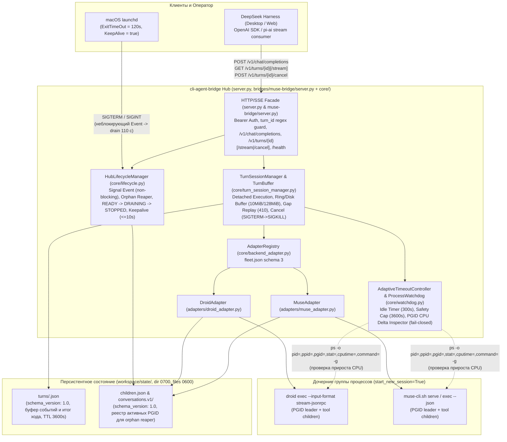
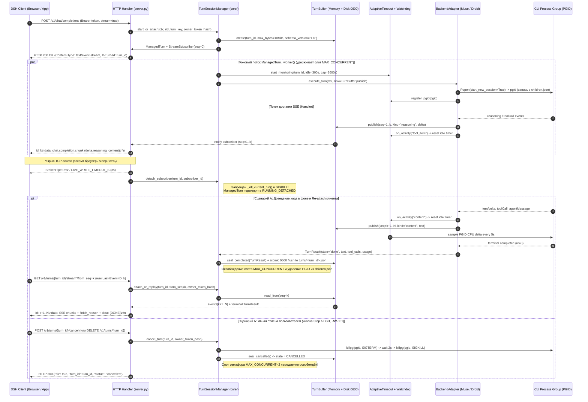
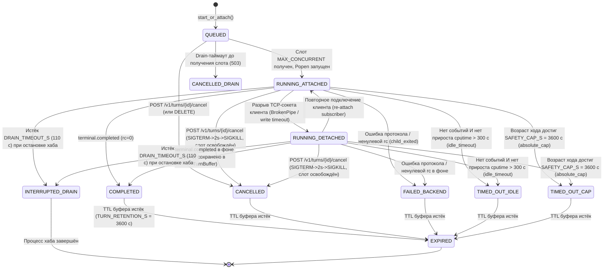

# Архитектурная спецификация: Сквозная отказоустойчивость мостов консольных агентов (`cli-agent-bridge`) в общем слое хаба

- **Задача:** `REQ-EYE-33873-RESILIENCE`
- **Run ID:** `dsh-bridge-resilience-20261017`
- **Критичность:** `S2`
- **Профиль:** `python-aisdlc-gcge`
- **Статус:** `DRAFT` (раунд доработки `a2` по брифам Архитектурного Совета `RW-001`..`RW-010`, `FU-001`..`FU-004`)
- **Связанный ADR:** `docs/adr/0005-resilient-hub-lifecycle-and-detached-turns.md`

---

## 1. Контекст, архитектурные драйверы и матрица трассируемости

Анализ инцидентов эксплуатации мостов DSH (`evidence-ledger.md`, факты `[F-01]`..`[F-34]`) выявил три системных класса отказов:

1. **Потеря активных ходов при разрыве клиентского соединения или перезапуске моста (`[F-01]`..`[F-13]`, `[F-33]`, `[F-34]`):**
   - При закрытии вкладки браузера, засыпании ноутбука, переключении пользователя в DSH или сетевом таймауте разрыв TCP-сокета вызывал немедленное уничтожение дочернего процесса модели (`_kill_current_run` / `_kill_group` / `client_gone`).
   - При перезапуске сервиса через `launchctl kickstart -k` процесс получал `SIGTERM` без обработчика в `muse-bridge` (`[F-01]`) либо с жёстким 4.5-секундным убийством активных ходов в `server.py` при дефолтном 5-секундном `ExitTimeOut` `launchd` (`[F-07]`, `[F-08]`), что приводило к ошибке `upstream stream ended before a completion event (TRANSPORT)` (`[F-10]`, `[F-32]`).
2. **Слепой абсолютный дедлайн хода без учёта реальной активности потомка (`[F-16]`..`[F-26]`):**
   - Чтение потока событий (`read_msg` / `watch`) ограничивалось только абсолютным временем жизни хода (`1800 - 35 = 1765 с`).
   - Три боевых сбоя (`[F-21]`, `[F-22]`, `[F-23]`) оборвали длительные ходы с активными вызовами инструментов (последние события `tool_item` приходили за 8 с, 16 с и 79 с до убийства процесса, `[F-24]`). При этом `proc.poll()` не отслеживал ни CPU/I/O группы процессов, ни дочерние PID инструментов (`[F-17]`), а логи параллельных ходов при `MAX_CONCURRENT=2` не содержали `rid` запроса (`[F-24]`).
3. **Ошибка шаблонизации `{{cwd}}` в профиле DSH Web (`[F-27]`..`[F-31]`):**
   - В `~/.dsh/profiles/web/cordis.patch.yml` секция `deployment:persona-suffix` использовала переменную `{{cwd}}`, тогда как реестр шаблонизатора DSH для этой секции допускает только `provider` и `model` (`[F-29]`).

### 1.1. Обязательные архитектурные директивы владельца (REQ-001..REQ-005) и трассируемость (FU-001)

| Требование | Архитектурное решение (Канон пакета) | Модули и контракты | Сценарии качества и риски | Верификация |
|---|---|---|---|---|
| **REQ-001:** Detached Execution, Session Buffering, Cancel & Gap Replay | **AD-001** (фоновое доведение хода, буфер `10 МиБ`, `POST /v1/turns/<id>/cancel`, `410 GAP_DETECTED`, точный `turn_key`) | `core/turn_session_manager.py`, `server.py` (`CD-002`, `CD-006`, `BND-001`, `BND-002`) | `QA-002`, `RISK-001`, `RISK-002`, `THREAT-001`..`THREAT-004` | `VER-001`, `VER-006` |
| **REQ-002:** Adaptive Idle Timeout (`300 с`) + Safety Cap (`3600 с`) + `ProcessWatchdog` | **AD-002** (приращение `cputime` и события протокола, fail-closed `ps`, запрет сброса таймера спящими процессами) | `core/watchdog.py` (`CD-003`, `BND-003`) | `QA-003`, `QA-004`, `RISK-003`, `RISK-005`, `RISK-007` | `VER-002`, `VER-006` |
| **REQ-003:** Common Hub Layer & Shared `core.*` Packaging | **AD-003** (реализация в `core/` и `server.py` без зависимости `TurnSessionManager` от `tool_emulation`, поставка `core.*` в `muse-bridge`) | `core/backend_adapter.py`, `server.py`, `bridges/muse-bridge/server.py` (`CD-001`, `BND-001`..`BND-005`) | `QA-004`, `QA-006`, `RISK-008` | `VER-004`, `VER-006`, `VER-007` |
| **REQ-004:** Graceful Shutdown, Non-blocking Signal Drain & Orphan Reaper | **AD-004** (неблокирующий `SIGTERM`/`SIGINT` через `threading.Event`, drain `110 с` в фоновом потоке, зачистка сирот по `children.json` на старте) | `core/lifecycle.py`, `launchd plist` (`CD-004`, `BND-004`) | `QA-001`, `QA-006`, `RISK-004`, `RISK-006` | `VER-003`, `VER-006` |
| **REQ-005:** DSH Web Profile `{{cwd}}` Fix | **AD-005** (удаление `{{cwd}}` из `deployment:persona-suffix`, передача через `AGENTS.md` и `DSH_CWD`) | `~/.dsh/profiles/web/cordis.patch.yml` (`CD-005`) | `QA-005` | `VER-005` |

---

## 2. C4 Container & Component View (Common Hub Layer)

### 2.1. C4 Container Diagram и механизм поставки `core.*` (RW-008)



#### Механизм поставки и разрешения импортов `core.*` в `bridges/muse-bridge/server.py` (RW-008)
Для того чтобы процесс `bridges/muse-bridge/server.py` гарантированно находил пакет `core.*` как при запуске из дерева репозитория (`<repo>/bridges/muse-bridge/server.py`), так и при изолированном запуске из `~/.dsh/bridges/muse-bridge/server.py`:
1. **Автоматический bootstrap `sys.path` при старте `bridges/muse-bridge/server.py`:**
   В прологе модуля до первого `from core... import ...` выполняется детерминированная резолюция корня `cli-agent-bridge`:
   ```python
   _BRIDGE_ROOT = os.environ.get("DSH_BRIDGE_ROOT")
   _CANDIDATES = [
       Path(_BRIDGE_ROOT).resolve() if _BRIDGE_ROOT else None,
       Path(__file__).resolve().parent,          # если рядом лежит симлинк/пакет core/
       Path(__file__).resolve().parents[2],      # корень репозитория cli-agent-bridge
   ]
   for _cand in _CANDIDATES:
       if _cand and (_cand / "core" / "backend_adapter.py").is_file():
           if str(_cand) not in sys.path:
               sys.path.insert(0, str(_cand))
           break
   ```
2. **Инсталляционный инвариант для `~/.dsh/bridges/muse-bridge/`:**
   При развёртывании в `~/.dsh/bridges/muse-bridge/` поддерживается симлинк `~/.dsh/bridges/muse-bridge/core -> <repo>/core`, а в `~/Library/LaunchAgents/com.user.dsh-muse-bridge.plist` дополнительно фиксируется переменная окружения `DSH_BRIDGE_ROOT=<repo>`.

### 2.2. C4 Component View и чистые границы модулей `core/` и `server.py` (FU-003)

> **Чистота абстракции (FU-003):** Из `core/turn_session_manager.py` полностью исключена зависимость от `core.tool_emulation`. Менеджер сессий оперирует абстрактными событиями `BufferedTurnEvent` и результатом `TurnResult`, а парсинг/эмуляция XML/JSON tool-вызовов остаётся ответственностью фасада `server.py` и адаптеров.

| Модуль / Компонент | Ответственность | Разрешённые зависимости | Запрещённые зависимости |
|---|---|---|---|
| `core/turn_session_manager.py` (`TurnSessionManager`, `ManagedTurn`, `TurnBuffer`, `StreamSubscriber`) | Отвязка выполнения хода от клиентского HTTP-сокета (detached run), формирование детерминированного `turn_key`, потокобезопасная кольцевая буферизация чанков `(seq, kind, payload)` с passthrough неизвестных типов событий, атомарная запись снимков (`schema_version: "1.0"`, права `0600`), replay с проверкой выпадения из окна (`410 GAP_DETECTED`), явная отмена хода (`cancel_turn` -> `CANCELLED`, `SIGTERM`->`SIGKILL`, немедленное освобождение слота `MAX_CONCURRENT`). | Python stdlib (`threading`, `queue`, `time`, `json`, `hashlib`, `uuid`, `pathlib`, `os`, `signal`, `re`, `dataclasses`, `typing`), `core.backend_adapter`, `core.watchdog` | `core.tool_emulation`, `http.server`, прямая работа с `socket.socket` или `BaseHTTPRequestHandler`, импорт `server` или конкретных `adapters.*` |
| `core/watchdog.py` (`AdaptiveTimeoutController`, `ProcessWatchdog`, `WatchdogMetrics`) | Двухуровневый контроль времени хода (`idle_timeout_s=300`, `safety_cap_s=3600`, `finish_reserve_s=35`), сброс таймера простоя **только** по событиям протокола или по положительному приросту CPU-времени (`cputime` delta) / появлению нового дочернего PID в `pgid`, fail-closed обработка ошибок/таймаутов `ps` на Darwin, сквозное логирование с `rid` и `turn_id`. | Python stdlib (`subprocess`, `os`, `signal`, `time`, `threading`, `dataclasses`, `re`) | `http.server`, `server`, `adapters.*`, `core.tool_emulation`, внешние пакеты вне stdlib (`psutil`) |
| `core/lifecycle.py` (`HubLifecycleManager`, `DrainState`, `KeepaliveController`) | Зачистка осиротевших процессов (`reap_orphans_on_startup`) по `children.json` на старте хаба; неблокирующий перехват `SIGTERM`/`SIGINT` через `threading.Event` (`shutdown_requested`); проведение drain (`DRAIN_TIMEOUT_S=110s`) и `server.shutdown()` в выделенном фоновом потоке; отказ новым запросам в `DRAINING` (`503 Retry-After: 5`); терминальный SSE-фрейм при принудительном завершении; генератор SSE keepalive (`<= 10 с`). | Python stdlib (`signal`, `threading`, `time`, `json`, `os`, `subprocess`, `pathlib`, `dataclasses`), `core.turn_session_manager` | Конкретные `adapters.*`, захват блокировок (`Lock`) или блокирующий I/O внутри signal handler, вызов `os._exit()` до завершения drain-цикла |
| `core/backend_adapter.py` (`BackendAdapter`, `TurnContext`, `TurnResult`, `AdapterRegistry`) | Контракт между фасадом/менеджером ходов и бэкендами. Расширяется полями `rid`, `turn_id`, `idle_timeout_s`, `safety_cap_s`, `on_activity`, `register_pgid` в `TurnContext` и ключами `idle_timeout_s`, `safety_cap_s` в `BACKEND_KEYS`. | Python stdlib (`abc`, `dataclasses`, `typing`, `threading`, `re`, `inspect`) | `server`, `adapters.*`, сетевой I/O |
| `server.py` (`Server`, `Handler`) и `bridges/muse-bridge/server.py` | HTTP/1.1 транспорт, валидация `turn_id` (`^[a-zA-Z0-9_-]{1,64}$`), Bearer-авторизация, `b_guard`, маршрутизация в `TurnSessionManager`, отдача SSE с полем `id: <seq>` и заголовком `X-Turn-Id`, эндпоинты `/v1/chat/completions`, `GET /v1/turns/<turn_id>`, `GET /v1/turns/<turn_id>/stream`, `POST /v1/turns/<turn_id>/cancel` (`DELETE /v1/turns/<turn_id>`), `/health`. | `core.backend_adapter`, `core.turn_session_manager`, `core.watchdog`, `core.lifecycle`, `core.tool_emulation`, `adapters` | Дублирование логики таймаутов, `killpg` при отсоединении клиента (при `DSH_BRIDGE_DETACHED_ENABLED=true`), блокирующие вызовы в signal handler |

---

## 3. Диаграмма последовательности: Detached Execution, Re-attach и Явная отмена (REQ-001, RW-001, FU-002)



---

## 4. Диаграмма состояний хода (`ManagedTurn` State Machine)



---

## 5. Контракт `TurnSessionManager`, `TurnBuffer`, отмены и защиты (REQ-001, RW-001, RW-002, RW-003, RW-006, RW-010, FU-002)

### 5.1. Структура `BufferedTurnEvent`, расширяемость и версионирование дампов (RW-010)
1. **Монотонная нумерация и открытый тип событий (`kind: str`):**
   Каждое событие хода получает строго возрастающий `seq: int` (`1, 2, ...`) внутри `ManagedTurn`:
   ```python
   KNOWN_EVENT_KINDS = frozenset({"reasoning", "content", "tool_call", "error", "done", "status"})

   @dataclass(frozen=True)
   class BufferedTurnEvent:
       seq: int
       ts: float
       kind: str  # открыт для passthrough неизвестных видов событий от новых бэкендов
       payload: Any
       byte_len: int
   ```
   - Если адаптер публикует событие с `kind`, не входящим в `KNOWN_EVENT_KINDS`, `TurnBuffer` **не** отбрасывает и **не** блокирует его, а сохраняет в кольцевом буфере и передаёт подписчикам как passthrough SSE-событие (`event: <kind>\nid: <seq>\ndata: <json>\n\n`).
2. **Версионирование дисковых снимков (`schema_version: "1.0"`):**
   - Каждый JSON-снимок хода `workspace/state/turns/<turn_id>.json` и файл реестра потомков `workspace/state/children.json` содержит обязательное корневое поле `"schema_version": "1.0"`.
   - Пример структуры `workspace/state/turns/<turn_id>.json`:
     ```json
     {
       "schema_version": "1.0",
       "turn_id": "turn_01j8x9k2m4",
       "turn_key": "a9f4...e12b",
       "status": "COMPLETED",
       "created_at": 1792250000.0,
       "updated_at": 1792250142.5,
       "oldest_available_seq": 1,
       "last_seq": 84,
       "reasoning_content": "...",
       "content": "...",
       "tool_calls": [],
       "usage": {"prompt_tokens": 120, "completion_tokens": 450, "total_tokens": 570},
       "error": null
     }
     ```
3. **Защита памяти (Bounded Ring Buffer):**
   - Суммарный объём событий одного хода в кольцевом буфере `TurnBuffer` ограничен `MAX_TURN_TEXT_BYTES = 10 MiB` (10 485 760 байт, настраивается env). При превышении 10 МиБ самые старые промежуточные события вытесняются из кольца с продвижением указателя `oldest_available_seq`, тогда как агрегированный результат (`reasoning_content`, `content`, `tool_calls`) продолжает накапливаться для финального снимка.
   - Глобальный лимит удерживаемых в памяти ходов ограничен `MAX_BUFFERED_TURNS = 128` и бюджетом `MAX_TURN_BUFFER_TOTAL_BYTES = 128 MiB` с LRU-выгрузкой завершённых ходов на диск (`workspace/state/turns/<turn_id>.json`, TTL `3600 с`).

### 5.2. Точный состав `turn_key` и защита от ложной дедупликации (RW-003)
1. **Детерминированная формула `turn_key`:**
   ```python
   turn_key_tuple = (
       os.path.normpath(ctx.cwd or default_workspace),   # 1. workspace
       str(ctx.model).strip(),                           # 2. model_id
       str(session_id_or_rid).strip(),                   # 3. session_id / prompt_cache_key / rid
       sha256_canonical_json(messages_including_last),   # 4. digest полной истории включая последнее user-сообщение
   )
   turn_key = hashlib.sha256(
       json.dumps(turn_key_tuple, ensure_ascii=False, separators=(",", ":")).encode("utf-8")
   ).hexdigest()
   ```
   Где `messages_including_last` включает все элементы массива `messages` (`role`, `content`, `tool_call_id`, `tool_calls`), в том числе полный текст последнего сообщения пользователя.
2. **Правило дедупликации vs перегенерации (Retry / Regenerate Guard):**
   - При поступлении `POST /v1/chat/completions` без заголовка `X-Turn-Resume-Id` дедупликация по `turn_key` присоединяет запрос **только** к активному (нетерминальному) ходу в состояниях `QUEUED`, `RUNNING_ATTACHED` или `RUNNING_DETACHED`.
   - Если ход с данным `turn_key` уже перешёл в любое терминальное состояние (`COMPLETED`, `CANCELLED`, `FAILED_BACKEND`, `TIMED_OUT_IDLE`, `TIMED_OUT_CAP`, `INTERRUPTED_DRAIN`), новый `POST /v1/chat/completions` гарантированно создаёт **новый** `ManagedTurn` с новым `turn_id` (поддержка кнопки Regenerate / повторного запуска с тем же промптом).
   - Для чтения результата уже завершённого хода клиент использует явный `GET /v1/turns/<turn_id>` или заголовок `X-Turn-Resume-Id: <turn_id>`.

### 5.3. Стандартизация заголовков, SSE `id:` и семантика Gap Replay (RW-006, FU-002)
1. **Единый заголовок `X-Turn-Id` и SSE `id: <seq>` (FU-002):**
   - Каждый ответ `/v1/chat/completions` и `/v1/turns/*` содержит HTTP-заголовок `X-Turn-Id: <turn_id>`.
   - Каждый SSE-кадр данных сопровождается стандартным полем `id: <seq>`:
     ```text
     id: 42
     data: {"id":"chatcmpl-...","object":"chat.completion.chunk",...}

     ```
   - При переподключении к `GET /v1/turns/<turn_id>/stream` начальный номер последовательности определяется как `max(int(query.from_seq or 0), int(headers.get("Last-Event-ID") or 0))`.
2. **Семантика Gap Replay при переполнении буфера 10 МиБ (RW-006):**
   - Если клиент запрашивает `from_seq` (через `?from_seq=N` или `Last-Event-ID: N`), и при этом `N < buffer.oldest_available_seq - 1` (то есть события `N+1 .. oldest_available_seq - 1` уже были вытеснены из кольцевого буфера 10 МиБ), сервер **запрещает** молчаливый пропуск чанков и возвращает:
     - Статус: `HTTP 410 Gone`
     - Заголовки: `X-Turn-Id: <turn_id>`, `X-Oldest-Available-Seq: <oldest_available_seq>`, `Content-Type: application/json`
     - Тело ответа:
       ```json
       {
         "error": {
           "code": "GAP_DETECTED",
           "type": "stream_gap_error",
           "message": "Requested from_seq has been evicted from the 10 MiB ring buffer; retrieve state snapshot via GET /v1/turns/<turn_id>",
           "turn_id": "<turn_id>",
           "requested_from_seq": 15,
           "oldest_available_seq": 64,
           "last_seq": 120,
           "snapshot_url": "/v1/turns/<turn_id>",
           "state_dump_path": "workspace/state/turns/<turn_id>.json"
         }
       }
       ```

### 5.4. Контракт явной отмены хода (RW-001)
- **Эндпоинты:** `POST /v1/turns/<turn_id>/cancel` и `DELETE /v1/turns/<turn_id>`.
- **Поведение:**
  1. Проверяется Bearer-авторизация и регулярное выражение `turn_id` (`^[a-zA-Z0-9_-]{1,64}$`). Если `turn_id` невалиден — `400 Bad Request`; если не найден — `404 Not Found`.
  2. Если ход активен (`QUEUED`, `RUNNING_ATTACHED`, `RUNNING_DETACHED`):
     - Состояние `ManagedTurn` переводится в `CANCELLED`, устанавливается флаг отмены (`ctx.client_gone()` становится `True`).
     - Зарегистрированной группе процессов `pgid` немедленно отправляется `os.killpg(pgid, signal.SIGTERM)`, через `2.0 с` при наличии живых процессов в группе — `os.killpg(pgid, signal.SIGKILL)`.
     - Слот семафора конкурентности `MAX_CONCURRENT=2` (`_slots` / `b_guard`) **немедленно освобождается**, а запись `pgid` удаляется из `children.json`.
     - В буфер записывается финальное событие `done`/`cancelled`, снимок сбрасывается на диск (`0600`).
  3. Возвращается ответ `HTTP 200 OK`:
     ```json
     {
       "ok": true,
       "turn_id": "<turn_id>",
       "status": "cancelled"
     }
     ```
     Вызов идемпотентен: повторный запрос отмены для уже отменённого хода возвращает `200 OK` с `"status": "cancelled"`.

### 5.5. Модель угроз и безопасность эндпоинтов `/v1/turns/*` и дампов (RW-002)
1. **Защита от Path Traversal (`THREAT-001`):**
   - Любой входящий `turn_id` из URL `/v1/turns/<turn_id>[/stream|/cancel]` и заголовка `X-Turn-Resume-Id` проверяется регулярным выражением `TURN_ID_RE = re.compile(r"^[a-zA-Z0-9_-]{1,64}$")`.
   - Любое значение, не прошедшее `TURN_ID_RE.fullmatch(turn_id)`, немедленно отвергается с `HTTP 400 Bad Request` (`code="invalid_turn_id"`) до обращения к файловой системе. Дополнительно при формировании пути к файлу проверяется `target_path.resolve().parent == turns_dir.resolve()`.
2. **Аутентификация и изоляция клиента (`THREAT-002`):**
   - Все эндпоинты `/v1/turns/<turn_id>`, `/v1/turns/<turn_id>/stream`, `POST /v1/turns/<turn_id>/cancel` и `DELETE /v1/turns/<turn_id>` защищены той же проверкой `Authorization: Bearer <token>` (через `hmac.compare_digest`), что и `/v1/chat/completions`.
   - При создании `ManagedTurn` сохраняется `owner_token_hash = sha256(bearer_token_or_local_peer)`. Чтение, стриминг и отмена хода разрешены только при совпадении `owner_token_hash` (иначе `HTTP 403 Forbidden`).
3. **Права доступа к файлам состояния (`THREAT-003`):**
   - Каталоги `workspace/state` и `workspace/state/turns` создаются с правами `0700` (`os.makedirs(..., mode=0o700, exist_ok=True)` + `os.chmod(..., 0o700)`).
   - Снимки `turns/<turn_id>.json` и `children.json` создаются атомарно через временный файл `os.open(tmp_path, os.O_WRONLY | os.O_CREAT | os.O_TRUNC, 0o600)` с последующим `os.replace(tmp_path, final_path)`, гарантируя права `0600` (чтение/запись только владельцу процесса).
4. **Санитизация секретов (`THREAT-004` / `RISK-005`):**
   - Перед сохранением снимка на диск и записью в лог диагностические поля ошибок и заголовков проходят через `_mask_secrets`.

---

## 6. Контракт `AdaptiveTimeoutController` и `ProcessWatchdog` (REQ-002, RW-005, FU-004)

### 6.1. Параметры таймаутов по умолчанию
- `IDLE_TIMEOUT_S = 300.0` (5 минут бездействия; переопределяется через `DROID_DSH_BRIDGE_IDLE_TIMEOUT_S` / `MUSE_BRIDGE_IDLE_TIMEOUT_S` или `backends[id].idle_timeout_s` в `fleet.json`).
- `SAFETY_CAP_S = 3600.0` (60 минут предохранительный потолок; переопределяется через `DROID_DSH_BRIDGE_TIMEOUT` / `MUSE_BRIDGE_TIMEOUT_S` или `backends[id].safety_cap_s`).
- `FINISH_RESERVE_S = 35.0` (резерв времени перед `SAFETY_CAP_S` для сброса накопленного буфера `reasoning_content` до закрытия потока).
- `WATCHDOG_INTERVAL_S = 5.0` (период опроса дерева процессов группы `pgid`).

### 6.2. Алгоритм оценки активности `ProcessWatchdog.sample(pgid)` (RW-005)
Каждые `WATCHDOG_INTERVAL_S` секунд (когда от stdout/stderr процесса нет новых байтов дольше `WATCHDOG_INTERVAL_S`):
1. Проверяется существование процессной группы `os.killpg(pgid, 0)`. Если группа не существует (`ProcessLookupError`), фиксируется терминал `child_exited`.
2. Выполняется неблокирующий системный опрос процессов группы с жёстким таймаутом `2.0 с`:
   `ps -o pid=,ppid=,pgid=,stat=,cputime=,command= -g <pgid>`.
3. Для каждого живого `pid` в группе парсится поле `cputime` (`[[dd-]hh:]mm:ss.xx`) в секунды `cpu_s[pid]` и вычисляется:
   - `cpu_delta = sum(max(0.0, cpu_s[pid] - prev_cpu_s.get(pid, 0.0)) for pid in cpu_s)`: суммарное приращение CPU-времени процессов группы с прошлого замера.
   - `new_descendants = set(descendant_pids) - seen_descendant_pids`: множество **новых** дочерних PID инструментов, порождённых с момента прошлого замера (`seen_descendant_pids.update(descendant_pids)`).
4. **Строгое условие сброса `idle_timeout` (RW-005):**
   - `last_activity_ts` обновляется до `time.monotonic()` **ТОЛЬКО** если:
     - поступило событие протокола (`on_activity` от stdout/stderr/JSON-RPC), **ИЛИ**
     - зафиксировано реальное потребление CPU: `cpu_delta > 0.0`, **ИЛИ**
     - в текущем такте появился новый дочерний процесс инструмента (`len(new_descendants) > 0`).
   - **Запрет утечки активности на спящих потомках:** Если дочерний процесс (`sleep`, `bash` в ожидании `stdin`, зависший сетевой сокет без чтения) уже существовал на прошлых тактах (`new_descendants == set()`) и не потребляет CPU (`cpu_delta == 0.0`), `last_activity_ts` **НЕ** обновляется. Такой зависший процесс гарантированно прерывается через `IDLE_TIMEOUT_S = 300 с`.
5. Если `now - started_at >= SAFETY_CAP_S - FINISH_RESERVE_S`:
   - Срабатывает `absolute_cap`: сбрасывается накопленный `reasoning_content`, группа процессов завершается, возвращается ошибка с кодом `absolute_cap` (`detail="turn reached safety cap of 3600s"`).
6. Если `now - last_activity_ts >= IDLE_TIMEOUT_S`:
   - Срабатывает `idle_timeout`: сбрасывается накопленный `reasoning_content`, группа процессов завершается, возвращается ошибка с кодом `idle_timeout` (`detail="turn idle timeout: no events or CPU activity for 300s"`).

### 6.3. Fail-Closed поведение при сбое или таймауте `ps` на Darwin (FU-004)
- Если вызов `ps` превышает таймаут `2.0 с` (`subprocess.TimeoutExpired`), завершается с `returncode != 0` или выбрасывает `OSError`:
  - `ProcessWatchdog` действует строго по принципу **fail-closed**: сбой мониторинга **не** считается активностью и **не** сбрасывает `last_activity_ts`.
  - В журнал записывается предупреждение с `rid`, `turn_id`, `pgid` и кодом `watchdog_ps_degraded`.
  - В этом состоянии сброс `idle_timeout` продолжает работать по протокольным событиям stdout/stderr (`on_activity`).

---

## 7. Контракт `HubLifecycleManager`: Orphan Reaper, Неблокирующие Сигналы и Drain (REQ-004, RW-004, RW-007)

### 7.1. Зачистка осиротевших процессов при старте хаба (`Orphan Reaper`, RW-004)
1. **Регистрация активных групп в `workspace/state/children.json`:**
   - При каждом запуске дочерней группы (`start_new_session=True`) в `children.json` (`schema_version: "1.0"`, права `0600`) атомарно записывается элемент `{"pgid": pgid, "pid": pid, "turn_id": turn_id, "started_at": ts, "executable": binary_name}`. При штатном завершении или отмене хода запись удаляется.
2. **Процедура `reap_orphans_on_startup()` на старте хаба:**
   - При инициализации `HubLifecycleManager` (до привязки HTTP-порта) читается `workspace/state/children.json`.
   - Для каждой оставшейся записи (свидетельствующей об аварийной гибели предыдущего инстанса моста по `SIGKILL` или панике):
     1. Проверяется наличие процесса/группы через `os.kill(pid, 0)` / `os.killpg(pgid, 0)`.
     2. Если процесс жив, через `ps -o comm=,command= -p <pid>` проверяется, что имя процесса соответствует целевым CLI-агентам моста (`muse`, `droid`, `node`, `python`, `bash`), исключая убийство постороннего процесса при переиспользовании PID операционной системой.
     3. Подтверждённой осиротевшей группе отправляется `os.killpg(pgid, signal.SIGTERM)`, через `1.0 с` — `os.killpg(pgid, signal.SIGKILL)`.
     4. В лог выводится запись `orphan_reaped pgid=<pgid> turn_id=<turn_id>`.
   - После зачистки файл `children.json` перезаписывается пустым списком `{"schema_version": "1.0", "children": []}`.

### 7.2. Неблокирующая обработка сигналов `SIGTERM`/`SIGINT` через `threading.Event` (RW-007)
1. **Асинхронно-безопасный обработчик сигналов в главном потоке:**
   - Обработчик `signal.signal(signal.SIGTERM, _handle_signal)` и `signal.SIGINT` в главном потоке **не захватывает никаких блокировок (`threading.Lock` / `RLock` / `Condition`)**, не вызывает `server.shutdown()` и не выполняет блокирующий I/O:
     ```python
     def _handle_signal(self, signum: int, _frame: Any) -> None:
         self._last_signal = signum
         self.shutdown_requested.set()  # threading.Event.set() — единственная операция
     ```
2. **Выделенный фоновый поток-координатор drain (`_drain_worker_thread`):**
   - При старте `HubLifecycleManager` запускается выделенный поток `_drain_worker_thread`, ожидающий `self.shutdown_requested.wait()`.
   - Как только `shutdown_requested` установлен:
     1. Поток переводит атомарный флаг состояния в `DRAINING`.
     2. Вызывает `TurnSessionManager.wait_for_active_turns(timeout=DRAIN_TIMEOUT_S)` (`110.0 с`).
     3. Если к истечению `DRAIN_TIMEOUT_S = 110 с` остаются активные ходы, рассылает всем активным SSE-подписчикам накопленный `reasoning_content`, затем финальный чанк ошибки (`code="drain_timeout"`, `message="bridge restart drain timeout exceeded"`) и `data: [DONE]\n\n`, после чего гасит оставшиеся группы процессов (`SIGTERM` -> `2 с` -> `SIGKILL`).
     4. Вызывает `server.shutdown()` в этом же фоновом потоке, разблокируя `server.serve_forever()` в главном потоке для чистого выхода с кодом `0`.

### 7.3. Конфигурация `launchd` и поведение HTTP-сервера в состоянии `DRAINING`
1. В `~/Library/LaunchAgents/com.user.dsh-muse-bridge.plist` и `com.user.dsh-droid-bridge.plist` устанавливается `<key>ExitTimeOut</key><integer>120</integer>`.
2. В состоянии `DRAINING`:
   - Любой новый `POST /v1/chat/completions` (не являющийся re-attach к уже бегущему ходу) получает `HTTP 503 Service Unavailable` с заголовком `Retry-After: 5` и телом `{"error": {"message": "bridge is draining for restart", "type": "overloaded", "code": 503}}`.
   - Запросы `GET /v1/turns/<turn_id>[/stream]` и `POST /v1/turns/<turn_id>/cancel` для текущих ходов продолжают обслуживаться до завершения drain.
   - `GET /health` возвращает `ok: False`, актуальный `active: <count>` и заголовок `X-Bridge-Draining: true` (в корневом `server.py` сохраняются строго 7 канонических ключей JSON-ответа `/health`).

---

## 8. Фичефлаги и операционное управление (Kill-Switch, RW-009)

Для мгновенного изолирования новых механизмов в эксплуатации без отката кода и без пересборки окружения вводятся три переменные окружения (значения `1/true/yes/on` включают режим, `0/false/no/off` переводят в консервативный fallback):

| Переменная окружения | По умолчанию | Поведение при `"false"` (Консервативный режим / Kill-Switch) |
|---|---|---|
| `DSH_BRIDGE_DETACHED_ENABLED` | `"true"` | Отключает фоновое удержание хода при разрыве сокета: при `BrokenPipeError` / отсоединении клиента ход немедленно завершается как в легаси-режиме; эндпоинты `/v1/turns/*` возвращают `501 Not Implemented`. |
| `DSH_BRIDGE_WATCHDOG_ENABLED` | `"true"` | Отключает опрос `ps` в `ProcessWatchdog` и адаптивный `idle_timeout`; действует только классический потолок `SAFETY_CAP_S - FINISH_RESERVE_S`. |
| `DSH_BRIDGE_DRAIN_ENABLED` | `"true"` | Отключает 110-секундное ожидание в `HubLifecycleManager`: по сигналу `SIGTERM` сервер немедленно закрывает активные группы процессов и вызывает `server.shutdown()`. |

---

## 9. Исправление шаблонизации профиля DSH Web (`REQ-005`)

- В файле `~/.dsh/profiles/web/cordis.patch.yml` (строки 51–55, `[F-28]`) удаляется ключ `suffix: Your working directory is {{cwd}}.` из секции плагина `persona` внутри `preset-standard`, приводя конфигурацию к паритету с профилем `desktop` (`[F-27]`), где зарегистрированы только переменные `provider` и `model` (`[F-29]`).
- Рабочий каталог передаётся модели стандартным путём через `extra_body.cwd` запроса DSH (обрабатывается мостом в `_work_dir_for`), инструкции `AGENTS.md` проекта и переменную окружения `DSH_CWD`.
