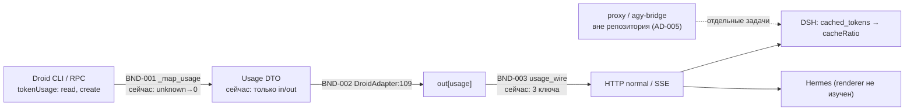
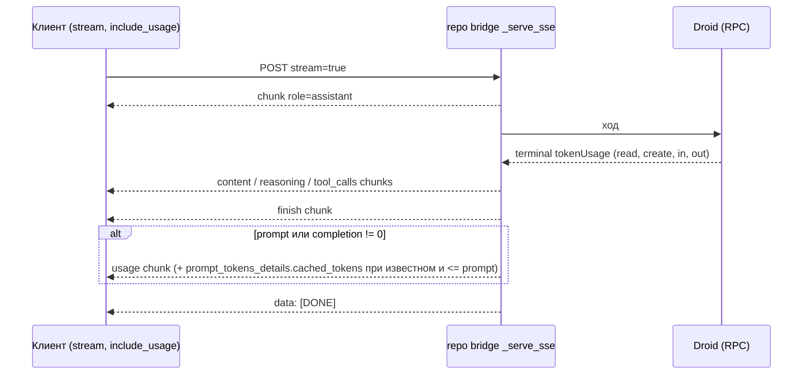
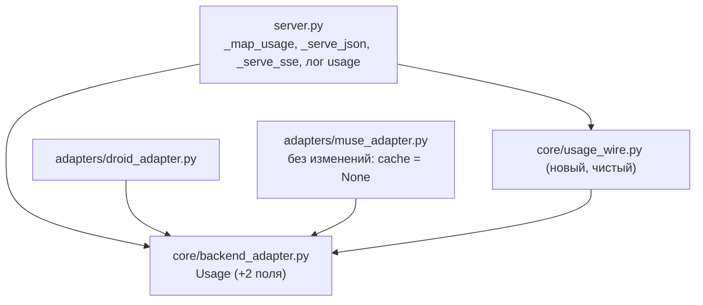

# Architecture Packet: REQ-CACHE-001 — телеметрия cache hit в мостах

Критичность S2, профиль python-aisdlc-gcge, статус пакета DRAFT. Машинная форма: `architecture/architecture-packet.json` (источник истины), этот файл — для Совета Тимлидов. Входы: `analysis/cache-hit-telemetry/` (факты [F-01]..[F-36], не переисследовались; ключевые факты repo bridge перепроверены по коду 2026-10-12).

## 1. Суть решения

Мост уже получает cache-счётчики от Droid, но теряет их на трёх стыках: `_map_usage` превращает «нет данных» в 0, DTO `Usage` хранит только input/output, сериализаторы normal и SSE отдают три ключа. Клиент DSH ждёт `usage.prompt_tokens_details.cached_tokens` и сам считает процент.

Решение: сохранить значение на всём пути и отдать его одним аддитивным полем в стандартном месте OpenAI. Ничего не синтезировать: unknown остаётся отсутствием поля, явный ноль остаётся нулём.

| Слой | Сейчас | Станет |
|---|---|---|
| RPC mapper `_map_usage` (server.py) | missing/нецелое → 0 | cache-поля `int \| None`, unknown = None (AD-002) |
| DTO `Usage` (core/backend_adapter.py) | input, output | + `cache_read_tokens`, `cache_creation_tokens` (`int \| None`) |
| `DroidAdapter` (adapters/droid_adapter.py:109) | передаёт 2 поля | передаёт 4 поля |
| Сериализатор (normal и SSE) | prompt/completion/total | + `prompt_tokens_details.cached_tokens` через `core/usage_wire.py` (AD-001, AD-004) |
| SSE-финализация | один usage-chunk после finish, при ненулевых токенах | без изменений порядка и условия (AD-003) |
| Журнал `usage sess=` | input/output | + `cache_read` (целое или `-`) |

Дельта внешнего контракта одна (CD-001) и разрешена текущей задачей (бриф, EVD-015): необязательное поле в `usage`, существующие ключи не меняются.

## 2. Решения

| ID | Решение | Вид | Одобрение |
|---|---|---|---|
| AD-001 | Wire-формат: `usage.prompt_tokens_details.cached_tokens`; cache creation на wire не выдаётся (семантика не доказана, OPEN-02) | two-way | нужно (публичный контракт) |
| AD-002 | DTO и mapper хранят cache как `int \| None`; None = unknown | two-way | нет |
| AD-003 | SSE: тот же chunk, то же место и условие; gating по `include_usage` не вводится | two-way | нет |
| AD-004 | Единая чистая функция `core/usage_wire.py`: `prompt_tokens = input_tokens`; `cached_tokens` выдаётся только при `int`, `0 <= cached <= prompt`; иначе поле отсутствует, при `cached > prompt` пишется `usage_cache_inconsistent`; clamp запрещён | two-way | нет |
| AD-005 | В этом репозитории только repo bridge; proxy и agy-bridge — отдельные задачи с правом владельцев | two-way | нужно (запись вне репозитория) |

Отвергнутые альтернативы (кратко): Anthropic-ключи или `prompt_cache_hit_tokens` на верхнем уровне (DSH читает `prompt_tokens_details` первым [F-24]); clamp (маскирует ошибку знаменателя); `prompt_tokens = input + cache` (опирается на недоказанную exclusive-семантику); строгий gating `include_usage` (меняет текущее поведение моста без требования).

Скрытое ограничение, которое сохраняется: SSE-usage не шлётся при нулевых токенах, чтобы не появлялись ложные «0 tok/s / 0%» (комментарий в `server.py`).

## 3. Границы

| ID | Компонент | Ответственность | Запрещено |
|---|---|---|---|
| BND-001 | CLI stream parser (`_map_usage`) | извлечь usage хода, сохранить unknown | HTTP-формат, синтез cache, клиентская логика |
| BND-002 | DTO / TurnResult (`core`, `adapters`) | нести типизированный usage | импорт `server` из `core`/`adapters`, ratio, дефолт 0 для cache |
| BND-003 | HTTP/SSE serializer + `core/usage_wire.py` | собрать wire-usage одной функцией | нестандартные поля, hit percentage, gating без решения, содержимое сообщений в журнале |

## 4. Views

### VIEW-001 (context): путь cache-счётчиков и места потерь

### VIEW-002 (dynamic): финализация SSE

### VIEW-003 (component): что меняется в repo bridge

Зависимости однонаправленны: `adapters → core`, `server → core`; `core` не импортирует `server` (проверяет `tests/test_backend_contract.py`).

## 5. Качество

| ID | Качество | Сценарий и мера |
|---|---|---|
| QA-001 | reliability | cache read = N на ходе → `cached_tokens = N` на normal и SSE; 100% фикстур (N>0, явный 0, N=prompt); живой ход совпадает с журналом |
| QA-002 | reliability | один usage-chunk перед `[DONE]`, `[DONE]` последний; 0 нарушений на 20 последовательных и 4 параллельных потоках (размеры — тестовый дизайн, не NFR) |
| QA-003 | compatibility | при cache unknown usage идентичен текущему; полный `python3 -m unittest` зелёный; Hermes без регрессии |
| QA-004 | testability | таблица unknown/0/N/N>prompt/bool/str/отрицательное; каждый тест красный на нетронутом коде |
| QA-005 | operability | строка `usage sess=` содержит `cache_read`, без текста сообщений |

Численных NFR (p95/p99, TTFT, hit ratio) в входах нет (OPEN-07), пороги не придуманы.

## 6. Эволюция

- Совместимость: поле аддитивно и опционально; порядок SSE-кадров и условие выдачи не меняются.
- Миграция: `NOT_APPLICABLE` — usage не персистится (в `server.py` встречается только в mapper, `_run_once`/`_execute`, логе и сериализаторах), схем и данных нет.
- Rollout: красные тесты (с расширением `fake_droid.py` cache-полями) → `core/usage_wire.py`, DTO, mapper, adapter → сериализаторы и лог → полный unittest, ruff, basedpyright → перезапуск моста в окно владельца (рестарт закрывает резидентные процессы Droid, hot-сессии восстанавливаются по plan restore) → живые проверки VER-005..009.
- Rollback: откат коммита и перезапуск моста; поле исчезает, данные не преобразуются.

Threat model не требуется: нет auth, PII, новой trust boundary или внешней поверхности; передаются числовые счётчики (`risk_triggers` пуст).

## 7. Риски

| ID | Риск | Вер. / влияние | Митигация и проверка |
|---|---|---|---|
| RISK-001 | input_tokens exclusive от cache (ASM-001 неверен) | средняя / средняя | инвариант `cached <= prompt`, видимый slug, живая проверка; смена формулы одной точкой через новый delta (VER-001, VER-005) |
| RISK-002 | DSH скрывает 0/unknown (positive-only [F-26]) | высокая / низкая | ограничение клиента вне scope; значение в журнале (VER-007) |
| RISK-003 | Hermes реагирует на новое поле (OPEN-06) | низкая / средняя | аддитивность, живая проверка, откат (VER-008) |
| RISK-004 | DSH ходит через proxy, а не repo bridge (OPEN-05) | средняя / высокая | установить endpoint до сдачи; proxy отдельной задачей (VER-007) |
| RISK-005 | регрессия порядка SSE или ложные 0 tok/s | низкая / высокая | меняется только содержимое usage; тесты порядка и нулевого usage (VER-002, 006, 009) |
| RISK-006 | fake_droid без cache → тесты зелёные вхолостую | средняя / высокая | расширить fake_droid; red → green (VER-001, 002) |
| RISK-007 | cache_read накопительный по процессу (OPEN-02) | низкая / средняя | сравнить ход 1 и ход 2 в hot-сессии с журналом (VER-005) |

## 8. Verification surface (заморожена до Coder)

| ID | Что проверяет | Команда / gate | Владелец |
|---|---|---|---|
| VER-001 | mapper, DTO, usage_wire, adapter (таблица случаев) | `python3 -m unittest tests.test_cache_usage -v` | verifier |
| VER-002 | normal и SSE с fake_droid, порядок кадров, лог | `python3 -m unittest tests.test_bridge_http -v` | verifier |
| VER-003 | полный набор | `python3 -m unittest` | verifier |
| VER-004 | форматирование, линт, типы | `.venv/bin/ruff format --check . && .venv/bin/ruff check . && .venv/bin/basedpyright` | verifier |
| VER-005 | живой normal-ход ×2, сверка с журналом | curl-цикл из JSON-пакета | verifier |
| VER-006 | живой SSE: один usage, `[DONE]` последний | `curl -sN … \| grep -E '"usage"\|\[DONE\]'` | verifier |
| VER-007 | рабочий чат DSH владельца, 2 хода, endpoint, UI и журнал | ручной gate | owner |
| VER-008 | Hermes Desktop без регрессии | ручной gate | owner |
| VER-009 | 4 параллельных SSE-потока | curl-цикл из JSON-пакета | verifier |
| VER-010 | граница adapters → core | `python3 -m unittest tests.test_backend_contract -v` | verifier |

Раннер репозитория — `unittest` (в репозитории нет `pyproject.toml` и pytest), поэтому вместо `pytest` из брифа указан он (EVD-013). Полные curl-команды — в `architecture-packet.json`.

## 9. Вопросы владельцу и допущения

БЛОКЕР (только ветка agy; Droid-путь от него не зависит):
- Q-001 / OPEN-01: какие cache-поля и единицы приходят в agy `result.usage`? Нужен обезличенный sample. Решение Совета: ответить или явно вынести agy из scope (в approved-версии `blocking=false`).

МОЖНО ПРОДОЛЖИТЬ (приняты явные допущения):
- ASM-001 / Q-002 (OPEN-02): `input_tokens` включает cache read. Если нет, wire-поле отсутствует (не искажено) до нового delta.
- ASM-002 / Q-003 (OPEN-05): DSH ходит к Droid через repo bridge. Проверка — VER-007.
- Q-004 (OPEN-06): отображение Hermes. Q-005 (OPEN-09): владельцы proxy и agy-bridge, право на запись вне репозитория. Q-006 (OPEN-07): NFR baseline.

Одобрение Совета нужно по AD-001 (расширение публичного контракта) и AD-005 (разбиение на задачи вне репозитория).

## 10. Вне scope (deferred)

agy cache (ждёт OPEN-01); proxy SSE usage и `prompt_tokens_details` (отдельная задача); cache creation на wire (OPEN-02); hit percentage на стороне моста; gating по `stream_options.include_usage`; численные NFR.

## 11. Статус сдачи

ПРОВЕРЕНО ЛЁГКИМ: структурная валидация пакета `validate_architecture_packet.py --phase draft`; выборочная перепроверка фактов repo bridge по коду; базовая линия `ruff format --check` и `ruff check` зелёные.
ПРОВЕРЕНО ТЯЖЁЛЫМ: ничего (архитектурная роль read-only; живые сценарии заморожены в VER-005..009).
НЕ ПРОВЕРЕНО: ASM-001, ASM-002, OPEN-01, OPEN-02, OPEN-05..OPEN-09; базовая линия `python3 -m unittest` и `basedpyright` не запускалась. Реализация не начата, слова «готово» и «работает» к runtime неприменимы.
