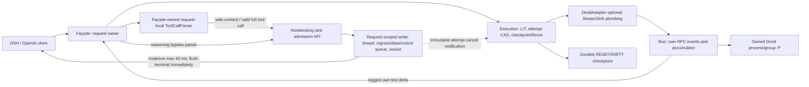

Ты — Реалист. Твоя задача — оценить практичность, реализуемость, баланс между идеальной теорией и инженерными затратами. Ключевой вопрос: «Как это сделать надёжно и просто без избыточного усложнения?» Фокусируйся на инженерной простоте, существующих абстракциях и соответствии текущей кодовой базе.

ВНИМАНИЕ: Ты — судья независимого пересчета сида (наименьший ранг 0560bb9f среди судей раунда).
В САМОМ НАЧАЛЕ ответа выведи строго строку:
SEED_RECHECK: seed_input="50c615a4#dsh-realtime-streaming#c1#R1" seed_hex=4adcf124 ranked_order_ok=да; rank(slot)=SHA-256(SEED + '#' + slot_id)


Оцени ВСЕ 6 критериев. При FAIL давай СРАЗУ ВСЕ советы по исправлению (список конкретных действий).

ФОРМАТ ОТВЕТА (строго):
1. КОРРЕКТНОСТЬ: VERDICT=PASS|FAIL
   WHY=<обоснование>
   СОВЕТЫ (при FAIL): <список конкретных действий>
2. ПОЛНОТА: VERDICT=PASS|FAIL
   WHY=<обоснование>
   СОВЕТЫ (при FAIL): <список конкретных действий>
3. РЕАЛИЗУЕМОСТЬ: VERDICT=PASS|FAIL
   WHY=<обоснование>
   СОВЕТЫ (при FAIL): <список конкретных действий>
4. РИСКИ: VERDICT=PASS|FAIL
   WHY=<обоснование>
   СОВЕТЫ (при FAIL): <список конкретных действий>
5. АЛЬТЕРНАТИВЫ: VERDICT=PASS|FAIL
   WHY=<обоснование>
   СОВЕТЫ (при FAIL): <список конкретных действий>
6. СООТВЕТСТВИЕ КОНТЕКСТУ: VERDICT=PASS|FAIL
   WHY=<обоснование>
   СОВЕТЫ (при FAIL): <список конкретных действий>
ОБЩИЙ ВЕРДИКТ: PASS|NEEDS WORK|RED FLAG

ЯКОРЯ ПАКЕТА (арх-проход; предмет — Architecture Packet, не diff)
Везде, где правила или формат ответа говорят «file:line», допустим один из якорей:
(а) architecture-packet.json:<N> — строка N поданной копии пакета;
(б) architecture-packet.json#<ID> — ID сущности пакета (AD-, QA-, VER-, EVD-, ASM-NNN, ID границы, contract delta, угрозы, риска);
(в) <файл proposals>:<N> — строка приложенного proposal-файла (ADR и др.);
(г) [F-NN] — факт из приложенного evidence ledger.
Цитата правила репозитория, ADR или architecture.md допустима, как и в правилах ниже. Якорь вне перечня или не существующий в поданных файлах ссылкой не считается.

РЕЖИМ: architecture
Оцени ВСЕ 6 критериев. Внутри каждого критерия выведи SUB-строки по подкатегориям:
SUB <критерий>/<подкатегория>: PASS|FAIL|N/A — evidence (якорь: architecture-packet.json#ID или строка)
Каждый FAIL должен иметь четкий issue ID (F-001, F-002, ...) и описание, почему это ломает систему.

ПРОВЕРКА УСТРАНЕНИЯ ЗАМЕЧАНИЙ СОВЕТА (VERIFY-FIXED для RW-001..RW-011):
Пакет доработан по итогам Раунда 1 (a1). Проверь устранение замечаний:
- RW-001 (F-001): Решения владельца (AD-001, AD-002, ASM-002) — необратимый partial prefix без отзыва, retry запрещен.
- RW-002 / RW-006 (F-002, F-006): Дедлайн cancellation fence (2 с на terminal, SIGTERM/SIGKILL pgid, возврат L/T в DIRTY).
- RW-003 / RW-007 / RW-011 (F-003, F-007, F-013): Режимы ToolCallParser: strict-live (0 тегов в content) строго при stream=true, non-stream fallback сохранен.
- RW-004 (F-004): DroidAdapter execute_turn(..., sse_writer=None) сквозной проброс StreamSink в pump.
- RW-005 (F-005): Usage chunk (finish_reason: null, честные cached_tokens без clamp, ровно один [DONE]).
- RW-008 (F-010): Владение компонентами: фасад владеет парсером, request thread владеет сокетом/очередью; коалесцирование 40 мс с flush перед финишем/ошибкой.
- RW-009 (F-011): Атомарный CAS attempt outcome, OpenAI-совместимый error chunk.
- RW-010 (F-012): Slow reader: лимит по байтам после коалесцирования, reserved control slot.

Критерии:
1. КОРРЕКТНОСТЬ:
   - Соответствие контракту OpenAI SSE streaming и Droid JSON-RPC streaming.
   - Освобождение блокировок L (аренда чата) и T (вычисление) сразу после хода (инвариант RW-009).
   - Корректность streaming ToolCallParser: отсутствие утечки сырых тегов <tool_call> в пользовательский текст.
2. ПОЛНОТА:
   - Наличие всех решений (AD-001..004), границ (BND-001..003), контрактных дельт (CD-001).
   - Полнота verification surface (VER-001..012) и quality scenarios (QA-001..005).
3. РЕАЛИЗУЕМОСТЬ:
   - Простота и надежность реализации в server.py и adapters/droid_adapter.py.
   - Отсутствие новых внешних зависимостей.
4. РИСКИ:
   - Поведение при ошибках сети / обрыве соединения клиентом.
   - Медленный клиент (slow reader) и переполнение очереди SSE.
5. АЛЬТЕРНАТИВЫ:
   - Обоснованность выбора потокового стриминга вместо искусственной задержки между накопленными токенами.
6. СООТВЕТСТВИЕ КОНТЕКСТУ:
   - Сохранение честных cached_tokens без clamp.
   - Сохранение non-streaming режима без деградации.

ОБЩИЙ ВЕРДИКТ: PASS | NEEDS WORK | RED FLAG


---
# МАТЕРИАЛЫ ДЛЯ ОЦЕНКИ

## РАСПИСКА АРХИТЕКТОРА (receipts/architect.json)
```json
{
  "schema_version": "1.0",
  "task_id": "REQ-STREAM-001",
  "run_id": "dsh-realtime-streaming",
  "role": "architect",
  "revision": 2,
  "verdict": "DRAFT_VALIDATED",
  "status": "DRAFT_VALIDATED",
  "packet_status": "DRAFT",
  "approval": "APPROVED",
  "updated_at": "2026-10-13T07:59:31.239279+00:00",
  "previous_receipt_ref": "architecture/revision-1/architect.json",
  "role_plan": {
    "path": ".ai-team/runs/dsh-realtime-streaming/plans/architect-01.json",
    "sha256": "42683c28f85aefd375d23c6a89d110cfb1a017724c63d576ef6d9110b009c2ea"
  },
  "sha256_files": {
    ".ai-team/runs/dsh-realtime-streaming/plans/architect-01.json": "42683c28f85aefd375d23c6a89d110cfb1a017724c63d576ef6d9110b009c2ea",
    ".ai-team/runs/dsh-realtime-streaming/architecture/architecture-packet.json": "50c615a487279f1c6a4e3ac630ea5c200db266284dc724abb97d387181ca6cff",
    ".ai-team/runs/dsh-realtime-streaming/architecture/architecture-packet.md": "5f575f104be54fa7d65481ec315e27dd23da067815235acc021c0106e8c5c2a5",
    ".ai-team/runs/dsh-realtime-streaming/architecture/architecture-packet.delta.diff": "618a932385d1a1935761480b0910651c3ad2e14cd673a1326a258b6620ccae69",
    ".ai-team/runs/dsh-realtime-streaming/architecture/validation-revision-2.json": "2b8415968bc3a9ea01621ff86eef3f7df509da91db4898398a71d7587ceebc3a",
    ".ai-team/runs/dsh-realtime-streaming/architecture/validation-revision-2-pre.json": "7254427193107932a3a614ec66de7926ce2bc2e278a8f9a4fb4dd38a29c04a59",
    ".ai-team/runs/dsh-realtime-streaming/architecture/revision-2-integrity.json": "ad889ec5aa5a9a1f6f0081fd40cf3d23beb60b4f8767bab9931d6e44bf9ef761",
    ".ai-team/runs/dsh-realtime-streaming/architecture/revision-2-product-before.json": "1c395406942f9ec9474a4d4e4ad0f290c2f0db7dc4633e9b2a7ef071f7584416",
    ".ai-team/runs/dsh-realtime-streaming/architecture/revision-2-product-after.json": "1c395406942f9ec9474a4d4e4ad0f290c2f0db7dc4633e9b2a7ef071f7584416",
    ".ai-team/runs/dsh-realtime-streaming/architecture/revision-1/architecture-packet.json": "45ad8ef8babd776ca0f755c2c1c98fa045281879f0e15795459287bfcbb9cc8c",
    ".ai-team/runs/dsh-realtime-streaming/architecture/revision-1/architecture-packet.md": "b2b15c6fef39a174106e0826d9abd88e9713701186f02dbf599cbe0aa57cbd6e",
    ".ai-team/runs/dsh-realtime-streaming/architecture/revision-1/architect-01.json": "7ab8ceb917a3db0934df95c1b30fe70df2281d80ea90e6c989f8e114be01277d",
    ".ai-team/runs/dsh-realtime-streaming/architecture/revision-1/architect.json": "3a8c8629c38f99ceb7c5fd64b2a819916112878bf32eba63e8e8a35763d92abb"
  },
  "receipt_self_hash_excluded": true,
  "validation": {
    "argv": [
      "python3",
      "/Users/aazhiry1/Мой диск/skils/ai-sdlc/universal/architect-software-product/scripts/validate_architecture_packet.py",
      ".ai-team/runs/dsh-realtime-streaming/architecture/architecture-packet.json",
      "--phase",
      "draft",
      "--run-dir",
      ".ai-team/runs/dsh-realtime-streaming",
      "--role-plan",
      ".ai-team/runs/dsh-realtime-streaming/plans/architect-01.json"
    ],
    "exit_code": 0,
    "stdout": "PASS: architecture packet is valid for draft; sha256=50c615a487279f1c6a4e3ac630ea5c200db266284dc724abb97d387181ca6cff\n",
    "stderr": ""
  },
  "role_plan_binding_validation": {
    "validator": "validate_architecture_packet.py --phase draft --role-plan plans/architect-01.json",
    "exit_code": 0,
    "sha256_matches": true,
    "all_steps_done": true
  },
  "product_fingerprint": {
    "unchanged": true,
    "scope": "54 tracked/untracked nonignored product files excluding .ai-team, plus git index and branch; prior baseline M fleet.json and analysis/ retained",
    "manifest_before_ref": "architecture/revision-2-product-before.json",
    "manifest_after_ref": "architecture/revision-2-product-after.json",
    "product_file_count": 54,
    "index_before_sha256": "f02ca97cb638950700e166dada35571ad3c9c9a9015364b423a05b8c5128aa32",
    "index_after_sha256": "f02ca97cb638950700e166dada35571ad3c9c9a9015364b423a05b8c5128aa32",
    "baseline_branch": "dev",
    "final_branch": "dev",
    "checked_again_after_final_validator": true
  },
  "finding_ids_addressed": [
    "RW-001",
    "RW-002",
    "RW-003",
    "RW-004",
    "RW-005",
    "RW-006",
    "RW-007",
    "RW-008",
    "RW-009",
    "RW-010",
    "RW-011",
    "FU-001",
    "FU-002"
  ],
  "finding_acceptance": "SPECIFICATION_UPDATED; council re-review PENDING",
  "runtime_acceptance": "NOT_RUN",
  "product_checks_run": [],
  "product_implementation": "NOT_PERFORMED",
  "subagents_started": 0,
  "open_approval_decisions": [],
  "background_commands": [
    {
      "command": [
        "python3",
        "/Users/aazhiry1/Мой диск/skils/ai-sdlc/universal/architect-software-product/scripts/validate_architecture_packet.py",
        ".ai-team/runs/dsh-realtime-streaming/architecture/architecture-packet.json",
        "--phase",
        "draft",
        "--run-dir",
        ".ai-team/runs/dsh-realtime-streaming",
        "--role-plan",
        ".ai-team/runs/dsh-realtime-streaming/plans/architect-01.json"
      ],
      "pid": 40204,
      "pgid": 40204,
      "result_ref": ".ai-team/runs/dsh-realtime-streaming/architecture/validation-revision-2.json",
      "exit_code": 0
    },
    {
      "result_ref": ".ai-team/runs/dsh-realtime-streaming/architecture/validation-revision-2-pre.json",
      "exit_code": 0,
      "purpose": "Draft prevalidation before ROLE PLAN hash-link"
    }
  ],
  "risks": [
    "DSH recognition of chat.completion.chunk error extension and null-finish usage not runtime-verified.",
    "Fence2+1+1s, CAS races, queue/control budgets, tool continuation and full resource reclaim NOT_RUN. Unconfirmed death is explicit failure/quarantine.",
    "Requested TTFT/token rate not measured.",
    "Repeat council and approved architecture gate still required before Coder; this receipt is not ARCH_GATE_PASS."
  ],
  "remote_mr": "NOT_APPLICABLE: artifact-only Architect handoff; no product commit/push/merge"
}

```

## PANEL REWORK BRIEF A1 (handoff/panel-rework-brief-arch-a1.json)
```json
{
  "schema_version": "1.0",
  "run_id": "dsh-realtime-streaming",
  "teamlead_cycle": 1,
  "panel_slug": "dsh-realtime-streaming-arch-council-1-a1",
  "panel_verdict": "NEEDS_WORK",
  "summarizer_slot": "gpt-6.1-sol",
  "coder_entry": "fix-from-panel",
  "iteration_budget_note": "Arch panel round 1 returned NEEDS WORK. 11 blocking findings to be addressed by Architect.",
  "findings_total": 13,
  "instructions": [
    {
      "id": "RW-001",
      "priority": "blocking",
      "criterion": "КОРРЕКТНОСТЬ",
      "file": ".ai-team/runs/dsh-realtime-streaming/architecture/architecture-packet.json",
      "line_hint": "AD-001",
      "rule_ref": "REQ-STREAM-001; CD-001: неизменность уже отправленных SSE-кадров; запрет retry после необратимого prefix; owner_decision F-001 от 2026-10-13 10:15 MSK.",
      "action": "Отразить решение владельца «1 кажется да. главное что бы было по архитектуре. пусть архитектор говорит как делать.» как делегирование архитектурного выбора. Architect должен явно зафиксировать выбранную политику irreversible partial prefix, retract и non-prefix complete без отзыва отправленных кадров; согласовать AD-001, ASM-002, Q-001, CD-001, approval, evolution, RISK-001 и VER-010. Различить подтверждённое решение владельца, последующий выбор Architect и ещё не выполненные проверки; не утверждать, что error после partial автоматически совместим со всеми OpenAI-клиентами.",
      "acceptance": "Пакет содержит дословное решение владельца с датой и ссылкой на ledger F-001, явный архитектурный выбор для retract/non-prefix complete и его последствия для клиентов. Q-001/ASM-002 и approval не противоречат решению; нигде не остаётся ложного требования повторного согласования уже делегированного выбора. Отправленный prefix не отзывается, retry после установленной границы необратимости запрещён; runtime acceptance остаётся NOT_RUN.",
      "source": "SUB КОРРЕКТНОСТЬ/openai-sse-contract: FAIL [F-001] — AD-001 вводит fail-close при retract/non-prefix complete (error+DONE на уже отправленный prefix), чего нет в реальном контракте OpenAI SSE (OpenAI никогда не отзывает отправленные кадры). Решение прямо названо блокером (ASM-002, Q-001) и ещё не одобрено владельцем — то есть на уровне пакета контракт с OpenAI-клиентами пока не зафиксирован как совместимый (architecture-packet.json#AD-001, #ASM-002, #EVD-008).",
      "evidence": "architecture-packet.json#AD-001; architecture-packet.json#ASM-002; architecture-packet.json#EVD-008; architecture-packet.json#CD-001; architecture-packet.json#Q-001; architecture-packet.json#approval",
      "source_findings": [
        "F-001"
      ]
    },
    {
      "id": "RW-002",
      "priority": "blocking",
      "criterion": "КОРРЕКТНОСТЬ",
      "file": ".ai-team/runs/dsh-realtime-streaming/architecture/architecture-packet.json",
      "line_hint": "AD-003",
      "rule_ref": "RW-009 / EVD-009; BND-002: lease reuse только после own terminal или подтверждённой смерти процесса; EVD-006: join не доказывает process death.",
      "action": "Специфицировать cancellation fence как проверяемый протокол, а не обещание: владелец L/T и attempt id, источник подтверждения own terminal, подтверждение смерти принадлежащего attempt процесса/группы, порядок checkpoint/DIRTY и освобождения ресурсов, защита от late/foreign events и переиспользования lease до fence. Согласовать AD-003, BND-002, RISK-004, VER-005 и VER-011; добавить детерминированные барьеры проверки гонок без заявления о выполненной реализации.",
      "acceptance": "Пакет однозначно перечисляет допустимые доказательства fence, владельца каждого перехода и порядок release L/T/P. Для cancel/disconnect, late terminal и повторного key указаны fault-injection сценарии с оракулом: нет reuse до own terminal/подтверждённой смерти, нет отмены нового attempt, нет утечки ресурсов. Bounded join явно не считается доказательством смерти; непроведённые проверки помечены NOT_RUN.",
      "source": "SUB КОРРЕКТНОСТЬ/rw009-lock-release-under-race: FAIL [F-002] — для нормального завершения L/T освобождаются до drain (AD-003), но для гонки cancel/disconnect фиксация «own terminal или подтверждённая смерть процесса перед переиспользованием lease» — это ПРЕДЛОЖЕНИЕ поверх известного пробела (EVD-006: «Join сам по себе не доказывает process death»), а не реализованный факт; VER-011 — manual/NOT_RUN (architecture-packet.json#RISK-004, #VER-011, #EVD-006).",
      "evidence": "architecture-packet.json#AD-003; architecture-packet.json#BND-002; architecture-packet.json#RISK-004; architecture-packet.json#VER-011; architecture-packet.json#EVD-006",
      "source_findings": [
        "F-002"
      ]
    },
    {
      "id": "RW-003",
      "priority": "blocking",
      "criterion": "КОРРЕКТНОСТЬ",
      "file": ".ai-team/runs/dsh-realtime-streaming/architecture/architecture-packet.json",
      "line_hint": "AD-002",
      "rule_ref": "QA-002 / THREAT-001: 0 recognized tool XML bytes в live content; owner_decision F-003 от 2026-10-13 10:15 MSK; nonstream fallback сохраняется.",
      "action": "Внести то же подтверждённое делегирование владельца и зафиксировать выбранную Architect strict-live политику malformed/unclosed recognized XML только для stream=true. Согласовать AD-002, ASM-003, Q-002, approval, BND-003, QA-002, THREAT-001, RISK-002, CD-001 и VER-010: удержание recognized XML до valid complete call, stream error при malformed/unclosed, reasoning обходит parser, классический nonstream fallback сохраняется.",
      "acceptance": "Пакет содержит решение владельца с датой и ledger F-003, явный выбор strict-live, границу stream=true и оракул 0 байт recognized XML в live content. ASM-003/Q-002 и approval согласованы с делегированием; политика больше не оставлена условным PROPOSED/PENDING owner approval без решения Architect. Проверки split/malformed/unclosed перечислены, но не выданы за пройденные.",
      "source": "SUB КОРРЕКТНОСТЬ/tool-parser-no-leak: FAIL [F-003] — гарантия «0 тегов в live content» существует только как PROPOSED strict-policy (AD-002), требующая одобрения (ASM-003, Q-002); до одобрения baseline-поведение (malformed/unclosed XML → в текст) сохраняется, то есть защита от утечки сейчас не architecturally locked (architecture-packet.json#AD-002, #ASM-003).",
      "evidence": "architecture-packet.json#AD-002; architecture-packet.json#ASM-003; architecture-packet.json#Q-002; architecture-packet.json#BND-003; architecture-packet.json#QA-002",
      "source_findings": [
        "F-003"
      ]
    },
    {
      "id": "RW-004",
      "priority": "blocking",
      "criterion": "РЕАЛИЗУЕМОСТЬ",
      "file": ".ai-team/runs/dsh-realtime-streaming/architecture/architecture-packet.json",
      "line_hint": "AD-001",
      "rule_ref": "EVD-004: существующий StreamSink(kind,text)->bool; BackendAdapter.execute_turn; ADAPTER_API=1; CD-001: nonstream и другие adapters сохраняют buffered path.",
      "action": "Расписать технический plumbing _serve_sse → _dispatch → DroidAdapter.execute_turn → _run_once/_execute → обработчик собственных RPC-событий. Указать способ передачи optional StreamSink, сигнатуры/контракт вызова, типы incremental событий, обработку False/исключений и отмены, offsets и anti-duplicate final. Указать точную развилку stream=true versus sink=None/nonstream, сохраняя синхронный итог для persistence и nonstream; не оставлять выбор моста Coder.",
      "acceptance": "В AD-001/BND-002 приведена непрерывная цепочка интерфейсов от execute_turn до RPC-handler с источником каждого callback и семантикой возврата bool. Существующий sink действительно достигает incremental handler по спецификации; RPC не пишет в socket. Для sink=None описан прежний buffered finalize flow, ADAPTER_API=1 сохраняется; есть проверяемые сценарии delayed delta, suffix-only complete и отсутствия повторной final delivery.",
      "source": "SUB РЕАЛИЗУЕМОСТЬ/adapter-plumbing-gap: FAIL [F-004] — EVD-004 прямо фиксирует: «DroidAdapter его пока игнорирует, вызывает _run_once; изменение требует сквозного plumbing». Пакет не даёт технического моста (как _run_once синхронно превращается в incremental callback без поломки nonstream-пути) — это оставлено «Coder узнает по ходу», а не зафиксировано как архитектурное решение, что для S2-критичности и одного мейнтейнера stdlib-бриджа — реальный риск недооценки объёма работ (architecture-packet.json#EVD-004, #AD-001).",
      "evidence": "architecture-packet.json#EVD-004; architecture-packet.json#AD-001; architecture-packet.json#BND-002; architecture-packet.json#CD-001",
      "source_findings": [
        "F-004"
      ]
    },
    {
      "id": "RW-005",
      "priority": "blocking",
      "criterion": "КОРРЕКТНОСТЬ",
      "file": ".ai-team/runs/dsh-realtime-streaming/architecture/architecture-packet.json",
      "line_hint": "AD-004",
      "rule_ref": "QA-005 / CD-001 / EVD-011: однозначное завершение, single optional usage, честные prompt_tokens_details.cached_tokens, ровно один [DONE].",
      "action": "Зафиксировать точную JSON-форму finish- и usage-чанков, включая choices/delta/finish_reason и значение finish_reason в usage-чанке. Architect выбирает вариант, совместимый с фактическим DSH чтением usage, и объясняет, как исключается потеря usage или двойное завершение. Определить FIFO порядок и baseline zero/absent usage policy; cached_tokens передаются честно без clamp и без изменения normalize_prompt_cache_details. Согласовать AD-004, CD-001, QA-005, VER-007 и связанный VER-006.",
      "acceptance": "Пакет содержит конкретные примеры finish/usage кадров и явно выбранное значение finish_reason для usage, а не неопределённое optional usage. Проверка DSH учитывает выбранную форму: usage/cached_tokens прочитаны один раз, завершение учтено один раз, затем ровно один [DONE]; значения cached_tokens, включая превышение prompt_tokens, нулевые и отсутствующие поля, сохраняют baseline без clamp. Error path не выдаёт success finish/usage.",
      "source": "SUB КОРРЕКТНОСТЬ/OpenAI SSE и Droid JSON-RPC streaming: FAIL — architecture-packet.json#AD-004, architecture-packet.json#CD-001. F-001: успех описан как один finish_reason, затем отдельный optional usage, затем DONE. Сейчас usage едет во втором чанке, у которого finish_reason повторяется (server.py около _serve_sse). Пакет не говорит, какой finish_reason у usage-чанка. DSH читает usage из stream-chunk; пустой finish_reason: null на usage-чанке может потерять usage, повтор stop может задвоить завершение. Это ломает единственный путь, которым клиент получает cached_tokens.",
      "evidence": "architecture-packet.json#AD-004; architecture-packet.json#CD-001; architecture-packet.json#QA-005; architecture-packet.json#VER-007; architecture-packet.json#EVD-011",
      "source_findings": [
        "F-005"
      ]
    },
    {
      "id": "RW-006",
      "priority": "blocking",
      "criterion": "КОРРЕКТНОСТЬ",
      "file": ".ai-team/runs/dsh-realtime-streaming/architecture/architecture-packet.json",
      "line_hint": "AD-003",
      "rule_ref": "RW-009 / EVD-009: 5-й ход после 4 slow readers и повтор key; bounded cancellation fence; lease reuse запрещён без terminal/death.",
      "action": "Дополнить fence конкретным конечным дедлайном и фазами cancel/disconnect: interrupt/ожидание own terminal, затем SIGTERM и при необходимости SIGKILL только принадлежащей попытке группы процессов, подтверждение смерти и cleanup/release. Architect задаёт численные интервалы и суммарную верхнюю границу, описывает способ bounded waitpid и исход при невозможности подтвердить fence. Разделить release нормального committed хода до writer drain и release отменённого хода после fence; бесконечное ожидание и небезопасное reuse запрещены.",
      "acceptance": "В AD-003/QA-003/VER-005/VER-009/VER-011 указаны конечные интервалы interrupt→TERM→KILL→подтверждение смерти и верхняя граница возврата L/T. Сценарий terminal/ack never arrives имеет проверяемый исход без бесконечного wait и без release непогашенного attempt. Пакет сохраняет RW-009: обычный 5-й ход и повтор key не ждут slow writer drain; отдельно проверяет cancel с эскалацией и отсутствие утечки L/T/P.",
      "source": "SUB КОРРЕКТНОСТЬ/Освобождение L и T (RW-009): FAIL — architecture-packet.json#AD-003, architecture-packet.json#EVD-006. F-002: «release сразу после хода» и «checkpoint+L/T release before writer drain» несовместимы с fence. При precommit cancel L/T держатся до own terminal или waitpid. Если terminal не приходит, а waitpid не ограничен, аренда чата и слот вычисления не возвращаются, и RW-009 (5-й ход после 4 медленных) не выполняется. Дедлайна fence в пакете нет.",
      "evidence": "architecture-packet.json#AD-003; architecture-packet.json#EVD-006; architecture-packet.json#QA-003; architecture-packet.json#VER-005; architecture-packet.json#VER-009; architecture-packet.json#VER-011",
      "source_findings": [
        "F-006"
      ]
    },
    {
      "id": "RW-007",
      "priority": "blocking",
      "criterion": "КОРРЕКТНОСТЬ",
      "file": ".ai-team/runs/dsh-realtime-streaming/architecture/architecture-packet.json",
      "line_hint": "AD-002",
      "rule_ref": "EVD-005 / QA-002: malformed/unclosed fallback текущего ToolCallParser; AD-001 / QA-004: установленная граница необратимости и запрет silent retry.",
      "action": "Определить интерфейс отдельного strict-live режима ToolCallParser и поведение его feed/finish/error/reset, позволяющее удерживать malformed/unclosed XML без _flush_all/legacy text fallback в stream=true. Отдельно устранить неоднозначность «accepted queue payload = видимость»: описать состояния queued/sent/discarded, точку необратимости, политику retry и DIRTY при cancel до send. Если Architect сохраняет консервативный enqueue fence, назвать его консервативным и обосновать последствия, не приравнивая к фактической доставке клиенту.",
      "acceptance": "Пакет задаёт отдельный live parser contract: recognized XML никогда не проходит legacy fallback, complete valid call публикуется один раз, reasoning обходит parser. Для queued-but-unsent cancel явно определены outcome, retry и cleanup; queued/sent не смешаны. AD-001/AD-002/QA-004/VER-004/VER-006/VER-011 используют одну границу необратимости и проверяют обе стороны этой границы.",
      "source": "SUB КОРРЕКТНОСТЬ/ToolCallParser без утечки тегов: FAIL — architecture-packet.json#AD-002, architecture-packet.json#EVD-005. F-003: strict-live («malformed/unclosed recognized XML → error, 0 байт XML в content») нельзя получить переиспользованием текущего ToolCallParser без смены контракта. Сейчас незакрытый блок на finish() и невалидный блок отдаются в content (_flush_all, _emit(OPEN+inner+CLOSE)). Отдельного live-режима у парсера нет. Плюс «accepted queue payload = видимость» делает необратимым кадр, который клиент ещё не получил: cancel до send уже запрещает retry и оставляет DIRTY.",
      "evidence": "architecture-packet.json#AD-002; architecture-packet.json#EVD-005; architecture-packet.json#AD-001; architecture-packet.json#QA-004; architecture-packet.json#VER-004; architecture-packet.json#VER-011",
      "source_findings": [
        "F-007"
      ]
    },
    {
      "id": "RW-008",
      "priority": "blocking",
      "criterion": "РЕАЛИЗУЕМОСТЬ",
      "file": ".ai-team/runs/dsh-realtime-streaming/architecture/architecture-packet.json",
      "line_hint": "AD-003",
      "rule_ref": "BND-001/BND-002/BND-003: один владелец socket, parser в facade, parser без socket/RPC; QA-001: coalesce ≤40 ms; nonblocking StreamSink.",
      "action": "Установить единое нормативное описание ownership в JSON: facade владеет ToolCallParser; request-scoped writer worker владеет socket/queue/control reserve; Execution владеет L/T/attempt и persist. Определить кто создаёт, завершает и освобождает writer, как передаётся failure с immutable attempt id. Зафиксировать coalescing в writer thread с конечным таймером ≤40 ms, nonblocking enqueue из RPC и немедленным flush последнего pending chunk перед terminal/error. Согласовать AD-001/AD-003, boundaries и descriptions VIEW-001/VIEW-002 в пакете, устранив противоречия с описанными component/sequence views.",
      "acceptance": "В JSON для каждого компонента есть ровно один владелец и полный lifecycle writer/queue/control slot. Parser отсутствует в Run как владелец и не обращается к RPC/socket; writer не владеет L/T. Указаны источник таймера и flush перед success/error/close; short last chunk не ждёт остаток 40 ms. Verification scenarios проверяют FIFO, отсутствие RPC blocking и прекращение worker без утечки; VIEW descriptions согласованы с нормативным ownership.",
      "source": "SUB РЕАЛИЗУЕМОСТЬ/server.py и droid_adapter.py: FAIL — architecture-packet.json#VIEW-001, architecture-packet.json#AD-003. F-008: component view рисует parser внутри Run (R --> P), sequence рисует P -> W напрямую, BND-002 говорит «ToolCallParser in facade», а BND-003 запрещает парсеру socket/RPC. Три владельца одного компонента. Writer описан и как очередь, и как поток сокета, и как участник sequence, который шлёт failure в Execution. Кто создаёт поток, кто его останавливает и кто владеет reserved control slot, не названо. F-009: coalesce ≤40 мс требует таймера, а sink обязан быть nonblocking. Кто коалесцирует (RPC-поток, writer, третий таймер) и что происходит с последним чанком короче 40 мс перед terminal, не задано. Иначе последний токен задерживается, либо таймер блокирует RPC.",
      "evidence": "architecture-packet.json#VIEW-001; architecture-packet.json#VIEW-002; architecture-packet.json#AD-003; architecture-packet.json#BND-001; architecture-packet.json#BND-002; architecture-packet.json#BND-003",
      "source_findings": [
        "F-010"
      ]
    },
    {
      "id": "RW-009",
      "priority": "blocking",
      "criterion": "РИСКИ",
      "file": ".ai-team/runs/dsh-realtime-streaming/architecture/architecture-packet.json",
      "line_hint": "RISK-004",
      "rule_ref": "RISK-004 / AD-001: durable checkpoint до success finish; immutable attempt id; однократный CAS outcome; AD-004/CD-001: OpenAI-compatible error chunk.",
      "action": "Специфицировать атомарную state machine attempt outcome с однократным CAS между durable success и precommit cancellation/failure, включая окно own terminal → checkpoint. Указать победителя, persist failure, READY/DIRTY, fence/release и обработку запоздалого disconnect только как delivery abort после commit. Привести точный OpenAI chat.completion.chunk error envelope и порядок error→[DONE] best effort вместо неопределённого standard error frame/{error:err}; success finish/usage при неуспешном checkpoint запрещены.",
      "acceptance": "Пакет содержит переходы и точку CAS, делающие READY и DIRTY взаимоисключающими для одного attempt id. Barrier scenarios VER-011 охватывают disconnect до/во время/после checkpoint, двойной callback и persist failure; success разрешён только после durable checkpoint, поздний writer не отменяет переиспользованный процесс. JSON-пример error имеет явную chat.completion.chunk оболочку и проверяемую клиентом семантику ошибки/завершения без success finish/usage.",
      "source": "SUB РИСКИ/Обрыв соединения: FAIL — architecture-packet.json#RISK-004, architecture-packet.json#AD-001. F-010: post-commit disconnect «только delivery abort» не определён, если disconnect приходит в окне между own terminal и durable checkpoint. Два исхода (READY+release и DIRTY+fence) могут примениться к одному attempt id. Writer при этом уже мог принять prefix. Итог: либо success finish на незакоммиченном ходе, либо DIRTY после частичного READY. F-011: error-кадр пакета («standard error frame») не совпадает с текущим {\"error\": err} без OpenAI chunk-обёртки. Клиент, который ждёт chat.completion.chunk, не увидит ошибку и будет ждать finish.",
      "evidence": "architecture-packet.json#RISK-004; architecture-packet.json#AD-001; architecture-packet.json#AD-003; architecture-packet.json#AD-004; architecture-packet.json#VER-011; architecture-packet.json#CD-001",
      "source_findings": [
        "F-011"
      ]
    },
    {
      "id": "RW-010",
      "priority": "blocking",
      "criterion": "РИСКИ",
      "file": ".ai-team/runs/dsh-realtime-streaming/architecture/architecture-packet.json",
      "line_hint": "AD-003",
      "rule_ref": "QA-003 / EVD-007 / RW-009: bounded per-response/global memory, fast small chunks без ложного overflow; reserved control slot вне 1024 data frames.",
      "action": "Уточнить модель budgeting: размер encoded payload/JSON envelope и pending data frames после коалесцирования, bounded ingress до writer coalescing и атомарное резервирование global bytes до принятия данных. Объяснить как быстрые мелкие upstream deltas нормально читающего клиента не исчерпывают frame cap, пока writer коалесцирует. Развести queue, accumulator, thinking и tool XML budgets, согласовать 16 MiB per-response с 256 MiB global и параллельными чатами. Определить отдельный bounded control reserve вне лимита 1024 data frames, позволяющий error/DONE после discard; release reservation при send/discard/close идемпотентен.",
      "acceptance": "Пакет задаёт единицы, точки учёта и формулы per-response/global/ingress/coalesced queue budgets; никакой промежуточный буфер не неограничен. Control reserve явно не входит в 1024 data frames и имеет byte/global accounting. VER-005/VER-009 различают normal fast small chunks и настоящий slow-reader overflow, проверяют 4×3 MB + 5-й ход, thinking/tool XML и параллельное резервирование; error/DONE помещаются после discard либо socket закрывается по заданному deadline без утечки bytes.",
      "source": "SUB РИСКИ/Медленный клиент и очередь: FAIL — architecture-packet.json#AD-003, architecture-packet.json#QA-003. F-012: лимит 1024 кадра при coalesce 40 мс не защищает быстрый upstream. Пока writer спит на coalesce, RPC продолжает enqueue. Overflow отменяет ход, который клиент читает нормально, только чанки мелкие. 16 МиБ на ответ при глобальных 256 МиБ и нескольких чатах с thinking+tool XML упирается в глобальный резерв раньше, чем в очередь, и тоже отменяет ход. Reserved control slot не описан как неучитываемый в 1024, поэтому error/DONE могут не влезть после discard.",
      "evidence": "architecture-packet.json#AD-003; architecture-packet.json#QA-003; architecture-packet.json#BND-001; architecture-packet.json#RISK-003; architecture-packet.json#EVD-007; architecture-packet.json#VER-009",
      "source_findings": [
        "F-012"
      ]
    },
    {
      "id": "RW-011",
      "priority": "blocking",
      "criterion": "СООТВЕТСТВИЕ КОНТЕКСТУ",
      "file": ".ai-team/runs/dsh-realtime-streaming/architecture/architecture-packet.json",
      "line_hint": "AD-002",
      "rule_ref": "CD-001: nonstream committed-only без деградации; EVD-005/EVD-012: baseline malformed/unclosed XML fallback; server.py:_serve_json nonstream flow неизменен.",
      "action": "Зафиксировать явный выбор parser mode по stream=true: strict-live включается только на live Droid path; stream=false/sink=None использует прежний parser и finish fallback. Описать isolation на уровне экземпляра/режима, чтобы общая правка finish не меняла nonstream. Включить в verification surface именованные парные регрессии для malformed/unclosed XML и идентичного входа в live/nonstream; согласовать AD-002, CD-001, BND-003, QA-005 и VER-004/VER-006.",
      "acceptance": "Пакет явно описывает независимую развилку strict-live/legacy nonstream. Для одного malformed/unclosed input nonstream сохраняет baseline текстовый fallback и committed-only JSON/tool output, а stream=true даёт предусмотренный error без XML leakage. Есть точные имена/команды запланированных regression checks и ожидаемые результаты; _serve_json nonstream flow и normalize_prompt_cache_details не требуют изменения.",
      "source": "SUB СООТВЕТСТВИЕ КОНТЕКСТУ/Non-streaming без деградации: FAIL — architecture-packet.json#AD-002, architecture-packet.json#CD-001. F-013: nonstream обещан committed-only и со старым XML fallback. Тот же ToolCallParser предлагается переиспользовать для strict-live. Если strict попадёт в общий finish(), nonstream начнёт отдавать error вместо текста на malformed XML. Пакет не фиксирует развилку по режиму и не даёт теста, что nonstream fallback не изменился. Это и есть деградация, которую критерий запрещает.",
      "evidence": "architecture-packet.json#AD-002; architecture-packet.json#CD-001; architecture-packet.json#BND-003; architecture-packet.json#QA-005; architecture-packet.json#VER-004; architecture-packet.json#VER-006",
      "source_findings": [
        "F-013"
      ]
    }
  ],
  "non_blocking_followups": [
    {
      "id": "FU-001",
      "text": "Исправить traceability в architecture-packet.json: добавить VER-006 в verification_ids AD-001 для retract/non-prefix/suffix-only complete и anti-duplicate accumulator; добавить VER-010 в BND-002 для связи с решением владельца и согласовать его актуальное содержание с делегированием Architect.",
      "reason": "F-008: проверки уже описаны, но прямые ссылки решений и границ неполны; это non-blocking followup совета, а не новая blocking находка.",
      "source_findings": [
        "F-008"
      ]
    },
    {
      "id": "FU-002",
      "text": "Уточнить verification/quality в architecture-packet.json: именовать новый delayed-delta regression и его red→green запуск в VER-001; исправить VER-004 — тесты пишет Coder, verifier независимо запускает. Добавить QA/VER tool-roundtrip: кто исполняет tools, как role=tool попадает в следующий ход и как сохраняется identity/irreversible prefix без автоматического replay. Добавить явный fault-injection barrier persist failure после prefix с запретом success finish/usage, а не только упоминание в expected VER-011.",
      "reason": "F-009 объединяет неполные verification инструкции, владельца тестов, tool-roundtrip и отсутствие воспроизводимого persist-failure барьера; совет классифицировал весь пункт как non-blocking.",
      "source_findings": [
        "F-009"
      ]
    }
  ],
  "excluded": [],
  "do_not_change": [
    "server.py:_serve_json nonstream flow",
    "core/metrics_normalizer.py:normalize_prompt_cache_details"
  ]
}

```

## ARCHITECTURE PACKET MARKDOWN (architecture-packet.md)
# REQ-STREAM-001 — Delta Architecture Packet, редакция 2

DRAFT; approval AD-001/AD-002 APPROVED. Это спецификация после cycle-1 NEEDS_WORK, перед повторным советом; не реализация, не ARCH_GATE_PASS и не runtime acceptance. Product worktree read-only; изменения только в run-каталоге.

## Делегирование и границы approval

Владелец (2026-10-13 10:15 MSK): «1 кажется да. главное что бы было по архитектуре. пусть архитектор говорит как делать.» Architect выбирает AD-001 fail-close irreversible partial prefix и AD-002 strict-live только stream=true. Оба решения APPROVED, approved_by="user via architect delegation". Общий approval: approved_by="user (decision 2026-10-13 10:15 MSK)", evidence_ref="chat instruction 2026-10-13 10:15 MSK". Источник: EVD-017, findings ledger F-001/F-003. Q-001/Q-002 resolved=true, blocking=false. Совместимость с конкретным DSH остаётся runtime gate.

## Evidence и baseline

- **EVD-001** `server.py:3196 Run._apply; :3236 Run._own_terminal; :3298 Run._terminal` — assistant/thinking дельты накапливаются; complete заменяет слот, retract удаляет; успешный own terminal публикует финальные text/reasoning/result/done.
- **EVD-002** `server.py:3564 Handler._execute; :3648 text event; :3659 reasoning; :3670 done` — text event трактуется как полный message и разделяется двойным newline; reasoning обходит parser; текущий fallback full final_text требует anti-duplicate gate.
- **EVD-003** `server.py:4541 Handler._dispatch; :4570 adapter.execute_turn(turn,None); :4695 Handler._serve_sse; :4733 _dispatch` — sink seam существует, но отключён; content выдаётся лишь после завершённого dispatch.
- **EVD-004** `core/backend_adapter.py:28 StreamSink; :629 BackendAdapter.execute_turn; adapters/droid_adapter.py:74 execute_turn` — Baseline: typed StreamSink(kind,text)->bool есть, DroidAdapter.execute_turn принимает sink, но игнорирует и вызывает handler._run_once(legacy, ctx.keepalive). Delta specification AD-001.plumbing добавляет default sse_writer=None и сквозной optional parameter до _execute/own RPC pump; не утверждает наличие реализации. Nonstream _run_once при None неизменен.
- **EVD-005** `core/tool_emulation.py:277 ToolCallParser; :290 _drain; :327 _find_close_outside_string` — Уже incremental parser: безопасный plain text, split prefix, полный XML до parse. Malformed/unclosed сейчас возвращаются в content, строгая live защита меняет oracle.
- **EVD-006** `server.py:3006 Run._consume; :3334 Run.close; :3413 _finish_attempt; :3938-3942 _run_once; :3996-4025 cleanup` — cancel interrupt+bounded join; failure DIRTY и asynchronous close; T release после close, L в outer finally. Join сам по себе не доказывает process death/terminal: требуется fence перед повторным execution.
- **EVD-007** `server.py:4113 _reserve_delivery; :4464-4468 HTTP finally; :269 MAX_TURN_TEXT_BYTES; :283 DELIVERY_CHUNK_BYTES; :286 MAX_DELIVERY_BYTES` — Delivery reservation сейчас после compute, releasing в HTTP finally; 10MiB turn,64KiB delivery slice,256MiB total defaults. Live budget надо брать до enqueue и возвращать после drain/discard.
- **EVD-008** `tests/test_rpc_core.py:471 TestTurnBuffer.test_tm011_retract_and_retry_commit_only_final; tests/test_bridge_http.py:207 test_buffered_text_not_leaked_on_failed_turn` — Baseline ожидает committed-only SSE и отсутствие partial на failure. Real-time prefix физически необратим: approval нужен до смены этих гарантий.
- **EVD-009** `tests/test_rpc_rework.py:532 TestDeliveryDecoupled.test_rw009_slow_clients_do_not_block_next_turn_or_exhaust_compute` — RW-009 oracle:4 не читающих 3MB SSE,5й ход и повтор key проходят после compute; READY не зависит от delivery.
- **EVD-010** `tests/test_rpc_lifecycle.py:407 test_tm010_first_token_total_keepalive_and_client_gone; tests/test_rpc_lifecycle.py:486 late events` — Есть lifecycle/cancel/late-event regressions; freeze плюс новые race и ack fences.
- **EVD-011** `tests/test_cache_usage.py:208 TestCacheUsageHttp.test_http_sse_cache_usage; server.py:4758-4793 usage` — Cached_tokens один usage после finish перед DONE; preserve baseline zero/absent usage policy.
- **EVD-012** `tests/test_tool_parser.py:47-144 TestToolCallParser; tests/test_cycle5_rework.py:316,333,354,414` — Существующие parser split/malformed/string и delivery budgets/tool arguments regressions: применять как baseline, добавить live sensitivity cases.
- **EVD-013** `README.md:29 buffered SSE caveat; :43 stdlib ThreadingHTTPServer; :186 project verification` — Python stdlib runtime; real project gates unittest,ruff,basedpyright; не pytest/uv с отсутствующими manifest.
- **EVD-014** `docs/adr/INDEX.md; docs/adr/0001-persistent-droid-bridge.md; docs/adr/0002-multi-binary-hub.md` — Accepted ADRs задают resident lifecycle и BackendAdapter hub; format ADR-full, сохраняем существующие boundaries без новой технологии.
- **EVD-015** `architecture/proposals/native-staging/product-before.json; path existence probe 2026-10-13T07:08Z` — branch dev; baseline M fleet.json, ?? .ai-team/, ?? analysis/. Root AGENTS.md,.agents/*,pyproject.toml,uv.lock,requirements.txt отсутствуют; .venv/bin/ruff и basedpyright существуют; Python3.14.7. Lock/dependency versions не заявляются.
- **EVD-016** `architecture/proposals/ops/architect-brief.md` — Owner-reported 458tokens/~2.5ms and 10–18s compute,179000tok/s не живой замер; owner requests batch→live SSE,20–80tok/s,TTFT<2s targets.
- **EVD-017** `chat instruction 2026-10-13 10:15 MSK; arch-panel/cycle-1/a1/findings-ledger.md#F-001/#F-003` — Решение владельца: «1 кажется да. главное что бы было по архитектуре. пусть архитектор говорит как делать.» Владелец делегировал выбор Architect; Architect выбирает irreversible partial fail-close AD-001 и strict-live только stream=true AD-002. Это approval решений, не доказательство клиентской совместимости или runtime acceptance.

## Решения

### AD-001 — Как отправлять настоящие дельты до completion при retract/retry?

Status: APPROVED. Approved by user via architect delegation. Verification: VER-008, VER-012, VER-006.

Live Droid SSE только при stream=true: optional StreamSink проходит от Façade через _dispatch и DroidAdapter.execute_turn(ctx, sse_writer=None) до _run_once/_execute и callbacks own RPC pump. Façade владеет parser; RPC не пишет в socket. Accepted deltas публикуются до terminal с identity/offset ledger, matching complete выпускает только suffix. Irreversible partial prefix не отзывается: retract/non-prefix complete или failure → chat.completion.chunk с error, затем отдельный [DONE], без success finish/usage. Retry запрещён после первого accepted semantic payload; это консервативный enqueue fence, не факт socket delivery. Success только после own terminal, durable checkpoint и outcome CAS READY; nonstream committed-only сохраняется.

Альтернативы: Оставить terminal-buffered SSE и исправить только метрику; Ждать message complete: уменьшает burst, но не обеспечивает token-live.

- Утверждено через делегирование EVD-017: live prefix provisional, all-or-nothing SSE guarantee снимается только с live path. Совместимость error envelope с реальным DSH остаётся NOT_RUN.
- Prefix невозможно отозвать OpenAI frames; не обещать успешный final-only ответ после retraction.
- Если upstream сообщает несколько message, newline separator один раз на реальной границе message, не перед каждой delta.
- Delivery ledger хранит emitted offsets/kind/mid и upstream accepted bytes; не сравнивать final_text последнего message со всей склеенной историей.

#### plumbing

**adapter_signature**: DroidAdapter.execute_turn(self, ctx: TurnContext, sse_writer: Optional[StreamSink] = None) -> TurnResult

**sink_contract**: StreamSink = Callable[[str, str], bool]; kind=content|reasoning|tool_call; tool_call payload — JSON-сериализованный полный нормализованный call (index,id,type,function.name,function.arguments), arguments уже валидны. Sink не пишет socket и не ждёт writer. True означает bounded acceptance; False или exception означает attempt-scoped cancel/fail-close, без retry после accepted prefix.

**facade_chain**: _serve_sse создаёт request worker и façade-owned parser/sink; _dispatch(ctx, keepalive, sse_writer=None) передаёт sink только Droid stream=true в adapter.execute_turn. Другие adapters сохраняют buffered finalize_turn, ADAPTER_API=1 не меняется.

**execution_chain**: DroidAdapter сохраняет DTO→legacy→TurnResult mapping; handler._run_once(legacy, ctx.keepalive, sse_writer=sse_writer) → _execute(run, keepalive, emulate_tools, sse_writer=None). При sse_writer=None вызов и buffered _run_once behavior прежние; nonstream _serve_json и finalize_turn не меняются.

**pump_callback**: Run._apply/_consume публикуют newly accepted own text/reasoning offsets в существующий Run.q как tagged incremental events при live path (immutable attempt_id, parent/session/turn/mid, kind, offset). _execute — façade consumer этих событий: text→его request-local ToolCallParser→content/tool_call sink; reasoning→sink мимо parser. Run не владеет ToolCallParser, не вызывает parser и не пишет socket.

**identity**: foreign/late events quarantined; ledger per attempt/mid/kind, offsets monotonic; newline separator один раз между подтверждёнными assistant messages; complete с accepted prefix выпускает только missing suffix, done не повторяет accumulator. Retract/non-prefix accepted message fail-close. Authoritative result accumulator сохраняется для persistence/nonstream; живой sink не заменяет его.

**sink_none**: Без sink Run events и _execute трактуют text как прежний whole-message buffered event; нет strict-live, новых live callbacks, queue worker или delta replay. Синхронный результат _run_once и nonstream fallback остаются прежними.

#### delivery_states

**states**: not-accepted → queued → sent либо discarded; queued ≠ sent. Writer публикует delivery ledger отдельно от execution outcome.

**irreversibility**: Первый True на semantic content/reasoning/tool_call — консервативная граница запрета automatic retry: queue может concurrently отправить данные. Role/keepalive не устанавливают её. Sent — фактическая передача socket, не гарантия прочтения клиентом.

**unsent_cancel**: Queued-but-unsent cancel до checkpoint выигрывает DIRTY; queued data discarded, parser reset/discard, reservations released, fence AD-003. Automatic replay запрещён даже при 0 sent bytes после enqueue fence. До первого acceptance retry возможен только по существующей transient policy и после безопасного cleanup/fence.

#### error_frame

**wire_example**

```json
{
  "id": "chatcmpl-example",
  "object": "chat.completion.chunk",
  "created": 1791875700,
  "model": "requested-model",
  "choices": [
    {
      "index": 0,
      "delta": {},
      "finish_reason": null
    }
  ],
  "error": {
    "message": "Live attempt failed after provisional prefix",
    "type": "stream_error",
    "code": "live_prefix_invalidated",
    "param": null
  }
}
```

**framing**: data: <JSON error chunk>\n\n, затем отдельное data: [DONE]\n\n; id/created/model совпадают с этим stream. Error object sanitized, без сырого XML, prompt, reasoning, stderr или секретов. Нет success finish_reason или usage.

**compatibility**: chat.completion.chunk envelope сохраняет транспортную форму, error — выбранное расширение. Это не заявление универсальной поддержки OpenAI-клиентами: DSH обязан распознать error и не засчитать success. Delivery error/DONE best effort, blocked/disconnected socket закрывается по 5 s deadline.

### AD-002 — Как сохранить clean live text и tool XML безопасность?

Status: APPROVED. Approved by user via architect delegation. Verification: VER-004, VER-010.

Façade создаёт отдельный request-local ToolCallParser с strict_live=True ТОЛЬКО для live Droid stream=true и присутствующего sink. stream=false или sink=None всегда strict_live=False: существующий feed/finish() и malformed/unclosed fallback абсолютно неизменны. Strict-live держит recognized <tool_call> prefix/XML до valid complete call; malformed/invalid JSON/unclosed XML → error AD-001, 0 сырых <tool_call> тегов в content; reasoning bypass. Valid complete calls публикуются ровно один раз с stable id/index/name и полными parsed arguments.

Альтернативы: Сохранить XML fallback в live SSE с честным caveat; Удерживать весь message до parser.finish(), отказ от live text.

- Strict-live выбор утверждён EVD-017; он ограничен stream=true. Общий legacy finish()/fallback менять нельзя; режим и буферы не разделяются между requests.
- Tool XML buffering <= existing per-turn output cap; unknown closing/JSON string splits проверять adversarial.
- Message identity нельзя смешивать между retract/retry; stream terminate на retract accepted prefix, чистить parser на отмене.

#### parser_contract

**interface**: ToolCallParser(..., strict_live=False); существующие callers по умолчанию legacy. Façade выбирает strict_live=(stream is True and Droid live sink is not None); mode immutable per instance.

**feed**: Legacy path дословно сохраняет baseline semantics. Strict path выпускает только safe text, удерживает каждый split-prefix recognized opening tag/XML; некорректный recognized блок не отправляет через _flush_all/text fallback. Valid JSON completed call → on_tool_call ровно один раз.

**finish**: strict_live=False: существующий finish() и fallback без изменений. strict_live=True: pending recognized prefix/неполный блок/invalid XML → parser error → fail-close; никакого legacy _flush_all. Safe text tail flush до terminal.

**error_reset**: После strict parser error/cancel больше callbacks нет; discard/reset буферов без text emission. Reset только при завершении собственного attempt, не retry/replay visible prefix. XML/parser/accumulator ограничены existing turn budget отдельно от delivery budget.

**reasoning**: delta.reasoning_content идёт прямо в façade sink, никогда в parser.

**paired_regressions**

- tests.test_tool_parser.TestToolCallParser.test_nonstream_malformed_xml_fallback_unchanged
- tests.test_tool_parser.TestToolCallParser.test_nonstream_unclosed_xml_finish_fallback_unchanged
- tests.test_tool_parser.TestToolCallParser.test_strict_live_malformed_xml_error_no_leak
- tests.test_tool_parser.TestToolCallParser.test_strict_live_unclosed_xml_error_no_leak

### AD-003 — Как live delivery соблюдает RW-009 и ограниченные ресурсы?

Status: PROPOSED. Verification: VER-005, VER-009, VER-011.

Execution владеет L/T, immutable attempt id, durable checkpoint и однократным CAS outcome UNDECIDED→READY|DIRTY. Façade создаёт/завершает request-scoped worker thread; worker владеет bounded ingress/data queue/control reserve и единственной записью socket. RPC sink enqueue-only, никогда не ждёт socket. Coalescing выполняется writer thread по monotonic таймеру ≤40 ms, немедленный flush перед finish/error/DONE. Normal READY освобождает L/T до writer drain. Precommit cancel: interrupt + own-terminal wait 2 s, SIGTERM owned group + waitpid(WNOHANG) ≤1 s, SIGKILL + reap ≤1 s; затем DIRTY cleanup и обязательный release L/T. Unconfirmed death — safety quarantine без process/key reuse, а не pretend-success.

Альтернативы: Писать socket синхронно из RPC callback: rejected blocks compute; Unbounded queue/spool без лимита: rejected memory/disk debt.

- 16 MiB/1024/64 KiB/40 ms/5 s — архитектурные ограничения для последующей проверки, не измеренные SLA. Сохраняется RW-009 normal 4×3 MB slow readers + 5th/repeat после checkpoint без drain.
- Cancel fence 2+1+1 s конкретен; unconfirmed death fail-closed quarantine, не небезопасный reuse. Полный reclaim требует факта reaping.
- Frame quota применяется после coalescing; ingress/encoded/control/global bounded отдельно, error/DONE имеют pre-reserved terminal batch.
- RPC producer не владеет parser/socket; writer не владеет L/T/checkpoint; postcommit callback не отменяет reused process.

#### attempt_outcome

**owner**: Execution only; outcome привязан к immutable attempt_id и обновляется один раз CAS(UNDECIDED, READY|DIRTY), любые duplicate callbacks idempotent. Writer посылает только notification с attempt_id.

**success_linearization**: Own success terminal не READY. Execution под per-attempt outcome guard сериализует проверку precommit cancel, durable checkpoint и CAS UNDECIDED→READY. Только после успешного durable checkpoint допускается READY и success frames. Guard запрещает конкурирующий DIRTY CAS во время checkpoint; writer/RPC только enqueue cancel notification, не ждут disk/guard.

**cancel_linearization**: Если cancel получен/проверен до входа success checkpoint critical section, Execution CAS UNDECIDED→DIRTY и не пишет successful checkpoint. Cancel во время checkpoint сериализуется: если checkpoint успешен, READY побеждает; если persist failed, DIRTY. Полученное own terminal без checkpoint ещё допускает DIRTY.

**failure**: Persist failure после prefix, malformed/retract/overflow, cancel до commit: CAS DIRTY, fence, dirty/invalidate checkpoint (если запись невозможна — in-memory quarantine и запрет READY/admission этого key); success finish/usage запрещены. DIRTY никогда не READY.

**postcommit**: CAS уже READY: disconnect/error notification только delivery abort старого response, не persist DIRTY, не interrupt/cancel/reuse process. CAS loser ничего не меняет, duplicate terminal не повторяет success.

#### process_death_fence

**scope**: Immutable attempt_id + собственный PID/PGID, зафиксированные при spawn; ни pkill, ни lookup reused chat process. Execution — owner. own terminal подтверждён только Run._own_terminal matching parent/session/turn/attempt; interrupt ACK без terminal и join timeout не fence.

**phases**

- {"phase": "interrupt", "deadline_seconds": 2, "action": "Отправить interrupt принадлежащему attempt process; ожидать matching own terminal monotonic deadline 2 s. При own terminal fence достигнут; отменённый attempt остаётся DIRTY."}
- {"phase": "SIGTERM", "deadline_seconds": 1, "action": "Нет own terminal: SIGTERM только owned PGID. Reaper делает waitpid(owned_pid, WNOHANG) с notification/deadline ≤1 s, подтверждает exit leader и отсутствие живых членов owned group; никакого blocking waitpid в RPC/writer."}
- {"phase": "SIGKILL", "deadline_seconds": 1, "action": "После 1 s SIGTERM без death: SIGKILL owned PGID, конечное ожидание reaping/отсутствия live group ≤1 s. Только waitpid actual reaping с согласованным reaper либо matching own terminal — доказательство fence; ECHILD в одиночку недостаточно."}

**upper_bound**: Fence escalation ≤4 s monotonic (2+1+1) после начала cancel; normal READY release после checkpoint независимо от writer. DIRTY release L/T в execution finally после fence/dirty cleanup, не writer drain. Длительность persistence отдельно измеряется; гарантировать finite disk fsync по процессному дедлайну нельзя.

**release**: Успешный terminal fence: DIRTY/invalidate checkpoint, detach cancelled run, release T и L ровно один раз. Death fence: то же + reaper возвращает P только после confirmed death. Queue/reservations освобождает worker на send/discard/close; parser discard делает Façade.

**unconfirmed_at_deadline**: Неподтверждённая смерть к 4 s — FAIL fence, quarantine owned process/attempt/key, запрет дальнейших RPC и reuse. L/T locks обязательно отпускаются в finally после detach/quarantine; соответствующая compute capacity retired из admission до подтверждения death, чтобы release lock не дал небезопасное execution. P не возвращать преждевременно; supervisor/reaper доводит reclaim. Это диагностируемый failure, не PASS «0 утечек»; normal/death injection gates должны подтвердить полный reclaim.

#### ownership

**facade**: Создаёт request-local parser и один worker; связывает sink/cancel с immutable attempt id; в HTTP finally закрывает ingress, сигналит stop, собирает завершение worker по конечному deadline. Parser callbacks только enqueue через worker API.

**worker**: Отдельный request-scoped thread владеет ingress mailbox, data frame queue, coalescing timer, control reserve, socket и release всех delivery reservations. Producers имеют только nonblocking admission API. Keepalive тоже через этот worker, без второго socket writer.

**execution**: Единственный owner L/T и persist/CAS/fence; не ждёт delivery drain. Failure из writer поступает enqueue notification с immutable attempt_id.

**flush**: Writer monotonic ≤40 ms от первого compatible pending chunk; frame≤64 KiB включая JSON envelope; flush немедленно перед terminal/finish/error/DONE, при заполнении frame и изменении kind/mid. При overflow/cancel invalid/discarded payload не отправлять; safe retained tail flush если delivery ещё разрешена, иначе discard с release. Control никогда не ждёт остаток timer.

**lifetime**: Worker завершается после единственного DONE или error/write deadline/HTTP close. Idempotent close/discard освобождает data и control bytes; нет неограниченного thread lifetime.

#### budgeting

**units**: Encoded UTF-8 SSE bytes включая JSON envelope и data framing; data frame count только ПОСЛЕ writer coalescing. Ingress raw deltas не считаются отдельными data frames.

**limits**

```json
{
  "response_data_bytes": 16777216,
  "coalesced_pending_data_frames": 1024,
  "encoded_data_frame_bytes": 65536,
  "coalesce_ms": 40,
  "socket_write_deadline_seconds": 5,
  "reserved_control_slot_bytes": 8192
}
```

**ingress**: До acceptance atomically reserve upper bound encoded bytes для raw delta с JSON escaping/envelope allowance. Mailbox byte-bounded/slab-backed, adjacent compatible fragments appended в bounded segments; unlimited per-delta object queue запрещена. RPC не спит на coalescing и не резервирует 1 frame на token. Writer владеет mailbox, producer только short nonblocking try-admit.

**formula**: B_response = B_ingress_reserved + B_pending_encoded + B_coalescing_pending + B_inflight ≤16 MiB; перемещение одного payload не double-count. При coalescing upper-bound ingress reservation преобразуется в exact encoded bytes; дополнительный envelope reserve атомарно до append, лишнее возвращается. N_data = count(post-coalescing queued+inflight frames) ≤1024. Разделять content/reasoning/tool chunks на ≤64 KiB включая envelope.

**global**: Σ(request B_response + 8192 control reserve) ≤ existing MAX_DELIVERY_BYTES (baseline default 256 MiB). До создания response worker и принятия data global reservation атомарная. 4×3 MiB нормальных reader payload + controls не исчерпывают 256 MiB; full concurrency всё равно требует admission/overflow handling.

**control**: Один отдельный reserved control slot вне 1024 data frames и 16 MiB DATA limit: bounded terminal batch error+DONE либо finish+optional usage+DONE ≤8192 encoded bytes, заранее входит в global accounting. Error message sanitized/truncated под cap, usage metadata bounded. Overflow discard data и освобождает data bytes; control admission гарантировано независимо от data cap. Socket delivery best effort: после 5 s close, no DONE guarantee на мёртвом socket.

**other_budgets**: Authoritative accumulator/reasoning/tool XML buffers отдельно входят в existing MAX_TURN_TEXT_BYTES (baseline 10 MiB), не в 16 MiB delivery reserve и не освобождаются как queue bytes. Контроль их собственного cap сохраняется; каждое retained copy bounded.

**release**: Reservation token single owner; send/discard/close releases once; idempotent close не double-release. Control bytes возвращаются после terminal send либо close/discard; no global oversubscription при параллельных requests.

### AD-004 — Как thinking влияет на content timing и finish usage?

Status: PROPOSED. Verification: VER-006, VER-012.

Reasoning только delta.reasoning_content, parser bypass. Success FIFO: remaining valid content/tools/reasoning → один finish chunk choices=[{index:0,delta:{},finish_reason:stop|tool_calls}] → отдельный optional usage chunk с choices=[{index:0,delta:{},finish_reason:null}] и _wire_usage → ровно один [DONE]. Usage только при input_tokens или output_tokens !=0 как baseline. cached_tokens передаётся честно без clamp, normalize_prompt_cache_details неизменен. Fail path AD-001 error chunk→[DONE], без success finish/usage.

Альтернативы: Писать thinking в content: rejected changes DSH semantics; Удерживать reasoning до terminal: compatibility fallback, misses requested realtime thinking.

- DSH decode duration от first nonempty content до usage/DONE включает thinking after first content,tool buffering,tail/commit;20–80tok/s не гарантируется из upstream rates.
- TTFT<2s целевой end-to-end metric, upstream first content может опоздать; bridge delta-to-frame отдельно замерить.
- Длинное thinking до content честно увеличивает TTFT; не синтезировать text tokens/pace/timestamps ради исправления метрики.

#### wire_contract

**finish_example**

```json
{
  "id": "chatcmpl-example",
  "object": "chat.completion.chunk",
  "created": 1791875700,
  "model": "requested-model",
  "choices": [
    {
      "index": 0,
      "delta": {},
      "finish_reason": "stop"
    }
  ]
}
```

**usage_example**

```json
{
  "id": "chatcmpl-example",
  "object": "chat.completion.chunk",
  "created": 1791875700,
  "model": "requested-model",
  "choices": [
    {
      "index": 0,
      "delta": {},
      "finish_reason": null
    }
  ],
  "usage": {
    "prompt_tokens": 100,
    "completion_tokens": 20,
    "total_tokens": 120,
    "prompt_tokens_details": {
      "cached_tokens": 150
    }
  }
}
```

**finish_reason_usage**: null

**order**: finish, затем 0 или 1 usage, затем ровно 1 отдельный data: [DONE]\n\n. Tool success finish_reason=tool_calls; usage frame всегда null, повторного finish нет.

**usage_policy**: Usage отсутствует при обоих нулевых/отсутствующих input/output; если есть ненулевой, wire values/нулевые поля/отсутствующий cache field по существующему _wire_usage. cached_tokens может быть >prompt_tokens: не clamp. normalize_prompt_cache_details и _serve_json unchanged.

**client_gate**: DSH читает usage независимо от finish_reason=null; один finish и один DONE, cache details сохранены. Это явный оракул VER-007/008, не подтверждённый факт текущего клиента. Если DSH не читает null usage, новая Architect delta перед Coder/rollout.

## Component

Façade owns request-local ToolCallParser; отдельный request-scoped worker thread owns queue/control reserve/socket, coalesces ≤40 ms и immediately flushes terminal/error/DONE. Execution owns L/T/checkpoint/one-shot READY|DIRTY CAS и process fence. Run owns only tagged own RPC events/accumulator.

VIEW-001: Кто владеет RPC,leases,parser,socket и bounded delivery?



## Sequence

Façade owns request-local ToolCallParser; отдельный request-scoped worker thread owns queue/control reserve/socket, coalesces ≤40 ms и immediately flushes terminal/error/DONE. Execution owns L/T/checkpoint/one-shot READY|DIRTY CAS и process fence. Run owns only tagged own RPC events/accumulator.

VIEW-002: Как deltas идут до terminal,а release/commit/cancel ограждены от slow writer?

```mermaid
sequenceDiagram
  participant C as Established DSH client
  participant F as Façade + owned ToolCallParser
  participant W as Request worker: queue/socket
  participant E as Execution: L/T and attempt CAS
  participant R as Run/owned RPC process
  C->>F: stream=true
  F->>W: create worker + bounded data/control reservation
  F->>E: optional sink / immutable attempt id
  E->>R: own turn under L/T
  loop Before own terminal
    R->>F: checked own incremental text/reasoning event
    F->>F: text through strict-live parser; reasoning bypass
    F->>W: nonblocking try-admit clean content/reasoning/tool_call
    W->>W: coalesce in writer thread max 40 ms
    W-->>C: preterminal data frame
  end
  alt Durable checkpoint wins under attempt guard
    R->>E: own success terminal + authoritative result
    E->>E: persist checkpoint then one-shot CAS READY
    E->>E: release L/T before delivery drain
    E->>W: terminal batch finish, optional usage(null), DONE
    W->>W: immediate tail flush then terminal FIFO
    W-->>C: exactly one finish and DONE
  else Precommit cancel/failure wins
    W->>E: notification with immutable attempt id
    E->>E: one-shot CAS DIRTY; prohibit success frames
    E->>R: interrupt; wait matching own terminal max 2 s
    opt No own terminal
      E->>R: SIGTERM owned PGID; waitpid nonblocking max 1 s
      opt Not dead
        E->>R: SIGKILL owned PGID; reap max 1 s
      end
    end
    E->>E: fence or FAIL/quarantine; DIRTY cleanup and L/T finally release
    F->>F: discard parser buffers without legacy XML flush
    E->>W: error chunk and separate DONE via control slot
    W->>W: immediate terminal flush/discard and idempotent reservation release
    W-->>C: error/DONE best effort or socket close by 5 s
  end
  Note over E,W: After READY: disconnect only old delivery abort, no new attempt cancellation
  Note over F,W: queued is not sent; first accepted semantic payload conservatively forbids retry
  Note over C,E: Client executes tools; role=tool/tool_call_id continues with new attempt on same key
```

## Границы

### BND-001 — Request-scoped SSE writer worker + bounded ingress/data/control queues

Façade создаёт/закрывает один request-scoped worker thread. Worker единственный владелец socket, очереди, coalescing ≤40 ms и immediate terminal/error/DONE flush, encoded bytes после coalescing и 1024 DATA frames; control slot 8192 bytes вне data frame cap, внутри global reserve. Execution отдельно выполняет one-shot outcome CAS и process fence AD-003; postcommit disconnect не переписывает READY. L/T обязательно release в execution finally, queue drain их не удерживает.

Allowed: HTTP facade frame formatting; StreamSink enqueue/close; request cancel notification; existing byte budget.
Forbidden: direct RPC thread socket write; chat persist/release L/T; unbounded queue; cancel reused proc after committed terminal.
Verification: VER-002, VER-003, VER-005, VER-009, VER-011.

### BND-002 — Run RPC delta pump + DroidAdapter/execution lifecycle

Run RPC pump owns только current turn/mid identity и authoritative accumulator; tagged incremental события идут façade _execute consumer, который владеет request-local parser и вызывает StreamSink. DroidAdapter optional sink plumbing AD-001; Execution owns L/T, attempt CAS, persist и 2+1+1 s fence, release не ждёт writer drain. Nonstream sink=None сохраняет прежний buffered _run_once.

Allowed: core.StreamSink; RPC process; ToolCallParser in facade; chat registry/persistence under existing execution owner.
Forbidden: socket write in _apply/_consume; L/T held until queue drained; late event delivered; retry after prefix; lease reuse after join timeout without terminal/death.
Verification: VER-002, VER-003, VER-005, VER-006, VER-011, VER-012, VER-010.

### BND-003 — Façade-owned request-local ToolCallParser

Façade владеет parser instance и выбирает strict_live=True только Droid stream=true+sink; strict feed/finish не выпускают raw <tool_call> XML и ошибаются на invalid/unclosed recognized block. stream=false/sink=None legacy feed/finish()/fallback абсолютно неизменны. Parser callbacks только enqueue API worker; reasoning bypass; parser не владеет RPC/socket/queue.

Allowed: plain text/call callbacks; JSON normalization; per-turn output budget.
Forbidden: socket/RPC/session ownership; reasoning fed to parser; tool XML in live content under strict approval; speculative executing partial JSON.
Verification: VER-002, VER-003, VER-004, VER-010.

## Контракт и ограничения

**CD-001**: Approved live Droid stream=true incremental content/reasoning/tool frames до terminal; AD-001 irreversible enqueue fence/fail-close error chunk, AD-002 isolated strict-live parser, AD-004 explicit finish/usage(null)/DONE. Approvals EVD-017; implementation/runtime NOT_RUN.

Nonstream _serve_json committed-only JSON, legacy ToolCallParser.finish()/malformed/unclosed fallback и normalize_prompt_cache_details неизменны. ADAPTER_API=1, auth/model/fleet/persisted schema unchanged. Error field в chat.completion.chunk — выбранное расширение, DSH client gate обязателен, universal compatibility не заявляется.

Verification: VER-001, VER-006, VER-007, VER-008, VER-010, VER-004.

## Quality и измерения

**QA-001 performance**: DSH → upstream emits text delta before terminal → BND-001/BND-002. Flush meaningful content before terminal; preserve actual timing

Measure: Requested end-to-end20–80tok/s and TTFT<2s are measurement targets, upstream-dependent; proposed bridge p95delta→frame≤100ms,coalesce≤40ms pending owner agreement. No invented results. Verification: VER-008, VER-012.

**QA-002 privacy**: untrusted CLI → split tool tag / malformed JSON / unclosed block / JSON string close tag → BND-003. Façade strict-live только stream=true: safe text incremental, invalid/unclosed recognized XML → error без raw tags; legacy nonstream fallback unchanged.

Measure: 0 raw <tool_call> tags/recognized XML bytes in live content, valid call emitted once; identical malformed/unclosed input nonstream byte-equivalent baseline fallback. Verification: VER-004, VER-010.

**QA-003 reliability**: slow/disconnected client → nonreading socket while compute progresses; overflow; 4 slow+5th and repeated key → BND-001/BND-002. Bounded delivery, cancellation fence, compute release independent drain

Measure: B_response≤16 MiB encoded/ingress reserved bytes,≤1024 post-coalescing DATA frames + separate8192byte control reserve,global≤MAX_DELIVERY_BYTES; normal4×3MB+5th/repeat after checkpoint independent drain; cancel fence2+1+1s; successful terminal/death cleanup0 leaked L/T/P/reservations. Unconfirmed death explicit FAIL/quarantine, no unsafe reuse. Verification: VER-005, VER-009, VER-011.

**QA-004 compatibility**: CLI → complete replaces,retract,retry,thinking delta,late foreign terminal → RPC pump/facade. No duplicate final,identity fencing,reasoning separate; error on irrevocable conflict

Measure: Every accepted text char emitted≤once per live stream; unchanged nonstream committed-only;0 thinking in content;0 silent retry after visibility. Verification: VER-006, VER-011, VER-012.

**QA-005 compatibility**: OpenAI client → successful response end/nonstream request; tool_calls → client execution → next request role=tool continuation → SSE/JSON facade. One finish, one optional usage(null), one DONE; nonstream keys/fallback unchanged. Tools исполняет DSH/client, не bridge; следующий ход содержит matched role=tool/tool_call_id в established chat, immutable new attempt identity, без automatic replay.

Measure: Exactly1 finish +0/1 usage(null) with honest cached_tokens +1 DONE. Valid tool_calls ids/index/args match role=tool continuation; same established key, distinct attempt, old callbacks quarantined. After partial/cancel client examines tool effects before manual reissue; bridge does not execute/replay tools. Verification: VER-001, VER-007, VER-004, VER-008, VER-011.

Реальный TTFT измеряется от HTTP start до первого непустого content. Role/keepalive/reasoning не маскируют upstream delay. Requested20–80tok/s и TTFT<2s — цели, не достигнутые результаты. Upstream задержка и bridge delta→frame измеряются отдельно.

## Verification surface (frozen draft)

Coder пишет все новые тесты и фиксирует red→green после architecture gate. Verifier независимо запускает frozen команды, не создаёт тесты и не меняет oracle. Имена новых regression tests ниже плановые (NOT_IMPLEMENTED), не существующие факты. Продуктовые тесты и live gates Architect не запускал.

### VER-001

`PYTHONDONTWRITEBYTECODE=1 python3 -m unittest discover -s tests`

exit0 full repo-native unittest. Coder создаёт tests.test_bridge_http.TestSSEFrames.test_live_delayed_delta_arrives_before_terminal (planned, NOT_IMPLEMENTED): controlled upstream emits ≥2 delayed content deltas; receive timestamps до own terminal, not batched/replayed final. Red на baseline → green на live implementation; Verifier только независимо запускает, не пишет тесты. Gates не ослаблены кроме явно approved live SSE oracle.

Execution owner: verifier. Test author: coder after architecture gate.

Плановый targeted red→green command: `PYTHONDONTWRITEBYTECODE=1 python3 -m unittest tests.test_bridge_http.TestSSEFrames.test_live_delayed_delta_arrives_before_terminal`.

### VER-002

`.venv/bin/ruff check .`

exit0; repo ruff.toml E4/E7/E9/F

Execution owner: verifier. Test author: coder after architecture gate.

### VER-003

`.venv/bin/basedpyright`

exit0; repo pyrightconfig.json

Execution owner: verifier. Test author: coder after architecture gate.

### VER-004

`PYTHONDONTWRITEBYTECODE=1 python3 -m unittest tests.test_tool_parser tests.test_cycle5_rework.TestRw012ToolArgumentsStreaming`

exit0 baseline split/string/tool args. Coder пишет red→green paired tests из AD-002.parser_contract на identical malformed/unclosed input: nonstream finish fallback byte-equivalent baseline; live error с0raw XML. Split каждого символа <tool_call>, UTF-8, multi-call, close tag в JSON string, mode isolation. Verifier только запускает независимо, never authors tests.

Execution owner: verifier. Test author: coder after architecture gate.

Плановые paired commands:

- `PYTHONDONTWRITEBYTECODE=1 python3 -m unittest tests.test_tool_parser.TestToolCallParser.test_nonstream_malformed_xml_fallback_unchanged`
- `PYTHONDONTWRITEBYTECODE=1 python3 -m unittest tests.test_tool_parser.TestToolCallParser.test_nonstream_unclosed_xml_finish_fallback_unchanged`
- `PYTHONDONTWRITEBYTECODE=1 python3 -m unittest tests.test_tool_parser.TestToolCallParser.test_strict_live_malformed_xml_error_no_leak`
- `PYTHONDONTWRITEBYTECODE=1 python3 -m unittest tests.test_tool_parser.TestToolCallParser.test_strict_live_unclosed_xml_error_no_leak`

### VER-005

`PYTHONDONTWRITEBYTECODE=1 python3 -m unittest tests.test_rpc_rework.TestDeliveryDecoupled tests.test_rpc_lifecycle.TestTimeoutsAndCancel tests.test_cycle5_rework.TestRw011DeliveryBudget`

exit0 existing RW-009/RW-011. Coder adds deterministic barriers: no terminal after interrupt2s→TERM1s→KILL/reap1s, L/T released exactly once after fence/dirty cleanup, P after reaping; unconfirmed death4s→FAIL/quarantine not reuse. Queue-full vs fast tiny delta flood, post-coalescing1024 cap,8192control delivery,error/DONE or5s close, bounds/global parallel reserve, no RPC blocking. Verifier independently runs; NOT_RUN.

Execution owner: verifier. Test author: coder after architecture gate.

### VER-006

`PYTHONDONTWRITEBYTECODE=1 python3 -m unittest tests.test_rpc_core.TestTurnBuffer tests.test_bridge_http.TestTransientRetry tests.test_bridge_http.TestMessageJoining tests.test_bridge_http.TestSSEFrames`

exit0 unchanged nonstream committed-only JSON and legacy malformed/unclosed fallback. Coder adds live prefix retract/non-prefix complete→explicit error chunk+DONE, suffix-only matching complete, no duplicate final, no automatic restart after queued acceptance even if0sent. Queued/sent/discarded and preaccept retry separate. AD-001/002 owner approval EVD-017 permits only live buffered-no-leak oracle change. Null-usage and error recognized by DSH in VER-008; NOT_RUN.

Execution owner: verifier. Test author: coder after architecture gate.

### VER-007

`PYTHONDONTWRITEBYTECODE=1 python3 -m unittest tests.test_cache_usage.TestCacheUsageHttp`

exit0; Coder adds exact envelope assertions:1finish(stop/tool_calls),0/1separate usage with choices[0].delta={},finish_reason=null,then1DONE. cached_tokens>prompt_tokens survives without clamp;0/absent usage baseline. DSH reads null usage exactly once and ends once (live VER-008); error path no success finish/usage. normalize_prompt_cache_details unchanged.

Execution owner: verifier. Test author: coder after architecture gate.

### VER-008

Manual independent gate; command=null.

На существующем рабочем owner DSH слоте: 3 последовательных и 2 параллельных реальных хода рабочей длины. Timestamp каждого curl data frame и upstream own delta; первый непустой content предшествует own terminal, ≥2 непустых content кадра разнесены во времени при upstream incremental output. Сверить DSH firstTokenTime/completedTime/usage, токены и dur_ms, TTFT включая thinking отдельно. Requested 20–80 tok/s и TTFT<2s — цели, PASS только после замера, не гарантия bridge. DSH parses error chunk as failure, null-finish usage exactly once incl cached_tokens without clamp, no double completion. Tool continuation on same established key: client executes valid tool call once, next request role=tool with matching tool_call_id, new attempt id; late old callback cannot affect it; no auto replay after partial failure.

Execution owner: owner + independent verifier. Test author: coder for fault-injection fixtures; owner/verifier for live/manual scenarios.

### VER-009

Manual independent gate; command=null.

4 реально медленных SSE readers (3MB каждый) и пятый обычный ход, повтор того же key после terminal. Compute/L свободны после checkpoint независимо от drain; малый injected cap детерминированно overflow→cancel, bounded memory/threads, доступный error+DONE либо close по write deadline. Высокая скорость small chunks проверяет coalescing/queue frame cap. Normal fast tiny deltas do not consume one data frame each: count after coalescing; measure ingress+pending+inflight bounded bytes and global atomic reserve. Force true slow overflow and control send after discard with full1024 data queue; compare reasoning/tool buffer caps. Cancel no-terminal escalation2+1+1s with reaping/L/T release; unconfirmed death branch explicit failure/quarantine.

Execution owner: owner + independent verifier. Test author: coder for fault-injection fixtures; owner/verifier for live/manual scenarios.

### VER-010

Manual independent gate; command=null.

EVD-017 содержит дословное делегирование2026-10-13 10:15 MSK; AD-001/002 APPROVED by user via architect delegation; ASM-002/003 VALIDATED,Q-001/002 resolved=true/blocking=false,approval APPROVED. Решения не требуют повторного согласования. Перед Coder нужны repeated council acceptance и approved validator/hash freeze; revision2 сейчас только draft validation, runtime NOT_RUN.

Execution owner: owner + independent verifier. Test author: coder for fault-injection fixtures; owner/verifier for live/manual scenarios.

### VER-011

Manual independent gate; command=null.

Coder ставит deterministic barriers до own terminal, между own terminal/checkpoint, внутри checkpoint guard, после durable checkpoint/CAS READY, queued-but-unsent и sent prefix. Двойной cancel/terminal callback: outcome CAS ровно1 READY|DIRTY. Cancel до checkpoint→DIRTY/fence; cancel внутри guard serializes after successful READY или persist failure DIRTY; postcommit disconnect delivery-only, new attempt/process unaffected. Barrier после accepted prefix перед durable write с injected PersistError→DIRTY, explicit error/DONE,0success finish/usage. No-terminal→interrupt2s/TERM1s/KILL reap1s, no lease reuse until fence/quarantine; exactly-once L/T release and P reclaim on confirmed death. Все runtime scenarios NOT_RUN; Verifier запускает только.

Execution owner: owner + independent verifier. Test author: coder for fault-injection fixtures; owner/verifier for live/manual scenarios.

### VER-012

Manual independent gate; command=null.

Deterministic delayed upstream: content и reasoning доставлены до terminal; reasoning только reasoning_content и мимо parser, пустой role/keepalive не считаются first content; bridge delta-to-frame proposed p95≤100ms на читающем localhost, max coalescing≤40ms измерено. Оба числа — proposed acceptance, согласовать; upstream задержку не приписывать bridge.

Execution owner: owner + independent verifier. Test author: coder for fault-injection fixtures; owner/verifier for live/manual scenarios.

## Риски и threat model

**RISK-001**: Streamed prefix retracted/mismatching complete or failure; baseline no-leak oracle incompatible. AD-001 утверждено EVD-017; irreversible partial + explicit error chunk/[DONE]; conservative enqueue no-retry fence distinguishes queued/sent/discarded, DSH recognition проверяет Verifier, не заявляется universal client compatibility. Verification: VER-006, VER-010, VER-011.

**RISK-002**: Malformed tool XML leaked as legacy parser fallback; speculative tool execution. AD-002 approved strict-live только stream=true, independent instance/mode, valid complete calls only; legacy nonstream finish()/fallback absolutely unchanged; paired identical-input tests. Verification: VER-004, VER-010.

**RISK-003**: Slow reader blocks RPC or queue/frame/global budget exhausted,control frame starves. AD-003 bounded byte ingress, post-coalescing data-frame count, 8192-byte control slot вне1024/data cap внутри global reservation; writer ≤40ms immediate terminal flush,5s write timeout; idempotent accounting. Verification: VER-005, VER-009.

**RISK-004**: Disconnect/terminal race cancels reused process or leases reused before ack/death; commit failed yet success emitted. AD-003 single CAS UNDECIDED→READY|DIRTY under attempt guard, durable checkpoint before READY,2s interrupt+1s TERM+1s KILL reap fence, quarantine on unconfirmed death; L/T cleanup finally, postcommit disconnect delivery-only. Verification: VER-005, VER-011.

**RISK-005**: TTFT/token speed target interpreted as guarantee despite upstream thinking/firstdelta/terminal batching. Separate monotonic upstream start/firstcontent/terminal and SSE arrival; actual DSH established-slot measurements; no fake pacing or fabricated target achievement. Verification: VER-008, VER-012.

Threat model required=true. Assets: private content/thinking, tool arguments and invocation integrity, chat identity and bounded resident resources.

Trust boundaries: untrusted Droid notifications→bridge checked own turn/message; bridge delivery queue→authenticated HTTP client socket.

**THREAT-001**: Untrusted recognized tool XML/malformed JSON becomes plain content or speculative executable call. AD-002 approved strict-live instance only stream=true; recognized XML buffered under turn cap, invalid/unclosed→error without legacy flush, complete calls only. Nonstream fallback unchanged. Verification: VER-004, VER-010.

**THREAT-002**: Nonreading client exhausts memory/writer threads or pins compute leases. AD-003 bounded byte ingress, post-coalescing data-frame count, 8192-byte control slot вне1024/data cap внутри global reservation; writer ≤40ms immediate terminal flush,5s write timeout; idempotent accounting. Verification: VER-005, VER-009.

**THREAT-003**: Foreign/late mid or terminal leaks another chat or disconnect cancels reused resident turn. AD-003 single CAS UNDECIDED→READY|DIRTY under attempt guard, durable checkpoint before READY,2s interrupt+1s TERM+1s KILL reap fence, quarantine on unconfirmed death; L/T cleanup finally, postcommit disconnect delivery-only. Verification: VER-006, VER-011.

## Эволюция и handoff

**compatibility**: No new technology/dependency. Live Droid только stream=true; sink=None/nonstream/other adapters buffered unchanged. AD-001/002 APPROVED EVD-017; legacy parser.finish/fallback, _serve_json и normalize_prompt_cache_details неизменны. DSH error envelope и null usage совместимость NOT_RUN.

**migration**: NOT_APPLICABLE: no persisted schema,DB,fleet or transcript format change; per-request in-memory delivery/offsets only.

**rollout**: Owner AD-001/002 decisions approved; далее revision 2 draft validation → повторный council → approved architecture gate/hash freeze → Coder regression red→green → независимый Verifier frozen suite → established owner DSH repeated/parallel/slow/tool-continuation runtime gates. No midturn version switch; supervisor drains old in-flight turns.

**rollback**: Revert live-path deployment to prior buffered code after draining or terminating owned in-flight turns; existing persisted schema compatible. Old active streams close/error as necessary; bytes already sent cannot be removed. Owner DSH reissue only after inspecting partial tool effects; no automatic replay.

DRAFT_VALIDATED не ARCH_GATE_PASS. Human decisions уже утверждены; повторный council и approved architecture gate ещё требуются перед Coder. Product commit/push/merge не выполнялись.

## Допущения и вопросы

**ASM-001 OPEN (continuable)**: Upstream actual text deltas/timing on existing owner DSH slot support requested20–80tok/s/TTFT<2s; not measured and not guaranteed by bridge.

**ASM-002 VALIDATED (blocker)**: Владелец делегировал Architect выбор AD-001; выбран irreversible partial prefix с fail-close при visible retract/non-prefix complete. Клиентская совместимость отдельно проверяется; runtime NOT_RUN.

**ASM-003 VALIDATED (blocker)**: Владелец делегировал Architect выбор AD-002; выбран strict-live только stream=true, legacy finish()/fallback для stream=false неизменны.

**ASM-004 OPEN (continuable)**: Proposed16MiB/1024frame queue,5s write deadline,40ms coalesce,p95bridge≤100ms fit established work and existing3MB×4 oracle; verify before acceptance.

**Q-001** resolved=true, blocking=false: Разрешено: AD-001 утверждено владельцем через делегирование Architect (2026-10-13 10:15 MSK).

**Q-002** resolved=true, blocking=false: Разрешено: AD-002 утверждено владельцем через делегирование Architect (2026-10-13 10:15 MSK).

**Q-003** resolved=false, blocking=false: МОЖНО ПРОДОЛЖИТЬ: подтвердить requestedTTFT<2s,20–80tok/s как end-to-end targets; согласовать proposed bridgep95≤100ms и измерить existing DSH upstream/think delays.

**Q-004** resolved=false, blocking=false: МОЖНО ПРОДОЛЖИТЬ: проверить16MiB/1024frame,5s write deadline,40ms coalescing на реальном размере/slow reader; при изменении обновить freeze до Coder.

## Закрытие замечаний в спецификации

Перечисленное внесено в revision2; acceptance совета остаётся PENDING.

- **RW-001** → AD-001, EVD-017, ASM-002, Q-001, approval, CD-001.
- **RW-002** → AD-003.process_death_fence, BND-002, VER-005, VER-011.
- **RW-003** → AD-002, EVD-017, ASM-003, Q-002, approval.
- **RW-004** → AD-001.plumbing, EVD-004, BND-002.
- **RW-005** → AD-004.wire_contract, QA-005, VER-007.
- **RW-006** → AD-003.process_death_fence, QA-003, VER-009.
- **RW-007** → AD-002.parser_contract, AD-001.delivery_states, VER-004.
- **RW-008** → AD-003.ownership, BND-001, BND-002, BND-003, VIEW-001, VIEW-002.
- **RW-009** → AD-003.attempt_outcome, AD-001.error_frame, BND-001, VER-011.
- **RW-010** → AD-003.budgeting, BND-001, VER-005, VER-009.
- **RW-011** → AD-002.parser_contract, CD-001, VER-004, VER-006.
- **FU-001** → AD-001.verification_ids, BND-002.verification_ids, VER-010.
- **FU-002** → VER-001, VER-004, QA-005, VER-008, VER-011.

## Проверено и не проверено

ПРОВЕРЕНО ЛЁГКИМ: draft packet validator, ROLE PLAN hash и product/index fingerprint; фактический exit и SHA-256 записаны в receipts/architect.json после финальной валидации.

ПРОВЕРЕНО ТЯЖЁЛЫМ: ничего; продуктовая реализация не выполнялась.

НЕ ПРОВЕРЕНО: повторный council/approved gate, все runtime VER scenarios, DSH error/usage(null) recognition, actual queue/memory/cancel timings, tool continuation, requested TTFT/rate. Runtime acceptance NOT_RUN.


## ARCHITECTURE PACKET JSON (architecture-packet.json)
```json
{
  "schema_version": "1.0",
  "task_id": "REQ-STREAM-001",
  "run_id": "dsh-realtime-streaming",
  "criticality": "S2",
  "criticality_reason": "Public SSE behavioral change + concurrency/cancellation/partial output semantics, no new system/security stack.",
  "profile": "python-aisdlc-gcge",
  "status": "DRAFT",
  "role_plan": {
    "path": ".ai-team/runs/dsh-realtime-streaming/plans/architect-01.json",
    "sha256": "42683c28f85aefd375d23c6a89d110cfb1a017724c63d576ef6d9110b009c2ea"
  },
  "requirement_ids": [
    "REQ-STREAM-001"
  ],
  "evidence": [
    {
      "id": "EVD-001",
      "kind": "code",
      "ref": "server.py:3196 Run._apply; :3236 Run._own_terminal; :3298 Run._terminal",
      "claim": "assistant/thinking дельты накапливаются; complete заменяет слот, retract удаляет; успешный own terminal публикует финальные text/reasoning/result/done."
    },
    {
      "id": "EVD-002",
      "kind": "code",
      "ref": "server.py:3564 Handler._execute; :3648 text event; :3659 reasoning; :3670 done",
      "claim": "text event трактуется как полный message и разделяется двойным newline; reasoning обходит parser; текущий fallback full final_text требует anti-duplicate gate."
    },
    {
      "id": "EVD-003",
      "kind": "code",
      "ref": "server.py:4541 Handler._dispatch; :4570 adapter.execute_turn(turn,None); :4695 Handler._serve_sse; :4733 _dispatch",
      "claim": "sink seam существует, но отключён; content выдаётся лишь после завершённого dispatch."
    },
    {
      "id": "EVD-004",
      "kind": "code",
      "ref": "core/backend_adapter.py:28 StreamSink; :629 BackendAdapter.execute_turn; adapters/droid_adapter.py:74 execute_turn",
      "claim": "Baseline: typed StreamSink(kind,text)->bool есть, DroidAdapter.execute_turn принимает sink, но игнорирует и вызывает handler._run_once(legacy, ctx.keepalive). Delta specification AD-001.plumbing добавляет default sse_writer=None и сквозной optional parameter до _execute/own RPC pump; не утверждает наличие реализации. Nonstream _run_once при None неизменен."
    },
    {
      "id": "EVD-005",
      "kind": "code",
      "ref": "core/tool_emulation.py:277 ToolCallParser; :290 _drain; :327 _find_close_outside_string",
      "claim": "Уже incremental parser: безопасный plain text, split prefix, полный XML до parse. Malformed/unclosed сейчас возвращаются в content, строгая live защита меняет oracle."
    },
    {
      "id": "EVD-006",
      "kind": "code",
      "ref": "server.py:3006 Run._consume; :3334 Run.close; :3413 _finish_attempt; :3938-3942 _run_once; :3996-4025 cleanup",
      "claim": "cancel interrupt+bounded join; failure DIRTY и asynchronous close; T release после close, L в outer finally. Join сам по себе не доказывает process death/terminal: требуется fence перед повторным execution."
    },
    {
      "id": "EVD-007",
      "kind": "code",
      "ref": "server.py:4113 _reserve_delivery; :4464-4468 HTTP finally; :269 MAX_TURN_TEXT_BYTES; :283 DELIVERY_CHUNK_BYTES; :286 MAX_DELIVERY_BYTES",
      "claim": "Delivery reservation сейчас после compute, releasing в HTTP finally; 10MiB turn,64KiB delivery slice,256MiB total defaults. Live budget надо брать до enqueue и возвращать после drain/discard."
    },
    {
      "id": "EVD-008",
      "kind": "code",
      "ref": "tests/test_rpc_core.py:471 TestTurnBuffer.test_tm011_retract_and_retry_commit_only_final; tests/test_bridge_http.py:207 test_buffered_text_not_leaked_on_failed_turn",
      "claim": "Baseline ожидает committed-only SSE и отсутствие partial на failure. Real-time prefix физически необратим: approval нужен до смены этих гарантий."
    },
    {
      "id": "EVD-009",
      "kind": "code",
      "ref": "tests/test_rpc_rework.py:532 TestDeliveryDecoupled.test_rw009_slow_clients_do_not_block_next_turn_or_exhaust_compute",
      "claim": "RW-009 oracle:4 не читающих 3MB SSE,5й ход и повтор key проходят после compute; READY не зависит от delivery."
    },
    {
      "id": "EVD-010",
      "kind": "code",
      "ref": "tests/test_rpc_lifecycle.py:407 test_tm010_first_token_total_keepalive_and_client_gone; tests/test_rpc_lifecycle.py:486 late events",
      "claim": "Есть lifecycle/cancel/late-event regressions; freeze плюс новые race и ack fences."
    },
    {
      "id": "EVD-011",
      "kind": "code",
      "ref": "tests/test_cache_usage.py:208 TestCacheUsageHttp.test_http_sse_cache_usage; server.py:4758-4793 usage",
      "claim": "Cached_tokens один usage после finish перед DONE; preserve baseline zero/absent usage policy."
    },
    {
      "id": "EVD-012",
      "kind": "code",
      "ref": "tests/test_tool_parser.py:47-144 TestToolCallParser; tests/test_cycle5_rework.py:316,333,354,414",
      "claim": "Существующие parser split/malformed/string и delivery budgets/tool arguments regressions: применять как baseline, добавить live sensitivity cases."
    },
    {
      "id": "EVD-013",
      "kind": "document",
      "ref": "README.md:29 buffered SSE caveat; :43 stdlib ThreadingHTTPServer; :186 project verification",
      "claim": "Python stdlib runtime; real project gates unittest,ruff,basedpyright; не pytest/uv с отсутствующими manifest."
    },
    {
      "id": "EVD-014",
      "kind": "document",
      "ref": "docs/adr/INDEX.md; docs/adr/0001-persistent-droid-bridge.md; docs/adr/0002-multi-binary-hub.md",
      "claim": "Accepted ADRs задают resident lifecycle и BackendAdapter hub; format ADR-full, сохраняем существующие boundaries без новой технологии."
    },
    {
      "id": "EVD-015",
      "kind": "command",
      "ref": "architecture/proposals/native-staging/product-before.json; path existence probe 2026-10-13T07:08Z",
      "claim": "branch dev; baseline M fleet.json, ?? .ai-team/, ?? analysis/. Root AGENTS.md,.agents/*,pyproject.toml,uv.lock,requirements.txt отсутствуют; .venv/bin/ruff и basedpyright существуют; Python3.14.7. Lock/dependency versions не заявляются."
    },
    {
      "id": "EVD-016",
      "kind": "document",
      "ref": "architecture/proposals/ops/architect-brief.md",
      "claim": "Owner-reported 458tokens/~2.5ms and 10–18s compute,179000tok/s не живой замер; owner requests batch→live SSE,20–80tok/s,TTFT<2s targets."
    },
    {
      "id": "EVD-017",
      "kind": "document",
      "ref": "chat instruction 2026-10-13 10:15 MSK; arch-panel/cycle-1/a1/findings-ledger.md#F-001/#F-003",
      "claim": "Решение владельца: «1 кажется да. главное что бы было по архитектуре. пусть архитектор говорит как делать.» Владелец делегировал выбор Architect; Architect выбирает irreversible partial fail-close AD-001 и strict-live только stream=true AD-002. Это approval решений, не доказательство клиентской совместимости или runtime acceptance."
    }
  ],
  "risk_triggers": [
    "trust-boundary"
  ],
  "assumptions": [
    {
      "id": "ASM-001",
      "statement": "Upstream actual text deltas/timing on existing owner DSH slot support requested20–80tok/s/TTFT<2s; not measured and not guaranteed by bridge.",
      "status": "OPEN",
      "class": "continuable",
      "evidence_ids": [
        "EVD-016"
      ]
    },
    {
      "id": "ASM-002",
      "statement": "Владелец делегировал Architect выбор AD-001; выбран irreversible partial prefix с fail-close при visible retract/non-prefix complete. Клиентская совместимость отдельно проверяется; runtime NOT_RUN.",
      "status": "VALIDATED",
      "class": "blocker",
      "evidence_ids": [
        "EVD-008",
        "EVD-017"
      ]
    },
    {
      "id": "ASM-003",
      "statement": "Владелец делегировал Architect выбор AD-002; выбран strict-live только stream=true, legacy finish()/fallback для stream=false неизменны.",
      "status": "VALIDATED",
      "class": "blocker",
      "evidence_ids": [
        "EVD-005",
        "EVD-012",
        "EVD-017"
      ]
    },
    {
      "id": "ASM-004",
      "statement": "Proposed16MiB/1024frame queue,5s write deadline,40ms coalesce,p95bridge≤100ms fit established work and existing3MB×4 oracle; verify before acceptance.",
      "status": "OPEN",
      "class": "continuable",
      "evidence_ids": [
        "EVD-007",
        "EVD-009"
      ]
    }
  ],
  "decisions": [
    {
      "id": "AD-001",
      "status": "APPROVED",
      "kind": "one-way",
      "question": "Как отправлять настоящие дельты до completion при retract/retry?",
      "choice": "Live Droid SSE только при stream=true: optional StreamSink проходит от Façade через _dispatch и DroidAdapter.execute_turn(ctx, sse_writer=None) до _run_once/_execute и callbacks own RPC pump. Façade владеет parser; RPC не пишет в socket. Accepted deltas публикуются до terminal с identity/offset ledger, matching complete выпускает только suffix. Irreversible partial prefix не отзывается: retract/non-prefix complete или failure → chat.completion.chunk с error, затем отдельный [DONE], без success finish/usage. Retry запрещён после первого accepted semantic payload; это консервативный enqueue fence, не факт socket delivery. Success только после own terminal, durable checkpoint и outcome CAS READY; nonstream committed-only сохраняется.",
      "alternatives": [
        "Оставить terminal-buffered SSE и исправить только метрику",
        "Ждать message complete: уменьшает burst, но не обеспечивает token-live"
      ],
      "drivers": [
        "REQ-STREAM-001",
        "реальный incremental output",
        "неблокирующий RPC",
        "совместимость фасада"
      ],
      "consequences": [
        "Утверждено через делегирование EVD-017: live prefix provisional, all-or-nothing SSE guarantee снимается только с live path. Совместимость error envelope с реальным DSH остаётся NOT_RUN.",
        "Prefix невозможно отозвать OpenAI frames; не обещать успешный final-only ответ после retraction.",
        "Если upstream сообщает несколько message, newline separator один раз на реальной границе message, не перед каждой delta.",
        "Delivery ledger хранит emitted offsets/kind/mid и upstream accepted bytes; не сравнивать final_text последнего message со всей склеенной историей."
      ],
      "approval_required": true,
      "evidence_ids": [
        "EVD-001",
        "EVD-002",
        "EVD-003",
        "EVD-004",
        "EVD-008",
        "EVD-017"
      ],
      "verification_ids": [
        "VER-008",
        "VER-012",
        "VER-006"
      ],
      "confirmation": {
        "kind": "manual",
        "command": null,
        "expected": "Владелец уже делегировал решение (EVD-017); независимый Verifier выполняет referenced VER IDs после реализации, совет повторно рассматривает revision 2. Draft validation не runtime acceptance и не ARCH_GATE_PASS."
      },
      "approved_by": "user via architect delegation",
      "approval_evidence_ref": "chat instruction 2026-10-13 10:15 MSK",
      "plumbing": {
        "adapter_signature": "DroidAdapter.execute_turn(self, ctx: TurnContext, sse_writer: Optional[StreamSink] = None) -> TurnResult",
        "sink_contract": "StreamSink = Callable[[str, str], bool]; kind=content|reasoning|tool_call; tool_call payload — JSON-сериализованный полный нормализованный call (index,id,type,function.name,function.arguments), arguments уже валидны. Sink не пишет socket и не ждёт writer. True означает bounded acceptance; False или exception означает attempt-scoped cancel/fail-close, без retry после accepted prefix.",
        "facade_chain": "_serve_sse создаёт request worker и façade-owned parser/sink; _dispatch(ctx, keepalive, sse_writer=None) передаёт sink только Droid stream=true в adapter.execute_turn. Другие adapters сохраняют buffered finalize_turn, ADAPTER_API=1 не меняется.",
        "execution_chain": "DroidAdapter сохраняет DTO→legacy→TurnResult mapping; handler._run_once(legacy, ctx.keepalive, sse_writer=sse_writer) → _execute(run, keepalive, emulate_tools, sse_writer=None). При sse_writer=None вызов и buffered _run_once behavior прежние; nonstream _serve_json и finalize_turn не меняются.",
        "pump_callback": "Run._apply/_consume публикуют newly accepted own text/reasoning offsets в существующий Run.q как tagged incremental events при live path (immutable attempt_id, parent/session/turn/mid, kind, offset). _execute — façade consumer этих событий: text→его request-local ToolCallParser→content/tool_call sink; reasoning→sink мимо parser. Run не владеет ToolCallParser, не вызывает parser и не пишет socket.",
        "identity": "foreign/late events quarantined; ledger per attempt/mid/kind, offsets monotonic; newline separator один раз между подтверждёнными assistant messages; complete с accepted prefix выпускает только missing suffix, done не повторяет accumulator. Retract/non-prefix accepted message fail-close. Authoritative result accumulator сохраняется для persistence/nonstream; живой sink не заменяет его.",
        "sink_none": "Без sink Run events и _execute трактуют text как прежний whole-message buffered event; нет strict-live, новых live callbacks, queue worker или delta replay. Синхронный результат _run_once и nonstream fallback остаются прежними."
      },
      "delivery_states": {
        "states": "not-accepted → queued → sent либо discarded; queued ≠ sent. Writer публикует delivery ledger отдельно от execution outcome.",
        "irreversibility": "Первый True на semantic content/reasoning/tool_call — консервативная граница запрета automatic retry: queue может concurrently отправить данные. Role/keepalive не устанавливают её. Sent — фактическая передача socket, не гарантия прочтения клиентом.",
        "unsent_cancel": "Queued-but-unsent cancel до checkpoint выигрывает DIRTY; queued data discarded, parser reset/discard, reservations released, fence AD-003. Automatic replay запрещён даже при 0 sent bytes после enqueue fence. До первого acceptance retry возможен только по существующей transient policy и после безопасного cleanup/fence."
      },
      "error_frame": {
        "wire_example": {
          "id": "chatcmpl-example",
          "object": "chat.completion.chunk",
          "created": 1791875700,
          "model": "requested-model",
          "choices": [
            {
              "index": 0,
              "delta": {},
              "finish_reason": null
            }
          ],
          "error": {
            "message": "Live attempt failed after provisional prefix",
            "type": "stream_error",
            "code": "live_prefix_invalidated",
            "param": null
          }
        },
        "framing": "data: <JSON error chunk>\\n\\n, затем отдельное data: [DONE]\\n\\n; id/created/model совпадают с этим stream. Error object sanitized, без сырого XML, prompt, reasoning, stderr или секретов. Нет success finish_reason или usage.",
        "compatibility": "chat.completion.chunk envelope сохраняет транспортную форму, error — выбранное расширение. Это не заявление универсальной поддержки OpenAI-клиентами: DSH обязан распознать error и не засчитать success. Delivery error/DONE best effort, blocked/disconnected socket закрывается по 5 s deadline."
      }
    },
    {
      "id": "AD-002",
      "status": "APPROVED",
      "kind": "one-way",
      "question": "Как сохранить clean live text и tool XML безопасность?",
      "choice": "Façade создаёт отдельный request-local ToolCallParser с strict_live=True ТОЛЬКО для live Droid stream=true и присутствующего sink. stream=false или sink=None всегда strict_live=False: существующий feed/finish() и malformed/unclosed fallback абсолютно неизменны. Strict-live держит recognized <tool_call> prefix/XML до valid complete call; malformed/invalid JSON/unclosed XML → error AD-001, 0 сырых <tool_call> тегов в content; reasoning bypass. Valid complete calls публикуются ровно один раз с stable id/index/name и полными parsed arguments.",
      "alternatives": [
        "Сохранить XML fallback в live SSE с честным caveat",
        "Удерживать весь message до parser.finish(), отказ от live text"
      ],
      "drivers": [
        "REQ-STREAM-001",
        "реальный incremental output",
        "неблокирующий RPC",
        "совместимость фасада"
      ],
      "consequences": [
        "Strict-live выбор утверждён EVD-017; он ограничен stream=true. Общий legacy finish()/fallback менять нельзя; режим и буферы не разделяются между requests.",
        "Tool XML buffering <= existing per-turn output cap; unknown closing/JSON string splits проверять adversarial.",
        "Message identity нельзя смешивать между retract/retry; stream terminate на retract accepted prefix, чистить parser на отмене."
      ],
      "approval_required": true,
      "evidence_ids": [
        "EVD-005",
        "EVD-012",
        "EVD-017"
      ],
      "verification_ids": [
        "VER-004",
        "VER-010"
      ],
      "confirmation": {
        "kind": "manual",
        "command": null,
        "expected": "Владелец уже делегировал решение (EVD-017); независимый Verifier выполняет referenced VER IDs после реализации, совет повторно рассматривает revision 2. Draft validation не runtime acceptance и не ARCH_GATE_PASS."
      },
      "approved_by": "user via architect delegation",
      "approval_evidence_ref": "chat instruction 2026-10-13 10:15 MSK",
      "parser_contract": {
        "interface": "ToolCallParser(..., strict_live=False); существующие callers по умолчанию legacy. Façade выбирает strict_live=(stream is True and Droid live sink is not None); mode immutable per instance.",
        "feed": "Legacy path дословно сохраняет baseline semantics. Strict path выпускает только safe text, удерживает каждый split-prefix recognized opening tag/XML; некорректный recognized блок не отправляет через _flush_all/text fallback. Valid JSON completed call → on_tool_call ровно один раз.",
        "finish": "strict_live=False: существующий finish() и fallback без изменений. strict_live=True: pending recognized prefix/неполный блок/invalid XML → parser error → fail-close; никакого legacy _flush_all. Safe text tail flush до terminal.",
        "error_reset": "После strict parser error/cancel больше callbacks нет; discard/reset буферов без text emission. Reset только при завершении собственного attempt, не retry/replay visible prefix. XML/parser/accumulator ограничены existing turn budget отдельно от delivery budget.",
        "reasoning": "delta.reasoning_content идёт прямо в façade sink, никогда в parser.",
        "paired_regressions": [
          "tests.test_tool_parser.TestToolCallParser.test_nonstream_malformed_xml_fallback_unchanged",
          "tests.test_tool_parser.TestToolCallParser.test_nonstream_unclosed_xml_finish_fallback_unchanged",
          "tests.test_tool_parser.TestToolCallParser.test_strict_live_malformed_xml_error_no_leak",
          "tests.test_tool_parser.TestToolCallParser.test_strict_live_unclosed_xml_error_no_leak"
        ]
      }
    },
    {
      "id": "AD-003",
      "status": "PROPOSED",
      "kind": "two-way",
      "question": "Как live delivery соблюдает RW-009 и ограниченные ресурсы?",
      "choice": "Execution владеет L/T, immutable attempt id, durable checkpoint и однократным CAS outcome UNDECIDED→READY|DIRTY. Façade создаёт/завершает request-scoped worker thread; worker владеет bounded ingress/data queue/control reserve и единственной записью socket. RPC sink enqueue-only, никогда не ждёт socket. Coalescing выполняется writer thread по monotonic таймеру ≤40 ms, немедленный flush перед finish/error/DONE. Normal READY освобождает L/T до writer drain. Precommit cancel: interrupt + own-terminal wait 2 s, SIGTERM owned group + waitpid(WNOHANG) ≤1 s, SIGKILL + reap ≤1 s; затем DIRTY cleanup и обязательный release L/T. Unconfirmed death — safety quarantine без process/key reuse, а не pretend-success.",
      "alternatives": [
        "Писать socket синхронно из RPC callback: rejected blocks compute",
        "Unbounded queue/spool без лимита: rejected memory/disk debt"
      ],
      "drivers": [
        "REQ-STREAM-001",
        "реальный incremental output",
        "неблокирующий RPC",
        "совместимость фасада"
      ],
      "consequences": [
        "16 MiB/1024/64 KiB/40 ms/5 s — архитектурные ограничения для последующей проверки, не измеренные SLA. Сохраняется RW-009 normal 4×3 MB slow readers + 5th/repeat после checkpoint без drain.",
        "Cancel fence 2+1+1 s конкретен; unconfirmed death fail-closed quarantine, не небезопасный reuse. Полный reclaim требует факта reaping.",
        "Frame quota применяется после coalescing; ingress/encoded/control/global bounded отдельно, error/DONE имеют pre-reserved terminal batch.",
        "RPC producer не владеет parser/socket; writer не владеет L/T/checkpoint; postcommit callback не отменяет reused process."
      ],
      "approval_required": false,
      "evidence_ids": [
        "EVD-006",
        "EVD-007",
        "EVD-009",
        "EVD-010"
      ],
      "verification_ids": [
        "VER-005",
        "VER-009",
        "VER-011"
      ],
      "confirmation": {
        "kind": "manual",
        "command": null,
        "expected": "Независимый verifier выполняет referenced VER IDs и owner approves отмеченную дельту; draft не runtime acceptance."
      },
      "attempt_outcome": {
        "owner": "Execution only; outcome привязан к immutable attempt_id и обновляется один раз CAS(UNDECIDED, READY|DIRTY), любые duplicate callbacks idempotent. Writer посылает только notification с attempt_id.",
        "success_linearization": "Own success terminal не READY. Execution под per-attempt outcome guard сериализует проверку precommit cancel, durable checkpoint и CAS UNDECIDED→READY. Только после успешного durable checkpoint допускается READY и success frames. Guard запрещает конкурирующий DIRTY CAS во время checkpoint; writer/RPC только enqueue cancel notification, не ждут disk/guard.",
        "cancel_linearization": "Если cancel получен/проверен до входа success checkpoint critical section, Execution CAS UNDECIDED→DIRTY и не пишет successful checkpoint. Cancel во время checkpoint сериализуется: если checkpoint успешен, READY побеждает; если persist failed, DIRTY. Полученное own terminal без checkpoint ещё допускает DIRTY.",
        "failure": "Persist failure после prefix, malformed/retract/overflow, cancel до commit: CAS DIRTY, fence, dirty/invalidate checkpoint (если запись невозможна — in-memory quarantine и запрет READY/admission этого key); success finish/usage запрещены. DIRTY никогда не READY.",
        "postcommit": "CAS уже READY: disconnect/error notification только delivery abort старого response, не persist DIRTY, не interrupt/cancel/reuse process. CAS loser ничего не меняет, duplicate terminal не повторяет success."
      },
      "process_death_fence": {
        "scope": "Immutable attempt_id + собственный PID/PGID, зафиксированные при spawn; ни pkill, ни lookup reused chat process. Execution — owner. own terminal подтверждён только Run._own_terminal matching parent/session/turn/attempt; interrupt ACK без terminal и join timeout не fence.",
        "phases": [
          {
            "phase": "interrupt",
            "deadline_seconds": 2,
            "action": "Отправить interrupt принадлежащему attempt process; ожидать matching own terminal monotonic deadline 2 s. При own terminal fence достигнут; отменённый attempt остаётся DIRTY."
          },
          {
            "phase": "SIGTERM",
            "deadline_seconds": 1,
            "action": "Нет own terminal: SIGTERM только owned PGID. Reaper делает waitpid(owned_pid, WNOHANG) с notification/deadline ≤1 s, подтверждает exit leader и отсутствие живых членов owned group; никакого blocking waitpid в RPC/writer."
          },
          {
            "phase": "SIGKILL",
            "deadline_seconds": 1,
            "action": "После 1 s SIGTERM без death: SIGKILL owned PGID, конечное ожидание reaping/отсутствия live group ≤1 s. Только waitpid actual reaping с согласованным reaper либо matching own terminal — доказательство fence; ECHILD в одиночку недостаточно."
          }
        ],
        "upper_bound": "Fence escalation ≤4 s monotonic (2+1+1) после начала cancel; normal READY release после checkpoint независимо от writer. DIRTY release L/T в execution finally после fence/dirty cleanup, не writer drain. Длительность persistence отдельно измеряется; гарантировать finite disk fsync по процессному дедлайну нельзя.",
        "release": "Успешный terminal fence: DIRTY/invalidate checkpoint, detach cancelled run, release T и L ровно один раз. Death fence: то же + reaper возвращает P только после confirmed death. Queue/reservations освобождает worker на send/discard/close; parser discard делает Façade.",
        "unconfirmed_at_deadline": "Неподтверждённая смерть к 4 s — FAIL fence, quarantine owned process/attempt/key, запрет дальнейших RPC и reuse. L/T locks обязательно отпускаются в finally после detach/quarantine; соответствующая compute capacity retired из admission до подтверждения death, чтобы release lock не дал небезопасное execution. P не возвращать преждевременно; supervisor/reaper доводит reclaim. Это диагностируемый failure, не PASS «0 утечек»; normal/death injection gates должны подтвердить полный reclaim."
      },
      "ownership": {
        "facade": "Создаёт request-local parser и один worker; связывает sink/cancel с immutable attempt id; в HTTP finally закрывает ingress, сигналит stop, собирает завершение worker по конечному deadline. Parser callbacks только enqueue через worker API.",
        "worker": "Отдельный request-scoped thread владеет ingress mailbox, data frame queue, coalescing timer, control reserve, socket и release всех delivery reservations. Producers имеют только nonblocking admission API. Keepalive тоже через этот worker, без второго socket writer.",
        "execution": "Единственный owner L/T и persist/CAS/fence; не ждёт delivery drain. Failure из writer поступает enqueue notification с immutable attempt_id.",
        "flush": "Writer monotonic ≤40 ms от первого compatible pending chunk; frame≤64 KiB включая JSON envelope; flush немедленно перед terminal/finish/error/DONE, при заполнении frame и изменении kind/mid. При overflow/cancel invalid/discarded payload не отправлять; safe retained tail flush если delivery ещё разрешена, иначе discard с release. Control никогда не ждёт остаток timer.",
        "lifetime": "Worker завершается после единственного DONE или error/write deadline/HTTP close. Idempotent close/discard освобождает data и control bytes; нет неограниченного thread lifetime."
      },
      "budgeting": {
        "units": "Encoded UTF-8 SSE bytes включая JSON envelope и data framing; data frame count только ПОСЛЕ writer coalescing. Ingress raw deltas не считаются отдельными data frames.",
        "limits": {
          "response_data_bytes": 16777216,
          "coalesced_pending_data_frames": 1024,
          "encoded_data_frame_bytes": 65536,
          "coalesce_ms": 40,
          "socket_write_deadline_seconds": 5,
          "reserved_control_slot_bytes": 8192
        },
        "ingress": "До acceptance atomically reserve upper bound encoded bytes для raw delta с JSON escaping/envelope allowance. Mailbox byte-bounded/slab-backed, adjacent compatible fragments appended в bounded segments; unlimited per-delta object queue запрещена. RPC не спит на coalescing и не резервирует 1 frame на token. Writer владеет mailbox, producer только short nonblocking try-admit.",
        "formula": "B_response = B_ingress_reserved + B_pending_encoded + B_coalescing_pending + B_inflight ≤16 MiB; перемещение одного payload не double-count. При coalescing upper-bound ingress reservation преобразуется в exact encoded bytes; дополнительный envelope reserve атомарно до append, лишнее возвращается. N_data = count(post-coalescing queued+inflight frames) ≤1024. Разделять content/reasoning/tool chunks на ≤64 KiB включая envelope.",
        "global": "Σ(request B_response + 8192 control reserve) ≤ existing MAX_DELIVERY_BYTES (baseline default 256 MiB). До создания response worker и принятия data global reservation атомарная. 4×3 MiB нормальных reader payload + controls не исчерпывают 256 MiB; full concurrency всё равно требует admission/overflow handling.",
        "control": "Один отдельный reserved control slot вне 1024 data frames и 16 MiB DATA limit: bounded terminal batch error+DONE либо finish+optional usage+DONE ≤8192 encoded bytes, заранее входит в global accounting. Error message sanitized/truncated под cap, usage metadata bounded. Overflow discard data и освобождает data bytes; control admission гарантировано независимо от data cap. Socket delivery best effort: после 5 s close, no DONE guarantee на мёртвом socket.",
        "other_budgets": "Authoritative accumulator/reasoning/tool XML buffers отдельно входят в existing MAX_TURN_TEXT_BYTES (baseline 10 MiB), не в 16 MiB delivery reserve и не освобождаются как queue bytes. Контроль их собственного cap сохраняется; каждое retained copy bounded.",
        "release": "Reservation token single owner; send/discard/close releases once; idempotent close не double-release. Control bytes возвращаются после terminal send либо close/discard; no global oversubscription при параллельных requests."
      }
    },
    {
      "id": "AD-004",
      "status": "PROPOSED",
      "kind": "two-way",
      "question": "Как thinking влияет на content timing и finish usage?",
      "choice": "Reasoning только delta.reasoning_content, parser bypass. Success FIFO: remaining valid content/tools/reasoning → один finish chunk choices=[{index:0,delta:{},finish_reason:stop|tool_calls}] → отдельный optional usage chunk с choices=[{index:0,delta:{},finish_reason:null}] и _wire_usage → ровно один [DONE]. Usage только при input_tokens или output_tokens !=0 как baseline. cached_tokens передаётся честно без clamp, normalize_prompt_cache_details неизменен. Fail path AD-001 error chunk→[DONE], без success finish/usage.",
      "alternatives": [
        "Писать thinking в content: rejected changes DSH semantics",
        "Удерживать reasoning до terminal: compatibility fallback, misses requested realtime thinking"
      ],
      "drivers": [
        "REQ-STREAM-001",
        "реальный incremental output",
        "неблокирующий RPC",
        "совместимость фасада"
      ],
      "consequences": [
        "DSH decode duration от first nonempty content до usage/DONE включает thinking after first content,tool buffering,tail/commit;20–80tok/s не гарантируется из upstream rates.",
        "TTFT<2s целевой end-to-end metric, upstream first content может опоздать; bridge delta-to-frame отдельно замерить.",
        "Длинное thinking до content честно увеличивает TTFT; не синтезировать text tokens/pace/timestamps ради исправления метрики."
      ],
      "approval_required": false,
      "evidence_ids": [
        "EVD-002",
        "EVD-011",
        "EVD-016"
      ],
      "verification_ids": [
        "VER-006",
        "VER-012"
      ],
      "confirmation": {
        "kind": "manual",
        "command": null,
        "expected": "Независимый verifier выполняет referenced VER IDs и owner approves отмеченную дельту; draft не runtime acceptance."
      },
      "wire_contract": {
        "finish_example": {
          "id": "chatcmpl-example",
          "object": "chat.completion.chunk",
          "created": 1791875700,
          "model": "requested-model",
          "choices": [
            {
              "index": 0,
              "delta": {},
              "finish_reason": "stop"
            }
          ]
        },
        "usage_example": {
          "id": "chatcmpl-example",
          "object": "chat.completion.chunk",
          "created": 1791875700,
          "model": "requested-model",
          "choices": [
            {
              "index": 0,
              "delta": {},
              "finish_reason": null
            }
          ],
          "usage": {
            "prompt_tokens": 100,
            "completion_tokens": 20,
            "total_tokens": 120,
            "prompt_tokens_details": {
              "cached_tokens": 150
            }
          }
        },
        "finish_reason_usage": null,
        "order": "finish, затем 0 или 1 usage, затем ровно 1 отдельный data: [DONE]\\n\\n. Tool success finish_reason=tool_calls; usage frame всегда null, повторного finish нет.",
        "usage_policy": "Usage отсутствует при обоих нулевых/отсутствующих input/output; если есть ненулевой, wire values/нулевые поля/отсутствующий cache field по существующему _wire_usage. cached_tokens может быть >prompt_tokens: не clamp. normalize_prompt_cache_details и _serve_json unchanged.",
        "client_gate": "DSH читает usage независимо от finish_reason=null; один finish и один DONE, cache details сохранены. Это явный оракул VER-007/008, не подтверждённый факт текущего клиента. Если DSH не читает null usage, новая Architect delta перед Coder/rollout."
      }
    }
  ],
  "quality_scenarios": [
    {
      "id": "QA-001",
      "quality": "performance",
      "source": "DSH",
      "stimulus": "upstream emits text delta before terminal",
      "environment": "established owner slot + controlled fault injection; draft checks NOT_RUN",
      "artifact": "BND-001/BND-002",
      "response": "Flush meaningful content before terminal; preserve actual timing",
      "response_measure": "Requested end-to-end20–80tok/s and TTFT<2s are measurement targets, upstream-dependent; proposed bridge p95delta→frame≤100ms,coalesce≤40ms pending owner agreement. No invented results.",
      "verification_ids": [
        "VER-008",
        "VER-012"
      ]
    },
    {
      "id": "QA-002",
      "quality": "privacy",
      "source": "untrusted CLI",
      "stimulus": "split tool tag / malformed JSON / unclosed block / JSON string close tag",
      "environment": "established owner slot + controlled fault injection; draft checks NOT_RUN",
      "artifact": "BND-003",
      "response": "Façade strict-live только stream=true: safe text incremental, invalid/unclosed recognized XML → error без raw tags; legacy nonstream fallback unchanged.",
      "response_measure": "0 raw <tool_call> tags/recognized XML bytes in live content, valid call emitted once; identical malformed/unclosed input nonstream byte-equivalent baseline fallback.",
      "verification_ids": [
        "VER-004",
        "VER-010"
      ]
    },
    {
      "id": "QA-003",
      "quality": "reliability",
      "source": "slow/disconnected client",
      "stimulus": "nonreading socket while compute progresses; overflow; 4 slow+5th and repeated key",
      "environment": "established owner slot + controlled fault injection; draft checks NOT_RUN",
      "artifact": "BND-001/BND-002",
      "response": "Bounded delivery, cancellation fence, compute release independent drain",
      "response_measure": "B_response≤16 MiB encoded/ingress reserved bytes,≤1024 post-coalescing DATA frames + separate8192byte control reserve,global≤MAX_DELIVERY_BYTES; normal4×3MB+5th/repeat after checkpoint independent drain; cancel fence2+1+1s; successful terminal/death cleanup0 leaked L/T/P/reservations. Unconfirmed death explicit FAIL/quarantine, no unsafe reuse.",
      "verification_ids": [
        "VER-005",
        "VER-009",
        "VER-011"
      ]
    },
    {
      "id": "QA-004",
      "quality": "compatibility",
      "source": "CLI",
      "stimulus": "complete replaces,retract,retry,thinking delta,late foreign terminal",
      "environment": "established owner slot + controlled fault injection; draft checks NOT_RUN",
      "artifact": "RPC pump/facade",
      "response": "No duplicate final,identity fencing,reasoning separate; error on irrevocable conflict",
      "response_measure": "Every accepted text char emitted≤once per live stream; unchanged nonstream committed-only;0 thinking in content;0 silent retry after visibility.",
      "verification_ids": [
        "VER-006",
        "VER-011",
        "VER-012"
      ]
    },
    {
      "id": "QA-005",
      "quality": "compatibility",
      "source": "OpenAI client",
      "stimulus": "successful response end/nonstream request; tool_calls → client execution → next request role=tool continuation",
      "environment": "established owner slot + controlled fault injection; draft checks NOT_RUN",
      "artifact": "SSE/JSON facade",
      "response": "One finish, one optional usage(null), one DONE; nonstream keys/fallback unchanged. Tools исполняет DSH/client, не bridge; следующий ход содержит matched role=tool/tool_call_id в established chat, immutable new attempt identity, без automatic replay.",
      "response_measure": "Exactly1 finish +0/1 usage(null) with honest cached_tokens +1 DONE. Valid tool_calls ids/index/args match role=tool continuation; same established key, distinct attempt, old callbacks quarantined. After partial/cancel client examines tool effects before manual reissue; bridge does not execute/replay tools.",
      "verification_ids": [
        "VER-001",
        "VER-007",
        "VER-004",
        "VER-008",
        "VER-011"
      ]
    }
  ],
  "boundaries": [
    {
      "id": "BND-001",
      "component": "Request-scoped SSE writer worker + bounded ingress/data/control queues",
      "responsibility": "Façade создаёт/закрывает один request-scoped worker thread. Worker единственный владелец socket, очереди, coalescing ≤40 ms и immediate terminal/error/DONE flush, encoded bytes после coalescing и 1024 DATA frames; control slot 8192 bytes вне data frame cap, внутри global reserve. Execution отдельно выполняет one-shot outcome CAS и process fence AD-003; postcommit disconnect не переписывает READY. L/T обязательно release в execution finally, queue drain их не удерживает.",
      "allowed_dependencies": [
        "HTTP facade frame formatting",
        "StreamSink enqueue/close",
        "request cancel notification",
        "existing byte budget"
      ],
      "forbidden_dependencies": [
        "direct RPC thread socket write",
        "chat persist/release L/T",
        "unbounded queue",
        "cancel reused proc after committed terminal"
      ],
      "verification_ids": [
        "VER-002",
        "VER-003",
        "VER-005",
        "VER-009",
        "VER-011"
      ],
      "normative_contract_refs": [
        "AD-003.attempt_outcome",
        "AD-003.process_death_fence",
        "AD-003.ownership",
        "AD-003.budgeting"
      ]
    },
    {
      "id": "BND-002",
      "component": "Run RPC delta pump + DroidAdapter/execution lifecycle",
      "responsibility": "Run RPC pump owns только current turn/mid identity и authoritative accumulator; tagged incremental события идут façade _execute consumer, который владеет request-local parser и вызывает StreamSink. DroidAdapter optional sink plumbing AD-001; Execution owns L/T, attempt CAS, persist и 2+1+1 s fence, release не ждёт writer drain. Nonstream sink=None сохраняет прежний buffered _run_once.",
      "allowed_dependencies": [
        "core.StreamSink",
        "RPC process",
        "ToolCallParser in facade",
        "chat registry/persistence under existing execution owner"
      ],
      "forbidden_dependencies": [
        "socket write in _apply/_consume",
        "L/T held until queue drained",
        "late event delivered",
        "retry after prefix",
        "lease reuse after join timeout without terminal/death"
      ],
      "verification_ids": [
        "VER-002",
        "VER-003",
        "VER-005",
        "VER-006",
        "VER-011",
        "VER-012",
        "VER-010"
      ],
      "normative_contract_refs": [
        "AD-001.plumbing",
        "AD-003.attempt_outcome",
        "AD-003.process_death_fence"
      ]
    },
    {
      "id": "BND-003",
      "component": "Façade-owned request-local ToolCallParser",
      "responsibility": "Façade владеет parser instance и выбирает strict_live=True только Droid stream=true+sink; strict feed/finish не выпускают raw <tool_call> XML и ошибаются на invalid/unclosed recognized block. stream=false/sink=None legacy feed/finish()/fallback абсолютно неизменны. Parser callbacks только enqueue API worker; reasoning bypass; parser не владеет RPC/socket/queue.",
      "allowed_dependencies": [
        "plain text/call callbacks",
        "JSON normalization",
        "per-turn output budget"
      ],
      "forbidden_dependencies": [
        "socket/RPC/session ownership",
        "reasoning fed to parser",
        "tool XML in live content under strict approval",
        "speculative executing partial JSON"
      ],
      "verification_ids": [
        "VER-002",
        "VER-003",
        "VER-004",
        "VER-010"
      ],
      "normative_contract_refs": [
        "AD-002.parser_contract",
        "AD-003.ownership"
      ]
    }
  ],
  "contract_deltas": [
    {
      "id": "CD-001",
      "type": "behavior",
      "producer": "OpenAI-compatible SSE facade / Droid adapter",
      "consumer": "owner DSH + OpenAI SSE clients",
      "change": "Approved live Droid stream=true incremental content/reasoning/tool frames до terminal; AD-001 irreversible enqueue fence/fail-close error chunk, AD-002 isolated strict-live parser, AD-004 explicit finish/usage(null)/DONE. Approvals EVD-017; implementation/runtime NOT_RUN.",
      "compatibility": "Nonstream _serve_json committed-only JSON, legacy ToolCallParser.finish()/malformed/unclosed fallback и normalize_prompt_cache_details неизменны. ADAPTER_API=1, auth/model/fleet/persisted schema unchanged. Error field в chat.completion.chunk — выбранное расширение, DSH client gate обязателен, universal compatibility не заявляется.",
      "verification_ids": [
        "VER-001",
        "VER-006",
        "VER-007",
        "VER-008",
        "VER-010",
        "VER-004"
      ]
    }
  ],
  "views": [
    {
      "id": "VIEW-001",
      "type": "component",
      "question": "Кто владеет RPC,leases,parser,socket и bounded delivery?",
      "artifact_ref": ".ai-team/runs/dsh-realtime-streaming/architecture/architecture-packet.md#component",
      "description": "Façade owns request-local ToolCallParser; отдельный request-scoped worker thread owns queue/control reserve/socket, coalesces ≤40 ms и immediately flushes terminal/error/DONE. Execution owns L/T/checkpoint/one-shot READY|DIRTY CAS и process fence. Run owns only tagged own RPC events/accumulator."
    },
    {
      "id": "VIEW-002",
      "type": "dynamic",
      "question": "Как deltas идут до terminal,а release/commit/cancel ограждены от slow writer?",
      "artifact_ref": ".ai-team/runs/dsh-realtime-streaming/architecture/architecture-packet.md#sequence",
      "description": "Façade owns request-local ToolCallParser; отдельный request-scoped worker thread owns queue/control reserve/socket, coalesces ≤40 ms и immediately flushes terminal/error/DONE. Execution owns L/T/checkpoint/one-shot READY|DIRTY CAS и process fence. Run owns only tagged own RPC events/accumulator."
    }
  ],
  "evolution": {
    "compatibility": "No new technology/dependency. Live Droid только stream=true; sink=None/nonstream/other adapters buffered unchanged. AD-001/002 APPROVED EVD-017; legacy parser.finish/fallback, _serve_json и normalize_prompt_cache_details неизменны. DSH error envelope и null usage совместимость NOT_RUN.",
    "migration": "NOT_APPLICABLE: no persisted schema,DB,fleet or transcript format change; per-request in-memory delivery/offsets only.",
    "rollout": "Owner AD-001/002 decisions approved; далее revision 2 draft validation → повторный council → approved architecture gate/hash freeze → Coder regression red→green → независимый Verifier frozen suite → established owner DSH repeated/parallel/slow/tool-continuation runtime gates. No midturn version switch; supervisor drains old in-flight turns.",
    "rollback": "Revert live-path deployment to prior buffered code after draining or terminating owned in-flight turns; existing persisted schema compatible. Old active streams close/error as necessary; bytes already sent cannot be removed. Owner DSH reissue only after inspecting partial tool effects; no automatic replay."
  },
  "threat_model": {
    "required": true,
    "assets": [
      "private content/thinking",
      "tool arguments and invocation integrity",
      "chat identity and bounded resident resources"
    ],
    "trust_boundaries": [
      "untrusted Droid notifications→bridge checked own turn/message",
      "bridge delivery queue→authenticated HTTP client socket"
    ],
    "threats": [
      {
        "id": "THREAT-001",
        "scenario": "Untrusted recognized tool XML/malformed JSON becomes plain content or speculative executable call.",
        "mitigation": "AD-002 approved strict-live instance only stream=true; recognized XML buffered under turn cap, invalid/unclosed→error without legacy flush, complete calls only. Nonstream fallback unchanged.",
        "verification_ids": [
          "VER-004",
          "VER-010"
        ]
      },
      {
        "id": "THREAT-002",
        "scenario": "Nonreading client exhausts memory/writer threads or pins compute leases.",
        "mitigation": "AD-003 bounded byte ingress, post-coalescing data-frame count, 8192-byte control slot вне1024/data cap внутри global reservation; writer ≤40ms immediate terminal flush,5s write timeout; idempotent accounting.",
        "verification_ids": [
          "VER-005",
          "VER-009"
        ]
      },
      {
        "id": "THREAT-003",
        "scenario": "Foreign/late mid or terminal leaks another chat or disconnect cancels reused resident turn.",
        "mitigation": "AD-003 single CAS UNDECIDED→READY|DIRTY under attempt guard, durable checkpoint before READY,2s interrupt+1s TERM+1s KILL reap fence, quarantine on unconfirmed death; L/T cleanup finally, postcommit disconnect delivery-only.",
        "verification_ids": [
          "VER-006",
          "VER-011"
        ]
      }
    ]
  },
  "risks": [
    {
      "id": "RISK-001",
      "scenario": "Streamed prefix retracted/mismatching complete or failure; baseline no-leak oracle incompatible",
      "probability": "high",
      "impact": "high",
      "mitigation": "AD-001 утверждено EVD-017; irreversible partial + explicit error chunk/[DONE]; conservative enqueue no-retry fence distinguishes queued/sent/discarded, DSH recognition проверяет Verifier, не заявляется universal client compatibility.",
      "verification_ids": [
        "VER-006",
        "VER-010",
        "VER-011"
      ]
    },
    {
      "id": "RISK-002",
      "scenario": "Malformed tool XML leaked as legacy parser fallback; speculative tool execution",
      "probability": "medium",
      "impact": "high",
      "mitigation": "AD-002 approved strict-live только stream=true, independent instance/mode, valid complete calls only; legacy nonstream finish()/fallback absolutely unchanged; paired identical-input tests.",
      "verification_ids": [
        "VER-004",
        "VER-010"
      ]
    },
    {
      "id": "RISK-003",
      "scenario": "Slow reader blocks RPC or queue/frame/global budget exhausted,control frame starves",
      "probability": "high",
      "impact": "high",
      "mitigation": "AD-003 bounded byte ingress, post-coalescing data-frame count, 8192-byte control slot вне1024/data cap внутри global reservation; writer ≤40ms immediate terminal flush,5s write timeout; idempotent accounting.",
      "verification_ids": [
        "VER-005",
        "VER-009"
      ]
    },
    {
      "id": "RISK-004",
      "scenario": "Disconnect/terminal race cancels reused process or leases reused before ack/death; commit failed yet success emitted",
      "probability": "medium",
      "impact": "high",
      "mitigation": "AD-003 single CAS UNDECIDED→READY|DIRTY under attempt guard, durable checkpoint before READY,2s interrupt+1s TERM+1s KILL reap fence, quarantine on unconfirmed death; L/T cleanup finally, postcommit disconnect delivery-only.",
      "verification_ids": [
        "VER-005",
        "VER-011"
      ]
    },
    {
      "id": "RISK-005",
      "scenario": "TTFT/token speed target interpreted as guarantee despite upstream thinking/firstdelta/terminal batching",
      "probability": "high",
      "impact": "medium",
      "mitigation": "Separate monotonic upstream start/firstcontent/terminal and SSE arrival; actual DSH established-slot measurements; no fake pacing or fabricated target achievement.",
      "verification_ids": [
        "VER-008",
        "VER-012"
      ]
    }
  ],
  "verification_surface": [
    {
      "id": "VER-001",
      "requirement_ids": [
        "REQ-STREAM-001",
        "CD-001"
      ],
      "kind": "command",
      "command": "PYTHONDONTWRITEBYTECODE=1 python3 -m unittest discover -s tests",
      "expected": "exit0 full repo-native unittest. Coder создаёт tests.test_bridge_http.TestSSEFrames.test_live_delayed_delta_arrives_before_terminal (planned, NOT_IMPLEMENTED): controlled upstream emits ≥2 delayed content deltas; receive timestamps до own terminal, not batched/replayed final. Red на baseline → green на live implementation; Verifier только независимо запускает, не пишет тесты. Gates не ослаблены кроме явно approved live SSE oracle.",
      "environment": "repo existing Python 3.14.7 + .venv; later independent verifier",
      "owner": "verifier",
      "planned_regression_command": "PYTHONDONTWRITEBYTECODE=1 python3 -m unittest tests.test_bridge_http.TestSSEFrames.test_live_delayed_delta_arrives_before_terminal",
      "test_author": "coder after architecture gate",
      "execution_owner": "independent verifier; no test authoring"
    },
    {
      "id": "VER-002",
      "requirement_ids": [
        "REQ-STREAM-001",
        "BND-001",
        "BND-002",
        "BND-003"
      ],
      "kind": "command",
      "command": ".venv/bin/ruff check .",
      "expected": "exit0; repo ruff.toml E4/E7/E9/F",
      "environment": "repo existing Python 3.14.7 + .venv; later independent verifier",
      "owner": "verifier",
      "test_author": "coder after architecture gate",
      "execution_owner": "independent verifier; no test authoring"
    },
    {
      "id": "VER-003",
      "requirement_ids": [
        "REQ-STREAM-001",
        "BND-001",
        "BND-002",
        "BND-003"
      ],
      "kind": "command",
      "command": ".venv/bin/basedpyright",
      "expected": "exit0; repo pyrightconfig.json",
      "environment": "repo existing Python 3.14.7 + .venv; later independent verifier",
      "owner": "verifier",
      "test_author": "coder after architecture gate",
      "execution_owner": "independent verifier; no test authoring"
    },
    {
      "id": "VER-004",
      "requirement_ids": [
        "AD-002",
        "BND-003",
        "QA-002",
        "RISK-002",
        "THREAT-001"
      ],
      "kind": "command",
      "command": "PYTHONDONTWRITEBYTECODE=1 python3 -m unittest tests.test_tool_parser tests.test_cycle5_rework.TestRw012ToolArgumentsStreaming",
      "expected": "exit0 baseline split/string/tool args. Coder пишет red→green paired tests из AD-002.parser_contract на identical malformed/unclosed input: nonstream finish fallback byte-equivalent baseline; live error с0raw XML. Split каждого символа <tool_call>, UTF-8, multi-call, close tag в JSON string, mode isolation. Verifier только запускает независимо, never authors tests.",
      "environment": "repo existing Python 3.14.7 + .venv; later independent verifier",
      "owner": "verifier",
      "planned_regression_commands": [
        "PYTHONDONTWRITEBYTECODE=1 python3 -m unittest tests.test_tool_parser.TestToolCallParser.test_nonstream_malformed_xml_fallback_unchanged",
        "PYTHONDONTWRITEBYTECODE=1 python3 -m unittest tests.test_tool_parser.TestToolCallParser.test_nonstream_unclosed_xml_finish_fallback_unchanged",
        "PYTHONDONTWRITEBYTECODE=1 python3 -m unittest tests.test_tool_parser.TestToolCallParser.test_strict_live_malformed_xml_error_no_leak",
        "PYTHONDONTWRITEBYTECODE=1 python3 -m unittest tests.test_tool_parser.TestToolCallParser.test_strict_live_unclosed_xml_error_no_leak"
      ],
      "test_author": "coder after architecture gate",
      "execution_owner": "independent verifier; no test authoring"
    },
    {
      "id": "VER-005",
      "requirement_ids": [
        "AD-003",
        "BND-001",
        "BND-002",
        "QA-003",
        "RISK-003",
        "RISK-004"
      ],
      "kind": "command",
      "command": "PYTHONDONTWRITEBYTECODE=1 python3 -m unittest tests.test_rpc_rework.TestDeliveryDecoupled tests.test_rpc_lifecycle.TestTimeoutsAndCancel tests.test_cycle5_rework.TestRw011DeliveryBudget",
      "expected": "exit0 existing RW-009/RW-011. Coder adds deterministic barriers: no terminal after interrupt2s→TERM1s→KILL/reap1s, L/T released exactly once after fence/dirty cleanup, P after reaping; unconfirmed death4s→FAIL/quarantine not reuse. Queue-full vs fast tiny delta flood, post-coalescing1024 cap,8192control delivery,error/DONE or5s close, bounds/global parallel reserve, no RPC blocking. Verifier independently runs; NOT_RUN.",
      "environment": "repo existing Python 3.14.7 + .venv; later independent verifier",
      "owner": "verifier",
      "test_author": "coder after architecture gate",
      "execution_owner": "independent verifier; no test authoring"
    },
    {
      "id": "VER-006",
      "requirement_ids": [
        "AD-001",
        "AD-004",
        "QA-004",
        "CD-001",
        "RISK-001",
        "BND-002"
      ],
      "kind": "command",
      "command": "PYTHONDONTWRITEBYTECODE=1 python3 -m unittest tests.test_rpc_core.TestTurnBuffer tests.test_bridge_http.TestTransientRetry tests.test_bridge_http.TestMessageJoining tests.test_bridge_http.TestSSEFrames",
      "expected": "exit0 unchanged nonstream committed-only JSON and legacy malformed/unclosed fallback. Coder adds live prefix retract/non-prefix complete→explicit error chunk+DONE, suffix-only matching complete, no duplicate final, no automatic restart after queued acceptance even if0sent. Queued/sent/discarded and preaccept retry separate. AD-001/002 owner approval EVD-017 permits only live buffered-no-leak oracle change. Null-usage and error recognized by DSH in VER-008; NOT_RUN.",
      "environment": "repo existing Python 3.14.7 + .venv; later independent verifier",
      "owner": "verifier",
      "test_author": "coder after architecture gate",
      "execution_owner": "independent verifier; no test authoring"
    },
    {
      "id": "VER-007",
      "requirement_ids": [
        "CD-001",
        "QA-005"
      ],
      "kind": "command",
      "command": "PYTHONDONTWRITEBYTECODE=1 python3 -m unittest tests.test_cache_usage.TestCacheUsageHttp",
      "expected": "exit0; Coder adds exact envelope assertions:1finish(stop/tool_calls),0/1separate usage with choices[0].delta={},finish_reason=null,then1DONE. cached_tokens>prompt_tokens survives without clamp;0/absent usage baseline. DSH reads null usage exactly once and ends once (live VER-008); error path no success finish/usage. normalize_prompt_cache_details unchanged.",
      "environment": "repo existing Python 3.14.7 + .venv; later independent verifier",
      "owner": "verifier",
      "test_author": "coder after architecture gate",
      "execution_owner": "independent verifier; no test authoring"
    },
    {
      "id": "VER-008",
      "requirement_ids": [
        "REQ-STREAM-001",
        "AD-001",
        "QA-001",
        "RISK-005"
      ],
      "kind": "manual",
      "command": null,
      "expected": "На существующем рабочем owner DSH слоте: 3 последовательных и 2 параллельных реальных хода рабочей длины. Timestamp каждого curl data frame и upstream own delta; первый непустой content предшествует own terminal, ≥2 непустых content кадра разнесены во времени при upstream incremental output. Сверить DSH firstTokenTime/completedTime/usage, токены и dur_ms, TTFT включая thinking отдельно. Requested 20–80 tok/s и TTFT<2s — цели, PASS только после замера, не гарантия bridge. DSH parses error chunk as failure, null-finish usage exactly once incl cached_tokens without clamp, no double completion. Tool continuation on same established key: client executes valid tool call once, next request role=tool with matching tool_call_id, new attempt id; late old callback cannot affect it; no auto replay after partial failure.",
      "environment": "owner existing DSH chat + pinned deployed bridge; live execution is NOT_RUN in draft",
      "owner": "owner + independent verifier",
      "test_author": "coder for fault-injection fixtures; owner/verifier for live/manual scenarios",
      "execution_owner": "independent verifier; no test authoring"
    },
    {
      "id": "VER-009",
      "requirement_ids": [
        "AD-001",
        "BND-001",
        "QA-003",
        "RISK-003",
        "THREAT-002"
      ],
      "kind": "manual",
      "command": null,
      "expected": "4 реально медленных SSE readers (3MB каждый) и пятый обычный ход, повтор того же key после terminal. Compute/L свободны после checkpoint независимо от drain; малый injected cap детерминированно overflow→cancel, bounded memory/threads, доступный error+DONE либо close по write deadline. Высокая скорость small chunks проверяет coalescing/queue frame cap. Normal fast tiny deltas do not consume one data frame each: count after coalescing; measure ingress+pending+inflight bounded bytes and global atomic reserve. Force true slow overflow and control send after discard with full1024 data queue; compare reasoning/tool buffer caps. Cancel no-terminal escalation2+1+1s with reaping/L/T release; unconfirmed death branch explicit failure/quarantine.",
      "environment": "controlled fake_droid + actual socket slow read, independent verifier; NOT_RUN",
      "owner": "owner + independent verifier",
      "test_author": "coder for fault-injection fixtures; owner/verifier for live/manual scenarios",
      "execution_owner": "independent verifier; no test authoring"
    },
    {
      "id": "VER-010",
      "requirement_ids": [
        "AD-002",
        "QA-002",
        "THREAT-001"
      ],
      "kind": "manual",
      "command": null,
      "expected": "EVD-017 содержит дословное делегирование2026-10-13 10:15 MSK; AD-001/002 APPROVED by user via architect delegation; ASM-002/003 VALIDATED,Q-001/002 resolved=true/blocking=false,approval APPROVED. Решения не требуют повторного согласования. Перед Coder нужны repeated council acceptance и approved validator/hash freeze; revision2 сейчас только draft validation, runtime NOT_RUN.",
      "environment": "owner approval RECORDED; council re-review/approved architecture gate pending",
      "owner": "owner + independent verifier",
      "test_author": "coder for fault-injection fixtures; owner/verifier for live/manual scenarios",
      "execution_owner": "independent verifier; no test authoring"
    },
    {
      "id": "VER-011",
      "requirement_ids": [
        "AD-003",
        "RISK-004",
        "THREAT-003"
      ],
      "kind": "manual",
      "command": null,
      "expected": "Coder ставит deterministic barriers до own terminal, между own terminal/checkpoint, внутри checkpoint guard, после durable checkpoint/CAS READY, queued-but-unsent и sent prefix. Двойной cancel/terminal callback: outcome CAS ровно1 READY|DIRTY. Cancel до checkpoint→DIRTY/fence; cancel внутри guard serializes after successful READY или persist failure DIRTY; postcommit disconnect delivery-only, new attempt/process unaffected. Barrier после accepted prefix перед durable write с injected PersistError→DIRTY, explicit error/DONE,0success finish/usage. No-terminal→interrupt2s/TERM1s/KILL reap1s, no lease reuse until fence/quarantine; exactly-once L/T release and P reclaim on confirmed death. Все runtime scenarios NOT_RUN; Verifier запускает только.",
      "environment": "fake_droid barriers + established keyed owner session after implementation; NOT_RUN",
      "owner": "owner + independent verifier",
      "test_author": "coder for fault-injection fixtures; owner/verifier for live/manual scenarios",
      "execution_owner": "independent verifier; no test authoring"
    },
    {
      "id": "VER-012",
      "requirement_ids": [
        "REQ-STREAM-001",
        "AD-004",
        "QA-001",
        "QA-004"
      ],
      "kind": "manual",
      "command": null,
      "expected": "Deterministic delayed upstream: content и reasoning доставлены до terminal; reasoning только reasoning_content и мимо parser, пустой role/keepalive не считаются first content; bridge delta-to-frame proposed p95≤100ms на читающем localhost, max coalescing≤40ms измерено. Оба числа — proposed acceptance, согласовать; upstream задержку не приписывать bridge.",
      "environment": "independent verifier monotonic timestamps, new red→green regression; NOT_RUN",
      "owner": "owner + independent verifier",
      "test_author": "coder for fault-injection fixtures; owner/verifier for live/manual scenarios",
      "execution_owner": "independent verifier; no test authoring"
    }
  ],
  "protected_paths": [
    ".ai-team/runs/dsh-realtime-streaming/architecture/architecture-packet.json",
    ".ai-team/runs/dsh-realtime-streaming/architecture/architecture-packet.md",
    ".ai-team/runs/dsh-realtime-streaming/plans/architect-01.json"
  ],
  "materialization": [],
  "approval": {
    "status": "APPROVED",
    "decision_ids": [
      "AD-001",
      "AD-002"
    ],
    "approved_by": "user (decision 2026-10-13 10:15 MSK)",
    "evidence_ref": "chat instruction 2026-10-13 10:15 MSK",
    "delegation_quote": "1 кажется да. главное что бы было по архитектуре. пусть архитектор говорит как делать."
  },
  "independent_review": {
    "required": false,
    "status": "NOT_REQUIRED",
    "reviewer": null,
    "evidence_ref": null,
    "note": "S2 schema independent_review NOT_REQUIRED retained; cycle-1 council NEEDS_WORK is recorded separately. Revision2 awaits council re-review; this draft is not a PASS or ARCH_GATE_PASS."
  },
  "open_questions": [
    {
      "id": "Q-001",
      "question": "Разрешено: AD-001 утверждено владельцем через делегирование Architect (2026-10-13 10:15 MSK).",
      "blocking": false,
      "resolved": true,
      "resolution_evidence": "EVD-017",
      "decision_id": "AD-001"
    },
    {
      "id": "Q-002",
      "question": "Разрешено: AD-002 утверждено владельцем через делегирование Architect (2026-10-13 10:15 MSK).",
      "blocking": false,
      "resolved": true,
      "resolution_evidence": "EVD-017",
      "decision_id": "AD-002"
    },
    {
      "id": "Q-003",
      "question": "МОЖНО ПРОДОЛЖИТЬ: подтвердить requestedTTFT<2s,20–80tok/s как end-to-end targets; согласовать proposed bridgep95≤100ms и измерить existing DSH upstream/think delays.",
      "blocking": false
    },
    {
      "id": "Q-004",
      "question": "МОЖНО ПРОДОЛЖИТЬ: проверить16MiB/1024frame,5s write deadline,40ms coalescing на реальном размере/slow reader; при изменении обновить freeze до Coder.",
      "blocking": false
    }
  ],
  "deferred": [
    "No product implementation,release,dependency install,branch/commit/MR or runtime acceptance by Architect.",
    "No DSH metric patch,fake pacing/token count,replacement web framework,other backend streaming,auth/fleet/persistence schema delta.",
    "Last architecture draft in another run is only structural schema example; successful runtime live-stream reference not supplied,not claimed."
  ],
  "runtime_acceptance": "NOT_RUN; targets owner-reported, not achieved here",
  "baseline_debt": [
    ".agents and root AGENTS.md absent; adopted supplied canon + accepted repo ADRs, no fabricated local files.",
    "Run.close timed join + asynchronous failed process close is not proof terminal/death before L/T reuse; approved implementation must enforce cancellation fence.",
    "Existing ToolCallParser malformed/unclosed fallback remains exactly legacy nonstream; strict-live branch approved AD-002 but NOT_IMPLEMENTED/NOT_RUN.",
    "No pyproject/uv.lock/requirements; do not invent dependency versions or pytest gate."
  ],
  "revision": 2,
  "previous_revision_ref": "architecture/revision-1/architecture-packet.json",
  "revision_scope": "RW-001..RW-011, FU-001..FU-002; architecture only; runtime acceptance NOT_RUN; council re-review pending.",
  "council_rework": {
    "cycle_1_verdict": "NEEDS_WORK",
    "evidence_ref": "arch-panel/cycle-1/verdict-a1.md",
    "revision_2_review_status": "PENDING",
    "closure_claim": "Specification addressed; council acceptance NOT_RUN",
    "addressed": [
      {
        "id": "RW-001",
        "packet_refs": [
          "AD-001",
          "EVD-017",
          "ASM-002",
          "Q-001",
          "approval",
          "CD-001"
        ]
      },
      {
        "id": "RW-002",
        "packet_refs": [
          "AD-003.process_death_fence",
          "BND-002",
          "VER-005",
          "VER-011"
        ]
      },
      {
        "id": "RW-003",
        "packet_refs": [
          "AD-002",
          "EVD-017",
          "ASM-003",
          "Q-002",
          "approval"
        ]
      },
      {
        "id": "RW-004",
        "packet_refs": [
          "AD-001.plumbing",
          "EVD-004",
          "BND-002"
        ]
      },
      {
        "id": "RW-005",
        "packet_refs": [
          "AD-004.wire_contract",
          "QA-005",
          "VER-007"
        ]
      },
      {
        "id": "RW-006",
        "packet_refs": [
          "AD-003.process_death_fence",
          "QA-003",
          "VER-009"
        ]
      },
      {
        "id": "RW-007",
        "packet_refs": [
          "AD-002.parser_contract",
          "AD-001.delivery_states",
          "VER-004"
        ]
      },
      {
        "id": "RW-008",
        "packet_refs": [
          "AD-003.ownership",
          "BND-001",
          "BND-002",
          "BND-003",
          "VIEW-001",
          "VIEW-002"
        ]
      },
      {
        "id": "RW-009",
        "packet_refs": [
          "AD-003.attempt_outcome",
          "AD-001.error_frame",
          "BND-001",
          "VER-011"
        ]
      },
      {
        "id": "RW-010",
        "packet_refs": [
          "AD-003.budgeting",
          "BND-001",
          "VER-005",
          "VER-009"
        ]
      },
      {
        "id": "RW-011",
        "packet_refs": [
          "AD-002.parser_contract",
          "CD-001",
          "VER-004",
          "VER-006"
        ]
      },
      {
        "id": "FU-001",
        "packet_refs": [
          "AD-001.verification_ids",
          "BND-002.verification_ids",
          "VER-010"
        ]
      },
      {
        "id": "FU-002",
        "packet_refs": [
          "VER-001",
          "VER-004",
          "QA-005",
          "VER-008",
          "VER-011"
        ]
      }
    ]
  }
}

```
