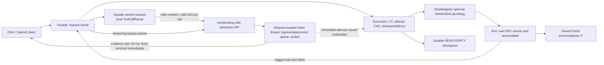

# REQ-STREAM-001 — Delta Architecture Packet, редакция 2

DRAFT; approval AD-001/AD-002 APPROVED. Это спецификация после cycle-1 NEEDS_WORK, перед повторным советом; не реализация, не ARCH_GATE_PASS и не runtime acceptance. Product worktree read-only; изменения только в run-каталоге.

## Делегирование и границы approval

Владелец (2026-10-13 10:15 MSK): «1 кажется да. главное что бы было по архитектуре. пусть архитектор говорит как делать.» Architect выбирает AD-001 fail-close irreversible partial prefix и AD-002 strict-live только stream=true. Оба решения APPROVED, approved_by="user via architect delegation". Общий approval: approved_by="user (decision 2026-10-13 10:15 MSK)", evidence_ref="chat instruction 2026-10-13 10:15 MSK". Источник: EVD-017, findings ledger F-001/F-003. Q-001/Q-002 resolved=true, blocking=false. Совместимость с конкретным DSH остаётся runtime gate.

## Evidence и baseline

- **EVD-001** `server.py:3196 Run._apply; :3236 Run._own_terminal; :3298 Run._terminal` — assistant/thinking дельты накапливаются; complete заменяет слот, retract удаляет; успешный own terminal публикует финальные text/reasoning/result/done.
- **EVD-002** `server.py:3564 Handler._execute; :3648 text event; :3659 reasoning; :3670 done` — text event трактуется как полный message и разделяется двойным newline; reasoning обходит parser; текущий fallback full final_text требует anti-duplicate gate.
- **EVD-003** `server.py:4541 Handler._dispatch; :4570 adapter.execute_turn(turn,None); :4695 Handler._serve_sse; :4733 _dispatch` — sink seam существует, но отключён; content выдаётся лишь после завершённого dispatch.
- **EVD-004** `core/backend_adapter.py:28 StreamSink; :629 BackendAdapter.execute_turn; adapters/droid_adapter.py:74 execute_turn` — Baseline: typed StreamSink(kind,text)->bool есть, DroidAdapter.execute_turn принимает sink, но игнорирует и вызывает handler._run_once(legacy, ctx.keepalive). Delta specification AD-001.plumbing добавляет default sse_writer=None и сквозной optional parameter до _execute/own RPC pump; не утверждает наличие реализации. Nonstream _run_once при None неизменен.
- **EVD-005** `core/tool_emulation.py:277 ToolCallParser; :290 _drain; :327 _find_close_outside_string` — Уже incremental parser: безопасный plain text, split prefix, полный XML до parse. Malformed/unclosed сейчас возвращаются в content, строгая live защита меняет oracle.
- **EVD-006** `server.py:3006 Run._consume; :3334 Run.close; :3413 _finish_attempt; :3938-3942 _run_once; :3996-4025 cleanup` — cancel interrupt+bounded join; failure DIRTY и asynchronous close; T release после close, L в outer finally. Join сам по себе не доказывает process death/terminal: требуется fence перед повторным execution.
- **EVD-007** `server.py:4113 _reserve_delivery; :4464-4468 HTTP finally; :269 MAX_TURN_TEXT_BYTES; :283 DELIVERY_CHUNK_BYTES; :286 MAX_DELIVERY_BYTES` — Delivery reservation сейчас после compute, releasing в HTTP finally; 10MiB turn,64KiB delivery slice,256MiB total defaults. Live budget надо брать до enqueue и возвращать после drain/discard.
- **EVD-008** `tests/test_rpc_core.py:471 TestTurnBuffer.test_tm011_retract_and_retry_commit_only_final; tests/test_bridge_http.py:207 test_buffered_text_not_leaked_on_failed_turn` — Baseline ожидает committed-only SSE и отсутствие partial на failure. Real-time prefix физически необратим: approval нужен до смены этих гарантий.
- **EVD-009** `tests/test_rpc_rework.py:532 TestDeliveryDecoupled.test_rw009_slow_clients_do_not_block_next_turn_or_exhaust_compute` — RW-009 oracle:4 не читающих 3MB SSE,5й ход и повтор key проходят после compute; READY не зависит от delivery.
- **EVD-010** `tests/test_rpc_lifecycle.py:407 test_tm010_first_token_total_keepalive_and_client_gone; tests/test_rpc_lifecycle.py:486 late events` — Есть lifecycle/cancel/late-event regressions; freeze плюс новые race и ack fences.
- **EVD-011** `tests/test_cache_usage.py:208 TestCacheUsageHttp.test_http_sse_cache_usage; server.py:4758-4793 usage` — Cached_tokens один usage после finish перед DONE; preserve baseline zero/absent usage policy.
- **EVD-012** `tests/test_tool_parser.py:47-144 TestToolCallParser; tests/test_cycle5_rework.py:316,333,354,414` — Существующие parser split/malformed/string и delivery budgets/tool arguments regressions: применять как baseline, добавить live sensitivity cases.
- **EVD-013** `README.md:29 buffered SSE caveat; :43 stdlib ThreadingHTTPServer; :186 project verification` — Python stdlib runtime; real project gates unittest,ruff,basedpyright; не pytest/uv с отсутствующими manifest.
- **EVD-014** `docs/adr/INDEX.md; docs/adr/0001-persistent-droid-bridge.md; docs/adr/0002-multi-binary-hub.md` — Accepted ADRs задают resident lifecycle и BackendAdapter hub; format ADR-full, сохраняем существующие boundaries без новой технологии.
- **EVD-015** `architecture/proposals/native-staging/product-before.json; path existence probe 2026-10-13T07:08Z` — branch dev; baseline M fleet.json, ?? .ai-team/, ?? analysis/. Root AGENTS.md,.agents/*,pyproject.toml,uv.lock,requirements.txt отсутствуют; .venv/bin/ruff и basedpyright существуют; Python3.14.7. Lock/dependency versions не заявляются.
- **EVD-016** `architecture/proposals/ops/architect-brief.md` — Owner-reported 458tokens/~2.5ms and 10–18s compute,179000tok/s не живой замер; owner requests batch→live SSE,20–80tok/s,TTFT<2s targets.
- **EVD-017** `chat instruction 2026-10-13 10:15 MSK; arch-panel/cycle-1/a1/findings-ledger.md#F-001/#F-003` — Решение владельца: «1 кажется да. главное что бы было по архитектуре. пусть архитектор говорит как делать.» Владелец делегировал выбор Architect; Architect выбирает irreversible partial fail-close AD-001 и strict-live только stream=true AD-002. Это approval решений, не доказательство клиентской совместимости или runtime acceptance.

## Решения

### AD-001 — Как отправлять настоящие дельты до completion при retract/retry?

Status: APPROVED. Approved by user via architect delegation. Verification: VER-008, VER-012, VER-006.

Live Droid SSE только при stream=true: optional StreamSink проходит от Façade через _dispatch и DroidAdapter.execute_turn(ctx, sse_writer=None) до _run_once/_execute и callbacks own RPC pump. Façade владеет parser; RPC не пишет в socket. Accepted deltas публикуются до terminal с identity/offset ledger, matching complete выпускает только suffix. Irreversible partial prefix не отзывается: retract/non-prefix complete или failure → chat.completion.chunk с error, затем отдельный [DONE], без success finish/usage. Retry запрещён после первого accepted semantic payload; это консервативный enqueue fence, не факт socket delivery. Success только после own terminal, durable checkpoint и outcome CAS READY; nonstream committed-only сохраняется.

Альтернативы: Оставить terminal-buffered SSE и исправить только метрику; Ждать message complete: уменьшает burst, но не обеспечивает token-live.

- Утверждено через делегирование EVD-017: live prefix provisional, all-or-nothing SSE guarantee снимается только с live path. Совместимость error envelope с реальным DSH остаётся NOT_RUN.
- Prefix невозможно отозвать OpenAI frames; не обещать успешный final-only ответ после retraction.
- Если upstream сообщает несколько message, newline separator один раз на реальной границе message, не перед каждой delta.
- Delivery ledger хранит emitted offsets/kind/mid и upstream accepted bytes; не сравнивать final_text последнего message со всей склеенной историей.

#### plumbing

**adapter_signature**: DroidAdapter.execute_turn(self, ctx: TurnContext, sse_writer: Optional[StreamSink] = None) -> TurnResult

**sink_contract**: StreamSink = Callable[[str, str], bool]; kind=content|reasoning|tool_call; tool_call payload — JSON-сериализованный полный нормализованный call (index,id,type,function.name,function.arguments), arguments уже валидны. Sink не пишет socket и не ждёт writer. True означает bounded acceptance; False или exception означает attempt-scoped cancel/fail-close, без retry после accepted prefix.

**facade_chain**: _serve_sse создаёт request worker и façade-owned parser/sink; _dispatch(ctx, keepalive, sse_writer=None) передаёт sink только Droid stream=true в adapter.execute_turn. Другие adapters сохраняют buffered finalize_turn, ADAPTER_API=1 не меняется.

**execution_chain**: DroidAdapter сохраняет DTO→legacy→TurnResult mapping; handler._run_once(legacy, ctx.keepalive, sse_writer=sse_writer) → _execute(run, keepalive, emulate_tools, sse_writer=None). При sse_writer=None вызов и buffered _run_once behavior прежние; nonstream _serve_json и finalize_turn не меняются.

**pump_callback**: Run._apply/_consume публикуют newly accepted own text/reasoning offsets в существующий Run.q как tagged incremental events при live path (immutable attempt_id, parent/session/turn/mid, kind, offset). _execute — façade consumer этих событий: text→его request-local ToolCallParser→content/tool_call sink; reasoning→sink мимо parser. Run не владеет ToolCallParser, не вызывает parser и не пишет socket.

**identity**: foreign/late events quarantined; ledger per attempt/mid/kind, offsets monotonic; newline separator один раз между подтверждёнными assistant messages; complete с accepted prefix выпускает только missing suffix, done не повторяет accumulator. Retract/non-prefix accepted message fail-close. Authoritative result accumulator сохраняется для persistence/nonstream; живой sink не заменяет его.

**sink_none**: Без sink Run events и _execute трактуют text как прежний whole-message buffered event; нет strict-live, новых live callbacks, queue worker или delta replay. Синхронный результат _run_once и nonstream fallback остаются прежними.

#### delivery_states

**states**: not-accepted → queued → sent либо discarded; queued ≠ sent. Writer публикует delivery ledger отдельно от execution outcome.

**irreversibility**: Первый True на semantic content/reasoning/tool_call — консервативная граница запрета automatic retry: queue может concurrently отправить данные. Role/keepalive не устанавливают её. Sent — фактическая передача socket, не гарантия прочтения клиентом.

**unsent_cancel**: Queued-but-unsent cancel до checkpoint выигрывает DIRTY; queued data discarded, parser reset/discard, reservations released, fence AD-003. Automatic replay запрещён даже при 0 sent bytes после enqueue fence. До первого acceptance retry возможен только по существующей transient policy и после безопасного cleanup/fence.

#### error_frame

**wire_example**

```json
{
  "id": "chatcmpl-example",
  "object": "chat.completion.chunk",
  "created": 1791875700,
  "model": "requested-model",
  "choices": [
    {
      "index": 0,
      "delta": {},
      "finish_reason": null
    }
  ],
  "error": {
    "message": "Live attempt failed after provisional prefix",
    "type": "stream_error",
    "code": "live_prefix_invalidated",
    "param": null
  }
}
```

**framing**: data: <JSON error chunk>\n\n, затем отдельное data: [DONE]\n\n; id/created/model совпадают с этим stream. Error object sanitized, без сырого XML, prompt, reasoning, stderr или секретов. Нет success finish_reason или usage.

**compatibility**: chat.completion.chunk envelope сохраняет транспортную форму, error — выбранное расширение. Это не заявление универсальной поддержки OpenAI-клиентами: DSH обязан распознать error и не засчитать success. Delivery error/DONE best effort, blocked/disconnected socket закрывается по 5 s deadline.

### AD-002 — Как сохранить clean live text и tool XML безопасность?

Status: APPROVED. Approved by user via architect delegation. Verification: VER-004, VER-010.

Façade создаёт отдельный request-local ToolCallParser с strict_live=True ТОЛЬКО для live Droid stream=true и присутствующего sink. stream=false или sink=None всегда strict_live=False: существующий feed/finish() и malformed/unclosed fallback абсолютно неизменны. Strict-live держит recognized <tool_call> prefix/XML до valid complete call; malformed/invalid JSON/unclosed XML → error AD-001, 0 сырых <tool_call> тегов в content; reasoning bypass. Valid complete calls публикуются ровно один раз с stable id/index/name и полными parsed arguments.

Альтернативы: Сохранить XML fallback в live SSE с честным caveat; Удерживать весь message до parser.finish(), отказ от live text.

- Strict-live выбор утверждён EVD-017; он ограничен stream=true. Общий legacy finish()/fallback менять нельзя; режим и буферы не разделяются между requests.
- Tool XML buffering <= existing per-turn output cap; unknown closing/JSON string splits проверять adversarial.
- Message identity нельзя смешивать между retract/retry; stream terminate на retract accepted prefix, чистить parser на отмене.

#### parser_contract

**interface**: ToolCallParser(..., strict_live=False); существующие callers по умолчанию legacy. Façade выбирает strict_live=(stream is True and Droid live sink is not None); mode immutable per instance.

**feed**: Legacy path дословно сохраняет baseline semantics. Strict path выпускает только safe text, удерживает каждый split-prefix recognized opening tag/XML; некорректный recognized блок не отправляет через _flush_all/text fallback. Valid JSON completed call → on_tool_call ровно один раз.

**finish**: strict_live=False: существующий finish() и fallback без изменений. strict_live=True: pending recognized prefix/неполный блок/invalid XML → parser error → fail-close; никакого legacy _flush_all. Safe text tail flush до terminal.

**error_reset**: После strict parser error/cancel больше callbacks нет; discard/reset буферов без text emission. Reset только при завершении собственного attempt, не retry/replay visible prefix. XML/parser/accumulator ограничены existing turn budget отдельно от delivery budget.

**reasoning**: delta.reasoning_content идёт прямо в façade sink, никогда в parser.

**paired_regressions**

- tests.test_tool_parser.TestToolCallParser.test_nonstream_malformed_xml_fallback_unchanged
- tests.test_tool_parser.TestToolCallParser.test_nonstream_unclosed_xml_finish_fallback_unchanged
- tests.test_tool_parser.TestToolCallParser.test_strict_live_malformed_xml_error_no_leak
- tests.test_tool_parser.TestToolCallParser.test_strict_live_unclosed_xml_error_no_leak

### AD-003 — Как live delivery соблюдает RW-009 и ограниченные ресурсы?

Status: PROPOSED. Verification: VER-005, VER-009, VER-011.

Execution владеет L/T, immutable attempt id, durable checkpoint и однократным CAS outcome UNDECIDED→READY|DIRTY. Façade создаёт/завершает request-scoped worker thread; worker владеет bounded ingress/data queue/control reserve и единственной записью socket. RPC sink enqueue-only, никогда не ждёт socket. Coalescing выполняется writer thread по monotonic таймеру ≤40 ms, немедленный flush перед finish/error/DONE. Normal READY освобождает L/T до writer drain. Precommit cancel: interrupt + own-terminal wait 2 s, SIGTERM owned group + waitpid(WNOHANG) ≤1 s, SIGKILL + reap ≤1 s; затем DIRTY cleanup и обязательный release L/T. Unconfirmed death — safety quarantine без process/key reuse, а не pretend-success.

Альтернативы: Писать socket синхронно из RPC callback: rejected blocks compute; Unbounded queue/spool без лимита: rejected memory/disk debt.

- 16 MiB/1024/64 KiB/40 ms/5 s — архитектурные ограничения для последующей проверки, не измеренные SLA. Сохраняется RW-009 normal 4×3 MB slow readers + 5th/repeat после checkpoint без drain.
- Cancel fence 2+1+1 s конкретен; unconfirmed death fail-closed quarantine, не небезопасный reuse. Полный reclaim требует факта reaping.
- Frame quota применяется после coalescing; ingress/encoded/control/global bounded отдельно, error/DONE имеют pre-reserved terminal batch.
- RPC producer не владеет parser/socket; writer не владеет L/T/checkpoint; postcommit callback не отменяет reused process.

#### attempt_outcome

**owner**: Execution only; outcome привязан к immutable attempt_id и обновляется один раз CAS(UNDECIDED, READY|DIRTY), любые duplicate callbacks idempotent. Writer посылает только notification с attempt_id.

**success_linearization**: Own success terminal не READY. Execution под per-attempt outcome guard сериализует проверку precommit cancel, durable checkpoint и CAS UNDECIDED→READY. Только после успешного durable checkpoint допускается READY и success frames. Guard запрещает конкурирующий DIRTY CAS во время checkpoint; writer/RPC только enqueue cancel notification, не ждут disk/guard.

**cancel_linearization**: Если cancel получен/проверен до входа success checkpoint critical section, Execution CAS UNDECIDED→DIRTY и не пишет successful checkpoint. Cancel во время checkpoint сериализуется: если checkpoint успешен, READY побеждает; если persist failed, DIRTY. Полученное own terminal без checkpoint ещё допускает DIRTY.

**failure**: Persist failure после prefix, malformed/retract/overflow, cancel до commit: CAS DIRTY, fence, dirty/invalidate checkpoint (если запись невозможна — in-memory quarantine и запрет READY/admission этого key); success finish/usage запрещены. DIRTY никогда не READY.

**postcommit**: CAS уже READY: disconnect/error notification только delivery abort старого response, не persist DIRTY, не interrupt/cancel/reuse process. CAS loser ничего не меняет, duplicate terminal не повторяет success.

#### process_death_fence

**scope**: Immutable attempt_id + собственный PID/PGID, зафиксированные при spawn; ни pkill, ни lookup reused chat process. Execution — owner. own terminal подтверждён только Run._own_terminal matching parent/session/turn/attempt; interrupt ACK без terminal и join timeout не fence.

**phases**

- {"phase": "interrupt", "deadline_seconds": 2, "action": "Отправить interrupt принадлежащему attempt process; ожидать matching own terminal monotonic deadline 2 s. При own terminal fence достигнут; отменённый attempt остаётся DIRTY."}
- {"phase": "SIGTERM", "deadline_seconds": 1, "action": "Нет own terminal: SIGTERM только owned PGID. Reaper делает waitpid(owned_pid, WNOHANG) с notification/deadline ≤1 s, подтверждает exit leader и отсутствие живых членов owned group; никакого blocking waitpid в RPC/writer."}
- {"phase": "SIGKILL", "deadline_seconds": 1, "action": "После 1 s SIGTERM без death: SIGKILL owned PGID, конечное ожидание reaping/отсутствия live group ≤1 s. Только waitpid actual reaping с согласованным reaper либо matching own terminal — доказательство fence; ECHILD в одиночку недостаточно."}

**upper_bound**: Fence escalation ≤4 s monotonic (2+1+1) после начала cancel; normal READY release после checkpoint независимо от writer. DIRTY release L/T в execution finally после fence/dirty cleanup, не writer drain. Длительность persistence отдельно измеряется; гарантировать finite disk fsync по процессному дедлайну нельзя.

**release**: Успешный terminal fence: DIRTY/invalidate checkpoint, detach cancelled run, release T и L ровно один раз. Death fence: то же + reaper возвращает P только после confirmed death. Queue/reservations освобождает worker на send/discard/close; parser discard делает Façade.

**unconfirmed_at_deadline**: Неподтверждённая смерть к 4 s — FAIL fence, quarantine owned process/attempt/key, запрет дальнейших RPC и reuse. L/T locks обязательно отпускаются в finally после detach/quarantine; соответствующая compute capacity retired из admission до подтверждения death, чтобы release lock не дал небезопасное execution. P не возвращать преждевременно; supervisor/reaper доводит reclaim. Это диагностируемый failure, не PASS «0 утечек»; normal/death injection gates должны подтвердить полный reclaim.

#### ownership

**facade**: Создаёт request-local parser и один worker; связывает sink/cancel с immutable attempt id; в HTTP finally закрывает ingress, сигналит stop, собирает завершение worker по конечному deadline. Parser callbacks только enqueue через worker API.

**worker**: Отдельный request-scoped thread владеет ingress mailbox, data frame queue, coalescing timer, control reserve, socket и release всех delivery reservations. Producers имеют только nonblocking admission API. Keepalive тоже через этот worker, без второго socket writer.

**execution**: Единственный owner L/T и persist/CAS/fence; не ждёт delivery drain. Failure из writer поступает enqueue notification с immutable attempt_id.

**flush**: Writer monotonic ≤40 ms от первого compatible pending chunk; frame≤64 KiB включая JSON envelope; flush немедленно перед terminal/finish/error/DONE, при заполнении frame и изменении kind/mid. При overflow/cancel invalid/discarded payload не отправлять; safe retained tail flush если delivery ещё разрешена, иначе discard с release. Control никогда не ждёт остаток timer.

**lifetime**: Worker завершается после единственного DONE или error/write deadline/HTTP close. Idempotent close/discard освобождает data и control bytes; нет неограниченного thread lifetime.

#### budgeting

**units**: Encoded UTF-8 SSE bytes включая JSON envelope и data framing; data frame count только ПОСЛЕ writer coalescing. Ingress raw deltas не считаются отдельными data frames.

**limits**

```json
{
  "response_data_bytes": 16777216,
  "coalesced_pending_data_frames": 1024,
  "encoded_data_frame_bytes": 65536,
  "coalesce_ms": 40,
  "socket_write_deadline_seconds": 5,
  "reserved_control_slot_bytes": 8192
}
```

**ingress**: До acceptance atomically reserve upper bound encoded bytes для raw delta с JSON escaping/envelope allowance. Mailbox byte-bounded/slab-backed, adjacent compatible fragments appended в bounded segments; unlimited per-delta object queue запрещена. RPC не спит на coalescing и не резервирует 1 frame на token. Writer владеет mailbox, producer только short nonblocking try-admit.

**formula**: B_response = B_ingress_reserved + B_pending_encoded + B_coalescing_pending + B_inflight ≤16 MiB; перемещение одного payload не double-count. При coalescing upper-bound ingress reservation преобразуется в exact encoded bytes; дополнительный envelope reserve атомарно до append, лишнее возвращается. N_data = count(post-coalescing queued+inflight frames) ≤1024. Разделять content/reasoning/tool chunks на ≤64 KiB включая envelope.

**global**: Σ(request B_response + 8192 control reserve) ≤ existing MAX_DELIVERY_BYTES (baseline default 256 MiB). До создания response worker и принятия data global reservation атомарная. 4×3 MiB нормальных reader payload + controls не исчерпывают 256 MiB; full concurrency всё равно требует admission/overflow handling.

**control**: Один отдельный reserved control slot вне 1024 data frames и 16 MiB DATA limit: bounded terminal batch error+DONE либо finish+optional usage+DONE ≤8192 encoded bytes, заранее входит в global accounting. Error message sanitized/truncated под cap, usage metadata bounded. Overflow discard data и освобождает data bytes; control admission гарантировано независимо от data cap. Socket delivery best effort: после 5 s close, no DONE guarantee на мёртвом socket.

**other_budgets**: Authoritative accumulator/reasoning/tool XML buffers отдельно входят в existing MAX_TURN_TEXT_BYTES (baseline 10 MiB), не в 16 MiB delivery reserve и не освобождаются как queue bytes. Контроль их собственного cap сохраняется; каждое retained copy bounded.

**release**: Reservation token single owner; send/discard/close releases once; idempotent close не double-release. Control bytes возвращаются после terminal send либо close/discard; no global oversubscription при параллельных requests.

### AD-004 — Как thinking влияет на content timing и finish usage?

Status: PROPOSED. Verification: VER-006, VER-012.

Reasoning только delta.reasoning_content, parser bypass. Success FIFO: remaining valid content/tools/reasoning → один finish chunk choices=[{index:0,delta:{},finish_reason:stop|tool_calls}] → отдельный optional usage chunk с choices=[{index:0,delta:{},finish_reason:null}] и _wire_usage → ровно один [DONE]. Usage только при input_tokens или output_tokens !=0 как baseline. cached_tokens передаётся честно без clamp, normalize_prompt_cache_details неизменен. Fail path AD-001 error chunk→[DONE], без success finish/usage.

Альтернативы: Писать thinking в content: rejected changes DSH semantics; Удерживать reasoning до terminal: compatibility fallback, misses requested realtime thinking.

- DSH decode duration от first nonempty content до usage/DONE включает thinking after first content,tool buffering,tail/commit;20–80tok/s не гарантируется из upstream rates.
- TTFT<2s целевой end-to-end metric, upstream first content может опоздать; bridge delta-to-frame отдельно замерить.
- Длинное thinking до content честно увеличивает TTFT; не синтезировать text tokens/pace/timestamps ради исправления метрики.

#### wire_contract

**finish_example**

```json
{
  "id": "chatcmpl-example",
  "object": "chat.completion.chunk",
  "created": 1791875700,
  "model": "requested-model",
  "choices": [
    {
      "index": 0,
      "delta": {},
      "finish_reason": "stop"
    }
  ]
}
```

**usage_example**

```json
{
  "id": "chatcmpl-example",
  "object": "chat.completion.chunk",
  "created": 1791875700,
  "model": "requested-model",
  "choices": [
    {
      "index": 0,
      "delta": {},
      "finish_reason": null
    }
  ],
  "usage": {
    "prompt_tokens": 100,
    "completion_tokens": 20,
    "total_tokens": 120,
    "prompt_tokens_details": {
      "cached_tokens": 150
    }
  }
}
```

**finish_reason_usage**: null

**order**: finish, затем 0 или 1 usage, затем ровно 1 отдельный data: [DONE]\n\n. Tool success finish_reason=tool_calls; usage frame всегда null, повторного finish нет.

**usage_policy**: Usage отсутствует при обоих нулевых/отсутствующих input/output; если есть ненулевой, wire values/нулевые поля/отсутствующий cache field по существующему _wire_usage. cached_tokens может быть >prompt_tokens: не clamp. normalize_prompt_cache_details и _serve_json unchanged.

**client_gate**: DSH читает usage независимо от finish_reason=null; один finish и один DONE, cache details сохранены. Это явный оракул VER-007/008, не подтверждённый факт текущего клиента. Если DSH не читает null usage, новая Architect delta перед Coder/rollout.

## Component

Façade owns request-local ToolCallParser; отдельный request-scoped worker thread owns queue/control reserve/socket, coalesces ≤40 ms и immediately flushes terminal/error/DONE. Execution owns L/T/checkpoint/one-shot READY|DIRTY CAS и process fence. Run owns only tagged own RPC events/accumulator.

VIEW-001: Кто владеет RPC,leases,parser,socket и bounded delivery?



## Sequence

Façade owns request-local ToolCallParser; отдельный request-scoped worker thread owns queue/control reserve/socket, coalesces ≤40 ms и immediately flushes terminal/error/DONE. Execution owns L/T/checkpoint/one-shot READY|DIRTY CAS и process fence. Run owns only tagged own RPC events/accumulator.

VIEW-002: Как deltas идут до terminal,а release/commit/cancel ограждены от slow writer?

```mermaid
sequenceDiagram
  participant C as Established DSH client
  participant F as Façade + owned ToolCallParser
  participant W as Request worker: queue/socket
  participant E as Execution: L/T and attempt CAS
  participant R as Run/owned RPC process
  C->>F: stream=true
  F->>W: create worker + bounded data/control reservation
  F->>E: optional sink / immutable attempt id
  E->>R: own turn under L/T
  loop Before own terminal
    R->>F: checked own incremental text/reasoning event
    F->>F: text through strict-live parser; reasoning bypass
    F->>W: nonblocking try-admit clean content/reasoning/tool_call
    W->>W: coalesce in writer thread max 40 ms
    W-->>C: preterminal data frame
  end
  alt Durable checkpoint wins under attempt guard
    R->>E: own success terminal + authoritative result
    E->>E: persist checkpoint then one-shot CAS READY
    E->>E: release L/T before delivery drain
    E->>W: terminal batch finish, optional usage(null), DONE
    W->>W: immediate tail flush then terminal FIFO
    W-->>C: exactly one finish and DONE
  else Precommit cancel/failure wins
    W->>E: notification with immutable attempt id
    E->>E: one-shot CAS DIRTY; prohibit success frames
    E->>R: interrupt; wait matching own terminal max 2 s
    opt No own terminal
      E->>R: SIGTERM owned PGID; waitpid nonblocking max 1 s
      opt Not dead
        E->>R: SIGKILL owned PGID; reap max 1 s
      end
    end
    E->>E: fence or FAIL/quarantine; DIRTY cleanup and L/T finally release
    F->>F: discard parser buffers without legacy XML flush
    E->>W: error chunk and separate DONE via control slot
    W->>W: immediate terminal flush/discard and idempotent reservation release
    W-->>C: error/DONE best effort or socket close by 5 s
  end
  Note over E,W: After READY: disconnect only old delivery abort, no new attempt cancellation
  Note over F,W: queued is not sent; first accepted semantic payload conservatively forbids retry
  Note over C,E: Client executes tools; role=tool/tool_call_id continues with new attempt on same key
```

## Границы

### BND-001 — Request-scoped SSE writer worker + bounded ingress/data/control queues

Façade создаёт/закрывает один request-scoped worker thread. Worker единственный владелец socket, очереди, coalescing ≤40 ms и immediate terminal/error/DONE flush, encoded bytes после coalescing и 1024 DATA frames; control slot 8192 bytes вне data frame cap, внутри global reserve. Execution отдельно выполняет one-shot outcome CAS и process fence AD-003; postcommit disconnect не переписывает READY. L/T обязательно release в execution finally, queue drain их не удерживает.

Allowed: HTTP facade frame formatting; StreamSink enqueue/close; request cancel notification; existing byte budget.
Forbidden: direct RPC thread socket write; chat persist/release L/T; unbounded queue; cancel reused proc after committed terminal.
Verification: VER-002, VER-003, VER-005, VER-009, VER-011.

### BND-002 — Run RPC delta pump + DroidAdapter/execution lifecycle

Run RPC pump owns только current turn/mid identity и authoritative accumulator; tagged incremental события идут façade _execute consumer, который владеет request-local parser и вызывает StreamSink. DroidAdapter optional sink plumbing AD-001; Execution owns L/T, attempt CAS, persist и 2+1+1 s fence, release не ждёт writer drain. Nonstream sink=None сохраняет прежний buffered _run_once.

Allowed: core.StreamSink; RPC process; ToolCallParser in facade; chat registry/persistence under existing execution owner.
Forbidden: socket write in _apply/_consume; L/T held until queue drained; late event delivered; retry after prefix; lease reuse after join timeout without terminal/death.
Verification: VER-002, VER-003, VER-005, VER-006, VER-011, VER-012, VER-010.

### BND-003 — Façade-owned request-local ToolCallParser

Façade владеет parser instance и выбирает strict_live=True только Droid stream=true+sink; strict feed/finish не выпускают raw <tool_call> XML и ошибаются на invalid/unclosed recognized block. stream=false/sink=None legacy feed/finish()/fallback абсолютно неизменны. Parser callbacks только enqueue API worker; reasoning bypass; parser не владеет RPC/socket/queue.

Allowed: plain text/call callbacks; JSON normalization; per-turn output budget.
Forbidden: socket/RPC/session ownership; reasoning fed to parser; tool XML in live content under strict approval; speculative executing partial JSON.
Verification: VER-002, VER-003, VER-004, VER-010.

## Контракт и ограничения

**CD-001**: Approved live Droid stream=true incremental content/reasoning/tool frames до terminal; AD-001 irreversible enqueue fence/fail-close error chunk, AD-002 isolated strict-live parser, AD-004 explicit finish/usage(null)/DONE. Approvals EVD-017; implementation/runtime NOT_RUN.

Nonstream _serve_json committed-only JSON, legacy ToolCallParser.finish()/malformed/unclosed fallback и normalize_prompt_cache_details неизменны. ADAPTER_API=1, auth/model/fleet/persisted schema unchanged. Error field в chat.completion.chunk — выбранное расширение, DSH client gate обязателен, universal compatibility не заявляется.

Verification: VER-001, VER-006, VER-007, VER-008, VER-010, VER-004.

## Quality и измерения

**QA-001 performance**: DSH → upstream emits text delta before terminal → BND-001/BND-002. Flush meaningful content before terminal; preserve actual timing

Measure: Requested end-to-end20–80tok/s and TTFT<2s are measurement targets, upstream-dependent; proposed bridge p95delta→frame≤100ms,coalesce≤40ms pending owner agreement. No invented results. Verification: VER-008, VER-012.

**QA-002 privacy**: untrusted CLI → split tool tag / malformed JSON / unclosed block / JSON string close tag → BND-003. Façade strict-live только stream=true: safe text incremental, invalid/unclosed recognized XML → error без raw tags; legacy nonstream fallback unchanged.

Measure: 0 raw <tool_call> tags/recognized XML bytes in live content, valid call emitted once; identical malformed/unclosed input nonstream byte-equivalent baseline fallback. Verification: VER-004, VER-010.

**QA-003 reliability**: slow/disconnected client → nonreading socket while compute progresses; overflow; 4 slow+5th and repeated key → BND-001/BND-002. Bounded delivery, cancellation fence, compute release independent drain

Measure: B_response≤16 MiB encoded/ingress reserved bytes,≤1024 post-coalescing DATA frames + separate8192byte control reserve,global≤MAX_DELIVERY_BYTES; normal4×3MB+5th/repeat after checkpoint independent drain; cancel fence2+1+1s; successful terminal/death cleanup0 leaked L/T/P/reservations. Unconfirmed death explicit FAIL/quarantine, no unsafe reuse. Verification: VER-005, VER-009, VER-011.

**QA-004 compatibility**: CLI → complete replaces,retract,retry,thinking delta,late foreign terminal → RPC pump/facade. No duplicate final,identity fencing,reasoning separate; error on irrevocable conflict

Measure: Every accepted text char emitted≤once per live stream; unchanged nonstream committed-only;0 thinking in content;0 silent retry after visibility. Verification: VER-006, VER-011, VER-012.

**QA-005 compatibility**: OpenAI client → successful response end/nonstream request; tool_calls → client execution → next request role=tool continuation → SSE/JSON facade. One finish, one optional usage(null), one DONE; nonstream keys/fallback unchanged. Tools исполняет DSH/client, не bridge; следующий ход содержит matched role=tool/tool_call_id в established chat, immutable new attempt identity, без automatic replay.

Measure: Exactly1 finish +0/1 usage(null) with honest cached_tokens +1 DONE. Valid tool_calls ids/index/args match role=tool continuation; same established key, distinct attempt, old callbacks quarantined. After partial/cancel client examines tool effects before manual reissue; bridge does not execute/replay tools. Verification: VER-001, VER-007, VER-004, VER-008, VER-011.

Реальный TTFT измеряется от HTTP start до первого непустого content. Role/keepalive/reasoning не маскируют upstream delay. Requested20–80tok/s и TTFT<2s — цели, не достигнутые результаты. Upstream задержка и bridge delta→frame измеряются отдельно.

## Verification surface (frozen draft)

Coder пишет все новые тесты и фиксирует red→green после architecture gate. Verifier независимо запускает frozen команды, не создаёт тесты и не меняет oracle. Имена новых regression tests ниже плановые (NOT_IMPLEMENTED), не существующие факты. Продуктовые тесты и live gates Architect не запускал.

### VER-001

`PYTHONDONTWRITEBYTECODE=1 python3 -m unittest discover -s tests`

exit0 full repo-native unittest. Coder создаёт tests.test_bridge_http.TestSSEFrames.test_live_delayed_delta_arrives_before_terminal (planned, NOT_IMPLEMENTED): controlled upstream emits ≥2 delayed content deltas; receive timestamps до own terminal, not batched/replayed final. Red на baseline → green на live implementation; Verifier только независимо запускает, не пишет тесты. Gates не ослаблены кроме явно approved live SSE oracle.

Execution owner: verifier. Test author: coder after architecture gate.

Плановый targeted red→green command: `PYTHONDONTWRITEBYTECODE=1 python3 -m unittest tests.test_bridge_http.TestSSEFrames.test_live_delayed_delta_arrives_before_terminal`.

### VER-002

`.venv/bin/ruff check .`

exit0; repo ruff.toml E4/E7/E9/F

Execution owner: verifier. Test author: coder after architecture gate.

### VER-003

`.venv/bin/basedpyright`

exit0; repo pyrightconfig.json

Execution owner: verifier. Test author: coder after architecture gate.

### VER-004

`PYTHONDONTWRITEBYTECODE=1 python3 -m unittest tests.test_tool_parser tests.test_cycle5_rework.TestRw012ToolArgumentsStreaming`

exit0 baseline split/string/tool args. Coder пишет red→green paired tests из AD-002.parser_contract на identical malformed/unclosed input: nonstream finish fallback byte-equivalent baseline; live error с0raw XML. Split каждого символа <tool_call>, UTF-8, multi-call, close tag в JSON string, mode isolation. Verifier только запускает независимо, never authors tests.

Execution owner: verifier. Test author: coder after architecture gate.

Плановые paired commands:

- `PYTHONDONTWRITEBYTECODE=1 python3 -m unittest tests.test_tool_parser.TestToolCallParser.test_nonstream_malformed_xml_fallback_unchanged`
- `PYTHONDONTWRITEBYTECODE=1 python3 -m unittest tests.test_tool_parser.TestToolCallParser.test_nonstream_unclosed_xml_finish_fallback_unchanged`
- `PYTHONDONTWRITEBYTECODE=1 python3 -m unittest tests.test_tool_parser.TestToolCallParser.test_strict_live_malformed_xml_error_no_leak`
- `PYTHONDONTWRITEBYTECODE=1 python3 -m unittest tests.test_tool_parser.TestToolCallParser.test_strict_live_unclosed_xml_error_no_leak`

### VER-005

`PYTHONDONTWRITEBYTECODE=1 python3 -m unittest tests.test_rpc_rework.TestDeliveryDecoupled tests.test_rpc_lifecycle.TestTimeoutsAndCancel tests.test_cycle5_rework.TestRw011DeliveryBudget`

exit0 existing RW-009/RW-011. Coder adds deterministic barriers: no terminal after interrupt2s→TERM1s→KILL/reap1s, L/T released exactly once after fence/dirty cleanup, P after reaping; unconfirmed death4s→FAIL/quarantine not reuse. Queue-full vs fast tiny delta flood, post-coalescing1024 cap,8192control delivery,error/DONE or5s close, bounds/global parallel reserve, no RPC blocking. Verifier independently runs; NOT_RUN.

Execution owner: verifier. Test author: coder after architecture gate.

### VER-006

`PYTHONDONTWRITEBYTECODE=1 python3 -m unittest tests.test_rpc_core.TestTurnBuffer tests.test_bridge_http.TestTransientRetry tests.test_bridge_http.TestMessageJoining tests.test_bridge_http.TestSSEFrames`

exit0 unchanged nonstream committed-only JSON and legacy malformed/unclosed fallback. Coder adds live prefix retract/non-prefix complete→explicit error chunk+DONE, suffix-only matching complete, no duplicate final, no automatic restart after queued acceptance even if0sent. Queued/sent/discarded and preaccept retry separate. AD-001/002 owner approval EVD-017 permits only live buffered-no-leak oracle change. Null-usage and error recognized by DSH in VER-008; NOT_RUN.

Execution owner: verifier. Test author: coder after architecture gate.

### VER-007

`PYTHONDONTWRITEBYTECODE=1 python3 -m unittest tests.test_cache_usage.TestCacheUsageHttp`

exit0; Coder adds exact envelope assertions:1finish(stop/tool_calls),0/1separate usage with choices[0].delta={},finish_reason=null,then1DONE. cached_tokens>prompt_tokens survives without clamp;0/absent usage baseline. DSH reads null usage exactly once and ends once (live VER-008); error path no success finish/usage. normalize_prompt_cache_details unchanged.

Execution owner: verifier. Test author: coder after architecture gate.

### VER-008

Manual independent gate; command=null.

На существующем рабочем owner DSH слоте: 3 последовательных и 2 параллельных реальных хода рабочей длины. Timestamp каждого curl data frame и upstream own delta; первый непустой content предшествует own terminal, ≥2 непустых content кадра разнесены во времени при upstream incremental output. Сверить DSH firstTokenTime/completedTime/usage, токены и dur_ms, TTFT включая thinking отдельно. Requested 20–80 tok/s и TTFT<2s — цели, PASS только после замера, не гарантия bridge. DSH parses error chunk as failure, null-finish usage exactly once incl cached_tokens without clamp, no double completion. Tool continuation on same established key: client executes valid tool call once, next request role=tool with matching tool_call_id, new attempt id; late old callback cannot affect it; no auto replay after partial failure.

Execution owner: owner + independent verifier. Test author: coder for fault-injection fixtures; owner/verifier for live/manual scenarios.

### VER-009

Manual independent gate; command=null.

4 реально медленных SSE readers (3MB каждый) и пятый обычный ход, повтор того же key после terminal. Compute/L свободны после checkpoint независимо от drain; малый injected cap детерминированно overflow→cancel, bounded memory/threads, доступный error+DONE либо close по write deadline. Высокая скорость small chunks проверяет coalescing/queue frame cap. Normal fast tiny deltas do not consume one data frame each: count after coalescing; measure ingress+pending+inflight bounded bytes and global atomic reserve. Force true slow overflow and control send after discard with full1024 data queue; compare reasoning/tool buffer caps. Cancel no-terminal escalation2+1+1s with reaping/L/T release; unconfirmed death branch explicit failure/quarantine.

Execution owner: owner + independent verifier. Test author: coder for fault-injection fixtures; owner/verifier for live/manual scenarios.

### VER-010

Manual independent gate; command=null.

EVD-017 содержит дословное делегирование2026-10-13 10:15 MSK; AD-001/002 APPROVED by user via architect delegation; ASM-002/003 VALIDATED,Q-001/002 resolved=true/blocking=false,approval APPROVED. Решения не требуют повторного согласования. Перед Coder нужны repeated council acceptance и approved validator/hash freeze; revision2 сейчас только draft validation, runtime NOT_RUN.

Execution owner: owner + independent verifier. Test author: coder for fault-injection fixtures; owner/verifier for live/manual scenarios.

### VER-011

Manual independent gate; command=null.

Coder ставит deterministic barriers до own terminal, между own terminal/checkpoint, внутри checkpoint guard, после durable checkpoint/CAS READY, queued-but-unsent и sent prefix. Двойной cancel/terminal callback: outcome CAS ровно1 READY|DIRTY. Cancel до checkpoint→DIRTY/fence; cancel внутри guard serializes after successful READY или persist failure DIRTY; postcommit disconnect delivery-only, new attempt/process unaffected. Barrier после accepted prefix перед durable write с injected PersistError→DIRTY, explicit error/DONE,0success finish/usage. No-terminal→interrupt2s/TERM1s/KILL reap1s, no lease reuse until fence/quarantine; exactly-once L/T release and P reclaim on confirmed death. Все runtime scenarios NOT_RUN; Verifier запускает только.

Execution owner: owner + independent verifier. Test author: coder for fault-injection fixtures; owner/verifier for live/manual scenarios.

### VER-012

Manual independent gate; command=null.

Deterministic delayed upstream: content и reasoning доставлены до terminal; reasoning только reasoning_content и мимо parser, пустой role/keepalive не считаются first content; bridge delta-to-frame proposed p95≤100ms на читающем localhost, max coalescing≤40ms измерено. Оба числа — proposed acceptance, согласовать; upstream задержку не приписывать bridge.

Execution owner: owner + independent verifier. Test author: coder for fault-injection fixtures; owner/verifier for live/manual scenarios.

## Риски и threat model

**RISK-001**: Streamed prefix retracted/mismatching complete or failure; baseline no-leak oracle incompatible. AD-001 утверждено EVD-017; irreversible partial + explicit error chunk/[DONE]; conservative enqueue no-retry fence distinguishes queued/sent/discarded, DSH recognition проверяет Verifier, не заявляется universal client compatibility. Verification: VER-006, VER-010, VER-011.

**RISK-002**: Malformed tool XML leaked as legacy parser fallback; speculative tool execution. AD-002 approved strict-live только stream=true, independent instance/mode, valid complete calls only; legacy nonstream finish()/fallback absolutely unchanged; paired identical-input tests. Verification: VER-004, VER-010.

**RISK-003**: Slow reader blocks RPC or queue/frame/global budget exhausted,control frame starves. AD-003 bounded byte ingress, post-coalescing data-frame count, 8192-byte control slot вне1024/data cap внутри global reservation; writer ≤40ms immediate terminal flush,5s write timeout; idempotent accounting. Verification: VER-005, VER-009.

**RISK-004**: Disconnect/terminal race cancels reused process or leases reused before ack/death; commit failed yet success emitted. AD-003 single CAS UNDECIDED→READY|DIRTY under attempt guard, durable checkpoint before READY,2s interrupt+1s TERM+1s KILL reap fence, quarantine on unconfirmed death; L/T cleanup finally, postcommit disconnect delivery-only. Verification: VER-005, VER-011.

**RISK-005**: TTFT/token speed target interpreted as guarantee despite upstream thinking/firstdelta/terminal batching. Separate monotonic upstream start/firstcontent/terminal and SSE arrival; actual DSH established-slot measurements; no fake pacing or fabricated target achievement. Verification: VER-008, VER-012.

Threat model required=true. Assets: private content/thinking, tool arguments and invocation integrity, chat identity and bounded resident resources.

Trust boundaries: untrusted Droid notifications→bridge checked own turn/message; bridge delivery queue→authenticated HTTP client socket.

**THREAT-001**: Untrusted recognized tool XML/malformed JSON becomes plain content or speculative executable call. AD-002 approved strict-live instance only stream=true; recognized XML buffered under turn cap, invalid/unclosed→error without legacy flush, complete calls only. Nonstream fallback unchanged. Verification: VER-004, VER-010.

**THREAT-002**: Nonreading client exhausts memory/writer threads or pins compute leases. AD-003 bounded byte ingress, post-coalescing data-frame count, 8192-byte control slot вне1024/data cap внутри global reservation; writer ≤40ms immediate terminal flush,5s write timeout; idempotent accounting. Verification: VER-005, VER-009.

**THREAT-003**: Foreign/late mid or terminal leaks another chat or disconnect cancels reused resident turn. AD-003 single CAS UNDECIDED→READY|DIRTY under attempt guard, durable checkpoint before READY,2s interrupt+1s TERM+1s KILL reap fence, quarantine on unconfirmed death; L/T cleanup finally, postcommit disconnect delivery-only. Verification: VER-006, VER-011.

## Эволюция и handoff

**compatibility**: No new technology/dependency. Live Droid только stream=true; sink=None/nonstream/other adapters buffered unchanged. AD-001/002 APPROVED EVD-017; legacy parser.finish/fallback, _serve_json и normalize_prompt_cache_details неизменны. DSH error envelope и null usage совместимость NOT_RUN.

**migration**: NOT_APPLICABLE: no persisted schema,DB,fleet or transcript format change; per-request in-memory delivery/offsets only.

**rollout**: Owner AD-001/002 decisions approved; далее revision 2 draft validation → повторный council → approved architecture gate/hash freeze → Coder regression red→green → независимый Verifier frozen suite → established owner DSH repeated/parallel/slow/tool-continuation runtime gates. No midturn version switch; supervisor drains old in-flight turns.

**rollback**: Revert live-path deployment to prior buffered code after draining or terminating owned in-flight turns; existing persisted schema compatible. Old active streams close/error as necessary; bytes already sent cannot be removed. Owner DSH reissue only after inspecting partial tool effects; no automatic replay.

DRAFT_VALIDATED не ARCH_GATE_PASS. Human decisions уже утверждены; повторный council и approved architecture gate ещё требуются перед Coder. Product commit/push/merge не выполнялись.

## Допущения и вопросы

**ASM-001 OPEN (continuable)**: Upstream actual text deltas/timing on existing owner DSH slot support requested20–80tok/s/TTFT<2s; not measured and not guaranteed by bridge.

**ASM-002 VALIDATED (blocker)**: Владелец делегировал Architect выбор AD-001; выбран irreversible partial prefix с fail-close при visible retract/non-prefix complete. Клиентская совместимость отдельно проверяется; runtime NOT_RUN.

**ASM-003 VALIDATED (blocker)**: Владелец делегировал Architect выбор AD-002; выбран strict-live только stream=true, legacy finish()/fallback для stream=false неизменны.

**ASM-004 OPEN (continuable)**: Proposed16MiB/1024frame queue,5s write deadline,40ms coalesce,p95bridge≤100ms fit established work and existing3MB×4 oracle; verify before acceptance.

**Q-001** resolved=true, blocking=false: Разрешено: AD-001 утверждено владельцем через делегирование Architect (2026-10-13 10:15 MSK).

**Q-002** resolved=true, blocking=false: Разрешено: AD-002 утверждено владельцем через делегирование Architect (2026-10-13 10:15 MSK).

**Q-003** resolved=false, blocking=false: МОЖНО ПРОДОЛЖИТЬ: подтвердить requestedTTFT<2s,20–80tok/s как end-to-end targets; согласовать proposed bridgep95≤100ms и измерить existing DSH upstream/think delays.

**Q-004** resolved=false, blocking=false: МОЖНО ПРОДОЛЖИТЬ: проверить16MiB/1024frame,5s write deadline,40ms coalescing на реальном размере/slow reader; при изменении обновить freeze до Coder.

## Закрытие замечаний в спецификации

Перечисленное внесено в revision2; acceptance совета остаётся PENDING.

- **RW-001** → AD-001, EVD-017, ASM-002, Q-001, approval, CD-001.
- **RW-002** → AD-003.process_death_fence, BND-002, VER-005, VER-011.
- **RW-003** → AD-002, EVD-017, ASM-003, Q-002, approval.
- **RW-004** → AD-001.plumbing, EVD-004, BND-002.
- **RW-005** → AD-004.wire_contract, QA-005, VER-007.
- **RW-006** → AD-003.process_death_fence, QA-003, VER-009.
- **RW-007** → AD-002.parser_contract, AD-001.delivery_states, VER-004.
- **RW-008** → AD-003.ownership, BND-001, BND-002, BND-003, VIEW-001, VIEW-002.
- **RW-009** → AD-003.attempt_outcome, AD-001.error_frame, BND-001, VER-011.
- **RW-010** → AD-003.budgeting, BND-001, VER-005, VER-009.
- **RW-011** → AD-002.parser_contract, CD-001, VER-004, VER-006.
- **FU-001** → AD-001.verification_ids, BND-002.verification_ids, VER-010.
- **FU-002** → VER-001, VER-004, QA-005, VER-008, VER-011.

## Проверено и не проверено

ПРОВЕРЕНО ЛЁГКИМ: draft packet validator, ROLE PLAN hash и product/index fingerprint; фактический exit и SHA-256 записаны в receipts/architect.json после финальной валидации.

ПРОВЕРЕНО ТЯЖЁЛЫМ: ничего; продуктовая реализация не выполнялась.

НЕ ПРОВЕРЕНО: повторный council/approved gate, все runtime VER scenarios, DSH error/usage(null) recognition, actual queue/memory/cancel timings, tool continuation, requested TTFT/rate. Runtime acceptance NOT_RUN.
