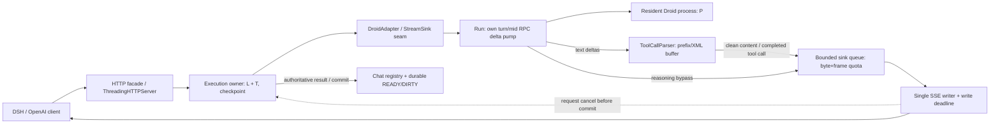

# REQ-STREAM-001 — live Droid SSE, draft

DRAFT / approval PENDING. Архитектурный пакет, не реализация и не runtime acceptance. Product worktree read-only. Требуется решение владельца по AD-001 и AD-002 до approved gate. Финальные refs используются заранее; файлы первоначально в native-staging до terminal старого исполнителя.

## Evidence и baseline

- **EVD-001** `server.py:3196 Run._apply; :3236 Run._own_terminal; :3298 Run._terminal` — assistant/thinking дельты накапливаются; complete заменяет слот, retract удаляет; успешный own terminal публикует финальные text/reasoning/result/done.
- **EVD-002** `server.py:3564 Handler._execute; :3648 text event; :3659 reasoning; :3670 done` — text event трактуется как полный message и разделяется двойным newline; reasoning обходит parser; текущий fallback full final_text требует anti-duplicate gate.
- **EVD-003** `server.py:4541 Handler._dispatch; :4570 adapter.execute_turn(turn,None); :4695 Handler._serve_sse; :4733 _dispatch` — sink seam существует, но отключён; content выдаётся лишь после завершённого dispatch.
- **EVD-004** `core/backend_adapter.py:28 StreamSink; :629 BackendAdapter.execute_turn; adapters/droid_adapter.py:84 execute_turn` — Существующий typed sink(kind,text)->bool; DroidAdapter его пока игнорирует, вызывает _run_once; изменение требует сквозного plumbing, не нового web framework.
- **EVD-005** `core/tool_emulation.py:277 ToolCallParser; :290 _drain; :327 _find_close_outside_string` — Уже incremental parser: безопасный plain text, split prefix, полный XML до parse. Malformed/unclosed сейчас возвращаются в content, строгая live защита меняет oracle.
- **EVD-006** `server.py:3006 Run._consume; :3334 Run.close; :3413 _finish_attempt; :3938-3942 _run_once; :3996-4025 cleanup` — cancel interrupt+bounded join; failure DIRTY и asynchronous close; T release после close, L в outer finally. Join сам по себе не доказывает process death/terminal: требуется fence перед повторным execution.
- **EVD-007** `server.py:4113 _reserve_delivery; :4464-4468 HTTP finally; :269 MAX_TURN_TEXT_BYTES; :283 DELIVERY_CHUNK_BYTES; :286 MAX_DELIVERY_BYTES` — Delivery reservation сейчас после compute, releasing в HTTP finally; 10MiB turn,64KiB delivery slice,256MiB total defaults. Live budget надо брать до enqueue и возвращать после drain/discard.
- **EVD-008** `tests/test_rpc_core.py:471 TestTurnBuffer.test_tm011_retract_and_retry_commit_only_final; tests/test_bridge_http.py:207 test_buffered_text_not_leaked_on_failed_turn` — Baseline ожидает committed-only SSE и отсутствие partial на failure. Real-time prefix физически необратим: approval нужен до смены этих гарантий.
- **EVD-009** `tests/test_rpc_rework.py:532 TestDeliveryDecoupled.test_rw009_slow_clients_do_not_block_next_turn_or_exhaust_compute` — RW-009 oracle:4 не читающих 3MB SSE,5й ход и повтор key проходят после compute; READY не зависит от delivery.
- **EVD-010** `tests/test_rpc_lifecycle.py:407 test_tm010_first_token_total_keepalive_and_client_gone; tests/test_rpc_lifecycle.py:486 late events` — Есть lifecycle/cancel/late-event regressions; freeze плюс новые race и ack fences.
- **EVD-011** `tests/test_cache_usage.py:208 TestCacheUsageHttp.test_http_sse_cache_usage; server.py:4758-4793 usage` — Cached_tokens один usage после finish перед DONE; preserve baseline zero/absent usage policy.
- **EVD-012** `tests/test_tool_parser.py:47-144 TestToolCallParser; tests/test_cycle5_rework.py:316,333,354,414` — Существующие parser split/malformed/string и delivery budgets/tool arguments regressions: применять как baseline, добавить live sensitivity cases.
- **EVD-013** `README.md:29 buffered SSE caveat; :43 stdlib ThreadingHTTPServer; :186 project verification` — Python stdlib runtime; real project gates unittest,ruff,basedpyright; не pytest/uv с отсутствующими manifest.
- **EVD-014** `docs/adr/INDEX.md; docs/adr/0001-persistent-droid-bridge.md; docs/adr/0002-multi-binary-hub.md` — Accepted ADRs задают resident lifecycle и BackendAdapter hub; format ADR-full, сохраняем существующие boundaries без новой технологии.
- **EVD-015** `architecture/proposals/native-staging/product-before.json; path existence probe 2026-10-13T07:08Z` — branch dev; baseline M fleet.json, ?? .ai-team/, ?? analysis/. Root AGENTS.md,.agents/*,pyproject.toml,uv.lock,requirements.txt отсутствуют; .venv/bin/ruff и basedpyright существуют; Python3.14.7. Lock/dependency versions не заявляются.
- **EVD-016** `architecture/proposals/ops/architect-brief.md` — Owner-reported 458tokens/~2.5ms and 10–18s compute,179000tok/s не живой замер; owner requests batch→live SSE,20–80tok/s,TTFT<2s targets.

## Решения

### AD-001 — Как отправлять настоящие дельты до completion при retract/retry?

StreamSink plumbing _serve_sse→_dispatch→DroidAdapter→_run_once/_execute→Run; pump публикует подтверждённые текущим turn/mid новые text/reasoning offsets. Sink only enqueue, single writer owns socket. Live prefix становится provisional: после первого принятого content/reasoning/tool frame retry запрещён. retract уже видимого mid или non-prefix complete → error+DONE и отмена/invalidated attempt, не подмена отправленного текста. Matching complete отдаёт только missing suffix; terminal не повторяет accumulated final. Final success только после own terminal + durable checkpoint. Nonstream остаётся committed-only.

Альтернативы: Оставить terminal-buffered SSE и исправить только метрику; Ждать message complete: уменьшает burst, но не обеспечивает token-live.

- Batch→live явно запрошен, но all-or-nothing failure/retract гарантия baseline теряется: требуется отдельное решение владельца.
- Prefix невозможно отозвать OpenAI frames; не обещать успешный final-only ответ после retraction.
- Если upstream сообщает несколько message, newline separator один раз на реальной границе message, не перед каждой delta.
- Delivery ledger хранит emitted offsets/kind/mid и upstream accepted bytes; не сравнивать final_text последнего message со всей склеенной историей.

Approval required: True. Verification: VER-008, VER-012.

### AD-002 — Как сохранить clean live text и tool XML безопасность?

Переиспользовать существующий incremental ToolCallParser: safe plain text live, pending opening prefix и XML удерживаются, on_tool_call только после valid complete JSON. Reasoning мимо parser. Proposed live-strict policy: malformed/unclosed recognized XML → stream error, никакого XML в content; baseline nonstream fallback не менять. Tool calls имеют stable id,index,name,целые parsed args выдаются стандартными chunks, не спекулятивно.

Альтернативы: Сохранить XML fallback в live SSE с честным caveat; Удерживать весь message до parser.finish(), отказ от live text.

- Strict live malformed policy — дополнительная behavioral delta, не молчаливое исправление; owner approval required.
- Tool XML buffering <= existing per-turn output cap; unknown closing/JSON string splits проверять adversarial.
- Message identity нельзя смешивать между retract/retry; stream terminate на retract accepted prefix, чистить parser на отмене.

Approval required: True. Verification: VER-004, VER-010.

### AD-003 — Как live delivery соблюдает RW-009 и ограниченные ресурсы?

Execution единственный владелец L/T/attempt state. Writer отдельный request-owned transport worker: socket writes, finite proposed 5s write deadline, bounded queue nonblocking sink bool. Proposed caps: ≤16MiB encoded queued bytes и ≤1024 pending frames per response, frame≤64KiB including JSON envelope; global reservation ≤existing MAX_DELIVERY_BYTES до enqueue. Coalesce adjacent compatible chunks ≤40ms без reorder. Overflow/global reserve reject: return False, mark cancel before commit, interrupt→own terminal или confirmed waitpid→DIRTY/checkpoint cleanup→release L/T. Не блокировать RPC и не расти без лимита. Terminal success checkpoint+L/T release before writer drain. Disconnect after durable success только delivery abort, не cancel old/new reused process.

Альтернативы: Писать socket синхронно из RPC callback: rejected blocks compute; Unbounded queue/spool без лимита: rejected memory/disk debt.

- Queue caps,5s,40ms — предложенные implementation constraints, не измеренные SLA; regression normal 3MB×4 обязан сохранить успешный RW-009 сценарий.
- При overflow discard queued content, отдельный reserved control slot для error/DONE; если socket blocked, deadline закрывает соединение, доставки DONE нельзя гарантировать.
- У bytes reservation один владелец; release каждый кадр после send/discard, close idempotent; accumulator/parser отдельно остаются в turn cap.
- Run.close join timeout недостаточен: отменённый process должен подтверждать own terminal или смерть перед lease reuse; P возвращается по waitpid baseline.
- Writer не содержит L/T,не делает persist,не обращается к reused chat proc после commit; keepalive через того же writer без конкурентной записи.

Approval required: False. Verification: VER-005, VER-009, VER-011.

### AD-004 — Как thinking влияет на content timing и finish usage?

thinking deltas только delta.reasoning_content, не delta.content и не ToolCallParser. Пустой role,keepalive,reasoning не запускают DSH firstTokenTime. Успех writer FIFO: remaining content/tool/reasoning → один finish_reason(stop/tool_calls) → baseline single optional usage(_wire_usage incl cached_tokens) → DONE. Fail after prefix: standard error frame→DONE best effort, без success finish/usage. Result остаётся authoritative accumulator для nonstream и persistence, не источник повторной live delivery.

Альтернативы: Писать thinking в content: rejected changes DSH semantics; Удерживать reasoning до terminal: compatibility fallback, misses requested realtime thinking.

- DSH decode duration от first nonempty content до usage/DONE включает thinking after first content,tool buffering,tail/commit;20–80tok/s не гарантируется из upstream rates.
- TTFT<2s целевой end-to-end metric, upstream first content может опоздать; bridge delta-to-frame отдельно замерить.
- Длинное thinking до content честно увеличивает TTFT; не синтезировать text tokens/pace/timestamps ради исправления метрики.

Approval required: False. Verification: VER-006, VER-012.

## Component

C4 Component view внутри одного существующего stdlib HTTP процесса; узлы обозначают ответственности, не обязательные новые Python классы. Vendor CLI — отдельный процесс. Socket writer единственный, execution владеет L/T, P принадлежит RPC process lifetime.



## Sequence

```mermaid
sequenceDiagram
  participant C as Existing DSH client
  participant W as SSE writer / bounded queue
  participant E as Execution L/T owner
  participant R as Run + Droid RPC
  participant P as Incremental parser
  C->>E: stream=true (same OpenAI request)
  E->>W: open queue + one writer (role/keepalive FIFO)
  E->>R: own turn under L/T
  loop Before own terminal
    R->>R: quarantine foreign events, validate parent/mid
    R->>P: newly accepted text delta (not whole message)
    P->>W: nonblocking enqueue clean text / valid full tool call
    R->>W: reasoning_content bypass parser
    W-->>C: real data frame before terminal
  end
  alt Own success terminal and durable checkpoint win
    R->>E: authoritative result + usage; no duplicate final text
    E->>E: persist READY, release L/T independent queue drain
    E->>W: finish_reason then optional usage then DONE
    W-->>C: FIFO tail and close; return delivery reservations
  else Cancel/overflow/retract visible prefix wins before commit
    W->>E: failure tied to immutable attempt identity
    E->>R: interrupt
    R-->>E: own terminal ack OR confirmed process death
    E->>E: DIRTY/invalidate; release leases after fence
    E->>W: reserved error control then DONE best effort
    W-->>C: error/DONE or close on blocked write deadline
  end
  Note over C,W: Already sent provisional prefix cannot be withdrawn
  Note over E,W: Postcommit disconnect only aborts old delivery; cannot cancel reused process
```

## Контракт и ограничения

CD-001 разрешает запрошенный переход buffered→live без смены OpenAI схем. Nonstream JSON committed-only, model/auth/fleet, ADAPTER_API=1 и persisted schema сохранены. Существующий sink bool — принять в bounded queue либо сообщить cancel; socket write из RPC запрещён. Accepted queue payload считается видимостью для запрета retry даже до фактического send, чтобы race не породил дубли.

Сепаратор `\n\n` добавляется один раз на подтверждённой границе assistant message, не на каждой delta. Complete с тем же prefix выпускает только недостающий suffix, повторный terminal не выдаёт full accumulator. Complete с другой уже видимой версией/retract видимого message завершает ошибкой. Reasoning offsets имеют те же identity/retract правила. Tools не исполняются спекулятивно; после valid call prefix он также необратим, retract/error требует остановки, автоматического replay нет.

Предлагаемые лимиты writer:16MiB encoded queued bytes,1024 frames,64KiB encoded frame,общий MAX_DELIVERY_BYTES,write deadline5s,coalescing≤40ms. Это предложения для freeze, не факты измеренной системы. Сохранить turn/parsing budget MAX_TURN_TEXT_BYTES и учитывать retained accumulator/parser/queue независимо. Overflow не блокирует RPC: cancel+interrupt, reserved control slot error/DONE, затем cleanup. Нечитающий socket может не получить DONE: после deadline close. Не добавлять unbounded spool или неограниченные retry/thread lifetimes.

Для cancellation успешный bounded join не эквивалентен ack/death. Если terminal не подтверждён, требуется waitpid/kill owned process group по существующему контракту перед L/T reuse; P возвращается после смерти. Commit race единственный: durable success → READY+release, последующий disconnect только delivery; precommit cancel → DIRTY и fence. Persist error после live prefix неизбежно оставляет partial, но success finish/usage не отправляются.

## Quality и измерения

- **QA-001 performance**: DSH → upstream emits text delta before terminal → BND-001/BND-002 → Flush meaningful content before terminal; preserve actual timing. Measure: Requested end-to-end20–80tok/s and TTFT<2s are measurement targets, upstream-dependent; proposed bridge p95delta→frame≤100ms,coalesce≤40ms pending owner agreement. No invented results. Проверки: VER-008, VER-012.
- **QA-002 privacy**: untrusted CLI → split tool tag / malformed JSON / unclosed block / JSON string close tag → BND-003 → Safe text incremental; XML protected until valid call; strict malformed proposal explicit. Measure: 0 recognized tool XML bytes in live content under approved strict policy; call once valid only, args reconstruct byte-for-byte. Проверки: VER-004, VER-010.
- **QA-003 reliability**: slow/disconnected client → nonreading socket while compute progresses; overflow; 4 slow+5th and repeated key → BND-001/BND-002 → Bounded delivery, cancellation fence, compute release independent drain. Measure: queue≤16MiB+1024frames per response proposed; global≤MAX_DELIVERY_BYTES; no RPC socket stall;5th/repeat admitted after terminal;0 leaked L/T/P/reservations. Проверки: VER-005, VER-009, VER-011.
- **QA-004 compatibility**: CLI → complete replaces,retract,retry,thinking delta,late foreign terminal → RPC pump/facade → No duplicate final,identity fencing,reasoning separate; error on irrevocable conflict. Measure: Every accepted text char emitted≤once per live stream; unchanged nonstream committed-only;0 thinking in content;0 silent retry after visibility. Проверки: VER-006, VER-011, VER-012.
- **QA-005 compatibility**: OpenAI client → successful response end/nonstream request → SSE/JSON facade → Finish/usage/DONE and JSON keys/values retain baseline. Measure: 1 finish frame + baseline single optional usage incl cached_tokens +1 DONE in FIFO; nonstreamJSON/tool calls unchanged. Проверки: VER-001, VER-007.

Реальный TTFT считаем от HTTP старта до первого **непустого content**. role/keepalive/reasoning не маскируют upstream delay. DSH скорость decodeTokens/((completedTime-firstTokenTime)/1000) после исправления включает tail/persistence/tool buffering и может отличаться от raw provider rate.20–80tok/s и TTFT<2s — requested targets, не гарантия; first actual upstream delta/thinking delay и bridge delta→frame измеряются отдельно.179000tok/s,458tokens/~2.5ms и10–18s compute — сообщение владельца, не наш опыт.

## Verification surface (frozen draft)

- **VER-001**: `PYTHONDONTWRITEBYTECODE=1 python3 -m unittest discover -s tests`. exit0 полного repo-native unittest; red→green новый delayed-delta regression, ни один существующий gate не ослаблен без отдельного одобрения Owner: verifier.
- **VER-002**: `.venv/bin/ruff check .`. exit0; repo ruff.toml E4/E7/E9/F Owner: verifier.
- **VER-003**: `.venv/bin/basedpyright`. exit0; repo pyrightconfig.json Owner: verifier.
- **VER-004**: `PYTHONDONTWRITEBYTECODE=1 python3 -m unittest tests.test_tool_parser tests.test_cycle5_rework.TestRw012ToolArgumentsStreaming`. exit0 baseline split/string/tool args; verifier добавляет red→green split каждого символа тега, UTF-8, multi-call, malformed и unclosed, без утечки XML в strict live режиме Owner: verifier.
- **VER-005**: `PYTHONDONTWRITEBYTECODE=1 python3 -m unittest tests.test_rpc_rework.TestDeliveryDecoupled tests.test_rpc_lifecycle.TestTimeoutsAndCancel tests.test_cycle5_rework.TestRw011DeliveryBudget`. exit0 текущих RW-009/RW-011; fault injection дополнительно queue-full, socket-stall, terminal/disconnect races, delayed interrupt ack; L/T не возвращены до own terminal или подтверждённой смерти процесса Owner: verifier.
- **VER-006**: `PYTHONDONTWRITEBYTECODE=1 python3 -m unittest tests.test_rpc_core.TestTurnBuffer tests.test_bridge_http.TestTransientRetry tests.test_bridge_http.TestMessageJoining tests.test_bridge_http.TestSSEFrames`. exit0 неизменного nonstream; live новые проверки prefix retract/mismatching-complete → error+DONE, без restart после видимого prefix, без повтора накопленного final; baseline buffered-no-leak SSE oracle остаётся до явного approval изменения Owner: verifier.
- **VER-007**: `PYTHONDONTWRITEBYTECODE=1 python3 -m unittest tests.test_cache_usage.TestCacheUsageHttp`. exit0, один usage после finish перед DONE, prompt_tokens_details.cached_tokens сохранён; отсутствующие/нулевые поля по baseline Owner: verifier.
- **VER-008**: manual independent gate. На существующем рабочем owner DSH слоте: 3 последовательных и 2 параллельных реальных хода рабочей длины. Timestamp каждого curl data frame и upstream own delta; первый непустой content предшествует own terminal, ≥2 непустых content кадра разнесены во времени при upstream incremental output. Сверить DSH firstTokenTime/completedTime/usage, токены и dur_ms, TTFT включая thinking отдельно. Requested 20–80 tok/s и TTFT<2s — цели, PASS только после замера, не гарантия bridge. Owner: owner + independent verifier.
- **VER-009**: manual independent gate. 4 реально медленных SSE readers (3MB каждый) и пятый обычный ход, повтор того же key после terminal. Compute/L свободны после checkpoint независимо от drain; малый injected cap детерминированно overflow→cancel, bounded memory/threads, доступный error+DONE либо close по write deadline. Высокая скорость small chunks проверяет coalescing/queue frame cap. Owner: owner + independent verifier.
- **VER-010**: manual independent gate. Решение владельца по live malformed/unclosed tool XML и retract/complete: approval evidence записано в packet; approved validator exit0, затем независимый архитектурный gate. Без решения Coder не запускается. Owner: owner + independent verifier.
- **VER-011**: manual independent gate. Повторяемый race own terminal+checkpoint+disconnect: победил durable success → READY и delivery abort не отменяет committed turn; победил precommit cancel → DIRTY, interrupt ack/own terminal или waitpid перед lease reuse, чужие mid/turn не доставляются. Принудительный persist failure → error, без success finish/usage. Owner: owner + independent verifier.
- **VER-012**: manual independent gate. Deterministic delayed upstream: content и reasoning доставлены до terminal; reasoning только reasoning_content и мимо parser, пустой role/keepalive не считаются first content; bridge delta-to-frame proposed p95≤100ms на читающем localhost, max coalescing≤40ms измерено. Оба числа — proposed acceptance, согласовать; upstream задержку не приписывать bridge. Owner: owner + independent verifier.

Продуктовые тесты здесь не запускались: они freeze для последующего независимого Verifier. Новые delayed-delta,split,overflow,race sensitivity regressions создаёт Coder только после approval; red→green обязательно. Не менять старые committed-only SSE assertions без owner evidence; неизменный nonstream и остальные gates должны оставаться зелёными.

Для живого gate сохранить private request.json существующего owner key и frames без секрета в журнале. Пример verifier-команды (вне исполнения Architect):

```bash
curl -N -sS --connect-timeout 2 --max-time 1800 \
  -H "Authorization: Bearer $DROID_DSH_BRIDGE_KEY" \
  -H 'Content-Type: application/json' \
  --data-binary @request.json http://127.0.0.1:9882/v1/chat/completions
```

Timestamp first/last **data frame** нужен на receive-boundary monotonic observer, не только curl total_time; trace с Authorization не сохранять. Доказательство preterminal arrival сопоставлять с own upstream terminal и emission, keepalive не считать. Нужен установленный существующий owner chat/slot, не новый echo. Повторные/параллельные рабочие тексты, tools и thinking — обязательны.

## Риски, эволюция и handoff

- **RISK-001** Streamed prefix retracted/mismatching complete or failure; baseline no-leak oracle incompatible. Mitigation: Human approval AD-001; irrevocable partial + error/DONE; no transparent retry after sink accepted payload. (VER-006, VER-010, VER-011).
- **RISK-002** Malformed tool XML leaked as legacy parser fallback; speculative tool execution. Mitigation: AD-002 strict live proposal: buffer under cap,error on invalid recognized XML,parsed complete calls only; preserve nonstream fallback until approved. (VER-004, VER-010).
- **RISK-003** Slow reader blocks RPC or queue/frame/global budget exhausted,control frame starves. Mitigation: AD-003 enqueue-only sink,bounds,reserved terminal control,write deadline,cancel on overflow,release reservations per send/discard. (VER-005, VER-009).
- **RISK-004** Disconnect/terminal race cancels reused process or leases reused before ack/death; commit failed yet success emitted. Mitigation: Atomic execution outcome,immutable attempt id,own terminal/process-death fence,checkpoint before success frame; writer cannot mutate reused process. (VER-005, VER-011).
- **RISK-005** TTFT/token speed target interpreted as guarantee despite upstream thinking/firstdelta/terminal batching. Mitigation: Separate monotonic upstream start/firstcontent/terminal and SSE arrival; actual DSH established-slot measurements; no fake pacing or fabricated target achievement. (VER-008, VER-012).

**compatibility**: No new technology/dependency. Stdlib ThreadingHTTPServer and typed BackendAdapter seam retained. Native-capable Droid live path only for stream=true; None sink/nonstream and other adapters keep buffered finalize_turn. Explicitly approve partial/retract/XML SSE deltas first.

**migration**: NOT_APPLICABLE: no persisted schema,DB,fleet or transcript format change; per-request in-memory delivery/offsets only.

**rollout**: After human decisions+approved architecture gate+independent council: Coder regression red→green, frozen verifier suite, established owner DSH repeated/parallel/slow tests. Restart deployment drains old in-flight requests and resident sessions by existing supervisor; old code serves buffered SSE; no midturn version switch.

**rollback**: Revert live-path deployment to prior buffered code after draining or terminating owned in-flight turns; existing persisted schema compatible. Old active streams close/error as necessary; bytes already sent cannot be removed. Owner DSH reissue only after inspecting partial tool effects; no automatic replay.

После owner decisions необходим approved validator, hash freeze и независимый council по маршруту оркестратора. DRAFT_VALIDATED не ARCH_GATE_PASS. Нет новых dependencies/CI/migration materialization; guardrails и verification — hash-locked packet, не конкурирующий ADR каталог.

## ВОПРОСЫ ВЛАДЕЛЬЦУ

- БЛОКЕР approved: принять irreversible partial SSE prefix и fail-close при retract/non-prefix complete вместо committed-only no-leak baseline?
- БЛОКЕР approved: malformed/unclosed recognized tool XML в live stream должен дать error, сохраняя nonstream fallback?
- МОЖНО ПРОДОЛЖИТЬ: подтвердить requestedTTFT<2s,20–80tok/s как end-to-end targets; согласовать proposed bridgep95≤100ms и измерить existing DSH upstream/think delays.
- МОЖНО ПРОДОЛЖИТЬ: проверить16MiB/1024frame,5s write deadline,40ms coalescing на реальном размере/slow reader; при изменении обновить freeze до Coder.

## Проверено и не проверено

ПРОВЕРЕНО ЛЁГКИМ: реальный read-only code evidence, план/packet schema validator и product/index fingerprint (фактические exit/hashes — receipt после финальной валидации).

ПРОВЕРЕНО ТЯЖЁЛЫМ: ничего; product implementation не выполнена.

НЕ ПРОВЕРЕНО: все runtime VER gates, requested TTFT/rate,процесс/cancel races,живой owner DSH; approval PENDING. Архитектура draft, runtime результат не сдан.
