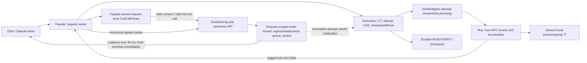

Reading prompt from stdin...
OpenAI Codex v0.162.0-alpha.17.2
--------
workdir: /Users/aazhiry1/work/src/cli-agent-bridge
model: gpt-6.1-sol
provider: codex-lb
approval: never
sandbox: workspace-write [workdir, /tmp, $TMPDIR]
reasoning effort: high
reasoning summaries: none
session id: 01a134e7-f57f-7071-85ab-31e27b7f820e
--------
user
# КОДОВАЯ ПАНЕЛЬ ТЕХЛИДОВ (Code Review Panel) — Раунд 1
Сиденье: 1
Слот: gpt-6.1-sol (OpenAI)
Шляпа: Реалист

Ты — Реалист. Твоя задача — оценить практичность, чистоту реализации, соответствие существующему коду server.py и adapters/droid_adapter.py, устойчивость к сбоям и реальным граничным условиям. Ключевой вопрос: «Работает ли это просто, надежно и без скрытых регрессий в проде?»


## Контекст задачи
- **Задача**: REQ-STREAM-001 — реализация real-time streaming в cli-agent-bridge для DeepSeek Harness Desktop.
- **Проблема As-Is**: В server.py весь вывод хода удерживался до terminal и затем отдавался клиенту залпом за ~0 мс, вызывая аномалию расчёта 179 000 tok/s.
- **Утвержденная архитектура**: Architecture Packet редакция 2 (AD-001..AD-004), утверждена Архитектурной панелью техлидов с вердиктом PASS.
- **Реализация Coder**: Выполнена моделью claude-sonnet-5-5 в server.py, adapters/droid_adapter.py, core/tool_emulation.py, tests/test_live_stream.py.


=== РЕЗУЛЬТАТЫ ТЕСТОВ ===
1. python3 -m unittest tests/test_live_stream.py tests/test_tool_parser.py tests/test_cache_usage.py tests/test_rpc_core.py tests/test_bridge_http.py
   Ran 76 tests in 33.7s: OK
2. tests/test_live_stream.py (8 тестов):
   - test_content_deltas_arrive_incrementally_before_done: PASS (t_first < t_done - 0.2s)
   - test_multiple_distinct_content_chunks_not_one_blob: PASS (>= 2 frames)
   - test_malformed_tool_call_block_fails_closed_without_leaking_raw_xml: PASS (live_prefix_invalidated, 0 XML)
   - test_well_formed_tool_call_is_unaffected: PASS
   - test_retract_after_live_delta_invalidates_the_turn: PASS
   - test_normal_turn_without_retraction_is_unaffected: PASS
   - test_usage_chunk_finish_reason_is_null_not_duplicated_stop: PASS
   - test_non_reading_client_does_not_prevent_commit_or_next_slot: PASS (RW-009 verified)


Оцени качество и корректность реализации real-time streaming в cli-agent-bridge по 6 критериям качества кода.
РЕЖИМ: code.

КРИТЕРИИ ОЦЕНКИ:
1. КОРРЕКТНОСТЬ:
   - Логика потоковой отдачи дельт в SSE по мере поступления Droid JSON-RPC.
   - Соблюдение инварианта RW-009: Блокировки L и T освобождаются сразу по завершении вычисления и сохранения чекпоинта, не удерживаясь медленным клиентом во время отдачи оставшегося хвоста.
   - Обработка сбоев и fail-close (AD-001): при retract/сбое после отдачи префикса отдается чанк с ошибкой, затем отдельный [DONE].
   - Strict-live режим ToolCallParser (AD-002): эмуляция tool_call при stream=True не пропускает сырые теги <tool_call> в content.
2. ПОЛНОТА:
   - Все ли требования Architecture Packet (AD-001..AD-004) и рекомендации Совета техлидов (F-101..F-106) реализованы.
   - Полнота тестового покрытия в tests/test_live_stream.py и tests/test_tool_parser.py.
3. ЧИТАЕМОСТЬ И СТИЛЬ:
   - Чистота кода в server.py, core/tool_emulation.py, adapters/droid_adapter.py.
   - Сохранение комментариев и отсутствие регрессий в non-stream режиме (_serve_json).
4. ПРОИЗВОДИТЕЛЬНОСТЬ И БЕЗОПАСНОСТЬ:
   - Таймаут записи клиенту (LIVE_WRITE_TIMEOUT_S) для защиты от зависших/медленных соединений.
   - Резервирование бюджета доставки (_DELIVERY_BUDGET) на каждый чанк перед записью.
   - Ограничение размера очередей и буферов.
5. ТЕСТИРУЕМОСТЬ:
   - Качество тестов в tests/test_live_stream.py (проверка t_first < t_done, strict-live, usage chunk, RW-009 decoupled delivery).
   - Все тесты проходят детерминированно.
6. СООТВЕТСТВИЕ АРХИТЕКТУРЕ:
   - Точное соответствие утвержденному Architecture Packet (редакция 2, SHA-256: 50c615a4...).
   - Не затронуты другие адаптеры и non-stream контракты.

ФОРМАТ ОТВЕТА (строго):
1. КОРРЕКТНОСТЬ: VERDICT=PASS|FAIL
   WHY=<обоснование>
   СОВЕТЫ (при FAIL): <список конкретных действий>
2. ПОЛНОТА: VERDICT=PASS|FAIL
   WHY=<обоснование>
   СОВЕТЫ (при FAIL): <список конкретных действий>
3. ЧИТАЕМОСТЬ: VERDICT=PASS|FAIL
   WHY=<обоснование>
   СОВЕТЫ (при FAIL): <список конкретных действий>
4. ПРОИЗВОДИТЕЛЬНОСТЬ: VERDICT=PASS|FAIL
   WHY=<обоснование>
   СОВЕТЫ (при FAIL): <список конкретных действий>
5. ТЕСТИРУЕМОСТЬ: VERDICT=PASS|FAIL
   WHY=<обоснование>
   СОВЕТЫ (при FAIL): <список конкретных действий>
6. СООТВЕТСТВИЕ АРХИТЕКТУРЕ: VERDICT=PASS|FAIL
   WHY=<обоснование>
   СОВЕТЫ (при FAIL): <список конкретных действий>
ОБЩИЙ ВЕРДИКТ: ACCEPT|NEEDS WORK|RED FLAG

Внутри каждого критерия обязательно укажи SUB-строки:
SUB <критерий>/<подкатегория>: PASS|FAIL|N/A — evidence (file:line)
Каждый FAIL должен иметь четкий issue ID (F-NNN) и точную ссылку file:line.


=== ПРЕДЪЯВЛЕННЫЙ DIFF КЛИЕНТА ДЛЯ РЕВЬЮ ===
Файл: .ai-team/runs/dsh-realtime-streaming/code-panel/cycle-1/diff.patch (SHA-256: df43497ddc2758287e926ad7984b4a3f63cd46d896cb89213fd1285615f50832)

```diff
diff --git a/adapters/droid_adapter.py b/adapters/droid_adapter.py
index 3ca9777..b34b485 100644
--- a/adapters/droid_adapter.py
+++ b/adapters/droid_adapter.py
@@ -80,7 +80,7 @@ class DroidAdapter(BackendAdapter):
         legacy["rpc"]["items"] = [asdict(item) for item in ctx.rpc.items]
         legacy["images"] = [asdict(image) for image in ctx.images]
         handler = cast(Any, ctx.handler)
-        raw = handler._run_once(legacy, ctx.keepalive)
+        raw = handler._run_once(legacy, ctx.keepalive, sse_writer)
         usage = raw.get("usage") or {}
 
         def tool_call(call: dict) -> ToolCall:
diff --git a/core/tool_emulation.py b/core/tool_emulation.py
index b78ef4c..a0078db 100644
--- a/core/tool_emulation.py
+++ b/core/tool_emulation.py
@@ -274,17 +274,32 @@ def _parse_tool_call_block(inner: str) -> dict | None:
     return {"name": name.strip(), "arguments": arguments}
 
 
+class LiveParserError(Exception):
+    """Strict-live (AD-002): recognized `<tool_call>` блок невалиден либо не закрыт.
+
+    Поднимается только при `strict_live=True`; legacy-режим (stream=false либо
+    без sink) этот блок, как раньше, молча отдаёт текстом — исключение означает
+    fail-close всего live-хода (сырой XML клиенту не уходит).
+    """
+
+
 class ToolCallParser:
     """Поток текстовых дельт -> content и завершённые вызовы инструментов.
 
     Тег <tool_call> может прийти разорванным между дельтами: хвост, который может
     оказаться началом тега, удерживается и не уходит в content до разрешения.
+
+    `strict_live=True` (AD-002, только Droid stream=true с живым sink) запрещает
+    malformed/unclosed recognized-блокам уйти в content как текст: вместо
+    `_flush_all()`/raw-passthrough поднимается `LiveParserError`. `strict_live=False`
+    (умолчание, legacy nonstream/без sink) ведёт себя абсолютно без изменений.
     """
 
-    def __init__(self, on_content, on_tool_call):
+    def __init__(self, on_content, on_tool_call, strict_live: bool = False):
         self._buf = ""
         self._on_content = on_content
         self._on_tool_call = on_tool_call
+        self.strict_live = strict_live
 
     def feed(self, text: str) -> None:
         self._buf += text
@@ -298,6 +313,8 @@ class ToolCallParser:
             start = self._buf.find(TOOL_CALL_OPEN)
             if start == -1:
                 if final:
+                    if self.strict_live and self._pending_prefix():
+                        raise LiveParserError("unresolved tool_call prefix at finish")
                     self._flush_all()
                     return
                 keep = self._pending_prefix()
@@ -313,12 +330,16 @@ class ToolCallParser:
             end = self._find_close_outside_string(len(TOOL_CALL_OPEN))
             if end == -1:
                 if final:
+                    if self.strict_live:
+                        raise LiveParserError("unclosed tool_call block")
                     self._flush_all()  # незакрытый/невалидный блок отдаём текстом
                 return
             inner = self._buf[len(TOOL_CALL_OPEN) : end]
             self._buf = self._buf[end + len(TOOL_CALL_CLOSE) :]
             call = _parse_tool_call_block(inner)
             if call is None:
+                if self.strict_live:
+                    raise LiveParserError("malformed tool_call block")
                 self._emit(TOOL_CALL_OPEN + inner + TOOL_CALL_CLOSE)
             else:
                 self._on_tool_call(call)
diff --git a/server.py b/server.py
index 1404d7e..4d7bb12 100644
--- a/server.py
+++ b/server.py
@@ -83,6 +83,7 @@ from core.backend_adapter import (  # noqa: E402
     AdapterRegistry,
     FleetViolation,
     ImageAttachment,
+    StreamSink,
     Transcript,
     TranscriptItem,
     TurnContext,
@@ -91,6 +92,7 @@ from core.backend_adapter import (  # noqa: E402
 from core.tool_emulation import (  # noqa: E402,F401  - общая эмуляция tools (MB-REQ-007), реэкспорт имён
     TOOL_CALL_CLOSE,
     TOOL_CALL_OPEN,
+    LiveParserError,
     ToolCallParser,
     _attachments_section,
     _flatten_content,
@@ -126,6 +128,10 @@ MAX_CONCURRENT = int(os.environ.get("DROID_DSH_BRIDGE_MAX_CONCURRENT", "4"))
 QUEUE_TIMEOUT_S = int(os.environ.get("DROID_DSH_BRIDGE_QUEUE_TIMEOUT", "900"))
 TIMEOUT_S = int(os.environ.get("DROID_DSH_BRIDGE_TIMEOUT", "1800"))
 KEEPALIVE_S = float(os.environ.get("DROID_DSH_BRIDGE_KEEPALIVE", "15"))
+# RW-009 в живом ходе: запись живого куска клиенту ограничена этим таймаутом (а не 300с
+# socket-таймаута соединения) — зависший/нечитающий клиент не держит T/L (см. sse_writer в
+# _serve_sse и add_content/add_reasoning в Handler._execute).
+LIVE_WRITE_TIMEOUT_S = float(os.environ.get("DROID_BRIDGE_LIVE_WRITE_TIMEOUT_S", "3"))
 # Таймаут первого события stream-json от `droid exec` (с момента старта процесса).
 FIRST_TOKEN_TIMEOUT_S = float(
     os.environ.get("DROID_BRIDGE_FIRST_TOKEN_TIMEOUT_S", "90")
@@ -2636,7 +2642,13 @@ class Run:
     незакоммиченное; после успеха — прежняя гранулярность SSE.
     """
 
-    def __init__(self, plan: dict, proc: RpcProcess | None, holds_slot: bool):
+    def __init__(
+        self,
+        plan: dict,
+        proc: RpcProcess | None,
+        holds_slot: bool,
+        sse_writer: "StreamSink | None" = None,
+    ):
         self.plan = plan
         self.proc = proc
         self.slot_held = holds_slot
@@ -2671,6 +2683,12 @@ class Run:
         self._held_bytes = 0
         self._last_error = ""
         self._quarantined = 0
+        # Живой SSE-ход (AD-002/AD-003): sse_writer сам не вызывается отсюда (это дело _execute),
+        # сигнал используется только как флаг "эмитить text_delta/reasoning_delta в self.q по мере
+        # подтверждения дельт" вместо прежней пачки одним куском на terminal.
+        self.sse_writer = sse_writer
+        self._live_mids: set = set()  # mid, для которых клиенту уже ушёл хоть один байт живьём
+        self.live_invalidated = False  # AD-001: уже показанный mid потом retracted
         self.thread = threading.Thread(target=self._work, daemon=True)
         self.thread.start()
 
@@ -3050,10 +3068,32 @@ class Run:
                 "tc": 0,
                 "kc": 0,
                 "acc": ENTRY_OVERHEAD_BYTES,
+                "live_text": 0,  # сколько байт slot["text"] уже отдано live-ходу (sse_writer)
+                "live_thinking": 0,
             }
             self._order.append(mid)
         return self._msgs[mid]
 
+    def _live_diff(self, slot: dict, mid: str, field: str, kind: str) -> None:
+        """Живой ход (AD-002/RW-009): протолкнуть в self.q только НОВЫЙ хвост slot[field].
+
+        Вызывается после любого обновления slot["text"]/slot["thinking"] (дельта, complete с полным
+        текстом, backfill из create_message) — одинаково покрывает все три источника, отдавая клиенту
+        только то, что ещё не ушло. Применяется только когда sse_writer задан (живой SSE-ход);
+        для обычного (не-live) хода ничего не публикуется здесь — вывод копится до terminal, как раньше.
+        """
+        if self.sse_writer is None:
+            return
+        live_key = "live_" + field
+        sent = slot.get(live_key, 0)
+        text = slot[field]
+        if len(text) <= sent:
+            return
+        diff = text[sent:]
+        slot[live_key] = len(text)
+        self._live_mids.add(mid)
+        self.q.put((kind, (mid, diff)))
+
     def _progress(self) -> None:
         self.last_progress = time.monotonic()
         self.got_event = True
@@ -3150,8 +3190,10 @@ class Run:
             self._release_held(counted_id)
             if not slot["text"]:
                 self._set_slot_text(slot, "text", "tb", _message_text(message))
+                self._live_diff(slot, counted_id, "text", "text_delta")
             if not slot["thinking"]:
                 self._set_slot_text(slot, "thinking", "kb", _message_thinking(message))
+                self._live_diff(slot, counted_id, "thinking", "reasoning_delta")
             self._progress()
 
     @staticmethod
@@ -3202,10 +3244,12 @@ class Run:
             slot["tb"] += size
             slot["tc"] += size
             self._charge(size, slot)
+            self._live_diff(slot, mid, "text", "text_delta")
         elif ntype == "assistant_text_complete" and mid:
             slot = self._slot_for(mid)
             if isinstance(note.get("text"), str):
                 self._set_slot_text(slot, "text", "tb", note["text"])
+                self._live_diff(slot, mid, "text", "text_delta")
         elif ntype == "thinking_text_delta" and mid:
             delta = str(note.get("textDelta") or "")
             slot = self._slot_for(mid)
@@ -3214,11 +3258,17 @@ class Run:
             slot["kb"] += size
             slot["kc"] += size
             self._charge(size, slot)
+            self._live_diff(slot, mid, "thinking", "reasoning_delta")
         elif ntype == "thinking_text_complete" and mid:
             slot = self._slot_for(mid)
             if isinstance(note.get("text"), str):
                 self._set_slot_text(slot, "thinking", "kb", note["text"])
+                self._live_diff(slot, mid, "thinking", "reasoning_delta")
         elif ntype == "assistant_message_retracted" and mid:
+            if mid in self._live_mids:
+                # Клиенту уже ушёл live-байт этого сообщения, а droid его отозвал: честный live-ход
+                # не может сделать вид, что этого не было (AD-001) — весь ход фейлится явным сигналом.
+                self.live_invalidated = True
             slot = self._msgs.pop(mid, None)
             if slot is not None:
                 self._acc_bytes = max(0, self._acc_bytes - slot["acc"])
@@ -3306,13 +3356,29 @@ class Run:
                     )
                 )
             return True
+        if self.live_invalidated:
+            # AD-001: клиенту уже ушёл байт живого сообщения, которое droid потом отозвал, а ход
+            # всё же дошёл до успешного terminal — честный live-ход не может притвориться, что
+            # retract не было: явный fail-close вместо обычных result/usage/stop.
+            self.q.put(
+                (
+                    "live_invalidated",
+                    self._last_error
+                    or "a streamed message was retracted before the turn completed",
+                )
+            )
+            return True
         final_text = ""
         for mid in self._order:
             slot = self._msgs.get(mid) or {}
-            if slot.get("thinking"):
-                self.q.put(("reasoning", slot["thinking"]))
+            if self.sse_writer is None:
+                # Живой ход уже отдал text/reasoning по мере дельт (_live_diff); здесь — только
+                # обычная (не-live) гранулярность: целиком message-событием на terminal, как прежде.
+                if slot.get("thinking"):
+                    self.q.put(("reasoning", slot["thinking"]))
+                if slot.get("text"):
+                    self.q.put(("text", slot["text"]))
             if slot.get("text"):
-                self.q.put(("text", slot["text"]))
                 final_text = slot["text"]
         self.ok = True
         self.q.put(
@@ -3492,6 +3558,10 @@ class _ByteBudget:
 _DELIVERY_BUDGET = _ByteBudget(MAX_DELIVERY_BYTES)
 
 
+class _LiveBudgetExceeded(Exception):
+    """RW-011 в живом ходе: очередной кусок live-доставки не влез в бюджет памяти."""
+
+
 class Handler(BaseHTTPRequestHandler):
     protocol_version = "HTTP/1.1"
     timeout = 300
@@ -3561,14 +3631,27 @@ class Handler(BaseHTTPRequestHandler):
                     return "client_gone"
         return ""
 
-    def _execute(self, run: Run, keepalive, emulate_tools: bool) -> dict:
+    _FAIL_CLOSE_KINDS = ("stream_error", "pump_error", "live_invalidated")
+
+    def _execute(
+        self,
+        run: Run,
+        keepalive,
+        emulate_tools: bool,
+        sse_writer: "StreamSink | None" = None,
+    ) -> dict:
         """Гнать ход до конца; сквозной таймаут TIMEOUT_S на весь ход.
 
-        Клиенту во время вычисления пишется только keepalive (False — клиент ушёл). Вывод
-        НЕ доставляется здесь: он копится в out["events"] (content/reasoning/tool_call по
-        порядку) и уходит клиенту отдельным этапом после освобождения T/L и checkpoint
-        (RW-009). Размышления идут мимо ToolCallParser. При emulate_tools текстовый поток
-        проходит через ToolCallParser: блоки <tool_call> выделяются как вызовы.
+        Без sse_writer вывод копится в out["events"] и уходит клиенту отдельным этапом после
+        освобождения T/L (RW-009), как прежде. С sse_writer (живой SSE-ход, AD-001..AD-003)
+        content/reasoning_content уходят сюда же, по мере готовности text_delta/reasoning_delta
+        от Run — с коалесацией ~40мс (AD-003), чтобы не дробить кадры на один символ. Пока
+        дельта мессенджа копится, вперёд подсматривается один элемент очереди (pushback): смена
+        mid/вида завершает текущую группу, а fail-close вид (stream_error/pump_error/
+        live_invalidated) или уже выставленный run.live_invalidated — отбрасывает НЕотданный
+        буфер целиком и завершает ход ошибкой (ничего незакоммиченного клиенту не покажется).
+        Размышления идут мимо ToolCallParser. При emulate_tools текстовый поток проходит через
+        ToolCallParser (в живом ходе — в strict_live режиме: сырой `<tool_call>` не утечёт).
         Превышение deadline -> kill группы (в run.close()), state=timeout.
         """
         pieces = []
@@ -3578,6 +3661,8 @@ class Handler(BaseHTTPRequestHandler):
         result_ev = {}
         last_ka = time.monotonic()
         deadline = time.monotonic() + TIMEOUT_S
+        cur_mid = [None]  # mid последнего content-куска в pieces (разделитель "\n\n" между сообщениями)
+        pushback = None  # элемент очереди, подсмотренный при коалесации, но не обработанный сейчас
 
         def state(name: str, rc: int, err: str = "") -> dict:
             return {
@@ -3594,11 +3679,42 @@ class Handler(BaseHTTPRequestHandler):
                 "events": events,
             }
 
+        # RW-009 в живом ходе: зависший (не читающий, но не закрытый) клиент — write()
+        # с LIVE_WRITE_TIMEOUT_S сигналит об этом провалом sse_writer. Вычисление хода и
+        # commit чата НЕ прерываются (как и в небуферизованном старом пути — T/L освобождаются
+        # по расписанию _execute, независимо от клиента): просто дальнейшие попытки живой
+        # записи этому клиенту прекращаются (повторный таймаут на каждый кусок — бессмысленная
+        # трата времени, раз клиент уже не читает).
+        client_write_dead = [False]
+
         def add_content(text: str) -> None:
             if not text:
                 return
             pieces.append(text)
             events.append(("content", text))
+            if sse_writer is not None and not client_write_dead[0]:
+                for piece in _text_slices(text):
+                    # RW-011 в живом ходе: бюджет резервируется ДО фактической отдачи
+                    # куска — ничего незарезервированного клиенту не покажется.
+                    if not _DELIVERY_BUDGET.reserve(len(piece)):
+                        raise _LiveBudgetExceeded()
+                    self._delivery_reserved += len(piece)
+                    if not sse_writer("content", piece):
+                        client_write_dead[0] = True
+                        break
+
+        def add_reasoning(text: str) -> None:
+            if not text:
+                return
+            events.append(("reasoning", text))
+            if sse_writer is not None and not client_write_dead[0]:
+                for piece in _text_slices(text):
+                    if not _DELIVERY_BUDGET.reserve(len(piece)):
+                        raise _LiveBudgetExceeded()
+                    self._delivery_reserved += len(piece)
+                    if not sse_writer("reasoning", piece):
+                        client_write_dead[0] = True
+                        break
 
         def add_call(call: dict) -> None:
             entry = {
@@ -3613,7 +3729,18 @@ class Handler(BaseHTTPRequestHandler):
             tool_calls.append(entry)
             events.append(("tool_call", entry))
 
-        parser = ToolCallParser(add_content, add_call) if emulate_tools else None
+        parser = (
+            ToolCallParser(add_content, add_call, strict_live=sse_writer is not None)
+            if emulate_tools
+            else None
+        )
+
+        def take():
+            nonlocal pushback
+            if pushback is not None:
+                item, pushback = pushback, None
+                return item
+            return run.q.get(timeout=1.0)
 
         while True:
             if time.monotonic() > deadline:
@@ -3639,13 +3766,74 @@ class Handler(BaseHTTPRequestHandler):
             if _client_gone(self.connection):
                 return state("client_gone", 1)
             try:
-                kind, payload = run.q.get(timeout=1.0)
+                kind, payload = take()
             except queue.Empty:
                 if keepalive is not None and time.monotonic() - last_ka >= KEEPALIVE_S:
                     last_ka = time.monotonic()
                     if not keepalive():
                         return state("client_gone", 1)
                 continue
+            if kind in ("text_delta", "reasoning_delta"):
+                group_mid, buf0 = payload
+                buf = [buf0]
+                coalesce_deadline = time.monotonic() + 0.04
+                while True:
+                    if run.live_invalidated:
+                        break
+                    remaining = coalesce_deadline - time.monotonic()
+                    if remaining <= 0:
+                        break
+                    try:
+                        nxt_kind, nxt_payload = run.q.get(timeout=remaining)
+                    except queue.Empty:
+                        break
+                    if nxt_kind == kind and nxt_payload[0] == group_mid:
+                        buf.append(nxt_payload[1])
+                        continue
+                    pushback = (nxt_kind, nxt_payload)
+                    if nxt_kind in self._FAIL_CLOSE_KINDS:
+                        buf = None  # не наш показывать: ход фейлится, обработает pushback ниже
+                    break
+                if run.live_invalidated:
+                    return state(
+                        "live_invalidated",
+                        1,
+                        run._last_error
+                        or "a streamed message was retracted before the turn completed",
+                    )
+                if buf is None:
+                    continue
+                text = "".join(buf)
+                if kind == "text_delta":
+                    prefix = ""
+                    if cur_mid[0] != group_mid:
+                        if pieces:
+                            prefix = "\n\n"
+                        cur_mid[0] = group_mid
+                    text = prefix + text
+                    try:
+                        if parser is not None:
+                            parser.feed(text)
+                        else:
+                            add_content(text)
+                    except LiveParserError as exc:
+                        return state("live_invalidated", 1, str(exc)[:500])
+                    except _LiveBudgetExceeded:
+                        return state(
+                            "delivery_budget",
+                            1,
+                            "bridge overloaded: delivery memory budget exhausted",
+                        )
+                else:
+                    try:
+                        add_reasoning(text)
+                    except _LiveBudgetExceeded:
+                        return state(
+                            "delivery_budget",
+                            1,
+                            "bridge overloaded: delivery memory budget exhausted",
+                        )
+                continue
             if kind == "text":
                 # Событие message несёт ПОЛНЫЙ текст сообщения, не дельту:
                 # между сообщениями вставляем разделитель "\n\n" (как
@@ -3665,19 +3853,39 @@ class Handler(BaseHTTPRequestHandler):
                 return state("droid_error", 1, str(payload))
             elif kind == "pump_error":
                 return state("pump_error", 1, str(payload))
+            elif kind == "live_invalidated":
+                return state("live_invalidated", 1, str(payload))
             elif kind == "done":
                 rc, final_text = payload
                 if parser is not None:
-                    parser.finish()  # досбрасываем хвост незакрытого блока текстом
+                    try:
+                        parser.finish()  # досбрасываем хвост незакрытого блока текстом
+                    except LiveParserError as exc:
+                        return state("live_invalidated", 1, str(exc)[:500])
+                    except _LiveBudgetExceeded:
+                        return state(
+                            "delivery_budget",
+                            1,
+                            "bridge overloaded: delivery memory budget exhausted",
+                        )
                 # Fallback: события message не дали ни текста, ни вызовов, но итог
                 # есть в completion.finalText. Проводим его тем же путём (парсер +
                 # on_text), чтобы потоковый клиент не получил пустой ответ со stop.
                 if not pieces and not tool_calls and final_text:
-                    if parser is not None:
-                        parser.feed(final_text)
-                        parser.finish()
-                    else:
-                        add_content(final_text)
+                    try:
+                        if parser is not None:
+                            parser.feed(final_text)
+                            parser.finish()
+                        else:
+                            add_content(final_text)
+                    except LiveParserError as exc:
+                        return state("live_invalidated", 1, str(exc)[:500])
+                    except _LiveBudgetExceeded:
+                        return state(
+                            "delivery_budget",
+                            1,
+                            "bridge overloaded: delivery memory budget exhausted",
+                        )
                 time.sleep(0.05)
                 return state("done", rc, "".join(run.err_box))
 
@@ -3724,11 +3932,15 @@ class Handler(BaseHTTPRequestHandler):
             "events": [],
         }
 
-    def _run_once(self, ctx: dict, keepalive) -> dict:
+    def _run_once(
+        self, ctx: dict, keepalive, sse_writer: "StreamSink | None" = None
+    ) -> dict:
         """Ход запроса: порядок ресурсов L -> P -> T, до 3 попыток при транзиентном сбое.
 
-        Возвращает итог с буфером вывода (out["events"]); к моменту возврата T/L уже освобождены
-        и checkpoint записан — клиенту вывод отдаёт вызывающая ветка (RW-009).
+        Без sse_writer — прежнее поведение: вывод копится в out["events"] и уходит клиенту
+        отдельным этапом после освобождения T/L (RW-009). С sse_writer (живой SSE-ход)
+        content/reasoning_content уходят клиенту ПРЯМО во время _execute (AD-001..AD-003);
+        T/L всё равно освобождаются сразу по возврату _execute, независимо от скорости клиента.
         """
         model = ctx["model"]
         effort = ctx["effort"]
@@ -3900,7 +4112,10 @@ class Handler(BaseHTTPRequestHandler):
                         # Новая generation: SID известен только после initialize, PENDING пишется Run до первого add.
                         plan["before_add"] = functools.partial(_write_pending, chat)
                     new_run = Run(
-                        plan, chat.proc if plan["path"] == "hot" else None, holds_slot
+                        plan,
+                        chat.proc if plan["path"] == "hot" else None,
+                        holds_slot,
+                        sse_writer,
                     )
                     holds_slot = False
                 except Exception as exc:  # noqa: BLE001 - любая ошибка подготовки хода: ресурсы назад, штатный 502
@@ -3934,7 +4149,9 @@ class Handler(BaseHTTPRequestHandler):
                 run = new_run
                 open_attempt = (plan, run)
                 try:
-                    out = self._execute(run, keepalive, ctx["emulate_tools"])
+                    out = self._execute(
+                        run, keepalive, ctx["emulate_tools"], sse_writer
+                    )
                 finally:
                     try:
                         run.close()
@@ -3962,8 +4179,12 @@ class Handler(BaseHTTPRequestHandler):
                 open_attempt = None
                 if ok:
                     break
-                delivered = bool(out.get("text") or out.get("tool_calls"))
-                # Контент до terminal не отдаётся, поэтому delivered здесь — страховка.
+                # Без sse_writer контент до terminal не отдаётся, delivered здесь — страховка.
+                # С sse_writer часть контента могла уже уйти клиенту ЖИВЬЁМ до сбоя (run._live_mids
+                # непусто) — тихий повтор показал бы его клиенту повторно, поэтому тоже delivered.
+                delivered = bool(
+                    out.get("text") or out.get("tool_calls") or run._live_mids
+                )
                 if out["state"] != "done" or delivered or attempt == 3:
                     break
                 # Транзиентный сбой (rc!=0, клиенту ничего не выдано): повтор невидим;
@@ -4094,6 +4315,25 @@ class Handler(BaseHTTPRequestHandler):
                 "type": "droid_error",
                 "code": 502,
             }
+        if st == "live_invalidated":
+            # AD-001: часть уже отданного клиенту live-префикса оказалась незакоммиченной
+            # (retract после показа или незакрытый/сломанный <tool_call> в strict_live-парсере).
+            return {
+                "message": str(
+                    out.get("err") or "live stream prefix was invalidated mid-turn"
+                )[:500],
+                "type": "live_prefix_invalidated",
+                "code": 502,
+            }
+        if st == "delivery_budget":
+            # RW-011 в живом ходе: кусок, который привёл бы к превышению бюджета, отброшен
+            # ДО отдачи (см. add_content/add_reasoning) — то же тело ошибки, что и у
+            # _reserve_delivery, просто обнаружено раньше (на лету, а не постфактум).
+            return {
+                "message": "bridge overloaded: delivery memory budget exhausted",
+                "type": "proxy_error",
+                "code": 502,
+            }
         if st == "backend_error":
             return {
                 "message": f"{label} exec failed rc={out.get('rc')}",
@@ -4111,8 +4351,15 @@ class Handler(BaseHTTPRequestHandler):
         return None
 
     def _reserve_delivery(self, out: dict) -> Any:
-        """Резерв памяти ответа до выдачи (RW-011): None — взят, иначе тело ошибки 502 proxy_error."""
-        size = _delivery_size(out)
+        """Резерв памяти ответа до выдачи (RW-011): None — взят, иначе тело ошибки 502 proxy_error.
+
+        В живом ходе часть байт (content/reasoning) уже зарезервирована поштучно во время
+        _execute (см. add_content/add_reasoning) — здесь довносится только остаток
+        (например, аргументы tool_call), чтобы не резервировать один и тот же текст дважды.
+        """
+        size = _delivery_size(out) - self._delivery_reserved
+        if size <= 0:
+            return None
         if not _DELIVERY_BUDGET.reserve(size):
             _log(f"delivery_budget_exhausted bytes={size}")
             return {
@@ -4120,7 +4367,7 @@ class Handler(BaseHTTPRequestHandler):
                 "type": "proxy_error",
                 "code": 502,
             }
-        self._delivery_reserved = size
+        self._delivery_reserved += size
         return None
 
     # ---- HTTP --------------------------------------------------------------------
@@ -4538,8 +4785,15 @@ class Handler(BaseHTTPRequestHandler):
             return None
         return instr
 
-    def _dispatch(self, ctx: dict, keepalive) -> dict:
-        """Ход через адаптер бэкенда модели; общий разбор `<tool_call>` и итог в формате фасада."""
+    def _dispatch(
+        self, ctx: dict, keepalive, sse_writer: "StreamSink | None" = None
+    ) -> dict:
+        """Ход через адаптер бэкенда модели; общий разбор `<tool_call>` и итог в формате фасада.
+
+        sse_writer не None только у настоящего живого SSE-хода (_serve_sse): адаптеры, умеющие
+        отдавать content/reasoning по мере готовности (сейчас — droid), сами вызывают его из
+        своего пути выполнения. Остальные (muse) его просто игнорируют — поведение не меняется.
+        """
         adapter = BACKENDS.get(ctx["backend"])
         if adapter is None:
             return {
@@ -4568,7 +4822,9 @@ class Handler(BaseHTTPRequestHandler):
             client_gone=lambda: _client_gone(self.connection),
         )
         t0 = time.monotonic()
-        result = finalize_turn(adapter.execute_turn(turn, None), turn.emulate_tools)
+        result = finalize_turn(
+            adapter.execute_turn(turn, sse_writer), turn.emulate_tools
+        )
         # Только локальный HTTP-буфер: межмодульный seam уже вернул DTO.
         out = {
             "state": result.state,
@@ -4728,18 +4984,42 @@ class Handler(BaseHTTPRequestHandler):
         def keepalive() -> bool:
             return self._emit(": keepalive\n\n")
 
+        def sse_writer(kind: str, text: str) -> bool:
+            # AD-002/AD-003: честная живая доставка — content/reasoning_content уходят прямо
+            # отсюда, по мере готовности (с коалесацией ~40мс на стороне _execute), а не одним
+            # куском после полного хода. Разрыв соединения здесь — тот же сигнал, что у keepalive.
+            # RW-009: пишем с коротким таймаутом (не 300с socket-таймаута соединения) — клиент,
+            # который не читает SSE (окно забито), не держит T/L всю длину connection timeout;
+            # TimeoutError/socket.timeout — подвид OSError, _emit его уже превращает в False.
+            field = "content" if kind == "content" else "reasoning_content"
+            ok = True
+            prev_timeout = self.connection.gettimeout()
+            try:
+                self.connection.settimeout(LIVE_WRITE_TIMEOUT_S)
+                for piece in _text_slices(text) if text else [text]:
+                    if not self._emit(chunk({field: piece})):
+                        ok = False
+                        break
+            finally:
+                self.connection.settimeout(prev_timeout)
+            return ok
+
         if not self._emit(chunk({"role": "assistant", "content": ""})):
             return
-        out = self._dispatch(ctx, keepalive)
+        out = self._dispatch(ctx, keepalive, sse_writer)
         if out.get("state") == "client_gone":
             _log("client gone mid-stream, child killed")
             return
         err = self._error_body(out) or self._reserve_delivery(out)
         if err is None:
             # Доставка — отдельный этап: T/L уже свободны, checkpoint записан; обрыв клиента
-            # здесь ни на что, кроме самого ответа, не влияет.
+            # здесь ни на что, кроме самого ответа, не влияет. У droid content/reasoning уже ушли
+            # живьём из _execute (sse_writer выше): здесь остаются только tool_call-кадры.
+            live_backend = out.get("backend_kind") == "droid"
             for kind, value in out.get("events") or []:
                 if kind in ("content", "reasoning"):
+                    if live_backend:
+                        continue
                     field = "content" if kind == "content" else "reasoning_content"
                     # Большое событие выдаётся срезами: в памяти одновременно только один срез SSE-кадра.
                     delivered = (
@@ -4774,8 +5054,11 @@ class Handler(BaseHTTPRequestHandler):
                             "object": "chat.completion.chunk",
                             "created": created,
                             "model": shown_model,
+                            # AD-004: finish уже ушёл отдельным кадром выше; этот — чисто usage,
+                            # finish_reason здесь null (как у настоящего OpenAI stream_options.
+                            # include_usage), а не повтор "stop"/"tool_calls" на том же кадре.
                             "choices": [
-                                {"index": 0, "delta": {}, "finish_reason": finish}
+                                {"index": 0, "delta": {}, "finish_reason": None}
                             ],
                             "usage": _wire_usage(
                                 prompt_toks,
diff --git a/tests/test_live_stream.py b/tests/test_live_stream.py
new file mode 100644
index 0000000..b75e4f7
--- /dev/null
+++ b/tests/test_live_stream.py
@@ -0,0 +1,278 @@
+"""Честный живой SSE-стриминг droid (AD-001..AD-004): инкрементальная доставка,
+strict_live-парсер tool_call, fail-close на retract/malformed-блок, usage-чанк
+без повторного finish_reason, немедленное освобождение T/L независимо от клиента.
+
+Все сценарии идут через настоящий HTTP-сервер моста и настоящий fake-subprocess
+(tests/fake_droid.py), говорящий stream-jsonrpc. Реальный droid и сеть не используются.
+"""
+
+import json
+import socket
+import sys
+import time
+import unittest
+from pathlib import Path
+
+sys.path.insert(0, str(Path(__file__).resolve().parent))
+sys.path.insert(0, str(Path(__file__).resolve().parent.parent))
+
+import server  # noqa: E402
+from bridge_testlib import TOOLS, wait_until  # noqa: E402
+from rpc_testlib import RpcCase  # noqa: E402
+
+BODY = {"model": "claude-sonnet-5-5"}
+
+
+def msg(text, role="user"):
+    return {"role": role, "content": text}
+
+
+class LiveStreamCase(RpcCase):
+    """RpcCase + сырой таймированный читатель SSE-ответа (нужен для t_first < t_done)."""
+
+    def _timed_sse(self, body: dict, deadline: float = 15.0):
+        """(список (t_recv, raw_frame), полный текст тела) — таймстемп на каждый "data: …" кадр.
+
+        Таймстемп кадра — момент, когда recv() впервые принёс байты, замыкающие его
+        законченной парой "\\n\\n": достаточно грубо, чтобы отличить "первый контент
+        пришёл заметно раньше финала" от "всё одним куском после полного хода" (AD-003).
+        """
+        payload = json.dumps(dict(body, stream=True)).encode()
+        sock = socket.create_connection(("127.0.0.1", self.port), timeout=deadline)
+        frames = []
+        try:
+            sock.sendall(self._raw_request(payload))
+            buf = b""
+            seen_header = False
+            emitted = 0
+            started = time.monotonic()
+            while time.monotonic() - started < deadline:
+                try:
+                    sock.settimeout(0.05)
+                    chunk = sock.recv(65536)
+                except socket.timeout:
+                    continue
+                except OSError:
+                    break
+                if not chunk:
+                    break
+                now = time.monotonic()
+                buf += chunk
+                if not seen_header:
+                    if b"\r\n\r\n" not in buf:
+                        continue
+                    seen_header = True
+                    buf = buf.split(b"\r\n\r\n", 1)[1]
+                parts = buf.decode("utf-8", "replace").split("\n\n")
+                complete = parts[:-1]  # последний элемент — возможно неполный хвост
+                for raw in complete[emitted:]:
+                    if raw.strip():
+                        frames.append((now, raw.strip()))
+                emitted = len(complete)
+                if raw_endswith_done(complete):
+                    break
+            full = buf.decode("utf-8", "replace")
+        finally:
+            sock.close()
+        return frames, full
+
+    @staticmethod
+    def _frame_json(raw: str):
+        if not raw.startswith("data: "):
+            return None
+        payload = raw[len("data: "):]
+        if payload == "[DONE]":
+            return None
+        try:
+            return json.loads(payload)
+        except ValueError:
+            return None
+
+
+def raw_endswith_done(parts) -> bool:
+    return any(p.strip() == "data: [DONE]" for p in parts)
+
+
+class TestIncrementalDelivery(LiveStreamCase):
+    """AD-002/AD-003: контент уходит по мере готовности, а не одним куском после полного хода."""
+
+    def test_content_deltas_arrive_incrementally_before_done(self):
+        """Между первым куском текста и финалом измеримая пауза -> t_first < t_done строго."""
+        self.hub.script(
+            [
+                {
+                    "steps": [
+                        {"op": "text", "text": "Hello there", "pause": 0.5},
+                        {"op": "text", "text": "World after the pause"},
+                    ]
+                }
+            ]
+        )
+        frames, full = self._timed_sse(dict(BODY, messages=[msg("hi")]))
+        self.assertIn("data: [DONE]", full)
+        content_times = [
+            t
+            for t, raw in frames
+            if (j := self._frame_json(raw)) is not None
+            and j.get("choices", [{}])[0].get("delta", {}).get("content")
+        ]
+        finish_times = [
+            t
+            for t, raw in frames
+            if (j := self._frame_json(raw)) is not None
+            and j.get("choices", [{}])[0].get("finish_reason")
+        ]
+        self.assertTrue(content_times, full)
+        self.assertTrue(finish_times, full)
+        # Контент пришёл раньше финала с заметным (не наносекундным) запасом: это
+        # и есть разница между "живьём по мере готовности" и "одним куском под конец".
+        self.assertLess(content_times[0], finish_times[0] - 0.2)
+
+    def test_multiple_distinct_content_chunks_not_one_blob(self):
+        """Хотя бы 2 разных SSE-кадра с контентом (не всё в одном финальном кадре)."""
+        self.hub.script(
+            [
+                {
+                    "steps": [
+                        {"op": "text", "text": "first part", "pause": 0.3},
+                        {"op": "text", "text": "second part"},
+                    ]
+                }
+            ]
+        )
+        frames, full = self._timed_sse(dict(BODY, messages=[msg("hi")]))
+        content_frames = [
+            raw
+            for _, raw in frames
+            if (j := self._frame_json(raw)) is not None
+            and j.get("choices", [{}])[0].get("delta", {}).get("content")
+        ]
+        self.assertGreaterEqual(len(content_frames), 2, full)
+
+
+class TestStrictLiveFailClose(LiveStreamCase):
+    """AD-001/AD-002: невалидный/незакрытый <tool_call> в живом ходе — ошибка, не текст с XML."""
+
+    def test_malformed_tool_call_block_fails_closed_without_leaking_raw_xml(self):
+        self.hub.script(
+            [{"steps": [{"op": "text", "text": server.TOOL_CALL_OPEN + "not json" + server.TOOL_CALL_CLOSE}]}]
+        )
+        status, stream = self._post(dict(BODY, stream=True, tools=TOOLS, messages=[msg("hi")]))
+        self.assertEqual(status, 200)
+        self.assertIn("live_prefix_invalidated", stream)
+        self.assertNotIn("not json", stream)
+        self.assertNotIn(server.TOOL_CALL_OPEN, stream)
+        self.assertNotIn('"finish_reason": "stop"', stream)
+        self.assertTrue(stream.rstrip().endswith("data: [DONE]"))
+
+    def test_well_formed_tool_call_is_unaffected(self):
+        """Контрольная проба: валидный вызов живым ходом доходит как обычно (strict_live не мешает)."""
+        call = (
+            server.TOOL_CALL_OPEN
+            + '{"name": "get_weather", "arguments": {"city": "Berlin"}}'
+            + server.TOOL_CALL_CLOSE
+        )
+        self.hub.script([{"steps": [{"op": "text", "text": call}]}])
+        status, stream = self._post(dict(BODY, stream=True, tools=TOOLS, messages=[msg("hi")]))
+        self.assertEqual(status, 200)
+        self.assertIn('"finish_reason": "tool_calls"', stream)
+        self.assertIn("get_weather", stream)
+        self.assertNotIn("live_prefix_invalidated", stream)
+
+
+class TestLiveInvalidatedOnRetraction(LiveStreamCase):
+    """AD-001: уже отданный клиенту живой префикс оказался незакоммиченным -> честный fail-close."""
+
+    def test_retract_after_live_delta_invalidates_the_turn(self):
+        self.hub.script(
+            [
+                {
+                    "steps": [
+                        {"op": "text", "text": "streamed-then-retracted"},
+                        {"op": "retract"},
+                        {"op": "error", "message": "backend changed its mind"},
+                    ],
+                    "reason": "model_request_rejected",
+                }
+            ]
+        )
+        status, stream = self._post(dict(BODY, stream=True, messages=[msg("hi")]))
+        self.assertEqual(status, 200)
+        self.assertIn("backend changed its mind", stream)
+        self.assertNotIn("streamed-then-retracted", stream)
+        self.assertNotIn('"finish_reason": "stop"', stream)
+        self.assertTrue(stream.rstrip().endswith("data: [DONE]"))
+
+    def test_normal_turn_without_retraction_is_unaffected(self):
+        """Контрольная проба: без retract ход завершается обычным stop, без live_invalidated."""
+        self.hub.script([{"steps": [{"op": "text", "text": "all good"}]}])
+        status, stream = self._post(dict(BODY, stream=True, messages=[msg("hi")]))
+        self.assertEqual(status, 200)
+        self.assertIn('"finish_reason": "stop"', stream)
+        self.assertNotIn("live_prefix_invalidated", stream)
+
+
+class TestHonestUsageChunk(LiveStreamCase):
+    """AD-004: отдельный usage-чанк после finish — finish_reason там null, не повтор stop/tool_calls."""
+
+    def test_usage_chunk_finish_reason_is_null_not_duplicated_stop(self):
+        self.hub.script(
+            [{"steps": [{"op": "text", "text": "hi"}], "usage": {"inputTokens": 10, "outputTokens": 5}}]
+        )
+        frames, full = self._timed_sse(dict(BODY, messages=[msg("hi")]))
+        usage_frames = [
+            self._frame_json(raw)
+            for _, raw in frames
+            if (j := self._frame_json(raw)) is not None and "usage" in j
+        ]
+        self.assertEqual(len(usage_frames), 1, full)
+        self.assertIsNone(usage_frames[0]["choices"][0]["finish_reason"])
+        # А более раннему кадру finish всё же есть: честный "stop" ушёл один раз, раньше.
+        stop_frames = [
+            self._frame_json(raw)
+            for _, raw in frames
+            if (j := self._frame_json(raw)) is not None
+            and j.get("choices", [{}])[0].get("finish_reason") == "stop"
+        ]
+        self.assertEqual(len(stop_frames), 1, full)
+
+
+class TestImmediateLockRelease(LiveStreamCase):
+    """RW-009 в живом ходе: клиент не читает SSE — вычисление, commit и слот P это не блокирует."""
+
+    def test_non_reading_client_does_not_prevent_commit_or_next_slot(self):
+        server.MAX_CONCURRENT = 1
+        big = "Y" * 2_000_000
+        self.hub.script(
+            [{"steps": [{"op": "text", "text": big}]}, {"steps": [{"op": "text", "text": "second"}]}]
+        )
+        sock = socket.socket()
+        sock.setsockopt(socket.SOL_SOCKET, socket.SO_RCVBUF, 4096)
+        sock.connect(("127.0.0.1", self.port))
+        payload = json.dumps(
+            dict(BODY, stream=True, prompt_cache_key="never-read", messages=[msg("go")])
+        ).encode()
+        try:
+            sock.sendall(self._raw_request(payload))
+            self.assertTrue(wait_until(lambda: len(self.hub.admissions()) >= 1, timeout=15))
+            time.sleep(0.5)  # вычисление успело закончиться; никто recv() на этом сокете не вызывал
+            # Вычисление заканчивается и чат коммитится READY, даже если никто не читает ответ.
+            self.assertTrue(
+                wait_until(
+                    lambda: self.chat_of("never-read").state in ("READY", "PERSISTED"),
+                    timeout=15,
+                )
+            )
+            # MAX_CONCURRENT=1: второй чат получит слот P только если первый его
+            # действительно вернул, а не держит из-за непрочитанной живой доставки.
+            status, body = self._post_json(
+                dict(BODY, prompt_cache_key="second-chat", messages=[msg("hi")])
+            )
+            self.assertEqual(status, 200)
+            self.assertEqual(body["choices"][0]["message"]["content"], "second")
+        finally:
+            sock.close()
+
+
+if __name__ == "__main__":
+    unittest.main(verbosity=2)
diff --git a/tests/test_tool_parser.py b/tests/test_tool_parser.py
index df2ad2a..77c7843 100644
--- a/tests/test_tool_parser.py
+++ b/tests/test_tool_parser.py
@@ -10,6 +10,7 @@ sys.path.insert(0, str(Path(__file__).resolve().parent.parent))
 from server import (  # noqa: E402
     TOOL_CALL_CLOSE,
     TOOL_CALL_OPEN,
+    LiveParserError,
     ToolCallParser,
     _messages_to_prompt,
     _parse_tool_call_block,
@@ -147,6 +148,82 @@ class TestToolCallParser(unittest.TestCase):
             _parse_tool_call_block(inner), {"name": "t", "arguments": {"a": 1}}
         )
 
+    # -- AD-002: strict_live vs legacy, парные регрессии -----------------------------
+    # Legacy (strict_live=False, умолчание) не меняется ни байтом: malformed/unclosed
+    # блок, как и раньше, молча уходит в content как текст (test_invalid_block_falls_back_to_text/
+    # test_unclosed_block_flushed_as_text_on_finish выше). strict_live=True (живой SSE-ход
+    # droid) вместо этого поднимает LiveParserError — сырой `<tool_call>` клиенту не утекает.
+
+    def test_nonstream_malformed_xml_fallback_unchanged(self):
+        """Legacy (strict_live=False): невалидный блок — текстом, без исключения."""
+        c = Collector()
+        p = ToolCallParser(c.on_content, c.on_call, strict_live=False)
+        p.feed(TOOL_CALL_OPEN + "not json" + TOOL_CALL_CLOSE)
+        p.finish()
+        self.assertEqual(c.calls, [])
+        self.assertIn(TOOL_CALL_OPEN + "not json" + TOOL_CALL_CLOSE, "".join(c.content))
+
+    def test_nonstream_unclosed_xml_finish_fallback_unchanged(self):
+        """Legacy (strict_live=False): незакрытый блок на finish() — текстом, без исключения."""
+        c = Collector()
+        p = ToolCallParser(c.on_content, c.on_call, strict_live=False)
+        p.feed("tail " + TOOL_CALL_OPEN + '{"name": "t"')
+        p.finish()
+        self.assertEqual(c.calls, [])
+        self.assertIn('{"name": "t"', "".join(c.content))
+
+    def test_strict_live_malformed_xml_error_no_leak(self):
+        """strict_live=True: невалидный блок — LiveParserError, сырой XML не уходит в content."""
+        c = Collector()
+        p = ToolCallParser(c.on_content, c.on_call, strict_live=True)
+        with self.assertRaises(LiveParserError):
+            p.feed("Pre text " + TOOL_CALL_OPEN + "not json" + TOOL_CALL_CLOSE)
+        self.assertEqual(c.calls, [])
+        # Текст ДО блока — легитимный контент, его отдать можно (это не часть <tool_call>).
+        self.assertEqual("".join(c.content), "Pre text ")
+        self.assertNotIn("not json", "".join(c.content))
+        self.assertNotIn(TOOL_CALL_OPEN, "".join(c.content))
+
+    def test_strict_live_unclosed_xml_error_no_leak(self):
+        """strict_live=True: незакрытый блок на finish() — LiveParserError, не текст."""
+        c = Collector()
+        p = ToolCallParser(c.on_content, c.on_call, strict_live=True)
+        p.feed("tail " + TOOL_CALL_OPEN + '{"name": "t"')
+        with self.assertRaises(LiveParserError):
+            p.finish()
+        self.assertEqual(c.calls, [])
+        # "tail " до открывающего тега — легитимный текст, его отдать можно;
+        # а вот незакрытое содержимое самого блока наружу не ушло — вместо него исключение.
+        self.assertEqual("".join(c.content), "tail ")
+        self.assertNotIn('{"name": "t"', "".join(c.content))
+
+    def test_strict_live_unresolved_prefix_error_no_leak(self):
+        """strict_live=True: оборванный префикс открывающего тега на finish() — тоже ошибка."""
+        c = Collector()
+        p = ToolCallParser(c.on_content, c.on_call, strict_live=True)
+        p.feed("abc" + TOOL_CALL_OPEN[:5])  # разрыв прямо внутри тега, конца хода нет
+        with self.assertRaises(LiveParserError):
+            p.finish()
+        self.assertEqual(c.calls, [])
+        self.assertEqual("".join(c.content), "abc")
+        self.assertNotIn(TOOL_CALL_OPEN[:5], "".join(c.content)[3:])
+
+    def test_strict_live_well_formed_call_unaffected(self):
+        """strict_live=True не меняет поведение для валидного блока (только malformed/unclosed)."""
+        c = Collector()
+        p = ToolCallParser(c.on_content, c.on_call, strict_live=True)
+        p.feed(
+            "Pre "
+            + TOOL_CALL_OPEN
+            + '{"name": "get_weather", "arguments": {"city": "Berlin"}}'
+            + TOOL_CALL_CLOSE
+        )
+        p.finish()
+        self.assertEqual(
+            c.calls, [{"name": "get_weather", "arguments": {"city": "Berlin"}}]
+        )
+        self.assertEqual("".join(c.content), "Pre ")
+
 
 class TestToolsSection(unittest.TestCase):
     def test_protocol_and_schema_present(self):

```

warning: Under-development features enabled: respect_system_proxy. Under-development features are incomplete and may behave unpredictably. To suppress this warning, set `suppress_unstable_features_warning = true` in /Users/aazhiry1/.codex/config.toml.
codex
[гейт оркестрации: активен | роль: reviewer]
Проверю предъявленный diff, соседний код и Architecture Packet по регламенту панели; ссылки в оценке привяжу к фактическим строкам файлов.

exec
/bin/zsh -lc "cat '/Users/aazhiry1/Мой диск/skils/answer-review-loop/SKILL.md'" in /Users/aazhiry1/work/src/cli-agent-bridge
exec
/bin/zsh -lc "cat '/Users/aazhiry1/Мой диск/skils/agent-rules/SKILL.md'" in /Users/aazhiry1/work/src/cli-agent-bridge
exec
/bin/zsh -lc "cat '/Users/aazhiry1/Мой диск/skils/cel/SKILL.md'" in /Users/aazhiry1/work/src/cli-agent-bridge
exec
/bin/zsh -lc "cat '/Users/aazhiry1/Мой диск/Context/models.md'" in /Users/aazhiry1/work/src/cli-agent-bridge
exec
/bin/zsh -lc "cat '/Users/aazhiry1/Мой диск/skils/ai-sdlc/universal/teamlead-gate/SKILL.md'" in /Users/aazhiry1/work/src/cli-agent-bridge
 succeeded in 0ms:
---
name: agent-rules
description: >-
  Единые правила/инструкции для ВСЕХ агентов (Claude Code, Cursor, opencode,
  Windsurf и др.) через стандарт AGENTS.md — один источник правды на Google
  Drive, симлинки и импорты, чтобы правило менялось в одном месте и применялось
  везде на обоих маках. Используй когда: «сделай правило для всех агентов»,
  «чтобы и в Cursor, и в opencode», «общие правила между маками», «не под одного
  агента». Triggers: AGENTS.md, общие правила агентов, cross-agent rules,
  правила для всех агентов, Cursor opencode правила.
---

# Скилл: agent-rules — единые правила для всех агентов

Цель: написать правило ОДИН раз → оно действует в Claude Code, Cursor, opencode и др., на обоих маках. Через открытый стандарт **AGENTS.md** (с 2025, в 2026 де-факто общий; нативно читают Cursor, opencode, Codex, Copilot, Gemini CLI, Windsurf, Zed).

Параллельность — канон `~/Мой диск/Context/AGENTS.md` «### Параллельность». Файлы и проверки: независимые Read/Grep/ls, Edit/Write разных файлов, cp/diff/wc — ОДНИМ сообщением, списком заранее; волнами и по одному за ход — нарушение (`~/Мой диск/skils/panel-backends/references/parallelism-params.md` §1).

⚠️ Подписка агента к этому отношения не имеет — правила это инструкции в контексте, подписка влияет только на лимиты/модели.

## Кто что читает (проверено 2026-06)

| Агент | Глобально (вне проекта) | В проекте |
|---|---|---|
| **Claude Code** | `~/.claude/CLAUDE.md` (+ импорт `@путь`, рекурсия до 5) | `./CLAUDE.md`, `./CLAUDE.local.md` |
| **opencode** | `~/.config/opencode/AGENTS.md`, **фоллбэк → `~/.claude/CLAUDE.md`** (категории объединяются, не перетирают) | `./AGENTS.md` > `./CLAUDE.md` > `./CONTEXT.md` (вверх по дереву) |
| **Cursor** | **только Settings → Rules → User Rules** (с ~0.50 в облаке аккаунта; не файл/`state.vscdb`) | `./AGENTS.md`, `./CLAUDE.md`, `./.cursor/rules/*.mdc` |
| **ZCode** | `~/.zcode/AGENTS.md` (нативно; `getUserZcodeAgentsFilePath`) | `./AGENTS.md` в workspace |
| **Codex** | `~/.codex/AGENTS.md` | `./AGENTS.md` |
| **Continue** | `~/.continue/rules/*.md` (каталог глобальных rules) | `.continue/rules/` |
| **Cline** | `~/Documents/Cline/Rules/*.md` (каталог глобальных rules) | `.clinerules` |
| **Kimi Code / Kimi.app** | `~/.kimi-code/AGENTS.md` + `~/.agents/AGENTS.md`; Desktop data-root `~/Library/Application Support/kimi-desktop/daimon-share/daimon/runtime/kimi-code/{,home/}AGENTS.md` + default ws `~/Documents/kimi/workspace/AGENTS.md` | `./AGENTS.md` в корне открытой папки (Desktop 3.1.7 грузит только workspace root) |
| ~~**Qoder Desktop / `qodercli`**~~ (снят 06.09.2026) | CLI: `~/.qoder/AGENTS.md` (live MemoryDiscovery); Desktop user Rules: `~/.qoder/rules/**/*.md` ([docs rules](https://docs.qoder.com/user-guide/rules) / [memory](https://docs.qoder.com/cli/memory)) | `./AGENTS.md`, `./AGENTS.local.md`, `./.qoder/rules/**/*.md` |
| **Grok CLI** | `~/.grok/AGENTS.md` → канон (уже подключено; `grok inspect` показывает первым) | `./AGENTS.md` / `./Agents.md` / `./CLAUDE.md` |
| **Factory Droid Desktop+CLI** | `~/.factory/AGENTS.md` → канон. GUI Settings (model / reasoning / autonomy / spec / cloud sync) **не содержит** User Rules — канон в GUI не вставлять | `./AGENTS.md` |
| **OpenClaw Desktop** | `~/.openclaw/workspace/AGENTS.md` (инжект в промпт каждой сессии; файл живой — агент сам его ведёт, канон подключается блоком-указателем в начале файла, не симлинком) | — |
| **Gemini.app / Antigravity `agy`** | Симлинки на `~/Мой диск/Context/AGENTS.md`: `~/.gemini/AGENTS.md`, `~/.gemini/GEMINI.md`, `~/.gemini/config/{AGENTS,GEMINI}.md`, `~/.gemini/antigravity-cli/AGENTS.md`. Чат Gemini.app без агента файлы не грузит — вставить канон в Superproject / Gem Instructions | `./AGENTS.md` / `./GEMINI.md` в открытой папке |

Команды подключения (`ln -sf` для Continue/Cline, `ln -sfn` для остальных; проверено 13.07–28.09.2026) для Continue/Cline, Kimi Code / Kimi.app, Qoder, OpenClaw (блок-указатель вместо симлинка), Factory Droid, Gemini.app / Antigravity и повтор на втором маке — прочитай `references/agent-wiring.md` до подключения или проверки конкретного агента.

**Вывод:** единого файла, который читают ВСЕ агенты глобально, нет. Claude Code и opencode — да (через `~/.claude/CLAUDE.md`). У Cursor глобальные правила = app-настройка (дублировать вручную в каждом Cursor). На уровне ПРОЕКТА `AGENTS.md` читают все.

## Рекомендованная схема (один источник правды)

**Канонический файл на Google Drive** (общий на оба мака): `~/Мой диск/Context/AGENTS.md`.

1. **Claude Code** (оба мака). НЕ импортировать напрямую путь с пробелом («Мой диск») — баг/риск. Сделать симлинк на space-free путь и импортировать его **отдельной строкой** (не в bullet — это известный баг):
   ```bash
   ln -sf "$HOME/Мой диск/Context/AGENTS.md" "$HOME/.claude/agents-global.md"
   ```
   В `~/.claude/CLAUDE.md` добавить отдельной строкой (не пунктом списка):
   ```
   @~/.claude/agents-global.md
   ```
   Первый импорт Claude Code спросит подтверждение (security) — разрешить. Проверка: `/memory` или `/context` — файл должен быть в «Memory files».

2. **opencode** (оба мака). Уже читает `~/.claude/CLAUDE.md` как глобальный фоллбэк → правила подхватятся через импорт из п.1. Либо явный симлинк:
   ```bash
   mkdir -p "$HOME/.config/opencode"
   ln -sf "$HOME/Мой диск/Context/AGENTS.md" "$HOME/.config/opencode/AGENTS.md"
   ```
   (Отключить фоллбэк на CLAUDE.md, если мешает: `OPENCODE_DISABLE_CLAUDE_CODE_PROMPT=1`.)

3. **Cursor** (оба мака):
   - В корне рабочего проекта — симлинк, Cursor прочитает его как rules:
     ```bash
     ln -sf "$HOME/Мой диск/Context/AGENTS.md" "<проект>/AGENTS.md"
     ```
   - Глобально-вне-проекта — разово вставить тот же текст в **Cursor → Settings → Rules → User Rules** (это app-настройка, файлом не синкается; повторить на обоих маках).

После: редактируешь ТОЛЬКО `~/Мой диск/Context/AGENTS.md` → меняется у Claude Code и opencode на обоих маках сразу; в Cursor — в проектах сразу, в User Rules — после ручного обновления.

## Проверенные оговорки (не наступить)

Прочитай `references/agent-wiring.md`, раздел «Проверенные оговорки», до правки `@import`/симлинков: `@import` в bullet не грузится (импорт отдельной строкой), путь с пробелом/кириллицей — через симлинк `~/.claude/agents-global.md`, глубина импортов 5, Cursor global = настройка приложения, opencode объединяет правила, `~/.config/opencode/AGENTS.md` приоритетнее `~/.claude/CLAUDE.md`, Drive сбрасывает `+x` (к симлинкам правил неактуально).

## Свой CLI-двойник не запускать (директива 03.10, ревизия 5 по внешнему ревью р2)

Полная формулировка — прочитай `references/cli-twin-policy.md` до любого запуска CLI своего продукта/бинаря (определение «двойник» по бинарю, не модели; риск рекурсивной оркестрации; правило: ещё исполнитель того же продукта → нативный Task, запрет покрывает прямой и косвенный запуск, глубина CLI-двойников ≤1, `AGENT_SPAWN_DEPTH`; исключение — цепочка роли `models.md`; ступенчатый выход (1)–(4); явная фраза владельца).

## Что класть в канонический AGENTS.md

Только **ссылки на скиллы** + жёсткие one-liner'ы, которых ещё нет в скилле
(например keychain / СБ). НЕ дублировать процедуры из скиллов (поиск, сессии, wiki, GSD, SDLC).
Обучение агента (filing-back знаний, очередь правок скилла) = `knowledge-persistence` + `skills-proposals/open/`; канон правил — только `~/Мой диск/Context/AGENTS.md`.
Маршрутизация хост→субагент (свои Task своего продукта; Claude/`claude -p` и GPT/Codex внешние; слот до версии) — канон `~/Мой диск/Context/AGENTS.md` § «Свои сабагенты, не чужой хост», не дублировать прозу здесь.

Шаблон строки в каноне:

```markdown
| Когда | Скилл (читай целиком) |
|---|---|
| Веб-поиск | `~/Мой диск/skils/web-search/SKILL.md` |
| Сессии / дельты | `~/Мой диск/skils/session-guard/SKILL.md` |
| Wiki / знания | `~/Мой диск/skils/knowledge-persistence/SKILL.md` |
| SDLC | `~/Мой диск/skils/ai-sdlc/SKILL.md` |
| Работа / экономия лимитов (GSD) | `~/Мой диск/skils/open-gsd/SKILL.md` |
| Секреты | `~/Мой диск/skils/secrets-hygiene/SKILL.md` |
```

Агент-специфика (Claude exit, локальные модели) — в обёртке агента (`~/.claude/CLAUDE.md`,
`AGENTS.local-models.md`), не в общем каноне. Связанные: `memory`, `mcp-servers`, `llm-gateways`.

## Источники

- AGENTS.md как стандарт: https://opencode.ai/docs/rules/ , https://codersera.com/blog/agents-md-vs-claude-md-vs-cursor-rules-comparison-2026/
- Claude Code @import: https://code.claude.com/docs/en/claude-directory , https://github.com/anthropics/claude-code/issues/8765 (баг home-импорта в списке)
- opencode precedence/fallback: https://opencode.ai/docs/rules/

## Свои сабагенты, не чужой хост (MUST) — перенесено из канона AGENTS.md 03.10.2026

Канон держит только ядро (хост-натив первым, CLI-двойники ≤1, BLOCKED); полная
таблица и правила — здесь.

| Хост оркестратора | Свой рантайм сабагентов |
|---|---|
| Cursor | свой Task (`grok-4.7-high` — единственный слот, разрешённый в Cursor директивой 04.10.2026; `dev-xhigh`/GLM-Cursor-слоты не запускать), не Factory / Hermes / Claude Desktop |
| Claude Code | свой Task/агенты (нативные сабагенты хоста); для чужих хостов, которым нужна модель Claude, — внешний контур `claude -p` по `models.md` / `model-invocation.md` (возвращён 02.10.2026) |
| Factory Droid | свой Task для Explorer (только факты), Reviewer (`sdlc-reviewer`), судей (`judge-*`), D3-слотов; Coder — по цепочке `models.md` внешним транспортом (встроенный `worker` как Coder запрещён: Оркестратор ≠ Coder) |
| ZCode / Hermes | свой контур (GLM max по канону роли) |
| DeepSeek Harness (DSH) | в `dsh-base`: `subagent` / `subagent_fork` / `workflow`. С бандлом `dsh-experimental-agent-team-profile` верхнеуровневые `tool-subagent*` ОТКЛЮЧАЮТСЯ и заменяются `tool-agent-team` (`spawn_teammate`, модель наследуется от лидера) — роли SDLC внешним транспортом по `models.md`. Пакеты `dsh-subagent-claude-code` / `-codex` в сборку не входят, npm — ровно `0.2.0-rc.2`: `dsh plugin --profile <name> add <пакет>@0.2.0-rc.2` (без пина pnpm возьмёт устаревший `latest` `0.0.1-rc.1`). Провайдер после установки **dormant**, `tool-subagent-claude-code` — `disabled: true` ВНУТРИ пресета (патч профиля не достаёт — свой пресет). Это настоящие сабагенты Claude Code / Codex С ИНСТРУМЕНТАМИ, не «(text only)». Главная — оркестратор |
| Antigravity (Desktop / `agy`) | `invoke_subagent` (модель только по тиру) — только Explorer; Coder/Reviewer — по `models.md` внешним транспортом |

Свой CLI-двойник не запускать: исполнитель того же продукта/бинаря (`claude`, `droid`,
`cursor-agent`, `codex`, `dsh`, ZCode; не модель) — нативный сабагент Task, не
терминальный CLI (напрямую, обёрткой, ACP/MCP); глубина CLI-двойников ≤1
(`AGENT_SPAWN_DEPTH`; нативные Task — без ограничения). Исключения — транспорт из
цепочки роли `models.md` (Droid-Coder → `droid exec`).

1. Модель есть на текущем хосте → только его Task. Нет точной **версии** → приоритет
   своей роли по `models.md`, не прыжок в чужой хост; «Почти то же» не подставлять.
   Сначала модель, потом транспорт под неё — два последовательных шага (выбор
   ТРАНСПОРТА — подпункт (б) п. 6).
2. **Claude и GPT вне своего хоста — внешние.** Для чужого хоста Claude = `claude -p`
   (Sonnet 5.5 `high`, по `models.md`; Opus выпилен 05.10.2026), GPT = `codex` (`model-invocation.md`), не «Grok как GPT».
   На своём хосте (Claude Code, Codex) основной путь — нативные агенты (п. 6).
   Падение внешнего контура — дальше по цепочке роли без вопроса владельцу.
3. Не ломать соседнее: Factory.ai не DIRECT; мост Cursor `:10815` не трогать; native
   xAI Grok (консольный `grok`, api.x.ai) не вызывать — подписка неактивна.
4. **Починка Hermes:** код — цепочка Coder по `models.md`; ревью — панель «техлид
   фаст»; в прод — только после вердикта панели.
5. Скиллы `claude-exit` / `claude-token-login` / `claude-account-switch` — про продукт
   Claude, не про слоты разработки; не трогать.
6. **Хост-натив первым (директива владельца 2026-10-02).** Сабагентов запускать
   СВОИМИ средствами хоста (таблица выше). Внешний CLI-транспорт (`claude -p`,
   `codex`, `droid exec`, ACP) — только если: (а) хост не умеет поднимать сабагентов
   сам; (б) нужной модели нет в нативном контуре хоста; (в) роль прямо требует
   внешний контур (напр. внешний якорь судей).
   - **Предел нативного запуска.** Делегирование — ТОЛЬКО сабагент роли с моделью по
     `models.md` (Coder — изменения и кодогенерация, Reviewer — ревью, Explorer — только
     факты). Главная сессия и встроенный `worker`/`explorer`, наследующий модель
     оркестратора, ролью Coder НЕ являются: «Оркестратор ≠ Coder», Гейт разработки без
     изменений; модель своего хоста не равна модели роли.
   - **Нативный сабагент без выбора модели роли делегированием НЕ является.** Схема не
     даёт задать модель и наследует модель/effort оркестратора — роль идёт внешним
     транспортом.
   - **`models.md` старше по силе.** Пункт 6 меняет только первый шаг (чем запускать);
     пулы, транспорты, effort, запреты, fallback — по `models.md`.
   - **Нет ни нативного, ни внешнего контура** → `BLOCKED: <факт>` владельцу и стоп.
     Самоисполнение вместо `BLOCKED` запрещено.

 succeeded in 0ms:
---
name: answer-review-loop
description: >-
  Проверяет факты и понятность содержательного ответа перед сдачей:
  ревьюер даёт findings, автор правит. Когда владелец попросил
  («легкий луп», «с ревью») или ответ станет основанием для действия.
  Жанровые контуры — по профильным скиллам.
---

## Когда читать / когда не читать

Читать и следовать целиком, когда одновременно:

- ответ содержательный: анализ, совет, исследование, объяснение;
- и выполнено одно из двух: владелец явно попросил («легкий луп», «с ревью», «проверь ответ», «не сдавай непроверенное») — или ответ станет основанием для действия владельца (правка, покупка, запуск, решение).

В остальных случаях контур не нужен.

Не читать:

- код, MR, миграции — это ai-sdlc / teamlead-gate;
- тексты голосом владельца (посты, публикации) — это clean-text;
- приёмку архитектурных решений — universal-panel / workshop-reviewer;
- одношаговый ответ из уже открытого контекста без новых фактов; приветствие, статус, консультацию на пару строк.

Если задача многошаговая и идёт по cel — луп живёт внутри контура Цели и не заменяет его: раунды ревью входят в исполнение, статусы cel остаются наверху.

## Нерушимые правила (MUST)

1. Декларативность. Скилл — текст с шагами, агент выполняет их сам. Кода и `scripts/` нет и не добавлять: шаг, описанный словами, обязателен к исполнению и без программы.
2. Режимы ревью — одиночный или зонный; ровно один ревьюер на единицу ревью (ответ или зону). Ревьюер — по строке «Ревью ответа» в `~/Мой диск/Context/models.md`: она задаёт слоты, порядок, effort и pinned id. Первый слот — `claude-haiku-5-5` `max` через OpenCode Go (условия запуска — `~/Мой диск/skils/panel-backends/references/model-invocation.md` §13). Отказ Haiku (пустой ответ, нет `VERDICT:`, rc≠0, таймаут >300 с) → следующий слот. Уровень `medium` — только по записи слота; Droid-фолбэки — `high`; выше (`max`, `xhigh`) не использовать, кроме `max` для Haiku. Если в цепочке ревьюера не осталось доступного слота — форс-мажор шага 8, причина: нет доступного слота цепочки ревьюера; если подходящие слоты были, но транспорты не отвечали — причина: падение всех транспортов и слотов цепочки ревьюера. Транспорт слота — по правилу 10 (записанный вызов первым). Без панелей, судей и второго мнения (сводный вердикт зон — сверка оркестратора, не панель и не второе мнение). Self-review запрещён. Режимы (решение владельца 03.10 — «правь»):
   - одиночный текст-ответ без зон (по умолчанию): один процесс ревьюера на прогон, раунды строго последовательно;
   - зонная задача — артефакт декомпозирован по зонам parallel-coders (`~/Мой диск/skils/ai-sdlc/universal/teamlead-gate/references/parallel-coders.md`): ревью по зонам идёт параллельно, один ревьюер на зону со свежим контекстом (постановка, своя зона, рубрика); бюджет — зон × ≤2 вызова, суммарно ≤6 судей-вызовов на задачу (потолок канона `models.md` не размножается по зонам); вердикт на каждую зону плюс сводный вердикт по собранному артефакту; повторное ревью зоны — всегда полное (правило 7), накопительный дедуп-блок ведётся на зону.
3. Свежий контекст. Ревьюер видит только: вопрос или постановку владельца дословно (склейка раздроблённой по сообщениям вводной — шаг 3), черновик ответа (в зонном режиме — зона артефакта), рубрику, формат вердикта и (со 2-го раунда) накопительный блок своей зоны с вводной строкой (состав — шаг 3). Не видит: рассуждения автора, историю чата, прошлые черновики.
4. Ревьюер не правит. Он возвращает только findings; правки вносит автор строго по findings.
5. Факт-чек до правки. Каждый finding с тегом `[FACT]` проверяется по первоисточнику (файл, команда на машине, web-поиск хоста) до применения правки — кроме findings, отсеянных как пожелание без места спотыкания, и повторов строк накопительного блока без нового основания (изъятия — шаг 7); объёмный web-поиск выполняет сабагент, оркестратор сверяет результат. Факт-чек выполняется на максимально доступном уровне достоверности: живой контур, если описанная система выкатана и доступна для проверки; иначе код/документация/репозиторий. Выбранный уровень фиксируется в сдаче одной строкой («факт-чек: живой контур» либо «факт-чек: код и документация — живой контур недоступен: <причина>»); живой уровень не подменяется статическим молча и не заявляется, если проверки не было.
6. Закрытый finding = по нему применена правка, либо факт подтверждён («проверено по <источник>, правка не требуется»), либо finding опровергнут источником, либо [CLARITY] отклонён по нарушенному запрету рубрики, либо finding любого тега отклонён как пожелание без места спотыкания (общий отсев шага 7). Тот же finding = та же суть претензии к тому же месту ответа; совпадение цитаты — достаточный, но не необходимый признак. Если один и тот же finding закрывался по-разному в разных раундах, классификация повтора ведётся по последнему закрытию. Как повторы закрытых findings влияют на стопы (неурегулированный finding, стагнация) и когда обрывается цепочка повторов — по шагу 6.
7. Полный повтор. Повторное ревью всегда полное и в свежем контексте: повторный раунд читает ответ целиком, как читатель. Частичный (только по изменённым местам) запрещён.
8. Лимиты. Одиночный режим: 3 раунда по умолчанию; до 10 — только по явному разрешению владельца в чате: раунд свыше дефолта без разрешения не запускается. Зонный режим: ≤2 вызова на зону, суммарно ≤6 судей-вызовов на задачу (правило 2); свыше потолка — только явное решение владельца в чате. Лимит считает ревью, не правки. Досрочные стопы — шаг 6; остаток, строка продолжения и возобновление — шаг 8. Исчерпание или досрочный стоп — честная сдача без маскировки.
9. Нулевая обвязка. Никаких run-dir, manifest, trace, файлов состояния. Бриф и сырой ответ ревьюера — во временном каталоге вне Google Drive (создание — шаг 3, судьба каталога — шаг 8). Статус — одна строка после классификации раунда: `раунд N/<лимит>: OK` | `раунд N/<лимит>: OK (с остатком)` | `раунд N/<лимит>: FIX ×K → разбираю` | `раунд N/<лимит>: STOP <причина>` — в основной поток владельцу; внутри cel она не заменяет 5-минутный статус Цели. Значение K, исключения из «одной строки на раунд» и правила счётчика N — шаги 5–8.
10. Транспорт — записанный вызов первым (директива 2026-10-02, `~/Мой диск/skils/agent-rules/SKILL.md`, § «Свои сабагенты, не чужой хост»). Нативный сабагент хоста (Task/Agent и аналоги) — первым, только если для слота цепочки ревьюера записан нативный вызов хоста с явными моделью и effort — так, как записано для этого хоста в `models.md` / `model-invocation.md`, без алиасов-семейств и без наследования модели от оркестратора; контекст при этом свежий — сабагент получает только бриф правила 3, без форка контекста чата. Для Haiku нативного вызова хоста нет: сразу внешний OpenCode Go, `agy` для него не пробуется; на хосте OpenCode это запрещённый CLI-двойник — слот пропускается, идёт следующий. Для Haiku запуск, отказ и повтор — по §13 `model-invocation.md`, вместо retry и параллельности шагов 4–5. Для остальных слотов, если записанного нативного вызова нет — первым `agy` без попытки натива. Внешний транспорт — только фолбэк: хост не умеет поднимать сабагентов; модели слота нет в нативном контуре хоста; схема нативного вызова хоста не позволяет передать требуемую модель или effort слота; нативный вызов упал, дал таймаут либо malformed после 1 retry (входит в бюджет вызовов слота); либо `models.md` прямо предписывает внешний транспорт. При фолбэке внешний CLI-двойник своего же хоста не запускать (`agent-rules`, § «Свой CLI-двойник не запускать»), кроме транспорта, прямо записанного для слота цепочки ревьюера в `models.md` (напр. Droid → `droid exec`; исключение не распространяется на Haiku на хосте OpenCode); если внешнего транспорта у слота нет или он запрещённый двойник своего хоста — переход к следующему слоту цепочки ревьюера. Встроенный worker/explorer, наследующий модель оркестратора, или сабагент с форком контекста чата ревьюером не является — это self-review. Внешние транспорты — по записи слота в `~/Мой диск/Context/models.md` и `~/Мой диск/skils/panel-backends/references/model-invocation.md`: в порядке записи, первый рабочий; команды вызова скилл не дублирует. Запрещённые каноном транспорты и модели не используются; id — только pinned из канона, без `auto` и семейств по памяти.

## Алгоритм

1. Проверь применимость по разделу «Когда читать». Не подходит — отдай ответ обычным порядком или уйди в профильный скилл. Задача идёт по cel — продолжай внутри её контура.
2. Подготовь черновик как самостоятельный текст: ответ читается без контекста чата (это же требование проверки 1 рубрики). Черновик — единственный объект правок. Preflight: черновик пуст или не собран → ревью не стартует — это дефект подготовки; вернись и перепиши ответ, сдавать его «проверенным» запрещено.
3. Собери бриф ревьюера во временном каталоге вне Google Drive — под /tmp, с уникальным именем прогона; каталог создаётся один раз за прогон, брифы и сырые ответы последующих раундов кладутся в него же с номером раунда в имени файла (способ создания — на усмотрение агента; судьба каталога — шаг 8). В брифе три части, без пояснений автора и без истории чата:
   - вопрос или постановка владельца дословно; если вводная раздроблена по нескольким сообщениям — их склейка без комментариев автора;
   - черновик ответа целиком;
   - рубрика ревьюера и формат вердикта (разделы ниже): в бриф идут рубрика целиком и формат вердикта до примера finding включительно — findings по-русски, латиница допускается в строке `VERDICT:`, тегах [FACT]/[CLARITY] и внутри цитат из черновика (версии, команды, идентификаторы); подраздел «Разбор вердикта (оркестратору)» — инструкция оркестратора, в бриф не включается.
   Со 2-го раунда добавляется четвёртая часть — накопительный блок с вводной строкой (в бриф — дословно): «Ниже — места, уже разобранные оркестратором: проверенные, опровергнутые, отклонённые по рубрике либо непроверяемые. Не повторяй эти претензии без нового основания (новое основание = ревьюер приводит источник, цитату или противоречие, которых не было в уже разобранной претензии; переформулировка той же претензии основанием не является); для строк „проверка не удалась“ новым основанием считается только указание другого источника». Если включать нечего — четвёртая часть в бриф не добавляется (вводная строка без записей запрещена). Findings, закрытые правкой, в блок не включаются (место изменилось); включаются, пока соответствующее место остаётся в черновике (место считается оставшимся в черновике, пока правка не затронула сам процитированный фрагмент; затронула — строка снимается; единственное исключение — «спорное место зафиксировано как есть», держится до конца прогона), каждый одной строкой: подтверждённые «проверено по <источник>: <факт> — правка не требуется», опровергнутые источником «ошибки нет: <источник>, <цитата>», отклонённые [CLARITY] с указанием нарушенного запрета рубрики, отклонённые пожелания «пожелание без спотыкания: <суть> — отклонено», непроверяемые «проверка не удалась: <что искали, где>». Отдельный класс строки — спорное место, зафиксированное как есть (пункт (4) шага 6): «спорное место зафиксировано как есть: <суть> — претензия разобрана, повтор без нового основания не нужен»; это единственное исключение из правила «закрытые правкой в блок не включаются»; строка держится в блоке до конца прогона независимо от правок в этом месте — она фиксирует разобранность претензии, а не место.
   Перед отправкой вычисти из брифа секреты, токены и персональные данные (канон `~/Мой диск/skils/secrets-hygiene/SKILL.md`). Если бриф без них теряет смысл (неочищаем от секретов): на любом раунде, включая 1-й → шаг 8, форс-мажор, причина: бриф неочищаем от секретов (при N=0 — пометка «ревью недоступно: бриф неочищаем от секретов» + ручная сверка по шагу 8).
4. Вызови ревьюера, выбранного по правилу 2, — одиночный режим: один процесс на прогон; зонный: по одному процессу на зону, зоны параллельно. «Ровно один активный процесс» действует на единицу ревью — retry и переход на следующий транспорт строго последовательно внутри ответа или зоны, зоны между собой не сериализуются. В каждом слоте транспорт выбирается по правилу 10: применимый нативный сабагент первым; Haiku — сразу внешний OpenCode Go или пропуск на хосте OpenCode; остальные внешние транспорты — только по условиям правила 10. Смена нативного транспорта на внешний — смена транспорта в рамках того же вызова: не новый вызов и не раунд. В зонном режиме нативные сабагенты зон запускаются одной пачкой в одном сообщении; зоны сверх лимита одновременных сабагентов хоста идут следующей пачкой — это не сериализация зон. Ловушки транспортов: пустой `content` при непустом `reasoning` — malformed; пустой или непарсящийся ответ нативного сабагента — тоже malformed; шлюз может переименовать id в ответе — не сверять по строке model. Точные команды, id в транспортах и таймауты — `~/Мой диск/skils/panel-backends/references/model-invocation.md`. Краевые случаи во время вызова:
   - бриф не помещается в окно транспорта (черновик, рубрика и накопительный блок вместе) — ревью по кускам запрещено; ни один транспорт и слот цепочки ревьюера не принимает объём → шаг 8, форс-мажор, причина: бриф не помещается в окно транспорта; формулировка пометки — по шагу 8;
   - транспорт упал или таймаут → следующий транспорт слота, затем следующий слот цепочки ревьюера; цепочка исчерпана → шаг 8, форс-мажор, причина: падение всех транспортов и слотов цепочки ревьюера (<какой, почему>); формулировка пометки — по шагу 8.
   Каждый раунд стартует с начала цепочки ревьюера; транспорту, который в прошлом раунде упал или дал malformed после retry, — одна сокращённая попытка; остальные транспорты того же слота проверяются по порядку; следующий слот цепочки ревьюера — только после исчерпания транспортов текущего. Раунд, оборвавшийся форс-мажором, раундом не считается: N не увеличивается, строка статуса не выводится — исход сообщается только блоком сдачи шага 8.
5. Сохрани сырой ответ ревьюера в тот же временный каталог, затем разбери вердикт. Счётчик: N=0 до первого вызова ревьюера; N увеличивается ровно в двух местах — OK-ветка ниже и пункт (1) шага 6, каждый раз до вывода статуса.
   - Malformed (нет первой строки `VERDICT:`, `VERDICT: FIX` без списка findings, `VERDICT: FIX` более чем с 10 валидных findings (подсчёт после отбраковки невалидных записей), пустой вывод, сломанный формат): один retry на каждом транспорте, кроме транспорта с сокращённой попыткой (шаг 4), — с явным напоминанием формата и лимита findings; malformed после retry или сокращённой попытки (или падение) — следующий транспорт слота, затем следующий слот цепочки ревьюера; цепочка исчерпана → шаг 8, форс-мажор, причина: вердикт непарсится (при malformed) / падение всех транспортов и слотов цепочки ревьюера (при падении); формулировка пометки — по шагу 8. Malformed-попытки раундом не считаются и в статус не входят.
   - Порядок разбора FIX: сначала отбрасываются невалидные записи — запись без цитаты, без тега либо с тегом, отличным от [FACT]/[CLARITY], отбрасывается; лимит 10 и K считаются по оставшимся валидным (K = число валидных findings); если валидных не осталось — malformed (retry выше).
   - `VERDICT: OK` (в том числе со списком findings — они игнорируются; число findings при OK не проверяется) → N+1, статус → шаг 8. OK закрывает луп без остатка только при отсутствии открытых findings прошлых раундов («не подтверждён источником») и зафиксированных как есть спорных мест («спорный») — тогда статус `раунд N/<лимит>: OK`; при их наличии статус `раунд N/<лимит>: OK (с остатком)` и сдача как честная остановка с блоком «ОСТАТОК РЕВЬЮ» (шаг 8), несмотря на VERDICT: OK. Шаг 6 не проходится.
   - `VERDICT: FIX` с findings → шаг 6.
6. Классифицируй раунд и проверь стоп-условия. Вместе с OK-веткой шага 5 это единственное место, где меняется N. Порядок жёсткий:
   (1) N+1 — раунд выполнен;
   (2) досрочная стагнация распознаётся, только если каждый finding раунда — повтор строки накопительного блока (закрытые без правки и „проверка не удалась“) без нового основания (правило 6; для строк «проверка не удалась» новым основанием считается только указание другого источника); повтор с новым основанием снимает досрочное распознавание стагнации и идёт в разбор шага 7; повтор строки «спорное место зафиксировано как есть» в этот счёт не входит (спорное место закрывалось применённой правкой) и досрочного распознавания стагнации не даёт; повторы правка-закрытых findings в блоке отсутствуют и распознаются пунктом (4), а не (2). Правок не будет и блок не изменится → STOP «стагнация»: бесплатного пересбора идентичного брифа нет. Хотя бы один новый finding, повтор с новым основанием или хотя бы один повтор правка-закрытого снимает досрочное распознавание — раунд идёт дальше по жёсткому порядку: пункт (3), затем (4) и далее в шаг 7, где работает хвостовая проверка. Пункт (2) срабатывает и при N = лимит; тогда причина STOP — «стагнация», строка продолжения не выводится;
   (3) проверка лимита по уже увеличенному N: N ≥ лимит (3, либо 10 с разрешения владельца) → STOP «лимит исчерпан»;
   (4) остальные стопы; внутри пункта (4) порядок жёсткий: сначала неурегулированный finding, затем goalpost-guard:
       — неурегулированный finding (определение — правило 6): повтор finding, закрытого применённой правкой, с той же сутью претензии к тому же месту; второй и каждый последующий подряд повтор того же finding по раундам с полным вердиктом → STOP «спорный finding». STOP «спорный finding» срабатывает, только если спорный finding — единственный finding раунда либо все остальные findings раунда — повторы строк накопительного блока и/или пожелания без места спотыкания (по признаку goalpost: finding не называет ни противоречия, ни неподтверждённого факта, ни места, где читатель спотыкается); иначе спорное место фиксируется как есть (в остаток, причина «спорный», факт-чеку и правке не подлежит; в накопительный блок — строка «спорное место зафиксировано как есть», шаг 3), остальные findings обрабатываются по шагу 7, луп продолжается в пределах лимита, цепочка повторов по спорному месту не обнуляется. Повторы разных findings стоп не дают, после STOP или сдачи цепочка обнуляется; при лимите 3 недостижим — работает только при лимите 10. Цепочка повторов одного finding обрывается также раундом с полным вердиктом, не содержащим повтора этого finding (помимо STOP и сдачи); на повторы строки „спорное место зафиксировано как есть“ действует то же правило;
       — goalpost-guard, применяется со 2-го раунда: finding, который не называет ни противоречия, ни неподтверждённого факта, ни места, где читатель спотыкается, — пожелание улучшения, не ошибка; findings прошлых раундов закрыты, зафиксированы как есть («спорный») либо остаются открытыми с пометкой к остатку «не подтверждён источником», новые — только такие пожелания → STOP «goalpost», признать «достаточно хорошо». На 1-м раунде goalpost не применяется: пожелания отклоняются по шагу 7, строки отклонений идут в блок → блок изменился → стагнации нет, идёт раунд 2; если те же пожелания повторяются, раунд 2 закрывается досрочной стагнацией (пункт (2)), новые пожелания — goalpost;
   (5) вывод статуса.
   Сработал стоп пунктов (2)–(4) → статус `раунд N/<лимит>: STOP <причина>` и шаг 8 с остатком; на стоп-раунде правки не применяются, остаток оформляется по шагу 8. Ни одно условие не сработало → статус `раунд N/<лимит>: FIX ×K → разбираю` (K — число валидных findings раунда, не число правок: часть findings закроется без правки на шаге 7) → шаг 7.
7. Сначала общий отсев, до разбора по тегам: finding любого тега, не называющий ни противоречия, ни неподтверждённого факта, ни места спотыкания, отклоняется как пожелание (правило 6), в накопительный блок — строка «пожелание без спотыкания: <суть> — отклонено»; факт-чеку не подлежит.

   Затем факт-чек каждого `[FACT]`-finding по первоисточнику — проверяется утверждение черновика. Файл или команда — открыть и сверить на машине; внешний факт (версия, цена, API, имя, дата) — web-поиск хоста; объёмный web-поиск выполняет сабагент, оркестратор сверяет результат. Четыре исхода:
   - факт в черновике неверен → правка по finding;
   - факт верен, finding лишь требовал проверки → finding закрывается без правки (правило 6), черновик не меняется; подтверждение идёт в накопительный блок брифа;
   - finding утверждает ошибку, которой нет (включая «пробел, которого нет» — требование того, что в ответе уже есть) → finding отклоняется с источником и цитатой из ответа; опровержение идёт в накопительный блок брифа;
   - проверка не удалась (нет доступа к источнику, источники противоречат, поиск не дал результата) → правка не применяется, finding остаётся открытым и переносится в «ОСТАТОК РЕВЬЮ» с причиной «не подтверждён источником»; в накопительный блок идёт строка «проверка не удалась: <что искали, где>».

   [FACT]-findings факт-чекаются одним батчем независимых Read/Grep/web-вызовов (`~/Мой диск/skils/panel-backends/references/parallelism-params.md` §1).

   Общее правило повторов: новое основание = ревьюер приводит источник, цитату или противоречие, которых не было в уже разобранной претензии; переформулировка той же претензии основанием не является. Finding, повторяющий строку накопительного блока без нового основания (для «проверка не удалась» — без указания другого источника), отклоняется без повторного факт-чека и разбора, новой строки в блок не даёт и при STOP уходит в свёртку (шаг 8). Два частных случая: повтор строки «проверка не удалась» без указания ревьюером другого источника — finding остаётся открытым (в остатке — «не подтверждён источником»), в свёртку не идёт и отдельной строки в остатке не добавляет — учитывается уже существующей строкой открытого finding прошлого раунда; повтор строки «спорное место зафиксировано как есть» — классифицируется пунктом (4) шага 6, в остатке — «спорный», в свёртку не идёт.

   `[CLARITY]`-findings факт-чеку не подлежат: применить, если читатель реально спотыкается; отклонить, если finding требует раздувать ответ — нарушенный запрет рубрики идёт в накопительный блок; пожелания без места спотыкания уже отсеяны общим пунктом выше.

   Примени правки строго по findings, требующим правки, и перепиши черновик. Если по итогам шага не применено ни одной правки: в накопительный блок добавлена хотя бы одна новая строка (подтверждение, опровержение, отклонение, «проверка не удалась») → стагнации нет, переходи к шагу 3 в пределах лимита; правок нет И блок не изменился → хвостовой STOP «стагнация» (пункт 2 шага 6) выводится второй строкой того же раунда — `раунд N/<лимит>: STOP стагнация`; затем шаг 8 с остатком. Хвостовая стагнация — страховочная ветка: штатным перечислением исходов шага 7 не достигается.
   Вернись к шагу 3: собери новый полный бриф (вопрос + новый черновик + рубрика + накопительный блок) — следующий раунд. Путь раунда один: 5 → 6 → 7 → 3 → 4 → 5; запуск раунда в обход шага 6 запрещён.

   Возобновление (вход из шага 8) — последним подпунктом. На входе обрабатываются findings остатка с причинами «не исправлен за лимит» и «не подтверждён источником»: разбор по шагу 7 (для [FACT] — факт-чек по первоисточнику, для [CLARITY] — проверка по рубрике), затем правки строго по ним. На возобновлении отсутствие правок даёт STOP «стагнация», который раундом не считается: N не меняется, статусная строка раунда не выводится — только строка `возобновление: правок нет → STOP стагнация`. Правки применены → сразу шаг 3, N не меняется, строка статуса не выводится. Правок нет → луп не перезапускается: строка `возобновление: правок нет → STOP стагнация` (не считается раундом), сдача честной остановкой; остаток пересобирается по правилам ниже: findings, закрытые на возобновлении подтверждением или опровержением, из остатка исключаются; сохраняются только оставшиеся открытыми («проверка не удалась» → «не подтверждён источником») и зафиксированные как есть («спорный»); если после пересборки остаток пуст — сдача без блока с пометкой «findings остатка закрыты проверкой на возобновлении, повторное ревью не запускалось (черновик не менялся)». Строка продолжения не выводится, далее — решение владельца по существу. Каталог прогона используется дальше без пересоздания (судьба каталога — шаг 8); накопительный блок ведётся в контексте оркестратора и при возобновлении восстанавливается из блока «ОСТАТОК РЕВЬЮ», записей прошлых раундов и из сохранённого каталога прогона.
8. Сдай результат — ровно один из исходов:

   - OK: финальный `VERDICT: OK`, нет открытых findings прошлых раундов («не подтверждён источником») и нет зафиксированных как есть спорных мест («спорный») — ответ владельцу без остатка, статус раунда `раунд N/<лимит>: OK`. При наличии тех или других — статус `раунд N/<лимит>: OK (с остатком)` и сдача как честная остановка с блоком «ОСТАТОК РЕВЬЮ» (ниже), несмотря на VERDICT: OK.
   - Честная остановка (стоп из шага 6 — или VERDICT: OK при открытых findings прошлых раундов либо зафиксированном как есть спорном месте): ответ + блок (блок не выводится, если остаток пуст после пересборки на возобновлении — вместо него пометка «findings остатка закрыты проверкой на возобновлении, повторное ревью не запускалось (черновик не менялся)», правила пересборки — шаг 7):

   ```
   ОСТАТОК РЕВЬЮ:
   <номер>. [FACT|CLARITY] <цитата/суть finding> — причина: <одна из пяти> — что сделано
   ```

   Причины — пять: «не подтверждён источником», «спорный», «не исправлен за лимит», «не обработан: стоп-раунд <причина STOP>» — для честной остановки на стоп-раундах «goalpost» / «спорный finding» / «стагнация» (на стоп-раунде правки не применяются, шаг 7 не проходится; «не обработан» получают новые findings стоп-раунда, не являющиеся пожеланиями и повторами строк блока); «исправлен, но не перепроверен» — только при форс-мажоре, для findings с уже применёнными правками, когда повторное ревью не состоялось.

   Соответствие причин и стопов:

   | STOP | причина в остатке | что уходит в свёртку |
   |---|---|---|
   | лимит исчерпан | новые findings этого раунда, не являющиеся пожеланиями и повторами строк блока, помечаются «не исправлен за лимит»; классификация синтаксическая, без факт-чека; шаг 7 на стоп-раунде не проходится | пожелания и повторы без нового основания |
   | goalpost | новые findings стоп-раунда, не являющиеся пожеланиями, помечаются «не обработан: стоп-раунд goalpost» (при «goalpost» новые findings — только пожелания, они уходят в свёртку); повторяемое спорное место — «спорный» | пожелания и повторы без нового основания |
   | спорный finding | новые findings стоп-раунда, не являющиеся пожеланиями, помечаются «не обработан: стоп-раунд спорный finding»; повторяемое спорное место — «спорный» | пожелания и повторы без нового основания |
   | стагнация | новых findings в раунде нет по определению — остаток состоит из свёртки и открытых findings прошлых раундов; «не обработан: стоп-раунд стагнация» — для нового finding, не являющегося пожеланием или повтором | пожелания и повторы без нового основания |

   Спорное место, зафиксированное как есть без STOP (пункт (4) шага 6), идёт в остаток с причиной «спорный» при любом исходе сдачи, включая финальный VERDICT: OK — такой OK сдаётся как честная остановка; открытые findings прошлых раундов — «не подтверждён источником»; применённые, но не перепроверенные правки — только форс-мажор. В свёртку при любом STOP идут повторы строк накопительного блока, не давшие ни правки, ни нового основания, и новые пожелания стоп-раунда — одной строкой: «остаток: <число> повторов и пожеланий — отклонены как уже разобранные (проверены, опровергнуты или без места спотыкания)»; новые пожелания стоп-раунда — findings, не называющие ни противоречия, ни неподтверждённого факта, ни места спотыкания (признак goalpost определяется синтаксически, без факт-чека), отдельными строками не выносятся; изъятия из свёртки — шаг 7 (повтор «проверка не удалась» учитывается существующей строкой открытого finding, повтор «спорного места» — строкой «спорный»). <число> в этой строке — количество именно таких свёрнутых findings; это не K из строки статуса (K — все валидные findings раунда, включая те, что пошли в правку), обозначения намеренно разные. Отдельными строками идут только новые findings, не являющиеся пожеланиями и повторами (причина — по таблице STOP), и findings с исходом «проверка не удалась» (с причиной «не подтверждён источником»); подтверждённые и опровергнутые в остаток не выносятся.
   Строка продолжения — только при STOP «лимит исчерпан» и только при лимите 3: «могу продолжить до 10 раундов по разрешению». Возобновление — тоже только для STOP «лимит исчерпан» при лимите 3: после разрешения лимит становится 10, счётчик продолжается с текущего N; вход — шаг 7 (правила возобновления — там); состав накопительного блока — по шагу 3, без изменений. При лимите 10 вместо строки продолжения — «потолок 10 раундов исчерпан, дальше нужно решение владельца по существу», луп не возобновляется. Разрешение, полученное до старта прогона, делает <лимит> равным 10 с раунда 1: строка продолжения и возобновление не применяются (они только для лимита 3), каталог прогона удаляется сразу при любом исходе. Разрешение, полученное по ходу прогона, действует начиная со следующего раунда: <лимит> в статусах становится 10, строка продолжения и возобновление не применяются, каталог удаляется сразу при любом исходе. Для STOP «стагнация», «спорный finding», «goalpost» — тоже «нужно решение владельца по существу»; луп не возобновляется — решение владельца по существу = новая вводная: черновик правится по ней, луп стартует с шага 2, N=0. Новая вводная владельца между раундами (прогон жив, стопа нет) — черновик правится по ней, текущий прогон закрывается без сдачи (каталог прогона удаляется), луп стартует с шага 2 с N=0.
   - Форс-мажор — пометка «повторное ревью недоступно (после раунда N): <точная причина>», а при N=0 — «ревью недоступно: <причина>»: падение всех транспортов и слотов цепочки ревьюера (<какой, почему>) | нет доступного слота цепочки ревьюера | бриф не помещается в окно транспорта | вердикт непарсится | бриф неочищаем от секретов (шаг 3, любой раунд включая 1-й; при N≥1 — пометка «повторное ревью недоступно (после раунда N): бриф неочищаем от секретов», при N=0 — «ревью недоступно: бриф неочищаем от секретов»). Оркестратор сам сверяет по первоисточникам числа, версии, команды и даты черновика (объёмный поиск — через сабагента) и в сдаче перечисляет: что проверено вручную, что осталось непроверенным. Сдача — тот же блок «ОСТАТОК РЕВЬЮ», включающий открытые findings прошлых раундов («не подтверждён источником»), зафиксированные как есть спорные места («спорный») и применённые-неперепроверенные правки (пометка «исправлен, но не перепроверен»); если ни открытых findings прошлых раундов, ни спорных мест, ни применённых-неперепроверенных правок нет (например, форс-мажор на первом раунде), блок не выводится — остаются пометка недоступности и перечень проверенного/непроверенного вручную.

   Подавать остаток или недоступность уверенным тоном без пометки запрещено. Каталог прогона: при STOP «лимит исчерпан» и лимите 3 каталог прогона сохраняется до итоговой сдачи (возможно возобновление); итоговая сдача = сдача после возобновления либо отказ владельца/закрытие задачи без возобновления; в обоих случаях каталог удаляется целиком. Во всех остальных исходах удаляется целиком сразу — только созданный на шаге 3.

### Рубрика ревьюера

Ревьюер проверяет по двум осям и помечает каждый finding тегом.

Ось «факты и согласованность» — тег `[FACT]`:

- внутренние противоречия: одна цифра или утверждение против другого;
- логические разрывы: вывод не следует из сказанного;
- утверждения без опоры: числа, версии, имена, команды, даты без источника — помечать «нужна проверка» с указанием, что именно проверить; помечать [FACT] только там, где ошибка изменила бы вывод или действие владельца.

Ревьюер не ходит в веб и не приносит новых фактов — только помечает.

Ось «понятность» — тег `[CLARITY]`, семь проверок:

1. Читатель — владелец, открывший ответ без истории чата, — понимает его с первого чтения.
2. Каждый термин пояснён при первом употреблении в потоке текста, не сноской.
3. Глоссарий, словарь терминов, ASR-таблица, телеграфные буллеты — сами по себе finding `[CLARITY]`: это анти-паттерн, а не помощь читателю.
4. Цифры и факты читаются как связный ответ, а не россыпь.
5. Нет отсылок, которые вне чата бессмысленны («как выше обсуждали», файл без пути, упоминание скриншота без ссылки). Документ/страница начинается сразу с содержательного текста, без заголовка любого уровня и без служебного блока перед вводным абзацем (заголовок платформы уже стоит над телом) — нарушение finding `[CLARITY]`.
6. Нет процессных метаданных прогона: имена файлов задания (spec-out.md, brief-*, workpack), «волна/фаза/цикл N», ветки/MR/ревизии как статус, ревью-кухня (совет ревьюеров, вердикты, модели-исполнители), «директивы владельца», локальные каноны и пути (knowledge-base/, ~/work/) — в тексте, предназначенном получателю, это finding `[CLARITY]`: кухня производства читателю не нужна.
   Сюда же служебные надписи вместо содержания: «Статус: …», «черновик/действует», «Проверено: <дата>», статус-плашки и заголовки-аудитории («Для кого», «Аудитория», «Кому») — finding `[CLARITY]`: получателю нужен ответ по сути, а не служебная обвязка.
7. Возможность или режим описан без конкретного примера использования (кто, зачем, что получит), и читатель не может перенести его на свою задачу — finding `[CLARITY]`; абстрактный каталог возможностей для получателя равен непонятому. Пример без конкретных значений (страна, режим, заголовки, лимиты, идентификаторы — где такие факты существуют) там, где они возможны, — тот же finding: читатель не может подставить пример в свою задачу.

Запреты ревьюеру: не требовать раздувать ответ; не требовать разделы «Источники», «Методика», «Глоссарий»; не требовать структуру ради структуры. Findings понятности — только там, где читатель реально спотыкается.

Суммарно не более 10 findings за раунд (обе оси вместе), приоритет — влиятельные; превышение недопустимо.

### Формат вердикта

Первая строка — латиницей, машиночитаемая:

- `VERDICT: OK` — ответ принимается, список findings не нужен;
- `VERDICT: FIX` — далее нумерованный список, каждый finding одной записью: `<номер>. [FACT|CLARITY] «цитата фразы из ответа» — что не так — как исправить`.

Язык findings — русский; латиница допускается в служебной строке `VERDICT:`, тегах [FACT]/[CLARITY] и внутри цитат из черновика (версии, команды, идентификаторы).

Пример finding: `1. [FACT] «поддерживается с версии 2.3» — версия без источника — дать источник или убрать версию из ответа.`

В бриф ревьюера раздел входит до примера finding включительно; дальнейшее — инструкция оркестратора, в бриф не включается.

#### Разбор вердикта (оркестратору)

- `VERDICT: OK` со списком findings — принимается как OK, findings игнорируются; число findings при OK не проверяется.
- Отбраковка записей: запись без цитаты, без тега либо с тегом, отличным от [FACT]/[CLARITY], отбрасывается (при валидном остальном списке); лимит 10 и K считаются по оставшимся валидным (K = число валидных findings); если валидных не осталось — malformed.
- Malformed: нет первой строки `VERDICT:`, `VERDICT: FIX` без списка findings, `VERDICT: FIX` более чем с 10 валидных findings (подсчёт после отбраковки невалидных записей), пустой вывод, сломанный формат — обработка на шаге 5.
- Превышение ревьюером лимита 10 findings — malformed; нарушение запрета рубрики — основание отклонить finding.

## Выходной формат и DoD

Исходы сдачи — шаг 8. Чек-лист:

- [ ] в тексте нет процессных метаданных прогона (файлы задания, волны/фазы, ветки/MR как статус, ревью-кухня, локальные каноны) — проверено ревьюером по пункту 6 рубрики `[CLARITY]` и grep'ом оркестратора до сдачи;
- [ ] у каждой описанной возможности/режима есть конкретный кейс использования — проверено ревьюером по пункту 7 рубрики `[CLARITY]`;
- [ ] прошёл минимум один полный раунд ревью или зафиксирован форс-мажор с точной причиной в форме шага 8 (при N≥1 — «повторное ревью недоступно (после раунда N)», при N=0 — «ревью недоступно»); причины цепочки: «нет доступного слота цепочки ревьюера» / «падение всех транспортов и слотов цепочки ревьюера»; сдача при форс-мажоре — по шагу 8;
- [ ] ревьюер запущен нативным сабагентом хоста либо внешним транспортом строго по условиям правила 10 (хост не умеет / нет модели или effort / сбой натива / прямое предписание models.md), без выноса ревью-кухни в текст ответа;
- [ ] исход OK без остатка — условия по шагу 8; иначе статус `раунд N/<лимит>: OK (с остатком)` и сдача честной остановкой;
- [ ] правки не выходили за пределы findings;
- [ ] статус — одна строка на раунд в форме MUST 9, в основной поток владельцу; исключения — шаги 5–8;
- [ ] счётчик менялся только в двух местах — OK-ветка шага 5 и пункт (1) шага 6; новые раунды — только через шаг 6, без обхода;
- [ ] остаток, свёртка, строка продолжения, возобновление и судьба каталога прогона — по шагу 8;
- [ ] остаток показан владельцу явно, без маскировки; раунд свыше дефолта — только по разрешению.

## References (один уровень)

- Цепочка ревьюера (правило 2): слоты, порядок, effort и pinned id — строка «Ревью ответа» в `~/Мой диск/Context/models.md`; команды и таймауты — `~/Мой диск/skils/panel-backends/references/model-invocation.md` (§13 — Haiku через OpenCode Go).
- Хост-натив первым, таблица «хост → свой рантайм сабагентов», условия внешнего транспорта: `~/Мой диск/skils/agent-rules/SKILL.md`, § «Свои сабагенты, не чужой хост».
- Зонные задачи: декомпозиция по зонам, footprint, merge-порядок, квоты — `~/Мой диск/skils/ai-sdlc/universal/teamlead-gate/references/parallel-coders.md`.
- Событийные handoff и зоны — `~/Мой диск/skils/cel/references/async-handoffs.md`; зонирование кодеров — `~/Мой диск/skils/ai-sdlc/universal/teamlead-gate/references/parallel-coders.md`.
- Очистка брифа от секретов, токенов и персональных данных перед отправкой ревьюеру: `~/Мой диск/skils/secrets-hygiene/SKILL.md`.
- Контур Цели многошаговой задачи, внутри которой живёт луп: `~/Мой диск/skils/cel/SKILL.md`.
- Ревью текстов голосом владельца (не этот контур): `~/Мой диск/skils/clean-text/SKILL.md`.
- Канон написания скиллов: `~/Мой диск/skils/skill-authoring/SKILL.md`.

## Анти-паттерны

| Анти-паттерн | Почему так нельзя |
|---|---|
| Self-review: автор проверяет свой ответ сам | Ошибка автора систематически воспроизводится в проверке; ревьюер — отдельный процесс со свежим контекстом |
| Ревьюер правит ответ сам | У него нет контекста задачи и права правки; правки делает автор по findings |
| Правки за пределами findings | Ответ дрейфует, следующий раунд проверяет не то, что прочтёт владелец |
| «Ещё раунд» без новых findings и правок | Стагнация не засчитывается как прогресс |
| Новый раунд в обход проверки стоп-условий (шаг 6) | Стопы проверяются после каждого полного вердикта до правок; обход даёт лишние раунды и съедает лимит |
| Скрыть остаточные findings после лимита | Владелец опирается на непроверенное; остаток показывается явно |
| Ревьюер вне цепочки ревьюера (правило 2) или id модели по памяти | Слоты, порядок, effort и pinned id — по строке «Ревью ответа» в `~/Мой диск/Context/models.md`, без `auto` и семейств |
| Внешний CLI-запуск ревьюера (claude -p, codex, droid exec, ACP), когда хост умеет нативный сабагент модели слота | Заметно дольше; хост-натив первым, внешний — по условиям и исключениям правила 10 |
| Нативный сабагент без явной модели слота Coder (наследует модель оркестратора) или с форком контекста чата | Это self-review: независимого ревьюера со свежим контекстом нет |
| Код или `scripts/` в скилле | Скилл декларативен; шаг выполняется агентом по тексту |
| run-dir, manifest, trace, файлы состояния | Лёгкий контур: состояние — черновик и строки статуса |
| Частичное повторное ревью и ревью длинного черновика по кускам | Повторное ревью читает ответ целиком (в зонном режиме — зону), как читатель; кусковое ревью по размеру запрещено — зоны parallel-coders не куски: зона — единица декомпозиции задачи, не порция текста |

 succeeded in 0ms:
---
name: teamlead-gate
description: >-
  Полный защищённый цикл разработки с приёмкой кода советом тимлидов: сначала
  orchestrate-coder-reviewer-summarizer (Reviewer заменён панелью), затем совет
  (universal-panel, mode=code, судьи из `role-setups.md`): судьи спорят и
  договариваются по каждой находке (дебаты, согласованный леджер) до инструкций
  Coder и выносят ACCEPT или REJECT. Тимлид прогоняет diff в чистой среде
  (L1/L2/L3), доказывает чувствительность тестов; oracle фиксируется до Coder.
  При NEEDS WORK panel-rework-summarizer пишет Coder instructions, замечания
  возвращаются на новый цикл до ACCEPT (потолок 5 циклов).
  Триггеры: «запускай разработку по скилу техлид» (default), «… техлид фаст» (fast),
  «… техлид квалити» (quality), «тимлид-гейт», «teamlead gate», «судьи совета
  разошлись», «пусть тимлиды договорятся». Не для мелких правок.
---

# teamlead-gate — разработка с приёмкой кода советом тимлидов

Механика совета — `references/council.md`, совещание судей (дебаты, консенсус-леджер) —
`references/council-consensus.md`; бриф Coder — `references/coder-brief.md`;
параллельные кодеры — `references/parallel-coders.md`. Здесь — инварианты, стопы, гейты.
Доп. триггеры: «несколько кодеров параллельно» → parallel-coders.md; «бриф
кодеру с критериями приёмки» → coder-brief.md; «совет нашёл не всё за круг» → council §3;
«судьи спорят/не договорились» → council-consensus.md.

Файлы и проверки: независимые Read/Grep/ls, Edit/Write разных файлов, cp/diff/wc — ОДНИМ сообщением, списком заранее (~/Мой диск/skils/panel-backends/references/parallelism-params.md §1); волнами и по одному — нарушение.

## Вопросы владельцу (аналитик / архитектор / координатор)

Канон БЛОКЕР/МОЖНО ПРОДОЛЖИТЬ, «падение транспорта — не БЛОКЕР» — `references/report-vpn-formats.md` § 1.

## ⭐ КРИТИЧЕСКИЙ ИНВАРИАНТ: ЗАМКНУТЫЙ ЦИКЛ ДО ACCEPT (LOOP UNTIL ACCEPT)

**Замечания Совета Тимлидов исправляются СТРОГО ПО КРУГУ ДО ВЕРДИКТА ACCEPT.**

1. Никакой сдачи по самоотчёту кодера. `NEEDS WORK` → Coder исправляет, но «код написан,
   тесты зелёные» **НЕ ЯВЛЯЕТСЯ ПРИЁМКОЙ**. Только повторный Совет вправе признать
   замечания закрытыми.
2. После любых исправлений Coder оркестратор **ОБЯЗАН** повторно отправить реальный
   `git diff` на Совет Тимлидов (universal-panel, `mode=code`).
3. Цикл: Совет (NEEDS WORK) → Coder → ПОВТОРНЫЙ Совет → … → ACCEPT.
   Потолок — 5 тимлид-циклов. Сброс в `REJECT` на 2-м цикле запрещён.
4. MR на remote **ДО** вердикта `ACCEPT` **КАТЕГОРИЧЕСКИ ЗАПРЕЩЁН**.
   Coder работает только в локальной ветке. MR открывает оркестратор строго ПОСЛЕ ACCEPT.
5. Фальш-старт MR (создан до ACCEPT) надзор не останавливает, задача не решена —
   цикл Совета доводится до официального `ACCEPT`.
6. Завершить ход/отчитаться после правок Coder без повторного Совета и `ACCEPT` — срыв регламента.

## ⭐ ИНВАРИАНТ: ВСЕ ЗАМЕЧАНИЯ БАТЧЕМ И СОГЛАСОВАННОЕ РЕШЕНИЕ СОВЕТА

Каждый судья за один проход выдаёт ВСЕ замечания сразу (поштучная выдача и обрыв на первой ошибке — malformed, council §1, §3). После независимого R1 судьи спорят по каждой находке (D-раунды ≤3, `fast` ≤2; позиции с evidence); несогласные дают CONSENT/OBJECT (с file:line), спор без согласия — владельцу; итог — согласованное решение по каждой F-NNN и вердикт из согласованного леджера (`references/council-consensus.md`); оркестратор только копирует дословно и считает статусы. Summarizer — один бриф на ВЕСЬ леджер, без «топ-N»; `late_miss`, `r2_late` — council §3 (council-gates § «Инвариант»).

## Какой пакет включать

До Шага 0 выбрать сетап из фразы (default; «… техлид фаст» → `fast`; «… техлид квалити» → `quality`; таблица фраза → сетап → судьи — `references/routing-gates.md`), записать `setup` в `route-manifest.json`.

Резолв моделей, приоритет модели/транспорта владельца, `direct_invocation`, блокирующий гейт маршрутизации — дословно `references/routing-gates.md` (читать до Шага 0). Нерушимое: вызов вне белого списка сетапа → `INVALID_MODEL`; пул исчерпан → `QUORUM_UNAVAILABLE`, подстановка запрещена; не спрашивать «кто кодер», панель на `acp-agents` не подменять; **panel-rework-summarizer при `NEEDS WORK`/`RED FLAG` — ВСЕГДА** (изолированно, слот из `role-setups.md`), координатору переводить замечания ЗАПРЕЩЕНО, без валидного выхода возврат Coder запрещён.

Скилл-обёртка, ничего не дублирует:
1. **Dev-цикл** — `orchestrate-coder-reviewer-summarizer` целиком (пакет по фразе).
2. **Совет** — `universal-panel`, `mode=code`, слоты по `model-invocation.md`
   § «Хост оркестратора». Агент пул не выбирает.

## MUST: бриф Coder (невалидный — не запускать)

Оркестратор сам классифицирует тип и кладёт в бриф **ровно один** путь:
`~/Мой диск/skils/ai-sdlc/python/aisdlc-gcge/skills/<тип>.md`
(`feature` | `bugfix` | `refactoring` | `hotfix` | `rework`; Architect — `architecture.md`;
Reviewer/MR — `code-review.md` / `mr.md`). Без этой строки бриф **невалиден**.
**Переключение на Rework (Cycle ≥ 2):** при возврате с `NEEDS WORK` оркестратор **ОБЯЗАН** сменить тип задачи Coder на `rework` (`rework.md`, фолбэк — `bugfix.md`); хирургический фикс (Anti-ballooning, 1–15 строк на замечание), regression-тест на каждое замечание, запрет попутного рефакторинга, сверка с baseline тестов — `references/coder-brief.md` §6.
Плюс 5–10 строк: задача, критерий, scope, тяжёлый путь. Обязательные блоки
(форматы — `references/coder-brief.md`): **AC-оракулы** — триада current/expected/unchanged + узкая команда с эталоном (L2/L3 — не AC); **self-check** с СЫРЫМ выводом (линтеры, L1-тесты с явным списком путей и причин выбора — `references/verification-integrity.md` §8, scope `git diff --name-only` ⊆ разрешённых путей, end-to-end ручка) — заявление кодера, не доказательство (доказательство — clean-room Шага 2); **анти-примеры** 0–3 (bugfix/hotfix/rework — ≥1); **резюме** для ревьюера 3–5 строк; **валидатор полей** без LLM — нет обязательного поля, не запускать.

## Пайплайн

```text
task envelope (direct_invocation: true|false)
  → VERIFICATION SURFACE (oracle + baseline до Coder)
  → DEV-ЦИКЛ (Coder → CODE_GATE → Verifier; Reviewer пропущен: downstream_panel) → READY_FOR_PR
  → CLEAN-ROOM EXECUTION-GATE (точный diff + 100% матрицы + sensitivity proof)
  → TRACEABILITY И ОПЕЧАТКА EVIDENCE
  → ПАКЕТ ПРИЁМКИ → СОВЕТ ТИМЛИДОВ (universal-panel, mode=code: R1 → дебаты D1..Dk → согласованный леджер)
        ├─ PASS        → ACCEPT → L3 → [direct ? Summarizer : координатор/one-shot] → MR человеку
        ├─ NEEDS WORK  → panel-rework-summarizer → brief.json → НОВЫЙ dev-цикл (тип: rework)
        └─ RED FLAG    → тот же круг (не стоп), кроме требования сменить ТЗ/архитектуру
```

Лимит: **до ACCEPT, потолок 5 тимлид-циклов**; повтор по тем же пунктам в REJECT не сбрасывает.

## Шаг 0. Verification surface до Coder

Выполнить раздел 1 живого references/verification-integrity.md (файл читать ОДИН раз целиком здесь: Шаг 0 исполняет раздел 1, Шаг 2 — разделы 2–8 по уже прочитанному тексту, без второго чтения).
До Coder создать `verification-surface.json` (хеши oracle, CI/config/lock, baseline,
jobs). Oracle меняет только read-only QA/verifier, не Coder. Нет слепка — `BLOCKED`.

## Шаг 1. Dev-цикл

Выполнить `orchestrate-coder-reviewer-summarizer` до `READY_FOR_PR`: Reviewer пропущен (orchestrate, правило 12); максимум 2 итерации Coder↔CODE_GATE внутри цикла (бюджет автомата ≤5 отдельно); preflight с AGENTS.md.
Модели Coordinator/Coder/Architect/Reviewer/Explorer — из `role-setups.md` выбранного сетапа, не из frontier-sdlc. Summarizer dev-пула внутри цикла не вызывать.
В envelope: `downstream_panel=true`, `parent_skill=teamlead-gate` (вызывающий orchestrate; во вложенной цепочке тоже он, внешних
родителей не подставлять; `init --parent-skill`), `critical=false` / `final_gate_council=false` (второй совет не нужен).
Risk-уровень Шагов 0/2: S0–S1 = low, S2 = medium, S3 = high.
Task envelope: тесты CODE_GATE и surface Verifier = L1; FINAL_GATE — зелёность L1 после последней правки Coder; L2 только в Шаге 2 (`references/verification-integrity.md` §8).
Не дошёл до `READY_FOR_PR` — совет НЕ запускать, эскалация человеку.

Пока идут Architect/Coder, оркестратор панели заранее готовит независимые от diff входы — `references/prepare-in-parallel.md` (перечень — `references/acceptance-package.md` § «Подготовка входов»).

Параллельные кодеры (`references/parallel-coders.md`): зона = Coder = worktree/клон, merge-арбитраж по `git diff --name-only`, locks, квота ≤3/≤6, best-of-N только S2–S3, страгглер — решение владельца.

## Шаг 2. Независимый clean-room прогон (гейт)

Выполнить разделы 2–8 живого `verification-integrity.md`. Логи Coder/Reviewer/CI —
заявления, не доказательство. Evidence — только реальный запуск точного candidate
в свежем temp-worktree/контейнере координатором или tool-enabled executor.

Нерушимое (детали — живой reference):
- матрица 100% (правила репо + CI + полный сьют компонента (L2) + regression + runtime/integration/contract/UI; строки L3 до ACCEPT — `DEFERRED_L3`, не `NOT_RUN`);
  сужать после fail нельзя; `environment-manifest.json` на точный candidate;
- кэш отключён либо ключ содержит fingerprint; `verification-traceability.md`
  (каждый AC → positive/negative/boundary + наблюдение; внешняя граница → end-to-end);
- L2 (быстрый полный сьют) — один раз на SHA + environment fingerprint, раньше Шага 2 его нет; пере-проверки того же candidate берут evidence по fingerprint; любая правка → новый SHA → L2 заново (STALE);
- рассуждение/`echo`/dry-run/collect-only/старый лог/targeted-subset вместо L2/мок вместо границы — не выполнение;
  bugfix/новое поведение: red без fix → green на candidate; high-risk: mutation/revert smoke;
- разделить `harness_status` и `verification_status`; опечатать всё в `evidence-manifest.sha256`;
  medium/high-risk: blind reverse-spec свежим read-only verifier. Пробел = пакет совета BLOCKED.

## Шаг 3. Пакет приёмки

`.ai-team/runs/<run-id>/teamlead/package.md` — только первичные артефакты, без пересказа: task envelope, candidate manifest + полный diff с SHA256, `coder.json`, `execution-evidence.md` (сырой лог L2 обязателен) + сырые логи, surface/environment/traceability/manifest; `PR_DESCRIPTION.md` — НЕ класть. Сравнение «совет vs Reviewer» (при `downstream_panel=true` совет — единственный рубеж ревью), составы судей, полный состав, передача CLI-судьям (`judge-prompt.md`, «Не вложено»; тихая обрезка = `BLOCKED_BRIEF`), блок «ПРАВИЛА ПАРАЛЛЕЛИЗМА» — `references/acceptance-package.md` (читать при сборке пакета).

## Шаг 4. Совет тимлидов → `references/council.md`

Гейты invocации дословно — `references/council-gates.md` § «Шаг 4» (читать перед запуском; механика — council §1). Нерушимое:
- `mode.txt` = `code`; 3 назначенных судьи пакета (вызываются по раунду — consensus §1), majority 2/3 разных семейств; раунда из 2 судей и ACCEPT на двоих нет; якорь недоступен — `QUORUM_UNAVAILABLE`, раунд не стартует;
- Backend gate: 4-й судья/процесс/голос или «опрос всех доступных» (судей ровно 3) / суд в родительской сессии / `acp-agents` / незаписанный fallback → FAIL; brief-review обязателен на каждое место каждого раунда, включая D-раунды (fail-closed; `BLOCKED_BRIEF`), гейт `shasum == approved.sha256`;
- внутренний ШАГ 6 universal-panel НЕ крутить; ШАГ 2 (один R2) и «R3 не предусмотрен» заменены совещанием (`references/council-consensus.md`): R1 → D1..Dk → согласованный леджер → вердикт по леджеру → Шаг 5.

## Шаг 5. Разбор вердикта → `references/council.md`

- **PASS → ACCEPT:** `true` — отдельный Summarizer (не DeepSeek) пишет `PR_DESCRIPTION.md` + отчёт;
  `false` — кратко координатор/one-shot. PASS не перекрывает красный execution-gate.
  После ACCEPT — MR по `~/Мой диск/skils/ai-sdlc/python/aisdlc-gcge/skills/mr.md` (merge — человек, «Границы»).
  До MR — L3 (`references/verification-integrity.md` §8): FAIL → Coder (тип `rework`) → L1 → L2 → повторная панель diff-scope. MR-гейт L3: PASS | PASS_WITH_PREEXISTING | N/A.
- **NEEDS WORK → panel-rework-summarizer → Coder:** слот из models.md (не DeepSeek); вход — согласованный леджер, все F-NNN со статусами (покрытие 100%; в instructions только согласованные blocking — `council-consensus.md` §10); до Coder — PASS проверки контракта brief; повторный совет — diff-scope (council §3). Дословно — council-gates § «Шаг 5».
- **RED FLAG → тот же круг** (исключения — «Пайплайн», «Стоп-условия»).

## Стоп-условия (поверх стопов обоих скиллов)

- 5 тимлид-циклов без ACCEPT → честный отчёт с остатком замечаний; продолжение — только по явному решению владельца. Раньше потолка стоп — только неустранимый внешний блокер (смена бизнес-ТЗ, отказ смежных систем), пауза владельца/`INCOMPLETE`/бюджет (consensus §6–8); повтор NEEDS WORK/RED FLAG по тем же пунктам ≠ REJECT.
- Кворум и замена судей — `references/council-gates.md` § «Шаг 4». Automatic ACCEPT только при реальной majority 2/3 разных семейств; ≥2 слота одной модели без изоляции, 4-й судья, суд в родительской сессии — FAIL.
- Нет read-back `processes.tsv` либо cleanup через `pkill`/`killall`/name-wide kill → `BLOCKED`, ACCEPT запрещён (`references/council-gates.md` § «Стоп: PID-safe lifecycle»).
- Diff меняет согласованный внешний контракт без указания в envelope или несёт чужие Jira-KEY/скоуп → `REJECT`/не ACCEPT («совместимое поле» не смягчает).
- Обязательный `FAIL`/`NOT_RUN`/`STALE`, пропуск строки матрицы, неподтверждённый лог → `BLOCKED`,
  даже при PASS совета. Исключение: L3 до ACCEPT = `DEFERRED_L3` — не `NOT_RUN`, не блокер ACCEPT; MR-гейт L3: PASS | PASS_WITH_PREEXISTING | N/A (`verification-integrity.md` §8).
- Surface изменён без QA/verifier verdict, нет clean-room/sensitivity/traceability → `BLOCKED`. Совет требует изменить ТЗ/архитектуру → решение человека.
- Reverse-spec (medium/high-risk) расходится с envelope → NEEDS WORK или REJECT.

## Корп-VPN упал — не стоп, поднять

Упавший корп-VPN, `git.sberdevices.ru` не резолвится, timeout до корп-хоста — **не стоп и не `BLOCKED`**: поднять и повторить, `NOT_RUN` без попытки — нарушение; процедура — `references/report-vpn-formats.md` § 2.

## Границы

- Совет оценивает код и пригодность к merge. Продукт глазами пользователя — `acceptance-gate`
  ПОСЛЕ ACCEPT: полный конвейер = `teamlead-gate` → `acceptance-gate` FULL.
- В цикле Coder/Reviewer не пушат; в `main`/`dev` не коммитить; merge — человек.
  Исключение — «кати» в промпте (= явная команда заранее): только по цепочке
  PASS → ACCEPT → MR → CI 100% → merge на remote с read-back; «продолжай»/
  молчание — не «кати»; при NEEDS WORK/RED FLAG/BLOCKED/красном гейте merge за человеком.
- Run tracing: каждый spawn — `trace/rounds/<round-id>/<role>__<model-slug>.trace.json` + `trace/index.json` (`run-tracing.md`, `$TRACE` — `workspace-paths`); в отчёте длительности по session/round/model. Отчёт и дельту сессии — в KB по `session-guard`/`knowledge-persistence`.

## Отчёт заказчику (формат)

Шаблон ACCEPT/не-ACCEPT — `references/report-vpn-formats.md` § 3; блок «Как совет договорился» — `references/council-consensus.md` § 11.

## Связанные скиллы

- `orchestrate-coder-reviewer-summarizer` — dev-цикл; `universal-panel` — механика совета; `acceptance-gate` — следующий слой; `heal-corp-vpn-network` — GIGA/EYE. Судьи/слоты, реворк-контракт, `run-tracing.md`, `workspace-paths` — дословно `references/routing-gates.md` § «Связанные скиллы».

## Remote-first контракт репозитория

Меняешь Git-репозиторий — перед сдачей прочитать и выполнить живого
`references/remote-mr-workflow.md`. Локальный merge не влитие:
сначала merge MR на remote, затем fast-forward локальной target-ветки.

 succeeded in 0ms:
---
name: cel
description: >-
  ГЛАВНЫЙ скилл канона: любая задача больше одного шага делается по нему.
  Формализует Цель: цель = результат + критерий готовности; план с отметками на диске;
  независимый надзор (факты ~10 с, модель-чекер по её вердикту — gemini-3.8-flash-high,
  либо адаптер хоста; MiMo Pro/Flash с чекера сняты 24.09);
  стагнация лечится сразу; цели доводятся до конца. Пока цель открыта и MR ещё
  не создан — статус каждые 5 мин **в основной поток сессии владельцу** (главный
  чат, тот же conversation, где он пишет команды), **с датой-временем Europe/Moscow
  (MSK, UTC+3) в шапке**; любое обновление туду — полное туду туда же в том же ходе
  (с обязательным указанием моделей, работающих над пунктами).
  Файл/панель/боковой агент/тред не заменяют. Создан MR на remote → таймеры и внутренние
  проверки стоп, один финальный статус с той же меткой времени
  (панель техлидов, модели, «можно мержить»). Чекер решает ПАНЕЛЬ
  (НЕТ / ФАСТ / ДЕФОЛТ). ГОТОВО только после тяжёлого пути (живой сценарий владельца),
  не `/health`/smoke и не факт MR. Триггеры: многошаговая задача, «цель», «доведи до конца»,
  «не тормози», «чекни прогресс».
---

# Цель — главный контур исполнения

Канон (`~/Мой диск/Context/AGENTS.md`, первый пункт): **любые задачи, где больше
одного шага, делаются по этому скиллу.** Читать целиком и следовать.

Это **декларативная процедура** (`skill-authoring`): агент сам создаёт файлы
`$RUN`, сам проверяет ход, сам пишет статус и туду **в основной поток сессии
владельцу**. Файл, панель, внутренний лог, боковой агент, отдельный тред /
subagent transcript — не замена. Владельцу не показывать bash и не делать
скрипт единственным способом работы.

`$RUN` = `/tmp/cel-runs/<slug>/`. Прогон, отчёты, `discovery-waves.md`, trace и временные
выгрузки цели — только сюда: не в `~/work`, не в корень репозитория, не на
Google Drive. `/tmp` очищается перезагрузкой — долговечный итог (страница KB,
MR) пишется в своё постоянное место; каталог прогона временный. Раскладка
файлов: [run-layout.md](references/run-layout.md).

**Частично ок — нельзя.** Есть `$RUN` и иногда статус, но нет 5-минуток с полным
туду в основной чат, нет яруса 1 (`facts.md` ~10 с) и нет яруса 2
(`checks.tsv` / вердикт) — контур не ведётся. Скилл не подменять оркестрацией
хоста (Task / Multitask / «закончить ход»). Grep якорей вместо чтения целиком —
тоже подмена.

## ⭐ ЧЕК-ЛИСТ ЖИВОГО ХОДА (сверять на каждом чеке, до всего остального)

Правила ниже уже есть в алгоритме и рантайме, но нарушаются чаще всего, поэтому
собраны здесь одним списком. Нарушен любой пункт — цель считается остановленной,
даже если процессы работают.

- [ ] **Статус раз в 5 минут — в основной поток сессии владельцу**, пока цель
      открыта и MR ещё не создан. Это видимое сообщение человеку в главном
      чате (тот же conversation, где он пишет команды). **Первая строка — абсолютная
      дата-время Europe/Moscow**, например `2026-09-06 19:47 MSK` или ISO с `+03:00`.
      Не UNIX-only и не «пять минут назад» без абсолютного времени. В том же статусе — **цель**, **полный туду** (сделано и не сделано, с моделями по пунктам) и живые флаги. Не файл `$RUN`, не панель/`progress_card`, не внутренний
      лог, не боковой агент, не отдельный тред / subagent transcript. Не ждать
      вопроса «что там?». Молчание дольше 5 мин в этом окне = простой. Создан MR
      на remote → 5-минутные статусы стоп, один финальный статус **с той же шапкой
      даты-времени** (раздел «Стоп надзора на созданном MR»). Дальше молчание ≠ простой.
- [ ] **Любое обновление туду → полное туду в основной поток сессии владельцу
      в том же ходе.** Чекбоксы `plan.md` (и TodoWrite, если ведётся) печатать
      целиком: `[x]` = сделано, `[ ]` = не сделано, плюс счётчик `сделано/всего`.
      **Для каждого пункта туду (особенно в работе и запланированных) обязательно
      указывать модель/слот/агента, которые работают над ним или назначены на шаг**
      (например: `[in_progress] реализация [модель: <live-id-из-models.md>, транспорт: <cli/task>]`,
      `[ ] ревью [модель: <live-id-судьи>, транспорт: Task:<droid-id>]`,
      `[ ] тесты [детерминированный чекер / local]`).
      **Пре-флайт сабагента (до каждого Task/invoke_subagent/agy -p): роль, pinned id модели, транспорт — в статус; наследующий модель оркестратора сабагент — только Explorer; Coder/Reviewer/Architect — с явной моделью роли и видимым транспортом; иначе `BLOCKED: <факт>` владельцу и стоп. Канон: `~/Мой диск/Context/AGENTS.md` § «Приоритет и переопределение», п. 1.**
      Сделал пункт / снял / добавил новый — сразу полный список в главный чат.
      Только открытые, «работаю» или «см. plan.md» без списка — нельзя.
      Диск и панель владельцу список не заменяют.
- [ ] **Статус построен на факте, снятом сейчас, а не на памяти и не на том, что
      было записано при старте.** Перед каждым статусом обновить `processes.tsv`
      фактом: `kill -0 <pid>` по каждой строке → `status=running|done`; `facts.md`
      главная **читает** как свежий снимок фонового цикла (живо N из M, возраст живых, рост логов) и сверяет цифры статуса с ним; цикл не жив или снимок устарел — перезапускает цикл (фолбэк: снять снимок вручную до перезапуска и пометить в статусе).
- [ ] **`facts.md` существует и пополняется** фоновым процессом каждые ~10 с, пока есть фон
      **и MR ещё не создан** (алгоритм §5; [facts-loop.md](references/facts-loop.md)). Цикл завершается
      при первом флаге/`ALERT` или по интервалу яруса 2 (≤120 с) и будит главную; главная читает свежий
      `facts.md`, при необходимости зовёт ярус 2 и перезапускает цикл; флаги/`ALERT` без пробуждения — не надзор. Нет `facts.md` при живом фоне до MR = надзора нет. После MR факты не крутить.
- [ ] **Цифры в чате и в карточке прогресса совпадают с `processes.tsv`.**
      Расхождение («9/9 живы» при одном живом) — тот же класс ошибки, что ложное
      ГОТОВО: доклад по памяти вместо проверки.
- [ ] **Молчащий лог при живом PID, мёртвый PID, просроченное обещание** —
      это флаги яруса 1, они попадают в статус сразу, а не «на следующем чеке».
- [ ] **Статус — не конец хода, сбой — не стоп.** Пока цель открыта, после
      статуса в том же ходе — следующий шаг; неуспех — другой вариант. Стоп —
      только по п. 7 «Правил рантайма».
- [ ] **Карточка прогресса обновлена инструментом `progress_card`** — на КАЖДОМ
      чеке, не один раз при старте. Что класть в `markdown` при живом фоне и
      параметры (`markdown`/`plan`, бар прогресса) — [status-format.md](references/status-format.md).

Быстрая проверка живости фона одной строкой (факт, не самоотчёт) — пример команды
`kill -0` по каждой строке `processes.tsv`: [status-format.md](references/status-format.md).

## Когда читать / когда нет

Читать, если шагов > 1, есть фон (агент, CLI, тесты, панель), обещание вернуться,
или владелец сказал «цель / доведи / не тормози / чекни прогресс».

Не читать: один вопрос, одна правка, одно чтение. Роли SDLC — `ai-sdlc` /
`teamlead-gate` внутри этого контура, не вместо него. Крупное на несколько сессий
— фазы `open-gsd`, каждая со своими отметками и чеками здесь.

## Нерушимые правила

0. Только описание: шаги ниже агент делает сам. Не подменять контур командой «запусти скрипт».
1. Цель без критерия готовности не стартует.
2. План дольше нескольких минут — на диске (`/tmp/cel-runs/<slug>/`), не в голове.
3. Чек независимый: файлы / PID / логи, не самоотчёт «я ещё работаю».
4. Тишина ≠ «выполняется». Deadline на каждое ожидание; после него — диагноз и действие.
5. Умер свой PID → рестарт или фолбэк по записанному рецепту. `pkill` по имени запрещён.
6. «Сам вернусь» без триггера и строки в `promises.tsv` — запрещено.
7. Два одинаковых неуспешных ДЕЙСТВИЯ подряд → эскалация владельцу, не третий слепой рестарт. Эскалация не останавливает ход: следующий — другой вариант («Правила рантайма», п. 7).
8. Код в прод — только после панели. Чекер файлы не меняет и ничего не запускает.
9. Пока цель открыта **и MR ещё не создан** — статус **в основной поток сессии
   владельцу** не реже чем раз в 5 мин (главный чат, тот же conversation),
   **с датой-временем MSK в первой строке**. В каждом таком статусе — **полный туду**.
   Не ждать вопроса. Создан MR на remote → правило 9 снимается: финальный статус
   (тоже с датой-временем) и стоп 5-минуток.
10. Туду без основного потока сессии не считается показанным. Любое изменение
    туду (сделано / не сделано / новый пункт) → полное туду в главный чат
    в том же ходе. Рядом с каждым пунктом туду обязательно писать работающие
    над ним модели/слоты по канону `models.md`. Диск (`plan.md`), карточка прогресса,
    боковой агент, тред владельцу список не заменяют. Скрывать закрытые пункты нельзя.
11. **Контур Цели держит главная сессия**, даже если она менеджер и объём у
    сабагента. Пока цель открыта и MR нет: нельзя отдать Task/сабагента и
    **закончить ход**, ждать только completion-нотификацию, или считать
    5-минутки «работой сабагента». Сабагент не пишет владельцу в основной чат.
12. См. канон AGENTS.md § «Бриф = план» и § «Параллельность» (2026-09-19):
    пре-флайт путей в брифе каждого Task, блок «## Уже известно», бюджет волн
    поиска (2 волны на этап, фиксация в `<run-dir>/discovery-waves.md`), мост
    для субагентов — субагент без абсолютных путей не стартует и не ищет их
    полнодисковым сканом. В каждый бриф исполнителю — блок «ПРАВИЛА ПАРАЛЛЕЛИЗМА» из
    `~/Мой диск/skils/panel-backends/references/parallelism-params.md` §1; пре-флайт путей — шаблоном, один раз за этап.
13. Файлы и проверки: независимые Read/Grep/ls, Edit/Write разных файлов, cp/diff/wc — ОДНИМ сообщением, списком заранее;
    волнами и по одному за ход — нарушение (`~/Мой диск/skils/panel-backends/references/parallelism-params.md` §1).
    «Читать целиком» = целиком и одним батчем параллельных Read.

## MUST-контур (обязателен на любом хосте)

Не альтернатива и не «по возможности». Пока цель открыта и MR на remote нет:

| MUST | Что именно |
|---|---|
| Цель + критерий | `goal.md` |
| План с чекбоксами | `plan.md` |
| Реестр фона | `processes.tsv` (PID / слот / лог) |
| 5 мин → владелец | сообщение **в основной чат**: шапка `YYYY-MM-DD HH:MM MSK` + **полный туду** (`[x]` и `[ ]` + счётчик) |
| Ярус 1 ~10 с | `facts.md` (PID, рост лога, обещания) — фоновый процесс со своим PGID, не ходы главной и не «когда сабагент ответит» |
| Ярус 2 | вердикт 5 строк → `check-verdict.md` + строка `checks.tsv` |
| `$RUN` полный | ещё `promises.tsv`; после старта не оставлять «только goal+plan» |

Нет любого пункта = цель остановлена, даже если процессы живы.

**Рантайм-механизм — адаптер хоста, не канон.** Канон = таблица выше.
Чекер — `gemini-3.8-flash-high`. MiMo Pro и Flash с оркестрации сняты 24.09 (каталог ZCode). Terra полностью выпилена со всех ролей.

## Адаптеры хоста (рантайм)

Главная сессия **сама** держит таймер 5 мин; цикл фактов ~10 с — фоновый процесс ([facts-loop.md](references/facts-loop.md)).
Объём (код, grep, выгрузка) можно отдать сабагенту/PID; контур Цели — нет.

| Хост | Как держать контур (любой достаточный набор) |
|---|---|
| **Cursor** | Главный чат = session-manager: **не заканчивать ход**, пока цель открыта без MR. Параллельно: Task на объём **и** свои tool-calls (статус, чтение свежего `facts.md`). Хуки `/loop`, Automations, `bash ~/Мой диск/skils/cel/scripts/check.sh "$RUN"` — если есть; отсутствие хука **не** снимает MUST. Ждать только Task completion = нарушение. Наблюдалось 26.09: Cursor выдал статус с туду и закончил ход при открытой цели — нарушение п. 7 «Правил рантайма». |
| **Claude Code** | Главная сессия + Task/агенты на объём; stop-hook / scheduler / свой PID-цикл на ярус 1–2. Статус — в тот же чат владельца, не в transcript сабагента. |
| **ZCode** | То же: оркестратор сессии шлёт 5-минутки; GLM/сабагенты — объём. MiMo Pro/Flash в каталоге ZCode остаются, в чекер и роли оркестрации не ставить. |
| **Hermes / OpenClaw** | Cron / gateway loop / `progress_card` **дополнительно**; 5-минутка всё равно в чат владельца. Карточка чат не заменяет. |
| **Чекер** | Дефолт — `gemini-3.8-flash-high`; порядок транспортов §2b. MiMo не вызывать. Если транспорт недоступен — следующий транспорт слота по §2b; `CEL_CHECKER_CMD` указывает тот же слот. Terra выпилена. |

**Запрет (Cursor и любой менеджер):** «отдал сабагенту и закрыл ход» =
нарушение, пока цель открыта без MR. Технически хост это позволяет —
канон запрещает. Нотификация о завершении Task **не** заменяет таймер Цели.

## Туду в основной поток сессии — что сделано и что нет

Куда и когда — канон: чек-лист живого хода (первые два пункта) и «Нерушимые» пп. 9–10.
Коротко: **основной поток сессии владельцу** (тот же conversation), каждый 5-минутный статус до MR
и **любое** изменение туду; **печатать список** из `plan.md` (и TodoWrite), не отсылать к файлу.

Владелец должен сразу видеть оба столбца и назначенные модели:
- **сделано** — `[x]`;
- **не сделано** — `[ ]`;
- счётчик `сделано/всего`;
- **модели / слоты исполнителей** — у каждого пункта туду обязательно пишется,
  какая модель/сабагент работает над ним (или назначена):
  `[модель: <pinned-live-id-coder>, транспорт: <cli-команда>]`,
  `[модель: <pinned-live-id-judge>, транспорт: Task:<droid-id>]`,
  `[детерминированный чекер / local]` и т.д.
  **Инвариант Single Pinned ID (2026-09-20, CMP-3 ACCEPT):** строго ровно один pinned live ID без слэшей (`X / Y`) и без `auto` (например: `[модель: deepseek-v4.1-flash, транспорт: DevPass/curl]`, `[модель: claude-sonnet-5-5-high, транспорт: claude -p]`). Слэши и перечисления альтернатив в поле модели запрещены и физически блокируются рантайм-хуком `~/.factory/hooks/model_guard.py`.
  Для шагов с участием LLM пара **модель + транспорт** обязательна: без транспорта пункт не считается
  делегированным (для детерминированных проверок указывается `[детерминированный чекер / local]`).
  Встроенные `worker`/`explorer` транспортом для ролей SDLC (Coder, Architect, Reviewer) не являются.
  Модели указывать строго по канону `~/Мой диск/Context/models.md` и машиночитаемому реестру `models.registry.json`
  без устаревших или вымышленных названий (Family Completion Ban).
  `models.md` и `model-invocation.md` — один раз за этап (дальше grep по якорю); пункты одного класса
  наследуют ту же пару «модель + транспорт» при неизменном Single Pinned ID (один pinned id на пункт).

Нельзя: только открытые пункты; пересказ «работаю»; «см. plan.md»; статус
без списка, если чекбоксы есть; туду без указания моделей/слотов над пунктами.
Пустой шаблон без реальных шагов — список не выдумывать.

Формат 5-минутного статуса (шапка MSK, полный туду, модели) — пример: [status-format.md](references/status-format.md).

## Понятия

- **Цель** — наблюдаемый результат + критерий готовности (+ дедлайн).
- **План** — шаги с наблюдаемой отметкой. Шаг короче надёжного горизонта исполнителя.
- **Чек** — ярус 1 факты (~10 с, без LLM) + ярус 2 модель (10–120 с по её `СЛЕДУЮЩИЙ_ЧЕК`).
- **Стагнация** — план не движется: PID мёртв/молчит, лог не растёт, обещание просрочено.

```
ЦЕЛЬ (+критерий) → ПЛАН → ИСПОЛНЕНИЕ
   ↑                              ↓
   └─ ДЕЙСТВИЕ ← ЧЕК (10 с факты, ~30 с модель)
```

## Алгоритм

0. Одношаговое? Стоп, скилл не нужен.
1. Сформулируй цель одной строкой и критерий готовности одной строкой. Нет критерия — сначала критерий.
2. Создай `$RUN` сам: каталог `/tmp/cel-runs/<slug>/`, файлы `goal.md` (цель + критерий + дедлайн), пустые `plan.md`, `processes.tsv`, `promises.tsv`, `checks.tsv`. Не затирать уже заполненный `goal.md`. Состав файлов — [run-layout.md](references/run-layout.md). Старт контура (`$RUN` + вооружение loop по правилу 6 + первый статус + первый веер Task/фон) — одним сообщением, пачкой tool-calls.
3. Заполни `plan.md`: чекбоксы + отметка «что доказывает шаг». Модель/транспорт чекера — строка в `$RUN/checker-model` (что реально вызовешь на этом хосте). Предпочтительный дефолт: `gemini-3.8-flash-high`. MiMo Pro/Flash не вызывать (сняты 24.09). Terra выпилена. Иначе — адаптер хоста. Не только в чате.
4. Исполняй шаги. Долгое — фоном: запиши PID, лог, `status=running` в `processes.tsv`. Слот закончился штатно — `status=done` (иначе следующий чек видит мёртвый PID и просит рестарт). Владельцу сразу **в основной поток сессии**: «запущено, где смотреть», никогда не «жду». Уточнение формы правил 5–6: «запущено, где смотреть» — отдельная текстовая строка в чате владельцу в том же ходе, что и запуск (не tool-результат и не туду-лист); для фоновых шагов с ожиданием ≥5 мин — с ETA (оценка из брифа/природы задачи, например «~5–7 мин») и именем артефакта, по которому видно завершение. Пока цель открыта и MR ещё не создан — 5-минутный статус с полным туду в основной поток (канон — чек-лист живого хода и «Нерушимые» пп. 9–10; формат — [status-format.md](references/status-format.md)); сменился туду — полное туду туда же в том же ходе. Пустой шаблон без реальных шагов — список не выдумывать.
5. Пока цель открыта, есть фон **и MR ещё не создан**: цикл ~10 с снимает факты без модели — жив ли PID, растёт ли лог, не просрочены ли обещания (флаги: молчащий лог, мёртвый PID, чужой PID на том же номере, просроченный дедлайн цели, план без новых отметок ≥900 с при стоящем логе) — и пишет `facts.md`. Исполняет цикл **фоновый процесс** (свой PGID, строка в `processes.tsv`), не ходы главной; он же пишет флаги и `ALERT`. Цикл **завершается** при первом флаге/`ALERT` или по интервалу яруса 2 (`СЛЕДУЮЩИЙ_ЧЕК`, ≤120 с): завершение будит главную (нотификация), главная читает `facts.md`, при необходимости выполняет ярус 2 и перезапускает цикл; 5-минутный loop хоста — статус и страховка, не замена яруса 2. Детали — [facts-loop.md](references/facts-loop.md). «Запущен» без проверки 10+ с = простой.
   Надзор внешнего вызова — детектор живости/завершения (полные нормы —
   [liveness-detector.md](references/liveness-detector.md)): финиш = терминальное событие
   ИЛИ `.done`+exit-код (истина = exit-код); живость = композит CPU/файл/трафик
   (сокет — не сигнал); grace 600 с, сэмпл 15→30 с, HUNG = 10 пустых сэмплов подряд;
   автокилл — только стрим-транспортов; kill — только свой PGID после ре-чека.
6. Ярус 2 по интервалу `СЛЕДУЮЩИЙ_ЧЕК` (дефолт ~30 с, при живом фоне не реже 120 с): собери бриф только из фактов → вызови чекер **адаптером хоста** (пять строк) → сохрани вердикт и строку истории. Два подряд сбоя вызова чекера → ПРОВАЛ, эскалация. Два чекера на один `$RUN` сразу — нельзя. После созданного MR ярус 2 не вызывать. Не ждать completion сабагента-исполнителя вместо этого тика.
7. Исполняй ДЕЙСТВИЕ чекера только если вердикт разобран и валиден. Два одинаковых неуспешных action → эскалация, не третий слепой рестарт; дальше — другой вариант, не стоп («Правила рантайма», п. 7).
8. После фактических правок кода — ПАНЕЛЬ из вердикта (таблица ниже). ACCEPT → открыть MR на remote. Как только MR есть (URL / iid на remote) — стоп надзора и финальный статус (раздел ниже). Merge — только по явной команде владельца.
9. Критерий готовности проверен фактом по тяжёлому пути → `close.md` + отчёт со ссылками. Иначе, **пока MR не создан**, круг с шага 4. Созданный MR не даёт `close.md` ГОТОВО и не продолжает 5-минутный цикл: ждёт команды владельца или живого сценария без таймера.
10. Ход оборвался — следующее сообщение начинается с `$RUN`, не с нуля.

## Модель-чекер

Быстрая, дешёвая, не пропускает стагнацию. Бенч:
`~/Мой диск/Работа/Sber/knowledge-base/tools/goal-checker-model-bench.md`.

Таблица — **предпочтительный порядок, если слот доступен**, не «без этого скилл
не действует». Недоступен транспорт — следующий транспорт того же слота по §2b; не выбирать другую модель автоматически.

| Приоритет | Слот | Транспорт | Зачем |
|---|---|---|---|
| 1 (дефолт) | `gemini-3.8-flash-high` | Droid `gemini-3.8-flash` (`-r high`) → Antigravity CLI `agy` (`~/.config/agy-launch/agy-cli.sh`, `high`) → Cursor Task `gemini-3.8-flash-high` → OpenCode Go CLI `opencode/gemini-3.8-flash` (`high`) (§2b; директива 07.10.2026) | Единый слот Оркестратора и чекера |

Terra (`gpt-5.6-terra`, `gpt-5.6-terra-max-fast`) полностью выпилена со всех ролей и из чекера `cel`.
Чекер — `gemini-3.8-flash-high`. MiMo Pro и Flash на чекер не брать. GPT Sol (`gpt-6.1-sol`) на чекер не брать.

Критерий отбора — доля верных пар СТАТУС+ДЕЙСТВИЕ, не скорость. Чекер, который на молчащий лог отвечает «продолжить наблюдение», хуже медленного: цель зависает при «исправном» надзоре.

Владелец может переопределить («чекер: …»). Id нет в живом каталоге моделей агента — не выдумывать.

Вызов: бриф из фактов (не самоотчёт) → адаптер хоста или строка таблицы → пять строк в `check-verdict.md`. Leftover `scripts/check.sh` — один из транспортов, не интерфейс владельцу. Фолбэки Cursor CLI: прокси на внутренний CLI снимать, без `--trust` часто баннер. Снимать markdown со строк. Пустой ответ за 1–2 с — смотреть stderr. `/health` и «PID жив» сами по себе не ГОТОВО.

Ярус 1 в фактах: молчащий лог при живом PID (после прогрева второго снимка); просроченные обещание/дедлайн цели; план без новых отметок ≥900 с, если лог не растёт; PID занят чужой командой. Kill-флаги лога / мёртвый PID → рестарт своего слота, не сигнал в чужой PID. Чужой PID на том же номере → эскалация, не рестарт. Ложное ГОТОВО по фактам резать. Два чекера сразу на один `$RUN` — нельзя.

Формат ответа чекера — пять строк:

```
1) СТАТУС: ПРОГРЕСС | СТАГНАЦИЯ | ГОТОВО | ПРОВАЛ
2) ДИАГНОЗ: <одна строка по фактам>
3) ДЕЙСТВИЕ: продолжить наблюдение | рестарт <слот> | фолбэк <что> | эскалация владельцу
4) ПАНЕЛЬ: НЕТ | ФАСТ | ДЕФОЛТ
5) СЛЕДУЮЩИЙ_ЧЕК: <10–120>
```

10 с — агрессивный минимум (рестарты, горящий дедлайн); 120 с — потолок при спокойном фоне.

## ПАНЕЛЬ после правок кода

| Вердикт | Когда | Что |
|---|---|---|
| НЕТ | не код репозитория: docs, KB, скиллы, tmp | ничего |
| ФАСТ | код некритичный (S0–S1, внутренние инструменты, черновики) | `teamlead-gate`, фраза «техлид фаст» |
| ДЕФОЛТ | код критичный (S2–S3, прод, боевые мосты) | `teamlead-gate` без «фаст» |

Критичность — до правок. Чекер **не понижает** панель: `apply_panel_gate` = max(критичность из `goal.md`, вердикт); нет→НЕТ, S0–S1→ФАСТ, S2–S3→ДЕФОЛТ. Составы: `panel-backends/references/role-setups.md`.
Выбор тройки судей и транспортов — по «Единому правилу раунда»
models.md п.1–1.8 (2026-09-19: сид-жеребьёвка с хеш-ранжированием,
группы native/external «2+1» — приоритет host-native моделей хоста,
добор извне при нехватке; анти-repeat окном 2 раунда; шляпы по
отдельному хешу; манифест раунда с гейтом; бюджет раунда ~15 мин —
жёсткий потолок; новый жребий на каждом раунде (R1, R2/D, forced-dissent, C1:
состав, транспорты и шляпы не наследуются). Жеребьёвка и анти-repeat применяются ко всем пакетам
(`default`/`fast`/`quality`; с 12.10.2026 фиксированной тройки `default`
нет); во всех пакетах коллегия раунда — ровно 3 судьи, пул — запас, не
список к запуску: «опрос всех доступных» и 4-й судья запрещены. Сдача панели — по-прежнему тяжёлым путём: вердикт
панели ≠ проверка бизнес-результата (канон AGENTS.md, второй пункт).
ФАСТ = пул судей `fast` → якорь `gpt-6.1-sol` (`medium`) + две случайных доступных из пула без семейства якоря
(Grok high / Gemini flash / GLM medium / Muse max); неякорных живых меньше двух — добор по п. 1.8
models.md (независимый сеанс из списков других ролей; не набрать — `QUORUM_UNAVAILABLE`); якорь недоступен — `QUORUM_UNAVAILABLE`, раунд не собирать (директива 02.10).
ДЕФОЛТ = судьи `default` — якорь Sol/Sonnet `high` (случайно) + 2 случайных из пула `default`; ровно 3 судьи; подробно `~/Мой диск/Context/models.md` § «Судьи `default`» (директива 12.10.2026). Оба якорных кандидата недоступны — `QUORUM_UNAVAILABLE`. `codex exec` на судьях — только канонический слот `gpt-6.1-sol` (якорь судей `default`/`fast`/`quality`); Sonnet-якорь `default` — транспорт случайно из {`claude -p --model claude-sonnet-5-5 --effort high`, `droid exec -m claude-sonnet-5-5 -r high`}.

## Правила рантайма (не дать цели остановиться)

1. Поллировать факт, не ждать уведомления (оно теряется). Факты поллирует фоновый цикл (алгоритм п. 5), не ходы главной; нотификация — ускоритель, страховка — свежий `facts.md` перед статусом. Первая проверка 30–60 с, дальше по классу работы; вердикты зависания внешнего вызова — по детектору (алгоритм п. 5), не по одному отсутствию роста файла. **Пока цель открыта без MR — ход главной сессии не завершать** в ожидании Task/сабагента: таймер 5 мин и ярус 1 идут в этом же conversation.
2. Внешние повторы — backoff с джиттером, операции идемпотентить. Только свой PID из `processes.tsv`.
3. Честные обещания: (а) «результат в `<файл>`, заберу следующим сообщением» + строка в `promises.tsv`; (б) cron, который сам поднимает агента; (в) сказать, что без сообщения владельца отчёта не будет.
4. Если рантайм даёт стоп-хук / `/goal` — предпочесть ручному ярусу 2: хук не даёт ходу завершиться без проверки.
5. Статус **в основной поток сессии владельцу** каждые 5 мин, пока не случилось одно из: создан MR на remote; `close.md` ГОТОВО/ПРОВАЛ; цель без MR-пути закрыта. Состав и формат (шапка MSK, полный туду, модели) — канон чек-листа живого хода и «Нерушимых» пп. 9–10. Любое обновление туду до этих точек — полное туду в главный чат в том же ходе. Молчание >5 мин **до** этих точек = простой. После финального статуса по MR 5-минутки стоп.
6. Хост со своим local loop (пример — Cursor, `~/.cursor/skills-cursor/loop/SKILL.md`): после любого фона/`Task` с открытой целью **в том же ходе** — (1) полный `$RUN` по MUST-контуру (`~/Мой диск/skils/cel/scripts/init_run.sh` — один из способов, не единственный); (2) вооружить local `loop` на 5 мин с sentinel `AGENT_LOOP_TICK_<slug>` и промптом «шапка MSK + полное туду в этот чат + facts.md»; (3) первый статус отправить сразу, не ждать тика. Пункты (1)–(3) и первый веер Task/фон — одной пачкой tool-calls в том же сообщении. Перед стартом убедиться grep-ом по sentinel, что loop этого slug ещё не крутится: два loop на один slug — шум. Сабагент и PID в `processes.tsv` **не** заменяют этот loop. Заканчивать ход после `run_in_background` без вооружённого 5-минутного wake — запрещено. Local loop — не cloud-таймер Cursor (`cursor-subscriptions-subscribe_timer`), не путать и не подменять. По созданному MR / `close.md` — остановить loop этого `$RUN`, иначе статусы пойдут после сдачи. CreateGoal Cursor — если владелец ведёт долгую цель в IDE (видимость в UI).
7. **Автономность хода: статус — не конец хода, сбой — не стоп** (директива владельца 26.09; все хосты — Cursor, Claude Code, Droid, Codex, Hermes, Kimi). Пока цель открыта (критерий не выполнен или не проверен тяжёлым путём):
   - 5-минутка / туду — промежуточное сообщение. После него в том же ходе — следующий шаг плана. Выдать статус и закончить ход — нарушение.
   - Блокер или неуспех — не останавливаться и не перекладывать задачу на владельца. Искать варианты: другой инструмент, транспорт, модель, источник, подход; шаг поменьше; обход в рамках запретов канона. Сбой транспорта / модели — по `~/Мой диск/Context/models.md`, «Правило выбора транспорта», п. 3. Пробовать по очереди; каждую попытку — строкой «вариант → факт исхода» в `plan.md` под шагом и в ближайший статус. Дальше — к цели.
   - С «Нерушимыми», п. 7, не спорит: там запрет третьего **одинакового** слепого действия; другой вариант — другое действие, его пробуют без паузы, а эскалация — флаг в статусе, не стоп хода.
   - Законный стоп — только один из пяти: (1) цель достигнута и проверена тяжёлым путём (`close.md`); (2) необратимое / деструктивное / наружу действие, которому нужно подтверждение владельца; (3) решение, которое принадлежит владельцу и не выводится из канона, KB и контекста; (4) гейт канона (Jira «да», ACCEPT Совета Тимлидов до MR, стоп надзора на созданном MR — раздел ниже); (5) все варианты исчерпаны — отчёт списком «вариант → факт» и конкретный запрос владельцу. В (2)–(4) ждёт владельца только этот шаг; независимые шаги цели продолжать.
   - «Больше ничего не могу» / «жду указаний» без списка опробованных вариантов — нарушение.
8. **Событийный handoff стадий:** старт — по `.done`(exit=0)+валидации артефакта,
   не wait-all; malformed → 1 retry → эскалация; скип незавершённой зоны — только
   владелец (зона — НЕ СДЕЛАНО). Нормы — [async-handoffs.md](references/async-handoffs.md).

## Стоп надзора на созданном MR

Триггер — факт на remote: URL / iid MR существует (`glab mr view`, не «сейчас открою»).
Для цели без remote / без MR-пути этот раздел не действует: таймеры до `close.md`.

**⛔ Исключение для задач с приёмкой кода (`teamlead-gate`, `teamlead-with-architect`, `ai-sdlc`):**
Триггер «создан MR на remote» действителен **ТОЛЬКО если MR открыт ПОСЛЕ получения вердикта ACCEPT Совета Тимлидов**.
Если Coder или оркестратор создали MR на remote преждевременно (до вердикта `ACCEPT` Совета Тимлидов по готовому коду) — это фальш-старт. В этом случае:
- Надзор Цели **НЕ останавливается** (5-минутки и чеки продолжаются);
- Финальный статус **НЕ выдаётся**;
- Задача остаётся открытой в работе;
- Оркестратор **обязан** запустить Совет Тимлидов по фактическому diff'у, получить вердикт `ACCEPT` (или отработать цикл повторных правок до `ACCEPT`), и только после этого остановить надзор и выдать финальный статус панели.

С этого момента **заканчиваются**:

- 5-минутный статус в основной поток сессии владельцу;
- ярус 1 (фоновый цикл ~10 с: `facts.md`, `ALERT`; процесс → `done`);
- ярус 2 (модель-чекер, `СЛЕДУЮЩИЙ_ЧЕК`);
- scheduler / `loop` / cron на этот `$RUN`.

Снять свой scheduler этого `$RUN`. Надзорные слоты в `processes.tsv` → `done`.
Дальше молчание ≠ простой и ≠ «цель зависла».

Выдать **один** финальный статус **в основной поток сессии владельцу** и записать копию в `$RUN/final-status.md`.
Это не `close.md` ГОТОВО: тяжёлый путь и merge — отдельные шаги по команде владельца.
Ждать кнопки merge таймером запрещено.

Формат финального статуса — та же шапка даты-времени; шаблон полей (панель,
режим, судьи построчно, MR/Target/SHA, «можно мержить» только при ACCEPT) —
[status-format.md](references/status-format.md); пример заполнения —
[examples.md](examples.md), раздел 6.

Модели и фразы брать из артефактов панели (`verdict.md` / `rN-*-text.md`), не из памяти.
Панель NEEDS WORK / FAIL → в статусе «мержить нельзя» + что чинить; таймеры всё равно стоп
(следующий ход — правка по вердикту, не ожидание merge).

## Закрытие

Только когда критерий готовности **проверен фактом по тяжёлому пути** (канон:
`~/Мой диск/Context/AGENTS.md`, второй пункт). Лёгкий путь (`/health`, PID жив,
свежий smoke, «мост перезапустили») **не даёт** СТАТУС ГОТОВО.

В `close.md` обязательны оба поля: что проверено лёгким и **какой живой сценарий
дернули** (ссылка/вывод). «НЕ ПРОВЕРЕНО» по тяжёлому → ГОТОВО писать нельзя, только
ПРОГРЕСС или ПРОВАЛ с причиной. Провал (варианты исчерпаны по «Правилам рантайма», п. 7,
нужен человек) — тоже закрытие с фактами. Состояния «наполовину и забыто» нет.

## Анти-паттерны

| Нельзя | Вместо этого |
|---|---|
| Ждать completion-notification / «отдал Task и закончил ход» | Пока цель открыта без MR — держать ход: факты, 5-минутка в этот чат, чекер |
| Подменить скилл оркестрацией хоста / grep якорей | Читать `SKILL.md` целиком; MUST-контур; адаптер только на транспорт |
| Верить «ещё работаю» | Снять факты: лог, PID, отметки плана |
| Показывать владельцу bash как способ работы | Делать шаги самому, в чат — статус и факты |
| Обещание без срока | строка в `promises.tsv` с `due_at` |
| Третий рестарт вслепую | эскалация после двух одинаковых + другой вариант в том же ходе |
| Статус / туду и конец хода при открытой цели | следующий шаг в том же ходе; стоп — только по п. 7 «Правил рантайма» |
| Сбой → стоп / «больше ничего не могу» / вопрос владельцу | другой инструмент, транспорт, модель, источник, подход; стоп (5) — со списком «вариант → факт» |
| Начать заново после обрыва | открыть `$RUN` |
| Молчать >5 мин при открытой цели до MR | статус в основной поток сессии владельцу: шапка MSK + полный туду |
| Статус без абсолютного времени / только «пять минут назад» | первая строка — `YYYY-MM-DD HH:MM MSK` или ISO `+03:00` |
| Писать 5-минутку / туду только в файл, панель, лог, бокового агента, тред | то же сообщение в главный чат (тот же conversation) |
| Только открытые `[ ]` или «см. plan.md» | в основной поток сессии весь список: `[x]` сделано и `[ ]` нет |
| Сменить туду и не показать полный список в том же ходе | полное туду в основной поток сессии владельцу |
| Туду без указания моделей/слотов над пунктами | Рядом с каждым пунктом явно писать модель/слот по канону models.md |
| Статус каждые 5 мин / чекер / scheduler после созданного MR | финальный статус панели в основной поток и стоп 5-минуток; ждать merge таймером нельзя |
| ГОТОВО по `/health` / «мост жив» / smoke / «MR открыт» | Пингануть живой ход владельца; без этого не закрывать |

## Ссылки

- Раскладка `$RUN`: [run-layout.md](references/run-layout.md)
- Примеры: [examples.md](examples.md)
- Детектор живости/завершения внешнего вызова: [liveness-detector.md](references/liveness-detector.md)
- Фоновый цикл фактов (ярус 1): [facts-loop.md](references/facts-loop.md)
- Событийные handoff без wait-all: [async-handoffs.md](references/async-handoffs.md)
- Форматы статусов, туду и карточка прогресса: [status-format.md](references/status-format.md)
- Практики надзора: `~/Мой диск/Работа/Sber/knowledge-base/tools/goal-supervision-web-practices.md`
- Вызов моделей: `~/Мой диск/skils/panel-backends/references/model-invocation.md`

 succeeded in 0ms:
# Заметки по моделям (канон моделей, слотов и ролевых сетапов)

> **Манифест (единый источник).** ЕДИНЫЙ канонический источник по моделям, слотам, ролевым сетапам, транспортам, разрешениям и запретам на обоих Маках.
> Любые изменения моделей (добавление, исключение, TEMP OFF, смена версий) вносятся СТРОГО СЮДА. В `AGENTS.md` и других файлах дублировать списки запрещено.
> **Канонический путь (единственное место правок):** `~/Мой диск/Context/models.md` (симлинк `~/models.md`). Историческое имя: `~/Мой диск/skils/panel-backends/references/role-setups.md` → тот же файл.
> Whitelist `context_drain.py` (Keeper); зеркало (не канон): `~/work/context-canon/models.md`.
> Как вызывать слот (CLI/флаги/curl) — `~/Мой диск/skils/panel-backends/references/model-invocation.md` (справочник вызова, не политика).
> **История директив** (происхождение правил, снятые записи) — `models-history.md` в этой же папке; не канон. Старый архив — `models.changelog.md`.

## Оперативные правила и баны (редакция 2026-10-12; директивы до 2026-10-12)

### Жеребьёвка модели и транспорта (директивы владельца 2026-10-08, четыре)

* Модель роли выбирается на КАЖДОМ шаге/раунде/вызове (R1, R2/D-раунды, forced-dissent, раунд согласования C1, каждая фаза/итерация лупа, перезапуск после правок) заново, равновероятно 1/N из живых моделей СТРОГО списка этой роли. Раз за сессию не выбирать; прошлый выбор не наследуется.
* Списки ролей изолированы (состав — таблица «Дефолтный сетап»): модель из списка одной роли в другую не подмешивается (живость, «свободность» слота, совпадение с другой ролью — не основание), кроме добора судьи по п. 1.8 «Единого правила раунда». Приоритетов «№N» в ролях нет; порядок строк — перечень кандидатов, кроме роли «Ревью ответа» (§ «Дефолтный сетап»): её цепочка идёт по порядку, не по жребию.
* Транспорт выпавшей модели — равновероятно из её живых транспортов (таблица «Транспорты слотов»), заново на каждом вызове. Упал (429, квота, auth, таймаут, сеть, пустой/битый ответ, нет CLI) — в том же раунде случайно из оставшихся живых транспортов того же слота, затем смена модели.
* Отказ модели (после исчерпания её живых транспортов): модель выбывает на этот шаг, следующая — случайно из оставшихся живых того же списка. Список пуст — эскалация; id не выдумывать, чужие списки не брать (кроме добора судьи независимым сеансом по п. 1.8; для остальных ролей исключения нет).
* Семейство совпадает с моделью другой роли того же цикла — модель исключается из жеребьёвки шага, пока есть другие живые; иначе допускается отдельным процессом с независимым брифом. Панель судей сохраняет разные семейства внутри раунда.
* Аудит шага (`route-manifest.json` / `verdict.md` / `run_state.md`): роль, кандидаты, выпавшие модель и транспорт, выбывшие с причиной, итог после fallback.
* Жеребьёвка не меняет составы списков, effort, баны, пропуск Reviewer, Оркестратор/чекер `cel` (только `gemini-3.8-flash-high`), `panel-rework-summarizer`.
* Транспорт `agy` и host-native: фиксированная приоритетная очередь «№1 → №2 → №3» отменена (08.10); автоматического приоритета `agy` по хосту нет — `agy` рядовой транспорт набора слота. Явное указание владельца («антигравити», «agy», …) — приоритет 1 на прогон (п. 1 «Правила выбора транспорта»).
* OpenCode Go для платных моделей (в т.ч. `gemini-3.8-flash`, `deepseek-v4.1-flash`) запрещён баном владельца 06.10; в наборы транспортов не входит; смоук бан НЕ снимает, снять может только владелец (08.10: баны не меняются). Бесплатные модели OpenCode — после смоука. Исключение (директива владельца 12.10.2026): `claude-haiku-5-5` в роли «ревью ответа» (`answer-review-loop`) — только `opencode-go` (OpenCode Go, подписка); смоук PONG 12.10.2026 остальной бан не снимает.

### Баны (fallback'ом не берутся никогда)

* **Opus** (`claude-opus-*`) выпилен полностью (04–05.10), заменён на `claude-sonnet-5-5`; не запускать ни через Droid, ни через Claude Code. **Anthropic**: единственный ID ролей — `claude-sonnet-5-5` (+ `claude-haiku-5-5` только Coordinator и ревью ответа (`answer-review-loop`)); Fable и прочие `claude-*` запрещены; Anthropic через DevPass и Cursor запрещён.
* **DevPass / LLM Gateway** (`api.llmgateway.io`) выпилен 29.09 (кредиты): ни одна модель, ни одна роль; имена слотов `devpass-*` исторические. «Через девпасс»/«шлюз» — сообщить и вести по цепочке роли без него.
* **Kimi K3** снят со всех ролей (Cursor, Droid, native). **Qwen** `qwen3.8-max` выпилен 30.09 (алиасы «квен», «qwen» — `FAIL CLOSED`, на другую модель не заменять). **MiMo** `mimo-v2.6-pro`/`-flash` — не роли оркестрации (24.09; алиасы «мимо …»; остаются в каталоге ZCode). **Terra** (`gpt-5.6-terra*`) выпилена. `gpt-6-astra`, Fable, native xAI Grok не использовать.
* **Cursor** (04.10): только `grok-4.7-high` (`cursor-agent -p`, Cursor Task, `cursor-acp-judge.sh`/ACP). Запрещены: Gemini через Cursor Task, `gpt-6.1-sol` (в каталоге нет), GLM (`glm-5.3` нет, `glm-5.2-*` — лимит до 17.10), `composer-*`, `cursor-kimi-*`, `gpt-5.6-*`, `gpt-5.5-*`. Cursor Agent/Task — не замена `claude -p`/`droid exec`/Hermes. Возврат — только директивой владельца.
* **OpenCode** (06.10): платные модели отключены владельцем; платные слоты канона (`deepseek-v4.1-flash`, `gemini-3.8-flash`) через OpenCode не запускать до отмены владельцем (старт падает); смоук бан не снимает. Бесплатные модели OpenCode — после смоука. eye-litellm с этого хоста недоступен (401, нет `LITELLM_KEY`). Исключение для ревью ответа — п. OpenCode Go выше.
* **Haiku** (08.10; уточнение 12.10.2026): `claude-haiku-5-5`, effort только `max`; Coordinator — только `claude -p --model claude-haiku-5-5 --effort max`; ревью ответа (`answer-review-loop`) — только `opencode run --pure -m opencode-go/claude-haiku-5-5 --variant max` с `OPENCODE_EXPERIMENTAL_OUTPUT_TOKEN_MAX=64000` (§13; OpenCode Go, подписка). Для роли «ревью ответа» `claude -p` запрещён. Zen `opencode/claude-haiku-5-5`, Droid, Cursor, API/шлюзы, Hermes запрещены; в другие роли и панели не добавлять, кроме ревью ответа. Упал разрешённый транспорт — Haiku выбывает на шаг: Coordinator — оставшийся живой слот своей роли, ревью ответа — следующий слот цепочки роли; все мертвы — эскалация (Sonnet, Grok, Muse не подставлять).
* **Muse**: только Muse Code CLI subscription; DevPass, Droid, мост `:9879`, `META_API_KEY`, `muse-spark-1.3-contributor` не использовать.
* Реестр: где есть `~/.factory/models.registry.json` он — единственный машиночитаемый источник истины, а PreToolUse-хук `model_guard.py` (`~/.factory/hooks.json`) блокирует невалидные вызовы (`deny`, exit 2); пока файла нет — источник истины этот `models.md`.
* **Claude Code** (`claude -p`) разрешён с 02.10. **Factory Droid** в строю с 05.10 (без Opus): запуск только через `~/.config/factory-launch/droid-cli.sh` / `droid()` из `~/.zshenv` (ProxyRack, `NODE_USE_ENV_PROXY=1`, откат `DROID_EGRESS=hy2` → `:10811`); голый `~/.local/bin/droid` в bash/cron запрещён (403 Vercel Checkpoint). Свежий 402 — обычный сбой (канон: KB `tools/factory-droid-agents-wiring.md`).

### Effort

* `claude-sonnet-5-5`: `high` везде, включая якорь судей `default` (12.10); `xhigh` СТРОГО только судьи `quality`; `max` для Anthropic запрещён. `claude-haiku-5-5`: только `max`.
* `gpt-6.1-sol`: `high` в ролях и судьях `default`; `medium` — судьи `fast`; `max` — судьи `quality`; иначе `xhigh`/`max` запрещены (`~/.codex/config.toml`: `model_reasoning_effort="high"`).
* Grok: ровно `high` в любом транспорте (Cursor `grok-4.7-high`, Droid `grok-4.7 -r high`, native `--reasoning-effort high`); выше и ниже не использовать.
* `gemini-3.8-flash`: роли — `high` везде. `deepseek-v4.1-flash`: `max` в Coder, `high` в Reviewer. `glm-5.3`: `max`; `medium` только судьи `fast`. `muse-spark-1.3`: `max` (CLI допускает `ultra`, runtime gate откатывает на `xhigh`).

### Транспорты слотов (набор для жребия; порядок не приоритет)

| Слот | Транспорты |
|---|---|
| `claude-sonnet-5-5` | `claude -p --model claude-sonnet-5-5 --effort <e>` (§1/§1c; флаг `-m` не поддержан) · Factory Droid `droid exec -m claude-sonnet-5-5 -r <e>` (`droid-cli.sh`, §12) |
| `claude-haiku-5-5` | Coordinator — только `claude -p --model claude-haiku-5-5 --effort max`; ревью ответа — только OpenCode Go `opencode run --pure -m opencode-go/claude-haiku-5-5 --variant max` с `OPENCODE_EXPERIMENTAL_OUTPUT_TOKEN_MAX=64000` (§13) |
| `gpt-6.1-sol` | `codex exec -m gpt-6.1-sol -c model_reasoning_effort="<e>"` (§5; только для Sol) · Droid `droid exec -m gpt-6.1-sol -r <e>` (§12); Cursor недоступен |
| `gemini-3.8-flash` | Droid `droid exec -m gemini-3.8-flash -r high` · agy `~/.config/agy-launch/agy-cli.sh -p --model gemini-3.8-flash-<e>` (§2b/§2c) · OpenCode Go (`opencode run --pure -m opencode/gemini-3.8-flash --variant high`) — запрещён баном 06.10; Cursor Task запрещён |
| `deepseek-v4.1-flash` | OpenCode Go (`opencode run --pure -m opencode/deepseek-v4.1-flash`, §13) — запрещён баном 06.10 · eye-litellm `deepseek/deepseek-v4.1-flash` (§14; с хоста 401) · Droid `-r max` (в Reviewer `-r high`). Фактически живой — Droid |
| `grok-4.7-high` | Cursor `cursor-agent -p --model grok-4.7-high` (print-id БЕЗ префикса `cursor-`) · Droid `grok-4.7 -r high` (кроме Reviewer и brief-review: там только Cursor) |
| `hermes-glm-5.3-max` | Hermes `zai-coding-plan`, `glm-5.3`, `max` · Droid `droid exec -m glm-5.3 -r max`; Cursor не используется. В `fast` — только Hermes `medium` (у Factory нет `medium`) |
| `muse-spark-1.3` | только `muse exec --model muse-spark-1.3 --reasoning-effort max` (§2d) |

* DeepSeek V4 Pro (`gigagateway/deepseek/deepseek-v4-pro`; вход 1048576, выход 384000) — только eye-litellm (§15), не роль. Sol: рабочий id только `gpt-6.1-sol`.

### Single Pinned ID

* В TodoWrite, `plan.md` и параметрах запуска — ровно один pinned live ID `[модель: <canonical-id>]`; альтернативы через слэш (`[модель: X / Y]`) и `auto` запрещены. Фактически выбранный транспорт фиксируется в строке туду и `processes.tsv`: `[модель: <id>, транспорт: <выбранный-транспорт>]`.

### Правило выбора транспорта

1. **Явное указание транспорта владельцем — приоритет 1 на этот прогон** (просьба, не замок; упал — п. 3):
   - «локальный кодекс», «кодекс», «через кодекс» → СТРОГО `codex exec`; «дройд», «через дройд» → СТРОГО Factory Droid; «курсор», «через курсор» → подписка Cursor (`cursor-agent`/ACP; только Grok);
   - «антигравити», «agy», «подписка гугла», «геминай подписка» → СТРОГО Antigravity CLI `agy` (§2b/§2c); «муза», «muse», «muse code», «подписка меты», «подписка muse» → только `muse exec` (§2d);
   - «опенкод го», «опенкод», «opencode-go», «opencode» → СТРОГО OpenCode Go (`zen/go/v1` с `x-opencode-session` либо `opencode run --pure -m opencode-go/...`; блок региона Global → Zen `zen/v1`; §13; платные слоты — бан 06.10, п. 3);
   - «девпасс», «через девпасс», «шлюз» → отключён 29.09: сообщить, вести по цепочке роли без него.
2. **Транспорт без явного указания — жребий** (директивы 08.10): случайно из живых транспортов слота выпавшей модели (таблица выше). Модель задаёт список роли либо владелец; названа только модель — тот же жребий по транспортам слота.
3. **Назначение владельца не стопорит прогон** (директива 26.09; `teamlead-gate`, `teamlead-with-architect`, панели, `cel`):
   - Названные владельцем модель/роль/транспорт — просьба, не блокировка. Назначенный транспорт упал (ошибка/rc≠0, 402/квота/лимит, auth/`Please sign in`, «Exec failed», таймаут, пустой/`malformed` ответ, CLI не найден) — не останавливаться и не спрашивать владельца. Повторяемый сбой (таймаут, 5xx, пустой ответ) — один retry того же транспорта; неповторяемый (402, auth, нет CLI) — сразу дальше:
   - (а) та же модель на следующем транспорте: назначенный владельцем транспорт идёт первым; после его отказа — случайно из оставшихся живых транспортов той же модели (08.10); Droid-вариант назначенной модели пробуется ДО перехода к другим моделям (исключение из tier-major). У `muse-spark-1.3` следующего транспорта нет — сразу (б);
   - (б) у модели нет рабочего транспорта — следующая модель по роли (§ «Дефолтный сетап», пулы судей), затем tier-major. Исчерпана вся цепочка роли — штатный терминал (`QUORUM_UNAVAILABLE`, «пул N/3», эскалация Reviewer), не зависание. Предохранитель 402 Factory снят 30.09.
   - Каждая замена записывается: просил владелец → упало (ошибка/rc) → взято (`rounds.tsv`/`route-manifest.json` requested→actual/`processes.tsv`/туду/статус); на следующем раунде снова первым выбор владельца (кроме отключённого транспорта).
   - Пункт перебивает «СТРОГО»/«только»/«не подставлять» при выборе транспорта, если иначе агент встал бы. **Не перебивает:** запрет Anthropic через DevPass и любых Anthropic-ID кроме разрешённых; native xAI Grok, MiMo, Terra, Fable, `gpt-6-astra`, `qwen3.8-max`, запрещённые модели Cursor, `auto`; запрет DevPass/Droid/моста для Muse; Family invariant и same-family правила судей; Single Pinned ID.

### Матрица нормализации (User Prompt → Canonical Live ID)

Неизвестный алиас → `FAIL CLOSED` (стоп, требовать уточнения).
* «сол 6», «сол 6.1», «сол 6 макс», «гпт сол 6», «кодекс сол 6», «кодекс сол 6.1», «кодекс сол 6 макс», «курсор сол 6.1», «курсор сол 6.1 макс»; legacy Sol 5.6: «сол 56 макс», «кодекс сол 56 макс», «курсор сол 56», «сол», «сол 56»; «локальный кодекс», «кодекс» → `gpt-6.1-sol` (в Cursor Sol нет).
* «оркестратор», «координатор», «чекер cel», «оркестратор cel», «чекер» → `gemini-3.8-flash-high` (Оркестратор/чекер `cel`; Coordinator — N=2 с `claude-haiku-5-5`; открытая сессия хоста меняет модель только выбором хоста; MiMo и Terra не вызывать).
* «клод кода фейбл 51 макс», «фебл 51 макс», «фейбл 51 хай», «клод код фейбл 51 хай» → Fable снят: `FAIL CLOSED`, на Sonnet автоматически не заменять.
* «опус 5 макс», «клод опус макс», «опус 5.5», «опус 5.5 макс», «клод опус 5.5 макс», «опус 5.5 ххай», «клод опус 5.5 ххай», «опус ххай», «опус 5 хай», «клод опус хай», «опус 5.5 хай», «клод опус 5.5 хай», «дройд опус 5.5 хай», «дройд опус хай»; «дройд соннет 5.5», «соннет 5.5», «дройд соннет», «соннет» → `claude-sonnet-5-5` (effort по роли: `high`; `xhigh` только судьи `quality`; «ххай»/«макс» уровень не повышают; `max` нельзя).
* «координатор хайку», «хайку 5.5», «хайку», «haiku 5.5» → `claude-haiku-5-5` (Coordinator и ревью ответа, `max`; транспорт — по роли, таблица «Транспорты слотов»).
* «грок ххай», «грок экстра хай», «грок хай», «грок» → `grok-4.7-high` (всегда `high`).
* «гэлэм макс», «глм 53», «глм 53 макс», «гермес глм» → `hermes-glm-5.3-max` (Hermes / Droid `-r max`).
* «дипсик флеш», «дипсик» → `deepseek-v4.1-flash`; «дипсик опенкод го», «дипсик опенкод», «опенкод дипсик» → `deepseek-v4.1-flash` через OpenCode Go (запрещён баном 06.10, п. 3).
* «дипсик про», «дипсик в4 про» → `gigagateway/deepseek/deepseek-v4-pro` (только eye-litellm, §15; слот flash не заменяет).
* «джемини 3.8 флеш», «джемини», «gemini 3.8 flash» → `gemini-3.8-flash`; «антигравити», «agy», «подписка гугла», «геминай подписка» → `gemini-3.8-flash-<effort>` через agy (`-high`/`-medium`/`-low`).
* «муза», «muse», «muse code», «мьюз», «маус код», «подписка muse», «мусе спарк», «muse spark», «muse spark 1.3», «мусе спарк 1.3» → `muse-spark-1.3` (только Muse CLI `max`; не Оркестратор и не чекер `cel`).
* «квен макс», «квен», «qwen», «qwen3.8-max», «квен 3.8 макс» → выпилен 30.09: `FAIL CLOSED`, на другую модель не заменять.
* «мимо 2.6 про», «мимо про», «мимо 2.6», «mimo pro», «mimo 2.6 pro» → `mimo-v2.6-pro`; «мимо 2.6 флеш», «мимо флеш», «mimo flash», «mimo 2.6 flash» → `mimo-v2.6-flash`; не роли оркестрации (24.09), каталог ZCode.
* «опенкод го», «опенкод» → по запрошенной модели, транспорт OpenCode Go (§13; платные — бан 06.10).

### Общие инварианты

* **Оркестратор ≠ исполнитель SDLC (все хосты, 2026-09-18):** модель сессии оркестратора не пишет код, тесты, архитектуру, не выносит вердикт ревью и не входит в коллегию судей. Встроенные сабагенты на модели сессии (`worker`/`explorer` Droid, Cursor Agent/Task) исполнителями SDLC не являются (`explorer` — только сбор фактов). Делегирование состоялось ТОЛЬКО если виден внешний транспорт и точный pinned live ID (`claude -p --model <id>`, `droid exec -m <id> -r …`, `Task` с именем дроида); иначе самоисполнение.
* **Family Invariant для Coder/Reviewer:** pinned ID оркестратора сессии и модели его семейства исключены из Coder/Reviewer того же цикла; оговорка «пока есть другие живые», отдельный процесс и независимый бриф это ограничение не снимают. Наличие ID в общих списках ролей запуск не разрешает; выбирать модель другого семейства из списка роли. Допустимого транспорта нет — `BLOCKED: <факт>` владельцу и стоп.
* Оркестратору обязательны: агрегация, факт-проверка, подсчёт голосов, гейт. Запрещено: синтез решения, собственный вердикт ACCEPT/NEEDS WORK/RED FLAG, добор голоса собой.
* **Zero-Hallucination & Family Completion Ban:** версии и поколения моделей по памяти не достраивать (никаких «Gemini 2.5 Pro», «Grok 3», «GLM-4», «Claude 3.5/3.7 Sonnet»); имена — только verbatim pinned live ID из этого файла. Любое упоминание семейства без версии — триггер немедленной сверки с файлом. Перед любым ответом, цитированием или запуском модели — обязательный факт-чек по этому документу.
* **Strict Model Whitelist & Quorum (2026-09-20):** состав роли и раунда — СТРОГО из таблиц этого файла; подстановка вне канона КАТЕГОРИЧЕСКИ ЗАПРЕЩЕНА; недоступность — только канонический fallback сетапа; кворум недостижим — `QUORUM_UNAVAILABLE`. При ЛЮБОМ отрицательном исходе (`NEEDS WORK`/`RED FLAG`) обязателен отдельный запуск `panel-rework-summarizer`.
* **Размер коллегии судей (12.10.2026):** во всех пакетах (`default`/`fast`/`quality`) коллегия раунда — РОВНО 3 судьи; пул — запас для выбора и замен, не список к запуску; «опрос всех доступных», 4-й судья и добор голосов запрещены. Подробно — § «Панель судей».
* SDLC-роли — не модели подписки Cursor.
* **Пропуск Reviewer (05.10):** при вызове оркестратора из родителей с downstream экспертной панелью (`teamlead-gate`, `teamlead-with-architect`, `analyst-teamlead`) шаг Reviewer пропускается (`downstream_panel=true`, `reviewer_skip=true`), diff идёт панели; при прямом запуске без панели Reviewer обязателен. Панели выдают замечания батчем за один проход (`validate_panel_rework_brief.py --ledger`).
* ⚠ НЕОДНОЗНАЧНО (форк, решение за владельцем): директива 03.10 — Coder и Reviewer = форк главной сессии (DSH `subagent_fork`, глубина ≤1, гейт оркестрации сохраняется); для Coder снята 04.10, для Reviewer «форк остаётся, пока владелец не скажет иное»; список Reviewer 08.10 форк не упоминает. Обе записи действуют до решения владельца. Панель приёмки — по канону (`cel` §ПАНЕЛЬ).

## Дефолтный сетап — сводная таблица

Модель роли — случайно 1/N на шаг из списка роли; транспорт — случайно из живых транспортов слота. Порядок строк не приоритет, кроме строки «Ревью ответа»: её порядок — приоритет, цепочка без жребия. Сетап (`default`/`fast`/`quality`) меняет ТОЛЬКО пакет судей; остальные роли от сетапа не зависят (`quality`: судьи Anthropic `xhigh`, Sol `max`).

| Роль | Список роли (effort) |
|---|---|
| **Оркестратор / чекер cel** | только `gemini-3.8-flash-high` (N=1) |
| **Coordinator** (read-only бриф; N=2) | `gemini-3.8-flash-high` · `claude-haiku-5-5` `max` (Haiku только `claude -p`) |
| **Coder** (N=7; во всех сетапах) | `claude-sonnet-5-5` `high` · `gpt-6.1-sol` `high` · `deepseek-v4.1-flash` `max` · `gemini-3.8-flash-high` · `grok-4.7-high` · `muse-spark-1.3` `max` · `hermes-glm-5.3-max` (`glm-5.3` `max`). Droid `grok-4.7`/`glm-5.3` — транспорты своих слотов, не кандидаты. |
| **Architect** (N=2) | `gpt-6.1-sol` `high` · `claude-sonnet-5-5` `high` (Muse убран 29.09) |
| **Analyst** (N=2) | тот же состав, что Architect |
| **Reviewer** (N=6) | `deepseek-v4.1-flash` `high` · `gemini-3.8-flash-high` · `grok-4.7-high` · `muse-spark-1.3` `max` · `claude-sonnet-5-5` `high` · `gpt-6.1-sol` `high` |
| **Ревью ответа** (`answer-review-loop`; цепочка по порядку, не жребий) | `claude-haiku-5-5` `max` (только OpenCode Go `opencode-go/claude-haiku-5-5` `--variant max` с `OPENCODE_EXPERIMENTAL_OUTPUT_TOKEN_MAX=64000` (§13)) → `gemini-3.8-flash-medium` (`agy`, §2c) → `gemini-3.8-flash` `-r high` (Droid, §2b/§12) → `deepseek-v4.1-flash` `-r high` (Droid, §12); порядок — приоритет для этой роли |
| **Brief-review** (N=3) | `gemini-3.8-flash-high` · `grok-4.7-high` · `muse-spark-1.3` `max` |
| **Explorer** (N=2; пул судей не используется) | `gpt-6.1-sol` `high` · `claude-sonnet-5-5` `high` |
| **Summarizer** (N=1) | только `claude-sonnet-5-5` `high` |
| **Судьи** | во всех пакетах РОВНО 3 судьи на раунд: якорь + 2 случайных из пула пакета (пул — запас, не список к запуску); `default` — якорь `gpt-6.1-sol` `high` ИЛИ `claude-sonnet-5-5` `high` (случайно), `fast`/`quality` — свои якоря (§ «Панель судей») |
| **panel-rework-summarizer** | случайный один слот из пула судей текущего сетапа либо назначенный владельцем `gpt-6.1-sol` (`codex exec`) / Droid `rework-summarizer` / `muse-spark-1.3` (`--reasoning-effort max`, §2d). ОБЯЗАТЕЛЕН отдельным процессом при ЛЮБОМ отрицательном исходе |
| **Verifier** | local deterministic (не модель) |

Фактический слот каждой роли — в `route-manifest.json`.
Раунда из двух судей нет: если из пула пакета не набираются 3 судьи разных семейств, недостающих добирает независимый сеанс живой модели из списков других ролей (1.4(г), 1.8; «⚠️ пул N/3»), иначе `QUORUM_UNAVAILABLE`. Судей ровно 3: 4-й судья, 4-я модель в раунде, добор голосов и «опрос всех доступных» запрещены (процесс, вызов, голос).
**Coordinator** — отдельный запускаемый агент, не текущая сессия и не родитель `gitlab-review`: свой процесс, бриф, файл; сессию с Coder/чатом, снявшим MR, не делить; model/effort родителя не наследовать. Во входе `review-only` Coordinator обязателен (пропуск Coder/Explore/Architect его не отменяет).

## Действующие цепочки ролей

Название историческое: «цепочек» нет — список роли + жребий.

* **Coder** и **Architect** — два разных списка; роли идут независимо (`teamlead-with-architect`, dev-цикл); не писать «Architect = Coder». Analyst — состав Architect; `claude-opus-5-5` выпилен (05.10).
* Квота параллельности Coder: до 3 одновременных процессов (зоны по footprint, `teamlead-gate`), модель и транспорт тянутся независимо; больше 3 — решение владельца.
* Droid-вызовы Coder/Architect — `droid-cli.sh`, `--auto high`; локальная запись, сборка/тесты, git local — брифом, push/deploy — нет; scope Architect (только run/architecture artifacts) — брифом.
* Недоступность модели (лимит, 429, timeout, id отвергнут) — только на этот `run-id` и шаг, в `route-manifest.json`; на следующем шаге модель снова в списке. Не спрашивать «кто кодер».
* Gemini — не через Google OAuth / ACP `sessions ensure` (нет Google API/OAuth, 15.09).

## Reviewer и Explorer

**Reviewer** (одиночный, dev-цикл, ревью кода/diff до панели техлидов): модель — случайно 1/6 из живых списка Reviewer (таблица сетапа), транспорт — случайно из живых слота. Модели других ролей не подмешиваются. Нюанс: `deepseek-v4.1-flash` — effort `high`, Droid `-r high` (`-r max` из Coder не переносится); `grok-4.7-high` — только Cursor; `muse-spark-1.3` — отдельная сессия.
**Brief-review** (ревью брифов судей, `~/Мой диск/skils/brief-review/SKILL.md`) — собственный список, случайно 1/3: `gemini-3.8-flash-high` · `grok-4.7-high` (только Cursor) · `muse-spark-1.3` (Muse CLI `max`). Все недоступны — эскалация. Панель техлидов этим слотом не заменяется, собирается по единому правилу раунда.
**Explorer** — собственный список (`gpt-6.1-sol` `high` · `claude-sonnet-5-5` `high`), по составу = Architect; пул судей и списки Coder/Reviewer не берутся.
На каждом шаге: недоступные на этот шаг (лимит, 429, таймаут, id отвергнут) исключить — только в `route-manifest.json` этого `run-id`; случайный выбор 1/N из оставшихся; транспорт — случайно из живых слота; в манифест — роль, кандидаты, выпавшие модель и транспорт. Пустой список — эскалация, id не выдумывать. Droid-вариант Sol — транспорт того же слота; семейство OpenAI, второго голоса панелям не даёт.

## Summarizer `default`

С 07.10.2026 (вечер-4) Summarizer — ТОЛЬКО `claude-sonnet-5-5` `high` (список из одной модели, N=1); транспорт — случайно из живых {`claude -p --model claude-sonnet-5-5 --effort high`, Factory Droid `droid exec -m claude-sonnet-5-5 -r high`}.
Упал на обоих — эскалация, другой слот не подставлять (Sol, Muse, Grok, GLM, DeepSeek в Summarizer нет). Тот же состав в `fast`/`quality`.
Запуск Droid — `--auto high` (§12); read-only задаётся брифом.

## Панель судей (совет тимлидов)

Не Coder/Reviewer/Summarizer. Роли Скептик / Реалист / Визионер ротируют по тройке раунда. Старые составы `acp-agents` (Grok CLI + GLM + Codex) не подставлять, если владелец не сказал.
**Коллегия раунда — РОВНО 3 судьи (3 голоса, 3 сиденья) в каждом пакете (директива 12.10.2026).** Пул пакета — запас для выбора и замен, НЕ список к запуску: запускать «всех доступных»/весь пул запрещено; одновременно живых судей ≤3. Упавший судья замещается по лестнице своего слота (1.4) и не голосует; замена не добавляет ни голоса, ни сиденья. Составы разных раундов в коллегию НЕ складываются: в каждом раунде свои ровно 3 (в `rounds.tsv`/манифесте раунда — ровно 3 сиденья).
Список панели — только пул своего пакета (`default`/`fast`/`quality`); модели списков ролей не подмешиваются (кроме добора судьи по п. 1.8); транспорт каждого судьи — случайно из живых транспортов его слота. Во всех пакетах — якорь + 2 случайных из пула пакета (кворум, якорь, tier-major лестница не меняются); `default` — якорь `gpt-6.1-sol` `high` ИЛИ `claude-sonnet-5-5` `high` (случайно, 1.2).

### Единое правило раунда (все контуры) — сид-жеребьёвка с хеш-ранжированием (2026-09-19, Совет Тимлидов PASS)

На любой панели (`default`/`fast`/`quality`, и generic `acp-agents` без фразы фаст/квалити) правило одно. Пул сетапа — запас моделей, не список к запуску.

```
1. Состав и транспорты раунда совета — сид-жеребьёвка с хеш-ранжированием.
1.0 Инварианты: коллегия раунда — РОВНО 3 судьи (3 голоса, 3 сиденья) во всех пакетах; 4-й судья, 4-я модель в раунде, добор голосов и «опрос всех доступных» запрещены (процесс/вызов/голос); пул — запас, не список к запуску; составы разных раундов не складываются; один из трёх — якорный слот, закреплённый до жеребьёвки: `default` — `gpt-6.1-sol` (`high`) ИЛИ `claude-sonnet-5-5` (`high`), случайно (1.2); `fast` — `gpt-6.1-sol` (`medium`); `quality` — `gpt-6.1-sol` (`max`) либо Claude (`claude-sonnet-5-5` `xhigh`). Жеребьёвка и anti-repeat вращают только два неякорных сиденья (во всех пакетах); одна семья — один голос; пакеты fast↔quality не смешиваются
    (пул своего сетапа исчерпан — замена упавшего неякорного судьи кандидатом из пула судей `default` без якорных слотов, заимствованный слот — в манифесте; голосов и сидений не добавляет); оркестратор-ПРОЦЕСС не судит (семья остаётся в пуле, если её представляет отдельный процесс); все id — verbatim pinned live ID; семейство слота — по колонке «Семейство» таблиц ниже. Automatic PASS: majority 2/3 РАЗНЫХ семейств; два голоса одной семьи automatic PASS не дают; семейств в раунде меньше трёх — automatic PASS запрещён: недостающих добирают по 1.8 до трёх разных семейств (пометка «⚠️ пул N/3»); не набрать — `QUORUM_UNAVAILABLE`, отчёт о несобранном раунде, а не вердикт панели. Не подставлять Task-subagent текущей сессии оркестратора вместо замены;
    id вне таблиц не выдумывать.
1.1 Сид. seed_input = «<artifact_sha8>#<run_slug>#c<N>#R<M>» — LC_ALL=C, без пробелов, БЕЗ завершающего перевода строки (перевод строки меняет хеш); artifact_sha8: текстовое решение — SHA-256 файла решения; code-раунд teamlead-gate — SHA-256 коммита/ревизии под ревью (байтовый вид diff нестабилен); run_slug = слаг run-каталога; вне run-dir строка сида — в статус цели verbatim. SEED = первые 8 hex SHA-256(seed_input) (пример: printf '%s' "$SEED_INPUT" | shasum -a 256 | cut -c1-8). Журнал rounds.tsv (run, c, R, seed_input, seed_hex, состав, hats, status) —
    append-only, производный от манифестов раундов; номера c/R монотонны; переигровка без записи = нарушение. seed_input — в манифест байт-в-байт; расхождение строки = блокер раунда.
1.2 Жеребьёвка — хеш-ранжирование с группами. Новый жребий на КАЖДОМ раунде (R1, R2/D-раунды, forced-dissent, раунд согласования C1; директива 08.10.2026; forced-dissent и C1 — всегда полная коллегия из 3 судей, не один судья и не «только несогласные»), свой seed_input с номером раунда: во всех пакетах (`default`/`fast`/`quality`) якорь `default` и 2 неякорные модели с их транспортами выбираются заново, роли (Скептик/Реалист/Визионер) перемешиваются заново; состав раунда не наследуется и не складывается с составами других раундов — в каждом раунде свои ровно 3:
    - rank(slot) = SHA-256(SEED + '#' + slot_id); порядок — возрастание hex (LC_ALL=C); тай-брейк равных hex — лексикографически по slot_id. Пересчитывается любым shasum/sha256sum.
    - Якорь (`gpt-6.1-sol` либо Claude в `quality`; Sol в `fast`; в `default` — Sol либо Sonnet по правилу ниже) закреплён на сиденье до жеребьёвки; ранжирование и группы заполняют только два неякорных сиденья из пула без семейства якоря. Якорь не входит в квоту native/external «2+1»: группы и квота считаются по двум неякорным сиденьям — native-приоритет действует для них, external-семья из раунда из-за якоря не выпадает. Ранжирование, группы и anti-repeat проводятся и в `default` (директива 12.10.2026; прежняя фиксированная тройка GLM+Sol+Grok отменена, GLM не якорь и не обязателен).
    - Якорь `default` (12.10.2026): СЛУЧАЙНО один из двух слотов — `gpt-6.1-sol` (`high`) ИЛИ `claude-sonnet-5-5` (`high`; не `xhigh`, `max` запрещён); равновероятно 1/2, заново на каждом раунде. Детерминированно и перепроверяемо тем же SEED: победитель — слот с меньшим hex SHA-256(SEED + '#anchor#' + slot_id) (LC_ALL=C, тай-брейк лексикографически по slot_id); результат и оба хеша — в манифест. Транспорт якоря — случайно из живых транспортов выбранного слота (Sonnet — `claude -p`/Droid `-r high`, Sol — `codex exec`/Droid `-r high`). Якорь, оба транспорта слота мертвы → сиденье занимает второй якорный кандидат (Sol↔Sonnet; requested→actual в манифест); оба якорных кандидата мертвы → `QUORUM_UNAVAILABLE`, раунд не стартует. Sonnet допустим в `default` ТОЛЬКО как якорный кандидат (`high`); в пул неякорных не входит.
    - Неякорные сиденья `default`: два слота из пула `default` (§ «Судьи `default`») разных семейств и без семейства якоря, по хеш-ранжированию, группам native/external и anti-repeat окну 2 раунда — как в `fast`/`quality`. Недоступный неякорный судья заменяется транспортной лестницей своего слота, затем следующим по рангу кандидатом пула `default` другой семьи (tier-major, 1.4); упавший не голосует.
    - Группы пула: native (семья имеет host-native транспорт текущего хоста) и external (только внешние транспорты, model-invocation.md).
    - Заполнение: при |native|≥2 оба неякорных сиденья ВСЕГДА native — первые по рангу из native (даже если внешняя семья выше по рангу); native < 2 — недостающие из общего порядка («добор, если своих недостаточно»); сиденье 3 — первая по рангу незанятая семья из ВСЕГО пула.
    - Anti-repeat: окно 2 раунда (состав сверяется с R−1 и R−2 по манифестам прошлых раундов), сквозное по прогону — новый цикл историю НЕ обнуляет. Точное совпадение состава → уступает ТОЛЬКО сиденье 3 (следующая по рангу незанятая семья); сдвинутый состав сверь снова, итерация ≤2; исчерпание → rotation_ok=relaxed+reason, сиденья 1–2 не крутятся.
    - Precedence корректирующих правил: raw rank → anti-drift promotion 1.8 (буст только внутри eligible-группы сиденья: внешняя — кандидат только сиденья 3, native — только 1–2; несколько претендентов — по возрастанию rank; ≤1 буст/раунд) → anti-repeat shift (сиденье 3) → счётчик замен 1.4.
    - Недоступный слот пропускается (skip_reason + skip_source=matrix|runtime в манифесте). Пересев = добровольная смена роли/модели в ходе раунда — запрещён; аварийная замена упавшего — разрешена. Матрица доступности (ниже) помечает семьи без транспорта на хосте и «подтверждённую нежизнеспособность семья× роль×класс брифа» ЗАРАНЕЕ — не каскадом skip в рантайме; каждый живой сбой → предмарк в ту же правку.
1.3 Транспорт выбранной семьи: случайно из живых транспортов её слота (директива 08.10; model-invocation.md). Иерархия: уникальность семей и размер 3 → доступность → tier-major ТОЛЬКО как аварийный fallback внутри раунда.
1.4 Запуск, доступность и приёмка: три сиденья стартуют параллельно — наблюдаемый критерий: все три запущены до получения первого вердикта (PID/task-id и время старта — в манифест/processes.tsv); wall-clock раунда = максимум, не сумма. Доступность ленивая (preflight-ping пула запрещён). Первый токен ≤120 с — критерий только стримящих транспортов (curl/droid exec); для Task — только полный вызов ≤600 с. БЮДЖЕТ РАУНДА ~15 мин — жёсткий потолок, отменяющий retry и замену: по исчерпании при <3 пришедших вердиктов общий вердикт панели НЕ выносится (NEEDS_RERUN либо эскалация владельцу), PASS запрещён; при трёх запущенных не закрывать
    по двум, пока третий в бюджете. Retry — 1, в пределах бюджета; далее skip. Падение слота (лимит, 429, пустой stdout, ActionRequiredError, таймаут, id отвергнут, лог не растёт) — лестница: (а) один транспортный retry того же слота (якорь — строго внутри своего слота: оставшиеся живые транспорты, иначе QUORUM_UNAVAILABLE: панель без якоря не собирается; в `default` — сначала второй якорный кандидат Sol↔Sonnet, `QUORUM_UNAVAILABLE` только если мертвы оба); (б) замена кандидатом tier 1 → tier 2 того же пула (family-diversity, случайный среди кандидатов ступени; выбранные/исключённые не повторять; занятые семьи пропускать); (в) после исчерпания tier 1+2 —
    same-family Droid-замена (tier 3); (г) затем добор по п. 1.8: независимый сеанс (отдельный процесс, независимый бриф) живой модели из списков других ролей, семейство не из занятых сидений, «⚠️ пул N/3»; нет и такого — `QUORUM_UNAVAILABLE`. Fail-fast по reasoning (только стримящие транспорты): поток завершился (rc=0/[DONE]) при нулевом content → skip_reason=reasoning_budget немедленно; порог ≥90% max_tokens опционально; метрика — стрим-счётчик дельт оркестратора. Приёмка ответа: парсинг 6×VERDICT + ОБЩИЙ ВЕРДИКТ; внутри каждого критерия — подкатегории рубрики, по каждой — машиночитаемая SUB-строка «SUB <критерий>/<подкатегория>: PASS|FAIL|N/A — evidence (файл:строка/правило)» (N/A — с одной строкой
    почему); каждый FAIL — с issue-ID F-NNN и привязкой к файлу/строке/правилу; malformed := нет SUB-строки по любой подкатегории, FAIL без ID/привязки, сплошные N/A > 2/3 подкатегорий при нуле содержательных наблюдений → 1 retry с напоминанием формата (тот же слот, не сгорает) → замена по рангу (не четвёртый голос). Замена: таймаут → SIGTERM по своему PID из processes.tsv (Task — штатная отмена хоста; curl/droid exec → 5 с → kill -KILL) → дождаться выхода → следующая по рангу семья; живых ≤3 всегда; счётчик: ≤1 замены в пользу семьи, сидевшей в
    предыдущем раунде; вторая не допускается (берётся кандидат другой семьи, иначе добор по 1.8). Потолок ≤6 вызовов судей на раунд — только лимит суммарных вызовов с учётом всех транспортных retry и аварийных замен после старта судей, включая замены из пула `default` и добор по п. 1.8; это НЕ разрешение на >3 судей или голосов и НЕ разрешение на >3 параллельных живых судей (одновременно ≤3; замена не добавляет голос и сиденье). НЕЗАВИСИМЫЙ ПЕРЕСЧЁТ (анти-самосертификация): детерминированно — судья с наименьшим рангом среди успешно стартовавших, не заменявшийся (отказ → следующий по рангу), ОБЯЗАН независимо пересчитать SEED и ranked_order по 1.1/1.2 и зафиксировать в своём вердикте; расхождение = блокер раунда.
1.5 Шляпы: hat_index = int(первые 8 hex SHA-256(seed_hex + '#hats'), 16) mod 6 — отдельный хеш. Таблица перестановок кортежа (Скептик, Реалист, Визионер), индексация с 0: 0:(С,Р,В) 1:(С,В,Р) 2:(Р,С,В) 3:(Р,В,С) 4:(В,С,Р) 5:(В,Р,С); назначение — по тройке сидений, отсортированной по pinned live ID (LC_ALL=C). Запрет повтора шляпы моделью из окна 2 раунда; сдвигается вся таблица (hat_index+k) mod 6; k — минимальное ≥1, устраняющее ВСЕ нарушения; нет валидного k∈1..5 → k=1, rotation_ok=relaxed; k и перечень нарушений — в манифест.
1.6 Манифест раунда (route-manifest.json; секреты ЗАПРЕЩЕНЫ — только slot_id/transport/пути): run_id, cycle, round, seed_input (байт-в-байт), seed_hex, artifact_sha256+путь, pool_setup, pool_source_rev (первые 8 hex SHA-256 этого файла на момент раунда), pool_ordered[], groups{native[],external[]}, ranked_order[], seats[{family, slot_id, transport, native|external, status, skip_reason, skip_source, retries, pid, killed_before_replace}], hats{}, hat_index(базовый), k, rotation_ok, fallbacks[], recheck{judge_family, seed_input_verbatim_ok, seed_hex_ok,
    ranked_order_ok, result}, family_usage_window (skip ≠ сидел; предмаркнутые исключены из анти-дрейфа), verdicts[], agreement, quorum_status (OK|NEEDS_RERUN|QUORUM_UNAVAILABLE), added_judges[] (requested→actual, роль-источник списка). ПРЕДрегистрация — постоянная норма: seed_input и ожидаемые составы публикуются в статусе цели ДО запуска судей. Манифест — на каждый начатый раунд, включая прерванные (status=aborted+причина), append-only; прикладывается к финальному статусу панели (вместе с составом и SEED). ГЕЙТ: старт судей запрещён, пока манифест не содержит seed_input, seed_hex, ranked_order[], seats[].
1.7 Операционка внешних вызовов: raw-захват тела + HTTP-код (без sed-фильтра в пайпе; pipefail); reasoning-слоты — max_tokens ≥32768; curl --connect-timeout 30 --max-time 600 --retry 0; raw-файлы mktemp вне Google Диска, очистка после раунда. СЕКРЕТЫ механизмом: заголовок авторизации только через curl --config <файл 0600, mktemp вне Диска> или stdin; раскрытие значения в argv запрещено; смоук «grep по ps -eo args и raw-логам пуст» — блокирующее предусловие первого
    внешнего вызова.
1.8 Добор судьи: уникальных доступных семей пула пакета < 3 → недостающих до ровно 3 добирает НЕЗАВИСИМЫЙ СЕАНС (отдельный процесс, независимый бриф) живой модели из списков ДРУГИХ ролей (например, Reviewer или Coder; effort и транспорты — как у списка той роли); семейство — не из уже занятых сидений. Это единственное исключение из изоляции списков ролей. Пометка «⚠️ пул N/3» в вердикте и уведомление владельцу; запись в манифест (requested→actual, роль-источник списка); голос добавленного обычный (одна семья — один голос; automatic PASS — majority 2/3 разных семейств). Из пула и списков других ролей 3 разных семейств не набрать — `QUORUM_UNAVAILABLE`, раунд не стартует, эскалация владельцу. Раунда из 2 судей и ACCEPT на двоих нет; 1 судья запрещён; пакеты не смешивать. Анти-дрейф: семья не СИДЕЛА 4 раунда подряд (skip ≠ сидел) → буст по precedence 1.2 внутри её eligible-группы.
```

#### Матрица доступности судей (предмарки по живым сбоям; актуализировать каждую правку)

Классификация «семья × хост» (native/external) задаёт группы и квоту неякорных сидений:

| Семья | Factory Droid | Cursor | Claude Code |
|---|---|---|---|
| xAI (`grok-4.7`) | native (Task judge-grok; D3 `grok-4.7` `-r high`) | native (Task panel-grok-low / CLI) | не проверялся (Э3) |
| Google (`gemini-3.8-flash`) | native (Task judge-gemini; D3 `-r high`; ACP сломан) | native (Task/whitelist; Cursor Task для Gemini запрещён 04.10) | external: Antigravity CLI `agy` (`gemini-3.8-flash-{high,medium,low}`, смоук PONG 07.10.2026 rc=0) |
| Zhipu (`glm-5.3`) | native (Task judge-glm; D3 `-r max`) — транспорт слота | не использовать для GLM (нет `glm-5.3`; `glm-5.2-*` — лимит до 17.10); транспорт слота — Hermes | не проверялся (Э3) |
| Anthropic (`claude-sonnet-5-5`) | Droid `-r high` (`default` — только якорный кандидат; `quality` — `-r xhigh`) | не использовать | native `claude -p` (`high`; `default` — только якорный кандидат; `quality` — `xhigh`) |
| DeepSeek (`deepseek-v4.1-flash`) | OpenCode Go (запрещён баном 06.10) · eye-litellm · Droid `-r max` | external | external; DevPass выпилен |
| Xiaomi (MiMo) | не в панели (сняты 24.09) | не в панели | не в панели |
| OpenAI GPT-6 (Sol) | native D3: `gpt-6.1-sol` `-r high` / `-r max` (`quality`); Astra запрещена | нет (0 совпадений; «Cannot use this model») | native (`codex exec -m gpt-6.1-sol`, смоук PONG) |

`agy` — внешний транспорт Google-семейства на любом хосте. Четвёртая модель пула — кандидат на замену, не голос. Замены строго tier-major: tier 1 → tier 2 → tier 3 (same-family Droid), Droid только после исчерпания tier 1 + 2.

### Судьи `default`

Состав раунда (директива 12.10.2026) — РОВНО 3 судьи, заново на каждом раунде (составы раундов не складываются):
* Сиденье 1 — якорь: СЛУЧАЙНО `gpt-6.1-sol` (`high`) ИЛИ `claude-sonnet-5-5` (`high`; не `xhigh`, `max` запрещён); равновероятно 1/2; победитель — меньший hex SHA-256(SEED + '#anchor#' + slot_id) (LC_ALL=C, тай-брейк по slot_id; запись в манифест, п. 1.2). Транспорт Sol-якоря — `codex exec`/Droid `-r high`; Sonnet-якоря — случайно из {`claude -p --model claude-sonnet-5-5 --effort high`, `droid exec -m claude-sonnet-5-5 -r high`}.
* Сиденья 2–3 — два случайных слота пула `default` разных семейств (хеш-ранжирование, группы native/external, anti-repeat окно 2 раунда — п. 1.2); Sol/Sonnet в неякорные не входят. Шляпы ротируют по тройке. Транспорт каждого судьи — случайно из живых транспортов его слота.
* Недоступность: якорь при мёртвых обоих транспортах слота заменяется вторым якорным кандидатом (Sol↔Sonnet), оба мертвы — `QUORUM_UNAVAILABLE`, раунд не стартует; неякорный — транспортная лестница своего слота, затем следующий по рангу из пула `default` другой семьи (tier-major, 1.4), упавший не голосует. Automatic PASS — majority 2/3 разных семейств; два голоса одной семьи PASS не дают.
* Anthropic в `default` — только якорный кандидат (`high`; правило от 12.10.2026 заменило запрет 04.10 «поздняя-3/поздняя-4»); в пул неякорных не входит. Прежняя фиксированная тройка `hermes-glm-5.3-max` + `gpt-6.1-sol` + `grok-4.7-high` ОТМЕНЕНА: GLM не якорь и не обязателен. Generic `acp-agents` — тот же состав.
Пул `default` (запас для неякорных сидений и замен, НЕ список к запуску; на раунд берутся 2 из пяти; источник замен для `fast`/`quality`): `muse-spark-1.3` `max` (Meta) · `grok-4.7-high` `high` (xAI) · `gemini-3.8-flash-high` `high` (Google; слота `…-max` нет, верх = high) · `hermes-glm-5.3-max` `max` (Zhipu) · `deepseek-v4.1-flash` `max` (DeepSeek); транспорты — таблица слотов. Запуск всех пяти запрещён.
**D3** = tier 3 Factory Droid (`droid exec`, §12): same-family замена недоступного native-слота, не новое семейство и не лишний голос: `grok-4.7-high` → Droid `grok-4.7` (`-r high`); `gemini-3.8-flash-high` → Droid `gemini-3.8-flash` (`-r high`); `hermes-glm-5.3-max` → Droid `glm-5.3` (`-r max`).

### Судьи `quality`

На раунд — якорь `gpt-6.1-sol` (`max`) либо Claude (`claude-sonnet-5-5` `xhigh`) + два случайных доступных слота разных семейств (02.10 вечер). Остальные кандидаты — замена, не голоса. Шляпы ротируют по тройке.
Недоступный НЕякорный слот заменяют из оставшихся `quality`, затем из неякорного пула `default` (без семейства якоря); якорь — только транспорты своего слота, иначе `QUORUM_UNAVAILABLE`. Судей на раунд ровно 3; остальные слоты — запас замены, не голоса.
Для `claude-sonnet-5-5` fallback в `default` запрещён (в `default` Sonnet — только якорный кандидат `default`, не замена `quality`). Не схлопывать панель в состав `default`, пока в `quality` есть живые слоты. Kimi и GLM в пул не входят.

| Слот | Модель — транспорт — effort | Семейство |
|---|---|---|
| `grok-4.7-high` | Cursor, `high` (без `-fast`; xhigh снят 02.10) | xAI |
| `claude-sonnet-5-5-xhigh` | `claude -p --effort xhigh` · Droid `-r xhigh` | Anthropic |
| `gpt-6.1-sol` | Codex CLI · Droid `-r max`, effort `max` | OpenAI GPT-6 |
| `muse-spark-1.3` | Muse CLI, `max` | Meta |

D3: `grok-4.7-high` → Droid `grok-4.7` (`-r high`); Sol → Droid `-r max`. Droid `glm-5.3` в `quality` не подставлять.

### Судьи `fast`

Пять слотов ниже — запас, а не список к запуску: на раунд берутся РОВНО 3 судьи — якорь `gpt-6.1-sol` (`medium`; якорь только Sol) + две живые из пула без семейства якоря (остальные — замена упавшего, не голоса; запуск всех пяти запрещён). Замена неякорных — из оставшихся `fast`, затем из пула `default` (не из `quality`). Шляпы ротируют.

| # | Слот | Live id / транспорт | Семейство |
|---|---|---|---|
| 1 | `grok-4.7-high` | Cursor | xAI |
| 2 | `gemini-3.8-flash-high` | Droid / agy | Google |
| 3 | `hermes-glm-5.3-medium` | Hermes `glm-5.3` `--reasoning medium` (Droid не добавлять: нет `medium`; подмена на `high` запрещена) | Zhipu |
| 4 | `muse-spark-1.3` | `muse exec --reasoning-effort max` | Meta |
| 5 | `gpt-6.1-sol` | Codex CLI · Droid `-r medium`, `medium` | OpenAI GPT-6 |

* Панель закрывается, когда ТРИ живых дали вердикт; «три сошлись, ждём четвёртого» — нарушение. Зависший слот: один retry → исключить → случайно другой из пула. Automatic PASS — majority 2/3 разных семейств.
* Имена: `grok-4.7-high` в cursor-agent — БЕЗ префикса `cursor-` (канон 23.09); `gemini-3.8-flash-high` без префикса. Лог судьи = список моделей → неверное имя.
* GLM-судья через API (`api.z.ai/api/coding/paas/v4`, `glm-5.3`): таймаут хоста ≥300 с (при 240 с `ReadTimeout`); в промпте — короткий ответ и `ВЕРДИКТ: PASS/FAIL` в конце. GLM в `fast` — `medium`.
* Пакет `fast` только для судей «техлид фаст»; в Reviewer/Explorer/Summarizer не подставлять.

## gitlab-review: комментарий

Проверка текста комментария — `validate_text.py` `CT-DOD-015` и `anti-neuromarkers`, без отдельной модели. Gemini на gitlab-review не звать. Панель судей — пакет `default` из этого файла, пока владелец не сказал «фаст»/«квалити».

## `default` / `fast` / `quality` — чем отличаются

Dev-роли во всех трёх сетапах одни и те же; сетап меняет ТОЛЬКО пакет судей (`default`/`fast`/`quality`). Reviewer от сетапа не зависит.

exec
/bin/zsh -lc "pwd && rg --files -g 'AGENTS.md' -g '*architecture*' -g '*packet*' -g '*F-10*' .ai-team .agents .codex" in /Users/aazhiry1/work/src/cli-agent-bridge
 exited 2 in 0ms:
/Users/aazhiry1/work/src/cli-agent-bridge
rg: .agents: No such file or directory (os error 2)
rg: .codex: No such file or directory (os error 2)
.ai-team/runs/dsh-realtime-streaming/architecture/proposals/native-staging/architecture-packet.json
.ai-team/runs/dsh-realtime-streaming/architecture/proposals/native-staging/architecture-packet.md
.ai-team/runs/dsh-realtime-streaming/architecture/architecture-packet.json
.ai-team/runs/dsh-realtime-streaming/architecture/revision-1/architecture-packet.json
.ai-team/runs/dsh-realtime-streaming/architecture/revision-1/architecture-packet.md
.ai-team/runs/dsh-realtime-streaming/architecture/architecture-packet.md
.ai-team/runs/dsh-realtime-streaming/architecture/architecture-packet.delta.diff
.ai-team/runs/dsh-cache-hit-onboarding/architecture/architecture-packet.json
.ai-team/runs/dsh-cache-hit-onboarding/architecture/architecture-packet.md

exec
/bin/zsh -lc "wc -c '/Users/aazhiry1/Мой диск/skils/cel/SKILL.md' '/Users/aazhiry1/Мой диск/skils/agent-rules/SKILL.md' '/Users/aazhiry1/Мой диск/Context/models.md' '/Users/aazhiry1/Мой диск/skils/ai-sdlc/universal/teamlead-gate/SKILL.md' '/Users/aazhiry1/Мой диск/skils/answer-review-loop/SKILL.md' && cat '/Users/aazhiry1/Мой диск/skils/agent-rules/SKILL.md'" in /Users/aazhiry1/work/src/cli-agent-bridge
 succeeded in 0ms:
   53555 /Users/aazhiry1/Мой диск/skils/cel/SKILL.md
   18742 /Users/aazhiry1/Мой диск/skils/agent-rules/SKILL.md
   68380 /Users/aazhiry1/Мой диск/Context/models.md
   22478 /Users/aazhiry1/Мой диск/skils/ai-sdlc/universal/teamlead-gate/SKILL.md
   68905 /Users/aazhiry1/Мой диск/skils/answer-review-loop/SKILL.md
  232060 total
---
name: agent-rules
description: >-
  Единые правила/инструкции для ВСЕХ агентов (Claude Code, Cursor, opencode,
  Windsurf и др.) через стандарт AGENTS.md — один источник правды на Google
  Drive, симлинки и импорты, чтобы правило менялось в одном месте и применялось
  везде на обоих маках. Используй когда: «сделай правило для всех агентов»,
  «чтобы и в Cursor, и в opencode», «общие правила между маками», «не под одного
  агента». Triggers: AGENTS.md, общие правила агентов, cross-agent rules,
  правила для всех агентов, Cursor opencode правила.
---

# Скилл: agent-rules — единые правила для всех агентов

Цель: написать правило ОДИН раз → оно действует в Claude Code, Cursor, opencode и др., на обоих маках. Через открытый стандарт **AGENTS.md** (с 2025, в 2026 де-факто общий; нативно читают Cursor, opencode, Codex, Copilot, Gemini CLI, Windsurf, Zed).

Параллельность — канон `~/Мой диск/Context/AGENTS.md` «### Параллельность». Файлы и проверки: независимые Read/Grep/ls, Edit/Write разных файлов, cp/diff/wc — ОДНИМ сообщением, списком заранее; волнами и по одному за ход — нарушение (`~/Мой диск/skils/panel-backends/references/parallelism-params.md` §1).

⚠️ Подписка агента к этому отношения не имеет — правила это инструкции в контексте, подписка влияет только на лимиты/модели.

## Кто что читает (проверено 2026-06)

| Агент | Глобально (вне проекта) | В проекте |
|---|---|---|
| **Claude Code** | `~/.claude/CLAUDE.md` (+ импорт `@путь`, рекурсия до 5) | `./CLAUDE.md`, `./CLAUDE.local.md` |
| **opencode** | `~/.config/opencode/AGENTS.md`, **фоллбэк → `~/.claude/CLAUDE.md`** (категории объединяются, не перетирают) | `./AGENTS.md` > `./CLAUDE.md` > `./CONTEXT.md` (вверх по дереву) |
| **Cursor** | **только Settings → Rules → User Rules** (с ~0.50 в облаке аккаунта; не файл/`state.vscdb`) | `./AGENTS.md`, `./CLAUDE.md`, `./.cursor/rules/*.mdc` |
| **ZCode** | `~/.zcode/AGENTS.md` (нативно; `getUserZcodeAgentsFilePath`) | `./AGENTS.md` в workspace |
| **Codex** | `~/.codex/AGENTS.md` | `./AGENTS.md` |
| **Continue** | `~/.continue/rules/*.md` (каталог глобальных rules) | `.continue/rules/` |
| **Cline** | `~/Documents/Cline/Rules/*.md` (каталог глобальных rules) | `.clinerules` |
| **Kimi Code / Kimi.app** | `~/.kimi-code/AGENTS.md` + `~/.agents/AGENTS.md`; Desktop data-root `~/Library/Application Support/kimi-desktop/daimon-share/daimon/runtime/kimi-code/{,home/}AGENTS.md` + default ws `~/Documents/kimi/workspace/AGENTS.md` | `./AGENTS.md` в корне открытой папки (Desktop 3.1.7 грузит только workspace root) |
| ~~**Qoder Desktop / `qodercli`**~~ (снят 06.09.2026) | CLI: `~/.qoder/AGENTS.md` (live MemoryDiscovery); Desktop user Rules: `~/.qoder/rules/**/*.md` ([docs rules](https://docs.qoder.com/user-guide/rules) / [memory](https://docs.qoder.com/cli/memory)) | `./AGENTS.md`, `./AGENTS.local.md`, `./.qoder/rules/**/*.md` |
| **Grok CLI** | `~/.grok/AGENTS.md` → канон (уже подключено; `grok inspect` показывает первым) | `./AGENTS.md` / `./Agents.md` / `./CLAUDE.md` |
| **Factory Droid Desktop+CLI** | `~/.factory/AGENTS.md` → канон. GUI Settings (model / reasoning / autonomy / spec / cloud sync) **не содержит** User Rules — канон в GUI не вставлять | `./AGENTS.md` |
| **OpenClaw Desktop** | `~/.openclaw/workspace/AGENTS.md` (инжект в промпт каждой сессии; файл живой — агент сам его ведёт, канон подключается блоком-указателем в начале файла, не симлинком) | — |
| **Gemini.app / Antigravity `agy`** | Симлинки на `~/Мой диск/Context/AGENTS.md`: `~/.gemini/AGENTS.md`, `~/.gemini/GEMINI.md`, `~/.gemini/config/{AGENTS,GEMINI}.md`, `~/.gemini/antigravity-cli/AGENTS.md`. Чат Gemini.app без агента файлы не грузит — вставить канон в Superproject / Gem Instructions | `./AGENTS.md` / `./GEMINI.md` в открытой папке |

Команды подключения (`ln -sf` для Continue/Cline, `ln -sfn` для остальных; проверено 13.07–28.09.2026) для Continue/Cline, Kimi Code / Kimi.app, Qoder, OpenClaw (блок-указатель вместо симлинка), Factory Droid, Gemini.app / Antigravity и повтор на втором маке — прочитай `references/agent-wiring.md` до подключения или проверки конкретного агента.

**Вывод:** единого файла, который читают ВСЕ агенты глобально, нет. Claude Code и opencode — да (через `~/.claude/CLAUDE.md`). У Cursor глобальные правила = app-настройка (дублировать вручную в каждом Cursor). На уровне ПРОЕКТА `AGENTS.md` читают все.

## Рекомендованная схема (один источник правды)

**Канонический файл на Google Drive** (общий на оба мака): `~/Мой диск/Context/AGENTS.md`.

1. **Claude Code** (оба мака). НЕ импортировать напрямую путь с пробелом («Мой диск») — баг/риск. Сделать симлинк на space-free путь и импортировать его **отдельной строкой** (не в bullet — это известный баг):
   ```bash
   ln -sf "$HOME/Мой диск/Context/AGENTS.md" "$HOME/.claude/agents-global.md"
   ```
   В `~/.claude/CLAUDE.md` добавить отдельной строкой (не пунктом списка):
   ```
   @~/.claude/agents-global.md
   ```
   Первый импорт Claude Code спросит подтверждение (security) — разрешить. Проверка: `/memory` или `/context` — файл должен быть в «Memory files».

2. **opencode** (оба мака). Уже читает `~/.claude/CLAUDE.md` как глобальный фоллбэк → правила подхватятся через импорт из п.1. Либо явный симлинк:
   ```bash
   mkdir -p "$HOME/.config/opencode"
   ln -sf "$HOME/Мой диск/Context/AGENTS.md" "$HOME/.config/opencode/AGENTS.md"
   ```
   (Отключить фоллбэк на CLAUDE.md, если мешает: `OPENCODE_DISABLE_CLAUDE_CODE_PROMPT=1`.)

3. **Cursor** (оба мака):
   - В корне рабочего проекта — симлинк, Cursor прочитает его как rules:
     ```bash
     ln -sf "$HOME/Мой диск/Context/AGENTS.md" "<проект>/AGENTS.md"
     ```
   - Глобально-вне-проекта — разово вставить тот же текст в **Cursor → Settings → Rules → User Rules** (это app-настройка, файлом не синкается; повторить на обоих маках).

После: редактируешь ТОЛЬКО `~/Мой диск/Context/AGENTS.md` → меняется у Claude Code и opencode на обоих маках сразу; в Cursor — в проектах сразу, в User Rules — после ручного обновления.

## Проверенные оговорки (не наступить)

Прочитай `references/agent-wiring.md`, раздел «Проверенные оговорки», до правки `@import`/симлинков: `@import` в bullet не грузится (импорт отдельной строкой), путь с пробелом/кириллицей — через симлинк `~/.claude/agents-global.md`, глубина импортов 5, Cursor global = настройка приложения, opencode объединяет правила, `~/.config/opencode/AGENTS.md` приоритетнее `~/.claude/CLAUDE.md`, Drive сбрасывает `+x` (к симлинкам правил неактуально).

## Свой CLI-двойник не запускать (директива 03.10, ревизия 5 по внешнему ревью р2)

Полная формулировка — прочитай `references/cli-twin-policy.md` до любого запуска CLI своего продукта/бинаря (определение «двойник» по бинарю, не модели; риск рекурсивной оркестрации; правило: ещё исполнитель того же продукта → нативный Task, запрет покрывает прямой и косвенный запуск, глубина CLI-двойников ≤1, `AGENT_SPAWN_DEPTH`; исключение — цепочка роли `models.md`; ступенчатый выход (1)–(4); явная фраза владельца).

## Что класть в канонический AGENTS.md

Только **ссылки на скиллы** + жёсткие one-liner'ы, которых ещё нет в скилле
(например keychain / СБ). НЕ дублировать процедуры из скиллов (поиск, сессии, wiki, GSD, SDLC).
Обучение агента (filing-back знаний, очередь правок скилла) = `knowledge-persistence` + `skills-proposals/open/`; канон правил — только `~/Мой диск/Context/AGENTS.md`.
Маршрутизация хост→субагент (свои Task своего продукта; Claude/`claude -p` и GPT/Codex внешние; слот до версии) — канон `~/Мой диск/Context/AGENTS.md` § «Свои сабагенты, не чужой хост», не дублировать прозу здесь.

Шаблон строки в каноне:

```markdown
| Когда | Скилл (читай целиком) |
|---|---|
| Веб-поиск | `~/Мой диск/skils/web-search/SKILL.md` |
| Сессии / дельты | `~/Мой диск/skils/session-guard/SKILL.md` |
| Wiki / знания | `~/Мой диск/skils/knowledge-persistence/SKILL.md` |
| SDLC | `~/Мой диск/skils/ai-sdlc/SKILL.md` |
| Работа / экономия лимитов (GSD) | `~/Мой диск/skils/open-gsd/SKILL.md` |
| Секреты | `~/Мой диск/skils/secrets-hygiene/SKILL.md` |
```

Агент-специфика (Claude exit, локальные модели) — в обёртке агента (`~/.claude/CLAUDE.md`,
`AGENTS.local-models.md`), не в общем каноне. Связанные: `memory`, `mcp-servers`, `llm-gateways`.

## Источники

- AGENTS.md как стандарт: https://opencode.ai/docs/rules/ , https://codersera.com/blog/agents-md-vs-claude-md-vs-cursor-rules-comparison-2026/
- Claude Code @import: https://code.claude.com/docs/en/claude-directory , https://github.com/anthropics/claude-code/issues/8765 (баг home-импорта в списке)
- opencode precedence/fallback: https://opencode.ai/docs/rules/

## Свои сабагенты, не чужой хост (MUST) — перенесено из канона AGENTS.md 03.10.2026

Канон держит только ядро (хост-натив первым, CLI-двойники ≤1, BLOCKED); полная
таблица и правила — здесь.

| Хост оркестратора | Свой рантайм сабагентов |
|---|---|
| Cursor | свой Task (`grok-4.7-high` — единственный слот, разрешённый в Cursor директивой 04.10.2026; `dev-xhigh`/GLM-Cursor-слоты не запускать), не Factory / Hermes / Claude Desktop |
| Claude Code | свой Task/агенты (нативные сабагенты хоста); для чужих хостов, которым нужна модель Claude, — внешний контур `claude -p` по `models.md` / `model-invocation.md` (возвращён 02.10.2026) |
| Factory Droid | свой Task для Explorer (только факты), Reviewer (`sdlc-reviewer`), судей (`judge-*`), D3-слотов; Coder — по цепочке `models.md` внешним транспортом (встроенный `worker` как Coder запрещён: Оркестратор ≠ Coder) |
| ZCode / Hermes | свой контур (GLM max по канону роли) |
| DeepSeek Harness (DSH) | в `dsh-base`: `subagent` / `subagent_fork` / `workflow`. С бандлом `dsh-experimental-agent-team-profile` верхнеуровневые `tool-subagent*` ОТКЛЮЧАЮТСЯ и заменяются `tool-agent-team` (`spawn_teammate`, модель наследуется от лидера) — роли SDLC внешним транспортом по `models.md`. Пакеты `dsh-subagent-claude-code` / `-codex` в сборку не входят, npm — ровно `0.2.0-rc.2`: `dsh plugin --profile <name> add <пакет>@0.2.0-rc.2` (без пина pnpm возьмёт устаревший `latest` `0.0.1-rc.1`). Провайдер после установки **dormant**, `tool-subagent-claude-code` — `disabled: true` ВНУТРИ пресета (патч профиля не достаёт — свой пресет). Это настоящие сабагенты Claude Code / Codex С ИНСТРУМЕНТАМИ, не «(text only)». Главная — оркестратор |
| Antigravity (Desktop / `agy`) | `invoke_subagent` (модель только по тиру) — только Explorer; Coder/Reviewer — по `models.md` внешним транспортом |

Свой CLI-двойник не запускать: исполнитель того же продукта/бинаря (`claude`, `droid`,
`cursor-agent`, `codex`, `dsh`, ZCode; не модель) — нативный сабагент Task, не
терминальный CLI (напрямую, обёрткой, ACP/MCP); глубина CLI-двойников ≤1
(`AGENT_SPAWN_DEPTH`; нативные Task — без ограничения). Исключения — транспорт из
цепочки роли `models.md` (Droid-Coder → `droid exec`).

1. Модель есть на текущем хосте → только его Task. Нет точной **версии** → приоритет
   своей роли по `models.md`, не прыжок в чужой хост; «Почти то же» не подставлять.
   Сначала модель, потом транспорт под неё — два последовательных шага (выбор
   ТРАНСПОРТА — подпункт (б) п. 6).
2. **Claude и GPT вне своего хоста — внешние.** Для чужого хоста Claude = `claude -p`
   (Sonnet 5.5 `high`, по `models.md`; Opus выпилен 05.10.2026), GPT = `codex` (`model-invocation.md`), не «Grok как GPT».
   На своём хосте (Claude Code, Codex) основной путь — нативные агенты (п. 6).
   Падение внешнего контура — дальше по цепочке роли без вопроса владельцу.
3. Не ломать соседнее: Factory.ai не DIRECT; мост Cursor `:10815` не трогать; native
   xAI Grok (консольный `grok`, api.x.ai) не вызывать — подписка неактивна.
4. **Починка Hermes:** код — цепочка Coder по `models.md`; ревью — панель «техлид
   фаст»; в прод — только после вердикта панели.
5. Скиллы `claude-exit` / `claude-token-login` / `claude-account-switch` — про продукт
   Claude, не про слоты разработки; не трогать.
6. **Хост-натив первым (директива владельца 2026-10-02).** Сабагентов запускать
   СВОИМИ средствами хоста (таблица выше). Внешний CLI-транспорт (`claude -p`,
   `codex`, `droid exec`, ACP) — только если: (а) хост не умеет поднимать сабагентов
   сам; (б) нужной модели нет в нативном контуре хоста; (в) роль прямо требует
   внешний контур (напр. внешний якорь судей).
   - **Предел нативного запуска.** Делегирование — ТОЛЬКО сабагент роли с моделью по
     `models.md` (Coder — изменения и кодогенерация, Reviewer — ревью, Explorer — только
     факты). Главная сессия и встроенный `worker`/`explorer`, наследующий модель
     оркестратора, ролью Coder НЕ являются: «Оркестратор ≠ Coder», Гейт разработки без
     изменений; модель своего хоста не равна модели роли.
   - **Нативный сабагент без выбора модели роли делегированием НЕ является.** Схема не
     даёт задать модель и наследует модель/effort оркестратора — роль идёт внешним
     транспортом.
   - **`models.md` старше по силе.** Пункт 6 меняет только первый шаг (чем запускать);
     пулы, транспорты, effort, запреты, fallback — по `models.md`.
   - **Нет ни нативного, ни внешнего контура** → `BLOCKED: <факт>` владельцу и стоп.
     Самоисполнение вместо `BLOCKED` запрещено.

exec
/bin/zsh -lc "cat '/Users/aazhiry1/Мой диск/skils/ai-sdlc/universal/teamlead-gate/SKILL.md'" in /Users/aazhiry1/work/src/cli-agent-bridge
 succeeded in 0ms:
---
name: teamlead-gate
description: >-
  Полный защищённый цикл разработки с приёмкой кода советом тимлидов: сначала
  orchestrate-coder-reviewer-summarizer (Reviewer заменён панелью), затем совет
  (universal-panel, mode=code, судьи из `role-setups.md`): судьи спорят и
  договариваются по каждой находке (дебаты, согласованный леджер) до инструкций
  Coder и выносят ACCEPT или REJECT. Тимлид прогоняет diff в чистой среде
  (L1/L2/L3), доказывает чувствительность тестов; oracle фиксируется до Coder.
  При NEEDS WORK panel-rework-summarizer пишет Coder instructions, замечания
  возвращаются на новый цикл до ACCEPT (потолок 5 циклов).
  Триггеры: «запускай разработку по скилу техлид» (default), «… техлид фаст» (fast),
  «… техлид квалити» (quality), «тимлид-гейт», «teamlead gate», «судьи совета
  разошлись», «пусть тимлиды договорятся». Не для мелких правок.
---

# teamlead-gate — разработка с приёмкой кода советом тимлидов

Механика совета — `references/council.md`, совещание судей (дебаты, консенсус-леджер) —
`references/council-consensus.md`; бриф Coder — `references/coder-brief.md`;
параллельные кодеры — `references/parallel-coders.md`. Здесь — инварианты, стопы, гейты.
Доп. триггеры: «несколько кодеров параллельно» → parallel-coders.md; «бриф
кодеру с критериями приёмки» → coder-brief.md; «совет нашёл не всё за круг» → council §3;
«судьи спорят/не договорились» → council-consensus.md.

Файлы и проверки: независимые Read/Grep/ls, Edit/Write разных файлов, cp/diff/wc — ОДНИМ сообщением, списком заранее (~/Мой диск/skils/panel-backends/references/parallelism-params.md §1); волнами и по одному — нарушение.

## Вопросы владельцу (аналитик / архитектор / координатор)

Канон БЛОКЕР/МОЖНО ПРОДОЛЖИТЬ, «падение транспорта — не БЛОКЕР» — `references/report-vpn-formats.md` § 1.

## ⭐ КРИТИЧЕСКИЙ ИНВАРИАНТ: ЗАМКНУТЫЙ ЦИКЛ ДО ACCEPT (LOOP UNTIL ACCEPT)

**Замечания Совета Тимлидов исправляются СТРОГО ПО КРУГУ ДО ВЕРДИКТА ACCEPT.**

1. Никакой сдачи по самоотчёту кодера. `NEEDS WORK` → Coder исправляет, но «код написан,
   тесты зелёные» **НЕ ЯВЛЯЕТСЯ ПРИЁМКОЙ**. Только повторный Совет вправе признать
   замечания закрытыми.
2. После любых исправлений Coder оркестратор **ОБЯЗАН** повторно отправить реальный
   `git diff` на Совет Тимлидов (universal-panel, `mode=code`).
3. Цикл: Совет (NEEDS WORK) → Coder → ПОВТОРНЫЙ Совет → … → ACCEPT.
   Потолок — 5 тимлид-циклов. Сброс в `REJECT` на 2-м цикле запрещён.
4. MR на remote **ДО** вердикта `ACCEPT` **КАТЕГОРИЧЕСКИ ЗАПРЕЩЁН**.
   Coder работает только в локальной ветке. MR открывает оркестратор строго ПОСЛЕ ACCEPT.
5. Фальш-старт MR (создан до ACCEPT) надзор не останавливает, задача не решена —
   цикл Совета доводится до официального `ACCEPT`.
6. Завершить ход/отчитаться после правок Coder без повторного Совета и `ACCEPT` — срыв регламента.

## ⭐ ИНВАРИАНТ: ВСЕ ЗАМЕЧАНИЯ БАТЧЕМ И СОГЛАСОВАННОЕ РЕШЕНИЕ СОВЕТА

Каждый судья за один проход выдаёт ВСЕ замечания сразу (поштучная выдача и обрыв на первой ошибке — malformed, council §1, §3). После независимого R1 судьи спорят по каждой находке (D-раунды ≤3, `fast` ≤2; позиции с evidence); несогласные дают CONSENT/OBJECT (с file:line), спор без согласия — владельцу; итог — согласованное решение по каждой F-NNN и вердикт из согласованного леджера (`references/council-consensus.md`); оркестратор только копирует дословно и считает статусы. Summarizer — один бриф на ВЕСЬ леджер, без «топ-N»; `late_miss`, `r2_late` — council §3 (council-gates § «Инвариант»).

## Какой пакет включать

До Шага 0 выбрать сетап из фразы (default; «… техлид фаст» → `fast`; «… техлид квалити» → `quality`; таблица фраза → сетап → судьи — `references/routing-gates.md`), записать `setup` в `route-manifest.json`.

Резолв моделей, приоритет модели/транспорта владельца, `direct_invocation`, блокирующий гейт маршрутизации — дословно `references/routing-gates.md` (читать до Шага 0). Нерушимое: вызов вне белого списка сетапа → `INVALID_MODEL`; пул исчерпан → `QUORUM_UNAVAILABLE`, подстановка запрещена; не спрашивать «кто кодер», панель на `acp-agents` не подменять; **panel-rework-summarizer при `NEEDS WORK`/`RED FLAG` — ВСЕГДА** (изолированно, слот из `role-setups.md`), координатору переводить замечания ЗАПРЕЩЕНО, без валидного выхода возврат Coder запрещён.

Скилл-обёртка, ничего не дублирует:
1. **Dev-цикл** — `orchestrate-coder-reviewer-summarizer` целиком (пакет по фразе).
2. **Совет** — `universal-panel`, `mode=code`, слоты по `model-invocation.md`
   § «Хост оркестратора». Агент пул не выбирает.

## MUST: бриф Coder (невалидный — не запускать)

Оркестратор сам классифицирует тип и кладёт в бриф **ровно один** путь:
`~/Мой диск/skils/ai-sdlc/python/aisdlc-gcge/skills/<тип>.md`
(`feature` | `bugfix` | `refactoring` | `hotfix` | `rework`; Architect — `architecture.md`;
Reviewer/MR — `code-review.md` / `mr.md`). Без этой строки бриф **невалиден**.
**Переключение на Rework (Cycle ≥ 2):** при возврате с `NEEDS WORK` оркестратор **ОБЯЗАН** сменить тип задачи Coder на `rework` (`rework.md`, фолбэк — `bugfix.md`); хирургический фикс (Anti-ballooning, 1–15 строк на замечание), regression-тест на каждое замечание, запрет попутного рефакторинга, сверка с baseline тестов — `references/coder-brief.md` §6.
Плюс 5–10 строк: задача, критерий, scope, тяжёлый путь. Обязательные блоки
(форматы — `references/coder-brief.md`): **AC-оракулы** — триада current/expected/unchanged + узкая команда с эталоном (L2/L3 — не AC); **self-check** с СЫРЫМ выводом (линтеры, L1-тесты с явным списком путей и причин выбора — `references/verification-integrity.md` §8, scope `git diff --name-only` ⊆ разрешённых путей, end-to-end ручка) — заявление кодера, не доказательство (доказательство — clean-room Шага 2); **анти-примеры** 0–3 (bugfix/hotfix/rework — ≥1); **резюме** для ревьюера 3–5 строк; **валидатор полей** без LLM — нет обязательного поля, не запускать.

## Пайплайн

```text
task envelope (direct_invocation: true|false)
  → VERIFICATION SURFACE (oracle + baseline до Coder)
  → DEV-ЦИКЛ (Coder → CODE_GATE → Verifier; Reviewer пропущен: downstream_panel) → READY_FOR_PR
  → CLEAN-ROOM EXECUTION-GATE (точный diff + 100% матрицы + sensitivity proof)
  → TRACEABILITY И ОПЕЧАТКА EVIDENCE
  → ПАКЕТ ПРИЁМКИ → СОВЕТ ТИМЛИДОВ (universal-panel, mode=code: R1 → дебаты D1..Dk → согласованный леджер)
        ├─ PASS        → ACCEPT → L3 → [direct ? Summarizer : координатор/one-shot] → MR человеку
        ├─ NEEDS WORK  → panel-rework-summarizer → brief.json → НОВЫЙ dev-цикл (тип: rework)
        └─ RED FLAG    → тот же круг (не стоп), кроме требования сменить ТЗ/архитектуру
```

Лимит: **до ACCEPT, потолок 5 тимлид-циклов**; повтор по тем же пунктам в REJECT не сбрасывает.

## Шаг 0. Verification surface до Coder

Выполнить раздел 1 живого references/verification-integrity.md (файл читать ОДИН раз целиком здесь: Шаг 0 исполняет раздел 1, Шаг 2 — разделы 2–8 по уже прочитанному тексту, без второго чтения).
До Coder создать `verification-surface.json` (хеши oracle, CI/config/lock, baseline,
jobs). Oracle меняет только read-only QA/verifier, не Coder. Нет слепка — `BLOCKED`.

## Шаг 1. Dev-цикл

Выполнить `orchestrate-coder-reviewer-summarizer` до `READY_FOR_PR`: Reviewer пропущен (orchestrate, правило 12); максимум 2 итерации Coder↔CODE_GATE внутри цикла (бюджет автомата ≤5 отдельно); preflight с AGENTS.md.
Модели Coordinator/Coder/Architect/Reviewer/Explorer — из `role-setups.md` выбранного сетапа, не из frontier-sdlc. Summarizer dev-пула внутри цикла не вызывать.
В envelope: `downstream_panel=true`, `parent_skill=teamlead-gate` (вызывающий orchestrate; во вложенной цепочке тоже он, внешних
родителей не подставлять; `init --parent-skill`), `critical=false` / `final_gate_council=false` (второй совет не нужен).
Risk-уровень Шагов 0/2: S0–S1 = low, S2 = medium, S3 = high.
Task envelope: тесты CODE_GATE и surface Verifier = L1; FINAL_GATE — зелёность L1 после последней правки Coder; L2 только в Шаге 2 (`references/verification-integrity.md` §8).
Не дошёл до `READY_FOR_PR` — совет НЕ запускать, эскалация человеку.

Пока идут Architect/Coder, оркестратор панели заранее готовит независимые от diff входы — `references/prepare-in-parallel.md` (перечень — `references/acceptance-package.md` § «Подготовка входов»).

Параллельные кодеры (`references/parallel-coders.md`): зона = Coder = worktree/клон, merge-арбитраж по `git diff --name-only`, locks, квота ≤3/≤6, best-of-N только S2–S3, страгглер — решение владельца.

## Шаг 2. Независимый clean-room прогон (гейт)

Выполнить разделы 2–8 живого `verification-integrity.md`. Логи Coder/Reviewer/CI —
заявления, не доказательство. Evidence — только реальный запуск точного candidate
в свежем temp-worktree/контейнере координатором или tool-enabled executor.

Нерушимое (детали — живой reference):
- матрица 100% (правила репо + CI + полный сьют компонента (L2) + regression + runtime/integration/contract/UI; строки L3 до ACCEPT — `DEFERRED_L3`, не `NOT_RUN`);
  сужать после fail нельзя; `environment-manifest.json` на точный candidate;
- кэш отключён либо ключ содержит fingerprint; `verification-traceability.md`
  (каждый AC → positive/negative/boundary + наблюдение; внешняя граница → end-to-end);
- L2 (быстрый полный сьют) — один раз на SHA + environment fingerprint, раньше Шага 2 его нет; пере-проверки того же candidate берут evidence по fingerprint; любая правка → новый SHA → L2 заново (STALE);
- рассуждение/`echo`/dry-run/collect-only/старый лог/targeted-subset вместо L2/мок вместо границы — не выполнение;
  bugfix/новое поведение: red без fix → green на candidate; high-risk: mutation/revert smoke;
- разделить `harness_status` и `verification_status`; опечатать всё в `evidence-manifest.sha256`;
  medium/high-risk: blind reverse-spec свежим read-only verifier. Пробел = пакет совета BLOCKED.

## Шаг 3. Пакет приёмки

`.ai-team/runs/<run-id>/teamlead/package.md` — только первичные артефакты, без пересказа: task envelope, candidate manifest + полный diff с SHA256, `coder.json`, `execution-evidence.md` (сырой лог L2 обязателен) + сырые логи, surface/environment/traceability/manifest; `PR_DESCRIPTION.md` — НЕ класть. Сравнение «совет vs Reviewer» (при `downstream_panel=true` совет — единственный рубеж ревью), составы судей, полный состав, передача CLI-судьям (`judge-prompt.md`, «Не вложено»; тихая обрезка = `BLOCKED_BRIEF`), блок «ПРАВИЛА ПАРАЛЛЕЛИЗМА» — `references/acceptance-package.md` (читать при сборке пакета).

## Шаг 4. Совет тимлидов → `references/council.md`

Гейты invocации дословно — `references/council-gates.md` § «Шаг 4» (читать перед запуском; механика — council §1). Нерушимое:
- `mode.txt` = `code`; 3 назначенных судьи пакета (вызываются по раунду — consensus §1), majority 2/3 разных семейств; раунда из 2 судей и ACCEPT на двоих нет; якорь недоступен — `QUORUM_UNAVAILABLE`, раунд не стартует;
- Backend gate: 4-й судья/процесс/голос или «опрос всех доступных» (судей ровно 3) / суд в родительской сессии / `acp-agents` / незаписанный fallback → FAIL; brief-review обязателен на каждое место каждого раунда, включая D-раунды (fail-closed; `BLOCKED_BRIEF`), гейт `shasum == approved.sha256`;
- внутренний ШАГ 6 universal-panel НЕ крутить; ШАГ 2 (один R2) и «R3 не предусмотрен» заменены совещанием (`references/council-consensus.md`): R1 → D1..Dk → согласованный леджер → вердикт по леджеру → Шаг 5.

## Шаг 5. Разбор вердикта → `references/council.md`

- **PASS → ACCEPT:** `true` — отдельный Summarizer (не DeepSeek) пишет `PR_DESCRIPTION.md` + отчёт;
  `false` — кратко координатор/one-shot. PASS не перекрывает красный execution-gate.
  После ACCEPT — MR по `~/Мой диск/skils/ai-sdlc/python/aisdlc-gcge/skills/mr.md` (merge — человек, «Границы»).
  До MR — L3 (`references/verification-integrity.md` §8): FAIL → Coder (тип `rework`) → L1 → L2 → повторная панель diff-scope. MR-гейт L3: PASS | PASS_WITH_PREEXISTING | N/A.
- **NEEDS WORK → panel-rework-summarizer → Coder:** слот из models.md (не DeepSeek); вход — согласованный леджер, все F-NNN со статусами (покрытие 100%; в instructions только согласованные blocking — `council-consensus.md` §10); до Coder — PASS проверки контракта brief; повторный совет — diff-scope (council §3). Дословно — council-gates § «Шаг 5».
- **RED FLAG → тот же круг** (исключения — «Пайплайн», «Стоп-условия»).

## Стоп-условия (поверх стопов обоих скиллов)

- 5 тимлид-циклов без ACCEPT → честный отчёт с остатком замечаний; продолжение — только по явному решению владельца. Раньше потолка стоп — только неустранимый внешний блокер (смена бизнес-ТЗ, отказ смежных систем), пауза владельца/`INCOMPLETE`/бюджет (consensus §6–8); повтор NEEDS WORK/RED FLAG по тем же пунктам ≠ REJECT.
- Кворум и замена судей — `references/council-gates.md` § «Шаг 4». Automatic ACCEPT только при реальной majority 2/3 разных семейств; ≥2 слота одной модели без изоляции, 4-й судья, суд в родительской сессии — FAIL.
- Нет read-back `processes.tsv` либо cleanup через `pkill`/`killall`/name-wide kill → `BLOCKED`, ACCEPT запрещён (`references/council-gates.md` § «Стоп: PID-safe lifecycle»).
- Diff меняет согласованный внешний контракт без указания в envelope или несёт чужие Jira-KEY/скоуп → `REJECT`/не ACCEPT («совместимое поле» не смягчает).
- Обязательный `FAIL`/`NOT_RUN`/`STALE`, пропуск строки матрицы, неподтверждённый лог → `BLOCKED`,
  даже при PASS совета. Исключение: L3 до ACCEPT = `DEFERRED_L3` — не `NOT_RUN`, не блокер ACCEPT; MR-гейт L3: PASS | PASS_WITH_PREEXISTING | N/A (`verification-integrity.md` §8).
- Surface изменён без QA/verifier verdict, нет clean-room/sensitivity/traceability → `BLOCKED`. Совет требует изменить ТЗ/архитектуру → решение человека.
- Reverse-spec (medium/high-risk) расходится с envelope → NEEDS WORK или REJECT.

## Корп-VPN упал — не стоп, поднять

Упавший корп-VPN, `git.sberdevices.ru` не резолвится, timeout до корп-хоста — **не стоп и не `BLOCKED`**: поднять и повторить, `NOT_RUN` без попытки — нарушение; процедура — `references/report-vpn-formats.md` § 2.

## Границы

- Совет оценивает код и пригодность к merge. Продукт глазами пользователя — `acceptance-gate`
  ПОСЛЕ ACCEPT: полный конвейер = `teamlead-gate` → `acceptance-gate` FULL.
- В цикле Coder/Reviewer не пушат; в `main`/`dev` не коммитить; merge — человек.
  Исключение — «кати» в промпте (= явная команда заранее): только по цепочке
  PASS → ACCEPT → MR → CI 100% → merge на remote с read-back; «продолжай»/
  молчание — не «кати»; при NEEDS WORK/RED FLAG/BLOCKED/красном гейте merge за человеком.
- Run tracing: каждый spawn — `trace/rounds/<round-id>/<role>__<model-slug>.trace.json` + `trace/index.json` (`run-tracing.md`, `$TRACE` — `workspace-paths`); в отчёте длительности по session/round/model. Отчёт и дельту сессии — в KB по `session-guard`/`knowledge-persistence`.

## Отчёт заказчику (формат)

Шаблон ACCEPT/не-ACCEPT — `references/report-vpn-formats.md` § 3; блок «Как совет договорился» — `references/council-consensus.md` § 11.

## Связанные скиллы

- `orchestrate-coder-reviewer-summarizer` — dev-цикл; `universal-panel` — механика совета; `acceptance-gate` — следующий слой; `heal-corp-vpn-network` — GIGA/EYE. Судьи/слоты, реворк-контракт, `run-tracing.md`, `workspace-paths` — дословно `references/routing-gates.md` § «Связанные скиллы».

## Remote-first контракт репозитория

Меняешь Git-репозиторий — перед сдачей прочитать и выполнить живого
`references/remote-mr-workflow.md`. Локальный merge не влитие:
сначала merge MR на remote, затем fast-forward локальной target-ветки.

codex
Применяю скиллы `teamlead-gate` и `code-review` для оценки отдельного сиденья панели. Ключевые проверки — удержание блокировок при записи SSE, замена уже показанного текста и fail-close после фактической доставки префикса.

exec
/bin/zsh -lc "cat '/Users/aazhiry1/Мой диск/skils/ai-sdlc/python/aisdlc-gcge/skills/code-review.md' && cat .ai-team/runs/dsh-realtime-streaming/architecture/architecture-packet.md" in /Users/aazhiry1/work/src/cli-agent-bridge
exec
/bin/zsh -lc 'cat adapters/droid_adapter.py core/tool_emulation.py tests/test_live_stream.py tests/test_tool_parser.py' in /Users/aazhiry1/work/src/cli-agent-bridge
 succeeded in 0ms:
"""Адаптер Factory Droid (`droid exec --input-format stream-jsonrpc`) — тонкая оболочка.

RPC-машина droid остаётся в `server.py`; фасад маршрутизирует ход через адаптер.
Инварианты ADR 0001 (L -> P -> T, receipt-допуск образа с schema 2, `settings_profile`/
`tools_policy`, резидентные процессы на чат, idle-revive, изоляция ходов, байтовые бюджеты)
адаптер даёт им единый контракт `BackendAdapter` и делегирует работу хосту (`host` — модуль
`server`; адаптер его НЕ импортирует, чтобы не было цикла). Поведение для моделей droid
байт-в-байт прежнее.
"""

from __future__ import annotations

from dataclasses import asdict, fields
from typing import Any, Optional, cast

from core.backend_adapter import (
    SESSIONS_RESIDENT,
    STREAMING_EMULATED,
    BackendAdapter,
    BackendNotSupported,
    BackendModel,
    Capabilities,
    Qualification,
    StreamSink,
    ToolCall,
    ToolFunction,
    TurnContext,
    TurnEvent,
    TurnResult,
    Usage,
)


class DroidAdapter(BackendAdapter):
    kind = "droid"
    capabilities = Capabilities(SESSIONS_RESIDENT, STREAMING_EMULATED, True, "exact")

    @property
    def max_concurrent(self) -> int:
        """Ёмкость P (cap процессов droid) — `MAX_CONCURRENT` хоста, как до хаба."""
        return int(self.host.MAX_CONCURRENT)

    def get_models(self) -> list[BackendModel]:
        return self._catalog_models()

    def qualify(self) -> Qualification:
        """Допуск образа по receipt (schema 2): ok | not_required | invalid."""
        state = self.host._receipt_state()
        return Qualification(state != "invalid", f"receipt_{state}")

    def is_healthy(self) -> bool:
        return bool(self.host._receipt_state() != "invalid")

    def preflight(self) -> Qualification:
        """Канонический лончер на месте (проверка до SSE и до любого запуска)."""
        try:
            self.host._launcher()
        except self.host.LauncherUnavailable:
            return Qualification(False, "launcher_unavailable")
        return Qualification(True, "")

    def active_count(self) -> int:
        with self.host._active_lock:
            return len(self.host._active)

    def spawn_session(self, ctx: TurnContext) -> object:
        """Сессия droid открывается лениво планом хода (`_make_plan`: hot|restore|rebase|cold).

        Отдельного «пустого» spawn контракт ADR 0001 не допускает: PENDING записывается
        до первого `add_user_message`, поэтому вызов вне хода отклоняется.
        """
        raise BackendNotSupported("session_opened_by_turn_plan")

    def execute_turn(
        self, ctx: TurnContext, sse_writer: Optional[StreamSink]
    ) -> TurnResult:
        """Единственное место преобразования DTO в legacy dict и обратно; RPC не меняется."""
        legacy = {f.name: getattr(ctx, f.name) for f in fields(ctx)}
        legacy["rpc"] = asdict(ctx.rpc)
        legacy["rpc"]["items"] = [asdict(item) for item in ctx.rpc.items]
        legacy["images"] = [asdict(image) for image in ctx.images]
        handler = cast(Any, ctx.handler)
        raw = handler._run_once(legacy, ctx.keepalive, sse_writer)
        usage = raw.get("usage") or {}

        def tool_call(call: dict) -> ToolCall:
            fn = call["function"]
            return ToolCall(
                call["index"],
                call["id"],
                ToolFunction(fn["name"], fn["arguments"]),
                call["type"],
            )

        events = (
            tuple(
                TurnEvent(kind, tool_call(value) if kind == "tool_call" else str(value))
                for kind, value in raw["events"]
            )
            if "events" in raw
            else None
        )
        return TurnResult(
            state=raw["state"],
            rc=raw["rc"],
            text=raw.get("text") or "",
            reasoning=raw.get("reasoning") or "",
            err=raw.get("err") or "",
            usage=Usage(
                input_tokens=usage.get("input_tokens", 0),
                output_tokens=usage.get("output_tokens", 0),
                cache_read_tokens=usage.get("cache_read_tokens"),
                cache_creation_tokens=usage.get("cache_creation_tokens"),
            ),
            tool_calls=tuple(tool_call(call) for call in raw.get("tool_calls") or ()),
            events=events,
        )

    def close_session(self, sid: str) -> None:
        """Закрыть процесс droid с данным SID (term); неизвестный SID — тихо."""
        with self.host._active_lock:
            procs = list(self.host._rpc_procs.values())
        for proc in procs:
            if getattr(proc, "sid", "") == sid:
                self.host._close_async(proc, "term")

    def shutdown(self) -> None:
        self.host.shutdown_all()
"""Общее ядро эмуляции OpenAI function calling (чистые функции, без I/O).

Единый источник для всех бэкендов хаба: рендер истории и протокола инструментов в
текстовый промпт, разбор блоков `<tool_call>…</tool_call>` из потока текстовых дельт.
Модуль не импортирует `server` и адаптеры; `server.py` реэкспортирует имена для
существующих тестов и совместимости.
"""

from __future__ import annotations

import json
import uuid
from dataclasses import replace
from typing import Any
from core.backend_adapter import ToolCall, ToolFunction, TurnEvent, TurnResult

TOOL_CALL_OPEN = "<tool_call>"
TOOL_CALL_CLOSE = "</tool_call>"


def _flatten_content(content: Any) -> str:
    if content is None:
        return ""
    if isinstance(content, str):
        return content
    if isinstance(content, list):
        parts = []
        for item in content:
            if isinstance(item, str):
                parts.append(item)
            elif isinstance(item, dict) and "text" in item:
                parts.append(str(item["text"]))
        return "\n".join(p for p in parts if p)
    return str(content)


def _render_content(content: Any, counter: list) -> str:
    """Содержимое сообщения -> текст; на месте изображений маркер `[image N]`.

    Нумерация сквозная по порядку появления во всей истории. Неизвестные
    НЕ-image части (например input_audio) молча пропускаются, как раньше.
    """
    if content is None:
        return ""
    if isinstance(content, str):
        return content
    if isinstance(content, list):
        parts = []
        for item in content:
            if isinstance(item, str):
                parts.append(item)
            elif isinstance(item, dict):
                if item.get("type") == "image_url":
                    counter[0] += 1
                    parts.append(f"[image {counter[0]}]")
                elif "text" in item and item.get("text") is not None:
                    parts.append(str(item["text"]))
        return "\n".join(p for p in parts if p)
    return str(content)


def _normalize_arguments(value: Any) -> dict | None:
    """arguments -> JSON-объект; None, если значение задано, но объектом не является.

    None отличает невалидные аргументы (строку-не-JSON, список, число, null) от
    отсутствия ключа: вызывающий код не вправе молча подменять их на пустой словарь
    и запускать инструмент с пустыми аргументами.
    """
    if isinstance(value, dict):
        return value
    if isinstance(value, str):
        text = value.strip()
        if text:
            try:
                parsed = json.loads(text)
            except ValueError:
                return None
            if isinstance(parsed, dict):
                return parsed
    return None


def _normalize_tool_call(item: Any) -> dict:
    """Один OpenAI tool_call -> {"id", "name", "arguments"}.

    id сохраняется, чтобы результат [tool result <id>] однозначно сопоставлялся
    с конкретным вызовом при нескольких одинаковых инструментах.
    """
    if not isinstance(item, dict):
        return {"id": "", "name": "", "arguments": {}}
    fn = item.get("function") if isinstance(item.get("function"), dict) else {}
    name = fn.get("name") or item.get("name") or ""
    args = fn.get("arguments")
    if args is None:
        args = item.get("arguments")
    normalized = _normalize_arguments(args)
    return {
        "id": str(item.get("id") or ""),
        "name": str(name),
        "arguments": normalized if normalized is not None else {},
    }


def _render_tool_call(item: Any) -> str:
    """Историю вызова рендерим тем же блоком, что просим от модели."""
    payload = json.dumps(_normalize_tool_call(item), ensure_ascii=False)
    return f"{TOOL_CALL_OPEN}{payload}{TOOL_CALL_CLOSE}"


def _tool_choice_none(tool_choice: Any) -> bool:
    """tool_choice:"none" — инструменты не предлагаем вовсе."""
    return isinstance(tool_choice, str) and tool_choice.strip().lower() == "none"


def _tool_choice_name(tool_choice: Any) -> str:
    """Имя обязательного инструмента из tool_choice ("" — без принуждения)."""
    if not isinstance(tool_choice, dict):
        return ""
    fn = (
        tool_choice.get("function")
        if isinstance(tool_choice.get("function"), dict)
        else {}
    )
    name = fn.get("name") or tool_choice.get("name") or ""
    return str(name) if name else ""


def _tools_section(tools: list, tool_choice: Any, has_attachments: bool = False) -> str:
    """Английская секция протокола и схем инструментов для промпта."""
    lines = [
        "[system]",
        "# Tool calling protocol",
        "You may call the external tools listed below.",
        "When you need a tool, output ONLY blocks exactly in this form:",
        f'{TOOL_CALL_OPEN}{{"name": "<tool_name>", "arguments": }}{TOOL_CALL_CLOSE}',
        "You may output several such blocks in a row. Do not narrate around them.",
        "Tool results arrive later as lines like [tool result <id>] with the result text.",
        "If no tool is needed, reply normally in plain text.",
        "Never attempt to use built-in tools; the only tools available are the ones listed here.",
    ]
    if has_attachments:
        lines[-1] += ", except Read on the attachment files listed under [attachments]."
    if tool_choice == "required":
        lines.append("You MUST call at least one tool now.")
    else:
        forced = _tool_choice_name(tool_choice)
        if forced:
            lines.append(f'You MUST call the tool "{forced}" now.')
    lines.append("")
    lines.append("Available tools:")
    for item in tools:
        fn = item.get("function") if isinstance(item.get("function"), dict) else item
        if not isinstance(fn, dict):
            continue
        name = str(fn.get("name") or "")
        desc = str(fn.get("description") or "")
        params = fn.get("parameters") if isinstance(fn.get("parameters"), dict) else {}
        lines.append(f"- {name}: {desc}")
        lines.append("  parameters: " + json.dumps(params, ensure_ascii=False))
    return "\n".join(lines)


def _render_message(msg: Any, counter: list) -> str:
    """Одно сообщение истории -> текстовый блок (с рендером tool-вызовов/результатов)."""
    if not isinstance(msg, dict):
        return ""
    role = str(msg.get("role") or "user")
    if role == "tool":
        call_id = str(msg.get("tool_call_id") or msg.get("id") or "")
        name = str(msg.get("name") or "")
        text = _render_content(msg.get("content"), counter)
        header = f"[tool result {call_id}]"
        if name:
            header += f" ({name})"
        return f"{header}\n{text}" if text.strip() else header
    text = _render_content(msg.get("content"), counter)
    if role == "assistant":
        parts = []
        if text.strip():
            parts.append(text)
        calls = msg.get("tool_calls")
        if isinstance(calls, list):
            parts.extend(_render_tool_call(tc) for tc in calls)
        body = "\n".join(p for p in parts if p)
        return f"[assistant]\n{body}" if body.strip() else ""
    if text.strip():
        return f"[{role}]\n{text}"
    return ""


def _attachments_section(images: list) -> str:
    """Хвост промпта метода workspace-read (эталон — kit/mkprompt.py)."""
    lines = [
        "[attachments]",
        "This request includes %d image(s) as local files in the working directory. "
        "The markers [image N] in the conversation refer to them in order."
        % len(images),
    ]
    for index, image in enumerate(images, 1):
        lines.append(
            "- [image %d] ./%s (%s, %d bytes)"
            % (index, image["name"], image["mime"], len(image["data"]))
        )
    lines.append(
        "Open each image with the Read tool on exactly these paths before answering about it "
        "(Read is the only built-in tool you may use, and only on these files). Do not claim to "
        "see an image you have not opened. If an image cannot be opened, say so explicitly "
        "instead of guessing."
    )
    return "\n".join(lines)


def _messages_to_prompt(
    messages: list,
    tools: list | None = None,
    tool_choice: Any = None,
    images: list | None = None,
) -> str:
    """Собрать единый текстовый промпт; при наличии tools — с секцией протокола.

    При наличии изображений в конец добавляется секция [attachments], а строка
    протокола инструментов получает исключение для Read (C-09).
    """
    tools = tools or []
    counter = [0]
    blocks = []
    for msg in messages:
        rendered = _render_message(msg, counter)
        if rendered:
            blocks.append(rendered)
    head = []
    if tools and not _tool_choice_none(tool_choice):
        head.append(_tools_section(tools, tool_choice, bool(images)))
    text = "\n\n".join(head + blocks).strip() or "Reply with exactly: PONG"
    if images:
        text = text + "\n\n" + _attachments_section(images)
    return text


def _strip_code_fence(text: str) -> str:
    """Снять обёртку ```…``` (в т.ч. ```json) вокруг JSON внутри блока."""
    body = text.strip()
    if body.startswith("```"):
        newline = body.find("\n")
        body = body[newline + 1 :] if newline != -1 else body[3:]
    if body.rstrip().endswith("```"):
        body = body.rstrip()[:-3]
    return body.strip()


def _parse_tool_call_block(inner: str) -> dict | None:
    """Содержимое блока -> {"name","arguments"}; None, если блок невалиден.

    Отсутствие ключа arguments — допустимый вызов с {}; присутствующее, но
    не-объектное значение (строка-не-JSON, список, число, null) — вызов
    отклоняем, чтобы не запускать инструмент с пустыми аргументами.
    """
    try:
        obj = json.loads(_strip_code_fence(inner))
    except ValueError:
        return None
    if not isinstance(obj, dict):
        return None
    name = obj.get("name")
    if not isinstance(name, str) or not name.strip():
        return None
    if "arguments" not in obj:
        arguments: dict = {}
    else:
        normalized = _normalize_arguments(obj.get("arguments"))
        if normalized is None:
            return None
        arguments = normalized
    return {"name": name.strip(), "arguments": arguments}


class LiveParserError(Exception):
    """Strict-live (AD-002): recognized `<tool_call>` блок невалиден либо не закрыт.

    Поднимается только при `strict_live=True`; legacy-режим (stream=false либо
    без sink) этот блок, как раньше, молча отдаёт текстом — исключение означает
    fail-close всего live-хода (сырой XML клиенту не уходит).
    """


class ToolCallParser:
    """Поток текстовых дельт -> content и завершённые вызовы инструментов.

    Тег <tool_call> может прийти разорванным между дельтами: хвост, который может
    оказаться началом тега, удерживается и не уходит в content до разрешения.

    `strict_live=True` (AD-002, только Droid stream=true с живым sink) запрещает
    malformed/unclosed recognized-блокам уйти в content как текст: вместо
    `_flush_all()`/raw-passthrough поднимается `LiveParserError`. `strict_live=False`
    (умолчание, legacy nonstream/без sink) ведёт себя абсолютно без изменений.
    """

    def __init__(self, on_content, on_tool_call, strict_live: bool = False):
        self._buf = ""
        self._on_content = on_content
        self._on_tool_call = on_tool_call
        self.strict_live = strict_live

    def feed(self, text: str) -> None:
        self._buf += text
        self._drain(final=False)

    def finish(self) -> None:
        self._drain(final=True)

    def _drain(self, final: bool) -> None:
        while True:
            start = self._buf.find(TOOL_CALL_OPEN)
            if start == -1:
                if final:
                    if self.strict_live and self._pending_prefix():
                        raise LiveParserError("unresolved tool_call prefix at finish")
                    self._flush_all()
                    return
                keep = self._pending_prefix()
                if keep:
                    self._emit(self._buf[:-keep])
                    self._buf = self._buf[-keep:]
                else:
                    self._flush_all()
                return
            if start > 0:
                self._emit(self._buf[:start])
                self._buf = self._buf[start:]
            end = self._find_close_outside_string(len(TOOL_CALL_OPEN))
            if end == -1:
                if final:
                    if self.strict_live:
                        raise LiveParserError("unclosed tool_call block")
                    self._flush_all()  # незакрытый/невалидный блок отдаём текстом
                return
            inner = self._buf[len(TOOL_CALL_OPEN) : end]
            self._buf = self._buf[end + len(TOOL_CALL_CLOSE) :]
            call = _parse_tool_call_block(inner)
            if call is None:
                if self.strict_live:
                    raise LiveParserError("malformed tool_call block")
                self._emit(TOOL_CALL_OPEN + inner + TOOL_CALL_CLOSE)
            else:
                self._on_tool_call(call)

    def _find_close_outside_string(self, start: int) -> int:
        """Позиция `</tool_call>` вне строковых литералов JSON, или -1.

        Закрывающий тег внутри JSON-строки (например значение аргумента содержит
        `</tool_call>`) границей блока не является. Экранированные кавычки `\\"`
        строку не закрывают.
        """
        index = start
        length = len(self._buf)
        in_string = False
        escaped = False
        while index < length:
            char = self._buf[index]
            if in_string:
                if escaped:
                    escaped = False
                elif char == "\\":
                    escaped = True
                elif char == '"':
                    in_string = False
            elif char == '"':
                in_string = True
            elif self._buf.startswith(TOOL_CALL_CLOSE, index):
                return index
            index += 1
        return -1

    def _pending_prefix(self) -> int:
        """Длина хвоста — префикса открывающего тега (его нельзя отдать в content)."""
        limit = min(len(TOOL_CALL_OPEN) - 1, len(self._buf))
        for length in range(limit, 0, -1):
            if self._buf[-length:] == TOOL_CALL_OPEN[:length]:
                return length
        return 0

    def _emit(self, text: str) -> None:
        if text:
            self._on_content(text)

    def _flush_all(self) -> None:
        if self._buf:
            text, self._buf = self._buf, ""
            self._on_content(text)


def finalize_turn(raw: TurnResult, emulate_tools: bool) -> TurnResult:
    """Сырой итог адаптера -> `out` фасада с буфером `events` (content/reasoning/tool_call).

    Готовый `out` (в нём уже есть `events`, как у droid-пути, где разбор идёт по потоку)
    возвращается без изменений. Для остальных: размышления идут мимо парсера, текст — через
    `ToolCallParser` при `emulate_tools`, вызовы получают `call_<hex>` как в droid-пути.
    """
    if raw.events is not None:
        return raw
    events: list[TurnEvent] = []
    tool_calls: list[ToolCall] = []
    pieces: list[str] = []
    reasoning = raw.reasoning
    if reasoning:
        events.append(TurnEvent("reasoning", reasoning))

    def add_content(text: str) -> None:
        if text:
            pieces.append(text)
            events.append(TurnEvent("content", text))

    def add_call(call: dict) -> None:
        entry = ToolCall(
            index=len(tool_calls),
            id="call_" + uuid.uuid4().hex[:24],
            function=ToolFunction(
                call["name"], json.dumps(call["arguments"], ensure_ascii=False)
            ),
        )
        tool_calls.append(entry)
        events.append(TurnEvent("tool_call", entry))

    text = raw.text
    if emulate_tools:
        parser = ToolCallParser(add_content, add_call)
        parser.feed(text)
        parser.finish()
    else:
        add_content(text)
    return replace(
        raw, text="".join(pieces), tool_calls=tuple(tool_calls), events=tuple(events)
    )
"""Честный живой SSE-стриминг droid (AD-001..AD-004): инкрементальная доставка,
strict_live-парсер tool_call, fail-close на retract/malformed-блок, usage-чанк
без повторного finish_reason, немедленное освобождение T/L независимо от клиента.

Все сценарии идут через настоящий HTTP-сервер моста и настоящий fake-subprocess
(tests/fake_droid.py), говорящий stream-jsonrpc. Реальный droid и сеть не используются.
"""

import json
import socket
import sys
import time
import unittest
from pathlib import Path

sys.path.insert(0, str(Path(__file__).resolve().parent))
sys.path.insert(0, str(Path(__file__).resolve().parent.parent))

import server  # noqa: E402
from bridge_testlib import TOOLS, wait_until  # noqa: E402
from rpc_testlib import RpcCase  # noqa: E402

BODY = {"model": "claude-sonnet-5-5"}


def msg(text, role="user"):
    return {"role": role, "content": text}


class LiveStreamCase(RpcCase):
    """RpcCase + сырой таймированный читатель SSE-ответа (нужен для t_first < t_done)."""

    def _timed_sse(self, body: dict, deadline: float = 15.0):
        """(список (t_recv, raw_frame), полный текст тела) — таймстемп на каждый "data: …" кадр.

        Таймстемп кадра — момент, когда recv() впервые принёс байты, замыкающие его
        законченной парой "\\n\\n": достаточно грубо, чтобы отличить "первый контент
        пришёл заметно раньше финала" от "всё одним куском после полного хода" (AD-003).
        """
        payload = json.dumps(dict(body, stream=True)).encode()
        sock = socket.create_connection(("127.0.0.1", self.port), timeout=deadline)
        frames = []
        try:
            sock.sendall(self._raw_request(payload))
            buf = b""
            seen_header = False
            emitted = 0
            started = time.monotonic()
            while time.monotonic() - started < deadline:
                try:
                    sock.settimeout(0.05)
                    chunk = sock.recv(65536)
                except socket.timeout:
                    continue
                except OSError:
                    break
                if not chunk:
                    break
                now = time.monotonic()
                buf += chunk
                if not seen_header:
                    if b"\r\n\r\n" not in buf:
                        continue
                    seen_header = True
                    buf = buf.split(b"\r\n\r\n", 1)[1]
                parts = buf.decode("utf-8", "replace").split("\n\n")
                complete = parts[:-1]  # последний элемент — возможно неполный хвост
                for raw in complete[emitted:]:
                    if raw.strip():
                        frames.append((now, raw.strip()))
                emitted = len(complete)
                if raw_endswith_done(complete):
                    break
            full = buf.decode("utf-8", "replace")
        finally:
            sock.close()
        return frames, full

    @staticmethod
    def _frame_json(raw: str):
        if not raw.startswith("data: "):
            return None
        payload = raw[len("data: "):]
        if payload == "[DONE]":
            return None
        try:
            return json.loads(payload)
        except ValueError:
            return None


def raw_endswith_done(parts) -> bool:
    return any(p.strip() == "data: [DONE]" for p in parts)


class TestIncrementalDelivery(LiveStreamCase):
    """AD-002/AD-003: контент уходит по мере готовности, а не одним куском после полного хода."""

    def test_content_deltas_arrive_incrementally_before_done(self):
        """Между первым куском текста и финалом измеримая пауза -> t_first < t_done строго."""
        self.hub.script(
            [
                {
                    "steps": [
                        {"op": "text", "text": "Hello there", "pause": 0.5},
                        {"op": "text", "text": "World after the pause"},
                    ]
                }
            ]
        )
        frames, full = self._timed_sse(dict(BODY, messages=[msg("hi")]))
        self.assertIn("data: [DONE]", full)
        content_times = [
            t
            for t, raw in frames
            if (j := self._frame_json(raw)) is not None
            and j.get("choices", [{}])[0].get("delta", {}).get("content")
        ]
        finish_times = [
            t
            for t, raw in frames
            if (j := self._frame_json(raw)) is not None
            and j.get("choices", [{}])[0].get("finish_reason")
        ]
        self.assertTrue(content_times, full)
        self.assertTrue(finish_times, full)
        # Контент пришёл раньше финала с заметным (не наносекундным) запасом: это
        # и есть разница между "живьём по мере готовности" и "одним куском под конец".
        self.assertLess(content_times[0], finish_times[0] - 0.2)

    def test_multiple_distinct_content_chunks_not_one_blob(self):
        """Хотя бы 2 разных SSE-кадра с контентом (не всё в одном финальном кадре)."""
        self.hub.script(
            [
                {
                    "steps": [
                        {"op": "text", "text": "first part", "pause": 0.3},
                        {"op": "text", "text": "second part"},
                    ]
                }
            ]
        )
        frames, full = self._timed_sse(dict(BODY, messages=[msg("hi")]))
        content_frames = [
            raw
            for _, raw in frames
            if (j := self._frame_json(raw)) is not None
            and j.get("choices", [{}])[0].get("delta", {}).get("content")
        ]
        self.assertGreaterEqual(len(content_frames), 2, full)


class TestStrictLiveFailClose(LiveStreamCase):
    """AD-001/AD-002: невалидный/незакрытый <tool_call> в живом ходе — ошибка, не текст с XML."""

    def test_malformed_tool_call_block_fails_closed_without_leaking_raw_xml(self):
        self.hub.script(
            [{"steps": [{"op": "text", "text": server.TOOL_CALL_OPEN + "not json" + server.TOOL_CALL_CLOSE}]}]
        )
        status, stream = self._post(dict(BODY, stream=True, tools=TOOLS, messages=[msg("hi")]))
        self.assertEqual(status, 200)
        self.assertIn("live_prefix_invalidated", stream)
        self.assertNotIn("not json", stream)
        self.assertNotIn(server.TOOL_CALL_OPEN, stream)
        self.assertNotIn('"finish_reason": "stop"', stream)
        self.assertTrue(stream.rstrip().endswith("data: [DONE]"))

    def test_well_formed_tool_call_is_unaffected(self):
        """Контрольная проба: валидный вызов живым ходом доходит как обычно (strict_live не мешает)."""
        call = (
            server.TOOL_CALL_OPEN
            + '{"name": "get_weather", "arguments": {"city": "Berlin"}}'
            + server.TOOL_CALL_CLOSE
        )
        self.hub.script([{"steps": [{"op": "text", "text": call}]}])
        status, stream = self._post(dict(BODY, stream=True, tools=TOOLS, messages=[msg("hi")]))
        self.assertEqual(status, 200)
        self.assertIn('"finish_reason": "tool_calls"', stream)
        self.assertIn("get_weather", stream)
        self.assertNotIn("live_prefix_invalidated", stream)


class TestLiveInvalidatedOnRetraction(LiveStreamCase):
    """AD-001: уже отданный клиенту живой префикс оказался незакоммиченным -> честный fail-close."""

    def test_retract_after_live_delta_invalidates_the_turn(self):
        self.hub.script(
            [
                {
                    "steps": [
                        {"op": "text", "text": "streamed-then-retracted"},
                        {"op": "retract"},
                        {"op": "error", "message": "backend changed its mind"},
                    ],
                    "reason": "model_request_rejected",
                }
            ]
        )
        status, stream = self._post(dict(BODY, stream=True, messages=[msg("hi")]))
        self.assertEqual(status, 200)
        self.assertIn("backend changed its mind", stream)
        self.assertNotIn("streamed-then-retracted", stream)
        self.assertNotIn('"finish_reason": "stop"', stream)
        self.assertTrue(stream.rstrip().endswith("data: [DONE]"))

    def test_normal_turn_without_retraction_is_unaffected(self):
        """Контрольная проба: без retract ход завершается обычным stop, без live_invalidated."""
        self.hub.script([{"steps": [{"op": "text", "text": "all good"}]}])
        status, stream = self._post(dict(BODY, stream=True, messages=[msg("hi")]))
        self.assertEqual(status, 200)
        self.assertIn('"finish_reason": "stop"', stream)
        self.assertNotIn("live_prefix_invalidated", stream)


class TestHonestUsageChunk(LiveStreamCase):
    """AD-004: отдельный usage-чанк после finish — finish_reason там null, не повтор stop/tool_calls."""

    def test_usage_chunk_finish_reason_is_null_not_duplicated_stop(self):
        self.hub.script(
            [{"steps": [{"op": "text", "text": "hi"}], "usage": {"inputTokens": 10, "outputTokens": 5}}]
        )
        frames, full = self._timed_sse(dict(BODY, messages=[msg("hi")]))
        usage_frames = [
            self._frame_json(raw)
            for _, raw in frames
            if (j := self._frame_json(raw)) is not None and "usage" in j
        ]
        self.assertEqual(len(usage_frames), 1, full)
        self.assertIsNone(usage_frames[0]["choices"][0]["finish_reason"])
        # А более раннему кадру finish всё же есть: честный "stop" ушёл один раз, раньше.
        stop_frames = [
            self._frame_json(raw)
            for _, raw in frames
            if (j := self._frame_json(raw)) is not None
            and j.get("choices", [{}])[0].get("finish_reason") == "stop"
        ]
        self.assertEqual(len(stop_frames), 1, full)


class TestImmediateLockRelease(LiveStreamCase):
    """RW-009 в живом ходе: клиент не читает SSE — вычисление, commit и слот P это не блокирует."""

    def test_non_reading_client_does_not_prevent_commit_or_next_slot(self):
        server.MAX_CONCURRENT = 1
        big = "Y" * 2_000_000
        self.hub.script(
            [{"steps": [{"op": "text", "text": big}]}, {"steps": [{"op": "text", "text": "second"}]}]
        )
        sock = socket.socket()
        sock.setsockopt(socket.SOL_SOCKET, socket.SO_RCVBUF, 4096)
        sock.connect(("127.0.0.1", self.port))
        payload = json.dumps(
            dict(BODY, stream=True, prompt_cache_key="never-read", messages=[msg("go")])
        ).encode()
        try:
            sock.sendall(self._raw_request(payload))
            self.assertTrue(wait_until(lambda: len(self.hub.admissions()) >= 1, timeout=15))
            time.sleep(0.5)  # вычисление успело закончиться; никто recv() на этом сокете не вызывал
            # Вычисление заканчивается и чат коммитится READY, даже если никто не читает ответ.
            self.assertTrue(
                wait_until(
                    lambda: self.chat_of("never-read").state in ("READY", "PERSISTED"),
                    timeout=15,
                )
            )
            # MAX_CONCURRENT=1: второй чат получит слот P только если первый его
            # действительно вернул, а не держит из-за непрочитанной живой доставки.
            status, body = self._post_json(
                dict(BODY, prompt_cache_key="second-chat", messages=[msg("hi")])
            )
            self.assertEqual(status, 200)
            self.assertEqual(body["choices"][0]["message"]["content"], "second")
        finally:
            sock.close()


if __name__ == "__main__":
    unittest.main(verbosity=2)
"""Unit-тесты ToolCallParser и _tools_section моста droid-bridge (импорт из server.py)."""

import json
import sys
import unittest
from pathlib import Path

sys.path.insert(0, str(Path(__file__).resolve().parent.parent))

from server import (  # noqa: E402
    TOOL_CALL_CLOSE,
    TOOL_CALL_OPEN,
    LiveParserError,
    ToolCallParser,
    _messages_to_prompt,
    _parse_tool_call_block,
    _tools_section,
)

TOOLS = [
    {
        "type": "function",
        "function": {
            "name": "get_weather",
            "description": "Get current weather",
            "parameters": {
                "type": "object",
                "properties": {"city": {"type": "string"}},
            },
        },
    }
]


class Collector:
    def __init__(self):
        self.content = []
        self.calls = []

    def on_content(self, text):
        self.content.append(text)

    def on_call(self, call):
        self.calls.append(call)


class TestToolCallParser(unittest.TestCase):
    def test_plain_text_passthrough(self):
        c = Collector()
        p = ToolCallParser(c.on_content, c.on_call)
        p.feed("Hello, ")
        p.feed("world")
        p.finish()
        self.assertEqual("".join(c.content), "Hello, world")
        self.assertEqual(c.calls, [])

    def test_single_call_split_across_deltas(self):
        c = Collector()
        p = ToolCallParser(c.on_content, c.on_call)
        p.feed("Pre text ")
        p.feed(TOOL_CALL_OPEN[:5])  # разрыв прямо внутри тега
        p.feed(TOOL_CALL_OPEN[5:])
        p.feed('{"name": "get_we')
        p.feed('ather", "arguments": {"city": "Berlin"}}')
        p.feed(TOOL_CALL_CLOSE)
        p.finish()
        self.assertEqual("".join(c.content), "Pre text ")
        self.assertEqual(
            c.calls, [{"name": "get_weather", "arguments": {"city": "Berlin"}}]
        )

    def test_multiple_calls_in_row(self):
        c = Collector()
        p = ToolCallParser(c.on_content, c.on_call)
        p.feed(
            TOOL_CALL_OPEN
            + '{"name": "a", "arguments": {}}'
            + TOOL_CALL_CLOSE
            + TOOL_CALL_OPEN
            + '{"name": "b"}'
            + TOOL_CALL_CLOSE
        )
        p.finish()
        self.assertEqual(
            c.calls, [{"name": "a", "arguments": {}}, {"name": "b", "arguments": {}}]
        )
        self.assertEqual("".join(c.content), "")

    def test_close_tag_inside_string_is_not_boundary(self):
        c = Collector()
        p = ToolCallParser(c.on_content, c.on_call)
        payload = json.dumps(
            {"name": "t", "arguments": {"text": "x " + TOOL_CALL_CLOSE + " y"}}
        )
        p.feed(TOOL_CALL_OPEN + payload + TOOL_CALL_CLOSE)
        p.finish()
        self.assertEqual(
            c.calls,
            [{"name": "t", "arguments": {"text": "x " + TOOL_CALL_CLOSE + " y"}}],
        )

    def test_escaped_quote_does_not_end_string(self):
        c = Collector()
        p = ToolCallParser(c.on_content, c.on_call)
        p.feed(
            TOOL_CALL_OPEN
            + '{"name": "t", "arguments": {"q": "a\\"b"}}'
            + TOOL_CALL_CLOSE
        )
        p.finish()
        self.assertEqual(c.calls, [{"name": "t", "arguments": {"q": 'a"b'}}])

    def test_invalid_block_falls_back_to_text(self):
        c = Collector()
        p = ToolCallParser(c.on_content, c.on_call)
        p.feed(TOOL_CALL_OPEN + "not json" + TOOL_CALL_CLOSE)
        p.finish()
        self.assertEqual(c.calls, [])
        self.assertIn("not json", "".join(c.content))

    def test_unclosed_block_flushed_as_text_on_finish(self):
        c = Collector()
        p = ToolCallParser(c.on_content, c.on_call)
        p.feed("tail " + TOOL_CALL_OPEN + '{"name": "t"')
        p.finish()
        self.assertEqual(c.calls, [])
        self.assertIn('{"name": "t"', "".join(c.content))

    def test_pending_prefix_not_emitted_early(self):
        c = Collector()
        p = ToolCallParser(c.on_content, c.on_call)
        p.feed("abc<tool_")
        self.assertEqual("".join(c.content), "abc")  # хвост удержан
        p.feed("call>" + '{"name": "t"}' + TOOL_CALL_CLOSE)
        p.finish()
        self.assertEqual(c.calls, [{"name": "t", "arguments": {}}])
        self.assertEqual("".join(c.content), "abc")

    def test_non_object_arguments_rejected(self):
        self.assertIsNone(_parse_tool_call_block('{"name": "t", "arguments": "[1,2]"}'))
        self.assertEqual(
            _parse_tool_call_block('{"name": "t"}'), {"name": "t", "arguments": {}}
        )

    def test_code_fence_stripped(self):
        inner = "```json\n" + '{"name": "t", "arguments": {"a": 1}}' + "\n```"
        self.assertEqual(
            _parse_tool_call_block(inner), {"name": "t", "arguments": {"a": 1}}
        )

    # -- AD-002: strict_live vs legacy, парные регрессии -----------------------------
    # Legacy (strict_live=False, умолчание) не меняется ни байтом: malformed/unclosed
    # блок, как и раньше, молча уходит в content как текст (test_invalid_block_falls_back_to_text/
    # test_unclosed_block_flushed_as_text_on_finish выше). strict_live=True (живой SSE-ход
    # droid) вместо этого поднимает LiveParserError — сырой `<tool_call>` клиенту не утекает.

    def test_nonstream_malformed_xml_fallback_unchanged(self):
        """Legacy (strict_live=False): невалидный блок — текстом, без исключения."""
        c = Collector()
        p = ToolCallParser(c.on_content, c.on_call, strict_live=False)
        p.feed(TOOL_CALL_OPEN + "not json" + TOOL_CALL_CLOSE)
        p.finish()
        self.assertEqual(c.calls, [])
        self.assertIn(TOOL_CALL_OPEN + "not json" + TOOL_CALL_CLOSE, "".join(c.content))

    def test_nonstream_unclosed_xml_finish_fallback_unchanged(self):
        """Legacy (strict_live=False): незакрытый блок на finish() — текстом, без исключения."""
        c = Collector()
        p = ToolCallParser(c.on_content, c.on_call, strict_live=False)
        p.feed("tail " + TOOL_CALL_OPEN + '{"name": "t"')
        p.finish()
        self.assertEqual(c.calls, [])
        self.assertIn('{"name": "t"', "".join(c.content))

    def test_strict_live_malformed_xml_error_no_leak(self):
        """strict_live=True: невалидный блок — LiveParserError, сырой XML не уходит в content."""
        c = Collector()
        p = ToolCallParser(c.on_content, c.on_call, strict_live=True)
        with self.assertRaises(LiveParserError):
            p.feed("Pre text " + TOOL_CALL_OPEN + "not json" + TOOL_CALL_CLOSE)
        self.assertEqual(c.calls, [])
        # Текст ДО блока — легитимный контент, его отдать можно (это не часть <tool_call>).
        self.assertEqual("".join(c.content), "Pre text ")
        self.assertNotIn("not json", "".join(c.content))
        self.assertNotIn(TOOL_CALL_OPEN, "".join(c.content))

    def test_strict_live_unclosed_xml_error_no_leak(self):
        """strict_live=True: незакрытый блок на finish() — LiveParserError, не текст."""
        c = Collector()
        p = ToolCallParser(c.on_content, c.on_call, strict_live=True)
        p.feed("tail " + TOOL_CALL_OPEN + '{"name": "t"')
        with self.assertRaises(LiveParserError):
            p.finish()
        self.assertEqual(c.calls, [])
        # "tail " до открывающего тега — легитимный текст, его отдать можно;
        # а вот незакрытое содержимое самого блока наружу не ушло — вместо него исключение.
        self.assertEqual("".join(c.content), "tail ")
        self.assertNotIn('{"name": "t"', "".join(c.content))

    def test_strict_live_unresolved_prefix_error_no_leak(self):
        """strict_live=True: оборванный префикс открывающего тега на finish() — тоже ошибка."""
        c = Collector()
        p = ToolCallParser(c.on_content, c.on_call, strict_live=True)
        p.feed("abc" + TOOL_CALL_OPEN[:5])  # разрыв прямо внутри тега, конца хода нет
        with self.assertRaises(LiveParserError):
            p.finish()
        self.assertEqual(c.calls, [])
        self.assertEqual("".join(c.content), "abc")
        self.assertNotIn(TOOL_CALL_OPEN[:5], "".join(c.content)[3:])

    def test_strict_live_well_formed_call_unaffected(self):
        """strict_live=True не меняет поведение для валидного блока (только malformed/unclosed)."""
        c = Collector()
        p = ToolCallParser(c.on_content, c.on_call, strict_live=True)
        p.feed(
            "Pre "
            + TOOL_CALL_OPEN
            + '{"name": "get_weather", "arguments": {"city": "Berlin"}}'
            + TOOL_CALL_CLOSE
        )
        p.finish()
        self.assertEqual(
            c.calls, [{"name": "get_weather", "arguments": {"city": "Berlin"}}]
        )
        self.assertEqual("".join(c.content), "Pre ")


class TestToolsSection(unittest.TestCase):
    def test_protocol_and_schema_present(self):
        section = _tools_section(TOOLS, None)
        self.assertIn("# Tool calling protocol", section)
        self.assertIn(
            TOOL_CALL_OPEN
            + '{"name": "<tool_name>", "arguments": {<json>}}'
            + TOOL_CALL_CLOSE,
            section,
        )
        self.assertIn("- get_weather: Get current weather", section)
        self.assertIn('"city"', section)
        self.assertNotIn("You MUST", section)

    def test_tool_choice_required(self):
        self.assertIn(
            "You MUST call at least one tool now.", _tools_section(TOOLS, "required")
        )

    def test_forced_function(self):
        self.assertIn(
            'You MUST call the tool "get_weather" now.',
            _tools_section(
                TOOLS, {"type": "function", "function": {"name": "get_weather"}}
            ),
        )


class TestPromptRendering(unittest.TestCase):
    def test_tool_history_roundtrip(self):
        prompt = _messages_to_prompt(
            [
                {"role": "user", "content": "Weather?"},
                {
                    "role": "assistant",
                    "content": "",
                    "tool_calls": [
                        {
                            "id": "call_1",
                            "type": "function",
                            "function": {
                                "name": "get_weather",
                                "arguments": '{"city": "Berlin"}',
                            },
                        }
                    ],
                },
                {
                    "role": "tool",
                    "tool_call_id": "call_1",
                    "name": "get_weather",
                    "content": "18C, rain",
                },
            ],
            TOOLS,
        )
        self.assertIn("[tool result call_1] (get_weather)", prompt)
        self.assertIn("18C, rain", prompt)
        self.assertIn(TOOL_CALL_OPEN, prompt)
        self.assertIn('"city": "Berlin"', prompt)

    def test_tool_choice_none_omits_section(self):
        prompt = _messages_to_prompt([{"role": "user", "content": "hi"}], TOOLS, "none")
        self.assertNotIn("# Tool calling protocol", prompt)


if __name__ == "__main__":
    unittest.main(verbosity=2)

 succeeded in 0ms:
# Skill: Code Review

## Цель

Проверить что код соответствует стандартам из `.agents/agents/python-standards.md`
и архитектурным правилам из `.agents/agents/architecture.md`.

***

## Алгоритм

### 1. Запустить автоматические проверки

~~~bash
uv run ruff check <файл_или_папка>
uv run basedpyright <файл_или_папка>
~~~

Включить результаты в отчёт. Автоматические ошибки не пересказывать — только итог.

### 2. Прочитать файлы под ревью полностью

### 3. Проверить по чеклисту

#### 🔴 Блокирующие (merge запрещён до исправления)

- [ ] `from __future__ import annotations` — первая строка в файле
- [ ] Все параметры функций аннотированы
- [ ] Все функции имеют аннотацию возвращаемого типа (включая `-> None`)
- [ ] Нет `Optional[X]`, `List[X]`, `Dict[K,V]` — только `X | None`, `list[X]`, `dict[K,V]`
- [ ] Нет `-> dict` / `dict[str, Any]` как публичного контракта (HTTP schema **и** service-layer public methods) — только DTO/Value Object/Pydantic
- [ ] **Boundary typing:** внешний API/connector — request/response через Pydantic `BaseModel` или `@dataclass`; запрещён пронос сырого `dict` / `dict[str, Any]` через service/handler boundary
- [ ] **Domain literals:** currency, billing cycle, product_type (`USD`/`RUB`, `yearly`/`monthly`, `ppr`, …) — только `Enum` / `Final` / именованная константа; inline string в production-коде = блокер
- [ ] **Один mapping provider→internal:** запрещены независимые копии одного и того же словаря/ветки match в разных модулях (дубль = блокер, не bikeshed)
- [ ] **Nested `.get()` chains** на парсинге внешнего JSON / money path запрещены (silent `None`); нужен model_validate / явный доступ с проверкой
<!-- BEGIN gitlab-review-hardening 2026-09-10-cel code-review promote -->
<!-- END gitlab-review-hardening 2026-09-10-cel -->
- [ ] Сервисный слой не импортирует `db/models.py` напрямую
- [ ] Бизнес-логика не в route handlers
- [ ] Нет `except Exception: pass`
- [ ] Нет мутируемых значений по умолчанию (`= []`, `= {}`)
- [ ] **Async-инварианты (§5):** проект полностью async — нет `from sqlalchemy.orm import Session` (только `AsyncSession`), все DB-методы `async def` + `await session.execute(...)`, сервис вызывает репозиторий через `await`, handler'ы `async def` + `await service.X(...)`. Sync-вызов в async-контексте блокирует event loop и валит производительность.
- [ ] **Никаких `next(generator_func())` для async-генераторов** — это просто не работает (нужен `anext()` или `async for`). Признак copy-paste из старого sync-кода.
- [ ] **Логирование (§13):** нет `print()`, нет f-строк в `logger.info(...)`, нет секретов / токенов / Authorization в kwargs.
- [ ] **Безопасность (§14):** нет хардкода секретов, SQL параметризован, пароли через `bcrypt`/`argon2`, HTTP-клиенты с `timeout=` и `verify=True`, `subprocess` без `shell=True` с user input.
- [ ] **Внешний контракт заморожен:** diff не меняет согласованный HTTP/event/data/CLI/SDK контракт с внешними исполнителями, если в текущей задаче нет явного указания это сделать. Добавление поля, смена default/типа, новый код ошибки на старом пути — тоже изменение. Канон: `.agents/agents/scope-and-contracts.md`.
- [ ] **Только своя задача:** в diff и отчёте нет чужих Jira-KEY, чужого скоупа и «заодно» из соседних задач. Тот же канон.
- [ ] **Сдача не минуя MR:** diff пришёл веткой / MR, не прямым коммитом или push в `main`/`master`/`dev`. Канон: `.agents/agents/mr.md`.

#### 🟡 Некритичные (рекомендации, исправить в следующем PR)

- [ ] Нет магических чисел — только именованные константы
  **Исключение/эскалация:** литералы currency / billing cycle / product_type и числовые пороги биллинга/квот — это 🔴 (см. Domain literals), не 🟡.
- [ ] Нет дублирования логики (DRY)
- [ ] Функция делает одно дело (SRP), не длиннее 30-40 строк
- [ ] Именование: `snake_case` / `PascalCase` / `UPPER_SNAKE_CASE`
- [ ] Параллельные задачи через `asyncio.TaskGroup`, не `gather()` (когда не нужен `return_exceptions=True`) — §5
- [ ] Современный синтаксис: `type UserId = int` (PEP 695), `Self`, `match/case`, `StrEnum` где уместно — §15
- [ ] Coverage на новой логике не понижает общий процент ниже 80% (`--cov-fail-under=80`)

***

## Формат отчёта

~~~text
## Code Review: <файл или ветка>

### Автоматические проверки
ruff: X ошибок | basedpyright: Y ошибок

### Нарушения

#### 🔴 Блокирующие

| # | Файл | Строка | Нарушение | Стандарт |
|---|------|--------|-----------|----------|
| 1 | bad_link_service.py | 1 | Отсутствует `from __future__ import annotations` | python-standards §1 |

#### 🟡 Некритичные

| # | Файл | Строка | Нарушение | Стандарт |
|---|------|--------|-----------|----------|
| 1 | bad_link_service.py | 45 | Магическое число `75` | python-standards §8 |

### Итог
- Блокирующих: X
- Рекомендаций: Y
- Вердикт: ❌ Требует правок / ✅ Можно принимать
~~~

***

## Пример промпта

~~~text
Прочитай файл .skills/code-review.md (он сам ссылается на .agents/agents/python-standards.md, .agents/agents/code.md и .agents/agents/architecture.md).

Проведи code review файла app/services/bad_link_service.py.

Сначала запусти:
uv run ruff check app/services/bad_link_service.py
uv run basedpyright app/services/bad_link_service.py

Затем проведи ручную проверку по чеклисту из .skills/code-review.md.
Сформируй отчёт в формате из .skills/code-review.md.
~~~

## Remote-first контракт репозитория

Если работа этой роли меняет Git-репозиторий, перед сдачей обязательно прочитать и
выполнить `~/Мой диск/skils/ai-sdlc/references/remote-mr-workflow.md`. Локальный
merge не считается влитием: сначала merge MR на remote, затем fast-forward
локальной target-ветки. Для read-only роли это требование к handoff, а не
разрешение писать в product worktree, пушить или сливать MR.
# REQ-STREAM-001 — Delta Architecture Packet, редакция 2

DRAFT; approval AD-001/AD-002 APPROVED. Это спецификация после cycle-1 NEEDS_WORK, перед повторным советом; не реализация, не ARCH_GATE_PASS и не runtime acceptance. Product worktree read-only; изменения только в run-каталоге.

## Делегирование и границы approval

Владелец (2026-10-13 10:15 MSK): «1 кажется да. главное что бы было по архитектуре. пусть архитектор говорит как делать.» Architect выбирает AD-001 fail-close irreversible partial prefix и AD-002 strict-live только stream=true. Оба решения APPROVED, approved_by="user via architect delegation". Общий approval: approved_by="user (decision 2026-10-13 10:15 MSK)", evidence_ref="chat instruction 2026-10-13 10:15 MSK". Источник: EVD-017, findings ledger F-001/F-003. Q-001/Q-002 resolved=true, blocking=false. Совместимость с конкретным DSH остаётся runtime gate.

## Evidence и baseline

- **EVD-001** `server.py:3196 Run._apply; :3236 Run._own_terminal; :3298 Run._terminal` — assistant/thinking дельты накапливаются; complete заменяет слот, retract удаляет; успешный own terminal публикует финальные text/reasoning/result/done.
- **EVD-002** `server.py:3564 Handler._execute; :3648 text event; :3659 reasoning; :3670 done` — text event трактуется как полный message и разделяется двойным newline; reasoning обходит parser; текущий fallback full final_text требует anti-duplicate gate.
- **EVD-003** `server.py:4541 Handler._dispatch; :4570 adapter.execute_turn(turn,None); :4695 Handler._serve_sse; :4733 _dispatch` — sink seam существует, но отключён; content выдаётся лишь после завершённого dispatch.
- **EVD-004** `core/backend_adapter.py:28 StreamSink; :629 BackendAdapter.execute_turn; adapters/droid_adapter.py:74 execute_turn` — Baseline: typed StreamSink(kind,text)->bool есть, DroidAdapter.execute_turn принимает sink, но игнорирует и вызывает handler._run_once(legacy, ctx.keepalive). Delta specification AD-001.plumbing добавляет default sse_writer=None и сквозной optional parameter до _execute/own RPC pump; не утверждает наличие реализации. Nonstream _run_once при None неизменен.
- **EVD-005** `core/tool_emulation.py:277 ToolCallParser; :290 _drain; :327 _find_close_outside_string` — Уже incremental parser: безопасный plain text, split prefix, полный XML до parse. Malformed/unclosed сейчас возвращаются в content, строгая live защита меняет oracle.
- **EVD-006** `server.py:3006 Run._consume; :3334 Run.close; :3413 _finish_attempt; :3938-3942 _run_once; :3996-4025 cleanup` — cancel interrupt+bounded join; failure DIRTY и asynchronous close; T release после close, L в outer finally. Join сам по себе не доказывает process death/terminal: требуется fence перед повторным execution.
- **EVD-007** `server.py:4113 _reserve_delivery; :4464-4468 HTTP finally; :269 MAX_TURN_TEXT_BYTES; :283 DELIVERY_CHUNK_BYTES; :286 MAX_DELIVERY_BYTES` — Delivery reservation сейчас после compute, releasing в HTTP finally; 10MiB turn,64KiB delivery slice,256MiB total defaults. Live budget надо брать до enqueue и возвращать после drain/discard.
- **EVD-008** `tests/test_rpc_core.py:471 TestTurnBuffer.test_tm011_retract_and_retry_commit_only_final; tests/test_bridge_http.py:207 test_buffered_text_not_leaked_on_failed_turn` — Baseline ожидает committed-only SSE и отсутствие partial на failure. Real-time prefix физически необратим: approval нужен до смены этих гарантий.
- **EVD-009** `tests/test_rpc_rework.py:532 TestDeliveryDecoupled.test_rw009_slow_clients_do_not_block_next_turn_or_exhaust_compute` — RW-009 oracle:4 не читающих 3MB SSE,5й ход и повтор key проходят после compute; READY не зависит от delivery.
- **EVD-010** `tests/test_rpc_lifecycle.py:407 test_tm010_first_token_total_keepalive_and_client_gone; tests/test_rpc_lifecycle.py:486 late events` — Есть lifecycle/cancel/late-event regressions; freeze плюс новые race и ack fences.
- **EVD-011** `tests/test_cache_usage.py:208 TestCacheUsageHttp.test_http_sse_cache_usage; server.py:4758-4793 usage` — Cached_tokens один usage после finish перед DONE; preserve baseline zero/absent usage policy.
- **EVD-012** `tests/test_tool_parser.py:47-144 TestToolCallParser; tests/test_cycle5_rework.py:316,333,354,414` — Существующие parser split/malformed/string и delivery budgets/tool arguments regressions: применять как baseline, добавить live sensitivity cases.
- **EVD-013** `README.md:29 buffered SSE caveat; :43 stdlib ThreadingHTTPServer; :186 project verification` — Python stdlib runtime; real project gates unittest,ruff,basedpyright; не pytest/uv с отсутствующими manifest.
- **EVD-014** `docs/adr/INDEX.md; docs/adr/0001-persistent-droid-bridge.md; docs/adr/0002-multi-binary-hub.md` — Accepted ADRs задают resident lifecycle и BackendAdapter hub; format ADR-full, сохраняем существующие boundaries без новой технологии.
- **EVD-015** `architecture/proposals/native-staging/product-before.json; path existence probe 2026-10-13T07:08Z` — branch dev; baseline M fleet.json, ?? .ai-team/, ?? analysis/. Root AGENTS.md,.agents/*,pyproject.toml,uv.lock,requirements.txt отсутствуют; .venv/bin/ruff и basedpyright существуют; Python3.14.7. Lock/dependency versions не заявляются.
- **EVD-016** `architecture/proposals/ops/architect-brief.md` — Owner-reported 458tokens/~2.5ms and 10–18s compute,179000tok/s не живой замер; owner requests batch→live SSE,20–80tok/s,TTFT<2s targets.
- **EVD-017** `chat instruction 2026-10-13 10:15 MSK; arch-panel/cycle-1/a1/findings-ledger.md#F-001/#F-003` — Решение владельца: «1 кажется да. главное что бы было по архитектуре. пусть архитектор говорит как делать.» Владелец делегировал выбор Architect; Architect выбирает irreversible partial fail-close AD-001 и strict-live только stream=true AD-002. Это approval решений, не доказательство клиентской совместимости или runtime acceptance.

## Решения

### AD-001 — Как отправлять настоящие дельты до completion при retract/retry?

Status: APPROVED. Approved by user via architect delegation. Verification: VER-008, VER-012, VER-006.

Live Droid SSE только при stream=true: optional StreamSink проходит от Façade через _dispatch и DroidAdapter.execute_turn(ctx, sse_writer=None) до _run_once/_execute и callbacks own RPC pump. Façade владеет parser; RPC не пишет в socket. Accepted deltas публикуются до terminal с identity/offset ledger, matching complete выпускает только suffix. Irreversible partial prefix не отзывается: retract/non-prefix complete или failure → chat.completion.chunk с error, затем отдельный [DONE], без success finish/usage. Retry запрещён после первого accepted semantic payload; это консервативный enqueue fence, не факт socket delivery. Success только после own terminal, durable checkpoint и outcome CAS READY; nonstream committed-only сохраняется.

Альтернативы: Оставить terminal-buffered SSE и исправить только метрику; Ждать message complete: уменьшает burst, но не обеспечивает token-live.

- Утверждено через делегирование EVD-017: live prefix provisional, all-or-nothing SSE guarantee снимается только с live path. Совместимость error envelope с реальным DSH остаётся NOT_RUN.
- Prefix невозможно отозвать OpenAI frames; не обещать успешный final-only ответ после retraction.
- Если upstream сообщает несколько message, newline separator один раз на реальной границе message, не перед каждой delta.
- Delivery ledger хранит emitted offsets/kind/mid и upstream accepted bytes; не сравнивать final_text последнего message со всей склеенной историей.

#### plumbing

**adapter_signature**: DroidAdapter.execute_turn(self, ctx: TurnContext, sse_writer: Optional[StreamSink] = None) -> TurnResult

**sink_contract**: StreamSink = Callable[[str, str], bool]; kind=content|reasoning|tool_call; tool_call payload — JSON-сериализованный полный нормализованный call (index,id,type,function.name,function.arguments), arguments уже валидны. Sink не пишет socket и не ждёт writer. True означает bounded acceptance; False или exception означает attempt-scoped cancel/fail-close, без retry после accepted prefix.

**facade_chain**: _serve_sse создаёт request worker и façade-owned parser/sink; _dispatch(ctx, keepalive, sse_writer=None) передаёт sink только Droid stream=true в adapter.execute_turn. Другие adapters сохраняют buffered finalize_turn, ADAPTER_API=1 не меняется.

**execution_chain**: DroidAdapter сохраняет DTO→legacy→TurnResult mapping; handler._run_once(legacy, ctx.keepalive, sse_writer=sse_writer) → _execute(run, keepalive, emulate_tools, sse_writer=None). При sse_writer=None вызов и buffered _run_once behavior прежние; nonstream _serve_json и finalize_turn не меняются.

**pump_callback**: Run._apply/_consume публикуют newly accepted own text/reasoning offsets в существующий Run.q как tagged incremental events при live path (immutable attempt_id, parent/session/turn/mid, kind, offset). _execute — façade consumer этих событий: text→его request-local ToolCallParser→content/tool_call sink; reasoning→sink мимо parser. Run не владеет ToolCallParser, не вызывает parser и не пишет socket.

**identity**: foreign/late events quarantined; ledger per attempt/mid/kind, offsets monotonic; newline separator один раз между подтверждёнными assistant messages; complete с accepted prefix выпускает только missing suffix, done не повторяет accumulator. Retract/non-prefix accepted message fail-close. Authoritative result accumulator сохраняется для persistence/nonstream; живой sink не заменяет его.

**sink_none**: Без sink Run events и _execute трактуют text как прежний whole-message buffered event; нет strict-live, новых live callbacks, queue worker или delta replay. Синхронный результат _run_once и nonstream fallback остаются прежними.

#### delivery_states

**states**: not-accepted → queued → sent либо discarded; queued ≠ sent. Writer публикует delivery ledger отдельно от execution outcome.

**irreversibility**: Первый True на semantic content/reasoning/tool_call — консервативная граница запрета automatic retry: queue может concurrently отправить данные. Role/keepalive не устанавливают её. Sent — фактическая передача socket, не гарантия прочтения клиентом.

**unsent_cancel**: Queued-but-unsent cancel до checkpoint выигрывает DIRTY; queued data discarded, parser reset/discard, reservations released, fence AD-003. Automatic replay запрещён даже при 0 sent bytes после enqueue fence. До первого acceptance retry возможен только по существующей transient policy и после безопасного cleanup/fence.

#### error_frame

**wire_example**

```json
{
  "id": "chatcmpl-example",
  "object": "chat.completion.chunk",
  "created": 1791875700,
  "model": "requested-model",
  "choices": [
    {
      "index": 0,
      "delta": {},
      "finish_reason": null
    }
  ],
  "error": {
    "message": "Live attempt failed after provisional prefix",
    "type": "stream_error",
    "code": "live_prefix_invalidated",
    "param": null
  }
}
```

**framing**: data: <JSON error chunk>\n\n, затем отдельное data: [DONE]\n\n; id/created/model совпадают с этим stream. Error object sanitized, без сырого XML, prompt, reasoning, stderr или секретов. Нет success finish_reason или usage.

**compatibility**: chat.completion.chunk envelope сохраняет транспортную форму, error — выбранное расширение. Это не заявление универсальной поддержки OpenAI-клиентами: DSH обязан распознать error и не засчитать success. Delivery error/DONE best effort, blocked/disconnected socket закрывается по 5 s deadline.

### AD-002 — Как сохранить clean live text и tool XML безопасность?

Status: APPROVED. Approved by user via architect delegation. Verification: VER-004, VER-010.

Façade создаёт отдельный request-local ToolCallParser с strict_live=True ТОЛЬКО для live Droid stream=true и присутствующего sink. stream=false или sink=None всегда strict_live=False: существующий feed/finish() и malformed/unclosed fallback абсолютно неизменны. Strict-live держит recognized <tool_call> prefix/XML до valid complete call; malformed/invalid JSON/unclosed XML → error AD-001, 0 сырых <tool_call> тегов в content; reasoning bypass. Valid complete calls публикуются ровно один раз с stable id/index/name и полными parsed arguments.

Альтернативы: Сохранить XML fallback в live SSE с честным caveat; Удерживать весь message до parser.finish(), отказ от live text.

- Strict-live выбор утверждён EVD-017; он ограничен stream=true. Общий legacy finish()/fallback менять нельзя; режим и буферы не разделяются между requests.
- Tool XML buffering <= existing per-turn output cap; unknown closing/JSON string splits проверять adversarial.
- Message identity нельзя смешивать между retract/retry; stream terminate на retract accepted prefix, чистить parser на отмене.

#### parser_contract

**interface**: ToolCallParser(..., strict_live=False); существующие callers по умолчанию legacy. Façade выбирает strict_live=(stream is True and Droid live sink is not None); mode immutable per instance.

**feed**: Legacy path дословно сохраняет baseline semantics. Strict path выпускает только safe text, удерживает каждый split-prefix recognized opening tag/XML; некорректный recognized блок не отправляет через _flush_all/text fallback. Valid JSON completed call → on_tool_call ровно один раз.

**finish**: strict_live=False: существующий finish() и fallback без изменений. strict_live=True: pending recognized prefix/неполный блок/invalid XML → parser error → fail-close; никакого legacy _flush_all. Safe text tail flush до terminal.

**error_reset**: После strict parser error/cancel больше callbacks нет; discard/reset буферов без text emission. Reset только при завершении собственного attempt, не retry/replay visible prefix. XML/parser/accumulator ограничены existing turn budget отдельно от delivery budget.

**reasoning**: delta.reasoning_content идёт прямо в façade sink, никогда в parser.

**paired_regressions**

- tests.test_tool_parser.TestToolCallParser.test_nonstream_malformed_xml_fallback_unchanged
- tests.test_tool_parser.TestToolCallParser.test_nonstream_unclosed_xml_finish_fallback_unchanged
- tests.test_tool_parser.TestToolCallParser.test_strict_live_malformed_xml_error_no_leak
- tests.test_tool_parser.TestToolCallParser.test_strict_live_unclosed_xml_error_no_leak

### AD-003 — Как live delivery соблюдает RW-009 и ограниченные ресурсы?

Status: PROPOSED. Verification: VER-005, VER-009, VER-011.

Execution владеет L/T, immutable attempt id, durable checkpoint и однократным CAS outcome UNDECIDED→READY|DIRTY. Façade создаёт/завершает request-scoped worker thread; worker владеет bounded ingress/data queue/control reserve и единственной записью socket. RPC sink enqueue-only, никогда не ждёт socket. Coalescing выполняется writer thread по monotonic таймеру ≤40 ms, немедленный flush перед finish/error/DONE. Normal READY освобождает L/T до writer drain. Precommit cancel: interrupt + own-terminal wait 2 s, SIGTERM owned group + waitpid(WNOHANG) ≤1 s, SIGKILL + reap ≤1 s; затем DIRTY cleanup и обязательный release L/T. Unconfirmed death — safety quarantine без process/key reuse, а не pretend-success.

Альтернативы: Писать socket синхронно из RPC callback: rejected blocks compute; Unbounded queue/spool без лимита: rejected memory/disk debt.

- 16 MiB/1024/64 KiB/40 ms/5 s — архитектурные ограничения для последующей проверки, не измеренные SLA. Сохраняется RW-009 normal 4×3 MB slow readers + 5th/repeat после checkpoint без drain.
- Cancel fence 2+1+1 s конкретен; unconfirmed death fail-closed quarantine, не небезопасный reuse. Полный reclaim требует факта reaping.
- Frame quota применяется после coalescing; ingress/encoded/control/global bounded отдельно, error/DONE имеют pre-reserved terminal batch.
- RPC producer не владеет parser/socket; writer не владеет L/T/checkpoint; postcommit callback не отменяет reused process.

#### attempt_outcome

**owner**: Execution only; outcome привязан к immutable attempt_id и обновляется один раз CAS(UNDECIDED, READY|DIRTY), любые duplicate callbacks idempotent. Writer посылает только notification с attempt_id.

**success_linearization**: Own success terminal не READY. Execution под per-attempt outcome guard сериализует проверку precommit cancel, durable checkpoint и CAS UNDECIDED→READY. Только после успешного durable checkpoint допускается READY и success frames. Guard запрещает конкурирующий DIRTY CAS во время checkpoint; writer/RPC только enqueue cancel notification, не ждут disk/guard.

**cancel_linearization**: Если cancel получен/проверен до входа success checkpoint critical section, Execution CAS UNDECIDED→DIRTY и не пишет successful checkpoint. Cancel во время checkpoint сериализуется: если checkpoint успешен, READY побеждает; если persist failed, DIRTY. Полученное own terminal без checkpoint ещё допускает DIRTY.

**failure**: Persist failure после prefix, malformed/retract/overflow, cancel до commit: CAS DIRTY, fence, dirty/invalidate checkpoint (если запись невозможна — in-memory quarantine и запрет READY/admission этого key); success finish/usage запрещены. DIRTY никогда не READY.

**postcommit**: CAS уже READY: disconnect/error notification только delivery abort старого response, не persist DIRTY, не interrupt/cancel/reuse process. CAS loser ничего не меняет, duplicate terminal не повторяет success.

#### process_death_fence

**scope**: Immutable attempt_id + собственный PID/PGID, зафиксированные при spawn; ни pkill, ни lookup reused chat process. Execution — owner. own terminal подтверждён только Run._own_terminal matching parent/session/turn/attempt; interrupt ACK без terminal и join timeout не fence.

**phases**

- {"phase": "interrupt", "deadline_seconds": 2, "action": "Отправить interrupt принадлежащему attempt process; ожидать matching own terminal monotonic deadline 2 s. При own terminal fence достигнут; отменённый attempt остаётся DIRTY."}
- {"phase": "SIGTERM", "deadline_seconds": 1, "action": "Нет own terminal: SIGTERM только owned PGID. Reaper делает waitpid(owned_pid, WNOHANG) с notification/deadline ≤1 s, подтверждает exit leader и отсутствие живых членов owned group; никакого blocking waitpid в RPC/writer."}
- {"phase": "SIGKILL", "deadline_seconds": 1, "action": "После 1 s SIGTERM без death: SIGKILL owned PGID, конечное ожидание reaping/отсутствия live group ≤1 s. Только waitpid actual reaping с согласованным reaper либо matching own terminal — доказательство fence; ECHILD в одиночку недостаточно."}

**upper_bound**: Fence escalation ≤4 s monotonic (2+1+1) после начала cancel; normal READY release после checkpoint независимо от writer. DIRTY release L/T в execution finally после fence/dirty cleanup, не writer drain. Длительность persistence отдельно измеряется; гарантировать finite disk fsync по процессному дедлайну нельзя.

**release**: Успешный terminal fence: DIRTY/invalidate checkpoint, detach cancelled run, release T и L ровно один раз. Death fence: то же + reaper возвращает P только после confirmed death. Queue/reservations освобождает worker на send/discard/close; parser discard делает Façade.

**unconfirmed_at_deadline**: Неподтверждённая смерть к 4 s — FAIL fence, quarantine owned process/attempt/key, запрет дальнейших RPC и reuse. L/T locks обязательно отпускаются в finally после detach/quarantine; соответствующая compute capacity retired из admission до подтверждения death, чтобы release lock не дал небезопасное execution. P не возвращать преждевременно; supervisor/reaper доводит reclaim. Это диагностируемый failure, не PASS «0 утечек»; normal/death injection gates должны подтвердить полный reclaim.

#### ownership

**facade**: Создаёт request-local parser и один worker; связывает sink/cancel с immutable attempt id; в HTTP finally закрывает ingress, сигналит stop, собирает завершение worker по конечному deadline. Parser callbacks только enqueue через worker API.

**worker**: Отдельный request-scoped thread владеет ingress mailbox, data frame queue, coalescing timer, control reserve, socket и release всех delivery reservations. Producers имеют только nonblocking admission API. Keepalive тоже через этот worker, без второго socket writer.

**execution**: Единственный owner L/T и persist/CAS/fence; не ждёт delivery drain. Failure из writer поступает enqueue notification с immutable attempt_id.

**flush**: Writer monotonic ≤40 ms от первого compatible pending chunk; frame≤64 KiB включая JSON envelope; flush немедленно перед terminal/finish/error/DONE, при заполнении frame и изменении kind/mid. При overflow/cancel invalid/discarded payload не отправлять; safe retained tail flush если delivery ещё разрешена, иначе discard с release. Control никогда не ждёт остаток timer.

**lifetime**: Worker завершается после единственного DONE или error/write deadline/HTTP close. Idempotent close/discard освобождает data и control bytes; нет неограниченного thread lifetime.

#### budgeting

**units**: Encoded UTF-8 SSE bytes включая JSON envelope и data framing; data frame count только ПОСЛЕ writer coalescing. Ingress raw deltas не считаются отдельными data frames.

**limits**

```json
{
  "response_data_bytes": 16777216,
  "coalesced_pending_data_frames": 1024,
  "encoded_data_frame_bytes": 65536,
  "coalesce_ms": 40,
  "socket_write_deadline_seconds": 5,
  "reserved_control_slot_bytes": 8192
}
```

**ingress**: До acceptance atomically reserve upper bound encoded bytes для raw delta с JSON escaping/envelope allowance. Mailbox byte-bounded/slab-backed, adjacent compatible fragments appended в bounded segments; unlimited per-delta object queue запрещена. RPC не спит на coalescing и не резервирует 1 frame на token. Writer владеет mailbox, producer только short nonblocking try-admit.

**formula**: B_response = B_ingress_reserved + B_pending_encoded + B_coalescing_pending + B_inflight ≤16 MiB; перемещение одного payload не double-count. При coalescing upper-bound ingress reservation преобразуется в exact encoded bytes; дополнительный envelope reserve атомарно до append, лишнее возвращается. N_data = count(post-coalescing queued+inflight frames) ≤1024. Разделять content/reasoning/tool chunks на ≤64 KiB включая envelope.

**global**: Σ(request B_response + 8192 control reserve) ≤ existing MAX_DELIVERY_BYTES (baseline default 256 MiB). До создания response worker и принятия data global reservation атомарная. 4×3 MiB нормальных reader payload + controls не исчерпывают 256 MiB; full concurrency всё равно требует admission/overflow handling.

**control**: Один отдельный reserved control slot вне 1024 data frames и 16 MiB DATA limit: bounded terminal batch error+DONE либо finish+optional usage+DONE ≤8192 encoded bytes, заранее входит в global accounting. Error message sanitized/truncated под cap, usage metadata bounded. Overflow discard data и освобождает data bytes; control admission гарантировано независимо от data cap. Socket delivery best effort: после 5 s close, no DONE guarantee на мёртвом socket.

**other_budgets**: Authoritative accumulator/reasoning/tool XML buffers отдельно входят в existing MAX_TURN_TEXT_BYTES (baseline 10 MiB), не в 16 MiB delivery reserve и не освобождаются как queue bytes. Контроль их собственного cap сохраняется; каждое retained copy bounded.

**release**: Reservation token single owner; send/discard/close releases once; idempotent close не double-release. Control bytes возвращаются после terminal send либо close/discard; no global oversubscription при параллельных requests.

### AD-004 — Как thinking влияет на content timing и finish usage?

Status: PROPOSED. Verification: VER-006, VER-012.

Reasoning только delta.reasoning_content, parser bypass. Success FIFO: remaining valid content/tools/reasoning → один finish chunk choices=[{index:0,delta:{},finish_reason:stop|tool_calls}] → отдельный optional usage chunk с choices=[{index:0,delta:{},finish_reason:null}] и _wire_usage → ровно один [DONE]. Usage только при input_tokens или output_tokens !=0 как baseline. cached_tokens передаётся честно без clamp, normalize_prompt_cache_details неизменен. Fail path AD-001 error chunk→[DONE], без success finish/usage.

Альтернативы: Писать thinking в content: rejected changes DSH semantics; Удерживать reasoning до terminal: compatibility fallback, misses requested realtime thinking.

- DSH decode duration от first nonempty content до usage/DONE включает thinking after first content,tool buffering,tail/commit;20–80tok/s не гарантируется из upstream rates.
- TTFT<2s целевой end-to-end metric, upstream first content может опоздать; bridge delta-to-frame отдельно замерить.
- Длинное thinking до content честно увеличивает TTFT; не синтезировать text tokens/pace/timestamps ради исправления метрики.

#### wire_contract

**finish_example**

```json
{
  "id": "chatcmpl-example",
  "object": "chat.completion.chunk",
  "created": 1791875700,
  "model": "requested-model",
  "choices": [
    {
      "index": 0,
      "delta": {},
      "finish_reason": "stop"
    }
  ]
}
```

**usage_example**

```json
{
  "id": "chatcmpl-example",
  "object": "chat.completion.chunk",
  "created": 1791875700,
  "model": "requested-model",
  "choices": [
    {
      "index": 0,
      "delta": {},
      "finish_reason": null
    }
  ],
  "usage": {
    "prompt_tokens": 100,
    "completion_tokens": 20,
    "total_tokens": 120,
    "prompt_tokens_details": {
      "cached_tokens": 150
    }
  }
}
```

**finish_reason_usage**: null

**order**: finish, затем 0 или 1 usage, затем ровно 1 отдельный data: [DONE]\n\n. Tool success finish_reason=tool_calls; usage frame всегда null, повторного finish нет.

**usage_policy**: Usage отсутствует при обоих нулевых/отсутствующих input/output; если есть ненулевой, wire values/нулевые поля/отсутствующий cache field по существующему _wire_usage. cached_tokens может быть >prompt_tokens: не clamp. normalize_prompt_cache_details и _serve_json unchanged.

**client_gate**: DSH читает usage независимо от finish_reason=null; один finish и один DONE, cache details сохранены. Это явный оракул VER-007/008, не подтверждённый факт текущего клиента. Если DSH не читает null usage, новая Architect delta перед Coder/rollout.

## Component

Façade owns request-local ToolCallParser; отдельный request-scoped worker thread owns queue/control reserve/socket, coalesces ≤40 ms и immediately flushes terminal/error/DONE. Execution owns L/T/checkpoint/one-shot READY|DIRTY CAS и process fence. Run owns only tagged own RPC events/accumulator.

VIEW-001: Кто владеет RPC,leases,parser,socket и bounded delivery?



## Sequence

Façade owns request-local ToolCallParser; отдельный request-scoped worker thread owns queue/control reserve/socket, coalesces ≤40 ms и immediately flushes terminal/error/DONE. Execution owns L/T/checkpoint/one-shot READY|DIRTY CAS и process fence. Run owns only tagged own RPC events/accumulator.

VIEW-002: Как deltas идут до terminal,а release/commit/cancel ограждены от slow writer?

```mermaid
sequenceDiagram
  participant C as Established DSH client
  participant F as Façade + owned ToolCallParser
  participant W as Request worker: queue/socket
  participant E as Execution: L/T and attempt CAS
  participant R as Run/owned RPC process
  C->>F: stream=true
  F->>W: create worker + bounded data/control reservation
  F->>E: optional sink / immutable attempt id
  E->>R: own turn under L/T
  loop Before own terminal
    R->>F: checked own incremental text/reasoning event
    F->>F: text through strict-live parser; reasoning bypass
    F->>W: nonblocking try-admit clean content/reasoning/tool_call
    W->>W: coalesce in writer thread max 40 ms
    W-->>C: preterminal data frame
  end
  alt Durable checkpoint wins under attempt guard
    R->>E: own success terminal + authoritative result
    E->>E: persist checkpoint then one-shot CAS READY
    E->>E: release L/T before delivery drain
    E->>W: terminal batch finish, optional usage(null), DONE
    W->>W: immediate tail flush then terminal FIFO
    W-->>C: exactly one finish and DONE
  else Precommit cancel/failure wins
    W->>E: notification with immutable attempt id
    E->>E: one-shot CAS DIRTY; prohibit success frames
    E->>R: interrupt; wait matching own terminal max 2 s
    opt No own terminal
      E->>R: SIGTERM owned PGID; waitpid nonblocking max 1 s
      opt Not dead
        E->>R: SIGKILL owned PGID; reap max 1 s
      end
    end
    E->>E: fence or FAIL/quarantine; DIRTY cleanup and L/T finally release
    F->>F: discard parser buffers without legacy XML flush
    E->>W: error chunk and separate DONE via control slot
    W->>W: immediate terminal flush/discard and idempotent reservation release
    W-->>C: error/DONE best effort or socket close by 5 s
  end
  Note over E,W: After READY: disconnect only old delivery abort, no new attempt cancellation
  Note over F,W: queued is not sent; first accepted semantic payload conservatively forbids retry
  Note over C,E: Client executes tools; role=tool/tool_call_id continues with new attempt on same key
```

## Границы

### BND-001 — Request-scoped SSE writer worker + bounded ingress/data/control queues

Façade создаёт/закрывает один request-scoped worker thread. Worker единственный владелец socket, очереди, coalescing ≤40 ms и immediate terminal/error/DONE flush, encoded bytes после coalescing и 1024 DATA frames; control slot 8192 bytes вне data frame cap, внутри global reserve. Execution отдельно выполняет one-shot outcome CAS и process fence AD-003; postcommit disconnect не переписывает READY. L/T обязательно release в execution finally, queue drain их не удерживает.

Allowed: HTTP facade frame formatting; StreamSink enqueue/close; request cancel notification; existing byte budget.
Forbidden: direct RPC thread socket write; chat persist/release L/T; unbounded queue; cancel reused proc after committed terminal.
Verification: VER-002, VER-003, VER-005, VER-009, VER-011.

### BND-002 — Run RPC delta pump + DroidAdapter/execution lifecycle

Run RPC pump owns только current turn/mid identity и authoritative accumulator; tagged incremental события идут façade _execute consumer, который владеет request-local parser и вызывает StreamSink. DroidAdapter optional sink plumbing AD-001; Execution owns L/T, attempt CAS, persist и 2+1+1 s fence, release не ждёт writer drain. Nonstream sink=None сохраняет прежний buffered _run_once.

Allowed: core.StreamSink; RPC process; ToolCallParser in facade; chat registry/persistence under existing execution owner.
Forbidden: socket write in _apply/_consume; L/T held until queue drained; late event delivered; retry after prefix; lease reuse after join timeout without terminal/death.
Verification: VER-002, VER-003, VER-005, VER-006, VER-011, VER-012, VER-010.

### BND-003 — Façade-owned request-local ToolCallParser

Façade владеет parser instance и выбирает strict_live=True только Droid stream=true+sink; strict feed/finish не выпускают raw <tool_call> XML и ошибаются на invalid/unclosed recognized block. stream=false/sink=None legacy feed/finish()/fallback абсолютно неизменны. Parser callbacks только enqueue API worker; reasoning bypass; parser не владеет RPC/socket/queue.

Allowed: plain text/call callbacks; JSON normalization; per-turn output budget.
Forbidden: socket/RPC/session ownership; reasoning fed to parser; tool XML in live content under strict approval; speculative executing partial JSON.
Verification: VER-002, VER-003, VER-004, VER-010.

## Контракт и ограничения

**CD-001**: Approved live Droid stream=true incremental content/reasoning/tool frames до terminal; AD-001 irreversible enqueue fence/fail-close error chunk, AD-002 isolated strict-live parser, AD-004 explicit finish/usage(null)/DONE. Approvals EVD-017; implementation/runtime NOT_RUN.

Nonstream _serve_json committed-only JSON, legacy ToolCallParser.finish()/malformed/unclosed fallback и normalize_prompt_cache_details неизменны. ADAPTER_API=1, auth/model/fleet/persisted schema unchanged. Error field в chat.completion.chunk — выбранное расширение, DSH client gate обязателен, universal compatibility не заявляется.

Verification: VER-001, VER-006, VER-007, VER-008, VER-010, VER-004.

## Quality и измерения

**QA-001 performance**: DSH → upstream emits text delta before terminal → BND-001/BND-002. Flush meaningful content before terminal; preserve actual timing

Measure: Requested end-to-end20–80tok/s and TTFT<2s are measurement targets, upstream-dependent; proposed bridge p95delta→frame≤100ms,coalesce≤40ms pending owner agreement. No invented results. Verification: VER-008, VER-012.

**QA-002 privacy**: untrusted CLI → split tool tag / malformed JSON / unclosed block / JSON string close tag → BND-003. Façade strict-live только stream=true: safe text incremental, invalid/unclosed recognized XML → error без raw tags; legacy nonstream fallback unchanged.

Measure: 0 raw <tool_call> tags/recognized XML bytes in live content, valid call emitted once; identical malformed/unclosed input nonstream byte-equivalent baseline fallback. Verification: VER-004, VER-010.

**QA-003 reliability**: slow/disconnected client → nonreading socket while compute progresses; overflow; 4 slow+5th and repeated key → BND-001/BND-002. Bounded delivery, cancellation fence, compute release independent drain

Measure: B_response≤16 MiB encoded/ingress reserved bytes,≤1024 post-coalescing DATA frames + separate8192byte control reserve,global≤MAX_DELIVERY_BYTES; normal4×3MB+5th/repeat after checkpoint independent drain; cancel fence2+1+1s; successful terminal/death cleanup0 leaked L/T/P/reservations. Unconfirmed death explicit FAIL/quarantine, no unsafe reuse. Verification: VER-005, VER-009, VER-011.

**QA-004 compatibility**: CLI → complete replaces,retract,retry,thinking delta,late foreign terminal → RPC pump/facade. No duplicate final,identity fencing,reasoning separate; error on irrevocable conflict

Measure: Every accepted text char emitted≤once per live stream; unchanged nonstream committed-only;0 thinking in content;0 silent retry after visibility. Verification: VER-006, VER-011, VER-012.

**QA-005 compatibility**: OpenAI client → successful response end/nonstream request; tool_calls → client execution → next request role=tool continuation → SSE/JSON facade. One finish, one optional usage(null), one DONE; nonstream keys/fallback unchanged. Tools исполняет DSH/client, не bridge; следующий ход содержит matched role=tool/tool_call_id в established chat, immutable new attempt identity, без automatic replay.

Measure: Exactly1 finish +0/1 usage(null) with honest cached_tokens +1 DONE. Valid tool_calls ids/index/args match role=tool continuation; same established key, distinct attempt, old callbacks quarantined. After partial/cancel client examines tool effects before manual reissue; bridge does not execute/replay tools. Verification: VER-001, VER-007, VER-004, VER-008, VER-011.

Реальный TTFT измеряется от HTTP start до первого непустого content. Role/keepalive/reasoning не маскируют upstream delay. Requested20–80tok/s и TTFT<2s — цели, не достигнутые результаты. Upstream задержка и bridge delta→frame измеряются отдельно.

## Verification surface (frozen draft)

Coder пишет все новые тесты и фиксирует red→green после architecture gate. Verifier независимо запускает frozen команды, не создаёт тесты и не меняет oracle. Имена новых regression tests ниже плановые (NOT_IMPLEMENTED), не существующие факты. Продуктовые тесты и live gates Architect не запускал.

### VER-001

`PYTHONDONTWRITEBYTECODE=1 python3 -m unittest discover -s tests`

exit0 full repo-native unittest. Coder создаёт tests.test_bridge_http.TestSSEFrames.test_live_delayed_delta_arrives_before_terminal (planned, NOT_IMPLEMENTED): controlled upstream emits ≥2 delayed content deltas; receive timestamps до own terminal, not batched/replayed final. Red на baseline → green на live implementation; Verifier только независимо запускает, не пишет тесты. Gates не ослаблены кроме явно approved live SSE oracle.

Execution owner: verifier. Test author: coder after architecture gate.

Плановый targeted red→green command: `PYTHONDONTWRITEBYTECODE=1 python3 -m unittest tests.test_bridge_http.TestSSEFrames.test_live_delayed_delta_arrives_before_terminal`.

### VER-002

`.venv/bin/ruff check .`

exit0; repo ruff.toml E4/E7/E9/F

Execution owner: verifier. Test author: coder after architecture gate.

### VER-003

`.venv/bin/basedpyright`

exit0; repo pyrightconfig.json

Execution owner: verifier. Test author: coder after architecture gate.

### VER-004

`PYTHONDONTWRITEBYTECODE=1 python3 -m unittest tests.test_tool_parser tests.test_cycle5_rework.TestRw012ToolArgumentsStreaming`

exit0 baseline split/string/tool args. Coder пишет red→green paired tests из AD-002.parser_contract на identical malformed/unclosed input: nonstream finish fallback byte-equivalent baseline; live error с0raw XML. Split каждого символа <tool_call>, UTF-8, multi-call, close tag в JSON string, mode isolation. Verifier только запускает независимо, never authors tests.

Execution owner: verifier. Test author: coder after architecture gate.

Плановые paired commands:

- `PYTHONDONTWRITEBYTECODE=1 python3 -m unittest tests.test_tool_parser.TestToolCallParser.test_nonstream_malformed_xml_fallback_unchanged`
- `PYTHONDONTWRITEBYTECODE=1 python3 -m unittest tests.test_tool_parser.TestToolCallParser.test_nonstream_unclosed_xml_finish_fallback_unchanged`
- `PYTHONDONTWRITEBYTECODE=1 python3 -m unittest tests.test_tool_parser.TestToolCallParser.test_strict_live_malformed_xml_error_no_leak`
- `PYTHONDONTWRITEBYTECODE=1 python3 -m unittest tests.test_tool_parser.TestToolCallParser.test_strict_live_unclosed_xml_error_no_leak`

### VER-005

`PYTHONDONTWRITEBYTECODE=1 python3 -m unittest tests.test_rpc_rework.TestDeliveryDecoupled tests.test_rpc_lifecycle.TestTimeoutsAndCancel tests.test_cycle5_rework.TestRw011DeliveryBudget`

exit0 existing RW-009/RW-011. Coder adds deterministic barriers: no terminal after interrupt2s→TERM1s→KILL/reap1s, L/T released exactly once after fence/dirty cleanup, P after reaping; unconfirmed death4s→FAIL/quarantine not reuse. Queue-full vs fast tiny delta flood, post-coalescing1024 cap,8192control delivery,error/DONE or5s close, bounds/global parallel reserve, no RPC blocking. Verifier independently runs; NOT_RUN.

Execution owner: verifier. Test author: coder after architecture gate.

### VER-006

`PYTHONDONTWRITEBYTECODE=1 python3 -m unittest tests.test_rpc_core.TestTurnBuffer tests.test_bridge_http.TestTransientRetry tests.test_bridge_http.TestMessageJoining tests.test_bridge_http.TestSSEFrames`

exit0 unchanged nonstream committed-only JSON and legacy malformed/unclosed fallback. Coder adds live prefix retract/non-prefix complete→explicit error chunk+DONE, suffix-only matching complete, no duplicate final, no automatic restart after queued acceptance even if0sent. Queued/sent/discarded and preaccept retry separate. AD-001/002 owner approval EVD-017 permits only live buffered-no-leak oracle change. Null-usage and error recognized by DSH in VER-008; NOT_RUN.

Execution owner: verifier. Test author: coder after architecture gate.

### VER-007

`PYTHONDONTWRITEBYTECODE=1 python3 -m unittest tests.test_cache_usage.TestCacheUsageHttp`

exit0; Coder adds exact envelope assertions:1finish(stop/tool_calls),0/1separate usage with choices[0].delta={},finish_reason=null,then1DONE. cached_tokens>prompt_tokens survives without clamp;0/absent usage baseline. DSH reads null usage exactly once and ends once (live VER-008); error path no success finish/usage. normalize_prompt_cache_details unchanged.

Execution owner: verifier. Test author: coder after architecture gate.

### VER-008

Manual independent gate; command=null.

На существующем рабочем owner DSH слоте: 3 последовательных и 2 параллельных реальных хода рабочей длины. Timestamp каждого curl data frame и upstream own delta; первый непустой content предшествует own terminal, ≥2 непустых content кадра разнесены во времени при upstream incremental output. Сверить DSH firstTokenTime/completedTime/usage, токены и dur_ms, TTFT включая thinking отдельно. Requested 20–80 tok/s и TTFT<2s — цели, PASS только после замера, не гарантия bridge. DSH parses error chunk as failure, null-finish usage exactly once incl cached_tokens without clamp, no double completion. Tool continuation on same established key: client executes valid tool call once, next request role=tool with matching tool_call_id, new attempt id; late old callback cannot affect it; no auto replay after partial failure.

Execution owner: owner + independent verifier. Test author: coder for fault-injection fixtures; owner/verifier for live/manual scenarios.

### VER-009

Manual independent gate; command=null.

4 реально медленных SSE readers (3MB каждый) и пятый обычный ход, повтор того же key после terminal. Compute/L свободны после checkpoint независимо от drain; малый injected cap детерминированно overflow→cancel, bounded memory/threads, доступный error+DONE либо close по write deadline. Высокая скорость small chunks проверяет coalescing/queue frame cap. Normal fast tiny deltas do not consume one data frame each: count after coalescing; measure ingress+pending+inflight bounded bytes and global atomic reserve. Force true slow overflow and control send after discard with full1024 data queue; compare reasoning/tool buffer caps. Cancel no-terminal escalation2+1+1s with reaping/L/T release; unconfirmed death branch explicit failure/quarantine.

Execution owner: owner + independent verifier. Test author: coder for fault-injection fixtures; owner/verifier for live/manual scenarios.

### VER-010

Manual independent gate; command=null.

EVD-017 содержит дословное делегирование2026-10-13 10:15 MSK; AD-001/002 APPROVED by user via architect delegation; ASM-002/003 VALIDATED,Q-001/002 resolved=true/blocking=false,approval APPROVED. Решения не требуют повторного согласования. Перед Coder нужны repeated council acceptance и approved validator/hash freeze; revision2 сейчас только draft validation, runtime NOT_RUN.

Execution owner: owner + independent verifier. Test author: coder for fault-injection fixtures; owner/verifier for live/manual scenarios.

### VER-011

Manual independent gate; command=null.

Coder ставит deterministic barriers до own terminal, между own terminal/checkpoint, внутри checkpoint guard, после durable checkpoint/CAS READY, queued-but-unsent и sent prefix. Двойной cancel/terminal callback: outcome CAS ровно1 READY|DIRTY. Cancel до checkpoint→DIRTY/fence; cancel внутри guard serializes after successful READY или persist failure DIRTY; postcommit disconnect delivery-only, new attempt/process unaffected. Barrier после accepted prefix перед durable write с injected PersistError→DIRTY, explicit error/DONE,0success finish/usage. No-terminal→interrupt2s/TERM1s/KILL reap1s, no lease reuse until fence/quarantine; exactly-once L/T release and P reclaim on confirmed death. Все runtime scenarios NOT_RUN; Verifier запускает только.

Execution owner: owner + independent verifier. Test author: coder for fault-injection fixtures; owner/verifier for live/manual scenarios.

### VER-012

Manual independent gate; command=null.

Deterministic delayed upstream: content и reasoning доставлены до terminal; reasoning только reasoning_content и мимо parser, пустой role/keepalive не считаются first content; bridge delta-to-frame proposed p95≤100ms на читающем localhost, max coalescing≤40ms измерено. Оба числа — proposed acceptance, согласовать; upstream задержку не приписывать bridge.

Execution owner: owner + independent verifier. Test author: coder for fault-injection fixtures; owner/verifier for live/manual scenarios.

## Риски и threat model

**RISK-001**: Streamed prefix retracted/mismatching complete or failure; baseline no-leak oracle incompatible. AD-001 утверждено EVD-017; irreversible partial + explicit error chunk/[DONE]; conservative enqueue no-retry fence distinguishes queued/sent/discarded, DSH recognition проверяет Verifier, не заявляется universal client compatibility. Verification: VER-006, VER-010, VER-011.

**RISK-002**: Malformed tool XML leaked as legacy parser fallback; speculative tool execution. AD-002 approved strict-live только stream=true, independent instance/mode, valid complete calls only; legacy nonstream finish()/fallback absolutely unchanged; paired identical-input tests. Verification: VER-004, VER-010.

**RISK-003**: Slow reader blocks RPC or queue/frame/global budget exhausted,control frame starves. AD-003 bounded byte ingress, post-coalescing data-frame count, 8192-byte control slot вне1024/data cap внутри global reservation; writer ≤40ms immediate terminal flush,5s write timeout; idempotent accounting. Verification: VER-005, VER-009.

**RISK-004**: Disconnect/terminal race cancels reused process or leases reused before ack/death; commit failed yet success emitted. AD-003 single CAS UNDECIDED→READY|DIRTY under attempt guard, durable checkpoint before READY,2s interrupt+1s TERM+1s KILL reap fence, quarantine on unconfirmed death; L/T cleanup finally, postcommit disconnect delivery-only. Verification: VER-005, VER-011.

**RISK-005**: TTFT/token speed target interpreted as guarantee despite upstream thinking/firstdelta/terminal batching. Separate monotonic upstream start/firstcontent/terminal and SSE arrival; actual DSH established-slot measurements; no fake pacing or fabricated target achievement. Verification: VER-008, VER-012.

Threat model required=true. Assets: private content/thinking, tool arguments and invocation integrity, chat identity and bounded resident resources.

Trust boundaries: untrusted Droid notifications→bridge checked own turn/message; bridge delivery queue→authenticated HTTP client socket.

**THREAT-001**: Untrusted recognized tool XML/malformed JSON becomes plain content or speculative executable call. AD-002 approved strict-live instance only stream=true; recognized XML buffered under turn cap, invalid/unclosed→error without legacy flush, complete calls only. Nonstream fallback unchanged. Verification: VER-004, VER-010.

**THREAT-002**: Nonreading client exhausts memory/writer threads or pins compute leases. AD-003 bounded byte ingress, post-coalescing data-frame count, 8192-byte control slot вне1024/data cap внутри global reservation; writer ≤40ms immediate terminal flush,5s write timeout; idempotent accounting. Verification: VER-005, VER-009.

**THREAT-003**: Foreign/late mid or terminal leaks another chat or disconnect cancels reused resident turn. AD-003 single CAS UNDECIDED→READY|DIRTY under attempt guard, durable checkpoint before READY,2s interrupt+1s TERM+1s KILL reap fence, quarantine on unconfirmed death; L/T cleanup finally, postcommit disconnect delivery-only. Verification: VER-006, VER-011.

## Эволюция и handoff

**compatibility**: No new technology/dependency. Live Droid только stream=true; sink=None/nonstream/other adapters buffered unchanged. AD-001/002 APPROVED EVD-017; legacy parser.finish/fallback, _serve_json и normalize_prompt_cache_details неизменны. DSH error envelope и null usage совместимость NOT_RUN.

**migration**: NOT_APPLICABLE: no persisted schema,DB,fleet or transcript format change; per-request in-memory delivery/offsets only.

**rollout**: Owner AD-001/002 decisions approved; далее revision 2 draft validation → повторный council → approved architecture gate/hash freeze → Coder regression red→green → независимый Verifier frozen suite → established owner DSH repeated/parallel/slow/tool-continuation runtime gates. No midturn version switch; supervisor drains old in-flight turns.

**rollback**: Revert live-path deployment to prior buffered code after draining or terminating owned in-flight turns; existing persisted schema compatible. Old active streams close/error as necessary; bytes already sent cannot be removed. Owner DSH reissue only after inspecting partial tool effects; no automatic replay.

DRAFT_VALIDATED не ARCH_GATE_PASS. Human decisions уже утверждены; повторный council и approved architecture gate ещё требуются перед Coder. Product commit/push/merge не выполнялись.

## Допущения и вопросы

**ASM-001 OPEN (continuable)**: Upstream actual text deltas/timing on existing owner DSH slot support requested20–80tok/s/TTFT<2s; not measured and not guaranteed by bridge.

**ASM-002 VALIDATED (blocker)**: Владелец делегировал Architect выбор AD-001; выбран irreversible partial prefix с fail-close при visible retract/non-prefix complete. Клиентская совместимость отдельно проверяется; runtime NOT_RUN.

**ASM-003 VALIDATED (blocker)**: Владелец делегировал Architect выбор AD-002; выбран strict-live только stream=true, legacy finish()/fallback для stream=false неизменны.

**ASM-004 OPEN (continuable)**: Proposed16MiB/1024frame queue,5s write deadline,40ms coalesce,p95bridge≤100ms fit established work and existing3MB×4 oracle; verify before acceptance.

**Q-001** resolved=true, blocking=false: Разрешено: AD-001 утверждено владельцем через делегирование Architect (2026-10-13 10:15 MSK).

**Q-002** resolved=true, blocking=false: Разрешено: AD-002 утверждено владельцем через делегирование Architect (2026-10-13 10:15 MSK).

**Q-003** resolved=false, blocking=false: МОЖНО ПРОДОЛЖИТЬ: подтвердить requestedTTFT<2s,20–80tok/s как end-to-end targets; согласовать proposed bridgep95≤100ms и измерить existing DSH upstream/think delays.

**Q-004** resolved=false, blocking=false: МОЖНО ПРОДОЛЖИТЬ: проверить16MiB/1024frame,5s write deadline,40ms coalescing на реальном размере/slow reader; при изменении обновить freeze до Coder.

## Закрытие замечаний в спецификации

Перечисленное внесено в revision2; acceptance совета остаётся PENDING.

- **RW-001** → AD-001, EVD-017, ASM-002, Q-001, approval, CD-001.
- **RW-002** → AD-003.process_death_fence, BND-002, VER-005, VER-011.
- **RW-003** → AD-002, EVD-017, ASM-003, Q-002, approval.
- **RW-004** → AD-001.plumbing, EVD-004, BND-002.
- **RW-005** → AD-004.wire_contract, QA-005, VER-007.
- **RW-006** → AD-003.process_death_fence, QA-003, VER-009.
- **RW-007** → AD-002.parser_contract, AD-001.delivery_states, VER-004.
- **RW-008** → AD-003.ownership, BND-001, BND-002, BND-003, VIEW-001, VIEW-002.
- **RW-009** → AD-003.attempt_outcome, AD-001.error_frame, BND-001, VER-011.
- **RW-010** → AD-003.budgeting, BND-001, VER-005, VER-009.
- **RW-011** → AD-002.parser_contract, CD-001, VER-004, VER-006.
- **FU-001** → AD-001.verification_ids, BND-002.verification_ids, VER-010.
- **FU-002** → VER-001, VER-004, QA-005, VER-008, VER-011.

## Проверено и не проверено

ПРОВЕРЕНО ЛЁГКИМ: draft packet validator, ROLE PLAN hash и product/index fingerprint; фактический exit и SHA-256 записаны в receipts/architect.json после финальной валидации.

ПРОВЕРЕНО ТЯЖЁЛЫМ: ничего; продуктовая реализация не выполнялась.

НЕ ПРОВЕРЕНО: повторный council/approved gate, все runtime VER scenarios, DSH error/usage(null) recognition, actual queue/memory/cancel timings, tool continuation, requested TTFT/rate. Runtime acceptance NOT_RUN.

exec
/bin/zsh -lc "git status --short && shasum -a 256 .ai-team/runs/dsh-realtime-streaming/code-panel/cycle-1/diff.patch .ai-team/runs/dsh-realtime-streaming/architecture/architecture-packet.md && rg -n 'F-10[1-6]|AD-00[1-4]|q =|Queue\\(|def _delivery_size|def _text_slices|def _set_slot_text|def _emit|_delivery_reserved|backend_kind|def finalize_turn' server.py core/backend_adapter.py adapters/droid_adapter.py .ai-team/runs/dsh-realtime-streaming/architecture" in /Users/aazhiry1/work/src/cli-agent-bridge
 succeeded in 0ms:
 M adapters/droid_adapter.py
 M core/tool_emulation.py
 M fleet.json
 M server.py
 A tests/test_live_stream.py
 M tests/test_tool_parser.py
?? .ai-team/
?? analysis/
df43497ddc2758287e926ad7984b4a3f63cd46d896cb89213fd1285615f50832  .ai-team/runs/dsh-realtime-streaming/code-panel/cycle-1/diff.patch
5f575f104be54fa7d65481ec315e27dd23da067815235acc021c0106e8c5c2a5  .ai-team/runs/dsh-realtime-streaming/architecture/architecture-packet.md
core/backend_adapter.py:200:        return "backend_kind_unknown"
core/backend_adapter.py:706:                raise ValueError(f"unknown_backend_kind:{kind}")
server.py:1057:        self.inbox: queue.Queue = queue.Queue()
server.py:1223:    def _emit_eof(self, rc: Any) -> None:
server.py:2477:def _text_slices(text: str):
server.py:2489:def _delivery_size(out: dict) -> int:
server.py:2656:        self.q: queue.Queue = queue.Queue()
server.py:2686:        # Живой SSE-ход (AD-002/AD-003): sse_writer сам не вызывается отсюда (это дело _execute),
server.py:2691:        self.live_invalidated = False  # AD-001: уже показанный mid потом retracted
server.py:3078:        """Живой ход (AD-002/RW-009): протолкнуть в self.q только НОВЫЙ хвост slot[field].
server.py:3270:                # не может сделать вид, что этого не было (AD-001) — весь ход фейлится явным сигналом.
server.py:3336:    def _set_slot_text(
server.py:3360:            # AD-001: клиенту уже ушёл байт живого сообщения, которое droid потом отозвал, а ход
server.py:3568:    _delivery_reserved = 0  # байты, взятые в _DELIVERY_BUDGET текущим запросом (RW-011)
server.py:3587:    def _emit(self, data: str) -> bool:
server.py:3646:        освобождения T/L (RW-009), как прежде. С sse_writer (живой SSE-ход, AD-001..AD-003)
server.py:3648:        от Run — с коалесацией ~40мс (AD-003), чтобы не дробить кадры на один символ. Пока
server.py:3701:                    self._delivery_reserved += len(piece)
server.py:3714:                    self._delivery_reserved += len(piece)
server.py:3942:        content/reasoning_content уходят клиенту ПРЯМО во время _execute (AD-001..AD-003);
server.py:4264:        label = str(out.get("backend_kind") or "droid")  # имя бинарника в тексте ошибки
server.py:4319:            # AD-001: часть уже отданного клиенту live-префикса оказалась незакоммиченной
server.py:4360:        size = _delivery_size(out) - self._delivery_reserved
server.py:4370:        self._delivery_reserved += size
server.py:4491:                req = json.loads(raw.decode("utf-8"))
server.py:4714:            _DELIVERY_BUDGET.release(self._delivery_reserved)
server.py:4715:            self._delivery_reserved = 0
server.py:4846:            "backend_kind": adapter.kind,
server.py:4928:    def _emit_tool_call(self, chunk: Any, call: dict) -> bool:
server.py:4988:            # AD-002/AD-003: честная живая доставка — content/reasoning_content уходят прямо
server.py:5018:            live_backend = out.get("backend_kind") == "droid"
server.py:5057:                            # AD-004: finish уже ушёл отдельным кадром выше; этот — чисто usage,
.ai-team/runs/dsh-realtime-streaming/architecture/proposals/ops/architect-brief.md:9:Выходы: schema_version=1.0, task_id=REQ-STREAM-001, run_id=dsh-realtime-streaming, requirement_ids=[REQ-STREAM-001], DRAFT, approval=PENDING. Decisions AD-001 real-time deltas via StreamSink/SSE writer; AD-002 streaming tool parser; AD-003 RW-009 ownership lifecycle; AD-004 reasoning semantics. BND-001 writer, BND-002 RPC delta pump, BND-003 parser. CD-001 batch-to-live SSE explicitly authorized user change, same OpenAI frames/nonstream JSON compatibility. Include C4 component and sequence Mermaid in markdown and artifact refs. Evidence paths symbols lines; quality scenarios 20-80 tok/s and TTFT<2s requested targets, not fabricated guarantees: separate bridge latency from upstream actual first delta and thinking delay, mark achievable SLA measurement open assumption. Verification: real existing unittest commands, curl streaming arrival timestamp first/last on established owner DSH slot (later verifier), clean-tool XML adversarial splits, bounded backpressure slow reader, cancellation and lease release, no duplicates final accumulated text, cached usage final ordering, nonstream JSON unchanged. Explicit writer queue bounds and overflow semantics (cancel not block RPC or unbounded memory), race success/disconnect and interrupt acknowledgment or process death before lease reuse; no lock release before process terminal. Don't emit role_plan DONE without actual evidence. Run draft validator exact as user: python3 '/Users/aazhiry1/Мой диск/skils/ai-sdlc/universal/architect-software-product/scripts/validate_architecture_packet.py' .ai-team/runs/dsh-realtime-streaming/architecture/architecture-packet.json --phase draft --run-dir .ai-team/runs/dsh-realtime-streaming --role-plan .ai-team/runs/dsh-realtime-streaming/plans/architect-01.json . Save stdout/evidence under proposals/ops if needed. Validator must exit0. Close plan and hash into packet then validate again. Receipt with verdict DRAFT_VALIDATED (not APPROVED), SHA256 files, validator exit, product before/after fingerprint excluding run_dir; include baseline status/hashes so unchanged product proven. Do not claim runtime acceptance: no product implementation requested. Hash receipt cannot include its own hash.
.ai-team/runs/dsh-realtime-streaming/architecture/revision-1/architecture-packet.json:159:      "id": "AD-001",
.ai-team/runs/dsh-realtime-streaming/architecture/revision-1/architecture-packet.json:199:      "id": "AD-002",
.ai-team/runs/dsh-realtime-streaming/architecture/revision-1/architecture-packet.json:235:      "id": "AD-003",
.ai-team/runs/dsh-realtime-streaming/architecture/revision-1/architecture-packet.json:276:      "id": "AD-004",
.ai-team/runs/dsh-realtime-streaming/architecture/revision-1/architecture-packet.json:467:      "change": "Explicit owner request authorizes batch-to-live SSE timing; frame schemas/content/reasoning/tool_calls/finish/usage/DONE stable. Additional partial-on-failure,retract-error and malformed-strict semantics PROPOSED/PENDING (AD-001,AD-002), not yet approved.",
.ai-team/runs/dsh-realtime-streaming/architecture/revision-1/architecture-packet.json:545:      "mitigation": "Human approval AD-001; irrevocable partial + error/DONE; no transparent retry after sink accepted payload.",
.ai-team/runs/dsh-realtime-streaming/architecture/revision-1/architecture-packet.json:557:      "mitigation": "AD-002 strict live proposal: buffer under cap,error on invalid recognized XML,parsed complete calls only; preserve nonstream fallback until approved.",
.ai-team/runs/dsh-realtime-streaming/architecture/revision-1/architecture-packet.json:568:      "mitigation": "AD-003 enqueue-only sink,bounds,reserved terminal control,write deadline,cancel on overflow,release reservations per send/discard.",
.ai-team/runs/dsh-realtime-streaming/architecture/revision-1/architecture-packet.json:641:        "AD-002",
.ai-team/runs/dsh-realtime-streaming/architecture/revision-1/architecture-packet.json:656:        "AD-003",
.ai-team/runs/dsh-realtime-streaming/architecture/revision-1/architecture-packet.json:672:        "AD-001",
.ai-team/runs/dsh-realtime-streaming/architecture/revision-1/architecture-packet.json:673:        "AD-004",
.ai-team/runs/dsh-realtime-streaming/architecture/revision-1/architecture-packet.json:701:        "AD-001",
.ai-team/runs/dsh-realtime-streaming/architecture/revision-1/architecture-packet.json:714:        "AD-001",
.ai-team/runs/dsh-realtime-streaming/architecture/revision-1/architecture-packet.json:729:        "AD-002",
.ai-team/runs/dsh-realtime-streaming/architecture/revision-1/architecture-packet.json:742:        "AD-003",
.ai-team/runs/dsh-realtime-streaming/architecture/revision-1/architecture-packet.json:756:        "AD-004",
.ai-team/runs/dsh-realtime-streaming/architecture/revision-1/architecture-packet.json:776:      "AD-001",
.ai-team/runs/dsh-realtime-streaming/architecture/revision-1/architecture-packet.json:777:      "AD-002"
.ai-team/runs/dsh-realtime-streaming/architecture/revision-1/architect-01.json:41:      "action": "Описать AD-001..004, BND-001..003, CD-001 и approval limits для live prefix/retract и malformed XML.",
.ai-team/runs/dsh-realtime-streaming/architecture/revision-1/architect-01.json:44:      "actual_evidence": "Staged architecture-packet.json has AD-001..004,BND-001..003,CD-001,ASM-001..004,Q-001..004 and approval PENDING with AD-001/002 human decision required."
.ai-team/runs/dsh-realtime-streaming/architecture/architecture-packet.md:3:DRAFT; approval AD-001/AD-002 APPROVED. Это спецификация после cycle-1 NEEDS_WORK, перед повторным советом; не реализация, не ARCH_GATE_PASS и не runtime acceptance. Product worktree read-only; изменения только в run-каталоге.
.ai-team/runs/dsh-realtime-streaming/architecture/architecture-packet.md:7:Владелец (2026-10-13 10:15 MSK): «1 кажется да. главное что бы было по архитектуре. пусть архитектор говорит как делать.» Architect выбирает AD-001 fail-close irreversible partial prefix и AD-002 strict-live только stream=true. Оба решения APPROVED, approved_by="user via architect delegation". Общий approval: approved_by="user (decision 2026-10-13 10:15 MSK)", evidence_ref="chat instruction 2026-10-13 10:15 MSK". Источник: EVD-017, findings ledger F-001/F-003. Q-001/Q-002 resolved=true, blocking=false. Совместимость с конкретным DSH остаётся runtime gate.
.ai-team/runs/dsh-realtime-streaming/architecture/architecture-packet.md:14:- **EVD-004** `core/backend_adapter.py:28 StreamSink; :629 BackendAdapter.execute_turn; adapters/droid_adapter.py:74 execute_turn` — Baseline: typed StreamSink(kind,text)->bool есть, DroidAdapter.execute_turn принимает sink, но игнорирует и вызывает handler._run_once(legacy, ctx.keepalive). Delta specification AD-001.plumbing добавляет default sse_writer=None и сквозной optional parameter до _execute/own RPC pump; не утверждает наличие реализации. Nonstream _run_once при None неизменен.
.ai-team/runs/dsh-realtime-streaming/architecture/architecture-packet.md:27:- **EVD-017** `chat instruction 2026-10-13 10:15 MSK; arch-panel/cycle-1/a1/findings-ledger.md#F-001/#F-003` — Решение владельца: «1 кажется да. главное что бы было по архитектуре. пусть архитектор говорит как делать.» Владелец делегировал выбор Architect; Architect выбирает irreversible partial fail-close AD-001 и strict-live только stream=true AD-002. Это approval решений, не доказательство клиентской совместимости или runtime acceptance.
.ai-team/runs/dsh-realtime-streaming/architecture/architecture-packet.md:31:### AD-001 — Как отправлять настоящие дельты до completion при retract/retry?
.ai-team/runs/dsh-realtime-streaming/architecture/architecture-packet.md:66:**unsent_cancel**: Queued-but-unsent cancel до checkpoint выигрывает DIRTY; queued data discarded, parser reset/discard, reservations released, fence AD-003. Automatic replay запрещён даже при 0 sent bytes после enqueue fence. До первого acceptance retry возможен только по существующей transient policy и после безопасного cleanup/fence.
.ai-team/runs/dsh-realtime-streaming/architecture/architecture-packet.md:98:### AD-002 — Как сохранить clean live text и tool XML безопасность?
.ai-team/runs/dsh-realtime-streaming/architecture/architecture-packet.md:102:Façade создаёт отдельный request-local ToolCallParser с strict_live=True ТОЛЬКО для live Droid stream=true и присутствующего sink. stream=false или sink=None всегда strict_live=False: существующий feed/finish() и malformed/unclosed fallback абсолютно неизменны. Strict-live держит recognized <tool_call> prefix/XML до valid complete call; malformed/invalid JSON/unclosed XML → error AD-001, 0 сырых <tool_call> тегов в content; reasoning bypass. Valid complete calls публикуются ровно один раз с stable id/index/name и полными parsed arguments.
.ai-team/runs/dsh-realtime-streaming/architecture/architecture-packet.md:129:### AD-003 — Как live delivery соблюдает RW-009 и ограниченные ресурсы?
.ai-team/runs/dsh-realtime-streaming/architecture/architecture-packet.md:211:### AD-004 — Как thinking влияет на content timing и finish usage?
.ai-team/runs/dsh-realtime-streaming/architecture/architecture-packet.md:215:Reasoning только delta.reasoning_content, parser bypass. Success FIFO: remaining valid content/tools/reasoning → один finish chunk choices=[{index:0,delta:{},finish_reason:stop|tool_calls}] → отдельный optional usage chunk с choices=[{index:0,delta:{},finish_reason:null}] и _wire_usage → ровно один [DONE]. Usage только при input_tokens или output_tokens !=0 как baseline. cached_tokens передаётся честно без clamp, normalize_prompt_cache_details неизменен. Fail path AD-001 error chunk→[DONE], без success finish/usage.
.ai-team/runs/dsh-realtime-streaming/architecture/architecture-packet.md:356:Façade создаёт/закрывает один request-scoped worker thread. Worker единственный владелец socket, очереди, coalescing ≤40 ms и immediate terminal/error/DONE flush, encoded bytes после coalescing и 1024 DATA frames; control slot 8192 bytes вне data frame cap, внутри global reserve. Execution отдельно выполняет one-shot outcome CAS и process fence AD-003; postcommit disconnect не переписывает READY. L/T обязательно release в execution finally, queue drain их не удерживает.
.ai-team/runs/dsh-realtime-streaming/architecture/architecture-packet.md:364:Run RPC pump owns только current turn/mid identity и authoritative accumulator; tagged incremental события идут façade _execute consumer, который владеет request-local parser и вызывает StreamSink. DroidAdapter optional sink plumbing AD-001; Execution owns L/T, attempt CAS, persist и 2+1+1 s fence, release не ждёт writer drain. Nonstream sink=None сохраняет прежний buffered _run_once.
.ai-team/runs/dsh-realtime-streaming/architecture/architecture-packet.md:380:**CD-001**: Approved live Droid stream=true incremental content/reasoning/tool frames до terminal; AD-001 irreversible enqueue fence/fail-close error chunk, AD-002 isolated strict-live parser, AD-004 explicit finish/usage(null)/DONE. Approvals EVD-017; implementation/runtime NOT_RUN.
.ai-team/runs/dsh-realtime-streaming/architecture/architecture-packet.md:444:exit0 baseline split/string/tool args. Coder пишет red→green paired tests из AD-002.parser_contract на identical malformed/unclosed input: nonstream finish fallback byte-equivalent baseline; live error с0raw XML. Split каждого символа <tool_call>, UTF-8, multi-call, close tag в JSON string, mode isolation. Verifier только запускает независимо, never authors tests.
.ai-team/runs/dsh-realtime-streaming/architecture/architecture-packet.md:467:exit0 unchanged nonstream committed-only JSON and legacy malformed/unclosed fallback. Coder adds live prefix retract/non-prefix complete→explicit error chunk+DONE, suffix-only matching complete, no duplicate final, no automatic restart after queued acceptance even if0sent. Queued/sent/discarded and preaccept retry separate. AD-001/002 owner approval EVD-017 permits only live buffered-no-leak oracle change. Null-usage and error recognized by DSH in VER-008; NOT_RUN.
.ai-team/runs/dsh-realtime-streaming/architecture/architecture-packet.md:499:EVD-017 содержит дословное делегирование2026-10-13 10:15 MSK; AD-001/002 APPROVED by user via architect delegation; ASM-002/003 VALIDATED,Q-001/002 resolved=true/blocking=false,approval APPROVED. Решения не требуют повторного согласования. Перед Coder нужны repeated council acceptance и approved validator/hash freeze; revision2 сейчас только draft validation, runtime NOT_RUN.
.ai-team/runs/dsh-realtime-streaming/architecture/architecture-packet.md:521:**RISK-001**: Streamed prefix retracted/mismatching complete or failure; baseline no-leak oracle incompatible. AD-001 утверждено EVD-017; irreversible partial + explicit error chunk/[DONE]; conservative enqueue no-retry fence distinguishes queued/sent/discarded, DSH recognition проверяет Verifier, не заявляется universal client compatibility. Verification: VER-006, VER-010, VER-011.
.ai-team/runs/dsh-realtime-streaming/architecture/architecture-packet.md:523:**RISK-002**: Malformed tool XML leaked as legacy parser fallback; speculative tool execution. AD-002 approved strict-live только stream=true, independent instance/mode, valid complete calls only; legacy nonstream finish()/fallback absolutely unchanged; paired identical-input tests. Verification: VER-004, VER-010.
.ai-team/runs/dsh-realtime-streaming/architecture/architecture-packet.md:525:**RISK-003**: Slow reader blocks RPC or queue/frame/global budget exhausted,control frame starves. AD-003 bounded byte ingress, post-coalescing data-frame count, 8192-byte control slot вне1024/data cap внутри global reservation; writer ≤40ms immediate terminal flush,5s write timeout; idempotent accounting. Verification: VER-005, VER-009.
.ai-team/runs/dsh-realtime-streaming/architecture/architecture-packet.md:527:**RISK-004**: Disconnect/terminal race cancels reused process or leases reused before ack/death; commit failed yet success emitted. AD-003 single CAS UNDECIDED→READY|DIRTY under attempt guard, durable checkpoint before READY,2s interrupt+1s TERM+1s KILL reap fence, quarantine on unconfirmed death; L/T cleanup finally, postcommit disconnect delivery-only. Verification: VER-005, VER-011.
.ai-team/runs/dsh-realtime-streaming/architecture/architecture-packet.md:535:**THREAT-001**: Untrusted recognized tool XML/malformed JSON becomes plain content or speculative executable call. AD-002 approved strict-live instance only stream=true; recognized XML buffered under turn cap, invalid/unclosed→error without legacy flush, complete calls only. Nonstream fallback unchanged. Verification: VER-004, VER-010.
.ai-team/runs/dsh-realtime-streaming/architecture/architecture-packet.md:537:**THREAT-002**: Nonreading client exhausts memory/writer threads or pins compute leases. AD-003 bounded byte ingress, post-coalescing data-frame count, 8192-byte control slot вне1024/data cap внутри global reservation; writer ≤40ms immediate terminal flush,5s write timeout; idempotent accounting. Verification: VER-005, VER-009.
.ai-team/runs/dsh-realtime-streaming/architecture/architecture-packet.md:539:**THREAT-003**: Foreign/late mid or terminal leaks another chat or disconnect cancels reused resident turn. AD-003 single CAS UNDECIDED→READY|DIRTY under attempt guard, durable checkpoint before READY,2s interrupt+1s TERM+1s KILL reap fence, quarantine on unconfirmed death; L/T cleanup finally, postcommit disconnect delivery-only. Verification: VER-006, VER-011.
.ai-team/runs/dsh-realtime-streaming/architecture/architecture-packet.md:543:**compatibility**: No new technology/dependency. Live Droid только stream=true; sink=None/nonstream/other adapters buffered unchanged. AD-001/002 APPROVED EVD-017; legacy parser.finish/fallback, _serve_json и normalize_prompt_cache_details неизменны. DSH error envelope и null usage совместимость NOT_RUN.
.ai-team/runs/dsh-realtime-streaming/architecture/architecture-packet.md:547:**rollout**: Owner AD-001/002 decisions approved; далее revision 2 draft validation → повторный council → approved architecture gate/hash freeze → Coder regression red→green → независимый Verifier frozen suite → established owner DSH repeated/parallel/slow/tool-continuation runtime gates. No midturn version switch; supervisor drains old in-flight turns.
.ai-team/runs/dsh-realtime-streaming/architecture/architecture-packet.md:557:**ASM-002 VALIDATED (blocker)**: Владелец делегировал Architect выбор AD-001; выбран irreversible partial prefix с fail-close при visible retract/non-prefix complete. Клиентская совместимость отдельно проверяется; runtime NOT_RUN.
.ai-team/runs/dsh-realtime-streaming/architecture/architecture-packet.md:559:**ASM-003 VALIDATED (blocker)**: Владелец делегировал Architect выбор AD-002; выбран strict-live только stream=true, legacy finish()/fallback для stream=false неизменны.
.ai-team/runs/dsh-realtime-streaming/architecture/architecture-packet.md:563:**Q-001** resolved=true, blocking=false: Разрешено: AD-001 утверждено владельцем через делегирование Architect (2026-10-13 10:15 MSK).
.ai-team/runs/dsh-realtime-streaming/architecture/architecture-packet.md:565:**Q-002** resolved=true, blocking=false: Разрешено: AD-002 утверждено владельцем через делегирование Architect (2026-10-13 10:15 MSK).
.ai-team/runs/dsh-realtime-streaming/architecture/architecture-packet.md:575:- **RW-001** → AD-001, EVD-017, ASM-002, Q-001, approval, CD-001.
.ai-team/runs/dsh-realtime-streaming/architecture/architecture-packet.md:576:- **RW-002** → AD-003.process_death_fence, BND-002, VER-005, VER-011.
.ai-team/runs/dsh-realtime-streaming/architecture/architecture-packet.md:577:- **RW-003** → AD-002, EVD-017, ASM-003, Q-002, approval.
.ai-team/runs/dsh-realtime-streaming/architecture/architecture-packet.md:578:- **RW-004** → AD-001.plumbing, EVD-004, BND-002.
.ai-team/runs/dsh-realtime-streaming/architecture/architecture-packet.md:579:- **RW-005** → AD-004.wire_contract, QA-005, VER-007.
.ai-team/runs/dsh-realtime-streaming/architecture/architecture-packet.md:580:- **RW-006** → AD-003.process_death_fence, QA-003, VER-009.
.ai-team/runs/dsh-realtime-streaming/architecture/architecture-packet.md:581:- **RW-007** → AD-002.parser_contract, AD-001.delivery_states, VER-004.
.ai-team/runs/dsh-realtime-streaming/architecture/architecture-packet.md:582:- **RW-008** → AD-003.ownership, BND-001, BND-002, BND-003, VIEW-001, VIEW-002.
.ai-team/runs/dsh-realtime-streaming/architecture/architecture-packet.md:583:- **RW-009** → AD-003.attempt_outcome, AD-001.error_frame, BND-001, VER-011.
.ai-team/runs/dsh-realtime-streaming/architecture/architecture-packet.md:584:- **RW-010** → AD-003.budgeting, BND-001, VER-005, VER-009.
.ai-team/runs/dsh-realtime-streaming/architecture/architecture-packet.md:585:- **RW-011** → AD-002.parser_contract, CD-001, VER-004, VER-006.
.ai-team/runs/dsh-realtime-streaming/architecture/architecture-packet.md:586:- **FU-001** → AD-001.verification_ids, BND-002.verification_ids, VER-010.
.ai-team/runs/dsh-realtime-streaming/architecture/revision-1/architecture-packet.md:3:DRAFT / approval PENDING. Архитектурный пакет, не реализация и не runtime acceptance. Product worktree read-only. Требуется решение владельца по AD-001 и AD-002 до approved gate. Финальные refs используются заранее; файлы первоначально в native-staging до terminal старого исполнителя.
.ai-team/runs/dsh-realtime-streaming/architecture/revision-1/architecture-packet.md:26:### AD-001 — Как отправлять настоящие дельты до completion при retract/retry?
.ai-team/runs/dsh-realtime-streaming/architecture/revision-1/architecture-packet.md:39:### AD-002 — Как сохранить clean live text и tool XML безопасность?
.ai-team/runs/dsh-realtime-streaming/architecture/revision-1/architecture-packet.md:51:### AD-003 — Как live delivery соблюдает RW-009 и ограниченные ресурсы?
.ai-team/runs/dsh-realtime-streaming/architecture/revision-1/architecture-packet.md:65:### AD-004 — Как thinking влияет на content timing и finish usage?
.ai-team/runs/dsh-realtime-streaming/architecture/revision-1/architecture-packet.md:183:- **RISK-001** Streamed prefix retracted/mismatching complete or failure; baseline no-leak oracle incompatible. Mitigation: Human approval AD-001; irrevocable partial + error/DONE; no transparent retry after sink accepted payload. (VER-006, VER-010, VER-011).
.ai-team/runs/dsh-realtime-streaming/architecture/revision-1/architecture-packet.md:184:- **RISK-002** Malformed tool XML leaked as legacy parser fallback; speculative tool execution. Mitigation: AD-002 strict live proposal: buffer under cap,error on invalid recognized XML,parsed complete calls only; preserve nonstream fallback until approved. (VER-004, VER-010).
.ai-team/runs/dsh-realtime-streaming/architecture/revision-1/architecture-packet.md:185:- **RISK-003** Slow reader blocks RPC or queue/frame/global budget exhausted,control frame starves. Mitigation: AD-003 enqueue-only sink,bounds,reserved terminal control,write deadline,cancel on overflow,release reservations per send/discard. (VER-005, VER-009).
.ai-team/runs/dsh-realtime-streaming/architecture/revision-1/architect.json:80:    "AD-001 irreversible partial/retract/failure SSE semantics",
.ai-team/runs/dsh-realtime-streaming/architecture/revision-1/architect.json:81:    "AD-002 strict live malformed/unclosed tool XML policy"
.ai-team/runs/dsh-realtime-streaming/architecture/proposals/native-staging/architecture-packet.json:159:      "id": "AD-001",
.ai-team/runs/dsh-realtime-streaming/architecture/proposals/native-staging/architecture-packet.json:199:      "id": "AD-002",
.ai-team/runs/dsh-realtime-streaming/architecture/proposals/native-staging/architecture-packet.json:235:      "id": "AD-003",
.ai-team/runs/dsh-realtime-streaming/architecture/proposals/native-staging/architecture-packet.json:276:      "id": "AD-004",
.ai-team/runs/dsh-realtime-streaming/architecture/proposals/native-staging/architecture-packet.json:467:      "change": "Explicit owner request authorizes batch-to-live SSE timing; frame schemas/content/reasoning/tool_calls/finish/usage/DONE stable. Additional partial-on-failure,retract-error and malformed-strict semantics PROPOSED/PENDING (AD-001,AD-002), not yet approved.",
.ai-team/runs/dsh-realtime-streaming/architecture/proposals/native-staging/architecture-packet.json:545:      "mitigation": "Human approval AD-001; irrevocable partial + error/DONE; no transparent retry after sink accepted payload.",
.ai-team/runs/dsh-realtime-streaming/architecture/proposals/native-staging/architecture-packet.json:557:      "mitigation": "AD-002 strict live proposal: buffer under cap,error on invalid recognized XML,parsed complete calls only; preserve nonstream fallback until approved.",
.ai-team/runs/dsh-realtime-streaming/architecture/proposals/native-staging/architecture-packet.json:568:      "mitigation": "AD-003 enqueue-only sink,bounds,reserved terminal control,write deadline,cancel on overflow,release reservations per send/discard.",
.ai-team/runs/dsh-realtime-streaming/architecture/proposals/native-staging/architecture-packet.json:641:        "AD-002",
.ai-team/runs/dsh-realtime-streaming/architecture/proposals/native-staging/architecture-packet.json:656:        "AD-003",
.ai-team/runs/dsh-realtime-streaming/architecture/proposals/native-staging/architecture-packet.json:672:        "AD-001",
.ai-team/runs/dsh-realtime-streaming/architecture/proposals/native-staging/architecture-packet.json:673:        "AD-004",
.ai-team/runs/dsh-realtime-streaming/architecture/proposals/native-staging/architecture-packet.json:701:        "AD-001",
.ai-team/runs/dsh-realtime-streaming/architecture/proposals/native-staging/architecture-packet.json:714:        "AD-001",
.ai-team/runs/dsh-realtime-streaming/architecture/proposals/native-staging/architecture-packet.json:729:        "AD-002",
.ai-team/runs/dsh-realtime-streaming/architecture/proposals/native-staging/architecture-packet.json:742:        "AD-003",
.ai-team/runs/dsh-realtime-streaming/architecture/proposals/native-staging/architecture-packet.json:756:        "AD-004",
.ai-team/runs/dsh-realtime-streaming/architecture/proposals/native-staging/architecture-packet.json:776:      "AD-001",
.ai-team/runs/dsh-realtime-streaming/architecture/proposals/native-staging/architecture-packet.json:777:      "AD-002"
.ai-team/runs/dsh-realtime-streaming/architecture/architecture-packet.delta.diff:19:+      "claim": "Baseline: typed StreamSink(kind,text)->bool есть, DroidAdapter.execute_turn принимает sink, но игнорирует и вызывает handler._run_once(legacy, ctx.keepalive). Delta specification AD-001.plumbing добавляет default sse_writer=None и сквозной optional parameter до _execute/own RPC pump; не утверждает наличие реализации. Nonstream _run_once при None неизменен."
.ai-team/runs/dsh-realtime-streaming/architecture/architecture-packet.delta.diff:32:+      "claim": "Решение владельца: «1 кажется да. главное что бы было по архитектуре. пусть архитектор говорит как делать.» Владелец делегировал выбор Architect; Architect выбирает irreversible partial fail-close AD-001 и strict-live только stream=true AD-002. Это approval решений, не доказательство клиентской совместимости или runtime acceptance."
.ai-team/runs/dsh-realtime-streaming/architecture/architecture-packet.delta.diff:42:+      "statement": "Владелец делегировал Architect выбор AD-001; выбран irreversible partial prefix с fail-close при visible retract/non-prefix complete. Клиентская совместимость отдельно проверяется; runtime NOT_RUN.",
.ai-team/runs/dsh-realtime-streaming/architecture/architecture-packet.delta.diff:55:+      "statement": "Владелец делегировал Architect выбор AD-002; выбран strict-live только stream=true, legacy finish()/fallback для stream=false неизменны.",
.ai-team/runs/dsh-realtime-streaming/architecture/architecture-packet.delta.diff:69:       "id": "AD-001",
.ai-team/runs/dsh-realtime-streaming/architecture/architecture-packet.delta.diff:122:+        "unsent_cancel": "Queued-but-unsent cancel до checkpoint выигрывает DIRTY; queued data discarded, parser reset/discard, reservations released, fence AD-003. Automatic replay запрещён даже при 0 sent bytes после enqueue fence. До первого acceptance retry возможен только по существующей transient policy и после безопасного cleanup/fence."
.ai-team/runs/dsh-realtime-streaming/architecture/architecture-packet.delta.diff:149:       "id": "AD-002",
.ai-team/runs/dsh-realtime-streaming/architecture/architecture-packet.delta.diff:155:+      "choice": "Façade создаёт отдельный request-local ToolCallParser с strict_live=True ТОЛЬКО для live Droid stream=true и присутствующего sink. stream=false или sink=None всегда strict_live=False: существующий feed/finish() и malformed/unclosed fallback абсолютно неизменны. Strict-live держит recognized <tool_call> prefix/XML до valid complete call; malformed/invalid JSON/unclosed XML → error AD-001, 0 сырых <tool_call> тегов в content; reasoning bypass. Valid complete calls публикуются ровно один раз с stable id/index/name и полными parsed arguments.",
.ai-team/runs/dsh-realtime-streaming/architecture/architecture-packet.delta.diff:292:+      "choice": "Reasoning только delta.reasoning_content, parser bypass. Success FIFO: remaining valid content/tools/reasoning → один finish chunk choices=[{index:0,delta:{},finish_reason:stop|tool_calls}] → отдельный optional usage chunk с choices=[{index:0,delta:{},finish_reason:null}] и _wire_usage → ровно один [DONE]. Usage только при input_tokens или output_tokens !=0 как baseline. cached_tokens передаётся честно без clamp, normalize_prompt_cache_details неизменен. Fail path AD-001 error chunk→[DONE], без success finish/usage.",
.ai-team/runs/dsh-realtime-streaming/architecture/architecture-packet.delta.diff:391:+      "responsibility": "Façade создаёт/закрывает один request-scoped worker thread. Worker единственный владелец socket, очереди, coalescing ≤40 ms и immediate terminal/error/DONE flush, encoded bytes после coalescing и 1024 DATA frames; control slot 8192 bytes вне data frame cap, внутри global reserve. Execution отдельно выполняет one-shot outcome CAS и process fence AD-003; postcommit disconnect не переписывает READY. L/T обязательно release в execution finally, queue drain их не удерживает.",
.ai-team/runs/dsh-realtime-streaming/architecture/architecture-packet.delta.diff:401:+        "AD-003.attempt_outcome",
.ai-team/runs/dsh-realtime-streaming/architecture/architecture-packet.delta.diff:402:+        "AD-003.process_death_fence",
.ai-team/runs/dsh-realtime-streaming/architecture/architecture-packet.delta.diff:403:+        "AD-003.ownership",
.ai-team/runs/dsh-realtime-streaming/architecture/architecture-packet.delta.diff:404:+        "AD-003.budgeting"
.ai-team/runs/dsh-realtime-streaming/architecture/architecture-packet.delta.diff:411:+      "responsibility": "Run RPC pump owns только current turn/mid identity и authoritative accumulator; tagged incremental события идут façade _execute consumer, который владеет request-local parser и вызывает StreamSink. DroidAdapter optional sink plumbing AD-001; Execution owns L/T, attempt CAS, persist и 2+1+1 s fence, release не ждёт writer drain. Nonstream sink=None сохраняет прежний buffered _run_once.",
.ai-team/runs/dsh-realtime-streaming/architecture/architecture-packet.delta.diff:424:+        "AD-001.plumbing",
.ai-team/runs/dsh-realtime-streaming/architecture/architecture-packet.delta.diff:425:+        "AD-003.attempt_outcome",
.ai-team/runs/dsh-realtime-streaming/architecture/architecture-packet.delta.diff:426:+        "AD-003.process_death_fence"
.ai-team/runs/dsh-realtime-streaming/architecture/architecture-packet.delta.diff:444:+        "AD-002.parser_contract",
.ai-team/runs/dsh-realtime-streaming/architecture/architecture-packet.delta.diff:445:+        "AD-003.ownership"
.ai-team/runs/dsh-realtime-streaming/architecture/architecture-packet.delta.diff:453:-      "change": "Explicit owner request authorizes batch-to-live SSE timing; frame schemas/content/reasoning/tool_calls/finish/usage/DONE stable. Additional partial-on-failure,retract-error and malformed-strict semantics PROPOSED/PENDING (AD-001,AD-002), not yet approved.",
.ai-team/runs/dsh-realtime-streaming/architecture/architecture-packet.delta.diff:455:+      "change": "Approved live Droid stream=true incremental content/reasoning/tool frames до terminal; AD-001 irreversible enqueue fence/fail-close error chunk, AD-002 isolated strict-live parser, AD-004 explicit finish/usage(null)/DONE. Approvals EVD-017; implementation/runtime NOT_RUN.",
.ai-team/runs/dsh-realtime-streaming/architecture/architecture-packet.delta.diff:487:+    "compatibility": "No new technology/dependency. Live Droid только stream=true; sink=None/nonstream/other adapters buffered unchanged. AD-001/002 APPROVED EVD-017; legacy parser.finish/fallback, _serve_json и normalize_prompt_cache_details неизменны. DSH error envelope и null usage совместимость NOT_RUN.",
.ai-team/runs/dsh-realtime-streaming/architecture/architecture-packet.delta.diff:490:+    "rollout": "Owner AD-001/002 decisions approved; далее revision 2 draft validation → повторный council → approved architecture gate/hash freeze → Coder regression red→green → независимый Verifier frozen suite → established owner DSH repeated/parallel/slow/tool-continuation runtime gates. No midturn version switch; supervisor drains old in-flight turns.",
.ai-team/runs/dsh-realtime-streaming/architecture/architecture-packet.delta.diff:499:+        "mitigation": "AD-002 approved strict-live instance only stream=true; recognized XML buffered under turn cap, invalid/unclosed→error without legacy flush, complete calls only. Nonstream fallback unchanged.",
.ai-team/runs/dsh-realtime-streaming/architecture/architecture-packet.delta.diff:508:+        "mitigation": "AD-003 bounded byte ingress, post-coalescing data-frame count, 8192-byte control slot вне1024/data cap внутри global reservation; writer ≤40ms immediate terminal flush,5s write timeout; idempotent accounting.",
.ai-team/runs/dsh-realtime-streaming/architecture/architecture-packet.delta.diff:517:+        "mitigation": "AD-003 single CAS UNDECIDED→READY|DIRTY under attempt guard, durable checkpoint before READY,2s interrupt+1s TERM+1s KILL reap fence, quarantine on unconfirmed death; L/T cleanup finally, postcommit disconnect delivery-only.",
.ai-team/runs/dsh-realtime-streaming/architecture/architecture-packet.delta.diff:525:-      "mitigation": "Human approval AD-001; irrevocable partial + error/DONE; no transparent retry after sink accepted payload.",
.ai-team/runs/dsh-realtime-streaming/architecture/architecture-packet.delta.diff:526:+      "mitigation": "AD-001 утверждено EVD-017; irreversible partial + explicit error chunk/[DONE]; conservative enqueue no-retry fence distinguishes queued/sent/discarded, DSH recognition проверяет Verifier, не заявляется universal client compatibility.",
.ai-team/runs/dsh-realtime-streaming/architecture/architecture-packet.delta.diff:534:-      "mitigation": "AD-002 strict live proposal: buffer under cap,error on invalid recognized XML,parsed complete calls only; preserve nonstream fallback until approved.",
.ai-team/runs/dsh-realtime-streaming/architecture/architecture-packet.delta.diff:535:+      "mitigation": "AD-002 approved strict-live только stream=true, independent instance/mode, valid complete calls only; legacy nonstream finish()/fallback absolutely unchanged; paired identical-input tests.",
.ai-team/runs/dsh-realtime-streaming/architecture/architecture-packet.delta.diff:543:-      "mitigation": "AD-003 enqueue-only sink,bounds,reserved terminal control,write deadline,cancel on overflow,release reservations per send/discard.",
.ai-team/runs/dsh-realtime-streaming/architecture/architecture-packet.delta.diff:544:+      "mitigation": "AD-003 bounded byte ingress, post-coalescing data-frame count, 8192-byte control slot вне1024/data cap внутри global reservation; writer ≤40ms immediate terminal flush,5s write timeout; idempotent accounting.",
.ai-team/runs/dsh-realtime-streaming/architecture/architecture-packet.delta.diff:553:+      "mitigation": "AD-003 single CAS UNDECIDED→READY|DIRTY under attempt guard, durable checkpoint before READY,2s interrupt+1s TERM+1s KILL reap fence, quarantine on unconfirmed death; L/T cleanup finally, postcommit disconnect delivery-only.",
.ai-team/runs/dsh-realtime-streaming/architecture/architecture-packet.delta.diff:599:+      "expected": "exit0 baseline split/string/tool args. Coder пишет red→green paired tests из AD-002.parser_contract на identical malformed/unclosed input: nonstream finish fallback byte-equivalent baseline; live error с0raw XML. Split каждого символа <tool_call>, UTF-8, multi-call, close tag в JSON string, mode isolation. Verifier только запускает независимо, never authors tests.",
.ai-team/runs/dsh-realtime-streaming/architecture/architecture-packet.delta.diff:633:+      "expected": "exit0 unchanged nonstream committed-only JSON and legacy malformed/unclosed fallback. Coder adds live prefix retract/non-prefix complete→explicit error chunk+DONE, suffix-only matching complete, no duplicate final, no automatic restart after queued acceptance even if0sent. Queued/sent/discarded and preaccept retry separate. AD-001/002 owner approval EVD-017 permits only live buffered-no-leak oracle change. Null-usage and error recognized by DSH in VER-008; NOT_RUN.",
.ai-team/runs/dsh-realtime-streaming/architecture/architecture-packet.delta.diff:691:+      "expected": "EVD-017 содержит дословное делегирование2026-10-13 10:15 MSK; AD-001/002 APPROVED by user via architect delegation; ASM-002/003 VALIDATED,Q-001/002 resolved=true/blocking=false,approval APPROVED. Решения не требуют повторного согласования. Перед Coder нужны repeated council acceptance и approved validator/hash freeze; revision2 сейчас только draft validation, runtime NOT_RUN.",
.ai-team/runs/dsh-realtime-streaming/architecture/architecture-packet.delta.diff:731:       "AD-001",
.ai-team/runs/dsh-realtime-streaming/architecture/architecture-packet.delta.diff:732:       "AD-002"
.ai-team/runs/dsh-realtime-streaming/architecture/architecture-packet.delta.diff:753:+      "question": "Разрешено: AD-001 утверждено владельцем через делегирование Architect (2026-10-13 10:15 MSK).",
.ai-team/runs/dsh-realtime-streaming/architecture/architecture-packet.delta.diff:757:+      "decision_id": "AD-001"
.ai-team/runs/dsh-realtime-streaming/architecture/architecture-packet.delta.diff:763:+      "question": "Разрешено: AD-002 утверждено владельцем через делегирование Architect (2026-10-13 10:15 MSK).",
.ai-team/runs/dsh-realtime-streaming/architecture/architecture-packet.delta.diff:767:+      "decision_id": "AD-002"
.ai-team/runs/dsh-realtime-streaming/architecture/architecture-packet.delta.diff:776:+    "Existing ToolCallParser malformed/unclosed fallback remains exactly legacy nonstream; strict-live branch approved AD-002 but NOT_IMPLEMENTED/NOT_RUN.",
.ai-team/runs/dsh-realtime-streaming/architecture/architecture-packet.delta.diff:792:+          "AD-001",
.ai-team/runs/dsh-realtime-streaming/architecture/architecture-packet.delta.diff:803:+          "AD-003.process_death_fence",
.ai-team/runs/dsh-realtime-streaming/architecture/architecture-packet.delta.diff:812:+          "AD-002",
.ai-team/runs/dsh-realtime-streaming/architecture/architecture-packet.delta.diff:822:+          "AD-001.plumbing",
.ai-team/runs/dsh-realtime-streaming/architecture/architecture-packet.delta.diff:830:+          "AD-004.wire_contract",
.ai-team/runs/dsh-realtime-streaming/architecture/architecture-packet.delta.diff:838:+          "AD-003.process_death_fence",
.ai-team/runs/dsh-realtime-streaming/architecture/architecture-packet.delta.diff:846:+          "AD-002.parser_contract",
.ai-team/runs/dsh-realtime-streaming/architecture/architecture-packet.delta.diff:847:+          "AD-001.delivery_states",
.ai-team/runs/dsh-realtime-streaming/architecture/architecture-packet.delta.diff:854:+          "AD-003.ownership",
.ai-team/runs/dsh-realtime-streaming/architecture/architecture-packet.delta.diff:865:+          "AD-003.attempt_outcome",
.ai-team/runs/dsh-realtime-streaming/architecture/architecture-packet.delta.diff:866:+          "AD-001.error_frame",
.ai-team/runs/dsh-realtime-streaming/architecture/architecture-packet.delta.diff:874:+          "AD-003.budgeting",
.ai-team/runs/dsh-realtime-streaming/architecture/architecture-packet.delta.diff:883:+          "AD-002.parser_contract",
.ai-team/runs/dsh-realtime-streaming/architecture/architecture-packet.delta.diff:892:+          "AD-001.verification_ids",
.ai-team/runs/dsh-realtime-streaming/architecture/architecture-packet.delta.diff:916:-DRAFT / approval PENDING. Архитектурный пакет, не реализация и не runtime acceptance. Product worktree read-only. Требуется решение владельца по AD-001 и AD-002 до approved gate. Финальные refs используются заранее; файлы первоначально в native-staging до terminal старого исполнителя.
.ai-team/runs/dsh-realtime-streaming/architecture/architecture-packet.delta.diff:917:+DRAFT; approval AD-001/AD-002 APPROVED. Это спецификация после cycle-1 NEEDS_WORK, перед повторным советом; не реализация, не ARCH_GATE_PASS и не runtime acceptance. Product worktree read-only; изменения только в run-каталоге.
.ai-team/runs/dsh-realtime-streaming/architecture/architecture-packet.delta.diff:921:+Владелец (2026-10-13 10:15 MSK): «1 кажется да. главное что бы было по архитектуре. пусть архитектор говорит как делать.» Architect выбирает AD-001 fail-close irreversible partial prefix и AD-002 strict-live только stream=true. Оба решения APPROVED, approved_by="user via architect delegation". Общий approval: approved_by="user (decision 2026-10-13 10:15 MSK)", evidence_ref="chat instruction 2026-10-13 10:15 MSK". Источник: EVD-017, findings ledger F-001/F-003. Q-001/Q-002 resolved=true, blocking=false. Совместимость с конкретным DSH остаётся runtime gate.
.ai-team/runs/dsh-realtime-streaming/architecture/architecture-packet.delta.diff:929:+- **EVD-004** `core/backend_adapter.py:28 StreamSink; :629 BackendAdapter.execute_turn; adapters/droid_adapter.py:74 execute_turn` — Baseline: typed StreamSink(kind,text)->bool есть, DroidAdapter.execute_turn принимает sink, но игнорирует и вызывает handler._run_once(legacy, ctx.keepalive). Delta specification AD-001.plumbing добавляет default sse_writer=None и сквозной optional parameter до _execute/own RPC pump; не утверждает наличие реализации. Nonstream _run_once при None неизменен.
.ai-team/runs/dsh-realtime-streaming/architecture/architecture-packet.delta.diff:937:+- **EVD-017** `chat instruction 2026-10-13 10:15 MSK; arch-panel/cycle-1/a1/findings-ledger.md#F-001/#F-003` — Решение владельца: «1 кажется да. главное что бы было по архитектуре. пусть архитектор говорит как делать.» Владелец делегировал выбор Architect; Architect выбирает irreversible partial fail-close AD-001 и strict-live только stream=true AD-002. Это approval решений, не доказательство клиентской совместимости или runtime acceptance.
.ai-team/runs/dsh-realtime-streaming/architecture/architecture-packet.delta.diff:941: ### AD-001 — Как отправлять настоящие дельты до completion при retract/retry?
.ai-team/runs/dsh-realtime-streaming/architecture/architecture-packet.delta.diff:979:+**unsent_cancel**: Queued-but-unsent cancel до checkpoint выигрывает DIRTY; queued data discarded, parser reset/discard, reservations released, fence AD-003. Automatic replay запрещён даже при 0 sent bytes после enqueue fence. До первого acceptance retry возможен только по существующей transient policy и после безопасного cleanup/fence.
.ai-team/runs/dsh-realtime-streaming/architecture/architecture-packet.delta.diff:1011: ### AD-002 — Как сохранить clean live text и tool XML безопасность?
.ai-team/runs/dsh-realtime-streaming/architecture/architecture-packet.delta.diff:1016:+Façade создаёт отдельный request-local ToolCallParser с strict_live=True ТОЛЬКО для live Droid stream=true и присутствующего sink. stream=false или sink=None всегда strict_live=False: существующий feed/finish() и malformed/unclosed fallback абсолютно неизменны. Strict-live держит recognized <tool_call> prefix/XML до valid complete call; malformed/invalid JSON/unclosed XML → error AD-001, 0 сырых <tool_call> тегов в content; reasoning bypass. Valid complete calls публикуются ровно один раз с stable id/index/name и полными parsed arguments.
.ai-team/runs/dsh-realtime-streaming/architecture/architecture-packet.delta.diff:1045: ### AD-003 — Как live delivery соблюдает RW-009 и ограниченные ресурсы?
.ai-team/runs/dsh-realtime-streaming/architecture/architecture-packet.delta.diff:1134: ### AD-004 — Как thinking влияет на content timing и finish usage?
.ai-team/runs/dsh-realtime-streaming/architecture/architecture-packet.delta.diff:1139:+Reasoning только delta.reasoning_content, parser bypass. Success FIFO: remaining valid content/tools/reasoning → один finish chunk choices=[{index:0,delta:{},finish_reason:stop|tool_calls}] → отдельный optional usage chunk с choices=[{index:0,delta:{},finish_reason:null}] и _wire_usage → ровно один [DONE]. Usage только при input_tokens или output_tokens !=0 как baseline. cached_tokens передаётся честно без clamp, normalize_prompt_cache_details неизменен. Fail path AD-001 error chunk→[DONE], без success finish/usage.
.ai-team/runs/dsh-realtime-streaming/architecture/architecture-packet.delta.diff:1324:+Façade создаёт/закрывает один request-scoped worker thread. Worker единственный владелец socket, очереди, coalescing ≤40 ms и immediate terminal/error/DONE flush, encoded bytes после coalescing и 1024 DATA frames; control slot 8192 bytes вне data frame cap, внутри global reserve. Execution отдельно выполняет one-shot outcome CAS и process fence AD-003; postcommit disconnect не переписывает READY. L/T обязательно release в execution finally, queue drain их не удерживает.
.ai-team/runs/dsh-realtime-streaming/architecture/architecture-packet.delta.diff:1334:+Run RPC pump owns только current turn/mid identity и authoritative accumulator; tagged incremental события идут façade _execute consumer, который владеет request-local parser и вызывает StreamSink. DroidAdapter optional sink plumbing AD-001; Execution owns L/T, attempt CAS, persist и 2+1+1 s fence, release не ждёт writer drain. Nonstream sink=None сохраняет прежний buffered _run_once.
.ai-team/runs/dsh-realtime-streaming/architecture/architecture-packet.delta.diff:1350:+**CD-001**: Approved live Droid stream=true incremental content/reasoning/tool frames до terminal; AD-001 irreversible enqueue fence/fail-close error chunk, AD-002 isolated strict-live parser, AD-004 explicit finish/usage(null)/DONE. Approvals EVD-017; implementation/runtime NOT_RUN.
.ai-team/runs/dsh-realtime-streaming/architecture/architecture-packet.delta.diff:1422:-- **RISK-001** Streamed prefix retracted/mismatching complete or failure; baseline no-leak oracle incompatible. Mitigation: Human approval AD-001; irrevocable partial + error/DONE; no transparent retry after sink accepted payload. (VER-006, VER-010, VER-011).
.ai-team/runs/dsh-realtime-streaming/architecture/architecture-packet.delta.diff:1423:-- **RISK-002** Malformed tool XML leaked as legacy parser fallback; speculative tool execution. Mitigation: AD-002 strict live proposal: buffer under cap,error on invalid recognized XML,parsed complete calls only; preserve nonstream fallback until approved. (VER-004, VER-010).
.ai-team/runs/dsh-realtime-streaming/architecture/architecture-packet.delta.diff:1424:-- **RISK-003** Slow reader blocks RPC or queue/frame/global budget exhausted,control frame starves. Mitigation: AD-003 enqueue-only sink,bounds,reserved terminal control,write deadline,cancel on overflow,release reservations per send/discard. (VER-005, VER-009).
.ai-team/runs/dsh-realtime-streaming/architecture/architecture-packet.delta.diff:1448:+exit0 baseline split/string/tool args. Coder пишет red→green paired tests из AD-002.parser_contract на identical malformed/unclosed input: nonstream finish fallback byte-equivalent baseline; live error с0raw XML. Split каждого символа <tool_call>, UTF-8, multi-call, close tag в JSON string, mode isolation. Verifier только запускает независимо, never authors tests.
.ai-team/runs/dsh-realtime-streaming/architecture/architecture-packet.delta.diff:1471:+exit0 unchanged nonstream committed-only JSON and legacy malformed/unclosed fallback. Coder adds live prefix retract/non-prefix complete→explicit error chunk+DONE, suffix-only matching complete, no duplicate final, no automatic restart after queued acceptance even if0sent. Queued/sent/discarded and preaccept retry separate. AD-001/002 owner approval EVD-017 permits only live buffered-no-leak oracle change. Null-usage and error recognized by DSH in VER-008; NOT_RUN.
.ai-team/runs/dsh-realtime-streaming/architecture/architecture-packet.delta.diff:1503:+EVD-017 содержит дословное делегирование2026-10-13 10:15 MSK; AD-001/002 APPROVED by user via architect delegation; ASM-002/003 VALIDATED,Q-001/002 resolved=true/blocking=false,approval APPROVED. Решения не требуют повторного согласования. Перед Coder нужны repeated council acceptance и approved validator/hash freeze; revision2 сейчас только draft validation, runtime NOT_RUN.
.ai-team/runs/dsh-realtime-streaming/architecture/architecture-packet.delta.diff:1525:+**RISK-001**: Streamed prefix retracted/mismatching complete or failure; baseline no-leak oracle incompatible. AD-001 утверждено EVD-017; irreversible partial + explicit error chunk/[DONE]; conservative enqueue no-retry fence distinguishes queued/sent/discarded, DSH recognition проверяет Verifier, не заявляется universal client compatibility. Verification: VER-006, VER-010, VER-011.
.ai-team/runs/dsh-realtime-streaming/architecture/architecture-packet.delta.diff:1527:+**RISK-002**: Malformed tool XML leaked as legacy parser fallback; speculative tool execution. AD-002 approved strict-live только stream=true, independent instance/mode, valid complete calls only; legacy nonstream finish()/fallback absolutely unchanged; paired identical-input tests. Verification: VER-004, VER-010.
.ai-team/runs/dsh-realtime-streaming/architecture/architecture-packet.delta.diff:1529:+**RISK-003**: Slow reader blocks RPC or queue/frame/global budget exhausted,control frame starves. AD-003 bounded byte ingress, post-coalescing data-frame count, 8192-byte control slot вне1024/data cap внутри global reservation; writer ≤40ms immediate terminal flush,5s write timeout; idempotent accounting. Verification: VER-005, VER-009.
.ai-team/runs/dsh-realtime-streaming/architecture/architecture-packet.delta.diff:1531:+**RISK-004**: Disconnect/terminal race cancels reused process or leases reused before ack/death; commit failed yet success emitted. AD-003 single CAS UNDECIDED→READY|DIRTY under attempt guard, durable checkpoint before READY,2s interrupt+1s TERM+1s KILL reap fence, quarantine on unconfirmed death; L/T cleanup finally, postcommit disconnect delivery-only. Verification: VER-005, VER-011.
.ai-team/runs/dsh-realtime-streaming/architecture/architecture-packet.delta.diff:1539:+**THREAT-001**: Untrusted recognized tool XML/malformed JSON becomes plain content or speculative executable call. AD-002 approved strict-live instance only stream=true; recognized XML buffered under turn cap, invalid/unclosed→error without legacy flush, complete calls only. Nonstream fallback unchanged. Verification: VER-004, VER-010.
.ai-team/runs/dsh-realtime-streaming/architecture/architecture-packet.delta.diff:1541:+**THREAT-002**: Nonreading client exhausts memory/writer threads or pins compute leases. AD-003 bounded byte ingress, post-coalescing data-frame count, 8192-byte control slot вне1024/data cap внутри global reservation; writer ≤40ms immediate terminal flush,5s write timeout; idempotent accounting. Verification: VER-005, VER-009.
.ai-team/runs/dsh-realtime-streaming/architecture/architecture-packet.delta.diff:1543:+**THREAT-003**: Foreign/late mid or terminal leaks another chat or disconnect cancels reused resident turn. AD-003 single CAS UNDECIDED→READY|DIRTY under attempt guard, durable checkpoint before READY,2s interrupt+1s TERM+1s KILL reap fence, quarantine on unconfirmed death; L/T cleanup finally, postcommit disconnect delivery-only. Verification: VER-006, VER-011.
.ai-team/runs/dsh-realtime-streaming/architecture/architecture-packet.delta.diff:1547:+**compatibility**: No new technology/dependency. Live Droid только stream=true; sink=None/nonstream/other adapters buffered unchanged. AD-001/002 APPROVED EVD-017; legacy parser.finish/fallback, _serve_json и normalize_prompt_cache_details неизменны. DSH error envelope и null usage совместимость NOT_RUN.
.ai-team/runs/dsh-realtime-streaming/architecture/architecture-packet.delta.diff:1552:+**rollout**: Owner AD-001/002 decisions approved; далее revision 2 draft validation → повторный council → approved architecture gate/hash freeze → Coder regression red→green → независимый Verifier frozen suite → established owner DSH repeated/parallel/slow/tool-continuation runtime gates. No midturn version switch; supervisor drains old in-flight turns.
.ai-team/runs/dsh-realtime-streaming/architecture/architecture-packet.delta.diff:1568:+**ASM-002 VALIDATED (blocker)**: Владелец делегировал Architect выбор AD-001; выбран irreversible partial prefix с fail-close при visible retract/non-prefix complete. Клиентская совместимость отдельно проверяется; runtime NOT_RUN.
.ai-team/runs/dsh-realtime-streaming/architecture/architecture-packet.delta.diff:1570:+**ASM-003 VALIDATED (blocker)**: Владелец делегировал Architect выбор AD-002; выбран strict-live только stream=true, legacy finish()/fallback для stream=false неизменны.
.ai-team/runs/dsh-realtime-streaming/architecture/architecture-packet.delta.diff:1574:+**Q-001** resolved=true, blocking=false: Разрешено: AD-001 утверждено владельцем через делегирование Architect (2026-10-13 10:15 MSK).
.ai-team/runs/dsh-realtime-streaming/architecture/architecture-packet.delta.diff:1576:+**Q-002** resolved=true, blocking=false: Разрешено: AD-002 утверждено владельцем через делегирование Architect (2026-10-13 10:15 MSK).
.ai-team/runs/dsh-realtime-streaming/architecture/architecture-packet.delta.diff:1586:+- **RW-001** → AD-001, EVD-017, ASM-002, Q-001, approval, CD-001.
.ai-team/runs/dsh-realtime-streaming/architecture/architecture-packet.delta.diff:1587:+- **RW-002** → AD-003.process_death_fence, BND-002, VER-005, VER-011.
.ai-team/runs/dsh-realtime-streaming/architecture/architecture-packet.delta.diff:1588:+- **RW-003** → AD-002, EVD-017, ASM-003, Q-002, approval.
.ai-team/runs/dsh-realtime-streaming/architecture/architecture-packet.delta.diff:1589:+- **RW-004** → AD-001.plumbing, EVD-004, BND-002.
.ai-team/runs/dsh-realtime-streaming/architecture/architecture-packet.delta.diff:1590:+- **RW-005** → AD-004.wire_contract, QA-005, VER-007.
.ai-team/runs/dsh-realtime-streaming/architecture/architecture-packet.delta.diff:1591:+- **RW-006** → AD-003.process_death_fence, QA-003, VER-009.
.ai-team/runs/dsh-realtime-streaming/architecture/architecture-packet.delta.diff:1592:+- **RW-007** → AD-002.parser_contract, AD-001.delivery_states, VER-004.
.ai-team/runs/dsh-realtime-streaming/architecture/architecture-packet.delta.diff:1593:+- **RW-008** → AD-003.ownership, BND-001, BND-002, BND-003, VIEW-001, VIEW-002.
.ai-team/runs/dsh-realtime-streaming/architecture/architecture-packet.delta.diff:1594:+- **RW-009** → AD-003.attempt_outcome, AD-001.error_frame, BND-001, VER-011.
.ai-team/runs/dsh-realtime-streaming/architecture/architecture-packet.delta.diff:1595:+- **RW-010** → AD-003.budgeting, BND-001, VER-005, VER-009.
.ai-team/runs/dsh-realtime-streaming/architecture/architecture-packet.delta.diff:1596:+- **RW-011** → AD-002.parser_contract, CD-001, VER-004, VER-006.
.ai-team/runs/dsh-realtime-streaming/architecture/architecture-packet.delta.diff:1597:+- **FU-001** → AD-001.verification_ids, BND-002.verification_ids, VER-010.
.ai-team/runs/dsh-realtime-streaming/architecture/proposals/native-staging/architect.json:80:    "AD-001 irreversible partial/retract/failure SSE semantics",
.ai-team/runs/dsh-realtime-streaming/architecture/proposals/native-staging/architect.json:81:    "AD-002 strict live malformed/unclosed tool XML policy"
.ai-team/runs/dsh-realtime-streaming/architecture/proposals/native-staging/architect-01.json:41:      "action": "Описать AD-001..004, BND-001..003, CD-001 и approval limits для live prefix/retract и malformed XML.",
.ai-team/runs/dsh-realtime-streaming/architecture/proposals/native-staging/architect-01.json:44:      "actual_evidence": "Staged architecture-packet.json has AD-001..004,BND-001..003,CD-001,ASM-001..004,Q-001..004 and approval PENDING with AD-001/002 human decision required."
.ai-team/runs/dsh-realtime-streaming/architecture/proposals/native-staging/architecture-packet.md:3:DRAFT / approval PENDING. Архитектурный пакет, не реализация и не runtime acceptance. Product worktree read-only. Требуется решение владельца по AD-001 и AD-002 до approved gate. Финальные refs используются заранее; файлы первоначально в native-staging до terminal старого исполнителя.
.ai-team/runs/dsh-realtime-streaming/architecture/proposals/native-staging/architecture-packet.md:26:### AD-001 — Как отправлять настоящие дельты до completion при retract/retry?
.ai-team/runs/dsh-realtime-streaming/architecture/proposals/native-staging/architecture-packet.md:39:### AD-002 — Как сохранить clean live text и tool XML безопасность?
.ai-team/runs/dsh-realtime-streaming/architecture/proposals/native-staging/architecture-packet.md:51:### AD-003 — Как live delivery соблюдает RW-009 и ограниченные ресурсы?
.ai-team/runs/dsh-realtime-streaming/architecture/proposals/native-staging/architecture-packet.md:65:### AD-004 — Как thinking влияет на content timing и finish usage?
.ai-team/runs/dsh-realtime-streaming/architecture/proposals/native-staging/architecture-packet.md:183:- **RISK-001** Streamed prefix retracted/mismatching complete or failure; baseline no-leak oracle incompatible. Mitigation: Human approval AD-001; irrevocable partial + error/DONE; no transparent retry after sink accepted payload. (VER-006, VER-010, VER-011).
.ai-team/runs/dsh-realtime-streaming/architecture/proposals/native-staging/architecture-packet.md:184:- **RISK-002** Malformed tool XML leaked as legacy parser fallback; speculative tool execution. Mitigation: AD-002 strict live proposal: buffer under cap,error on invalid recognized XML,parsed complete calls only; preserve nonstream fallback until approved. (VER-004, VER-010).
.ai-team/runs/dsh-realtime-streaming/architecture/proposals/native-staging/architecture-packet.md:185:- **RISK-003** Slow reader blocks RPC or queue/frame/global budget exhausted,control frame starves. Mitigation: AD-003 enqueue-only sink,bounds,reserved terminal control,write deadline,cancel on overflow,release reservations per send/discard. (VER-005, VER-009).
.ai-team/runs/dsh-realtime-streaming/architecture/architecture-packet.json:39:      "claim": "Baseline: typed StreamSink(kind,text)->bool есть, DroidAdapter.execute_turn принимает sink, но игнорирует и вызывает handler._run_once(legacy, ctx.keepalive). Delta specification AD-001.plumbing добавляет default sse_writer=None и сквозной optional parameter до _execute/own RPC pump; не утверждает наличие реализации. Nonstream _run_once при None неизменен."
.ai-team/runs/dsh-realtime-streaming/architecture/architecture-packet.json:117:      "claim": "Решение владельца: «1 кажется да. главное что бы было по архитектуре. пусть архитектор говорит как делать.» Владелец делегировал выбор Architect; Architect выбирает irreversible partial fail-close AD-001 и strict-live только stream=true AD-002. Это approval решений, не доказательство клиентской совместимости или runtime acceptance."
.ai-team/runs/dsh-realtime-streaming/architecture/architecture-packet.json:135:      "statement": "Владелец делегировал Architect выбор AD-001; выбран irreversible partial prefix с fail-close при visible retract/non-prefix complete. Клиентская совместимость отдельно проверяется; runtime NOT_RUN.",
.ai-team/runs/dsh-realtime-streaming/architecture/architecture-packet.json:145:      "statement": "Владелец делегировал Architect выбор AD-002; выбран strict-live только stream=true, legacy finish()/fallback для stream=false неизменны.",
.ai-team/runs/dsh-realtime-streaming/architecture/architecture-packet.json:167:      "id": "AD-001",
.ai-team/runs/dsh-realtime-streaming/architecture/architecture-packet.json:221:        "unsent_cancel": "Queued-but-unsent cancel до checkpoint выигрывает DIRTY; queued data discarded, parser reset/discard, reservations released, fence AD-003. Automatic replay запрещён даже при 0 sent bytes после enqueue fence. До первого acceptance retry возможен только по существующей transient policy и после безопасного cleanup/fence."
.ai-team/runs/dsh-realtime-streaming/architecture/architecture-packet.json:248:      "id": "AD-002",
.ai-team/runs/dsh-realtime-streaming/architecture/architecture-packet.json:252:      "choice": "Façade создаёт отдельный request-local ToolCallParser с strict_live=True ТОЛЬКО для live Droid stream=true и присутствующего sink. stream=false или sink=None всегда strict_live=False: существующий feed/finish() и malformed/unclosed fallback абсолютно неизменны. Strict-live держит recognized <tool_call> prefix/XML до valid complete call; malformed/invalid JSON/unclosed XML → error AD-001, 0 сырых <tool_call> тегов в content; reasoning bypass. Valid complete calls публикуются ровно один раз с stable id/index/name и полными parsed arguments.",
.ai-team/runs/dsh-realtime-streaming/architecture/architecture-packet.json:300:      "id": "AD-003",
.ai-team/runs/dsh-realtime-streaming/architecture/architecture-packet.json:394:      "id": "AD-004",
.ai-team/runs/dsh-realtime-streaming/architecture/architecture-packet.json:398:      "choice": "Reasoning только delta.reasoning_content, parser bypass. Success FIFO: remaining valid content/tools/reasoning → один finish chunk choices=[{index:0,delta:{},finish_reason:stop|tool_calls}] → отдельный optional usage chunk с choices=[{index:0,delta:{},finish_reason:null}] и _wire_usage → ровно один [DONE]. Usage только при input_tokens или output_tokens !=0 как baseline. cached_tokens передаётся честно без clamp, normalize_prompt_cache_details неизменен. Fail path AD-001 error chunk→[DONE], без success finish/usage.",
.ai-team/runs/dsh-realtime-streaming/architecture/architecture-packet.json:552:      "responsibility": "Façade создаёт/закрывает один request-scoped worker thread. Worker единственный владелец socket, очереди, coalescing ≤40 ms и immediate terminal/error/DONE flush, encoded bytes после coalescing и 1024 DATA frames; control slot 8192 bytes вне data frame cap, внутри global reserve. Execution отдельно выполняет one-shot outcome CAS и process fence AD-003; postcommit disconnect не переписывает READY. L/T обязательно release в execution finally, queue drain их не удерживает.",
.ai-team/runs/dsh-realtime-streaming/architecture/architecture-packet.json:573:        "AD-003.attempt_outcome",
.ai-team/runs/dsh-realtime-streaming/architecture/architecture-packet.json:574:        "AD-003.process_death_fence",
.ai-team/runs/dsh-realtime-streaming/architecture/architecture-packet.json:575:        "AD-003.ownership",
.ai-team/runs/dsh-realtime-streaming/architecture/architecture-packet.json:576:        "AD-003.budgeting"
.ai-team/runs/dsh-realtime-streaming/architecture/architecture-packet.json:582:      "responsibility": "Run RPC pump owns только current turn/mid identity и authoritative accumulator; tagged incremental события идут façade _execute consumer, который владеет request-local parser и вызывает StreamSink. DroidAdapter optional sink plumbing AD-001; Execution owns L/T, attempt CAS, persist и 2+1+1 s fence, release не ждёт writer drain. Nonstream sink=None сохраняет прежний buffered _run_once.",
.ai-team/runs/dsh-realtime-streaming/architecture/architecture-packet.json:606:        "AD-001.plumbing",
.ai-team/runs/dsh-realtime-streaming/architecture/architecture-packet.json:607:        "AD-003.attempt_outcome",
.ai-team/runs/dsh-realtime-streaming/architecture/architecture-packet.json:608:        "AD-003.process_death_fence"
.ai-team/runs/dsh-realtime-streaming/architecture/architecture-packet.json:633:        "AD-002.parser_contract",
.ai-team/runs/dsh-realtime-streaming/architecture/architecture-packet.json:634:        "AD-003.ownership"
.ai-team/runs/dsh-realtime-streaming/architecture/architecture-packet.json:644:      "change": "Approved live Droid stream=true incremental content/reasoning/tool frames до terminal; AD-001 irreversible enqueue fence/fail-close error chunk, AD-002 isolated strict-live parser, AD-004 explicit finish/usage(null)/DONE. Approvals EVD-017; implementation/runtime NOT_RUN.",
.ai-team/runs/dsh-realtime-streaming/architecture/architecture-packet.json:673:    "compatibility": "No new technology/dependency. Live Droid только stream=true; sink=None/nonstream/other adapters buffered unchanged. AD-001/002 APPROVED EVD-017; legacy parser.finish/fallback, _serve_json и normalize_prompt_cache_details неизменны. DSH error envelope и null usage совместимость NOT_RUN.",
.ai-team/runs/dsh-realtime-streaming/architecture/architecture-packet.json:675:    "rollout": "Owner AD-001/002 decisions approved; далее revision 2 draft validation → повторный council → approved architecture gate/hash freeze → Coder regression red→green → независимый Verifier frozen suite → established owner DSH repeated/parallel/slow/tool-continuation runtime gates. No midturn version switch; supervisor drains old in-flight turns.",
.ai-team/runs/dsh-realtime-streaming/architecture/architecture-packet.json:693:        "mitigation": "AD-002 approved strict-live instance only stream=true; recognized XML buffered under turn cap, invalid/unclosed→error without legacy flush, complete calls only. Nonstream fallback unchanged.",
.ai-team/runs/dsh-realtime-streaming/architecture/architecture-packet.json:702:        "mitigation": "AD-003 bounded byte ingress, post-coalescing data-frame count, 8192-byte control slot вне1024/data cap внутри global reservation; writer ≤40ms immediate terminal flush,5s write timeout; idempotent accounting.",
.ai-team/runs/dsh-realtime-streaming/architecture/architecture-packet.json:711:        "mitigation": "AD-003 single CAS UNDECIDED→READY|DIRTY under attempt guard, durable checkpoint before READY,2s interrupt+1s TERM+1s KILL reap fence, quarantine on unconfirmed death; L/T cleanup finally, postcommit disconnect delivery-only.",
.ai-team/runs/dsh-realtime-streaming/architecture/architecture-packet.json:725:      "mitigation": "AD-001 утверждено EVD-017; irreversible partial + explicit error chunk/[DONE]; conservative enqueue no-retry fence distinguishes queued/sent/discarded, DSH recognition проверяет Verifier, не заявляется universal client compatibility.",
.ai-team/runs/dsh-realtime-streaming/architecture/architecture-packet.json:737:      "mitigation": "AD-002 approved strict-live только stream=true, independent instance/mode, valid complete calls only; legacy nonstream finish()/fallback absolutely unchanged; paired identical-input tests.",
.ai-team/runs/dsh-realtime-streaming/architecture/architecture-packet.json:748:      "mitigation": "AD-003 bounded byte ingress, post-coalescing data-frame count, 8192-byte control slot вне1024/data cap внутри global reservation; writer ≤40ms immediate terminal flush,5s write timeout; idempotent accounting.",
.ai-team/runs/dsh-realtime-streaming/architecture/architecture-packet.json:759:      "mitigation": "AD-003 single CAS UNDECIDED→READY|DIRTY under attempt guard, durable checkpoint before READY,2s interrupt+1s TERM+1s KILL reap fence, quarantine on unconfirmed death; L/T cleanup finally, postcommit disconnect delivery-only.",
.ai-team/runs/dsh-realtime-streaming/architecture/architecture-packet.json:828:        "AD-002",
.ai-team/runs/dsh-realtime-streaming/architecture/architecture-packet.json:836:      "expected": "exit0 baseline split/string/tool args. Coder пишет red→green paired tests из AD-002.parser_contract на identical malformed/unclosed input: nonstream finish fallback byte-equivalent baseline; live error с0raw XML. Split каждого символа <tool_call>, UTF-8, multi-call, close tag в JSON string, mode isolation. Verifier только запускает независимо, never authors tests.",
.ai-team/runs/dsh-realtime-streaming/architecture/architecture-packet.json:851:        "AD-003",
.ai-team/runs/dsh-realtime-streaming/architecture/architecture-packet.json:869:        "AD-001",
.ai-team/runs/dsh-realtime-streaming/architecture/architecture-packet.json:870:        "AD-004",
.ai-team/runs/dsh-realtime-streaming/architecture/architecture-packet.json:878:      "expected": "exit0 unchanged nonstream committed-only JSON and legacy malformed/unclosed fallback. Coder adds live prefix retract/non-prefix complete→explicit error chunk+DONE, suffix-only matching complete, no duplicate final, no automatic restart after queued acceptance even if0sent. Queued/sent/discarded and preaccept retry separate. AD-001/002 owner approval EVD-017 permits only live buffered-no-leak oracle change. Null-usage and error recognized by DSH in VER-008; NOT_RUN.",
.ai-team/runs/dsh-realtime-streaming/architecture/architecture-packet.json:902:        "AD-001",
.ai-team/runs/dsh-realtime-streaming/architecture/architecture-packet.json:917:        "AD-001",
.ai-team/runs/dsh-realtime-streaming/architecture/architecture-packet.json:934:        "AD-002",
.ai-team/runs/dsh-realtime-streaming/architecture/architecture-packet.json:940:      "expected": "EVD-017 содержит дословное делегирование2026-10-13 10:15 MSK; AD-001/002 APPROVED by user via architect delegation; ASM-002/003 VALIDATED,Q-001/002 resolved=true/blocking=false,approval APPROVED. Решения не требуют повторного согласования. Перед Coder нужны repeated council acceptance и approved validator/hash freeze; revision2 сейчас только draft validation, runtime NOT_RUN.",
.ai-team/runs/dsh-realtime-streaming/architecture/architecture-packet.json:949:        "AD-003",
.ai-team/runs/dsh-realtime-streaming/architecture/architecture-packet.json:965:        "AD-004",
.ai-team/runs/dsh-realtime-streaming/architecture/architecture-packet.json:987:      "AD-001",
.ai-team/runs/dsh-realtime-streaming/architecture/architecture-packet.json:988:      "AD-002"
.ai-team/runs/dsh-realtime-streaming/architecture/architecture-packet.json:1004:      "question": "Разрешено: AD-001 утверждено владельцем через делегирование Architect (2026-10-13 10:15 MSK).",
.ai-team/runs/dsh-realtime-streaming/architecture/architecture-packet.json:1008:      "decision_id": "AD-001"
.ai-team/runs/dsh-realtime-streaming/architecture/architecture-packet.json:1012:      "question": "Разрешено: AD-002 утверждено владельцем через делегирование Architect (2026-10-13 10:15 MSK).",
.ai-team/runs/dsh-realtime-streaming/architecture/architecture-packet.json:1016:      "decision_id": "AD-002"
.ai-team/runs/dsh-realtime-streaming/architecture/architecture-packet.json:1038:    "Existing ToolCallParser malformed/unclosed fallback remains exactly legacy nonstream; strict-live branch approved AD-002 but NOT_IMPLEMENTED/NOT_RUN.",
.ai-team/runs/dsh-realtime-streaming/architecture/architecture-packet.json:1053:          "AD-001",
.ai-team/runs/dsh-realtime-streaming/architecture/architecture-packet.json:1064:          "AD-003.process_death_fence",
.ai-team/runs/dsh-realtime-streaming/architecture/architecture-packet.json:1073:          "AD-002",
.ai-team/runs/dsh-realtime-streaming/architecture/architecture-packet.json:1083:          "AD-001.plumbing",
.ai-team/runs/dsh-realtime-streaming/architecture/architecture-packet.json:1091:          "AD-004.wire_contract",
.ai-team/runs/dsh-realtime-streaming/architecture/architecture-packet.json:1099:          "AD-003.process_death_fence",
.ai-team/runs/dsh-realtime-streaming/architecture/architecture-packet.json:1107:          "AD-002.parser_contract",
.ai-team/runs/dsh-realtime-streaming/architecture/architecture-packet.json:1108:          "AD-001.delivery_states",
.ai-team/runs/dsh-realtime-streaming/architecture/architecture-packet.json:1115:          "AD-003.ownership",
.ai-team/runs/dsh-realtime-streaming/architecture/architecture-packet.json:1126:          "AD-003.attempt_outcome",
.ai-team/runs/dsh-realtime-streaming/architecture/architecture-packet.json:1127:          "AD-001.error_frame",
.ai-team/runs/dsh-realtime-streaming/architecture/architecture-packet.json:1135:          "AD-003.budgeting",
.ai-team/runs/dsh-realtime-streaming/architecture/architecture-packet.json:1144:          "AD-002.parser_contract",
.ai-team/runs/dsh-realtime-streaming/architecture/architecture-packet.json:1153:          "AD-001.verification_ids",

exec
/bin/zsh -lc 'nl -ba .ai-team/runs/dsh-realtime-streaming/architecture/architecture-packet.md' in /Users/aazhiry1/work/src/cli-agent-bridge
 succeeded in 0ms:
     1	# REQ-STREAM-001 — Delta Architecture Packet, редакция 2
     2	
     3	DRAFT; approval AD-001/AD-002 APPROVED. Это спецификация после cycle-1 NEEDS_WORK, перед повторным советом; не реализация, не ARCH_GATE_PASS и не runtime acceptance. Product worktree read-only; изменения только в run-каталоге.
     4	
     5	## Делегирование и границы approval
     6	
     7	Владелец (2026-10-13 10:15 MSK): «1 кажется да. главное что бы было по архитектуре. пусть архитектор говорит как делать.» Architect выбирает AD-001 fail-close irreversible partial prefix и AD-002 strict-live только stream=true. Оба решения APPROVED, approved_by="user via architect delegation". Общий approval: approved_by="user (decision 2026-10-13 10:15 MSK)", evidence_ref="chat instruction 2026-10-13 10:15 MSK". Источник: EVD-017, findings ledger F-001/F-003. Q-001/Q-002 resolved=true, blocking=false. Совместимость с конкретным DSH остаётся runtime gate.
     8	
     9	## Evidence и baseline
    10	
    11	- **EVD-001** `server.py:3196 Run._apply; :3236 Run._own_terminal; :3298 Run._terminal` — assistant/thinking дельты накапливаются; complete заменяет слот, retract удаляет; успешный own terminal публикует финальные text/reasoning/result/done.
    12	- **EVD-002** `server.py:3564 Handler._execute; :3648 text event; :3659 reasoning; :3670 done` — text event трактуется как полный message и разделяется двойным newline; reasoning обходит parser; текущий fallback full final_text требует anti-duplicate gate.
    13	- **EVD-003** `server.py:4541 Handler._dispatch; :4570 adapter.execute_turn(turn,None); :4695 Handler._serve_sse; :4733 _dispatch` — sink seam существует, но отключён; content выдаётся лишь после завершённого dispatch.
    14	- **EVD-004** `core/backend_adapter.py:28 StreamSink; :629 BackendAdapter.execute_turn; adapters/droid_adapter.py:74 execute_turn` — Baseline: typed StreamSink(kind,text)->bool есть, DroidAdapter.execute_turn принимает sink, но игнорирует и вызывает handler._run_once(legacy, ctx.keepalive). Delta specification AD-001.plumbing добавляет default sse_writer=None и сквозной optional parameter до _execute/own RPC pump; не утверждает наличие реализации. Nonstream _run_once при None неизменен.
    15	- **EVD-005** `core/tool_emulation.py:277 ToolCallParser; :290 _drain; :327 _find_close_outside_string` — Уже incremental parser: безопасный plain text, split prefix, полный XML до parse. Malformed/unclosed сейчас возвращаются в content, строгая live защита меняет oracle.
    16	- **EVD-006** `server.py:3006 Run._consume; :3334 Run.close; :3413 _finish_attempt; :3938-3942 _run_once; :3996-4025 cleanup` — cancel interrupt+bounded join; failure DIRTY и asynchronous close; T release после close, L в outer finally. Join сам по себе не доказывает process death/terminal: требуется fence перед повторным execution.
    17	- **EVD-007** `server.py:4113 _reserve_delivery; :4464-4468 HTTP finally; :269 MAX_TURN_TEXT_BYTES; :283 DELIVERY_CHUNK_BYTES; :286 MAX_DELIVERY_BYTES` — Delivery reservation сейчас после compute, releasing в HTTP finally; 10MiB turn,64KiB delivery slice,256MiB total defaults. Live budget надо брать до enqueue и возвращать после drain/discard.
    18	- **EVD-008** `tests/test_rpc_core.py:471 TestTurnBuffer.test_tm011_retract_and_retry_commit_only_final; tests/test_bridge_http.py:207 test_buffered_text_not_leaked_on_failed_turn` — Baseline ожидает committed-only SSE и отсутствие partial на failure. Real-time prefix физически необратим: approval нужен до смены этих гарантий.
    19	- **EVD-009** `tests/test_rpc_rework.py:532 TestDeliveryDecoupled.test_rw009_slow_clients_do_not_block_next_turn_or_exhaust_compute` — RW-009 oracle:4 не читающих 3MB SSE,5й ход и повтор key проходят после compute; READY не зависит от delivery.
    20	- **EVD-010** `tests/test_rpc_lifecycle.py:407 test_tm010_first_token_total_keepalive_and_client_gone; tests/test_rpc_lifecycle.py:486 late events` — Есть lifecycle/cancel/late-event regressions; freeze плюс новые race и ack fences.
    21	- **EVD-011** `tests/test_cache_usage.py:208 TestCacheUsageHttp.test_http_sse_cache_usage; server.py:4758-4793 usage` — Cached_tokens один usage после finish перед DONE; preserve baseline zero/absent usage policy.
    22	- **EVD-012** `tests/test_tool_parser.py:47-144 TestToolCallParser; tests/test_cycle5_rework.py:316,333,354,414` — Существующие parser split/malformed/string и delivery budgets/tool arguments regressions: применять как baseline, добавить live sensitivity cases.
    23	- **EVD-013** `README.md:29 buffered SSE caveat; :43 stdlib ThreadingHTTPServer; :186 project verification` — Python stdlib runtime; real project gates unittest,ruff,basedpyright; не pytest/uv с отсутствующими manifest.
    24	- **EVD-014** `docs/adr/INDEX.md; docs/adr/0001-persistent-droid-bridge.md; docs/adr/0002-multi-binary-hub.md` — Accepted ADRs задают resident lifecycle и BackendAdapter hub; format ADR-full, сохраняем существующие boundaries без новой технологии.
    25	- **EVD-015** `architecture/proposals/native-staging/product-before.json; path existence probe 2026-10-13T07:08Z` — branch dev; baseline M fleet.json, ?? .ai-team/, ?? analysis/. Root AGENTS.md,.agents/*,pyproject.toml,uv.lock,requirements.txt отсутствуют; .venv/bin/ruff и basedpyright существуют; Python3.14.7. Lock/dependency versions не заявляются.
    26	- **EVD-016** `architecture/proposals/ops/architect-brief.md` — Owner-reported 458tokens/~2.5ms and 10–18s compute,179000tok/s не живой замер; owner requests batch→live SSE,20–80tok/s,TTFT<2s targets.
    27	- **EVD-017** `chat instruction 2026-10-13 10:15 MSK; arch-panel/cycle-1/a1/findings-ledger.md#F-001/#F-003` — Решение владельца: «1 кажется да. главное что бы было по архитектуре. пусть архитектор говорит как делать.» Владелец делегировал выбор Architect; Architect выбирает irreversible partial fail-close AD-001 и strict-live только stream=true AD-002. Это approval решений, не доказательство клиентской совместимости или runtime acceptance.
    28	
    29	## Решения
    30	
    31	### AD-001 — Как отправлять настоящие дельты до completion при retract/retry?
    32	
    33	Status: APPROVED. Approved by user via architect delegation. Verification: VER-008, VER-012, VER-006.
    34	
    35	Live Droid SSE только при stream=true: optional StreamSink проходит от Façade через _dispatch и DroidAdapter.execute_turn(ctx, sse_writer=None) до _run_once/_execute и callbacks own RPC pump. Façade владеет parser; RPC не пишет в socket. Accepted deltas публикуются до terminal с identity/offset ledger, matching complete выпускает только suffix. Irreversible partial prefix не отзывается: retract/non-prefix complete или failure → chat.completion.chunk с error, затем отдельный [DONE], без success finish/usage. Retry запрещён после первого accepted semantic payload; это консервативный enqueue fence, не факт socket delivery. Success только после own terminal, durable checkpoint и outcome CAS READY; nonstream committed-only сохраняется.
    36	
    37	Альтернативы: Оставить terminal-buffered SSE и исправить только метрику; Ждать message complete: уменьшает burst, но не обеспечивает token-live.
    38	
    39	- Утверждено через делегирование EVD-017: live prefix provisional, all-or-nothing SSE guarantee снимается только с live path. Совместимость error envelope с реальным DSH остаётся NOT_RUN.
    40	- Prefix невозможно отозвать OpenAI frames; не обещать успешный final-only ответ после retraction.
    41	- Если upstream сообщает несколько message, newline separator один раз на реальной границе message, не перед каждой delta.
    42	- Delivery ledger хранит emitted offsets/kind/mid и upstream accepted bytes; не сравнивать final_text последнего message со всей склеенной историей.
    43	
    44	#### plumbing
    45	
    46	**adapter_signature**: DroidAdapter.execute_turn(self, ctx: TurnContext, sse_writer: Optional[StreamSink] = None) -> TurnResult
    47	
    48	**sink_contract**: StreamSink = Callable[[str, str], bool]; kind=content|reasoning|tool_call; tool_call payload — JSON-сериализованный полный нормализованный call (index,id,type,function.name,function.arguments), arguments уже валидны. Sink не пишет socket и не ждёт writer. True означает bounded acceptance; False или exception означает attempt-scoped cancel/fail-close, без retry после accepted prefix.
    49	
    50	**facade_chain**: _serve_sse создаёт request worker и façade-owned parser/sink; _dispatch(ctx, keepalive, sse_writer=None) передаёт sink только Droid stream=true в adapter.execute_turn. Другие adapters сохраняют buffered finalize_turn, ADAPTER_API=1 не меняется.
    51	
    52	**execution_chain**: DroidAdapter сохраняет DTO→legacy→TurnResult mapping; handler._run_once(legacy, ctx.keepalive, sse_writer=sse_writer) → _execute(run, keepalive, emulate_tools, sse_writer=None). При sse_writer=None вызов и buffered _run_once behavior прежние; nonstream _serve_json и finalize_turn не меняются.
    53	
    54	**pump_callback**: Run._apply/_consume публикуют newly accepted own text/reasoning offsets в существующий Run.q как tagged incremental events при live path (immutable attempt_id, parent/session/turn/mid, kind, offset). _execute — façade consumer этих событий: text→его request-local ToolCallParser→content/tool_call sink; reasoning→sink мимо parser. Run не владеет ToolCallParser, не вызывает parser и не пишет socket.
    55	
    56	**identity**: foreign/late events quarantined; ledger per attempt/mid/kind, offsets monotonic; newline separator один раз между подтверждёнными assistant messages; complete с accepted prefix выпускает только missing suffix, done не повторяет accumulator. Retract/non-prefix accepted message fail-close. Authoritative result accumulator сохраняется для persistence/nonstream; живой sink не заменяет его.
    57	
    58	**sink_none**: Без sink Run events и _execute трактуют text как прежний whole-message buffered event; нет strict-live, новых live callbacks, queue worker или delta replay. Синхронный результат _run_once и nonstream fallback остаются прежними.
    59	
    60	#### delivery_states
    61	
    62	**states**: not-accepted → queued → sent либо discarded; queued ≠ sent. Writer публикует delivery ledger отдельно от execution outcome.
    63	
    64	**irreversibility**: Первый True на semantic content/reasoning/tool_call — консервативная граница запрета automatic retry: queue может concurrently отправить данные. Role/keepalive не устанавливают её. Sent — фактическая передача socket, не гарантия прочтения клиентом.
    65	
    66	**unsent_cancel**: Queued-but-unsent cancel до checkpoint выигрывает DIRTY; queued data discarded, parser reset/discard, reservations released, fence AD-003. Automatic replay запрещён даже при 0 sent bytes после enqueue fence. До первого acceptance retry возможен только по существующей transient policy и после безопасного cleanup/fence.
    67	
    68	#### error_frame
    69	
    70	**wire_example**
    71	
    72	```json
    73	{
    74	  "id": "chatcmpl-example",
    75	  "object": "chat.completion.chunk",
    76	  "created": 1791875700,
    77	  "model": "requested-model",
    78	  "choices": [
    79	    {
    80	      "index": 0,
    81	      "delta": {},
    82	      "finish_reason": null
    83	    }
    84	  ],
    85	  "error": {
    86	    "message": "Live attempt failed after provisional prefix",
    87	    "type": "stream_error",
    88	    "code": "live_prefix_invalidated",
    89	    "param": null
    90	  }
    91	}
    92	```
    93	
    94	**framing**: data: <JSON error chunk>\n\n, затем отдельное data: [DONE]\n\n; id/created/model совпадают с этим stream. Error object sanitized, без сырого XML, prompt, reasoning, stderr или секретов. Нет success finish_reason или usage.
    95	
    96	**compatibility**: chat.completion.chunk envelope сохраняет транспортную форму, error — выбранное расширение. Это не заявление универсальной поддержки OpenAI-клиентами: DSH обязан распознать error и не засчитать success. Delivery error/DONE best effort, blocked/disconnected socket закрывается по 5 s deadline.
    97	
    98	### AD-002 — Как сохранить clean live text и tool XML безопасность?
    99	
   100	Status: APPROVED. Approved by user via architect delegation. Verification: VER-004, VER-010.
   101	
   102	Façade создаёт отдельный request-local ToolCallParser с strict_live=True ТОЛЬКО для live Droid stream=true и присутствующего sink. stream=false или sink=None всегда strict_live=False: существующий feed/finish() и malformed/unclosed fallback абсолютно неизменны. Strict-live держит recognized <tool_call> prefix/XML до valid complete call; malformed/invalid JSON/unclosed XML → error AD-001, 0 сырых <tool_call> тегов в content; reasoning bypass. Valid complete calls публикуются ровно один раз с stable id/index/name и полными parsed arguments.
   103	
   104	Альтернативы: Сохранить XML fallback в live SSE с честным caveat; Удерживать весь message до parser.finish(), отказ от live text.
   105	
   106	- Strict-live выбор утверждён EVD-017; он ограничен stream=true. Общий legacy finish()/fallback менять нельзя; режим и буферы не разделяются между requests.
   107	- Tool XML buffering <= existing per-turn output cap; unknown closing/JSON string splits проверять adversarial.
   108	- Message identity нельзя смешивать между retract/retry; stream terminate на retract accepted prefix, чистить parser на отмене.
   109	
   110	#### parser_contract
   111	
   112	**interface**: ToolCallParser(..., strict_live=False); существующие callers по умолчанию legacy. Façade выбирает strict_live=(stream is True and Droid live sink is not None); mode immutable per instance.
   113	
   114	**feed**: Legacy path дословно сохраняет baseline semantics. Strict path выпускает только safe text, удерживает каждый split-prefix recognized opening tag/XML; некорректный recognized блок не отправляет через _flush_all/text fallback. Valid JSON completed call → on_tool_call ровно один раз.
   115	
   116	**finish**: strict_live=False: существующий finish() и fallback без изменений. strict_live=True: pending recognized prefix/неполный блок/invalid XML → parser error → fail-close; никакого legacy _flush_all. Safe text tail flush до terminal.
   117	
   118	**error_reset**: После strict parser error/cancel больше callbacks нет; discard/reset буферов без text emission. Reset только при завершении собственного attempt, не retry/replay visible prefix. XML/parser/accumulator ограничены existing turn budget отдельно от delivery budget.
   119	
   120	**reasoning**: delta.reasoning_content идёт прямо в façade sink, никогда в parser.
   121	
   122	**paired_regressions**
   123	
   124	- tests.test_tool_parser.TestToolCallParser.test_nonstream_malformed_xml_fallback_unchanged
   125	- tests.test_tool_parser.TestToolCallParser.test_nonstream_unclosed_xml_finish_fallback_unchanged
   126	- tests.test_tool_parser.TestToolCallParser.test_strict_live_malformed_xml_error_no_leak
   127	- tests.test_tool_parser.TestToolCallParser.test_strict_live_unclosed_xml_error_no_leak
   128	
   129	### AD-003 — Как live delivery соблюдает RW-009 и ограниченные ресурсы?
   130	
   131	Status: PROPOSED. Verification: VER-005, VER-009, VER-011.
   132	
   133	Execution владеет L/T, immutable attempt id, durable checkpoint и однократным CAS outcome UNDECIDED→READY|DIRTY. Façade создаёт/завершает request-scoped worker thread; worker владеет bounded ingress/data queue/control reserve и единственной записью socket. RPC sink enqueue-only, никогда не ждёт socket. Coalescing выполняется writer thread по monotonic таймеру ≤40 ms, немедленный flush перед finish/error/DONE. Normal READY освобождает L/T до writer drain. Precommit cancel: interrupt + own-terminal wait 2 s, SIGTERM owned group + waitpid(WNOHANG) ≤1 s, SIGKILL + reap ≤1 s; затем DIRTY cleanup и обязательный release L/T. Unconfirmed death — safety quarantine без process/key reuse, а не pretend-success.
   134	
   135	Альтернативы: Писать socket синхронно из RPC callback: rejected blocks compute; Unbounded queue/spool без лимита: rejected memory/disk debt.
   136	
   137	- 16 MiB/1024/64 KiB/40 ms/5 s — архитектурные ограничения для последующей проверки, не измеренные SLA. Сохраняется RW-009 normal 4×3 MB slow readers + 5th/repeat после checkpoint без drain.
   138	- Cancel fence 2+1+1 s конкретен; unconfirmed death fail-closed quarantine, не небезопасный reuse. Полный reclaim требует факта reaping.
   139	- Frame quota применяется после coalescing; ingress/encoded/control/global bounded отдельно, error/DONE имеют pre-reserved terminal batch.
   140	- RPC producer не владеет parser/socket; writer не владеет L/T/checkpoint; postcommit callback не отменяет reused process.
   141	
   142	#### attempt_outcome
   143	
   144	**owner**: Execution only; outcome привязан к immutable attempt_id и обновляется один раз CAS(UNDECIDED, READY|DIRTY), любые duplicate callbacks idempotent. Writer посылает только notification с attempt_id.
   145	
   146	**success_linearization**: Own success terminal не READY. Execution под per-attempt outcome guard сериализует проверку precommit cancel, durable checkpoint и CAS UNDECIDED→READY. Только после успешного durable checkpoint допускается READY и success frames. Guard запрещает конкурирующий DIRTY CAS во время checkpoint; writer/RPC только enqueue cancel notification, не ждут disk/guard.
   147	
   148	**cancel_linearization**: Если cancel получен/проверен до входа success checkpoint critical section, Execution CAS UNDECIDED→DIRTY и не пишет successful checkpoint. Cancel во время checkpoint сериализуется: если checkpoint успешен, READY побеждает; если persist failed, DIRTY. Полученное own terminal без checkpoint ещё допускает DIRTY.
   149	
   150	**failure**: Persist failure после prefix, malformed/retract/overflow, cancel до commit: CAS DIRTY, fence, dirty/invalidate checkpoint (если запись невозможна — in-memory quarantine и запрет READY/admission этого key); success finish/usage запрещены. DIRTY никогда не READY.
   151	
   152	**postcommit**: CAS уже READY: disconnect/error notification только delivery abort старого response, не persist DIRTY, не interrupt/cancel/reuse process. CAS loser ничего не меняет, duplicate terminal не повторяет success.
   153	
   154	#### process_death_fence
   155	
   156	**scope**: Immutable attempt_id + собственный PID/PGID, зафиксированные при spawn; ни pkill, ни lookup reused chat process. Execution — owner. own terminal подтверждён только Run._own_terminal matching parent/session/turn/attempt; interrupt ACK без terminal и join timeout не fence.
   157	
   158	**phases**
   159	
   160	- {"phase": "interrupt", "deadline_seconds": 2, "action": "Отправить interrupt принадлежащему attempt process; ожидать matching own terminal monotonic deadline 2 s. При own terminal fence достигнут; отменённый attempt остаётся DIRTY."}
   161	- {"phase": "SIGTERM", "deadline_seconds": 1, "action": "Нет own terminal: SIGTERM только owned PGID. Reaper делает waitpid(owned_pid, WNOHANG) с notification/deadline ≤1 s, подтверждает exit leader и отсутствие живых членов owned group; никакого blocking waitpid в RPC/writer."}
   162	- {"phase": "SIGKILL", "deadline_seconds": 1, "action": "После 1 s SIGTERM без death: SIGKILL owned PGID, конечное ожидание reaping/отсутствия live group ≤1 s. Только waitpid actual reaping с согласованным reaper либо matching own terminal — доказательство fence; ECHILD в одиночку недостаточно."}
   163	
   164	**upper_bound**: Fence escalation ≤4 s monotonic (2+1+1) после начала cancel; normal READY release после checkpoint независимо от writer. DIRTY release L/T в execution finally после fence/dirty cleanup, не writer drain. Длительность persistence отдельно измеряется; гарантировать finite disk fsync по процессному дедлайну нельзя.
   165	
   166	**release**: Успешный terminal fence: DIRTY/invalidate checkpoint, detach cancelled run, release T и L ровно один раз. Death fence: то же + reaper возвращает P только после confirmed death. Queue/reservations освобождает worker на send/discard/close; parser discard делает Façade.
   167	
   168	**unconfirmed_at_deadline**: Неподтверждённая смерть к 4 s — FAIL fence, quarantine owned process/attempt/key, запрет дальнейших RPC и reuse. L/T locks обязательно отпускаются в finally после detach/quarantine; соответствующая compute capacity retired из admission до подтверждения death, чтобы release lock не дал небезопасное execution. P не возвращать преждевременно; supervisor/reaper доводит reclaim. Это диагностируемый failure, не PASS «0 утечек»; normal/death injection gates должны подтвердить полный reclaim.
   169	
   170	#### ownership
   171	
   172	**facade**: Создаёт request-local parser и один worker; связывает sink/cancel с immutable attempt id; в HTTP finally закрывает ingress, сигналит stop, собирает завершение worker по конечному deadline. Parser callbacks только enqueue через worker API.
   173	
   174	**worker**: Отдельный request-scoped thread владеет ingress mailbox, data frame queue, coalescing timer, control reserve, socket и release всех delivery reservations. Producers имеют только nonblocking admission API. Keepalive тоже через этот worker, без второго socket writer.
   175	
   176	**execution**: Единственный owner L/T и persist/CAS/fence; не ждёт delivery drain. Failure из writer поступает enqueue notification с immutable attempt_id.
   177	
   178	**flush**: Writer monotonic ≤40 ms от первого compatible pending chunk; frame≤64 KiB включая JSON envelope; flush немедленно перед terminal/finish/error/DONE, при заполнении frame и изменении kind/mid. При overflow/cancel invalid/discarded payload не отправлять; safe retained tail flush если delivery ещё разрешена, иначе discard с release. Control никогда не ждёт остаток timer.
   179	
   180	**lifetime**: Worker завершается после единственного DONE или error/write deadline/HTTP close. Idempotent close/discard освобождает data и control bytes; нет неограниченного thread lifetime.
   181	
   182	#### budgeting
   183	
   184	**units**: Encoded UTF-8 SSE bytes включая JSON envelope и data framing; data frame count только ПОСЛЕ writer coalescing. Ingress raw deltas не считаются отдельными data frames.
   185	
   186	**limits**
   187	
   188	```json
   189	{
   190	  "response_data_bytes": 16777216,
   191	  "coalesced_pending_data_frames": 1024,
   192	  "encoded_data_frame_bytes": 65536,
   193	  "coalesce_ms": 40,
   194	  "socket_write_deadline_seconds": 5,
   195	  "reserved_control_slot_bytes": 8192
   196	}
   197	```
   198	
   199	**ingress**: До acceptance atomically reserve upper bound encoded bytes для raw delta с JSON escaping/envelope allowance. Mailbox byte-bounded/slab-backed, adjacent compatible fragments appended в bounded segments; unlimited per-delta object queue запрещена. RPC не спит на coalescing и не резервирует 1 frame на token. Writer владеет mailbox, producer только short nonblocking try-admit.
   200	
   201	**formula**: B_response = B_ingress_reserved + B_pending_encoded + B_coalescing_pending + B_inflight ≤16 MiB; перемещение одного payload не double-count. При coalescing upper-bound ingress reservation преобразуется в exact encoded bytes; дополнительный envelope reserve атомарно до append, лишнее возвращается. N_data = count(post-coalescing queued+inflight frames) ≤1024. Разделять content/reasoning/tool chunks на ≤64 KiB включая envelope.
   202	
   203	**global**: Σ(request B_response + 8192 control reserve) ≤ existing MAX_DELIVERY_BYTES (baseline default 256 MiB). До создания response worker и принятия data global reservation атомарная. 4×3 MiB нормальных reader payload + controls не исчерпывают 256 MiB; full concurrency всё равно требует admission/overflow handling.
   204	
   205	**control**: Один отдельный reserved control slot вне 1024 data frames и 16 MiB DATA limit: bounded terminal batch error+DONE либо finish+optional usage+DONE ≤8192 encoded bytes, заранее входит в global accounting. Error message sanitized/truncated под cap, usage metadata bounded. Overflow discard data и освобождает data bytes; control admission гарантировано независимо от data cap. Socket delivery best effort: после 5 s close, no DONE guarantee на мёртвом socket.
   206	
   207	**other_budgets**: Authoritative accumulator/reasoning/tool XML buffers отдельно входят в existing MAX_TURN_TEXT_BYTES (baseline 10 MiB), не в 16 MiB delivery reserve и не освобождаются как queue bytes. Контроль их собственного cap сохраняется; каждое retained copy bounded.
   208	
   209	**release**: Reservation token single owner; send/discard/close releases once; idempotent close не double-release. Control bytes возвращаются после terminal send либо close/discard; no global oversubscription при параллельных requests.
   210	
   211	### AD-004 — Как thinking влияет на content timing и finish usage?
   212	
   213	Status: PROPOSED. Verification: VER-006, VER-012.
   214	
   215	Reasoning только delta.reasoning_content, parser bypass. Success FIFO: remaining valid content/tools/reasoning → один finish chunk choices=[{index:0,delta:{},finish_reason:stop|tool_calls}] → отдельный optional usage chunk с choices=[{index:0,delta:{},finish_reason:null}] и _wire_usage → ровно один [DONE]. Usage только при input_tokens или output_tokens !=0 как baseline. cached_tokens передаётся честно без clamp, normalize_prompt_cache_details неизменен. Fail path AD-001 error chunk→[DONE], без success finish/usage.
   216	
   217	Альтернативы: Писать thinking в content: rejected changes DSH semantics; Удерживать reasoning до terminal: compatibility fallback, misses requested realtime thinking.
   218	
   219	- DSH decode duration от first nonempty content до usage/DONE включает thinking after first content,tool buffering,tail/commit;20–80tok/s не гарантируется из upstream rates.
   220	- TTFT<2s целевой end-to-end metric, upstream first content может опоздать; bridge delta-to-frame отдельно замерить.
   221	- Длинное thinking до content честно увеличивает TTFT; не синтезировать text tokens/pace/timestamps ради исправления метрики.
   222	
   223	#### wire_contract
   224	
   225	**finish_example**
   226	
   227	```json
   228	{
   229	  "id": "chatcmpl-example",
   230	  "object": "chat.completion.chunk",
   231	  "created": 1791875700,
   232	  "model": "requested-model",
   233	  "choices": [
   234	    {
   235	      "index": 0,
   236	      "delta": {},
   237	      "finish_reason": "stop"
   238	    }
   239	  ]
   240	}
   241	```
   242	
   243	**usage_example**
   244	
   245	```json
   246	{
   247	  "id": "chatcmpl-example",
   248	  "object": "chat.completion.chunk",
   249	  "created": 1791875700,
   250	  "model": "requested-model",
   251	  "choices": [
   252	    {
   253	      "index": 0,
   254	      "delta": {},
   255	      "finish_reason": null
   256	    }
   257	  ],
   258	  "usage": {
   259	    "prompt_tokens": 100,
   260	    "completion_tokens": 20,
   261	    "total_tokens": 120,
   262	    "prompt_tokens_details": {
   263	      "cached_tokens": 150
   264	    }
   265	  }
   266	}
   267	```
   268	
   269	**finish_reason_usage**: null
   270	
   271	**order**: finish, затем 0 или 1 usage, затем ровно 1 отдельный data: [DONE]\n\n. Tool success finish_reason=tool_calls; usage frame всегда null, повторного finish нет.
   272	
   273	**usage_policy**: Usage отсутствует при обоих нулевых/отсутствующих input/output; если есть ненулевой, wire values/нулевые поля/отсутствующий cache field по существующему _wire_usage. cached_tokens может быть >prompt_tokens: не clamp. normalize_prompt_cache_details и _serve_json unchanged.
   274	
   275	**client_gate**: DSH читает usage независимо от finish_reason=null; один finish и один DONE, cache details сохранены. Это явный оракул VER-007/008, не подтверждённый факт текущего клиента. Если DSH не читает null usage, новая Architect delta перед Coder/rollout.
   276	
   277	## Component
   278	
   279	Façade owns request-local ToolCallParser; отдельный request-scoped worker thread owns queue/control reserve/socket, coalesces ≤40 ms и immediately flushes terminal/error/DONE. Execution owns L/T/checkpoint/one-shot READY|DIRTY CAS и process fence. Run owns only tagged own RPC events/accumulator.
   280	
   281	VIEW-001: Кто владеет RPC,leases,parser,socket и bounded delivery?
   282	
   283	```mermaid
   284	flowchart LR
   285	  DSH[DSH / OpenAI client] --> F[Façade: request owner]
   286	  F --> E[Execution: L/T, attempt CAS, checkpoint/fence]
   287	  E --> A[DroidAdapter optional StreamSink plumbing]
   288	  A --> R[Run: own RPC events and accumulator]
   289	  R --> CLI[Owned Droid process/group: P]
   290	  R -->|tagged own text delta| F
   291	  F --> P[Façade-owned request-local ToolCallParser]
   292	  P -->|safe content / valid full tool call| S[Nonblocking sink admission API]
   293	  F -->|reasoning bypass parser| S
   294	  S --> W[Request-scoped writer thread: ingress/data/control queue, socket]
   295	  W -->|coalesce max 40 ms; flush terminal immediately| DSH
   296	  E --> C[Durable READY/DIRTY checkpoint]
   297	  W -. immutable attempt cancel notification .-> E
   298	```
   299	
   300	## Sequence
   301	
   302	Façade owns request-local ToolCallParser; отдельный request-scoped worker thread owns queue/control reserve/socket, coalesces ≤40 ms и immediately flushes terminal/error/DONE. Execution owns L/T/checkpoint/one-shot READY|DIRTY CAS и process fence. Run owns only tagged own RPC events/accumulator.
   303	
   304	VIEW-002: Как deltas идут до terminal,а release/commit/cancel ограждены от slow writer?
   305	
   306	```mermaid
   307	sequenceDiagram
   308	  participant C as Established DSH client
   309	  participant F as Façade + owned ToolCallParser
   310	  participant W as Request worker: queue/socket
   311	  participant E as Execution: L/T and attempt CAS
   312	  participant R as Run/owned RPC process
   313	  C->>F: stream=true
   314	  F->>W: create worker + bounded data/control reservation
   315	  F->>E: optional sink / immutable attempt id
   316	  E->>R: own turn under L/T
   317	  loop Before own terminal
   318	    R->>F: checked own incremental text/reasoning event
   319	    F->>F: text through strict-live parser; reasoning bypass
   320	    F->>W: nonblocking try-admit clean content/reasoning/tool_call
   321	    W->>W: coalesce in writer thread max 40 ms
   322	    W-->>C: preterminal data frame
   323	  end
   324	  alt Durable checkpoint wins under attempt guard
   325	    R->>E: own success terminal + authoritative result
   326	    E->>E: persist checkpoint then one-shot CAS READY
   327	    E->>E: release L/T before delivery drain
   328	    E->>W: terminal batch finish, optional usage(null), DONE
   329	    W->>W: immediate tail flush then terminal FIFO
   330	    W-->>C: exactly one finish and DONE
   331	  else Precommit cancel/failure wins
   332	    W->>E: notification with immutable attempt id
   333	    E->>E: one-shot CAS DIRTY; prohibit success frames
   334	    E->>R: interrupt; wait matching own terminal max 2 s
   335	    opt No own terminal
   336	      E->>R: SIGTERM owned PGID; waitpid nonblocking max 1 s
   337	      opt Not dead
   338	        E->>R: SIGKILL owned PGID; reap max 1 s
   339	      end
   340	    end
   341	    E->>E: fence or FAIL/quarantine; DIRTY cleanup and L/T finally release
   342	    F->>F: discard parser buffers without legacy XML flush
   343	    E->>W: error chunk and separate DONE via control slot
   344	    W->>W: immediate terminal flush/discard and idempotent reservation release
   345	    W-->>C: error/DONE best effort or socket close by 5 s
   346	  end
   347	  Note over E,W: After READY: disconnect only old delivery abort, no new attempt cancellation
   348	  Note over F,W: queued is not sent; first accepted semantic payload conservatively forbids retry
   349	  Note over C,E: Client executes tools; role=tool/tool_call_id continues with new attempt on same key
   350	```
   351	
   352	## Границы
   353	
   354	### BND-001 — Request-scoped SSE writer worker + bounded ingress/data/control queues
   355	
   356	Façade создаёт/закрывает один request-scoped worker thread. Worker единственный владелец socket, очереди, coalescing ≤40 ms и immediate terminal/error/DONE flush, encoded bytes после coalescing и 1024 DATA frames; control slot 8192 bytes вне data frame cap, внутри global reserve. Execution отдельно выполняет one-shot outcome CAS и process fence AD-003; postcommit disconnect не переписывает READY. L/T обязательно release в execution finally, queue drain их не удерживает.
   357	
   358	Allowed: HTTP facade frame formatting; StreamSink enqueue/close; request cancel notification; existing byte budget.
   359	Forbidden: direct RPC thread socket write; chat persist/release L/T; unbounded queue; cancel reused proc after committed terminal.
   360	Verification: VER-002, VER-003, VER-005, VER-009, VER-011.
   361	
   362	### BND-002 — Run RPC delta pump + DroidAdapter/execution lifecycle
   363	
   364	Run RPC pump owns только current turn/mid identity и authoritative accumulator; tagged incremental события идут façade _execute consumer, который владеет request-local parser и вызывает StreamSink. DroidAdapter optional sink plumbing AD-001; Execution owns L/T, attempt CAS, persist и 2+1+1 s fence, release не ждёт writer drain. Nonstream sink=None сохраняет прежний buffered _run_once.
   365	
   366	Allowed: core.StreamSink; RPC process; ToolCallParser in facade; chat registry/persistence under existing execution owner.
   367	Forbidden: socket write in _apply/_consume; L/T held until queue drained; late event delivered; retry after prefix; lease reuse after join timeout without terminal/death.
   368	Verification: VER-002, VER-003, VER-005, VER-006, VER-011, VER-012, VER-010.
   369	
   370	### BND-003 — Façade-owned request-local ToolCallParser
   371	
   372	Façade владеет parser instance и выбирает strict_live=True только Droid stream=true+sink; strict feed/finish не выпускают raw <tool_call> XML и ошибаются на invalid/unclosed recognized block. stream=false/sink=None legacy feed/finish()/fallback абсолютно неизменны. Parser callbacks только enqueue API worker; reasoning bypass; parser не владеет RPC/socket/queue.
   373	
   374	Allowed: plain text/call callbacks; JSON normalization; per-turn output budget.
   375	Forbidden: socket/RPC/session ownership; reasoning fed to parser; tool XML in live content under strict approval; speculative executing partial JSON.
   376	Verification: VER-002, VER-003, VER-004, VER-010.
   377	
   378	## Контракт и ограничения
   379	
   380	**CD-001**: Approved live Droid stream=true incremental content/reasoning/tool frames до terminal; AD-001 irreversible enqueue fence/fail-close error chunk, AD-002 isolated strict-live parser, AD-004 explicit finish/usage(null)/DONE. Approvals EVD-017; implementation/runtime NOT_RUN.
   381	
   382	Nonstream _serve_json committed-only JSON, legacy ToolCallParser.finish()/malformed/unclosed fallback и normalize_prompt_cache_details неизменны. ADAPTER_API=1, auth/model/fleet/persisted schema unchanged. Error field в chat.completion.chunk — выбранное расширение, DSH client gate обязателен, universal compatibility не заявляется.
   383	
   384	Verification: VER-001, VER-006, VER-007, VER-008, VER-010, VER-004.
   385	
   386	## Quality и измерения
   387	
   388	**QA-001 performance**: DSH → upstream emits text delta before terminal → BND-001/BND-002. Flush meaningful content before terminal; preserve actual timing
   389	
   390	Measure: Requested end-to-end20–80tok/s and TTFT<2s are measurement targets, upstream-dependent; proposed bridge p95delta→frame≤100ms,coalesce≤40ms pending owner agreement. No invented results. Verification: VER-008, VER-012.
   391	
   392	**QA-002 privacy**: untrusted CLI → split tool tag / malformed JSON / unclosed block / JSON string close tag → BND-003. Façade strict-live только stream=true: safe text incremental, invalid/unclosed recognized XML → error без raw tags; legacy nonstream fallback unchanged.
   393	
   394	Measure: 0 raw <tool_call> tags/recognized XML bytes in live content, valid call emitted once; identical malformed/unclosed input nonstream byte-equivalent baseline fallback. Verification: VER-004, VER-010.
   395	
   396	**QA-003 reliability**: slow/disconnected client → nonreading socket while compute progresses; overflow; 4 slow+5th and repeated key → BND-001/BND-002. Bounded delivery, cancellation fence, compute release independent drain
   397	
   398	Measure: B_response≤16 MiB encoded/ingress reserved bytes,≤1024 post-coalescing DATA frames + separate8192byte control reserve,global≤MAX_DELIVERY_BYTES; normal4×3MB+5th/repeat after checkpoint independent drain; cancel fence2+1+1s; successful terminal/death cleanup0 leaked L/T/P/reservations. Unconfirmed death explicit FAIL/quarantine, no unsafe reuse. Verification: VER-005, VER-009, VER-011.
   399	
   400	**QA-004 compatibility**: CLI → complete replaces,retract,retry,thinking delta,late foreign terminal → RPC pump/facade. No duplicate final,identity fencing,reasoning separate; error on irrevocable conflict
   401	
   402	Measure: Every accepted text char emitted≤once per live stream; unchanged nonstream committed-only;0 thinking in content;0 silent retry after visibility. Verification: VER-006, VER-011, VER-012.
   403	
   404	**QA-005 compatibility**: OpenAI client → successful response end/nonstream request; tool_calls → client execution → next request role=tool continuation → SSE/JSON facade. One finish, one optional usage(null), one DONE; nonstream keys/fallback unchanged. Tools исполняет DSH/client, не bridge; следующий ход содержит matched role=tool/tool_call_id в established chat, immutable new attempt identity, без automatic replay.
   405	
   406	Measure: Exactly1 finish +0/1 usage(null) with honest cached_tokens +1 DONE. Valid tool_calls ids/index/args match role=tool continuation; same established key, distinct attempt, old callbacks quarantined. After partial/cancel client examines tool effects before manual reissue; bridge does not execute/replay tools. Verification: VER-001, VER-007, VER-004, VER-008, VER-011.
   407	
   408	Реальный TTFT измеряется от HTTP start до первого непустого content. Role/keepalive/reasoning не маскируют upstream delay. Requested20–80tok/s и TTFT<2s — цели, не достигнутые результаты. Upstream задержка и bridge delta→frame измеряются отдельно.
   409	
   410	## Verification surface (frozen draft)
   411	
   412	Coder пишет все новые тесты и фиксирует red→green после architecture gate. Verifier независимо запускает frozen команды, не создаёт тесты и не меняет oracle. Имена новых regression tests ниже плановые (NOT_IMPLEMENTED), не существующие факты. Продуктовые тесты и live gates Architect не запускал.
   413	
   414	### VER-001
   415	
   416	`PYTHONDONTWRITEBYTECODE=1 python3 -m unittest discover -s tests`
   417	
   418	exit0 full repo-native unittest. Coder создаёт tests.test_bridge_http.TestSSEFrames.test_live_delayed_delta_arrives_before_terminal (planned, NOT_IMPLEMENTED): controlled upstream emits ≥2 delayed content deltas; receive timestamps до own terminal, not batched/replayed final. Red на baseline → green на live implementation; Verifier только независимо запускает, не пишет тесты. Gates не ослаблены кроме явно approved live SSE oracle.
   419	
   420	Execution owner: verifier. Test author: coder after architecture gate.
   421	
   422	Плановый targeted red→green command: `PYTHONDONTWRITEBYTECODE=1 python3 -m unittest tests.test_bridge_http.TestSSEFrames.test_live_delayed_delta_arrives_before_terminal`.
   423	
   424	### VER-002
   425	
   426	`.venv/bin/ruff check .`
   427	
   428	exit0; repo ruff.toml E4/E7/E9/F
   429	
   430	Execution owner: verifier. Test author: coder after architecture gate.
   431	
   432	### VER-003
   433	
   434	`.venv/bin/basedpyright`
   435	
   436	exit0; repo pyrightconfig.json
   437	
   438	Execution owner: verifier. Test author: coder after architecture gate.
   439	
   440	### VER-004
   441	
   442	`PYTHONDONTWRITEBYTECODE=1 python3 -m unittest tests.test_tool_parser tests.test_cycle5_rework.TestRw012ToolArgumentsStreaming`
   443	
   444	exit0 baseline split/string/tool args. Coder пишет red→green paired tests из AD-002.parser_contract на identical malformed/unclosed input: nonstream finish fallback byte-equivalent baseline; live error с0raw XML. Split каждого символа <tool_call>, UTF-8, multi-call, close tag в JSON string, mode isolation. Verifier только запускает независимо, never authors tests.
   445	
   446	Execution owner: verifier. Test author: coder after architecture gate.
   447	
   448	Плановые paired commands:
   449	
   450	- `PYTHONDONTWRITEBYTECODE=1 python3 -m unittest tests.test_tool_parser.TestToolCallParser.test_nonstream_malformed_xml_fallback_unchanged`
   451	- `PYTHONDONTWRITEBYTECODE=1 python3 -m unittest tests.test_tool_parser.TestToolCallParser.test_nonstream_unclosed_xml_finish_fallback_unchanged`
   452	- `PYTHONDONTWRITEBYTECODE=1 python3 -m unittest tests.test_tool_parser.TestToolCallParser.test_strict_live_malformed_xml_error_no_leak`
   453	- `PYTHONDONTWRITEBYTECODE=1 python3 -m unittest tests.test_tool_parser.TestToolCallParser.test_strict_live_unclosed_xml_error_no_leak`
   454	
   455	### VER-005
   456	
   457	`PYTHONDONTWRITEBYTECODE=1 python3 -m unittest tests.test_rpc_rework.TestDeliveryDecoupled tests.test_rpc_lifecycle.TestTimeoutsAndCancel tests.test_cycle5_rework.TestRw011DeliveryBudget`
   458	
   459	exit0 existing RW-009/RW-011. Coder adds deterministic barriers: no terminal after interrupt2s→TERM1s→KILL/reap1s, L/T released exactly once after fence/dirty cleanup, P after reaping; unconfirmed death4s→FAIL/quarantine not reuse. Queue-full vs fast tiny delta flood, post-coalescing1024 cap,8192control delivery,error/DONE or5s close, bounds/global parallel reserve, no RPC blocking. Verifier independently runs; NOT_RUN.
   460	
   461	Execution owner: verifier. Test author: coder after architecture gate.
   462	
   463	### VER-006
   464	
   465	`PYTHONDONTWRITEBYTECODE=1 python3 -m unittest tests.test_rpc_core.TestTurnBuffer tests.test_bridge_http.TestTransientRetry tests.test_bridge_http.TestMessageJoining tests.test_bridge_http.TestSSEFrames`
   466	
   467	exit0 unchanged nonstream committed-only JSON and legacy malformed/unclosed fallback. Coder adds live prefix retract/non-prefix complete→explicit error chunk+DONE, suffix-only matching complete, no duplicate final, no automatic restart after queued acceptance even if0sent. Queued/sent/discarded and preaccept retry separate. AD-001/002 owner approval EVD-017 permits only live buffered-no-leak oracle change. Null-usage and error recognized by DSH in VER-008; NOT_RUN.
   468	
   469	Execution owner: verifier. Test author: coder after architecture gate.
   470	
   471	### VER-007
   472	
   473	`PYTHONDONTWRITEBYTECODE=1 python3 -m unittest tests.test_cache_usage.TestCacheUsageHttp`
   474	
   475	exit0; Coder adds exact envelope assertions:1finish(stop/tool_calls),0/1separate usage with choices[0].delta={},finish_reason=null,then1DONE. cached_tokens>prompt_tokens survives without clamp;0/absent usage baseline. DSH reads null usage exactly once and ends once (live VER-008); error path no success finish/usage. normalize_prompt_cache_details unchanged.
   476	
   477	Execution owner: verifier. Test author: coder after architecture gate.
   478	
   479	### VER-008
   480	
   481	Manual independent gate; command=null.
   482	
   483	На существующем рабочем owner DSH слоте: 3 последовательных и 2 параллельных реальных хода рабочей длины. Timestamp каждого curl data frame и upstream own delta; первый непустой content предшествует own terminal, ≥2 непустых content кадра разнесены во времени при upstream incremental output. Сверить DSH firstTokenTime/completedTime/usage, токены и dur_ms, TTFT включая thinking отдельно. Requested 20–80 tok/s и TTFT<2s — цели, PASS только после замера, не гарантия bridge. DSH parses error chunk as failure, null-finish usage exactly once incl cached_tokens without clamp, no double completion. Tool continuation on same established key: client executes valid tool call once, next request role=tool with matching tool_call_id, new attempt id; late old callback cannot affect it; no auto replay after partial failure.
   484	
   485	Execution owner: owner + independent verifier. Test author: coder for fault-injection fixtures; owner/verifier for live/manual scenarios.
   486	
   487	### VER-009
   488	
   489	Manual independent gate; command=null.
   490	
   491	4 реально медленных SSE readers (3MB каждый) и пятый обычный ход, повтор того же key после terminal. Compute/L свободны после checkpoint независимо от drain; малый injected cap детерминированно overflow→cancel, bounded memory/threads, доступный error+DONE либо close по write deadline. Высокая скорость small chunks проверяет coalescing/queue frame cap. Normal fast tiny deltas do not consume one data frame each: count after coalescing; measure ingress+pending+inflight bounded bytes and global atomic reserve. Force true slow overflow and control send after discard with full1024 data queue; compare reasoning/tool buffer caps. Cancel no-terminal escalation2+1+1s with reaping/L/T release; unconfirmed death branch explicit failure/quarantine.
   492	
   493	Execution owner: owner + independent verifier. Test author: coder for fault-injection fixtures; owner/verifier for live/manual scenarios.
   494	
   495	### VER-010
   496	
   497	Manual independent gate; command=null.
   498	
   499	EVD-017 содержит дословное делегирование2026-10-13 10:15 MSK; AD-001/002 APPROVED by user via architect delegation; ASM-002/003 VALIDATED,Q-001/002 resolved=true/blocking=false,approval APPROVED. Решения не требуют повторного согласования. Перед Coder нужны repeated council acceptance и approved validator/hash freeze; revision2 сейчас только draft validation, runtime NOT_RUN.
   500	
   501	Execution owner: owner + independent verifier. Test author: coder for fault-injection fixtures; owner/verifier for live/manual scenarios.
   502	
   503	### VER-011
   504	
   505	Manual independent gate; command=null.
   506	
   507	Coder ставит deterministic barriers до own terminal, между own terminal/checkpoint, внутри checkpoint guard, после durable checkpoint/CAS READY, queued-but-unsent и sent prefix. Двойной cancel/terminal callback: outcome CAS ровно1 READY|DIRTY. Cancel до checkpoint→DIRTY/fence; cancel внутри guard serializes after successful READY или persist failure DIRTY; postcommit disconnect delivery-only, new attempt/process unaffected. Barrier после accepted prefix перед durable write с injected PersistError→DIRTY, explicit error/DONE,0success finish/usage. No-terminal→interrupt2s/TERM1s/KILL reap1s, no lease reuse until fence/quarantine; exactly-once L/T release and P reclaim on confirmed death. Все runtime scenarios NOT_RUN; Verifier запускает только.
   508	
   509	Execution owner: owner + independent verifier. Test author: coder for fault-injection fixtures; owner/verifier for live/manual scenarios.
   510	
   511	### VER-012
   512	
   513	Manual independent gate; command=null.
   514	
   515	Deterministic delayed upstream: content и reasoning доставлены до terminal; reasoning только reasoning_content и мимо parser, пустой role/keepalive не считаются first content; bridge delta-to-frame proposed p95≤100ms на читающем localhost, max coalescing≤40ms измерено. Оба числа — proposed acceptance, согласовать; upstream задержку не приписывать bridge.
   516	
   517	Execution owner: owner + independent verifier. Test author: coder for fault-injection fixtures; owner/verifier for live/manual scenarios.
   518	
   519	## Риски и threat model
   520	
   521	**RISK-001**: Streamed prefix retracted/mismatching complete or failure; baseline no-leak oracle incompatible. AD-001 утверждено EVD-017; irreversible partial + explicit error chunk/[DONE]; conservative enqueue no-retry fence distinguishes queued/sent/discarded, DSH recognition проверяет Verifier, не заявляется universal client compatibility. Verification: VER-006, VER-010, VER-011.
   522	
   523	**RISK-002**: Malformed tool XML leaked as legacy parser fallback; speculative tool execution. AD-002 approved strict-live только stream=true, independent instance/mode, valid complete calls only; legacy nonstream finish()/fallback absolutely unchanged; paired identical-input tests. Verification: VER-004, VER-010.
   524	
   525	**RISK-003**: Slow reader blocks RPC or queue/frame/global budget exhausted,control frame starves. AD-003 bounded byte ingress, post-coalescing data-frame count, 8192-byte control slot вне1024/data cap внутри global reservation; writer ≤40ms immediate terminal flush,5s write timeout; idempotent accounting. Verification: VER-005, VER-009.
   526	
   527	**RISK-004**: Disconnect/terminal race cancels reused process or leases reused before ack/death; commit failed yet success emitted. AD-003 single CAS UNDECIDED→READY|DIRTY under attempt guard, durable checkpoint before READY,2s interrupt+1s TERM+1s KILL reap fence, quarantine on unconfirmed death; L/T cleanup finally, postcommit disconnect delivery-only. Verification: VER-005, VER-011.
   528	
   529	**RISK-005**: TTFT/token speed target interpreted as guarantee despite upstream thinking/firstdelta/terminal batching. Separate monotonic upstream start/firstcontent/terminal and SSE arrival; actual DSH established-slot measurements; no fake pacing or fabricated target achievement. Verification: VER-008, VER-012.
   530	
   531	Threat model required=true. Assets: private content/thinking, tool arguments and invocation integrity, chat identity and bounded resident resources.
   532	
   533	Trust boundaries: untrusted Droid notifications→bridge checked own turn/message; bridge delivery queue→authenticated HTTP client socket.
   534	
   535	**THREAT-001**: Untrusted recognized tool XML/malformed JSON becomes plain content or speculative executable call. AD-002 approved strict-live instance only stream=true; recognized XML buffered under turn cap, invalid/unclosed→error without legacy flush, complete calls only. Nonstream fallback unchanged. Verification: VER-004, VER-010.
   536	
   537	**THREAT-002**: Nonreading client exhausts memory/writer threads or pins compute leases. AD-003 bounded byte ingress, post-coalescing data-frame count, 8192-byte control slot вне1024/data cap внутри global reservation; writer ≤40ms immediate terminal flush,5s write timeout; idempotent accounting. Verification: VER-005, VER-009.
   538	
   539	**THREAT-003**: Foreign/late mid or terminal leaks another chat or disconnect cancels reused resident turn. AD-003 single CAS UNDECIDED→READY|DIRTY under attempt guard, durable checkpoint before READY,2s interrupt+1s TERM+1s KILL reap fence, quarantine on unconfirmed death; L/T cleanup finally, postcommit disconnect delivery-only. Verification: VER-006, VER-011.
   540	
   541	## Эволюция и handoff
   542	
   543	**compatibility**: No new technology/dependency. Live Droid только stream=true; sink=None/nonstream/other adapters buffered unchanged. AD-001/002 APPROVED EVD-017; legacy parser.finish/fallback, _serve_json и normalize_prompt_cache_details неизменны. DSH error envelope и null usage совместимость NOT_RUN.
   544	
   545	**migration**: NOT_APPLICABLE: no persisted schema,DB,fleet or transcript format change; per-request in-memory delivery/offsets only.
   546	
   547	**rollout**: Owner AD-001/002 decisions approved; далее revision 2 draft validation → повторный council → approved architecture gate/hash freeze → Coder regression red→green → независимый Verifier frozen suite → established owner DSH repeated/parallel/slow/tool-continuation runtime gates. No midturn version switch; supervisor drains old in-flight turns.
   548	
   549	**rollback**: Revert live-path deployment to prior buffered code after draining or terminating owned in-flight turns; existing persisted schema compatible. Old active streams close/error as necessary; bytes already sent cannot be removed. Owner DSH reissue only after inspecting partial tool effects; no automatic replay.
   550	
   551	DRAFT_VALIDATED не ARCH_GATE_PASS. Human decisions уже утверждены; повторный council и approved architecture gate ещё требуются перед Coder. Product commit/push/merge не выполнялись.
   552	
   553	## Допущения и вопросы
   554	
   555	**ASM-001 OPEN (continuable)**: Upstream actual text deltas/timing on existing owner DSH slot support requested20–80tok/s/TTFT<2s; not measured and not guaranteed by bridge.
   556	
   557	**ASM-002 VALIDATED (blocker)**: Владелец делегировал Architect выбор AD-001; выбран irreversible partial prefix с fail-close при visible retract/non-prefix complete. Клиентская совместимость отдельно проверяется; runtime NOT_RUN.
   558	
   559	**ASM-003 VALIDATED (blocker)**: Владелец делегировал Architect выбор AD-002; выбран strict-live только stream=true, legacy finish()/fallback для stream=false неизменны.
   560	
   561	**ASM-004 OPEN (continuable)**: Proposed16MiB/1024frame queue,5s write deadline,40ms coalesce,p95bridge≤100ms fit established work and existing3MB×4 oracle; verify before acceptance.
   562	
   563	**Q-001** resolved=true, blocking=false: Разрешено: AD-001 утверждено владельцем через делегирование Architect (2026-10-13 10:15 MSK).
   564	
   565	**Q-002** resolved=true, blocking=false: Разрешено: AD-002 утверждено владельцем через делегирование Architect (2026-10-13 10:15 MSK).
   566	
   567	**Q-003** resolved=false, blocking=false: МОЖНО ПРОДОЛЖИТЬ: подтвердить requestedTTFT<2s,20–80tok/s как end-to-end targets; согласовать proposed bridgep95≤100ms и измерить existing DSH upstream/think delays.
   568	
   569	**Q-004** resolved=false, blocking=false: МОЖНО ПРОДОЛЖИТЬ: проверить16MiB/1024frame,5s write deadline,40ms coalescing на реальном размере/slow reader; при изменении обновить freeze до Coder.
   570	
   571	## Закрытие замечаний в спецификации
   572	
   573	Перечисленное внесено в revision2; acceptance совета остаётся PENDING.
   574	
   575	- **RW-001** → AD-001, EVD-017, ASM-002, Q-001, approval, CD-001.
   576	- **RW-002** → AD-003.process_death_fence, BND-002, VER-005, VER-011.
   577	- **RW-003** → AD-002, EVD-017, ASM-003, Q-002, approval.
   578	- **RW-004** → AD-001.plumbing, EVD-004, BND-002.
   579	- **RW-005** → AD-004.wire_contract, QA-005, VER-007.
   580	- **RW-006** → AD-003.process_death_fence, QA-003, VER-009.
   581	- **RW-007** → AD-002.parser_contract, AD-001.delivery_states, VER-004.
   582	- **RW-008** → AD-003.ownership, BND-001, BND-002, BND-003, VIEW-001, VIEW-002.
   583	- **RW-009** → AD-003.attempt_outcome, AD-001.error_frame, BND-001, VER-011.
   584	- **RW-010** → AD-003.budgeting, BND-001, VER-005, VER-009.
   585	- **RW-011** → AD-002.parser_contract, CD-001, VER-004, VER-006.
   586	- **FU-001** → AD-001.verification_ids, BND-002.verification_ids, VER-010.
   587	- **FU-002** → VER-001, VER-004, QA-005, VER-008, VER-011.
   588	
   589	## Проверено и не проверено
   590	
   591	ПРОВЕРЕНО ЛЁГКИМ: draft packet validator, ROLE PLAN hash и product/index fingerprint; фактический exit и SHA-256 записаны в receipts/architect.json после финальной валидации.
   592	
   593	ПРОВЕРЕНО ТЯЖЁЛЫМ: ничего; продуктовая реализация не выполнялась.
   594	
   595	НЕ ПРОВЕРЕНО: повторный council/approved gate, все runtime VER scenarios, DSH error/usage(null) recognition, actual queue/memory/cancel timings, tool continuation, requested TTFT/rate. Runtime acceptance NOT_RUN.

exec
/bin/zsh -lc "git status --short && shasum -a 256 .ai-team/runs/dsh-realtime-streaming/code-panel/cycle-1/diff.patch .ai-team/runs/dsh-realtime-streaming/architecture/architecture-packet.md && rg -n 'F-10[1-6]|q =|Queue\\(|def _delivery_size|def _text_slices|def _set_slot_text|def _emit|_delivery_reserved|backend_kind|def finalize_turn' server.py core/backend_adapter.py adapters/droid_adapter.py .ai-team/runs/dsh-realtime-streaming/arch-panel/cycle-2" in /Users/aazhiry1/work/src/cli-agent-bridge
 exited 2 in 0ms:
 M adapters/droid_adapter.py
 M core/tool_emulation.py
 M fleet.json
 M server.py
 A tests/test_live_stream.py
 M tests/test_tool_parser.py
?? .ai-team/
?? analysis/
df43497ddc2758287e926ad7984b4a3f63cd46d896cb89213fd1285615f50832  .ai-team/runs/dsh-realtime-streaming/code-panel/cycle-1/diff.patch
5f575f104be54fa7d65481ec315e27dd23da067815235acc021c0106e8c5c2a5  .ai-team/runs/dsh-realtime-streaming/architecture/architecture-packet.md
rg: .ai-team/runs/dsh-realtime-streaming/arch-panel/cycle-2: No such file or directory (os error 2)
core/backend_adapter.py:200:        return "backend_kind_unknown"
core/backend_adapter.py:706:                raise ValueError(f"unknown_backend_kind:{kind}")
server.py:1057:        self.inbox: queue.Queue = queue.Queue()
server.py:1223:    def _emit_eof(self, rc: Any) -> None:
server.py:2477:def _text_slices(text: str):
server.py:2489:def _delivery_size(out: dict) -> int:
server.py:2656:        self.q: queue.Queue = queue.Queue()
server.py:3336:    def _set_slot_text(
server.py:3568:    _delivery_reserved = 0  # байты, взятые в _DELIVERY_BUDGET текущим запросом (RW-011)
server.py:3587:    def _emit(self, data: str) -> bool:
server.py:3701:                    self._delivery_reserved += len(piece)
server.py:3714:                    self._delivery_reserved += len(piece)
server.py:4264:        label = str(out.get("backend_kind") or "droid")  # имя бинарника в тексте ошибки
server.py:4360:        size = _delivery_size(out) - self._delivery_reserved
server.py:4370:        self._delivery_reserved += size
server.py:4491:                req = json.loads(raw.decode("utf-8"))
server.py:4714:            _DELIVERY_BUDGET.release(self._delivery_reserved)
server.py:4715:            self._delivery_reserved = 0
server.py:4846:            "backend_kind": adapter.kind,
server.py:4928:    def _emit_tool_call(self, chunk: Any, call: dict) -> bool:
server.py:5018:            live_backend = out.get("backend_kind") == "droid"

exec
/bin/zsh -lc "nl -ba server.py | sed -n '2635,2710p;3060,3125p;3230,3405p;3630,3905p'" in /Users/aazhiry1/work/src/cli-agent-bridge
 succeeded in 0ms:
  2635	
  2636	class Run:
  2637	    """Один ход чата поверх RpcProcess; воркер-поток публикует события в очередь.
  2638	
  2639	    Интерфейс очереди прежний (text/reasoning/result/stream_error/pump_error/done),
  2640	    поэтому HTTP-слой (_execute) не знает про RPC. Вывод хода удерживается до
  2641	    успешного agent_turn_completed: retract/llm_retry удаляют только
  2642	    незакоммиченное; после успеха — прежняя гранулярность SSE.
  2643	    """
  2644	
  2645	    def __init__(
  2646	        self,
  2647	        plan: dict,
  2648	        proc: RpcProcess | None,
  2649	        holds_slot: bool,
  2650	        sse_writer: "StreamSink | None" = None,
  2651	    ):
  2652	        self.plan = plan
  2653	        self.proc = proc
  2654	        self.slot_held = holds_slot
  2655	        self.path = plan["path"]
  2656	        self.q: queue.Queue = queue.Queue()
  2657	        self.err_box: list = proc.err_box if proc is not None else []
  2658	        self.got_event = False
  2659	        self.started = time.monotonic()
  2660	        self.last_progress = 0.0
  2661	        self.cancel = threading.Event()
  2662	        self.ok = False
  2663	        self.sent = False
  2664	        self.armed = False
  2665	        self.sid = plan.get("sid") or ""
  2666	        self.droid_real = int(plan.get("droid_real", -1))
  2667	        self.turn_req_id = ""
  2668	        self.interrupted = False
  2669	        self._msgs: dict = {}
  2670	        self._order: list = []
  2671	        self._counted: set = (
  2672	            set()
  2673	        )  # id сообщений, уже учтённых в droid_real (дубли/retraction)
  2674	        self._acc_bytes = (
  2675	            0  # накопленный text/thinking/метаданные хода (бюджет MAX_TURN_TEXT_BYTES)
  2676	        )
  2677	        self.active_turn = ""  # id user-сообщения текущего хода: у реального droid он же turnId терминала
  2678	        self._foreign_mids: set = (
  2679	            set()
  2680	        )  # сообщения прежних ходов, попавшие в поток после arming
  2681	        self._own: set = set()  # подтверждённые id хода: user-сообщение и собственные assistant (цепочка parentId)
  2682	        self._held: dict = {}  # события ещё не подтверждённого mid (дельты раньше create_message): mid -> [(type, note, size)]
  2683	        self._held_bytes = 0
  2684	        self._last_error = ""
  2685	        self._quarantined = 0
  2686	        # Живой SSE-ход (AD-002/AD-003): sse_writer сам не вызывается отсюда (это дело _execute),
  2687	        # сигнал используется только как флаг "эмитить text_delta/reasoning_delta в self.q по мере
  2688	        # подтверждения дельт" вместо прежней пачки одним куском на terminal.
  2689	        self.sse_writer = sse_writer
  2690	        self._live_mids: set = set()  # mid, для которых клиенту уже ушёл хоть один байт живьём
  2691	        self.live_invalidated = False  # AD-001: уже показанный mid потом retracted
  2692	        self.thread = threading.Thread(target=self._work, daemon=True)
  2693	        self.thread.start()
  2694	
  2695	    # -- воркер ----------------------------------------------------------------
  2696	    def _work(self) -> None:
  2697	        try:
  2698	            self._run_turn()
  2699	        except _Cancelled:
  2700	            return
  2701	        except ModelMismatch as exc:
  2702	            self.q.put(("stream_error", str(exc)[:500]))
  2703	        except RpcEof as exc:
  2704	            self.q.put(("done", (exc.rc or 1, "")))
  2705	        except RpcError as exc:
  2706	            self.q.put(("pump_error", str(exc)[:500]))
  2707	        except OSError as exc:
  2708	            self.q.put(("pump_error", repr(exc)))
  2709	        except Exception as exc:  # noqa: BLE001 - воркер не должен умирать молча: ход иначе висел бы до таймаута
  2710	            _log(f"session_rpc worker_error err={_err_summary(repr(exc), 160)!r}")
  3060	                ENTRY_OVERHEAD_BYTES
  3061	            )  # пустые сообщения тоже расходуют бюджет хода
  3062	            # tb/kb — текущий размер, tc/kc — максимум уже учтённого в бюджете (короткий complete его не снижает)
  3063	            self._msgs[mid] = {
  3064	                "text": "",
  3065	                "thinking": "",
  3066	                "tb": 0,
  3067	                "kb": 0,
  3068	                "tc": 0,
  3069	                "kc": 0,
  3070	                "acc": ENTRY_OVERHEAD_BYTES,
  3071	                "live_text": 0,  # сколько байт slot["text"] уже отдано live-ходу (sse_writer)
  3072	                "live_thinking": 0,
  3073	            }
  3074	            self._order.append(mid)
  3075	        return self._msgs[mid]
  3076	
  3077	    def _live_diff(self, slot: dict, mid: str, field: str, kind: str) -> None:
  3078	        """Живой ход (AD-002/RW-009): протолкнуть в self.q только НОВЫЙ хвост slot[field].
  3079	
  3080	        Вызывается после любого обновления slot["text"]/slot["thinking"] (дельта, complete с полным
  3081	        текстом, backfill из create_message) — одинаково покрывает все три источника, отдавая клиенту
  3082	        только то, что ещё не ушло. Применяется только когда sse_writer задан (живой SSE-ход);
  3083	        для обычного (не-live) хода ничего не публикуется здесь — вывод копится до terminal, как раньше.
  3084	        """
  3085	        if self.sse_writer is None:
  3086	            return
  3087	        live_key = "live_" + field
  3088	        sent = slot.get(live_key, 0)
  3089	        text = slot[field]
  3090	        if len(text) <= sent:
  3091	            return
  3092	        diff = text[sent:]
  3093	        slot[live_key] = len(text)
  3094	        self._live_mids.add(mid)
  3095	        self.q.put((kind, (mid, diff)))
  3096	
  3097	    def _progress(self) -> None:
  3098	        self.last_progress = time.monotonic()
  3099	        self.got_event = True
  3100	
  3101	    _MID_EVENTS = (
  3102	        "assistant_text_delta",
  3103	        "assistant_text_complete",
  3104	        "thinking_text_delta",
  3105	        "thinking_text_complete",
  3106	        "assistant_message_retracted",
  3107	    )
  3108	
  3109	    def _on_notif(self, params: Any) -> bool:
  3110	        """True — получен terminal ТЕКУЩЕГО хода (события опубликованы)."""
  3111	        if not isinstance(params, dict):
  3112	            return False
  3113	        note = params.get("notification")
  3114	        if not isinstance(note, dict):
  3115	            return False
  3116	        # sessionId в реальном droid лежит в params (часть событий — внутри notification).
  3117	        got_sid = params.get("sessionId") or note.get("sessionId")
  3118	        if got_sid and got_sid != self.sid:
  3119	            self._quarantined += 1  # чужая/устаревшая сессия в карантин
  3120	            return False
  3121	        ntype = note.get("type")
  3122	        mid = str(note.get("messageId") or "")
  3123	        if ntype == "create_message":
  3124	            self._on_create(note, mid)
  3125	            return False
  3230	
  3231	    def _release_held(self, mid: str, apply: bool = True) -> None:
  3232	        """События mid, пришедшие раньше его create_message: применить (сообщение подтверждено) либо выбросить."""
  3233	        for ntype, note, size in self._held.pop(mid, []):
  3234	            self._held_bytes -= size
  3235	            if apply:
  3236	                self._apply(ntype, mid, note)
  3237	
  3238	    def _apply(self, ntype: Any, mid: str, note: dict) -> None:
  3239	        if ntype == "assistant_text_delta" and mid:
  3240	            delta = str(note.get("textDelta") or "")
  3241	            slot = self._slot_for(mid)
  3242	            size = len(delta.encode("utf-8"))
  3243	            slot["text"] += delta
  3244	            slot["tb"] += size
  3245	            slot["tc"] += size
  3246	            self._charge(size, slot)
  3247	            self._live_diff(slot, mid, "text", "text_delta")
  3248	        elif ntype == "assistant_text_complete" and mid:
  3249	            slot = self._slot_for(mid)
  3250	            if isinstance(note.get("text"), str):
  3251	                self._set_slot_text(slot, "text", "tb", note["text"])
  3252	                self._live_diff(slot, mid, "text", "text_delta")
  3253	        elif ntype == "thinking_text_delta" and mid:
  3254	            delta = str(note.get("textDelta") or "")
  3255	            slot = self._slot_for(mid)
  3256	            size = len(delta.encode("utf-8"))
  3257	            slot["thinking"] += delta
  3258	            slot["kb"] += size
  3259	            slot["kc"] += size
  3260	            self._charge(size, slot)
  3261	            self._live_diff(slot, mid, "thinking", "reasoning_delta")
  3262	        elif ntype == "thinking_text_complete" and mid:
  3263	            slot = self._slot_for(mid)
  3264	            if isinstance(note.get("text"), str):
  3265	                self._set_slot_text(slot, "thinking", "kb", note["text"])
  3266	                self._live_diff(slot, mid, "thinking", "reasoning_delta")
  3267	        elif ntype == "assistant_message_retracted" and mid:
  3268	            if mid in self._live_mids:
  3269	                # Клиенту уже ушёл live-байт этого сообщения, а droid его отозвал: честный live-ход
  3270	                # не может сделать вид, что этого не было (AD-001) — весь ход фейлится явным сигналом.
  3271	                self.live_invalidated = True
  3272	            slot = self._msgs.pop(mid, None)
  3273	            if slot is not None:
  3274	                self._acc_bytes = max(0, self._acc_bytes - slot["acc"])
  3275	            if mid in self._order:
  3276	                self._order.remove(mid)
  3277	            if mid in self._counted:
  3278	                # Сообщение удалено из истории droid: счётчик согласуется с его историей.
  3279	                self._counted.discard(mid)
  3280	                self.droid_real -= 1
  3281	        elif ntype == "error":
  3282	            self._last_error = str(
  3283	                note.get("message") or note.get("errorType") or "droid error"
  3284	            )[:300]
  3285	
  3286	    def _own_terminal(self, note: dict) -> bool:
  3287	        """terminal принадлежит ТЕКУЩЕМУ ходу: непустой turnId, не завершённый ранее, равный id запустившего user.
  3288	
  3289	        У реального droid turnId есть только у agent_turn_completed и равен id user-сообщения хода
  3290	        (create_message с requestId нашего add). Пока id user-сообщения неизвестен, терминал не принимается
  3291	        (fail-closed): ход закончится по watchdog, а не по чужому событию.
  3292	        """
  3293	        turn_id = str(note.get("turnId") or "")
  3294	        if not turn_id or not self.active_turn:
  3295	            return False
  3296	        if self.proc is not None and turn_id in self.proc.finished_turns:
  3297	            return False
  3298	        return turn_id == self.active_turn
  3299	
  3300	    def _is_foreign_mid(self, mid: str) -> bool:
  3301	        return mid in self._foreign_mids or (
  3302	            self.proc is not None and mid in self.proc.finished_mids
  3303	        )
  3304	
  3305	    def _is_foreign_parent(self, parent: str) -> bool:
  3306	        """parentId ассистентского сообщения указывает на другой (уже завершённый или чужой) ход."""
  3307	        if not parent:
  3308	            return False
  3309	        if self.proc is not None and parent in self.proc.finished_turns:
  3310	            return True
  3311	        return False
  3312	
  3313	    def _drop_foreign(self, mid: str) -> None:
  3314	        """Выбросить уже накопленное сообщение чужого хода: его байты и вывод не принадлежат текущему."""
  3315	        self._quarantined += 1
  3316	        if mid:
  3317	            self._foreign_mids.add(mid)
  3318	            slot = self._msgs.pop(mid, None)
  3319	            if slot is not None:
  3320	                self._acc_bytes = max(0, self._acc_bytes - slot["acc"])
  3321	            if mid in self._order:
  3322	                self._order.remove(mid)
  3323	            self._release_held(mid, apply=False)
  3324	
  3325	    def _charge(self, size: int, slot: dict | None = None) -> None:
  3326	        """Бюджет хода MAX_TURN_TEXT_BYTES: текст, размышления и метаданные (сообщения, слоты) вместе.
  3327	
  3328	        Сверх лимита — RpcError (ход завершается ошибкой, процесс и слоты возвращаются).
  3329	        """
  3330	        self._acc_bytes += size
  3331	        if slot is not None:
  3332	            slot["acc"] += size
  3333	        if self._acc_bytes + self._held_bytes > MAX_TURN_TEXT_BYTES:
  3334	            raise RpcError(f"turn output exceeds limit {MAX_TURN_TEXT_BYTES} bytes")
  3335	
  3336	    def _set_slot_text(
  3337	        self, slot: dict, field: str, size_field: str, text: str
  3338	    ) -> None:
  3339	        """*_complete несёт полный текст: бюджет получает только прирост к максимуму уже учтённого."""
  3340	        size = len(text.encode("utf-8"))
  3341	        charged = "tc" if field == "text" else "kc"
  3342	        if size > slot[charged]:
  3343	            self._charge(size - slot[charged], slot)
  3344	            slot[charged] = size
  3345	        slot[field] = text
  3346	        slot[size_field] = size
  3347	
  3348	    def _terminal(self, note: dict) -> bool:
  3349	        reason = str(note.get("reason") or "")
  3350	        if self.cancel.is_set() or reason not in ("completed", "permission_rejected"):
  3351	            if not self.cancel.is_set():
  3352	                self.q.put(
  3353	                    (
  3354	                        "stream_error",
  3355	                        self._last_error or f"turn ended: {reason or 'unknown'}",
  3356	                    )
  3357	                )
  3358	            return True
  3359	        if self.live_invalidated:
  3360	            # AD-001: клиенту уже ушёл байт живого сообщения, которое droid потом отозвал, а ход
  3361	            # всё же дошёл до успешного terminal — честный live-ход не может притвориться, что
  3362	            # retract не было: явный fail-close вместо обычных result/usage/stop.
  3363	            self.q.put(
  3364	                (
  3365	                    "live_invalidated",
  3366	                    self._last_error
  3367	                    or "a streamed message was retracted before the turn completed",
  3368	                )
  3369	            )
  3370	            return True
  3371	        final_text = ""
  3372	        for mid in self._order:
  3373	            slot = self._msgs.get(mid) or {}
  3374	            if self.sse_writer is None:
  3375	                # Живой ход уже отдал text/reasoning по мере дельт (_live_diff); здесь — только
  3376	                # обычная (не-live) гранулярность: целиком message-событием на terminal, как прежде.
  3377	                if slot.get("thinking"):
  3378	                    self.q.put(("reasoning", slot["thinking"]))
  3379	                if slot.get("text"):
  3380	                    self.q.put(("text", slot["text"]))
  3381	            if slot.get("text"):
  3382	                final_text = slot["text"]
  3383	        self.ok = True
  3384	        self.q.put(
  3385	            (
  3386	                "result",
  3387	                {
  3388	                    "finalText": final_text,
  3389	                    "session_id": self.sid,
  3390	                    "duration_ms": note.get("durationMs"),
  3391	                    "num_turns": None,
  3392	                    "usage": _map_usage(note.get("tokenUsage")),
  3393	                },
  3394	            )
  3395	        )
  3396	        self.q.put(("done", (0, final_text)))
  3397	        return True
  3398	
  3399	    # -- завершение ----------------------------------------------------------------
  3400	    def close(self) -> None:
  3401	        """Отмена хода: interrupt, ожидание terminal в пределах грейса; процесс не закрывается."""
  3402	        self.cancel.set()
  3403	        self.thread.join(timeout=INTERRUPT_GRACE_S + 1.0)
  3404	
  3405	
  3630	                if not keepalive():
  3631	                    return "client_gone"
  3632	        return ""
  3633	
  3634	    _FAIL_CLOSE_KINDS = ("stream_error", "pump_error", "live_invalidated")
  3635	
  3636	    def _execute(
  3637	        self,
  3638	        run: Run,
  3639	        keepalive,
  3640	        emulate_tools: bool,
  3641	        sse_writer: "StreamSink | None" = None,
  3642	    ) -> dict:
  3643	        """Гнать ход до конца; сквозной таймаут TIMEOUT_S на весь ход.
  3644	
  3645	        Без sse_writer вывод копится в out["events"] и уходит клиенту отдельным этапом после
  3646	        освобождения T/L (RW-009), как прежде. С sse_writer (живой SSE-ход, AD-001..AD-003)
  3647	        content/reasoning_content уходят сюда же, по мере готовности text_delta/reasoning_delta
  3648	        от Run — с коалесацией ~40мс (AD-003), чтобы не дробить кадры на один символ. Пока
  3649	        дельта мессенджа копится, вперёд подсматривается один элемент очереди (pushback): смена
  3650	        mid/вида завершает текущую группу, а fail-close вид (stream_error/pump_error/
  3651	        live_invalidated) или уже выставленный run.live_invalidated — отбрасывает НЕотданный
  3652	        буфер целиком и завершает ход ошибкой (ничего незакоммиченного клиенту не покажется).
  3653	        Размышления идут мимо ToolCallParser. При emulate_tools текстовый поток проходит через
  3654	        ToolCallParser (в живом ходе — в strict_live режиме: сырой `<tool_call>` не утечёт).
  3655	        Превышение deadline -> kill группы (в run.close()), state=timeout.
  3656	        """
  3657	        pieces = []
  3658	        events: list = []
  3659	        tool_calls: list = []
  3660	        usage = {}
  3661	        result_ev = {}
  3662	        last_ka = time.monotonic()
  3663	        deadline = time.monotonic() + TIMEOUT_S
  3664	        cur_mid = [None]  # mid последнего content-куска в pieces (разделитель "\n\n" между сообщениями)
  3665	        pushback = None  # элемент очереди, подсмотренный при коалесации, но не обработанный сейчас
  3666	
  3667	        def state(name: str, rc: int, err: str = "") -> dict:
  3668	            return {
  3669	                "rc": rc,
  3670	                "text": "".join(pieces),
  3671	                "usage": usage,
  3672	                "result": result_ev,
  3673	                "state": name,
  3674	                "err": err,
  3675	                "session_id": result_ev.get("session_id") or "",
  3676	                "duration_ms": result_ev.get("duration_ms"),
  3677	                "num_turns": result_ev.get("num_turns"),
  3678	                "tool_calls": tool_calls,
  3679	                "events": events,
  3680	            }
  3681	
  3682	        # RW-009 в живом ходе: зависший (не читающий, но не закрытый) клиент — write()
  3683	        # с LIVE_WRITE_TIMEOUT_S сигналит об этом провалом sse_writer. Вычисление хода и
  3684	        # commit чата НЕ прерываются (как и в небуферизованном старом пути — T/L освобождаются
  3685	        # по расписанию _execute, независимо от клиента): просто дальнейшие попытки живой
  3686	        # записи этому клиенту прекращаются (повторный таймаут на каждый кусок — бессмысленная
  3687	        # трата времени, раз клиент уже не читает).
  3688	        client_write_dead = [False]
  3689	
  3690	        def add_content(text: str) -> None:
  3691	            if not text:
  3692	                return
  3693	            pieces.append(text)
  3694	            events.append(("content", text))
  3695	            if sse_writer is not None and not client_write_dead[0]:
  3696	                for piece in _text_slices(text):
  3697	                    # RW-011 в живом ходе: бюджет резервируется ДО фактической отдачи
  3698	                    # куска — ничего незарезервированного клиенту не покажется.
  3699	                    if not _DELIVERY_BUDGET.reserve(len(piece)):
  3700	                        raise _LiveBudgetExceeded()
  3701	                    self._delivery_reserved += len(piece)
  3702	                    if not sse_writer("content", piece):
  3703	                        client_write_dead[0] = True
  3704	                        break
  3705	
  3706	        def add_reasoning(text: str) -> None:
  3707	            if not text:
  3708	                return
  3709	            events.append(("reasoning", text))
  3710	            if sse_writer is not None and not client_write_dead[0]:
  3711	                for piece in _text_slices(text):
  3712	                    if not _DELIVERY_BUDGET.reserve(len(piece)):
  3713	                        raise _LiveBudgetExceeded()
  3714	                    self._delivery_reserved += len(piece)
  3715	                    if not sse_writer("reasoning", piece):
  3716	                        client_write_dead[0] = True
  3717	                        break
  3718	
  3719	        def add_call(call: dict) -> None:
  3720	            entry = {
  3721	                "index": len(tool_calls),
  3722	                "id": "call_" + uuid.uuid4().hex[:24],
  3723	                "type": "function",
  3724	                "function": {
  3725	                    "name": call["name"],
  3726	                    "arguments": json.dumps(call["arguments"], ensure_ascii=False),
  3727	                },
  3728	            }
  3729	            tool_calls.append(entry)
  3730	            events.append(("tool_call", entry))
  3731	
  3732	        parser = (
  3733	            ToolCallParser(add_content, add_call, strict_live=sse_writer is not None)
  3734	            if emulate_tools
  3735	            else None
  3736	        )
  3737	
  3738	        def take():
  3739	            nonlocal pushback
  3740	            if pushback is not None:
  3741	                item, pushback = pushback, None
  3742	                return item
  3743	            return run.q.get(timeout=1.0)
  3744	
  3745	        while True:
  3746	            if time.monotonic() > deadline:
  3747	                return state("timeout", 124, f"proxy timeout after {TIMEOUT_S}s")
  3748	            if (
  3749	                not run.got_event
  3750	                and time.monotonic() - run.started > FIRST_TOKEN_TIMEOUT_S
  3751	            ):
  3752	                return state(
  3753	                    "first_token_timeout",
  3754	                    124,
  3755	                    f"no droid event within {FIRST_TOKEN_TIMEOUT_S:g}s",
  3756	                )
  3757	            if (
  3758	                run.got_event
  3759	                and run.last_progress
  3760	                and time.monotonic() - run.last_progress > SILENCE_WATCHDOG_S
  3761	            ):
  3762	                # Тишина: сбрасывают только события ТЕКУЩЕГО хода (не keepalive/чужие).
  3763	                return state(
  3764	                    "timeout", 124, f"no droid progress within {SILENCE_WATCHDOG_S:g}s"
  3765	                )
  3766	            if _client_gone(self.connection):
  3767	                return state("client_gone", 1)
  3768	            try:
  3769	                kind, payload = take()
  3770	            except queue.Empty:
  3771	                if keepalive is not None and time.monotonic() - last_ka >= KEEPALIVE_S:
  3772	                    last_ka = time.monotonic()
  3773	                    if not keepalive():
  3774	                        return state("client_gone", 1)
  3775	                continue
  3776	            if kind in ("text_delta", "reasoning_delta"):
  3777	                group_mid, buf0 = payload
  3778	                buf = [buf0]
  3779	                coalesce_deadline = time.monotonic() + 0.04
  3780	                while True:
  3781	                    if run.live_invalidated:
  3782	                        break
  3783	                    remaining = coalesce_deadline - time.monotonic()
  3784	                    if remaining <= 0:
  3785	                        break
  3786	                    try:
  3787	                        nxt_kind, nxt_payload = run.q.get(timeout=remaining)
  3788	                    except queue.Empty:
  3789	                        break
  3790	                    if nxt_kind == kind and nxt_payload[0] == group_mid:
  3791	                        buf.append(nxt_payload[1])
  3792	                        continue
  3793	                    pushback = (nxt_kind, nxt_payload)
  3794	                    if nxt_kind in self._FAIL_CLOSE_KINDS:
  3795	                        buf = None  # не наш показывать: ход фейлится, обработает pushback ниже
  3796	                    break
  3797	                if run.live_invalidated:
  3798	                    return state(
  3799	                        "live_invalidated",
  3800	                        1,
  3801	                        run._last_error
  3802	                        or "a streamed message was retracted before the turn completed",
  3803	                    )
  3804	                if buf is None:
  3805	                    continue
  3806	                text = "".join(buf)
  3807	                if kind == "text_delta":
  3808	                    prefix = ""
  3809	                    if cur_mid[0] != group_mid:
  3810	                        if pieces:
  3811	                            prefix = "\n\n"
  3812	                        cur_mid[0] = group_mid
  3813	                    text = prefix + text
  3814	                    try:
  3815	                        if parser is not None:
  3816	                            parser.feed(text)
  3817	                        else:
  3818	                            add_content(text)
  3819	                    except LiveParserError as exc:
  3820	                        return state("live_invalidated", 1, str(exc)[:500])
  3821	                    except _LiveBudgetExceeded:
  3822	                        return state(
  3823	                            "delivery_budget",
  3824	                            1,
  3825	                            "bridge overloaded: delivery memory budget exhausted",
  3826	                        )
  3827	                else:
  3828	                    try:
  3829	                        add_reasoning(text)
  3830	                    except _LiveBudgetExceeded:
  3831	                        return state(
  3832	                            "delivery_budget",
  3833	                            1,
  3834	                            "bridge overloaded: delivery memory budget exhausted",
  3835	                        )
  3836	                continue
  3837	            if kind == "text":
  3838	                # Событие message несёт ПОЛНЫЙ текст сообщения, не дельту:
  3839	                # между сообщениями вставляем разделитель "\n\n" (как
  3840	                # droid-cli-proxy), чтобы несколько message-событий не
  3841	                # склеивались в одно слово.
  3842	                delta = payload if not pieces else "\n\n" + payload
  3843	                if parser is not None:
  3844	                    parser.feed(delta)
  3845	                else:
  3846	                    add_content(delta)
  3847	            elif kind == "reasoning":
  3848	                events.append(("reasoning", str(payload)))
  3849	            elif kind == "result":
  3850	                result_ev = payload
  3851	                usage = payload.get("usage") or {}
  3852	            elif kind == "stream_error":
  3853	                return state("droid_error", 1, str(payload))
  3854	            elif kind == "pump_error":
  3855	                return state("pump_error", 1, str(payload))
  3856	            elif kind == "live_invalidated":
  3857	                return state("live_invalidated", 1, str(payload))
  3858	            elif kind == "done":
  3859	                rc, final_text = payload
  3860	                if parser is not None:
  3861	                    try:
  3862	                        parser.finish()  # досбрасываем хвост незакрытого блока текстом
  3863	                    except LiveParserError as exc:
  3864	                        return state("live_invalidated", 1, str(exc)[:500])
  3865	                    except _LiveBudgetExceeded:
  3866	                        return state(
  3867	                            "delivery_budget",
  3868	                            1,
  3869	                            "bridge overloaded: delivery memory budget exhausted",
  3870	                        )
  3871	                # Fallback: события message не дали ни текста, ни вызовов, но итог
  3872	                # есть в completion.finalText. Проводим его тем же путём (парсер +
  3873	                # on_text), чтобы потоковый клиент не получил пустой ответ со stop.
  3874	                if not pieces and not tool_calls and final_text:
  3875	                    try:
  3876	                        if parser is not None:
  3877	                            parser.feed(final_text)
  3878	                            parser.finish()
  3879	                        else:
  3880	                            add_content(final_text)
  3881	                    except LiveParserError as exc:
  3882	                        return state("live_invalidated", 1, str(exc)[:500])
  3883	                    except _LiveBudgetExceeded:
  3884	                        return state(
  3885	                            "delivery_budget",
  3886	                            1,
  3887	                            "bridge overloaded: delivery memory budget exhausted",
  3888	                        )
  3889	                time.sleep(0.05)
  3890	                return state("done", rc, "".join(run.err_box))
  3891	
  3892	    def _poll_wait(self, started: float, keepalive, state: dict) -> str:
  3893	        """Один тик ожидания (аренда чата, ёмкость P): клиент, таймаут очереди, keepalive."""
  3894	        if _client_gone(self.connection):
  3895	            return "client_gone"
  3896	        now = time.monotonic()
  3897	        if now - started > QUEUE_TIMEOUT_S:
  3898	            return "queue_timeout"
  3899	        if keepalive is not None and now - state["last_ka"] >= KEEPALIVE_S:
  3900	            state["last_ka"] = now
  3901	            if not keepalive():
  3902	                return "client_gone"
  3903	        return ""
  3904	
  3905	    def _acquire_chat(self, chat: Chat, keepalive, state: dict) -> str:

codex
Обнаружены два существенных расхождения: SSE пишется синхронно до освобождения L/T, а `*_complete` проверяется только по длине, без проверки совпадения уже опубликованного префикса. Проверяю их последствия и недостающие граничные сценарии.

exec
/bin/zsh -lc "nl -ba server.py | sed -n '2470,2510p;3485,3530p;3570,3610p;4140,4245p;4790,4870p;4960,5098p' && nl -ba .ai-team/runs/dsh-realtime-streaming/architecture/architecture-packet.md | sed -n '139,244p' && rg -n 'F-10[1-6]' .ai-team/runs/dsh-realtime-streaming && shasum -a 256 .ai-team/runs/dsh-realtime-streaming/architecture/architecture-packet.json" in /Users/aazhiry1/work/src/cli-agent-bridge
 succeeded in 0ms:
  2470	    for block in blocks:
  2471	        limit = _instr_limit(block, max_bytes)
  2472	        if block["bytes"] > limit:
  2473	            return block["bytes"], limit
  2474	    return None
  2475	
  2476	
  2477	def _text_slices(text: str):
  2478	    """Срезы текста для выдачи: не более DELIVERY_CHUNK_BYTES байт UTF-8 в каждом (до 4 Б на символ)."""
  2479	    step = max(1, int(DELIVERY_CHUNK_BYTES) // 4)
  2480	    for start in range(0, len(text), step):
  2481	        yield text[start : start + step]
  2482	
  2483	
  2484	def _str_mem_bytes(text: str) -> int:
  2485	    """Память, удерживаемая строкой CPython: 1/2/4 Б на символ по самому широкому символу, а не длина UTF-8 (RW-008)."""
  2486	    return sys.getsizeof(text) if text else 0
  2487	
  2488	
  2489	def _delivery_size(out: dict) -> int:
  2490	    """Память, удерживаемая готовым ответом до конца выдачи: объединённый текст И события (две копии) и аргументы вызовов."""
  2491	    size = _str_mem_bytes(out.get("text") or "")
  2492	    for kind, value in out.get("events") or []:
  2493	        size += _str_mem_bytes(
  2494	            value
  2495	            if kind in ("content", "reasoning")
  2496	            else value["function"]["arguments"]
  2497	        )
  2498	    return size
  2499	
  2500	
  2501	def _escape_json_piece(piece: str) -> bytes:
  2502	    """Содержимое JSON-строки для среза (без обрамляющих кавычек)."""
  2503	    return json.dumps(piece, ensure_ascii=False)[1:-1].encode("utf-8")
  2504	
  2505	
  2506	class InstructionGuard:
  2507	    """Автоматический контур b_guard: фактические профили DSH и канон проверяются на старте и периодически.
  2508	
  2509	    Состояние: ok | unsafe | unknown. unsafe (CANON_LOST, DUPLICATE_RETURNED, REQ003_SIZE_EXCEEDED на
  2510	    профиле, maxBytes не читается) даёт alert в журнал и управляемый отказ для НОВЫХ чатов с блоком
  3485	        # Недоставленный/неполный ход: user мог попасть в контекст droid -> только
  3486	        # свежая generation; процесс закрывается (слот возвращается после waitpid).
  3487	        try:
  3488	            if chat is not None:
  3489	                chat.proc = None
  3490	                chat.state = "DIRTY"
  3491	                _persist_chat(chat)
  3492	        finally:
  3493	            if proc is not None:
  3494	                _close_async(proc, "term")
  3495	        return 0
  3496	    if chat is None:
  3497	        # Эфемерная сессия (nokey/title/image) никому не нужна после ответа: быстрое закрытие без
  3498	        # close_session, иначе слот P держался бы до ~10 с (RW-013).
  3499	        if proc is not None:
  3500	            _close_async(proc, "term")
  3501	        return 1
  3502	    new_generation = run.path in ("cold", "rebase")
  3503	    if new_generation:
  3504	        chat.generation += 1
  3505	        chat.restore_count = 0
  3506	    elif run.path == "restore":
  3507	        chat.restore_count += 1
  3508	    chat.proc = proc
  3509	    chat.sid = run.sid
  3510	    chat.cfg = cfg
  3511	    chat.n = len(items) + 1
  3512	    projection = _projection_digest(out.get("text") or "", out.get("tool_calls") or [])
  3513	    chat.head = _chain(_chain_head(items, len(items)), projection)
  3514	    chat.settings = plan["settings"]
  3515	    chat.droid_real = run.droid_real
  3516	    chat.turns += 1
  3517	    chat.last_used = _clock()
  3518	    chat.state = "READY"
  3519	    if not _persist_chat(chat):
  3520	        # Commit не записан: успех клиенту не выдаётся, процесс закрывается, чат DIRTY -> только
  3521	        # новая generation (после рестарта запись на диске PENDING/отсутствует — продолжения старого SID нет).
  3522	        chat.proc = None
  3523	        chat.state = "DIRTY"
  3524	        if proc is not None:
  3525	            _close_async(proc, "term")
  3526	        raise PersistError("chat state commit failed")
  3527	    return chat.turns
  3528	
  3529	
  3530	def _client_gone(sock: socket.socket) -> bool:
  3570	    def log_message(self, fmt: str, *args: Any) -> None:
  3571	        _log("http " + (fmt % args))
  3572	
  3573	    def handle_error(self, request: Any, client_address: Any) -> None:
  3574	        _log(f"http accept error from {client_address}")
  3575	
  3576	    def _client_tag(self) -> str:
  3577	        return f"{self.client_address[0]}:{self.client_address[1]}"
  3578	
  3579	    def _send(self, code: int, payload: dict) -> None:
  3580	        body = json.dumps(payload, ensure_ascii=False).encode("utf-8")
  3581	        self.send_response(int(code))
  3582	        self.send_header("Content-Type", "application/json; charset=utf-8")
  3583	        self.send_header("Content-Length", str(len(body)))
  3584	        self.end_headers()
  3585	        self.wfile.write(body)
  3586	
  3587	    def _emit(self, data: str) -> bool:
  3588	        try:
  3589	            self.wfile.write(data.encode("utf-8"))
  3590	            self.wfile.flush()
  3591	            return True
  3592	        except (BrokenPipeError, ConnectionResetError, OSError):
  3593	            return False
  3594	
  3595	    def _log_reject(
  3596	        self, reason: str, model: str = "unknown", model_len: int = 0
  3597	    ) -> None:
  3598	        """Строка отказа в журнал (строгий формат RW-013)."""
  3599	        _log(
  3600	            f"reject reason={reason} model={model or 'unknown'} "
  3601	            f"model_len={int(model_len)} client={self._client_tag()}"
  3602	        )
  3603	
  3604	    def _reject(
  3605	        self,
  3606	        code: int,
  3607	        reason: str,
  3608	        message: str,
  3609	        model: str = "unknown",
  3610	        model_len: int = 0,
  4140	                    }
  4141	                    break
  4142	                except BaseException:
  4143	                    if new_run is None:
  4144	                        if t_held:
  4145	                            _slots.release()
  4146	                        if holds_slot:
  4147	                            POOL.release()
  4148	                    raise
  4149	                run = new_run
  4150	                open_attempt = (plan, run)
  4151	                try:
  4152	                    out = self._execute(
  4153	                        run, keepalive, ctx["emulate_tools"], sse_writer
  4154	                    )
  4155	                finally:
  4156	                    try:
  4157	                        run.close()
  4158	                    finally:
  4159	                        _slots.release()
  4160	                ok = bool(run.ok and out.get("state") == "done" and out.get("rc") == 0)
  4161	                try:
  4162	                    committed_turns = _finish_attempt(
  4163	                        chat, plan, run, out, ok, cfg, rpc["items"]
  4164	                    )
  4165	                except PersistError:
  4166	                    # Commit не записан: успешный ответ клиенту не выдаётся, повтор хода не делаем.
  4167	                    open_attempt = None
  4168	                    out = {
  4169	                        "state": "persist_error",
  4170	                        "rc": 1,
  4171	                        "text": "",
  4172	                        "usage": {},
  4173	                        "result": {},
  4174	                        "err": "chat state commit failed",
  4175	                        "tool_calls": [],
  4176	                        "events": [],
  4177	                    }
  4178	                    break
  4179	                open_attempt = None
  4180	                if ok:
  4181	                    break
  4182	                # Без sse_writer контент до terminal не отдаётся, delivered здесь — страховка.
  4183	                # С sse_writer часть контента могла уже уйти клиенту ЖИВЬЁМ до сбоя (run._live_mids
  4184	                # непусто) — тихий повтор показал бы его клиенту повторно, поэтому тоже delivered.
  4185	                delivered = bool(
  4186	                    out.get("text") or out.get("tool_calls") or run._live_mids
  4187	                )
  4188	                if out["state"] != "done" or delivered or attempt == 3:
  4189	                    break
  4190	                # Транзиентный сбой (rc!=0, клиенту ничего не выдано): повтор невидим;
  4191	                # он строится заново из истории запроса, а не повтором user в старую сессию.
  4192	                _log(
  4193	                    f"transient failure rc={out['rc']} err={_err_summary(out.get('err'), 120)!r}, "
  4194	                    f"retry {attempt} {tag}"
  4195	                )
  4196	                # Сбой egress не должен сохранять SKIP-префлайт: повтор идёт с полным префлайтом.
  4197	                _last_ok[0] = 0.0
  4198	                _sleep(2 * attempt)
  4199	            ok_done = bool(
  4200	                run is not None
  4201	                and run.ok
  4202	                and out.get("state") == "done"
  4203	                and out.get("rc") == 0
  4204	            )
  4205	            hot = bool(ok_done and run.path in ("hot", "restore"))
  4206	            usage = out.get("usage") or {}
  4207	            rep_turns = committed_turns if ok_done else 0
  4208	            sess8 = ((run.sid if ok_done else plan["sid"]) or "")[:8] or "-"
  4209	            raw_in = usage.get("input_tokens", 0)
  4210	            raw_out = usage.get("output_tokens", 0)
  4211	            cache_read = usage.get("cache_read_tokens")
  4212	            cache_read_str = (
  4213	                str(cache_read)
  4214	                if isinstance(cache_read, int) and not isinstance(cache_read, bool)
  4215	                else "-"
  4216	            )
  4217	            _log(
  4218	                f"usage sess={sess8} raw={raw_in}/{raw_out} "
  4219	                f"cache_read={cache_read_str} "
  4220	                f"rep={raw_in}/{raw_out} resumed={1 if hot else 0} turns={rep_turns}"
  4221	            )
  4222	        finally:
  4223	            # Независимые звенья: сбой одного (например, _finish_attempt) не оставляет аренду L и ссылку на чат.
  4224	            try:
  4225	                if open_attempt is not None:
  4226	                    # Исключение посреди хода: чат инвалидируется, процесс не остаётся «в середине хода».
  4227	                    _finish_attempt(
  4228	                        chat,
  4229	                        open_attempt[0],
  4230	                        open_attempt[1],
  4231	                        {},
  4232	                        False,
  4233	                        cfg,
  4234	                        rpc["items"],
  4235	                    )
  4236	            finally:
  4237	                try:
  4238	                    if img_dir is not None:
  4239	                        shutil.rmtree(str(img_dir), ignore_errors=True)
  4240	                finally:
  4241	                    try:
  4242	                        if chat_held:
  4243	                            chat.lock.release()
  4244	                    finally:
  4245	                        if chat is not None:
  4790	    ) -> dict:
  4791	        """Ход через адаптер бэкенда модели; общий разбор `<tool_call>` и итог в формате фасада.
  4792	
  4793	        sse_writer не None только у настоящего живого SSE-хода (_serve_sse): адаптеры, умеющие
  4794	        отдавать content/reasoning по мере готовности (сейчас — droid), сами вызывают его из
  4795	        своего пути выполнения. Остальные (muse) его просто игнорируют — поведение не меняется.
  4796	        """
  4797	        adapter = BACKENDS.get(ctx["backend"])
  4798	        if adapter is None:
  4799	            return {
  4800	                "state": "launcher_unavailable",
  4801	                "rc": 1,
  4802	                "text": "",
  4803	                "usage": {},
  4804	                "result": {},
  4805	                "err": "",
  4806	                "tool_calls": [],
  4807	                "events": [],
  4808	            }
  4809	        transcript = ctx["rpc"]
  4810	        turn = TurnContext(
  4811	            **{
  4812	                key: value for key, value in ctx.items() if key not in ("rpc", "images")
  4813	            },
  4814	            rpc=Transcript(
  4815	                system=transcript["system"],
  4816	                runnable=transcript["runnable"],
  4817	                items=tuple(TranscriptItem(**item) for item in transcript["items"]),
  4818	            ),
  4819	            images=tuple(ImageAttachment(**image) for image in ctx["images"]),
  4820	            handler=self,
  4821	            keepalive=keepalive,
  4822	            client_gone=lambda: _client_gone(self.connection),
  4823	        )
  4824	        t0 = time.monotonic()
  4825	        result = finalize_turn(
  4826	            adapter.execute_turn(turn, sse_writer), turn.emulate_tools
  4827	        )
  4828	        # Только локальный HTTP-буфер: межмодульный seam уже вернул DTO.
  4829	        out = {
  4830	            "state": result.state,
  4831	            "rc": result.rc,
  4832	            "text": result.text,
  4833	            "err": result.err,
  4834	            "usage": asdict(result.usage),
  4835	            "result": {},
  4836	            "tool_calls": [asdict(call) for call in result.tool_calls],
  4837	            "events": [
  4838	                (
  4839	                    event.kind,
  4840	                    asdict(event.value)
  4841	                    if not isinstance(event.value, str)
  4842	                    else event.value,
  4843	                )
  4844	                for event in result.events or ()
  4845	            ],
  4846	            "backend_kind": adapter.kind,
  4847	        }
  4848	        if (
  4849	            adapter.kind != "droid"
  4850	        ):  # droid-путь пишет свои done/usage строки в _run_once
  4851	            # RW-007: сырой stderr/terminal reason бэкенда может содержать пользовательский
  4852	            # текст; в постоянный журнал идут только коды и размеры (сырой err — в ответ клиенту).
  4853	            _log(
  4854	                f"done model={ctx['model']} backend={adapter.id} rc={out.get('rc')} "
  4855	                f"state={out.get('state')} out_bytes={len(str(out.get('text') or '').encode())} "
  4856	                f"wall_s={time.monotonic() - t0:.1f} "
  4857	                f"err_bytes={len(str(out.get('err') or '').encode())} {ctx['tag']}"
  4858	            )
  4859	        return out
  4860	
  4861	    def _serve_json(self, ctx: dict) -> None:
  4862	        out = self._dispatch(ctx, None)
  4863	        if out.get("state") == "client_gone":
  4864	            return
  4865	        err = self._error_body(out) or self._reserve_delivery(out)
  4866	        if err is not None:
  4867	            self._send(err["code"], {"error": err})
  4868	            return
  4869	        usage = out.get("usage") or {}
  4870	        wire_usage = _wire_usage(
  4960	            self.end_headers()
  4961	            self.close_connection = True
  4962	        except (BrokenPipeError, ConnectionResetError, OSError):
  4963	            _log("client gone before headers")
  4964	            return
  4965	
  4966	        def chunk(delta: dict, finish=None) -> str:
  4967	            return (
  4968	                "data: "
  4969	                + json.dumps(
  4970	                    {
  4971	                        "id": completion_id,
  4972	                        "object": "chat.completion.chunk",
  4973	                        "created": created,
  4974	                        "model": shown_model,
  4975	                        "choices": [
  4976	                            {"index": 0, "delta": delta, "finish_reason": finish}
  4977	                        ],
  4978	                    },
  4979	                    ensure_ascii=False,
  4980	                )
  4981	                + "\n\n"
  4982	            )
  4983	
  4984	        def keepalive() -> bool:
  4985	            return self._emit(": keepalive\n\n")
  4986	
  4987	        def sse_writer(kind: str, text: str) -> bool:
  4988	            # AD-002/AD-003: честная живая доставка — content/reasoning_content уходят прямо
  4989	            # отсюда, по мере готовности (с коалесацией ~40мс на стороне _execute), а не одним
  4990	            # куском после полного хода. Разрыв соединения здесь — тот же сигнал, что у keepalive.
  4991	            # RW-009: пишем с коротким таймаутом (не 300с socket-таймаута соединения) — клиент,
  4992	            # который не читает SSE (окно забито), не держит T/L всю длину connection timeout;
  4993	            # TimeoutError/socket.timeout — подвид OSError, _emit его уже превращает в False.
  4994	            field = "content" if kind == "content" else "reasoning_content"
  4995	            ok = True
  4996	            prev_timeout = self.connection.gettimeout()
  4997	            try:
  4998	                self.connection.settimeout(LIVE_WRITE_TIMEOUT_S)
  4999	                for piece in _text_slices(text) if text else [text]:
  5000	                    if not self._emit(chunk({field: piece})):
  5001	                        ok = False
  5002	                        break
  5003	            finally:
  5004	                self.connection.settimeout(prev_timeout)
  5005	            return ok
  5006	
  5007	        if not self._emit(chunk({"role": "assistant", "content": ""})):
  5008	            return
  5009	        out = self._dispatch(ctx, keepalive, sse_writer)
  5010	        if out.get("state") == "client_gone":
  5011	            _log("client gone mid-stream, child killed")
  5012	            return
  5013	        err = self._error_body(out) or self._reserve_delivery(out)
  5014	        if err is None:
  5015	            # Доставка — отдельный этап: T/L уже свободны, checkpoint записан; обрыв клиента
  5016	            # здесь ни на что, кроме самого ответа, не влияет. У droid content/reasoning уже ушли
  5017	            # живьём из _execute (sse_writer выше): здесь остаются только tool_call-кадры.
  5018	            live_backend = out.get("backend_kind") == "droid"
  5019	            for kind, value in out.get("events") or []:
  5020	                if kind in ("content", "reasoning"):
  5021	                    if live_backend:
  5022	                        continue
  5023	                    field = "content" if kind == "content" else "reasoning_content"
  5024	                    # Большое событие выдаётся срезами: в памяти одновременно только один срез SSE-кадра.
  5025	                    delivered = (
  5026	                        all(
  5027	                            self._emit(chunk({field: piece}))
  5028	                            for piece in _text_slices(value)
  5029	                        )
  5030	                        if value
  5031	                        else self._emit(chunk({field: value}))
  5032	                    )
  5033	                else:
  5034	                    delivered = self._emit_tool_call(chunk, value)
  5035	                if not delivered:
  5036	                    _log("client gone during delivery; turn already committed")
  5037	                    return
  5038	            finish = "tool_calls" if out.get("tool_calls") else "stop"
  5039	            self._emit(chunk({}, finish))
  5040	            # Harness считает tok/s и % контекста только из usage в потоке
  5041	            # (dsh-llm-pi-ai toStreamChunks: usage-chunk -> session usage ->
  5042	            # tokenUsage/contextPressure). Без этого чанка метрики пустые.
  5043	            # Шлём только при ненулевых токенах, чтобы нулевой usage от droid
  5044	            # не превращался в ложные "0 tok/s / 0%".
  5045	            out_usage = out.get("usage") or {}
  5046	            prompt_toks = out_usage.get("input_tokens", 0)
  5047	            compl_toks = out_usage.get("output_tokens", 0)
  5048	            if prompt_toks or compl_toks:
  5049	                self._emit(
  5050	                    "data: "
  5051	                    + json.dumps(
  5052	                        {
  5053	                            "id": completion_id,
  5054	                            "object": "chat.completion.chunk",
  5055	                            "created": created,
  5056	                            "model": shown_model,
  5057	                            # AD-004: finish уже ушёл отдельным кадром выше; этот — чисто usage,
  5058	                            # finish_reason здесь null (как у настоящего OpenAI stream_options.
  5059	                            # include_usage), а не повтор "stop"/"tool_calls" на том же кадре.
  5060	                            "choices": [
  5061	                                {"index": 0, "delta": {}, "finish_reason": None}
  5062	                            ],
  5063	                            "usage": _wire_usage(
  5064	                                prompt_toks,
  5065	                                compl_toks,
  5066	                                out_usage.get("cache_read_tokens"),
  5067	                            ),
  5068	                        },
  5069	                        ensure_ascii=False,
  5070	                    )
  5071	                    + "\n\n"
  5072	                )
  5073	        else:
  5074	            self._emit(
  5075	                "data: " + json.dumps({"error": err}, ensure_ascii=False) + "\n\n"
  5076	            )
  5077	        self._emit("data: [DONE]\n\n")
  5078	
  5079	
  5080	class Server(ThreadingHTTPServer):
  5081	    """HTTP-сервер с семафором числа соединений на уровне приёма (C-11)."""
  5082	
  5083	    daemon_threads = True
  5084	    request_queue_size = 64
  5085	    allow_reuse_address = True
  5086	
  5087	    def __init__(self, *args: Any, **kwargs: Any):
  5088	        super().__init__(*args, **kwargs)
  5089	        self._conn_sem = threading.BoundedSemaphore(
  5090	            int(FLEET["admission"]["max_http_connections"])
  5091	        )
  5092	
  5093	    def _send_raw_503(self, request: socket.socket) -> None:
  5094	        body = json.dumps(
  5095	            {
  5096	                "error": {
  5097	                    "message": "bridge overloaded: connection limit",
  5098	                    "type": "overloaded",
   139	- Frame quota применяется после coalescing; ingress/encoded/control/global bounded отдельно, error/DONE имеют pre-reserved terminal batch.
   140	- RPC producer не владеет parser/socket; writer не владеет L/T/checkpoint; postcommit callback не отменяет reused process.
   141	
   142	#### attempt_outcome
   143	
   144	**owner**: Execution only; outcome привязан к immutable attempt_id и обновляется один раз CAS(UNDECIDED, READY|DIRTY), любые duplicate callbacks idempotent. Writer посылает только notification с attempt_id.
   145	
   146	**success_linearization**: Own success terminal не READY. Execution под per-attempt outcome guard сериализует проверку precommit cancel, durable checkpoint и CAS UNDECIDED→READY. Только после успешного durable checkpoint допускается READY и success frames. Guard запрещает конкурирующий DIRTY CAS во время checkpoint; writer/RPC только enqueue cancel notification, не ждут disk/guard.
   147	
   148	**cancel_linearization**: Если cancel получен/проверен до входа success checkpoint critical section, Execution CAS UNDECIDED→DIRTY и не пишет successful checkpoint. Cancel во время checkpoint сериализуется: если checkpoint успешен, READY побеждает; если persist failed, DIRTY. Полученное own terminal без checkpoint ещё допускает DIRTY.
   149	
   150	**failure**: Persist failure после prefix, malformed/retract/overflow, cancel до commit: CAS DIRTY, fence, dirty/invalidate checkpoint (если запись невозможна — in-memory quarantine и запрет READY/admission этого key); success finish/usage запрещены. DIRTY никогда не READY.
   151	
   152	**postcommit**: CAS уже READY: disconnect/error notification только delivery abort старого response, не persist DIRTY, не interrupt/cancel/reuse process. CAS loser ничего не меняет, duplicate terminal не повторяет success.
   153	
   154	#### process_death_fence
   155	
   156	**scope**: Immutable attempt_id + собственный PID/PGID, зафиксированные при spawn; ни pkill, ни lookup reused chat process. Execution — owner. own terminal подтверждён только Run._own_terminal matching parent/session/turn/attempt; interrupt ACK без terminal и join timeout не fence.
   157	
   158	**phases**
   159	
   160	- {"phase": "interrupt", "deadline_seconds": 2, "action": "Отправить interrupt принадлежащему attempt process; ожидать matching own terminal monotonic deadline 2 s. При own terminal fence достигнут; отменённый attempt остаётся DIRTY."}
   161	- {"phase": "SIGTERM", "deadline_seconds": 1, "action": "Нет own terminal: SIGTERM только owned PGID. Reaper делает waitpid(owned_pid, WNOHANG) с notification/deadline ≤1 s, подтверждает exit leader и отсутствие живых членов owned group; никакого blocking waitpid в RPC/writer."}
   162	- {"phase": "SIGKILL", "deadline_seconds": 1, "action": "После 1 s SIGTERM без death: SIGKILL owned PGID, конечное ожидание reaping/отсутствия live group ≤1 s. Только waitpid actual reaping с согласованным reaper либо matching own terminal — доказательство fence; ECHILD в одиночку недостаточно."}
   163	
   164	**upper_bound**: Fence escalation ≤4 s monotonic (2+1+1) после начала cancel; normal READY release после checkpoint независимо от writer. DIRTY release L/T в execution finally после fence/dirty cleanup, не writer drain. Длительность persistence отдельно измеряется; гарантировать finite disk fsync по процессному дедлайну нельзя.
   165	
   166	**release**: Успешный terminal fence: DIRTY/invalidate checkpoint, detach cancelled run, release T и L ровно один раз. Death fence: то же + reaper возвращает P только после confirmed death. Queue/reservations освобождает worker на send/discard/close; parser discard делает Façade.
   167	
   168	**unconfirmed_at_deadline**: Неподтверждённая смерть к 4 s — FAIL fence, quarantine owned process/attempt/key, запрет дальнейших RPC и reuse. L/T locks обязательно отпускаются в finally после detach/quarantine; соответствующая compute capacity retired из admission до подтверждения death, чтобы release lock не дал небезопасное execution. P не возвращать преждевременно; supervisor/reaper доводит reclaim. Это диагностируемый failure, не PASS «0 утечек»; normal/death injection gates должны подтвердить полный reclaim.
   169	
   170	#### ownership
   171	
   172	**facade**: Создаёт request-local parser и один worker; связывает sink/cancel с immutable attempt id; в HTTP finally закрывает ingress, сигналит stop, собирает завершение worker по конечному deadline. Parser callbacks только enqueue через worker API.
   173	
   174	**worker**: Отдельный request-scoped thread владеет ingress mailbox, data frame queue, coalescing timer, control reserve, socket и release всех delivery reservations. Producers имеют только nonblocking admission API. Keepalive тоже через этот worker, без второго socket writer.
   175	
   176	**execution**: Единственный owner L/T и persist/CAS/fence; не ждёт delivery drain. Failure из writer поступает enqueue notification с immutable attempt_id.
   177	
   178	**flush**: Writer monotonic ≤40 ms от первого compatible pending chunk; frame≤64 KiB включая JSON envelope; flush немедленно перед terminal/finish/error/DONE, при заполнении frame и изменении kind/mid. При overflow/cancel invalid/discarded payload не отправлять; safe retained tail flush если delivery ещё разрешена, иначе discard с release. Control никогда не ждёт остаток timer.
   179	
   180	**lifetime**: Worker завершается после единственного DONE или error/write deadline/HTTP close. Idempotent close/discard освобождает data и control bytes; нет неограниченного thread lifetime.
   181	
   182	#### budgeting
   183	
   184	**units**: Encoded UTF-8 SSE bytes включая JSON envelope и data framing; data frame count только ПОСЛЕ writer coalescing. Ingress raw deltas не считаются отдельными data frames.
   185	
   186	**limits**
   187	
   188	```json
   189	{
   190	  "response_data_bytes": 16777216,
   191	  "coalesced_pending_data_frames": 1024,
   192	  "encoded_data_frame_bytes": 65536,
   193	  "coalesce_ms": 40,
   194	  "socket_write_deadline_seconds": 5,
   195	  "reserved_control_slot_bytes": 8192
   196	}
   197	```
   198	
   199	**ingress**: До acceptance atomically reserve upper bound encoded bytes для raw delta с JSON escaping/envelope allowance. Mailbox byte-bounded/slab-backed, adjacent compatible fragments appended в bounded segments; unlimited per-delta object queue запрещена. RPC не спит на coalescing и не резервирует 1 frame на token. Writer владеет mailbox, producer только short nonblocking try-admit.
   200	
   201	**formula**: B_response = B_ingress_reserved + B_pending_encoded + B_coalescing_pending + B_inflight ≤16 MiB; перемещение одного payload не double-count. При coalescing upper-bound ingress reservation преобразуется в exact encoded bytes; дополнительный envelope reserve атомарно до append, лишнее возвращается. N_data = count(post-coalescing queued+inflight frames) ≤1024. Разделять content/reasoning/tool chunks на ≤64 KiB включая envelope.
   202	
   203	**global**: Σ(request B_response + 8192 control reserve) ≤ existing MAX_DELIVERY_BYTES (baseline default 256 MiB). До создания response worker и принятия data global reservation атомарная. 4×3 MiB нормальных reader payload + controls не исчерпывают 256 MiB; full concurrency всё равно требует admission/overflow handling.
   204	
   205	**control**: Один отдельный reserved control slot вне 1024 data frames и 16 MiB DATA limit: bounded terminal batch error+DONE либо finish+optional usage+DONE ≤8192 encoded bytes, заранее входит в global accounting. Error message sanitized/truncated под cap, usage metadata bounded. Overflow discard data и освобождает data bytes; control admission гарантировано независимо от data cap. Socket delivery best effort: после 5 s close, no DONE guarantee на мёртвом socket.
   206	
   207	**other_budgets**: Authoritative accumulator/reasoning/tool XML buffers отдельно входят в existing MAX_TURN_TEXT_BYTES (baseline 10 MiB), не в 16 MiB delivery reserve и не освобождаются как queue bytes. Контроль их собственного cap сохраняется; каждое retained copy bounded.
   208	
   209	**release**: Reservation token single owner; send/discard/close releases once; idempotent close не double-release. Control bytes возвращаются после terminal send либо close/discard; no global oversubscription при параллельных requests.
   210	
   211	### AD-004 — Как thinking влияет на content timing и finish usage?
   212	
   213	Status: PROPOSED. Verification: VER-006, VER-012.
   214	
   215	Reasoning только delta.reasoning_content, parser bypass. Success FIFO: remaining valid content/tools/reasoning → один finish chunk choices=[{index:0,delta:{},finish_reason:stop|tool_calls}] → отдельный optional usage chunk с choices=[{index:0,delta:{},finish_reason:null}] и _wire_usage → ровно один [DONE]. Usage только при input_tokens или output_tokens !=0 как baseline. cached_tokens передаётся честно без clamp, normalize_prompt_cache_details неизменен. Fail path AD-001 error chunk→[DONE], без success finish/usage.
   216	
   217	Альтернативы: Писать thinking в content: rejected changes DSH semantics; Удерживать reasoning до terminal: compatibility fallback, misses requested realtime thinking.
   218	
   219	- DSH decode duration от first nonempty content до usage/DONE включает thinking after first content,tool buffering,tail/commit;20–80tok/s не гарантируется из upstream rates.
   220	- TTFT<2s целевой end-to-end metric, upstream first content может опоздать; bridge delta-to-frame отдельно замерить.
   221	- Длинное thinking до content честно увеличивает TTFT; не синтезировать text tokens/pace/timestamps ради исправления метрики.
   222	
   223	#### wire_contract
   224	
   225	**finish_example**
   226	
   227	```json
   228	{
   229	  "id": "chatcmpl-example",
   230	  "object": "chat.completion.chunk",
   231	  "created": 1791875700,
   232	  "model": "requested-model",
   233	  "choices": [
   234	    {
   235	      "index": 0,
   236	      "delta": {},
   237	      "finish_reason": "stop"
   238	    }
   239	  ]
   240	}
   241	```
   242	
   243	**usage_example**
   244	
.ai-team/runs/dsh-realtime-streaming/code-panel/cycle-1/gen_code_prompts.py:149:   - Все ли требования Architecture Packet (AD-001..AD-004) и рекомендации Совета техлидов (F-101..F-106) реализованы.
.ai-team/runs/dsh-realtime-streaming/code-panel/cycle-1/judge-prompt-seat-1.md:41:   - Все ли требования Architecture Packet (AD-001..AD-004) и рекомендации Совета техлидов (F-101..F-106) реализованы.
.ai-team/runs/dsh-realtime-streaming/code-panel/cycle-1/judge-prompt-seat-2.md:53:   - Все ли требования Architecture Packet (AD-001..AD-004) и рекомендации Совета техлидов (F-101..F-106) реализованы.
.ai-team/runs/dsh-realtime-streaming/code-panel/cycle-1/verdict-seat-1.md:54:   - Все ли требования Architecture Packet (AD-001..AD-004) и рекомендации Совета техлидов (F-101..F-106) реализованы.
.ai-team/runs/dsh-realtime-streaming/code-panel/cycle-1/judge-prompt-seat-3.md:41:   - Все ли требования Architecture Packet (AD-001..AD-004) и рекомендации Совета техлидов (F-101..F-106) реализованы.
.ai-team/runs/dsh-realtime-streaming/coder/coder-prompt.md:18:Реализовать честный потоковый SSE-стриминг (real-time streaming) от RPC pump Droid до клиента в соответствии с утвержденным Архитектурным Пакетом (редакция 2, AD-001, AD-002, AD-003, AD-004) и рекомендациями Совета техлидов (F-101..F-106).
.ai-team/runs/dsh-realtime-streaming/coder/coder-prompt.md:38:   - Рекомендации Совета техлидов (F-101..F-106):
.ai-team/runs/dsh-realtime-streaming/coder/coder-prompt.md:39:     - F-101: Не отравлять `chat_key` навсегда при нештатном завершении процесса, сохранять возможность восстановления сессии на следующем ходе (role=tool).
.ai-team/runs/dsh-realtime-streaming/coder/coder-prompt.md:40:     - F-102: Дедлайн cancellation fence и сериализация с checkpoint fsync.
.ai-team/runs/dsh-realtime-streaming/coder/coder-prompt.md:41:     - F-103: Ограничить размер промежуточной очереди `Run.q` (например, maxsize=1024), чтобы не накапливать unbounded память.
.ai-team/runs/dsh-realtime-streaming/coder/coder-prompt.md:42:     - F-104: Ограничить суммарный объем live буферов в рамках `MAX_DELIVERY_BYTES`.
.ai-team/runs/dsh-realtime-streaming/coder/coder-prompt.md:43:     - F-106: Не удерживать lock очереди во время блокирующего `socket.send()`.
.ai-team/runs/dsh-realtime-streaming/arch-panel/cycle-1/a2/findings-ledger.md:5:### F-101
.ai-team/runs/dsh-realtime-streaming/arch-panel/cycle-1/a2/findings-ledger.md:17:> SUB КОРРЕКТНОСТЬ/attempt-key-quarantine-vs-tool-continuation: FAIL [F-101] — process_death_fence.unconfirmed_at_deadline квалифицирует quarantine не только по attempt, но и по ключу («quarantine owned process/attempt/key, запрет дальнейших RPC и reuse», architecture-packet.json#AD-003.process_death_fence). Это прямо противоречит QA-005/VER-008 требованию «same established key, distinct attempt» для role=tool continuation и RW-009-оракулу «повтор key проходит после checkpoint». Спецификация не описывает ни recovery-процедуру снятия quarantine, ни отличие «quarantine key до recovery» от «quarantine key навсегда».
.ai-team/runs/dsh-realtime-streaming/arch-panel/cycle-1/a2/findings-ledger.md:19:### F-102
.ai-team/runs/dsh-realtime-streaming/arch-panel/cycle-1/a2/findings-ledger.md:31:> SUB КОРРЕКТНОСТЬ/cancellation-fence-upper-bound-contradiction: FAIL [F-102] — process_death_fence.upper_bound заявляет «Fence escalation ≤4 s monotonic... normal READY release после checkpoint независимо от writer», но attempt_outcome.cancel_linearization говорит: «Cancel во время checkpoint сериализуется: если checkpoint успешен, READY побеждает» — т.е. cancel ждёт завершения checkpoint, а checkpoint (fsync) прямо помечен как неограниченный по времени («гарантировать finite disk fsync по процессному дедлайну нельзя», architecture-packet.json#AD-003.process_death_fence.upper_bound). Значит заявленные 4 с — верхняя граница только для ветки без гонки с checkpoint; для гонки с медленным diskwrite верхней границы фактически нет, а текст это не разграничивает явно.
.ai-team/runs/dsh-realtime-streaming/arch-panel/cycle-1/a2/findings-ledger.md:33:### F-103
.ai-team/runs/dsh-realtime-streaming/arch-panel/cycle-1/a2/findings-ledger.md:45:> SUB ПОЛНОТА/queue-topology-completeness: FAIL [F-103] — AD-003.budgeting бюджетирует только мейлбокс/очередь request-scoped worker'a. Промежуточная очередь Run.q, через которую RPC pump публикует tagged incremental events до façade-consumer (architecture-packet.json#AD-001.plumbing, pump_callback), нигде не включена в формулу B_response и не имеет явного bound/owner в BND-001/BND-002. Это отдельный, неучтённый путь накопления памяти при всплеске upstream-дельт до того, как façade успеет их вычитать.
.ai-team/runs/dsh-realtime-streaming/arch-panel/cycle-1/a2/findings-ledger.md:47:### F-104
.ai-team/runs/dsh-realtime-streaming/arch-panel/cycle-1/a2/findings-ledger.md:59:> SUB ПОЛНОТА/global-accumulator-cap: FAIL [F-104] — для delivery есть явный глобальный пул (MAX_DELIVERY_BYTES, 256 MiB, architecture-packet.json#AD-003.budgeting.global), а для accumulator/reasoning/tool XML буферов («other_budgets», MAX_TURN_TEXT_BYTES 10 MiB) указан только per-turn предел — глобального потолка на сумму по всем параллельным live-ходам нет.
.ai-team/runs/dsh-realtime-streaming/arch-panel/cycle-1/a2/findings-ledger.md:61:### F-106
.ai-team/runs/dsh-realtime-streaming/arch-panel/cycle-1/a2/findings-ledger.md:73:> SUB РЕАЛИЗУЕМОСТЬ/ownership-threads (RW-008 verify-fixed): FAIL [F-106] — ownership/flush заявляют «RPC sink enqueue-only, никогда не ждёт socket» и «Producers имеют только nonblocking admission API» (architecture-packet.json#AD-003.ownership), но архитектура не запрещает явно общий lock между admission-путём и веткой writer, выполняющей фактический (потенциально блокирующий до 5 с) socket.send(). Если Coder реализует это одним mutex'ом вокруг очереди (естественный первый вариант в stdlib-threading коде), promise «RPC никогда не блокируется» будет молча нарушен лок-контеншном, а verification surface (VER-005/009) это явно не проверяет.
.ai-team/runs/dsh-realtime-streaming/arch-panel/cycle-1/a2/consensus-ledger.md:5:### F-101
.ai-team/runs/dsh-realtime-streaming/arch-panel/cycle-1/a2/consensus-ledger.md:17:> SUB КОРРЕКТНОСТЬ/attempt-key-quarantine-vs-tool-continuation: FAIL [F-101] — process_death_fence.unconfirmed_at_deadline квалифицирует quarantine не только по attempt, но и по ключу («quarantine owned process/attempt/key, запрет дальнейших RPC и reuse», architecture-packet.json#AD-003.process_death_fence). Это прямо противоречит QA-005/VER-008 требованию «same established key, distinct attempt» для role=tool continuation и RW-009-оракулу «повтор key проходит после checkpoint». Спецификация не описывает ни recovery-процедуру снятия quarantine, ни отличие «quarantine key до recovery» от «quarantine key навсегда».
.ai-team/runs/dsh-realtime-streaming/arch-panel/cycle-1/a2/consensus-ledger.md:19:### F-102
.ai-team/runs/dsh-realtime-streaming/arch-panel/cycle-1/a2/consensus-ledger.md:31:> SUB КОРРЕКТНОСТЬ/cancellation-fence-upper-bound-contradiction: FAIL [F-102] — process_death_fence.upper_bound заявляет «Fence escalation ≤4 s monotonic... normal READY release после checkpoint независимо от writer», но attempt_outcome.cancel_linearization говорит: «Cancel во время checkpoint сериализуется: если checkpoint успешен, READY побеждает» — т.е. cancel ждёт завершения checkpoint, а checkpoint (fsync) прямо помечен как неограниченный по времени («гарантировать finite disk fsync по процессному дедлайну нельзя», architecture-packet.json#AD-003.process_death_fence.upper_bound). Значит заявленные 4 с — верхняя граница только для ветки без гонки с checkpoint; для гонки с медленным diskwrite верхней границы фактически нет, а текст это не разграничивает явно.
.ai-team/runs/dsh-realtime-streaming/arch-panel/cycle-1/a2/consensus-ledger.md:33:### F-103
.ai-team/runs/dsh-realtime-streaming/arch-panel/cycle-1/a2/consensus-ledger.md:45:> SUB ПОЛНОТА/queue-topology-completeness: FAIL [F-103] — AD-003.budgeting бюджетирует только мейлбокс/очередь request-scoped worker'a. Промежуточная очередь Run.q, через которую RPC pump публикует tagged incremental events до façade-consumer (architecture-packet.json#AD-001.plumbing, pump_callback), нигде не включена в формулу B_response и не имеет явного bound/owner в BND-001/BND-002. Это отдельный, неучтённый путь накопления памяти при всплеске upstream-дельт до того, как façade успеет их вычитать.
.ai-team/runs/dsh-realtime-streaming/arch-panel/cycle-1/a2/consensus-ledger.md:47:### F-104
.ai-team/runs/dsh-realtime-streaming/arch-panel/cycle-1/a2/consensus-ledger.md:59:> SUB ПОЛНОТА/global-accumulator-cap: FAIL [F-104] — для delivery есть явный глобальный пул (MAX_DELIVERY_BYTES, 256 MiB, architecture-packet.json#AD-003.budgeting.global), а для accumulator/reasoning/tool XML буферов («other_budgets», MAX_TURN_TEXT_BYTES 10 MiB) указан только per-turn предел — глобального потолка на сумму по всем параллельным live-ходам нет.
.ai-team/runs/dsh-realtime-streaming/arch-panel/cycle-1/a2/consensus-ledger.md:61:### F-106
.ai-team/runs/dsh-realtime-streaming/arch-panel/cycle-1/a2/consensus-ledger.md:73:> SUB РЕАЛИЗУЕМОСТЬ/ownership-threads (RW-008 verify-fixed): FAIL [F-106] — ownership/flush заявляют «RPC sink enqueue-only, никогда не ждёт socket» и «Producers имеют только nonblocking admission API» (architecture-packet.json#AD-003.ownership), но архитектура не запрещает явно общий lock между admission-путём и веткой writer, выполняющей фактический (потенциально блокирующий до 5 с) socket.send(). Если Coder реализует это одним mutex'ом вокруг очереди (естественный первый вариант в stdlib-threading коде), promise «RPC никогда не блокируется» будет молча нарушен лок-контеншном, а verification surface (VER-005/009) это явно не проверяет.
.ai-team/runs/dsh-realtime-streaming/arch-panel/cycle-1/verdict-a2.md:12:  - Non-blocking: 5 (F-101, F-102, F-103, F-104, F-106)
.ai-team/runs/dsh-realtime-streaming/arch-panel/cycle-1/verdict-a2.md:32:Замечания Скептика (F-101..F-106) квалифицированы коллегией по правилу консенсуса как non-blocking замечания (minority report) и передаются Coder как инженерные рекомендации при реализации:
.ai-team/runs/dsh-realtime-streaming/arch-panel/cycle-1/verdict-a2.md:33:- F-101: Не блокировать key навсегда при unconfirmed death, обеспечить recovery для tool continuation.
.ai-team/runs/dsh-realtime-streaming/arch-panel/cycle-1/verdict-a2.md:34:- F-102: Учесть гонку с checkpoint fsync при линеаризации отмены.
.ai-team/runs/dsh-realtime-streaming/arch-panel/cycle-1/verdict-a2.md:35:- F-103: Ограничить размер промежуточной очереди Run.q.
.ai-team/runs/dsh-realtime-streaming/arch-panel/cycle-1/verdict-a2.md:36:- F-104: Контролировать суммарный объем accumulator-буферов при параллельных ходах.
.ai-team/runs/dsh-realtime-streaming/arch-panel/cycle-1/verdict-a2.md:37:- F-106: Не удерживать lock очереди во время блокирующего `socket.send()`.
.ai-team/runs/dsh-realtime-streaming/arch-panel/cycle-1/a2/verdict-seat-1.md:6:| RW-002/RW-006 (F-002/F-006) | **ЧАСТИЧНО** | Числовой fence (2+1+1 с) задан (AD-003.process_death_fence), но `upper_bound` конфликтует с `cancel_linearization` (см. F-102 ниже) — реального верхнего предела 4 с нет для случая гонки с checkpoint. |
.ai-team/runs/dsh-realtime-streaming/arch-panel/cycle-1/a2/verdict-seat-1.md:8:| RW-004 (F-004) | **ЧАСТИЧНО** | Сигнатуры/цепочка вызовов расписаны (AD-001.plumbing), но бюджет промежуточной очереди Run.q не закрыт (см. F-103). |
.ai-team/runs/dsh-realtime-streaming/arch-panel/cycle-1/a2/verdict-seat-1.md:10:| RW-008 (F-010) | **ЧАСТИЧНО** | Единственный владелец на компонент задан (AD-003.ownership, VIEW-001/002), но не закрыта блокировка lock-contention между producer admission и writer.send() (см. F-106). |
.ai-team/runs/dsh-realtime-streaming/arch-panel/cycle-1/a2/verdict-seat-1.md:12:| RW-010 (F-012) | **ЧАСТИЧНО** | Байтовый/фреймовый бюджет и control slot заданы (AD-003.budgeting), но нет глобального потолка на параллельные accumulator-буферы (см. F-104) и Run.q (см. F-103). |
.ai-team/runs/dsh-realtime-streaming/arch-panel/cycle-1/a2/verdict-seat-1.md:22:SUB КОРРЕКТНОСТЬ/attempt-key-quarantine-vs-tool-continuation: **FAIL [F-101]** — `process_death_fence.unconfirmed_at_deadline` квалифицирует quarantine не только по attempt, но и по **ключу** («quarantine owned process/attempt/key, запрет дальнейших RPC и reuse», architecture-packet.json#AD-003.process_death_fence). Это прямо противоречит QA-005/VER-008 требованию «same established key, distinct attempt» для role=tool continuation и RW-009-оракулу «повтор key проходит после checkpoint». Спецификация не описывает ни recovery-процедуру снятия quarantine, ни отличие «quarantine key до recovery» от «quarantine key навсегда».
.ai-team/runs/dsh-realtime-streaming/arch-panel/cycle-1/a2/verdict-seat-1.md:24:SUB КОРРЕКТНОСТЬ/cancellation-fence-upper-bound-contradiction: **FAIL [F-102]** — `process_death_fence.upper_bound` заявляет «Fence escalation ≤4 s monotonic... normal READY release после checkpoint независимо от writer», но `attempt_outcome.cancel_linearization` говорит: «Cancel во время checkpoint сериализуется: если checkpoint успешен, READY побеждает» — т.е. cancel ждёт завершения checkpoint, а checkpoint (fsync) прямо помечен как неограниченный по времени («гарантировать finite disk fsync по процессному дедлайну нельзя», architecture-packet.json#AD-003.process_death_fence.upper_bound). Значит заявленные 4 с — верхняя граница только для ветки без гонки с checkpoint; для гонки с медленным diskwrite верхней границы фактически нет, а текст это не разграничивает явно.
.ai-team/runs/dsh-realtime-streaming/arch-panel/cycle-1/a2/verdict-seat-1.md:35:SUB ПОЛНОТА/queue-topology-completeness: **FAIL [F-103]** — AD-003.budgeting бюджетирует только мейлбокс/очередь request-scoped worker'a. Промежуточная очередь `Run.q`, через которую RPC pump публикует tagged incremental events до façade-consumer (architecture-packet.json#AD-001.plumbing, pump_callback), нигде не включена в формулу `B_response` и не имеет явного bound/owner в BND-001/BND-002. Это отдельный, неучтённый путь накопления памяти при всплеске upstream-дельт до того, как façade успеет их вычитать.
.ai-team/runs/dsh-realtime-streaming/arch-panel/cycle-1/a2/verdict-seat-1.md:37:SUB ПОЛНОТА/global-accumulator-cap: **FAIL [F-104]** — для delivery есть явный глобальный пул (`MAX_DELIVERY_BYTES`, 256 MiB, architecture-packet.json#AD-003.budgeting.global), а для accumulator/reasoning/tool XML буферов («other_budgets», MAX_TURN_TEXT_BYTES 10 MiB) указан только per-turn предел — глобального потолка на сумму по всем параллельным live-ходам нет.
.ai-team/runs/dsh-realtime-streaming/arch-panel/cycle-1/a2/verdict-seat-1.md:45:SUB РЕАЛИЗУЕМОСТЬ/adapter-plumbing (RW-004 verify-fixed): PASS-с-оговоркой — сигнатуры/цепочка вызовов достаточно детальны для Coder (architecture-packet.json#AD-001.plumbing), оговорка — см. F-103.
.ai-team/runs/dsh-realtime-streaming/arch-panel/cycle-1/a2/verdict-seat-1.md:47:SUB РЕАЛИЗУЕМОСТЬ/ownership-threads (RW-008 verify-fixed): **FAIL [F-106]** — `ownership`/`flush` заявляют «RPC sink enqueue-only, никогда не ждёт socket» и «Producers имеют только nonblocking admission API» (architecture-packet.json#AD-003.ownership), но архитектура не запрещает явно общий lock между admission-путём и веткой writer, выполняющей фактический (потенциально блокирующий до 5 с) `socket.send()`. Если Coder реализует это одним mutex'ом вокруг очереди (естественный первый вариант в stdlib-threading коде), promise «RPC никогда не блокируется» будет молча нарушен лок-контеншном, а verification surface (VER-005/009) это явно не проверяет.
.ai-team/runs/dsh-realtime-streaming/arch-panel/cycle-1/a2/verdict-seat-1.md:54:- Закрыть Run.q-бюджет (F-103) до передачи Coder, иначе RW-004 закрыт лишь частично.
.ai-team/runs/dsh-realtime-streaming/arch-panel/cycle-1/a2/verdict-seat-1.md:60:SUB РИСКИ/quarantine-dos: **FAIL [F-101]** (см. выше) — severity high: одна неоднозначная гонка disconnect/process-death превращает established-чат в постоянно недоступный без описанного восстановления — это самостоятельный DoS-вектор поверх уже перечисленных RISK-001..005.
.ai-team/runs/dsh-realtime-streaming/arch-panel/cycle-1/a2/verdict-seat-1.md:62:SUB РИСКИ/slow-reader-and-accumulator-budget: **FAIL [F-103/F-104]** — неучтённые Run.q и глобальный accumulator-потолок означают, что заявленное «global≤MAX_DELIVERY_BYTES» и «0 leaked reservations» (QA-003) не покрывают весь путь памяти турна.
.ai-team/runs/dsh-realtime-streaming/arch-panel/cycle-1/a2/verdict-seat-1.md:64:**СОВЕТЫ (при FAIL):** см. советы к F-101, F-103, F-104 выше; дополнительно добавить RISK-00X в risk-реестр архитектуры на quarantine-DoS явно (сейчас он отсутствует как отдельный риск, хотя логически вытекает из AD-003).
.ai-team/runs/dsh-realtime-streaming/arch-panel/cycle-1/a2/verdict-seat-1.md:76:SUB СООТВЕТСТВИЕ/established-key-continuation-contract: **FAIL [F-101]** (повторная проекция того же корневого дефекта) — контракт «тот же established key, новый attempt» из QA-005/rollout нарушается описанным quarantine-поведением key в AD-003, что является несоответствием задаче REQ-STREAM-001 (сохранить рабочий слот живым для продолжения хода).
.ai-team/runs/dsh-realtime-streaming/arch-panel/cycle-1/a2/verdict-seat-1.md:78:**СОВЕТЫ (при FAIL):** то же, что F-101 — развести quarantine процесса/attempt от quarantine key, либо явно задать условия и срок снятия блокировки key.
.ai-team/runs/dsh-realtime-streaming/arch-panel/cycle-1/a2/verdict-seat-1.md:85:- **F-101** (high) — quarantine ключа при unconfirmed death блокирует established-чат без recovery-процедуры, конфликтует с QA-005/RW-009.
.ai-team/runs/dsh-realtime-streaming/arch-panel/cycle-1/a2/verdict-seat-1.md:86:- **F-102** (medium-high) — заявленный upper bound 4 с для cancellation fence не выполняется в гонке с in-flight checkpoint.
.ai-team/runs/dsh-realtime-streaming/arch-panel/cycle-1/a2/verdict-seat-1.md:87:- **F-103** (medium) — промежуточная очередь Run.q не включена в budgeting.
.ai-team/runs/dsh-realtime-streaming/arch-panel/cycle-1/a2/verdict-seat-1.md:88:- **F-104** (medium) — нет глобального потолка на параллельные accumulator-буферы.
.ai-team/runs/dsh-realtime-streaming/arch-panel/cycle-1/a2/verdict-seat-1.md:89:- **F-106** (medium) — не исключена возможность lock-contention, нарушающего «RPC никогда не блокируется на socket».
.ai-team/runs/dsh-realtime-streaming/arch-panel/cycle-1/a2/verdict-seat-1.md:91:Это специфичные, устранимые пробелы спецификации, а не признак неверного архитектурного направления — поэтому RED FLAG не ставлю, но для прохождения повторного совета пакету нужна ещё одна правка, закрывающая F-101..F-104 и F-106.
50c615a487279f1c6a4e3ac630ea5c200db266284dc724abb97d387181ca6cff  .ai-team/runs/dsh-realtime-streaming/architecture/architecture-packet.json

exec
/bin/zsh -lc "rg -n 'complete|op ==|pause|def setUp|def tearDown|MAX_CONCURRENT|MAX_TURN_TEXT|DELIVERY' tests/fake_droid.py tests/rpc_testlib.py core/turn_finalizer.py tests/test_rpc_rework.py && cat adapters/droid_adapter.py && rg -n 'READY|PERSISTED|def _finish_attempt|lease.release|_finish_attempt\\(' server.py" in /Users/aazhiry1/work/src/cli-agent-bridge
 exited 2 in 0ms:
rg: core/turn_finalizer.py: No such file or directory (os error 2)
tests/rpc_testlib.py:64:    def setUp(self):
tests/test_rpc_rework.py:85:    def setUp(self):
tests/test_rpc_rework.py:292:    def setUp(self):
tests/test_rpc_rework.py:406:        server.MAX_TURN_TEXT_BYTES = 100_000
tests/test_rpc_rework.py:469:        self.assertLessEqual(len(server.REGISTRY.chats), server.MAX_CONCURRENT + 1)
tests/test_rpc_rework.py:534:        server.MAX_CONCURRENT = 4
tests/fake_droid.py:6:завершение — `agent_turn_completed`). Без сети, без ключей, без реального droid.
tests/fake_droid.py:20:Протокол как у реального droid: turnId есть ТОЛЬКО у agent_turn_completed и равен id user-сообщения
tests/fake_droid.py:421:    def pause(self, seconds: float) -> bool:
tests/fake_droid.py:435:        reason = scenario.get("reason", "completed")
tests/fake_droid.py:449:            if op == "text":
tests/fake_droid.py:465:                if step.get("complete_with_text"):
tests/fake_droid.py:466:                    self.notify("assistant_text_complete", messageId=mid, text=text)
tests/fake_droid.py:468:                    self.notify("assistant_text_complete", messageId=mid)
tests/fake_droid.py:480:                if step.get("pause"):
tests/fake_droid.py:481:                    if self.pause(float(step["pause"])):
tests/fake_droid.py:484:            elif op == "thinking":
tests/fake_droid.py:491:                    "thinking_text_complete", messageId=mid, text=text, durationMs=5
tests/fake_droid.py:503:            elif op == "retry":
tests/fake_droid.py:505:            elif op == "retract":
tests/fake_droid.py:508:            elif op == "error":
tests/fake_droid.py:512:            elif op == "sleep":
tests/fake_droid.py:513:                if self.pause(float(step.get("s", 0.1))):
tests/fake_droid.py:516:            elif op == "hang":
tests/fake_droid.py:521:            elif op == "exit":
tests/fake_droid.py:527:            elif op == "notify":
tests/fake_droid.py:529:            elif op == "garbage":
tests/fake_droid.py:531:            elif op == "stale_terminal":
tests/fake_droid.py:534:                    "agent_turn_completed",
tests/fake_droid.py:535:                    reason="completed",
tests/fake_droid.py:539:            elif op == "unknown_terminal":
tests/fake_droid.py:542:                    "agent_turn_completed",
tests/fake_droid.py:543:                    reason="completed",
tests/fake_droid.py:547:            elif op == "empty_terminal":
tests/fake_droid.py:549:                    "agent_turn_completed",
tests/fake_droid.py:550:                    reason="completed",
tests/fake_droid.py:553:            elif op == "stale_message":
tests/fake_droid.py:563:            elif op == "stale_delta":
tests/fake_droid.py:571:            elif op == "ghost_message":
tests/fake_droid.py:580:            elif op == "ghost_delta":
tests/fake_droid.py:587:            elif op == "struct_flood":
tests/fake_droid.py:592:            elif op == "num_flood":
tests/fake_droid.py:601:            elif op == "deep_nesting":
tests/fake_droid.py:604:            elif op == "empty_msgs":
tests/fake_droid.py:617:            elif op == "orphan_child":
tests/fake_droid.py:625:            elif op == "big_line":
tests/fake_droid.py:627:            elif op == "flood":
tests/fake_droid.py:636:            elif op == "foreign_terminal":
tests/fake_droid.py:638:                    "agent_turn_completed",
tests/fake_droid.py:640:                    reason="completed",
tests/fake_droid.py:655:            "agent_turn_completed",
tests/fake_droid.py:667:            self.pause(float(scenario["late"]))
tests/fake_droid.py:675:                "agent_turn_completed",
tests/fake_droid.py:676:                reason="completed",

exec
/bin/zsh -lc 'PYTHONDONTWRITEBYTECODE=1 python3 -m unittest tests/test_live_stream.py tests/test_tool_parser.py tests/test_cache_usage.py tests/test_rpc_core.py tests/test_bridge_http.py' in /Users/aazhiry1/work/src/cli-agent-bridge
 exited 1 in 388ms:
EEEEEEEE.....................EEEEEEEEEEEE............EEEEEEEEEEEEEEEFF..EEEE
======================================================================
ERROR: test_usage_chunk_finish_reason_is_null_not_duplicated_stop (tests.test_live_stream.TestHonestUsageChunk.test_usage_chunk_finish_reason_is_null_not_duplicated_stop)
----------------------------------------------------------------------
Traceback (most recent call last):
  File "/Users/aazhiry1/work/src/cli-agent-bridge/tests/rpc_testlib.py", line 65, in setUp
    super().setUp()
    ~~~~~~~~~~~~~^^
  File "/Users/aazhiry1/work/src/cli-agent-bridge/tests/bridge_testlib.py", line 355, in setUp
    self.httpd = ThreadingHTTPServer(("127.0.0.1", 0), server.Handler)
                 ~~~~~~~~~~~~~~~~~~~^^^^^^^^^^^^^^^^^^^^^^^^^^^^^^^^^^
  File "/opt/homebrew/Cellar/python@3.14/3.14.7/Frameworks/Python.framework/Versions/3.14/lib/python3.14/socketserver.py", line 457, in __init__
    self.server_bind()
    ~~~~~~~~~~~~~~~~^^
  File "/opt/homebrew/Cellar/python@3.14/3.14.7/Frameworks/Python.framework/Versions/3.14/lib/python3.14/http/server.py", line 148, in server_bind
    socketserver.TCPServer.server_bind(self)
    ~~~~~~~~~~~~~~~~~~~~~~~~~~~~~~~~~~^^^^^^
  File "/opt/homebrew/Cellar/python@3.14/3.14.7/Frameworks/Python.framework/Versions/3.14/lib/python3.14/socketserver.py", line 478, in server_bind
    self.socket.bind(self.server_address)
    ~~~~~~~~~~~~~~~~^^^^^^^^^^^^^^^^^^^^^
PermissionError: [Errno 1] Operation not permitted

======================================================================
ERROR: test_non_reading_client_does_not_prevent_commit_or_next_slot (tests.test_live_stream.TestImmediateLockRelease.test_non_reading_client_does_not_prevent_commit_or_next_slot)
----------------------------------------------------------------------
Traceback (most recent call last):
  File "/Users/aazhiry1/work/src/cli-agent-bridge/tests/rpc_testlib.py", line 65, in setUp
    super().setUp()
    ~~~~~~~~~~~~~^^
  File "/Users/aazhiry1/work/src/cli-agent-bridge/tests/bridge_testlib.py", line 355, in setUp
    self.httpd = ThreadingHTTPServer(("127.0.0.1", 0), server.Handler)
                 ~~~~~~~~~~~~~~~~~~~^^^^^^^^^^^^^^^^^^^^^^^^^^^^^^^^^^
  File "/opt/homebrew/Cellar/python@3.14/3.14.7/Frameworks/Python.framework/Versions/3.14/lib/python3.14/socketserver.py", line 457, in __init__
    self.server_bind()
    ~~~~~~~~~~~~~~~~^^
  File "/opt/homebrew/Cellar/python@3.14/3.14.7/Frameworks/Python.framework/Versions/3.14/lib/python3.14/http/server.py", line 148, in server_bind
    socketserver.TCPServer.server_bind(self)
    ~~~~~~~~~~~~~~~~~~~~~~~~~~~~~~~~~~^^^^^^
  File "/opt/homebrew/Cellar/python@3.14/3.14.7/Frameworks/Python.framework/Versions/3.14/lib/python3.14/socketserver.py", line 478, in server_bind
    self.socket.bind(self.server_address)
    ~~~~~~~~~~~~~~~~^^^^^^^^^^^^^^^^^^^^^
PermissionError: [Errno 1] Operation not permitted

======================================================================
ERROR: test_content_deltas_arrive_incrementally_before_done (tests.test_live_stream.TestIncrementalDelivery.test_content_deltas_arrive_incrementally_before_done)
Между первым куском текста и финалом измеримая пауза -> t_first < t_done строго.
----------------------------------------------------------------------
Traceback (most recent call last):
  File "/Users/aazhiry1/work/src/cli-agent-bridge/tests/rpc_testlib.py", line 65, in setUp
    super().setUp()
    ~~~~~~~~~~~~~^^
  File "/Users/aazhiry1/work/src/cli-agent-bridge/tests/bridge_testlib.py", line 355, in setUp
    self.httpd = ThreadingHTTPServer(("127.0.0.1", 0), server.Handler)
                 ~~~~~~~~~~~~~~~~~~~^^^^^^^^^^^^^^^^^^^^^^^^^^^^^^^^^^
  File "/opt/homebrew/Cellar/python@3.14/3.14.7/Frameworks/Python.framework/Versions/3.14/lib/python3.14/socketserver.py", line 457, in __init__
    self.server_bind()
    ~~~~~~~~~~~~~~~~^^
  File "/opt/homebrew/Cellar/python@3.14/3.14.7/Frameworks/Python.framework/Versions/3.14/lib/python3.14/http/server.py", line 148, in server_bind
    socketserver.TCPServer.server_bind(self)
    ~~~~~~~~~~~~~~~~~~~~~~~~~~~~~~~~~~^^^^^^
  File "/opt/homebrew/Cellar/python@3.14/3.14.7/Frameworks/Python.framework/Versions/3.14/lib/python3.14/socketserver.py", line 478, in server_bind
    self.socket.bind(self.server_address)
    ~~~~~~~~~~~~~~~~^^^^^^^^^^^^^^^^^^^^^
PermissionError: [Errno 1] Operation not permitted

======================================================================
ERROR: test_multiple_distinct_content_chunks_not_one_blob (tests.test_live_stream.TestIncrementalDelivery.test_multiple_distinct_content_chunks_not_one_blob)
Хотя бы 2 разных SSE-кадра с контентом (не всё в одном финальном кадре).
----------------------------------------------------------------------
Traceback (most recent call last):
  File "/Users/aazhiry1/work/src/cli-agent-bridge/tests/rpc_testlib.py", line 65, in setUp
    super().setUp()
    ~~~~~~~~~~~~~^^
  File "/Users/aazhiry1/work/src/cli-agent-bridge/tests/bridge_testlib.py", line 355, in setUp
    self.httpd = ThreadingHTTPServer(("127.0.0.1", 0), server.Handler)
                 ~~~~~~~~~~~~~~~~~~~^^^^^^^^^^^^^^^^^^^^^^^^^^^^^^^^^^
  File "/opt/homebrew/Cellar/python@3.14/3.14.7/Frameworks/Python.framework/Versions/3.14/lib/python3.14/socketserver.py", line 457, in __init__
    self.server_bind()
    ~~~~~~~~~~~~~~~~^^
  File "/opt/homebrew/Cellar/python@3.14/3.14.7/Frameworks/Python.framework/Versions/3.14/lib/python3.14/http/server.py", line 148, in server_bind
    socketserver.TCPServer.server_bind(self)
    ~~~~~~~~~~~~~~~~~~~~~~~~~~~~~~~~~~^^^^^^
  File "/opt/homebrew/Cellar/python@3.14/3.14.7/Frameworks/Python.framework/Versions/3.14/lib/python3.14/socketserver.py", line 478, in server_bind
    self.socket.bind(self.server_address)
    ~~~~~~~~~~~~~~~~^^^^^^^^^^^^^^^^^^^^^
PermissionError: [Errno 1] Operation not permitted

======================================================================
ERROR: test_normal_turn_without_retraction_is_unaffected (tests.test_live_stream.TestLiveInvalidatedOnRetraction.test_normal_turn_without_retraction_is_unaffected)
Контрольная проба: без retract ход завершается обычным stop, без live_invalidated.
----------------------------------------------------------------------
Traceback (most recent call last):
  File "/Users/aazhiry1/work/src/cli-agent-bridge/tests/rpc_testlib.py", line 65, in setUp
    super().setUp()
    ~~~~~~~~~~~~~^^
  File "/Users/aazhiry1/work/src/cli-agent-bridge/tests/bridge_testlib.py", line 355, in setUp
    self.httpd = ThreadingHTTPServer(("127.0.0.1", 0), server.Handler)
                 ~~~~~~~~~~~~~~~~~~~^^^^^^^^^^^^^^^^^^^^^^^^^^^^^^^^^^
  File "/opt/homebrew/Cellar/python@3.14/3.14.7/Frameworks/Python.framework/Versions/3.14/lib/python3.14/socketserver.py", line 457, in __init__
    self.server_bind()
    ~~~~~~~~~~~~~~~~^^
  File "/opt/homebrew/Cellar/python@3.14/3.14.7/Frameworks/Python.framework/Versions/3.14/lib/python3.14/http/server.py", line 148, in server_bind
    socketserver.TCPServer.server_bind(self)
    ~~~~~~~~~~~~~~~~~~~~~~~~~~~~~~~~~~^^^^^^
  File "/opt/homebrew/Cellar/python@3.14/3.14.7/Frameworks/Python.framework/Versions/3.14/lib/python3.14/socketserver.py", line 478, in server_bind
    self.socket.bind(self.server_address)
    ~~~~~~~~~~~~~~~~^^^^^^^^^^^^^^^^^^^^^
PermissionError: [Errno 1] Operation not permitted

======================================================================
ERROR: test_retract_after_live_delta_invalidates_the_turn (tests.test_live_stream.TestLiveInvalidatedOnRetraction.test_retract_after_live_delta_invalidates_the_turn)
----------------------------------------------------------------------
Traceback (most recent call last):
  File "/Users/aazhiry1/work/src/cli-agent-bridge/tests/rpc_testlib.py", line 65, in setUp
    super().setUp()
    ~~~~~~~~~~~~~^^
  File "/Users/aazhiry1/work/src/cli-agent-bridge/tests/bridge_testlib.py", line 355, in setUp
    self.httpd = ThreadingHTTPServer(("127.0.0.1", 0), server.Handler)
                 ~~~~~~~~~~~~~~~~~~~^^^^^^^^^^^^^^^^^^^^^^^^^^^^^^^^^^
  File "/opt/homebrew/Cellar/python@3.14/3.14.7/Frameworks/Python.framework/Versions/3.14/lib/python3.14/socketserver.py", line 457, in __init__
    self.server_bind()
    ~~~~~~~~~~~~~~~~^^
  File "/opt/homebrew/Cellar/python@3.14/3.14.7/Frameworks/Python.framework/Versions/3.14/lib/python3.14/http/server.py", line 148, in server_bind
    socketserver.TCPServer.server_bind(self)
    ~~~~~~~~~~~~~~~~~~~~~~~~~~~~~~~~~~^^^^^^
  File "/opt/homebrew/Cellar/python@3.14/3.14.7/Frameworks/Python.framework/Versions/3.14/lib/python3.14/socketserver.py", line 478, in server_bind
    self.socket.bind(self.server_address)
    ~~~~~~~~~~~~~~~~^^^^^^^^^^^^^^^^^^^^^
PermissionError: [Errno 1] Operation not permitted

======================================================================
ERROR: test_malformed_tool_call_block_fails_closed_without_leaking_raw_xml (tests.test_live_stream.TestStrictLiveFailClose.test_malformed_tool_call_block_fails_closed_without_leaking_raw_xml)
----------------------------------------------------------------------
Traceback (most recent call last):
  File "/Users/aazhiry1/work/src/cli-agent-bridge/tests/rpc_testlib.py", line 65, in setUp
    super().setUp()
    ~~~~~~~~~~~~~^^
  File "/Users/aazhiry1/work/src/cli-agent-bridge/tests/bridge_testlib.py", line 355, in setUp
    self.httpd = ThreadingHTTPServer(("127.0.0.1", 0), server.Handler)
                 ~~~~~~~~~~~~~~~~~~~^^^^^^^^^^^^^^^^^^^^^^^^^^^^^^^^^^
  File "/opt/homebrew/Cellar/python@3.14/3.14.7/Frameworks/Python.framework/Versions/3.14/lib/python3.14/socketserver.py", line 457, in __init__
    self.server_bind()
    ~~~~~~~~~~~~~~~~^^
  File "/opt/homebrew/Cellar/python@3.14/3.14.7/Frameworks/Python.framework/Versions/3.14/lib/python3.14/http/server.py", line 148, in server_bind
    socketserver.TCPServer.server_bind(self)
    ~~~~~~~~~~~~~~~~~~~~~~~~~~~~~~~~~~^^^^^^
  File "/opt/homebrew/Cellar/python@3.14/3.14.7/Frameworks/Python.framework/Versions/3.14/lib/python3.14/socketserver.py", line 478, in server_bind
    self.socket.bind(self.server_address)
    ~~~~~~~~~~~~~~~~^^^^^^^^^^^^^^^^^^^^^
PermissionError: [Errno 1] Operation not permitted

======================================================================
ERROR: test_well_formed_tool_call_is_unaffected (tests.test_live_stream.TestStrictLiveFailClose.test_well_formed_tool_call_is_unaffected)
Контрольная проба: валидный вызов живым ходом доходит как обычно (strict_live не мешает).
----------------------------------------------------------------------
Traceback (most recent call last):
  File "/Users/aazhiry1/work/src/cli-agent-bridge/tests/rpc_testlib.py", line 65, in setUp
    super().setUp()
    ~~~~~~~~~~~~~^^
  File "/Users/aazhiry1/work/src/cli-agent-bridge/tests/bridge_testlib.py", line 355, in setUp
    self.httpd = ThreadingHTTPServer(("127.0.0.1", 0), server.Handler)
                 ~~~~~~~~~~~~~~~~~~~^^^^^^^^^^^^^^^^^^^^^^^^^^^^^^^^^^
  File "/opt/homebrew/Cellar/python@3.14/3.14.7/Frameworks/Python.framework/Versions/3.14/lib/python3.14/socketserver.py", line 457, in __init__
    self.server_bind()
    ~~~~~~~~~~~~~~~~^^
  File "/opt/homebrew/Cellar/python@3.14/3.14.7/Frameworks/Python.framework/Versions/3.14/lib/python3.14/http/server.py", line 148, in server_bind
    socketserver.TCPServer.server_bind(self)
    ~~~~~~~~~~~~~~~~~~~~~~~~~~~~~~~~~~^^^^^^
  File "/opt/homebrew/Cellar/python@3.14/3.14.7/Frameworks/Python.framework/Versions/3.14/lib/python3.14/socketserver.py", line 478, in server_bind
    self.socket.bind(self.server_address)
    ~~~~~~~~~~~~~~~~^^^^^^^^^^^^^^^^^^^^^
PermissionError: [Errno 1] Operation not permitted

======================================================================
ERROR: test_creation_alone_yields_no_details (tests.test_cache_usage.TestCacheUsageHttp.test_creation_alone_yields_no_details)
----------------------------------------------------------------------
Traceback (most recent call last):
  File "/Users/aazhiry1/work/src/cli-agent-bridge/tests/bridge_testlib.py", line 355, in setUp
    self.httpd = ThreadingHTTPServer(("127.0.0.1", 0), server.Handler)
                 ~~~~~~~~~~~~~~~~~~~^^^^^^^^^^^^^^^^^^^^^^^^^^^^^^^^^^
  File "/opt/homebrew/Cellar/python@3.14/3.14.7/Frameworks/Python.framework/Versions/3.14/lib/python3.14/socketserver.py", line 457, in __init__
    self.server_bind()
    ~~~~~~~~~~~~~~~~^^
  File "/opt/homebrew/Cellar/python@3.14/3.14.7/Frameworks/Python.framework/Versions/3.14/lib/python3.14/http/server.py", line 148, in server_bind
    socketserver.TCPServer.server_bind(self)
    ~~~~~~~~~~~~~~~~~~~~~~~~~~~~~~~~~~^^^^^^
  File "/opt/homebrew/Cellar/python@3.14/3.14.7/Frameworks/Python.framework/Versions/3.14/lib/python3.14/socketserver.py", line 478, in server_bind
    self.socket.bind(self.server_address)
    ~~~~~~~~~~~~~~~~^^^^^^^^^^^^^^^^^^^^^
PermissionError: [Errno 1] Operation not permitted

======================================================================
ERROR: test_creation_never_on_wire (tests.test_cache_usage.TestCacheUsageHttp.test_creation_never_on_wire)
----------------------------------------------------------------------
Traceback (most recent call last):
  File "/Users/aazhiry1/work/src/cli-agent-bridge/tests/bridge_testlib.py", line 355, in setUp
    self.httpd = ThreadingHTTPServer(("127.0.0.1", 0), server.Handler)
                 ~~~~~~~~~~~~~~~~~~~^^^^^^^^^^^^^^^^^^^^^^^^^^^^^^^^^^
  File "/opt/homebrew/Cellar/python@3.14/3.14.7/Frameworks/Python.framework/Versions/3.14/lib/python3.14/socketserver.py", line 457, in __init__
    self.server_bind()
    ~~~~~~~~~~~~~~~~^^
  File "/opt/homebrew/Cellar/python@3.14/3.14.7/Frameworks/Python.framework/Versions/3.14/lib/python3.14/http/server.py", line 148, in server_bind
    socketserver.TCPServer.server_bind(self)
    ~~~~~~~~~~~~~~~~~~~~~~~~~~~~~~~~~~^^^^^^
  File "/opt/homebrew/Cellar/python@3.14/3.14.7/Frameworks/Python.framework/Versions/3.14/lib/python3.14/socketserver.py", line 478, in server_bind
    self.socket.bind(self.server_address)
    ~~~~~~~~~~~~~~~~^^^^^^^^^^^^^^^^^^^^^
PermissionError: [Errno 1] Operation not permitted

======================================================================
ERROR: test_http_normal_absent_cache (tests.test_cache_usage.TestCacheUsageHttp.test_http_normal_absent_cache)
----------------------------------------------------------------------
Traceback (most recent call last):
  File "/Users/aazhiry1/work/src/cli-agent-bridge/tests/bridge_testlib.py", line 355, in setUp
    self.httpd = ThreadingHTTPServer(("127.0.0.1", 0), server.Handler)
                 ~~~~~~~~~~~~~~~~~~~^^^^^^^^^^^^^^^^^^^^^^^^^^^^^^^^^^
  File "/opt/homebrew/Cellar/python@3.14/3.14.7/Frameworks/Python.framework/Versions/3.14/lib/python3.14/socketserver.py", line 457, in __init__
    self.server_bind()
    ~~~~~~~~~~~~~~~~^^
  File "/opt/homebrew/Cellar/python@3.14/3.14.7/Frameworks/Python.framework/Versions/3.14/lib/python3.14/http/server.py", line 148, in server_bind
    socketserver.TCPServer.server_bind(self)
    ~~~~~~~~~~~~~~~~~~~~~~~~~~~~~~~~~~^^^^^^
  File "/opt/homebrew/Cellar/python@3.14/3.14.7/Frameworks/Python.framework/Versions/3.14/lib/python3.14/socketserver.py", line 478, in server_bind
    self.socket.bind(self.server_address)
    ~~~~~~~~~~~~~~~~^^^^^^^^^^^^^^^^^^^^^
PermissionError: [Errno 1] Operation not permitted

======================================================================
ERROR: test_http_normal_cache_usage (tests.test_cache_usage.TestCacheUsageHttp.test_http_normal_cache_usage)
----------------------------------------------------------------------
Traceback (most recent call last):
  File "/Users/aazhiry1/work/src/cli-agent-bridge/tests/bridge_testlib.py", line 355, in setUp
    self.httpd = ThreadingHTTPServer(("127.0.0.1", 0), server.Handler)
                 ~~~~~~~~~~~~~~~~~~~^^^^^^^^^^^^^^^^^^^^^^^^^^^^^^^^^^
  File "/opt/homebrew/Cellar/python@3.14/3.14.7/Frameworks/Python.framework/Versions/3.14/lib/python3.14/socketserver.py", line 457, in __init__
    self.server_bind()
    ~~~~~~~~~~~~~~~~^^
  File "/opt/homebrew/Cellar/python@3.14/3.14.7/Frameworks/Python.framework/Versions/3.14/lib/python3.14/http/server.py", line 148, in server_bind
    socketserver.TCPServer.server_bind(self)
    ~~~~~~~~~~~~~~~~~~~~~~~~~~~~~~~~~~^^^^^^
  File "/opt/homebrew/Cellar/python@3.14/3.14.7/Frameworks/Python.framework/Versions/3.14/lib/python3.14/socketserver.py", line 478, in server_bind
    self.socket.bind(self.server_address)
    ~~~~~~~~~~~~~~~~^^^^^^^^^^^^^^^^^^^^^
PermissionError: [Errno 1] Operation not permitted

======================================================================
ERROR: test_http_normal_equal_cache (tests.test_cache_usage.TestCacheUsageHttp.test_http_normal_equal_cache)
----------------------------------------------------------------------
Traceback (most recent call last):
  File "/Users/aazhiry1/work/src/cli-agent-bridge/tests/bridge_testlib.py", line 355, in setUp
    self.httpd = ThreadingHTTPServer(("127.0.0.1", 0), server.Handler)
                 ~~~~~~~~~~~~~~~~~~~^^^^^^^^^^^^^^^^^^^^^^^^^^^^^^^^^^
  File "/opt/homebrew/Cellar/python@3.14/3.14.7/Frameworks/Python.framework/Versions/3.14/lib/python3.14/socketserver.py", line 457, in __init__
    self.server_bind()
    ~~~~~~~~~~~~~~~~^^
  File "/opt/homebrew/Cellar/python@3.14/3.14.7/Frameworks/Python.framework/Versions/3.14/lib/python3.14/http/server.py", line 148, in server_bind
    socketserver.TCPServer.server_bind(self)
    ~~~~~~~~~~~~~~~~~~~~~~~~~~~~~~~~~~^^^^^^
  File "/opt/homebrew/Cellar/python@3.14/3.14.7/Frameworks/Python.framework/Versions/3.14/lib/python3.14/socketserver.py", line 478, in server_bind
    self.socket.bind(self.server_address)
    ~~~~~~~~~~~~~~~~^^^^^^^^^^^^^^^^^^^^^
PermissionError: [Errno 1] Operation not permitted

======================================================================
ERROR: test_http_normal_zero_cache (tests.test_cache_usage.TestCacheUsageHttp.test_http_normal_zero_cache)
----------------------------------------------------------------------
Traceback (most recent call last):
  File "/Users/aazhiry1/work/src/cli-agent-bridge/tests/bridge_testlib.py", line 355, in setUp
    self.httpd = ThreadingHTTPServer(("127.0.0.1", 0), server.Handler)
                 ~~~~~~~~~~~~~~~~~~~^^^^^^^^^^^^^^^^^^^^^^^^^^^^^^^^^^
  File "/opt/homebrew/Cellar/python@3.14/3.14.7/Frameworks/Python.framework/Versions/3.14/lib/python3.14/socketserver.py", line 457, in __init__
    self.server_bind()
    ~~~~~~~~~~~~~~~~^^
  File "/opt/homebrew/Cellar/python@3.14/3.14.7/Frameworks/Python.framework/Versions/3.14/lib/python3.14/http/server.py", line 148, in server_bind
    socketserver.TCPServer.server_bind(self)
    ~~~~~~~~~~~~~~~~~~~~~~~~~~~~~~~~~~^^^^^^
  File "/opt/homebrew/Cellar/python@3.14/3.14.7/Frameworks/Python.framework/Versions/3.14/lib/python3.14/socketserver.py", line 478, in server_bind
    self.socket.bind(self.server_address)
    ~~~~~~~~~~~~~~~~^^^^^^^^^^^^^^^^^^^^^
PermissionError: [Errno 1] Operation not permitted

======================================================================
ERROR: test_http_sse_absent_cache (tests.test_cache_usage.TestCacheUsageHttp.test_http_sse_absent_cache)
----------------------------------------------------------------------
Traceback (most recent call last):
  File "/Users/aazhiry1/work/src/cli-agent-bridge/tests/bridge_testlib.py", line 355, in setUp
    self.httpd = ThreadingHTTPServer(("127.0.0.1", 0), server.Handler)
                 ~~~~~~~~~~~~~~~~~~~^^^^^^^^^^^^^^^^^^^^^^^^^^^^^^^^^^
  File "/opt/homebrew/Cellar/python@3.14/3.14.7/Frameworks/Python.framework/Versions/3.14/lib/python3.14/socketserver.py", line 457, in __init__
    self.server_bind()
    ~~~~~~~~~~~~~~~~^^
  File "/opt/homebrew/Cellar/python@3.14/3.14.7/Frameworks/Python.framework/Versions/3.14/lib/python3.14/http/server.py", line 148, in server_bind
    socketserver.TCPServer.server_bind(self)
    ~~~~~~~~~~~~~~~~~~~~~~~~~~~~~~~~~~^^^^^^
  File "/opt/homebrew/Cellar/python@3.14/3.14.7/Frameworks/Python.framework/Versions/3.14/lib/python3.14/socketserver.py", line 478, in server_bind
    self.socket.bind(self.server_address)
    ~~~~~~~~~~~~~~~~^^^^^^^^^^^^^^^^^^^^^
PermissionError: [Errno 1] Operation not permitted

======================================================================
ERROR: test_http_sse_cache_usage (tests.test_cache_usage.TestCacheUsageHttp.test_http_sse_cache_usage)
----------------------------------------------------------------------
Traceback (most recent call last):
  File "/Users/aazhiry1/work/src/cli-agent-bridge/tests/bridge_testlib.py", line 355, in setUp
    self.httpd = ThreadingHTTPServer(("127.0.0.1", 0), server.Handler)
                 ~~~~~~~~~~~~~~~~~~~^^^^^^^^^^^^^^^^^^^^^^^^^^^^^^^^^^
  File "/opt/homebrew/Cellar/python@3.14/3.14.7/Frameworks/Python.framework/Versions/3.14/lib/python3.14/socketserver.py", line 457, in __init__
    self.server_bind()
    ~~~~~~~~~~~~~~~~^^
  File "/opt/homebrew/Cellar/python@3.14/3.14.7/Frameworks/Python.framework/Versions/3.14/lib/python3.14/http/server.py", line 148, in server_bind
    socketserver.TCPServer.server_bind(self)
    ~~~~~~~~~~~~~~~~~~~~~~~~~~~~~~~~~~^^^^^^
  File "/opt/homebrew/Cellar/python@3.14/3.14.7/Frameworks/Python.framework/Versions/3.14/lib/python3.14/socketserver.py", line 478, in server_bind
    self.socket.bind(self.server_address)
    ~~~~~~~~~~~~~~~~^^^^^^^^^^^^^^^^^^^^^
PermissionError: [Errno 1] Operation not permitted

======================================================================
ERROR: test_http_sse_inconsistent_cache_logged (tests.test_cache_usage.TestCacheUsageHttp.test_http_sse_inconsistent_cache_logged)
----------------------------------------------------------------------
Traceback (most recent call last):
  File "/Users/aazhiry1/work/src/cli-agent-bridge/tests/bridge_testlib.py", line 355, in setUp
    self.httpd = ThreadingHTTPServer(("127.0.0.1", 0), server.Handler)
                 ~~~~~~~~~~~~~~~~~~~^^^^^^^^^^^^^^^^^^^^^^^^^^^^^^^^^^
  File "/opt/homebrew/Cellar/python@3.14/3.14.7/Frameworks/Python.framework/Versions/3.14/lib/python3.14/socketserver.py", line 457, in __init__
    self.server_bind()
    ~~~~~~~~~~~~~~~~^^
  File "/opt/homebrew/Cellar/python@3.14/3.14.7/Frameworks/Python.framework/Versions/3.14/lib/python3.14/http/server.py", line 148, in server_bind
    socketserver.TCPServer.server_bind(self)
    ~~~~~~~~~~~~~~~~~~~~~~~~~~~~~~~~~~^^^^^^
  File "/opt/homebrew/Cellar/python@3.14/3.14.7/Frameworks/Python.framework/Versions/3.14/lib/python3.14/socketserver.py", line 478, in server_bind
    self.socket.bind(self.server_address)
    ~~~~~~~~~~~~~~~~^^^^^^^^^^^^^^^^^^^^^
PermissionError: [Errno 1] Operation not permitted

======================================================================
ERROR: test_inconsistent_cache_usage_logged (tests.test_cache_usage.TestCacheUsageHttp.test_inconsistent_cache_usage_logged)
----------------------------------------------------------------------
Traceback (most recent call last):
  File "/Users/aazhiry1/work/src/cli-agent-bridge/tests/bridge_testlib.py", line 355, in setUp
    self.httpd = ThreadingHTTPServer(("127.0.0.1", 0), server.Handler)
                 ~~~~~~~~~~~~~~~~~~~^^^^^^^^^^^^^^^^^^^^^^^^^^^^^^^^^^
  File "/opt/homebrew/Cellar/python@3.14/3.14.7/Frameworks/Python.framework/Versions/3.14/lib/python3.14/socketserver.py", line 457, in __init__
    self.server_bind()
    ~~~~~~~~~~~~~~~~^^
  File "/opt/homebrew/Cellar/python@3.14/3.14.7/Frameworks/Python.framework/Versions/3.14/lib/python3.14/http/server.py", line 148, in server_bind
    socketserver.TCPServer.server_bind(self)
    ~~~~~~~~~~~~~~~~~~~~~~~~~~~~~~~~~~^^^^^^
  File "/opt/homebrew/Cellar/python@3.14/3.14.7/Frameworks/Python.framework/Versions/3.14/lib/python3.14/socketserver.py", line 478, in server_bind
    self.socket.bind(self.server_address)
    ~~~~~~~~~~~~~~~~^^^^^^^^^^^^^^^^^^^^^
PermissionError: [Errno 1] Operation not permitted

======================================================================
ERROR: test_usage_log_absent_cache_is_dash (tests.test_cache_usage.TestCacheUsageHttp.test_usage_log_absent_cache_is_dash)
----------------------------------------------------------------------
Traceback (most recent call last):
  File "/Users/aazhiry1/work/src/cli-agent-bridge/tests/bridge_testlib.py", line 355, in setUp
    self.httpd = ThreadingHTTPServer(("127.0.0.1", 0), server.Handler)
                 ~~~~~~~~~~~~~~~~~~~^^^^^^^^^^^^^^^^^^^^^^^^^^^^^^^^^^
  File "/opt/homebrew/Cellar/python@3.14/3.14.7/Frameworks/Python.framework/Versions/3.14/lib/python3.14/socketserver.py", line 457, in __init__
    self.server_bind()
    ~~~~~~~~~~~~~~~~^^
  File "/opt/homebrew/Cellar/python@3.14/3.14.7/Frameworks/Python.framework/Versions/3.14/lib/python3.14/http/server.py", line 148, in server_bind
    socketserver.TCPServer.server_bind(self)
    ~~~~~~~~~~~~~~~~~~~~~~~~~~~~~~~~~~^^^^^^
  File "/opt/homebrew/Cellar/python@3.14/3.14.7/Frameworks/Python.framework/Versions/3.14/lib/python3.14/socketserver.py", line 478, in server_bind
    self.socket.bind(self.server_address)
    ~~~~~~~~~~~~~~~~^^^^^^^^^^^^^^^^^^^^^
PermissionError: [Errno 1] Operation not permitted

======================================================================
ERROR: test_usage_log_reports_cache_read (tests.test_cache_usage.TestCacheUsageHttp.test_usage_log_reports_cache_read)
----------------------------------------------------------------------
Traceback (most recent call last):
  File "/Users/aazhiry1/work/src/cli-agent-bridge/tests/bridge_testlib.py", line 355, in setUp
    self.httpd = ThreadingHTTPServer(("127.0.0.1", 0), server.Handler)
                 ~~~~~~~~~~~~~~~~~~~^^^^^^^^^^^^^^^^^^^^^^^^^^^^^^^^^^
  File "/opt/homebrew/Cellar/python@3.14/3.14.7/Frameworks/Python.framework/Versions/3.14/lib/python3.14/socketserver.py", line 457, in __init__
    self.server_bind()
    ~~~~~~~~~~~~~~~~^^
  File "/opt/homebrew/Cellar/python@3.14/3.14.7/Frameworks/Python.framework/Versions/3.14/lib/python3.14/http/server.py", line 148, in server_bind
    socketserver.TCPServer.server_bind(self)
    ~~~~~~~~~~~~~~~~~~~~~~~~~~~~~~~~~~^^^^^^
  File "/opt/homebrew/Cellar/python@3.14/3.14.7/Frameworks/Python.framework/Versions/3.14/lib/python3.14/socketserver.py", line 478, in server_bind
    self.socket.bind(self.server_address)
    ~~~~~~~~~~~~~~~~^^^^^^^^^^^^^^^^^^^^^
PermissionError: [Errno 1] Operation not permitted

======================================================================
ERROR: test_tm001_one_chat_four_turns_one_spawn_suffix_only (tests.test_rpc_core.TestDeltaAndIsolation.test_tm001_one_chat_four_turns_one_spawn_suffix_only)
TM-001: один keyed-чат, 4 запроса: 1 spawn, 1 initialize, 4 хода; в RPC только суффикс; usage по ходу.
----------------------------------------------------------------------
Traceback (most recent call last):
  File "/Users/aazhiry1/work/src/cli-agent-bridge/tests/rpc_testlib.py", line 65, in setUp
    super().setUp()
    ~~~~~~~~~~~~~^^
  File "/Users/aazhiry1/work/src/cli-agent-bridge/tests/bridge_testlib.py", line 355, in setUp
    self.httpd = ThreadingHTTPServer(("127.0.0.1", 0), server.Handler)
                 ~~~~~~~~~~~~~~~~~~~^^^^^^^^^^^^^^^^^^^^^^^^^^^^^^^^^^
  File "/opt/homebrew/Cellar/python@3.14/3.14.7/Frameworks/Python.framework/Versions/3.14/lib/python3.14/socketserver.py", line 457, in __init__
    self.server_bind()
    ~~~~~~~~~~~~~~~~^^
  File "/opt/homebrew/Cellar/python@3.14/3.14.7/Frameworks/Python.framework/Versions/3.14/lib/python3.14/http/server.py", line 148, in server_bind
    socketserver.TCPServer.server_bind(self)
    ~~~~~~~~~~~~~~~~~~~~~~~~~~~~~~~~~~^^^^^^
  File "/opt/homebrew/Cellar/python@3.14/3.14.7/Frameworks/Python.framework/Versions/3.14/lib/python3.14/socketserver.py", line 478, in server_bind
    self.socket.bind(self.server_address)
    ~~~~~~~~~~~~~~~~^^^^^^^^^^^^^^^^^^^^^
PermissionError: [Errno 1] Operation not permitted

======================================================================
ERROR: test_tm002_keys_isolate_chats_and_keyless_is_fresh_replay (tests.test_rpc_core.TestDeltaAndIsolation.test_tm002_keys_isolate_chats_and_keyless_is_fresh_replay)
TM-002: разные ключи -> разные PID/SID без канарейки; без ключа — изолированный replay.
----------------------------------------------------------------------
Traceback (most recent call last):
  File "/Users/aazhiry1/work/src/cli-agent-bridge/tests/rpc_testlib.py", line 65, in setUp
    super().setUp()
    ~~~~~~~~~~~~~^^
  File "/Users/aazhiry1/work/src/cli-agent-bridge/tests/bridge_testlib.py", line 355, in setUp
    self.httpd = ThreadingHTTPServer(("127.0.0.1", 0), server.Handler)
                 ~~~~~~~~~~~~~~~~~~~^^^^^^^^^^^^^^^^^^^^^^^^^^^^^^^^^^
  File "/opt/homebrew/Cellar/python@3.14/3.14.7/Frameworks/Python.framework/Versions/3.14/lib/python3.14/socketserver.py", line 457, in __init__
    self.server_bind()
    ~~~~~~~~~~~~~~~~^^
  File "/opt/homebrew/Cellar/python@3.14/3.14.7/Frameworks/Python.framework/Versions/3.14/lib/python3.14/http/server.py", line 148, in server_bind
    socketserver.TCPServer.server_bind(self)
    ~~~~~~~~~~~~~~~~~~~~~~~~~~~~~~~~~~^^^^^^
  File "/opt/homebrew/Cellar/python@3.14/3.14.7/Frameworks/Python.framework/Versions/3.14/lib/python3.14/socketserver.py", line 478, in server_bind
    self.socket.bind(self.server_address)
    ~~~~~~~~~~~~~~~~^^^^^^^^^^^^^^^^^^^^^
PermissionError: [Errno 1] Operation not permitted

======================================================================
ERROR: test_tm003_title_is_ephemeral_by_structure_not_size (tests.test_rpc_core.TestDeltaAndIsolation.test_tm003_title_is_ephemeral_by_structure_not_size)
TM-003: main+title параллельно с одним ключом: title — эфемерная сессия без записи в реестр.
----------------------------------------------------------------------
Traceback (most recent call last):
  File "/Users/aazhiry1/work/src/cli-agent-bridge/tests/rpc_testlib.py", line 65, in setUp
    super().setUp()
    ~~~~~~~~~~~~~^^
  File "/Users/aazhiry1/work/src/cli-agent-bridge/tests/bridge_testlib.py", line 355, in setUp
    self.httpd = ThreadingHTTPServer(("127.0.0.1", 0), server.Handler)
                 ~~~~~~~~~~~~~~~~~~~^^^^^^^^^^^^^^^^^^^^^^^^^^^^^^^^^^
  File "/opt/homebrew/Cellar/python@3.14/3.14.7/Frameworks/Python.framework/Versions/3.14/lib/python3.14/socketserver.py", line 457, in __init__
    self.server_bind()
    ~~~~~~~~~~~~~~~~^^
  File "/opt/homebrew/Cellar/python@3.14/3.14.7/Frameworks/Python.framework/Versions/3.14/lib/python3.14/http/server.py", line 148, in server_bind
    socketserver.TCPServer.server_bind(self)
    ~~~~~~~~~~~~~~~~~~~~~~~~~~~~~~~~~~^^^^^^
  File "/opt/homebrew/Cellar/python@3.14/3.14.7/Frameworks/Python.framework/Versions/3.14/lib/python3.14/socketserver.py", line 478, in server_bind
    self.socket.bind(self.server_address)
    ~~~~~~~~~~~~~~~~^^^^^^^^^^^^^^^^^^^^^
PermissionError: [Errno 1] Operation not permitted

======================================================================
ERROR: test_tm004_service_injections_echo_and_two_tool_calls (tests.test_rpc_core.TestDeltaAndIsolation.test_tm004_service_injections_echo_and_two_tool_calls)
TM-004: первый user != последний; echo assistant не повторяется; 2 tool_calls; суффикс из нескольких.
----------------------------------------------------------------------
Traceback (most recent call last):
  File "/Users/aazhiry1/work/src/cli-agent-bridge/tests/rpc_testlib.py", line 65, in setUp
    super().setUp()
    ~~~~~~~~~~~~~^^
  File "/Users/aazhiry1/work/src/cli-agent-bridge/tests/bridge_testlib.py", line 355, in setUp
    self.httpd = ThreadingHTTPServer(("127.0.0.1", 0), server.Handler)
                 ~~~~~~~~~~~~~~~~~~~^^^^^^^^^^^^^^^^^^^^^^^^^^^^^^^^^^
  File "/opt/homebrew/Cellar/python@3.14/3.14.7/Frameworks/Python.framework/Versions/3.14/lib/python3.14/socketserver.py", line 457, in __init__
    self.server_bind()
    ~~~~~~~~~~~~~~~~^^
  File "/opt/homebrew/Cellar/python@3.14/3.14.7/Frameworks/Python.framework/Versions/3.14/lib/python3.14/http/server.py", line 148, in server_bind
    socketserver.TCPServer.server_bind(self)
    ~~~~~~~~~~~~~~~~~~~~~~~~~~~~~~~~~~^^^^^^
  File "/opt/homebrew/Cellar/python@3.14/3.14.7/Frameworks/Python.framework/Versions/3.14/lib/python3.14/socketserver.py", line 478, in server_bind
    self.socket.bind(self.server_address)
    ~~~~~~~~~~~~~~~~^^^^^^^^^^^^^^^^^^^^^
PermissionError: [Errno 1] Operation not permitted

======================================================================
ERROR: test_tm005_divergence_gives_new_generation_with_replay (tests.test_rpc_core.TestDeltaAndIsolation.test_tm005_divergence_gives_new_generation_with_replay)
TM-005: форк, правка префикса, компакция, смена tools/system/cwd -> новая generation с replay.
----------------------------------------------------------------------
Traceback (most recent call last):
  File "/Users/aazhiry1/work/src/cli-agent-bridge/tests/rpc_testlib.py", line 65, in setUp
    super().setUp()
    ~~~~~~~~~~~~~^^
  File "/Users/aazhiry1/work/src/cli-agent-bridge/tests/bridge_testlib.py", line 355, in setUp
    self.httpd = ThreadingHTTPServer(("127.0.0.1", 0), server.Handler)
                 ~~~~~~~~~~~~~~~~~~~^^^^^^^^^^^^^^^^^^^^^^^^^^^^^^^^^^
  File "/opt/homebrew/Cellar/python@3.14/3.14.7/Frameworks/Python.framework/Versions/3.14/lib/python3.14/socketserver.py", line 457, in __init__
    self.server_bind()
    ~~~~~~~~~~~~~~~~^^
  File "/opt/homebrew/Cellar/python@3.14/3.14.7/Frameworks/Python.framework/Versions/3.14/lib/python3.14/http/server.py", line 148, in server_bind
    socketserver.TCPServer.server_bind(self)
    ~~~~~~~~~~~~~~~~~~~~~~~~~~~~~~~~~~^^^^^^
  File "/opt/homebrew/Cellar/python@3.14/3.14.7/Frameworks/Python.framework/Versions/3.14/lib/python3.14/socketserver.py", line 478, in server_bind
    self.socket.bind(self.server_address)
    ~~~~~~~~~~~~~~~~^^^^^^^^^^^^^^^^^^^^^
PermissionError: [Errno 1] Operation not permitted

======================================================================
ERROR: test_tm006_ack_is_not_completion_and_anomalies_keep_error_taxonomy (tests.test_rpc_core.TestDeltaAndIsolation.test_tm006_ack_is_not_completion_and_anomalies_keep_error_taxonomy)
TM-006: ACK не завершает ход; чужой sessionId/дубль ACK/невалидный JSON/EOF -> прежние ошибки.
----------------------------------------------------------------------
Traceback (most recent call last):
  File "/Users/aazhiry1/work/src/cli-agent-bridge/tests/rpc_testlib.py", line 65, in setUp
    super().setUp()
    ~~~~~~~~~~~~~^^
  File "/Users/aazhiry1/work/src/cli-agent-bridge/tests/bridge_testlib.py", line 355, in setUp
    self.httpd = ThreadingHTTPServer(("127.0.0.1", 0), server.Handler)
                 ~~~~~~~~~~~~~~~~~~~^^^^^^^^^^^^^^^^^^^^^^^^^^^^^^^^^^
  File "/opt/homebrew/Cellar/python@3.14/3.14.7/Frameworks/Python.framework/Versions/3.14/lib/python3.14/socketserver.py", line 457, in __init__
    self.server_bind()
    ~~~~~~~~~~~~~~~~^^
  File "/opt/homebrew/Cellar/python@3.14/3.14.7/Frameworks/Python.framework/Versions/3.14/lib/python3.14/http/server.py", line 148, in server_bind
    socketserver.TCPServer.server_bind(self)
    ~~~~~~~~~~~~~~~~~~~~~~~~~~~~~~~~~~^^^^^^
  File "/opt/homebrew/Cellar/python@3.14/3.14.7/Frameworks/Python.framework/Versions/3.14/lib/python3.14/socketserver.py", line 478, in server_bind
    self.socket.bind(self.server_address)
    ~~~~~~~~~~~~~~~~^^^^^^^^^^^^^^^^^^^^^
PermissionError: [Errno 1] Operation not permitted

======================================================================
ERROR: test_tm007_settings_update_readback_and_no_silent_substitution (tests.test_rpc_core.TestDeltaAndIsolation.test_tm007_settings_update_readback_and_no_silent_substitution)
TM-007: смена model/effort/autonomy на границе хода: update+read-back; подмена модели отвергается.
----------------------------------------------------------------------
Traceback (most recent call last):
  File "/Users/aazhiry1/work/src/cli-agent-bridge/tests/rpc_testlib.py", line 65, in setUp
    super().setUp()
    ~~~~~~~~~~~~~^^
  File "/Users/aazhiry1/work/src/cli-agent-bridge/tests/bridge_testlib.py", line 355, in setUp
    self.httpd = ThreadingHTTPServer(("127.0.0.1", 0), server.Handler)
                 ~~~~~~~~~~~~~~~~~~~^^^^^^^^^^^^^^^^^^^^^^^^^^^^^^^^^^
  File "/opt/homebrew/Cellar/python@3.14/3.14.7/Frameworks/Python.framework/Versions/3.14/lib/python3.14/socketserver.py", line 457, in __init__
    self.server_bind()
    ~~~~~~~~~~~~~~~~^^
  File "/opt/homebrew/Cellar/python@3.14/3.14.7/Frameworks/Python.framework/Versions/3.14/lib/python3.14/http/server.py", line 148, in server_bind
    socketserver.TCPServer.server_bind(self)
    ~~~~~~~~~~~~~~~~~~~~~~~~~~~~~~~~~~^^^^^^
  File "/opt/homebrew/Cellar/python@3.14/3.14.7/Frameworks/Python.framework/Versions/3.14/lib/python3.14/socketserver.py", line 478, in server_bind
    self.socket.bind(self.server_address)
    ~~~~~~~~~~~~~~~~^^^^^^^^^^^^^^^^^^^^^
PermissionError: [Errno 1] Operation not permitted

======================================================================
ERROR: test_tm011_retract_and_retry_commit_only_final (tests.test_rpc_core.TestTurnBuffer.test_tm011_retract_and_retry_commit_only_final)
TM-011: llm_retry/assistant_message_retracted после text_complete: отдаётся ровно закоммиченное.
----------------------------------------------------------------------
Traceback (most recent call last):
  File "/Users/aazhiry1/work/src/cli-agent-bridge/tests/rpc_testlib.py", line 65, in setUp
    super().setUp()
    ~~~~~~~~~~~~~^^
  File "/Users/aazhiry1/work/src/cli-agent-bridge/tests/bridge_testlib.py", line 355, in setUp
    self.httpd = ThreadingHTTPServer(("127.0.0.1", 0), server.Handler)
                 ~~~~~~~~~~~~~~~~~~~^^^^^^^^^^^^^^^^^^^^^^^^^^^^^^^^^^
  File "/opt/homebrew/Cellar/python@3.14/3.14.7/Frameworks/Python.framework/Versions/3.14/lib/python3.14/socketserver.py", line 457, in __init__
    self.server_bind()
    ~~~~~~~~~~~~~~~~^^
  File "/opt/homebrew/Cellar/python@3.14/3.14.7/Frameworks/Python.framework/Versions/3.14/lib/python3.14/http/server.py", line 148, in server_bind
    socketserver.TCPServer.server_bind(self)
    ~~~~~~~~~~~~~~~~~~~~~~~~~~~~~~~~~~^^^^^^
  File "/opt/homebrew/Cellar/python@3.14/3.14.7/Frameworks/Python.framework/Versions/3.14/lib/python3.14/socketserver.py", line 478, in server_bind
    self.socket.bind(self.server_address)
    ~~~~~~~~~~~~~~~~^^^^^^^^^^^^^^^^^^^^^
PermissionError: [Errno 1] Operation not permitted

======================================================================
ERROR: test_two_message_events_joined_nonstream (tests.test_bridge_http.TestMessageJoining.test_two_message_events_joined_nonstream)
----------------------------------------------------------------------
Traceback (most recent call last):
  File "/Users/aazhiry1/work/src/cli-agent-bridge/tests/bridge_testlib.py", line 355, in setUp
    self.httpd = ThreadingHTTPServer(("127.0.0.1", 0), server.Handler)
                 ~~~~~~~~~~~~~~~~~~~^^^^^^^^^^^^^^^^^^^^^^^^^^^^^^^^^^
  File "/opt/homebrew/Cellar/python@3.14/3.14.7/Frameworks/Python.framework/Versions/3.14/lib/python3.14/socketserver.py", line 457, in __init__
    self.server_bind()
    ~~~~~~~~~~~~~~~~^^
  File "/opt/homebrew/Cellar/python@3.14/3.14.7/Frameworks/Python.framework/Versions/3.14/lib/python3.14/http/server.py", line 148, in server_bind
    socketserver.TCPServer.server_bind(self)
    ~~~~~~~~~~~~~~~~~~~~~~~~~~~~~~~~~~^^^^^^
  File "/opt/homebrew/Cellar/python@3.14/3.14.7/Frameworks/Python.framework/Versions/3.14/lib/python3.14/socketserver.py", line 478, in server_bind
    self.socket.bind(self.server_address)
    ~~~~~~~~~~~~~~~~^^^^^^^^^^^^^^^^^^^^^
PermissionError: [Errno 1] Operation not permitted

======================================================================
ERROR: test_two_message_events_joined_sse (tests.test_bridge_http.TestMessageJoining.test_two_message_events_joined_sse)
----------------------------------------------------------------------
Traceback (most recent call last):
  File "/Users/aazhiry1/work/src/cli-agent-bridge/tests/bridge_testlib.py", line 355, in setUp
    self.httpd = ThreadingHTTPServer(("127.0.0.1", 0), server.Handler)
                 ~~~~~~~~~~~~~~~~~~~^^^^^^^^^^^^^^^^^^^^^^^^^^^^^^^^^^
  File "/opt/homebrew/Cellar/python@3.14/3.14.7/Frameworks/Python.framework/Versions/3.14/lib/python3.14/socketserver.py", line 457, in __init__
    self.server_bind()
    ~~~~~~~~~~~~~~~~^^
  File "/opt/homebrew/Cellar/python@3.14/3.14.7/Frameworks/Python.framework/Versions/3.14/lib/python3.14/http/server.py", line 148, in server_bind
    socketserver.TCPServer.server_bind(self)
    ~~~~~~~~~~~~~~~~~~~~~~~~~~~~~~~~~~^^^^^^
  File "/opt/homebrew/Cellar/python@3.14/3.14.7/Frameworks/Python.framework/Versions/3.14/lib/python3.14/socketserver.py", line 478, in server_bind
    self.socket.bind(self.server_address)
    ~~~~~~~~~~~~~~~~^^^^^^^^^^^^^^^^^^^^^
PermissionError: [Errno 1] Operation not permitted

======================================================================
ERROR: test_tool_call_block_becomes_tool_calls (tests.test_bridge_http.TestNonStreamToolCalls.test_tool_call_block_becomes_tool_calls)
----------------------------------------------------------------------
Traceback (most recent call last):
  File "/Users/aazhiry1/work/src/cli-agent-bridge/tests/bridge_testlib.py", line 355, in setUp
    self.httpd = ThreadingHTTPServer(("127.0.0.1", 0), server.Handler)
                 ~~~~~~~~~~~~~~~~~~~^^^^^^^^^^^^^^^^^^^^^^^^^^^^^^^^^^
  File "/opt/homebrew/Cellar/python@3.14/3.14.7/Frameworks/Python.framework/Versions/3.14/lib/python3.14/socketserver.py", line 457, in __init__
    self.server_bind()
    ~~~~~~~~~~~~~~~~^^
  File "/opt/homebrew/Cellar/python@3.14/3.14.7/Frameworks/Python.framework/Versions/3.14/lib/python3.14/http/server.py", line 148, in server_bind
    socketserver.TCPServer.server_bind(self)
    ~~~~~~~~~~~~~~~~~~~~~~~~~~~~~~~~~~^^^^^^
  File "/opt/homebrew/Cellar/python@3.14/3.14.7/Frameworks/Python.framework/Versions/3.14/lib/python3.14/socketserver.py", line 478, in server_bind
    self.socket.bind(self.server_address)
    ~~~~~~~~~~~~~~~~^^^^^^^^^^^^^^^^^^^^^
PermissionError: [Errno 1] Operation not permitted

======================================================================
ERROR: test_slot_released_after_timeout (tests.test_bridge_http.TestOverallTimeout.test_slot_released_after_timeout)
----------------------------------------------------------------------
Traceback (most recent call last):
  File "/Users/aazhiry1/work/src/cli-agent-bridge/tests/bridge_testlib.py", line 355, in setUp
    self.httpd = ThreadingHTTPServer(("127.0.0.1", 0), server.Handler)
                 ~~~~~~~~~~~~~~~~~~~^^^^^^^^^^^^^^^^^^^^^^^^^^^^^^^^^^
  File "/opt/homebrew/Cellar/python@3.14/3.14.7/Frameworks/Python.framework/Versions/3.14/lib/python3.14/socketserver.py", line 457, in __init__
    self.server_bind()
    ~~~~~~~~~~~~~~~~^^
  File "/opt/homebrew/Cellar/python@3.14/3.14.7/Frameworks/Python.framework/Versions/3.14/lib/python3.14/http/server.py", line 148, in server_bind
    socketserver.TCPServer.server_bind(self)
    ~~~~~~~~~~~~~~~~~~~~~~~~~~~~~~~~~~^^^^^^
  File "/opt/homebrew/Cellar/python@3.14/3.14.7/Frameworks/Python.framework/Versions/3.14/lib/python3.14/socketserver.py", line 478, in server_bind
    self.socket.bind(self.server_address)
    ~~~~~~~~~~~~~~~~^^^^^^^^^^^^^^^^^^^^^
PermissionError: [Errno 1] Operation not permitted

======================================================================
ERROR: test_timeout_returns_504 (tests.test_bridge_http.TestOverallTimeout.test_timeout_returns_504)
----------------------------------------------------------------------
Traceback (most recent call last):
  File "/Users/aazhiry1/work/src/cli-agent-bridge/tests/bridge_testlib.py", line 355, in setUp
    self.httpd = ThreadingHTTPServer(("127.0.0.1", 0), server.Handler)
                 ~~~~~~~~~~~~~~~~~~~^^^^^^^^^^^^^^^^^^^^^^^^^^^^^^^^^^
  File "/opt/homebrew/Cellar/python@3.14/3.14.7/Frameworks/Python.framework/Versions/3.14/lib/python3.14/socketserver.py", line 457, in __init__
    self.server_bind()
    ~~~~~~~~~~~~~~~~^^
  File "/opt/homebrew/Cellar/python@3.14/3.14.7/Frameworks/Python.framework/Versions/3.14/lib/python3.14/http/server.py", line 148, in server_bind
    socketserver.TCPServer.server_bind(self)
    ~~~~~~~~~~~~~~~~~~~~~~~~~~~~~~~~~~^^^^^^
  File "/opt/homebrew/Cellar/python@3.14/3.14.7/Frameworks/Python.framework/Versions/3.14/lib/python3.14/socketserver.py", line 478, in server_bind
    self.socket.bind(self.server_address)
    ~~~~~~~~~~~~~~~~^^^^^^^^^^^^^^^^^^^^^
PermissionError: [Errno 1] Operation not permitted

======================================================================
ERROR: test_stream_ends_with_finish_and_done (tests.test_bridge_http.TestSSEFrames.test_stream_ends_with_finish_and_done)
----------------------------------------------------------------------
Traceback (most recent call last):
  File "/Users/aazhiry1/work/src/cli-agent-bridge/tests/bridge_testlib.py", line 355, in setUp
    self.httpd = ThreadingHTTPServer(("127.0.0.1", 0), server.Handler)
                 ~~~~~~~~~~~~~~~~~~~^^^^^^^^^^^^^^^^^^^^^^^^^^^^^^^^^^
  File "/opt/homebrew/Cellar/python@3.14/3.14.7/Frameworks/Python.framework/Versions/3.14/lib/python3.14/socketserver.py", line 457, in __init__
    self.server_bind()
    ~~~~~~~~~~~~~~~~^^
  File "/opt/homebrew/Cellar/python@3.14/3.14.7/Frameworks/Python.framework/Versions/3.14/lib/python3.14/http/server.py", line 148, in server_bind
    socketserver.TCPServer.server_bind(self)
    ~~~~~~~~~~~~~~~~~~~~~~~~~~~~~~~~~~^^^^^^
  File "/opt/homebrew/Cellar/python@3.14/3.14.7/Frameworks/Python.framework/Versions/3.14/lib/python3.14/socketserver.py", line 478, in server_bind
    self.socket.bind(self.server_address)
    ~~~~~~~~~~~~~~~~^^^^^^^^^^^^^^^^^^^^^
PermissionError: [Errno 1] Operation not permitted

======================================================================
ERROR: test_stream_error_frame_then_done (tests.test_bridge_http.TestSSEFrames.test_stream_error_frame_then_done)
----------------------------------------------------------------------
Traceback (most recent call last):
  File "/Users/aazhiry1/work/src/cli-agent-bridge/tests/bridge_testlib.py", line 355, in setUp
    self.httpd = ThreadingHTTPServer(("127.0.0.1", 0), server.Handler)
                 ~~~~~~~~~~~~~~~~~~~^^^^^^^^^^^^^^^^^^^^^^^^^^^^^^^^^^
  File "/opt/homebrew/Cellar/python@3.14/3.14.7/Frameworks/Python.framework/Versions/3.14/lib/python3.14/socketserver.py", line 457, in __init__
    self.server_bind()
    ~~~~~~~~~~~~~~~~^^
  File "/opt/homebrew/Cellar/python@3.14/3.14.7/Frameworks/Python.framework/Versions/3.14/lib/python3.14/http/server.py", line 148, in server_bind
    socketserver.TCPServer.server_bind(self)
    ~~~~~~~~~~~~~~~~~~~~~~~~~~~~~~~~~~^^^^^^
  File "/opt/homebrew/Cellar/python@3.14/3.14.7/Frameworks/Python.framework/Versions/3.14/lib/python3.14/socketserver.py", line 478, in server_bind
    self.socket.bind(self.server_address)
    ~~~~~~~~~~~~~~~~^^^^^^^^^^^^^^^^^^^^^
PermissionError: [Errno 1] Operation not permitted

======================================================================
ERROR: test_buffered_text_not_leaked_on_failed_turn (tests.test_bridge_http.TestTransientRetry.test_buffered_text_not_leaked_on_failed_turn)
----------------------------------------------------------------------
Traceback (most recent call last):
  File "/Users/aazhiry1/work/src/cli-agent-bridge/tests/bridge_testlib.py", line 355, in setUp
    self.httpd = ThreadingHTTPServer(("127.0.0.1", 0), server.Handler)
                 ~~~~~~~~~~~~~~~~~~~^^^^^^^^^^^^^^^^^^^^^^^^^^^^^^^^^^
  File "/opt/homebrew/Cellar/python@3.14/3.14.7/Frameworks/Python.framework/Versions/3.14/lib/python3.14/socketserver.py", line 457, in __init__
    self.server_bind()
    ~~~~~~~~~~~~~~~~^^
  File "/opt/homebrew/Cellar/python@3.14/3.14.7/Frameworks/Python.framework/Versions/3.14/lib/python3.14/http/server.py", line 148, in server_bind
    socketserver.TCPServer.server_bind(self)
    ~~~~~~~~~~~~~~~~~~~~~~~~~~~~~~~~~~^^^^^^
  File "/opt/homebrew/Cellar/python@3.14/3.14.7/Frameworks/Python.framework/Versions/3.14/lib/python3.14/socketserver.py", line 478, in server_bind
    self.socket.bind(self.server_address)
    ~~~~~~~~~~~~~~~~^^^^^^^^^^^^^^^^^^^^^
PermissionError: [Errno 1] Operation not permitted

======================================================================
ERROR: test_no_retry_after_content_committed (tests.test_bridge_http.TestTransientRetry.test_no_retry_after_content_committed)
----------------------------------------------------------------------
Traceback (most recent call last):
  File "/Users/aazhiry1/work/src/cli-agent-bridge/tests/bridge_testlib.py", line 355, in setUp
    self.httpd = ThreadingHTTPServer(("127.0.0.1", 0), server.Handler)
                 ~~~~~~~~~~~~~~~~~~~^^^^^^^^^^^^^^^^^^^^^^^^^^^^^^^^^^
  File "/opt/homebrew/Cellar/python@3.14/3.14.7/Frameworks/Python.framework/Versions/3.14/lib/python3.14/socketserver.py", line 457, in __init__
    self.server_bind()
    ~~~~~~~~~~~~~~~~^^
  File "/opt/homebrew/Cellar/python@3.14/3.14.7/Frameworks/Python.framework/Versions/3.14/lib/python3.14/http/server.py", line 148, in server_bind
    socketserver.TCPServer.server_bind(self)
    ~~~~~~~~~~~~~~~~~~~~~~~~~~~~~~~~~~^^^^^^
  File "/opt/homebrew/Cellar/python@3.14/3.14.7/Frameworks/Python.framework/Versions/3.14/lib/python3.14/socketserver.py", line 478, in server_bind
    self.socket.bind(self.server_address)
    ~~~~~~~~~~~~~~~~^^^^^^^^^^^^^^^^^^^^^
PermissionError: [Errno 1] Operation not permitted

======================================================================
ERROR: test_retry_gives_up_after_three (tests.test_bridge_http.TestTransientRetry.test_retry_gives_up_after_three)
----------------------------------------------------------------------
Traceback (most recent call last):
  File "/Users/aazhiry1/work/src/cli-agent-bridge/tests/bridge_testlib.py", line 355, in setUp
    self.httpd = ThreadingHTTPServer(("127.0.0.1", 0), server.Handler)
                 ~~~~~~~~~~~~~~~~~~~^^^^^^^^^^^^^^^^^^^^^^^^^^^^^^^^^^
  File "/opt/homebrew/Cellar/python@3.14/3.14.7/Frameworks/Python.framework/Versions/3.14/lib/python3.14/socketserver.py", line 457, in __init__
    self.server_bind()
    ~~~~~~~~~~~~~~~~^^
  File "/opt/homebrew/Cellar/python@3.14/3.14.7/Frameworks/Python.framework/Versions/3.14/lib/python3.14/http/server.py", line 148, in server_bind
    socketserver.TCPServer.server_bind(self)
    ~~~~~~~~~~~~~~~~~~~~~~~~~~~~~~~~~~^^^^^^
  File "/opt/homebrew/Cellar/python@3.14/3.14.7/Frameworks/Python.framework/Versions/3.14/lib/python3.14/socketserver.py", line 478, in server_bind
    self.socket.bind(self.server_address)
    ~~~~~~~~~~~~~~~~^^^^^^^^^^^^^^^^^^^^^
PermissionError: [Errno 1] Operation not permitted

======================================================================
ERROR: test_retry_until_success (tests.test_bridge_http.TestTransientRetry.test_retry_until_success)
----------------------------------------------------------------------
Traceback (most recent call last):
  File "/Users/aazhiry1/work/src/cli-agent-bridge/tests/bridge_testlib.py", line 355, in setUp
    self.httpd = ThreadingHTTPServer(("127.0.0.1", 0), server.Handler)
                 ~~~~~~~~~~~~~~~~~~~^^^^^^^^^^^^^^^^^^^^^^^^^^^^^^^^^^
  File "/opt/homebrew/Cellar/python@3.14/3.14.7/Frameworks/Python.framework/Versions/3.14/lib/python3.14/socketserver.py", line 457, in __init__
    self.server_bind()
    ~~~~~~~~~~~~~~~~^^
  File "/opt/homebrew/Cellar/python@3.14/3.14.7/Frameworks/Python.framework/Versions/3.14/lib/python3.14/http/server.py", line 148, in server_bind
    socketserver.TCPServer.server_bind(self)
    ~~~~~~~~~~~~~~~~~~~~~~~~~~~~~~~~~~^^^^^^
  File "/opt/homebrew/Cellar/python@3.14/3.14.7/Frameworks/Python.framework/Versions/3.14/lib/python3.14/socketserver.py", line 478, in server_bind
    self.socket.bind(self.server_address)
    ~~~~~~~~~~~~~~~~^^^^^^^^^^^^^^^^^^^^^
PermissionError: [Errno 1] Operation not permitted

======================================================================
FAIL: test_reconcile_dead_leader_uses_signed_member_not_reused_identity (tests.test_bridge_http.TestSweepWorkspace.test_reconcile_dead_leader_uses_signed_member_not_reused_identity)
RW-009: вышедший лидер не мешает проверке подписанного члена своей группы.
----------------------------------------------------------------------
Traceback (most recent call last):
  File "/Users/aazhiry1/work/src/cli-agent-bridge/tests/test_bridge_http.py", line 423, in test_reconcile_dead_leader_uses_signed_member_not_reused_identity
    self.assertEqual(server.reconcile_children(), 1)
    ~~~~~~~~~~~~~~~~^^^^^^^^^^^^^^^^^^^^^^^^^^^^^^^^
AssertionError: 0 != 1

======================================================================
FAIL: test_restart_reconciles_own_muse_orphans_keeps_foreign (tests.test_bridge_http.TestSweepWorkspace.test_restart_reconciles_own_muse_orphans_keeps_foreign)
RW-010: после аварии хаба restart добивает свои orphan-группы muse; чужой PID цел.
----------------------------------------------------------------------
Traceback (most recent call last):
  File "/Users/aazhiry1/work/src/cli-agent-bridge/tests/test_bridge_http.py", line 366, in test_restart_reconciles_own_muse_orphans_keeps_foreign
    self.assertEqual(server.reconcile_children(), 1)
    ~~~~~~~~~~~~~~~~^^^^^^^^^^^^^^^^^^^^^^^^^^^^^^^^
AssertionError: 0 != 1

----------------------------------------------------------------------
Ran 76 tests in 0.414s

FAILED (failures=2, errors=39)

exec
/bin/zsh -lc "nl -ba .ai-team/runs/dsh-realtime-streaming/architecture/architecture-packet.md | sed -n '139,246p' && nl -ba server.py | sed -n '5040,5102p' && rg -n 'def finalize_turn|def execute_turn|sse_writer' core adapters/muse_adapter.py && nl -ba adapters/droid_adapter.py | sed -n '60,142p'" in /Users/aazhiry1/work/src/cli-agent-bridge
exec
/bin/zsh -lc "nl -ba tests/fake_droid.py | sed -n '440,535p' && nl -ba tests/test_live_stream.py | sed -n '173,276p' && nl -ba tests/rpc_testlib.py | sed -n '45,115p' && nl -ba tests/bridge_testlib.py | sed -n '285,327p;360,395p' && rg -n 'F-105|F-101|F-102|F-103|F-104|F-106' .ai-team/runs/dsh-realtime-streaming/architecture/architecture-packet.json" in /Users/aazhiry1/work/src/cli-agent-bridge
 succeeded in 0ms:
   139	- Frame quota применяется после coalescing; ingress/encoded/control/global bounded отдельно, error/DONE имеют pre-reserved terminal batch.
   140	- RPC producer не владеет parser/socket; writer не владеет L/T/checkpoint; postcommit callback не отменяет reused process.
   141	
   142	#### attempt_outcome
   143	
   144	**owner**: Execution only; outcome привязан к immutable attempt_id и обновляется один раз CAS(UNDECIDED, READY|DIRTY), любые duplicate callbacks idempotent. Writer посылает только notification с attempt_id.
   145	
   146	**success_linearization**: Own success terminal не READY. Execution под per-attempt outcome guard сериализует проверку precommit cancel, durable checkpoint и CAS UNDECIDED→READY. Только после успешного durable checkpoint допускается READY и success frames. Guard запрещает конкурирующий DIRTY CAS во время checkpoint; writer/RPC только enqueue cancel notification, не ждут disk/guard.
   147	
   148	**cancel_linearization**: Если cancel получен/проверен до входа success checkpoint critical section, Execution CAS UNDECIDED→DIRTY и не пишет successful checkpoint. Cancel во время checkpoint сериализуется: если checkpoint успешен, READY побеждает; если persist failed, DIRTY. Полученное own terminal без checkpoint ещё допускает DIRTY.
   149	
   150	**failure**: Persist failure после prefix, malformed/retract/overflow, cancel до commit: CAS DIRTY, fence, dirty/invalidate checkpoint (если запись невозможна — in-memory quarantine и запрет READY/admission этого key); success finish/usage запрещены. DIRTY никогда не READY.
   151	
   152	**postcommit**: CAS уже READY: disconnect/error notification только delivery abort старого response, не persist DIRTY, не interrupt/cancel/reuse process. CAS loser ничего не меняет, duplicate terminal не повторяет success.
   153	
   154	#### process_death_fence
   155	
   156	**scope**: Immutable attempt_id + собственный PID/PGID, зафиксированные при spawn; ни pkill, ни lookup reused chat process. Execution — owner. own terminal подтверждён только Run._own_terminal matching parent/session/turn/attempt; interrupt ACK без terminal и join timeout не fence.
   157	
   158	**phases**
   159	
   160	- {"phase": "interrupt", "deadline_seconds": 2, "action": "Отправить interrupt принадлежащему attempt process; ожидать matching own terminal monotonic deadline 2 s. При own terminal fence достигнут; отменённый attempt остаётся DIRTY."}
   161	- {"phase": "SIGTERM", "deadline_seconds": 1, "action": "Нет own terminal: SIGTERM только owned PGID. Reaper делает waitpid(owned_pid, WNOHANG) с notification/deadline ≤1 s, подтверждает exit leader и отсутствие живых членов owned group; никакого blocking waitpid в RPC/writer."}
   162	- {"phase": "SIGKILL", "deadline_seconds": 1, "action": "После 1 s SIGTERM без death: SIGKILL owned PGID, конечное ожидание reaping/отсутствия live group ≤1 s. Только waitpid actual reaping с согласованным reaper либо matching own terminal — доказательство fence; ECHILD в одиночку недостаточно."}
   163	
   164	**upper_bound**: Fence escalation ≤4 s monotonic (2+1+1) после начала cancel; normal READY release после checkpoint независимо от writer. DIRTY release L/T в execution finally после fence/dirty cleanup, не writer drain. Длительность persistence отдельно измеряется; гарантировать finite disk fsync по процессному дедлайну нельзя.
   165	
   166	**release**: Успешный terminal fence: DIRTY/invalidate checkpoint, detach cancelled run, release T и L ровно один раз. Death fence: то же + reaper возвращает P только после confirmed death. Queue/reservations освобождает worker на send/discard/close; parser discard делает Façade.
   167	
   168	**unconfirmed_at_deadline**: Неподтверждённая смерть к 4 s — FAIL fence, quarantine owned process/attempt/key, запрет дальнейших RPC и reuse. L/T locks обязательно отпускаются в finally после detach/quarantine; соответствующая compute capacity retired из admission до подтверждения death, чтобы release lock не дал небезопасное execution. P не возвращать преждевременно; supervisor/reaper доводит reclaim. Это диагностируемый failure, не PASS «0 утечек»; normal/death injection gates должны подтвердить полный reclaim.
   169	
   170	#### ownership
   171	
   172	**facade**: Создаёт request-local parser и один worker; связывает sink/cancel с immutable attempt id; в HTTP finally закрывает ingress, сигналит stop, собирает завершение worker по конечному deadline. Parser callbacks только enqueue через worker API.
   173	
   174	**worker**: Отдельный request-scoped thread владеет ingress mailbox, data frame queue, coalescing timer, control reserve, socket и release всех delivery reservations. Producers имеют только nonblocking admission API. Keepalive тоже через этот worker, без второго socket writer.
   175	
   176	**execution**: Единственный owner L/T и persist/CAS/fence; не ждёт delivery drain. Failure из writer поступает enqueue notification с immutable attempt_id.
   177	
   178	**flush**: Writer monotonic ≤40 ms от первого compatible pending chunk; frame≤64 KiB включая JSON envelope; flush немедленно перед terminal/finish/error/DONE, при заполнении frame и изменении kind/mid. При overflow/cancel invalid/discarded payload не отправлять; safe retained tail flush если delivery ещё разрешена, иначе discard с release. Control никогда не ждёт остаток timer.
   179	
   180	**lifetime**: Worker завершается после единственного DONE или error/write deadline/HTTP close. Idempotent close/discard освобождает data и control bytes; нет неограниченного thread lifetime.
   181	
   182	#### budgeting
   183	
   184	**units**: Encoded UTF-8 SSE bytes включая JSON envelope и data framing; data frame count только ПОСЛЕ writer coalescing. Ingress raw deltas не считаются отдельными data frames.
   185	
   186	**limits**
   187	
   188	```json
   189	{
   190	  "response_data_bytes": 16777216,
   191	  "coalesced_pending_data_frames": 1024,
   192	  "encoded_data_frame_bytes": 65536,
   193	  "coalesce_ms": 40,
   194	  "socket_write_deadline_seconds": 5,
   195	  "reserved_control_slot_bytes": 8192
   196	}
   197	```
   198	
   199	**ingress**: До acceptance atomically reserve upper bound encoded bytes для raw delta с JSON escaping/envelope allowance. Mailbox byte-bounded/slab-backed, adjacent compatible fragments appended в bounded segments; unlimited per-delta object queue запрещена. RPC не спит на coalescing и не резервирует 1 frame на token. Writer владеет mailbox, producer только short nonblocking try-admit.
   200	
   201	**formula**: B_response = B_ingress_reserved + B_pending_encoded + B_coalescing_pending + B_inflight ≤16 MiB; перемещение одного payload не double-count. При coalescing upper-bound ingress reservation преобразуется в exact encoded bytes; дополнительный envelope reserve атомарно до append, лишнее возвращается. N_data = count(post-coalescing queued+inflight frames) ≤1024. Разделять content/reasoning/tool chunks на ≤64 KiB включая envelope.
   202	
   203	**global**: Σ(request B_response + 8192 control reserve) ≤ existing MAX_DELIVERY_BYTES (baseline default 256 MiB). До создания response worker и принятия data global reservation атомарная. 4×3 MiB нормальных reader payload + controls не исчерпывают 256 MiB; full concurrency всё равно требует admission/overflow handling.
   204	
   205	**control**: Один отдельный reserved control slot вне 1024 data frames и 16 MiB DATA limit: bounded terminal batch error+DONE либо finish+optional usage+DONE ≤8192 encoded bytes, заранее входит в global accounting. Error message sanitized/truncated под cap, usage metadata bounded. Overflow discard data и освобождает data bytes; control admission гарантировано независимо от data cap. Socket delivery best effort: после 5 s close, no DONE guarantee на мёртвом socket.
   206	
   207	**other_budgets**: Authoritative accumulator/reasoning/tool XML buffers отдельно входят в existing MAX_TURN_TEXT_BYTES (baseline 10 MiB), не в 16 MiB delivery reserve и не освобождаются как queue bytes. Контроль их собственного cap сохраняется; каждое retained copy bounded.
   208	
   209	**release**: Reservation token single owner; send/discard/close releases once; idempotent close не double-release. Control bytes возвращаются после terminal send либо close/discard; no global oversubscription при параллельных requests.
   210	
   211	### AD-004 — Как thinking влияет на content timing и finish usage?
   212	
   213	Status: PROPOSED. Verification: VER-006, VER-012.
   214	
   215	Reasoning только delta.reasoning_content, parser bypass. Success FIFO: remaining valid content/tools/reasoning → один finish chunk choices=[{index:0,delta:{},finish_reason:stop|tool_calls}] → отдельный optional usage chunk с choices=[{index:0,delta:{},finish_reason:null}] и _wire_usage → ровно один [DONE]. Usage только при input_tokens или output_tokens !=0 как baseline. cached_tokens передаётся честно без clamp, normalize_prompt_cache_details неизменен. Fail path AD-001 error chunk→[DONE], без success finish/usage.
   216	
   217	Альтернативы: Писать thinking в content: rejected changes DSH semantics; Удерживать reasoning до terminal: compatibility fallback, misses requested realtime thinking.
   218	
   219	- DSH decode duration от first nonempty content до usage/DONE включает thinking after first content,tool buffering,tail/commit;20–80tok/s не гарантируется из upstream rates.
   220	- TTFT<2s целевой end-to-end metric, upstream first content может опоздать; bridge delta-to-frame отдельно замерить.
   221	- Длинное thinking до content честно увеличивает TTFT; не синтезировать text tokens/pace/timestamps ради исправления метрики.
   222	
   223	#### wire_contract
   224	
   225	**finish_example**
   226	
   227	```json
   228	{
   229	  "id": "chatcmpl-example",
   230	  "object": "chat.completion.chunk",
   231	  "created": 1791875700,
   232	  "model": "requested-model",
   233	  "choices": [
   234	    {
   235	      "index": 0,
   236	      "delta": {},
   237	      "finish_reason": "stop"
   238	    }
   239	  ]
   240	}
   241	```
   242	
   243	**usage_example**
   244	
   245	```json
   246	{
  5040	            # Harness считает tok/s и % контекста только из usage в потоке
  5041	            # (dsh-llm-pi-ai toStreamChunks: usage-chunk -> session usage ->
  5042	            # tokenUsage/contextPressure). Без этого чанка метрики пустые.
  5043	            # Шлём только при ненулевых токенах, чтобы нулевой usage от droid
  5044	            # не превращался в ложные "0 tok/s / 0%".
  5045	            out_usage = out.get("usage") or {}
  5046	            prompt_toks = out_usage.get("input_tokens", 0)
  5047	            compl_toks = out_usage.get("output_tokens", 0)
  5048	            if prompt_toks or compl_toks:
  5049	                self._emit(
  5050	                    "data: "
  5051	                    + json.dumps(
  5052	                        {
  5053	                            "id": completion_id,
  5054	                            "object": "chat.completion.chunk",
  5055	                            "created": created,
  5056	                            "model": shown_model,
  5057	                            # AD-004: finish уже ушёл отдельным кадром выше; этот — чисто usage,
  5058	                            # finish_reason здесь null (как у настоящего OpenAI stream_options.
  5059	                            # include_usage), а не повтор "stop"/"tool_calls" на том же кадре.
  5060	                            "choices": [
  5061	                                {"index": 0, "delta": {}, "finish_reason": None}
  5062	                            ],
  5063	                            "usage": _wire_usage(
  5064	                                prompt_toks,
  5065	                                compl_toks,
  5066	                                out_usage.get("cache_read_tokens"),
  5067	                            ),
  5068	                        },
  5069	                        ensure_ascii=False,
  5070	                    )
  5071	                    + "\n\n"
  5072	                )
  5073	        else:
  5074	            self._emit(
  5075	                "data: " + json.dumps({"error": err}, ensure_ascii=False) + "\n\n"
  5076	            )
  5077	        self._emit("data: [DONE]\n\n")
  5078	
  5079	
  5080	class Server(ThreadingHTTPServer):
  5081	    """HTTP-сервер с семафором числа соединений на уровне приёма (C-11)."""
  5082	
  5083	    daemon_threads = True
  5084	    request_queue_size = 64
  5085	    allow_reuse_address = True
  5086	
  5087	    def __init__(self, *args: Any, **kwargs: Any):
  5088	        super().__init__(*args, **kwargs)
  5089	        self._conn_sem = threading.BoundedSemaphore(
  5090	            int(FLEET["admission"]["max_http_connections"])
  5091	        )
  5092	
  5093	    def _send_raw_503(self, request: socket.socket) -> None:
  5094	        body = json.dumps(
  5095	            {
  5096	                "error": {
  5097	                    "message": "bridge overloaded: connection limit",
  5098	                    "type": "overloaded",
  5099	                    "code": 503,
  5100	                },
  5101	            }
  5102	        ).encode("utf-8")
adapters/muse_adapter.py:518:    def execute_turn(
adapters/muse_adapter.py:519:        self, ctx: TurnContext, sse_writer: Optional[StreamSink]
core/tool_emulation.py:392:def finalize_turn(raw: TurnResult, emulate_tools: bool) -> TurnResult:
core/backend_adapter.py:629:    def execute_turn(
core/backend_adapter.py:630:        self, ctx: TurnContext, sse_writer: Optional[StreamSink]
core/backend_adapter.py:634:        `ctx` — типизированный контекст запроса фасада. `sse_writer` — необязательный вызываемый
    60	        return Qualification(True, "")
    61	
    62	    def active_count(self) -> int:
    63	        with self.host._active_lock:
    64	            return len(self.host._active)
    65	
    66	    def spawn_session(self, ctx: TurnContext) -> object:
    67	        """Сессия droid открывается лениво планом хода (`_make_plan`: hot|restore|rebase|cold).
    68	
    69	        Отдельного «пустого» spawn контракт ADR 0001 не допускает: PENDING записывается
    70	        до первого `add_user_message`, поэтому вызов вне хода отклоняется.
    71	        """
    72	        raise BackendNotSupported("session_opened_by_turn_plan")
    73	
    74	    def execute_turn(
    75	        self, ctx: TurnContext, sse_writer: Optional[StreamSink]
    76	    ) -> TurnResult:
    77	        """Единственное место преобразования DTO в legacy dict и обратно; RPC не меняется."""
    78	        legacy = {f.name: getattr(ctx, f.name) for f in fields(ctx)}
    79	        legacy["rpc"] = asdict(ctx.rpc)
    80	        legacy["rpc"]["items"] = [asdict(item) for item in ctx.rpc.items]
    81	        legacy["images"] = [asdict(image) for image in ctx.images]
    82	        handler = cast(Any, ctx.handler)
    83	        raw = handler._run_once(legacy, ctx.keepalive, sse_writer)
    84	        usage = raw.get("usage") or {}
    85	
    86	        def tool_call(call: dict) -> ToolCall:
    87	            fn = call["function"]
    88	            return ToolCall(
    89	                call["index"],
    90	                call["id"],
    91	                ToolFunction(fn["name"], fn["arguments"]),
    92	                call["type"],
    93	            )
    94	
    95	        events = (
    96	            tuple(
    97	                TurnEvent(kind, tool_call(value) if kind == "tool_call" else str(value))
    98	                for kind, value in raw["events"]
    99	            )
   100	            if "events" in raw
   101	            else None
   102	        )
   103	        return TurnResult(
   104	            state=raw["state"],
   105	            rc=raw["rc"],
   106	            text=raw.get("text") or "",
   107	            reasoning=raw.get("reasoning") or "",
   108	            err=raw.get("err") or "",
   109	            usage=Usage(
   110	                input_tokens=usage.get("input_tokens", 0),
   111	                output_tokens=usage.get("output_tokens", 0),
   112	                cache_read_tokens=usage.get("cache_read_tokens"),
   113	                cache_creation_tokens=usage.get("cache_creation_tokens"),
   114	            ),
   115	            tool_calls=tuple(tool_call(call) for call in raw.get("tool_calls") or ()),
   116	            events=events,
   117	        )
   118	
   119	    def close_session(self, sid: str) -> None:
   120	        """Закрыть процесс droid с данным SID (term); неизвестный SID — тихо."""
   121	        with self.host._active_lock:
   122	            procs = list(self.host._rpc_procs.values())
   123	        for proc in procs:
   124	            if getattr(proc, "sid", "") == sid:
   125	                self.host._close_async(proc, "term")
   126	
   127	    def shutdown(self) -> None:
   128	        self.host.shutdown_all()

 exited 1 in 0ms:
   440	        pending_thinking = ""
   441	        cancelled = False
   442	        made_mids: list = []
   443	        self.notify("droid_working_state_changed", newState="thinking")
   444	        for step in steps:
   445	            if self.interrupted():
   446	                cancelled = True
   447	                break
   448	            op = step.get("op")
   449	            if op == "text":
   450	                self.seq += 1
   451	                mid = f"m{self.seq}"
   452	                text = step.get("text", "")
   453	                blocks = []
   454	                if pending_thinking:
   455	                    blocks.append({"type": "thinking", "thinking": pending_thinking})
   456	                    pending_thinking = ""
   457	                half = max(1, len(text) // 2)
   458	                for chunk in (text[:half], text[half:]):
   459	                    self.notify(
   460	                        "assistant_text_delta",
   461	                        messageId=mid,
   462	                        blockIndex=0,
   463	                        textDelta=chunk,
   464	                    )
   465	                if step.get("complete_with_text"):
   466	                    self.notify("assistant_text_complete", messageId=mid, text=text)
   467	                else:
   468	                    self.notify("assistant_text_complete", messageId=mid)
   469	                blocks.append({"type": "text", "text": text})
   470	                msg = {
   471	                    "id": mid,
   472	                    "role": "assistant",
   473	                    "content": blocks,
   474	                    "parentId": turn_id,
   475	                }
   476	                self.messages.append(msg)
   477	                self.notify("create_message", message=msg, messageId=mid)
   478	                last_mid = mid
   479	                made_mids.append(mid)
   480	                if step.get("pause"):
   481	                    if self.pause(float(step["pause"])):
   482	                        cancelled = True
   483	                        break
   484	            elif op == "thinking":
   485	                self.seq += 1
   486	                mid = f"t{self.seq}"
   487	                text = step.get("text", "")
   488	                pending_thinking = text
   489	                self.notify("thinking_text_delta", messageId=mid, textDelta=text)
   490	                self.notify(
   491	                    "thinking_text_complete", messageId=mid, text=text, durationMs=5
   492	                )
   493	                if step.get("alone"):
   494	                    msg = {
   495	                        "id": mid,
   496	                        "role": "assistant",
   497	                        "parentId": turn_id,
   498	                        "content": [{"type": "thinking", "thinking": text}],
   499	                    }
   500	                    self.notify("create_message", message=msg, messageId=mid)
   501	                    last_mid = mid
   502	                    pending_thinking = ""
   503	            elif op == "retry":
   504	                self.notify("llm_retry", attempt=1, reason="timeout")
   505	            elif op == "retract":
   506	                self.notify("assistant_message_retracted", messageId=last_mid)
   507	                self.messages = [m for m in self.messages if m.get("id") != last_mid]
   508	            elif op == "error":
   509	                self.notify(
   510	                    "error", message=step.get("message", "boom"), errorType="Test"
   511	                )
   512	            elif op == "sleep":
   513	                if self.pause(float(step.get("s", 0.1))):
   514	                    cancelled = True
   515	                    break
   516	            elif op == "hang":
   517	                while not self.interrupted():
   518	                    time.sleep(0.05)
   519	                cancelled = True
   520	                break
   521	            elif op == "exit":
   522	                if step.get("stderr"):
   523	                    sys.stderr.write(step["stderr"] + "\n")
   524	                    sys.stderr.flush()
   525	                self.log({"ev": "exit", "reason": "scenario", "rc": step.get("rc", 1)})
   526	                os._exit(int(step.get("rc", 1)))
   527	            elif op == "notify":
   528	                self.notify(step["type"], **(step.get("fields") or {}))
   529	            elif op == "garbage":
   530	                self.raw("{this is not json")
   531	            elif op == "stale_terminal":
   532	                # Запоздавший terminal ПРЕЖНЕГО хода (его turnId), пришедший после arming текущего.
   533	                self.notify(
   534	                    "agent_turn_completed",
   535	                    reason="completed",
   173	            + server.TOOL_CALL_CLOSE
   174	        )
   175	        self.hub.script([{"steps": [{"op": "text", "text": call}]}])
   176	        status, stream = self._post(dict(BODY, stream=True, tools=TOOLS, messages=[msg("hi")]))
   177	        self.assertEqual(status, 200)
   178	        self.assertIn('"finish_reason": "tool_calls"', stream)
   179	        self.assertIn("get_weather", stream)
   180	        self.assertNotIn("live_prefix_invalidated", stream)
   181	
   182	
   183	class TestLiveInvalidatedOnRetraction(LiveStreamCase):
   184	    """AD-001: уже отданный клиенту живой префикс оказался незакоммиченным -> честный fail-close."""
   185	
   186	    def test_retract_after_live_delta_invalidates_the_turn(self):
   187	        self.hub.script(
   188	            [
   189	                {
   190	                    "steps": [
   191	                        {"op": "text", "text": "streamed-then-retracted"},
   192	                        {"op": "retract"},
   193	                        {"op": "error", "message": "backend changed its mind"},
   194	                    ],
   195	                    "reason": "model_request_rejected",
   196	                }
   197	            ]
   198	        )
   199	        status, stream = self._post(dict(BODY, stream=True, messages=[msg("hi")]))
   200	        self.assertEqual(status, 200)
   201	        self.assertIn("backend changed its mind", stream)
   202	        self.assertNotIn("streamed-then-retracted", stream)
   203	        self.assertNotIn('"finish_reason": "stop"', stream)
   204	        self.assertTrue(stream.rstrip().endswith("data: [DONE]"))
   205	
   206	    def test_normal_turn_without_retraction_is_unaffected(self):
   207	        """Контрольная проба: без retract ход завершается обычным stop, без live_invalidated."""
   208	        self.hub.script([{"steps": [{"op": "text", "text": "all good"}]}])
   209	        status, stream = self._post(dict(BODY, stream=True, messages=[msg("hi")]))
   210	        self.assertEqual(status, 200)
   211	        self.assertIn('"finish_reason": "stop"', stream)
   212	        self.assertNotIn("live_prefix_invalidated", stream)
   213	
   214	
   215	class TestHonestUsageChunk(LiveStreamCase):
   216	    """AD-004: отдельный usage-чанк после finish — finish_reason там null, не повтор stop/tool_calls."""
   217	
   218	    def test_usage_chunk_finish_reason_is_null_not_duplicated_stop(self):
   219	        self.hub.script(
   220	            [{"steps": [{"op": "text", "text": "hi"}], "usage": {"inputTokens": 10, "outputTokens": 5}}]
   221	        )
   222	        frames, full = self._timed_sse(dict(BODY, messages=[msg("hi")]))
   223	        usage_frames = [
   224	            self._frame_json(raw)
   225	            for _, raw in frames
   226	            if (j := self._frame_json(raw)) is not None and "usage" in j
   227	        ]
   228	        self.assertEqual(len(usage_frames), 1, full)
   229	        self.assertIsNone(usage_frames[0]["choices"][0]["finish_reason"])
   230	        # А более раннему кадру finish всё же есть: честный "stop" ушёл один раз, раньше.
   231	        stop_frames = [
   232	            self._frame_json(raw)
   233	            for _, raw in frames
   234	            if (j := self._frame_json(raw)) is not None
   235	            and j.get("choices", [{}])[0].get("finish_reason") == "stop"
   236	        ]
   237	        self.assertEqual(len(stop_frames), 1, full)
   238	
   239	
   240	class TestImmediateLockRelease(LiveStreamCase):
   241	    """RW-009 в живом ходе: клиент не читает SSE — вычисление, commit и слот P это не блокирует."""
   242	
   243	    def test_non_reading_client_does_not_prevent_commit_or_next_slot(self):
   244	        server.MAX_CONCURRENT = 1
   245	        big = "Y" * 2_000_000
   246	        self.hub.script(
   247	            [{"steps": [{"op": "text", "text": big}]}, {"steps": [{"op": "text", "text": "second"}]}]
   248	        )
   249	        sock = socket.socket()
   250	        sock.setsockopt(socket.SOL_SOCKET, socket.SO_RCVBUF, 4096)
   251	        sock.connect(("127.0.0.1", self.port))
   252	        payload = json.dumps(
   253	            dict(BODY, stream=True, prompt_cache_key="never-read", messages=[msg("go")])
   254	        ).encode()
   255	        try:
   256	            sock.sendall(self._raw_request(payload))
   257	            self.assertTrue(wait_until(lambda: len(self.hub.admissions()) >= 1, timeout=15))
   258	            time.sleep(0.5)  # вычисление успело закончиться; никто recv() на этом сокете не вызывал
   259	            # Вычисление заканчивается и чат коммитится READY, даже если никто не читает ответ.
   260	            self.assertTrue(
   261	                wait_until(
   262	                    lambda: self.chat_of("never-read").state in ("READY", "PERSISTED"),
   263	                    timeout=15,
   264	                )
   265	            )
   266	            # MAX_CONCURRENT=1: второй чат получит слот P только если первый его
   267	            # действительно вернул, а не держит из-за непрочитанной живой доставки.
   268	            status, body = self._post_json(
   269	                dict(BODY, prompt_cache_key="second-chat", messages=[msg("hi")])
   270	            )
   271	            self.assertEqual(status, 200)
   272	            self.assertEqual(body["choices"][0]["message"]["content"], "second")
   273	        finally:
   274	            sock.close()
   275	
   276	
    45	        if self.key:
    46	            body["prompt_cache_key"] = self.key
    47	        body.update(self.extra)
    48	        body.update(more)
    49	        status, data = self.case._post_json(body)
    50	        if status == 200:
    51	            message = data["choices"][0]["message"]
    52	            reply = {"role": "assistant", "content": message.get("content")}
    53	            if message.get("tool_calls"):
    54	                reply["tool_calls"] = message["tool_calls"]
    55	            self.msgs.append(reply)
    56	        return status, data
    57	
    58	    def ask(self, text, **more):
    59	        self.msgs.append({"role": "user", "content": text})
    60	        return self.send(**more)
    61	
    62	
    63	class RpcCase(BridgeCase):
    64	    def setUp(self):
    65	        super().setUp()
    66	        # In-process main() держит flock-handle .writer.lock до конца процесса: тест закрывает его сам (FU-001).
    67	        self._lock_handles = []
    68	        real = server.acquire_writer_lock
    69	
    70	        def tracked():
    71	            handle = real()
    72	            if handle is not None:
    73	                self._lock_handles.append(handle)
    74	            return handle
    75	
    76	        patcher = mock.patch.object(server, "acquire_writer_lock", tracked)
    77	        patcher.start()
    78	        self.addCleanup(patcher.stop)
    79	        self.addCleanup(self._close_lock_handles)
    80	
    81	    def _close_lock_handles(self):
    82	        for handle in self._lock_handles:
    83	            handle.close()
    84	
    85	    def conv(self, key="chat-1", **extra):
    86	        return Conv(self, key, **extra)
    87	
    88	    def chat_of(self, key):
    89	        return server.REGISTRY.chats[server._key_hash(key)]
    90	
    91	    def texts_by_pid(self):
    92	        """pid процесса -> [(text, skipAgentLoop)] в порядке получения."""
    93	        result = {}
    94	        for rec in self.hub.rpcs("droid.add_user_message"):
    95	            result.setdefault(rec["pid"], []).append(
    96	                (
    97	                    rec["params"].get("text", ""),
    98	                    bool(rec["params"].get("skipAgentLoop")),
    99	                )
   100	            )
   101	        return result
   102	
   103	    def wait_gone(self, pid, timeout=10.0):
   104	        return wait_until(lambda: not pid_alive(pid), timeout)
   105	
   106	    def health(self):
   107	        return self._get("/health")[1]
   108	
   109	
   110	class FakeClock:
   111	    """Подменяемые monotonic-часы моста (idle-реап без реального ожидания)."""
   112	
   113	    def __init__(self, now=1000.0):
   114	        self.now = now
   115	
   285	    return True
   286	
   287	
   288	class BridgeCase(unittest.TestCase):
   289	    """Сервер на свободном порту с подменённым Run и временным workspace."""
   290	
   291	    def setUp(self):
   292	        self._saved = {
   293	            name: getattr(server, name, _MISSING)
   294	            for name in (
   295	                "AUTH_KEY",
   296	                "WORKSPACE",
   297	                "FLEET",
   298	                "IMAGE_PROBE",
   299	                "LAUNCHER",
   300	                "_budget",
   301	                "MODEL_ID",
   302	                "_sleep",
   303	                "INTERRUPT_GRACE_S",
   304	                "RPC_CALL_TIMEOUT_S",
   305	                "SILENCE_WATCHDOG_S",
   306	                "FIRST_TOKEN_TIMEOUT_S",
   307	                "TIMEOUT_S",
   308	                "_clock",
   309	                "IDLE_SECONDS",
   310	                "RECEIPT_REQUIRED",
   311	                "MAX_RPC_LINE_BYTES",
   312	                "MAX_STDERR_BYTES",
   313	                "MAX_INBOX_BYTES",
   314	                "MAX_TURN_TEXT_BYTES",
   315	                "MAX_CHATS",
   316	                "MAX_CONCURRENT",
   317	                "INSTR_BLOCK_LIMIT",
   318	                "FINISHED_TURNS_KEEP",
   319	                "DELIVERY_CHUNK_BYTES",
   320	                "ENTRY_OVERHEAD_BYTES",
   321	                "GUARD",
   322	                "GUARD_PROFILES_DIR",
   323	                "GUARD_CANON",
   324	                "INSTR_NONKB_MARGIN",
   325	                "MAX_JSON_STRUCT_TOKENS",
   326	            )
   327	        }
   360	    def tearDown(self):
   361	        self.httpd.shutdown()
   362	        self.httpd.server_close()
   363	        server._reset_rpc_state()
   364	        for name, value in self._saved.items():
   365	            if value is _MISSING:
   366	                if hasattr(server, name):
   367	                    delattr(server, name)
   368	            else:
   369	                setattr(server, name, value)
   370	        if self._env_fake is None:
   371	            os.environ.pop("FAKE_DROID_DIR", None)
   372	        else:
   373	            os.environ["FAKE_DROID_DIR"] = self._env_fake
   374	        self._tmp.cleanup()
   375	
   376	    def _restore_factory_key(self):
   377	        if self._env_factory_key is None:
   378	            os.environ.pop("FACTORY_API_KEY", None)
   379	        else:
   380	            os.environ["FACTORY_API_KEY"] = self._env_factory_key
   381	
   382	    # -- helpers ----------------------------------------------------------------
   383	    def _post(self, body: dict, timeout: float = 60.0):
   384	        conn = http.client.HTTPConnection("127.0.0.1", self.port, timeout=timeout)
   385	        try:
   386	            conn.request(
   387	                "POST",
   388	                "/v1/chat/completions",
   389	                body=json.dumps(body),
   390	                headers={
   391	                    "Authorization": "Bearer test-key",
   392	                    "Content-Type": "application/json",
   393	                },
   394	            )
   395	            resp = conn.getresponse()

exec
/bin/zsh -lc '.venv/bin/ruff check server.py adapters/droid_adapter.py core/tool_emulation.py tests/test_live_stream.py tests/test_tool_parser.py' in /Users/aazhiry1/work/src/cli-agent-bridge
 succeeded in 0ms:
All checks passed!

exec
/bin/zsh -lc 'PYTHONDONTWRITEBYTECODE=1 python3 -m unittest tests.test_tool_parser' in /Users/aazhiry1/work/src/cli-agent-bridge
 succeeded in 0ms:
.....................
----------------------------------------------------------------------
Ran 21 tests in 0.000s

OK

exec
/bin/zsh -lc "python3 - <<'PY'
import json
from pathlib import Path
p=Path('.ai-team/runs/dsh-realtime-streaming/architecture/architecture-packet.json')
x=json.loads(p.read_text())
print('KEYS',list(x))
for key,value in x.items():
 if key in ('decisions','architecture_decisions','approval','revision'):
  print(key,json.dumps(value,ensure_ascii=False,indent=2))
PY" in /Users/aazhiry1/work/src/cli-agent-bridge
 succeeded in 0ms:
KEYS ['schema_version', 'task_id', 'run_id', 'criticality', 'criticality_reason', 'profile', 'status', 'role_plan', 'requirement_ids', 'evidence', 'risk_triggers', 'assumptions', 'decisions', 'quality_scenarios', 'boundaries', 'contract_deltas', 'views', 'evolution', 'threat_model', 'risks', 'verification_surface', 'protected_paths', 'materialization', 'approval', 'independent_review', 'open_questions', 'deferred', 'runtime_acceptance', 'baseline_debt', 'revision', 'previous_revision_ref', 'revision_scope', 'council_rework']
decisions [
  {
    "id": "AD-001",
    "status": "APPROVED",
    "kind": "one-way",
    "question": "Как отправлять настоящие дельты до completion при retract/retry?",
    "choice": "Live Droid SSE только при stream=true: optional StreamSink проходит от Façade через _dispatch и DroidAdapter.execute_turn(ctx, sse_writer=None) до _run_once/_execute и callbacks own RPC pump. Façade владеет parser; RPC не пишет в socket. Accepted deltas публикуются до terminal с identity/offset ledger, matching complete выпускает только suffix. Irreversible partial prefix не отзывается: retract/non-prefix complete или failure → chat.completion.chunk с error, затем отдельный [DONE], без success finish/usage. Retry запрещён после первого accepted semantic payload; это консервативный enqueue fence, не факт socket delivery. Success только после own terminal, durable checkpoint и outcome CAS READY; nonstream committed-only сохраняется.",
    "alternatives": [
      "Оставить terminal-buffered SSE и исправить только метрику",
      "Ждать message complete: уменьшает burst, но не обеспечивает token-live"
    ],
    "drivers": [
      "REQ-STREAM-001",
      "реальный incremental output",
      "неблокирующий RPC",
      "совместимость фасада"
    ],
    "consequences": [
      "Утверждено через делегирование EVD-017: live prefix provisional, all-or-nothing SSE guarantee снимается только с live path. Совместимость error envelope с реальным DSH остаётся NOT_RUN.",
      "Prefix невозможно отозвать OpenAI frames; не обещать успешный final-only ответ после retraction.",
      "Если upstream сообщает несколько message, newline separator один раз на реальной границе message, не перед каждой delta.",
      "Delivery ledger хранит emitted offsets/kind/mid и upstream accepted bytes; не сравнивать final_text последнего message со всей склеенной историей."
    ],
    "approval_required": true,
    "evidence_ids": [
      "EVD-001",
      "EVD-002",
      "EVD-003",
      "EVD-004",
      "EVD-008",
      "EVD-017"
    ],
    "verification_ids": [
      "VER-008",
      "VER-012",
      "VER-006"
    ],
    "confirmation": {
      "kind": "manual",
      "command": null,
      "expected": "Владелец уже делегировал решение (EVD-017); независимый Verifier выполняет referenced VER IDs после реализации, совет повторно рассматривает revision 2. Draft validation не runtime acceptance и не ARCH_GATE_PASS."
    },
    "approved_by": "user via architect delegation",
    "approval_evidence_ref": "chat instruction 2026-10-13 10:15 MSK",
    "plumbing": {
      "adapter_signature": "DroidAdapter.execute_turn(self, ctx: TurnContext, sse_writer: Optional[StreamSink] = None) -> TurnResult",
      "sink_contract": "StreamSink = Callable[[str, str], bool]; kind=content|reasoning|tool_call; tool_call payload — JSON-сериализованный полный нормализованный call (index,id,type,function.name,function.arguments), arguments уже валидны. Sink не пишет socket и не ждёт writer. True означает bounded acceptance; False или exception означает attempt-scoped cancel/fail-close, без retry после accepted prefix.",
      "facade_chain": "_serve_sse создаёт request worker и façade-owned parser/sink; _dispatch(ctx, keepalive, sse_writer=None) передаёт sink только Droid stream=true в adapter.execute_turn. Другие adapters сохраняют buffered finalize_turn, ADAPTER_API=1 не меняется.",
      "execution_chain": "DroidAdapter сохраняет DTO→legacy→TurnResult mapping; handler._run_once(legacy, ctx.keepalive, sse_writer=sse_writer) → _execute(run, keepalive, emulate_tools, sse_writer=None). При sse_writer=None вызов и buffered _run_once behavior прежние; nonstream _serve_json и finalize_turn не меняются.",
      "pump_callback": "Run._apply/_consume публикуют newly accepted own text/reasoning offsets в существующий Run.q как tagged incremental events при live path (immutable attempt_id, parent/session/turn/mid, kind, offset). _execute — façade consumer этих событий: text→его request-local ToolCallParser→content/tool_call sink; reasoning→sink мимо parser. Run не владеет ToolCallParser, не вызывает parser и не пишет socket.",
      "identity": "foreign/late events quarantined; ledger per attempt/mid/kind, offsets monotonic; newline separator один раз между подтверждёнными assistant messages; complete с accepted prefix выпускает только missing suffix, done не повторяет accumulator. Retract/non-prefix accepted message fail-close. Authoritative result accumulator сохраняется для persistence/nonstream; живой sink не заменяет его.",
      "sink_none": "Без sink Run events и _execute трактуют text как прежний whole-message buffered event; нет strict-live, новых live callbacks, queue worker или delta replay. Синхронный результат _run_once и nonstream fallback остаются прежними."
    },
    "delivery_states": {
      "states": "not-accepted → queued → sent либо discarded; queued ≠ sent. Writer публикует delivery ledger отдельно от execution outcome.",
      "irreversibility": "Первый True на semantic content/reasoning/tool_call — консервативная граница запрета automatic retry: queue может concurrently отправить данные. Role/keepalive не устанавливают её. Sent — фактическая передача socket, не гарантия прочтения клиентом.",
      "unsent_cancel": "Queued-but-unsent cancel до checkpoint выигрывает DIRTY; queued data discarded, parser reset/discard, reservations released, fence AD-003. Automatic replay запрещён даже при 0 sent bytes после enqueue fence. До первого acceptance retry возможен только по существующей transient policy и после безопасного cleanup/fence."
    },
    "error_frame": {
      "wire_example": {
        "id": "chatcmpl-example",
        "object": "chat.completion.chunk",
        "created": 1791875700,
        "model": "requested-model",
        "choices": [
          {
            "index": 0,
            "delta": {},
            "finish_reason": null
          }
        ],
        "error": {
          "message": "Live attempt failed after provisional prefix",
          "type": "stream_error",
          "code": "live_prefix_invalidated",
          "param": null
        }
      },
      "framing": "data: <JSON error chunk>\\n\\n, затем отдельное data: [DONE]\\n\\n; id/created/model совпадают с этим stream. Error object sanitized, без сырого XML, prompt, reasoning, stderr или секретов. Нет success finish_reason или usage.",
      "compatibility": "chat.completion.chunk envelope сохраняет транспортную форму, error — выбранное расширение. Это не заявление универсальной поддержки OpenAI-клиентами: DSH обязан распознать error и не засчитать success. Delivery error/DONE best effort, blocked/disconnected socket закрывается по 5 s deadline."
    }
  },
  {
    "id": "AD-002",
    "status": "APPROVED",
    "kind": "one-way",
    "question": "Как сохранить clean live text и tool XML безопасность?",
    "choice": "Façade создаёт отдельный request-local ToolCallParser с strict_live=True ТОЛЬКО для live Droid stream=true и присутствующего sink. stream=false или sink=None всегда strict_live=False: существующий feed/finish() и malformed/unclosed fallback абсолютно неизменны. Strict-live держит recognized <tool_call> prefix/XML до valid complete call; malformed/invalid JSON/unclosed XML → error AD-001, 0 сырых <tool_call> тегов в content; reasoning bypass. Valid complete calls публикуются ровно один раз с stable id/index/name и полными parsed arguments.",
    "alternatives": [
      "Сохранить XML fallback в live SSE с честным caveat",
      "Удерживать весь message до parser.finish(), отказ от live text"
    ],
    "drivers": [
      "REQ-STREAM-001",
      "реальный incremental output",
      "неблокирующий RPC",
      "совместимость фасада"
    ],
    "consequences": [
      "Strict-live выбор утверждён EVD-017; он ограничен stream=true. Общий legacy finish()/fallback менять нельзя; режим и буферы не разделяются между requests.",
      "Tool XML buffering <= existing per-turn output cap; unknown closing/JSON string splits проверять adversarial.",
      "Message identity нельзя смешивать между retract/retry; stream terminate на retract accepted prefix, чистить parser на отмене."
    ],
    "approval_required": true,
    "evidence_ids": [
      "EVD-005",
      "EVD-012",
      "EVD-017"
    ],
    "verification_ids": [
      "VER-004",
      "VER-010"
    ],
    "confirmation": {
      "kind": "manual",
      "command": null,
      "expected": "Владелец уже делегировал решение (EVD-017); независимый Verifier выполняет referenced VER IDs после реализации, совет повторно рассматривает revision 2. Draft validation не runtime acceptance и не ARCH_GATE_PASS."
    },
    "approved_by": "user via architect delegation",
    "approval_evidence_ref": "chat instruction 2026-10-13 10:15 MSK",
    "parser_contract": {
      "interface": "ToolCallParser(..., strict_live=False); существующие callers по умолчанию legacy. Façade выбирает strict_live=(stream is True and Droid live sink is not None); mode immutable per instance.",
      "feed": "Legacy path дословно сохраняет baseline semantics. Strict path выпускает только safe text, удерживает каждый split-prefix recognized opening tag/XML; некорректный recognized блок не отправляет через _flush_all/text fallback. Valid JSON completed call → on_tool_call ровно один раз.",
      "finish": "strict_live=False: существующий finish() и fallback без изменений. strict_live=True: pending recognized prefix/неполный блок/invalid XML → parser error → fail-close; никакого legacy _flush_all. Safe text tail flush до terminal.",
      "error_reset": "После strict parser error/cancel больше callbacks нет; discard/reset буферов без text emission. Reset только при завершении собственного attempt, не retry/replay visible prefix. XML/parser/accumulator ограничены existing turn budget отдельно от delivery budget.",
      "reasoning": "delta.reasoning_content идёт прямо в façade sink, никогда в parser.",
      "paired_regressions": [
        "tests.test_tool_parser.TestToolCallParser.test_nonstream_malformed_xml_fallback_unchanged",
        "tests.test_tool_parser.TestToolCallParser.test_nonstream_unclosed_xml_finish_fallback_unchanged",
        "tests.test_tool_parser.TestToolCallParser.test_strict_live_malformed_xml_error_no_leak",
        "tests.test_tool_parser.TestToolCallParser.test_strict_live_unclosed_xml_error_no_leak"
      ]
    }
  },
  {
    "id": "AD-003",
    "status": "PROPOSED",
    "kind": "two-way",
    "question": "Как live delivery соблюдает RW-009 и ограниченные ресурсы?",
    "choice": "Execution владеет L/T, immutable attempt id, durable checkpoint и однократным CAS outcome UNDECIDED→READY|DIRTY. Façade создаёт/завершает request-scoped worker thread; worker владеет bounded ingress/data queue/control reserve и единственной записью socket. RPC sink enqueue-only, никогда не ждёт socket. Coalescing выполняется writer thread по monotonic таймеру ≤40 ms, немедленный flush перед finish/error/DONE. Normal READY освобождает L/T до writer drain. Precommit cancel: interrupt + own-terminal wait 2 s, SIGTERM owned group + waitpid(WNOHANG) ≤1 s, SIGKILL + reap ≤1 s; затем DIRTY cleanup и обязательный release L/T. Unconfirmed death — safety quarantine без process/key reuse, а не pretend-success.",
    "alternatives": [
      "Писать socket синхронно из RPC callback: rejected blocks compute",
      "Unbounded queue/spool без лимита: rejected memory/disk debt"
    ],
    "drivers": [
      "REQ-STREAM-001",
      "реальный incremental output",
      "неблокирующий RPC",
      "совместимость фасада"
    ],
    "consequences": [
      "16 MiB/1024/64 KiB/40 ms/5 s — архитектурные ограничения для последующей проверки, не измеренные SLA. Сохраняется RW-009 normal 4×3 MB slow readers + 5th/repeat после checkpoint без drain.",
      "Cancel fence 2+1+1 s конкретен; unconfirmed death fail-closed quarantine, не небезопасный reuse. Полный reclaim требует факта reaping.",
      "Frame quota применяется после coalescing; ingress/encoded/control/global bounded отдельно, error/DONE имеют pre-reserved terminal batch.",
      "RPC producer не владеет parser/socket; writer не владеет L/T/checkpoint; postcommit callback не отменяет reused process."
    ],
    "approval_required": false,
    "evidence_ids": [
      "EVD-006",
      "EVD-007",
      "EVD-009",
      "EVD-010"
    ],
    "verification_ids": [
      "VER-005",
      "VER-009",
      "VER-011"
    ],
    "confirmation": {
      "kind": "manual",
      "command": null,
      "expected": "Независимый verifier выполняет referenced VER IDs и owner approves отмеченную дельту; draft не runtime acceptance."
    },
    "attempt_outcome": {
      "owner": "Execution only; outcome привязан к immutable attempt_id и обновляется один раз CAS(UNDECIDED, READY|DIRTY), любые duplicate callbacks idempotent. Writer посылает только notification с attempt_id.",
      "success_linearization": "Own success terminal не READY. Execution под per-attempt outcome guard сериализует проверку precommit cancel, durable checkpoint и CAS UNDECIDED→READY. Только после успешного durable checkpoint допускается READY и success frames. Guard запрещает конкурирующий DIRTY CAS во время checkpoint; writer/RPC только enqueue cancel notification, не ждут disk/guard.",
      "cancel_linearization": "Если cancel получен/проверен до входа success checkpoint critical section, Execution CAS UNDECIDED→DIRTY и не пишет successful checkpoint. Cancel во время checkpoint сериализуется: если checkpoint успешен, READY побеждает; если persist failed, DIRTY. Полученное own terminal без checkpoint ещё допускает DIRTY.",
      "failure": "Persist failure после prefix, malformed/retract/overflow, cancel до commit: CAS DIRTY, fence, dirty/invalidate checkpoint (если запись невозможна — in-memory quarantine и запрет READY/admission этого key); success finish/usage запрещены. DIRTY никогда не READY.",
      "postcommit": "CAS уже READY: disconnect/error notification только delivery abort старого response, не persist DIRTY, не interrupt/cancel/reuse process. CAS loser ничего не меняет, duplicate terminal не повторяет success."
    },
    "process_death_fence": {
      "scope": "Immutable attempt_id + собственный PID/PGID, зафиксированные при spawn; ни pkill, ни lookup reused chat process. Execution — owner. own terminal подтверждён только Run._own_terminal matching parent/session/turn/attempt; interrupt ACK без terminal и join timeout не fence.",
      "phases": [
        {
          "phase": "interrupt",
          "deadline_seconds": 2,
          "action": "Отправить interrupt принадлежащему attempt process; ожидать matching own terminal monotonic deadline 2 s. При own terminal fence достигнут; отменённый attempt остаётся DIRTY."
        },
        {
          "phase": "SIGTERM",
          "deadline_seconds": 1,
          "action": "Нет own terminal: SIGTERM только owned PGID. Reaper делает waitpid(owned_pid, WNOHANG) с notification/deadline ≤1 s, подтверждает exit leader и отсутствие живых членов owned group; никакого blocking waitpid в RPC/writer."
        },
        {
          "phase": "SIGKILL",
          "deadline_seconds": 1,
          "action": "После 1 s SIGTERM без death: SIGKILL owned PGID, конечное ожидание reaping/отсутствия live group ≤1 s. Только waitpid actual reaping с согласованным reaper либо matching own terminal — доказательство fence; ECHILD в одиночку недостаточно."
        }
      ],
      "upper_bound": "Fence escalation ≤4 s monotonic (2+1+1) после начала cancel; normal READY release после checkpoint независимо от writer. DIRTY release L/T в execution finally после fence/dirty cleanup, не writer drain. Длительность persistence отдельно измеряется; гарантировать finite disk fsync по процессному дедлайну нельзя.",
      "release": "Успешный terminal fence: DIRTY/invalidate checkpoint, detach cancelled run, release T и L ровно один раз. Death fence: то же + reaper возвращает P только после confirmed death. Queue/reservations освобождает worker на send/discard/close; parser discard делает Façade.",
      "unconfirmed_at_deadline": "Неподтверждённая смерть к 4 s — FAIL fence, quarantine owned process/attempt/key, запрет дальнейших RPC и reuse. L/T locks обязательно отпускаются в finally после detach/quarantine; соответствующая compute capacity retired из admission до подтверждения death, чтобы release lock не дал небезопасное execution. P не возвращать преждевременно; supervisor/reaper доводит reclaim. Это диагностируемый failure, не PASS «0 утечек»; normal/death injection gates должны подтвердить полный reclaim."
    },
    "ownership": {
      "facade": "Создаёт request-local parser и один worker; связывает sink/cancel с immutable attempt id; в HTTP finally закрывает ingress, сигналит stop, собирает завершение worker по конечному deadline. Parser callbacks только enqueue через worker API.",
      "worker": "Отдельный request-scoped thread владеет ingress mailbox, data frame queue, coalescing timer, control reserve, socket и release всех delivery reservations. Producers имеют только nonblocking admission API. Keepalive тоже через этот worker, без второго socket writer.",
      "execution": "Единственный owner L/T и persist/CAS/fence; не ждёт delivery drain. Failure из writer поступает enqueue notification с immutable attempt_id.",
      "flush": "Writer monotonic ≤40 ms от первого compatible pending chunk; frame≤64 KiB включая JSON envelope; flush немедленно перед terminal/finish/error/DONE, при заполнении frame и изменении kind/mid. При overflow/cancel invalid/discarded payload не отправлять; safe retained tail flush если delivery ещё разрешена, иначе discard с release. Control никогда не ждёт остаток timer.",
      "lifetime": "Worker завершается после единственного DONE или error/write deadline/HTTP close. Idempotent close/discard освобождает data и control bytes; нет неограниченного thread lifetime."
    },
    "budgeting": {
      "units": "Encoded UTF-8 SSE bytes включая JSON envelope и data framing; data frame count только ПОСЛЕ writer coalescing. Ingress raw deltas не считаются отдельными data frames.",
      "limits": {
        "response_data_bytes": 16777216,
        "coalesced_pending_data_frames": 1024,
        "encoded_data_frame_bytes": 65536,
        "coalesce_ms": 40,
        "socket_write_deadline_seconds": 5,
        "reserved_control_slot_bytes": 8192
      },
      "ingress": "До acceptance atomically reserve upper bound encoded bytes для raw delta с JSON escaping/envelope allowance. Mailbox byte-bounded/slab-backed, adjacent compatible fragments appended в bounded segments; unlimited per-delta object queue запрещена. RPC не спит на coalescing и не резервирует 1 frame на token. Writer владеет mailbox, producer только short nonblocking try-admit.",
      "formula": "B_response = B_ingress_reserved + B_pending_encoded + B_coalescing_pending + B_inflight ≤16 MiB; перемещение одного payload не double-count. При coalescing upper-bound ingress reservation преобразуется в exact encoded bytes; дополнительный envelope reserve атомарно до append, лишнее возвращается. N_data = count(post-coalescing queued+inflight frames) ≤1024. Разделять content/reasoning/tool chunks на ≤64 KiB включая envelope.",
      "global": "Σ(request B_response + 8192 control reserve) ≤ existing MAX_DELIVERY_BYTES (baseline default 256 MiB). До создания response worker и принятия data global reservation атомарная. 4×3 MiB нормальных reader payload + controls не исчерпывают 256 MiB; full concurrency всё равно требует admission/overflow handling.",
      "control": "Один отдельный reserved control slot вне 1024 data frames и 16 MiB DATA limit: bounded terminal batch error+DONE либо finish+optional usage+DONE ≤8192 encoded bytes, заранее входит в global accounting. Error message sanitized/truncated под cap, usage metadata bounded. Overflow discard data и освобождает data bytes; control admission гарантировано независимо от data cap. Socket delivery best effort: после 5 s close, no DONE guarantee на мёртвом socket.",
      "other_budgets": "Authoritative accumulator/reasoning/tool XML buffers отдельно входят в existing MAX_TURN_TEXT_BYTES (baseline 10 MiB), не в 16 MiB delivery reserve и не освобождаются как queue bytes. Контроль их собственного cap сохраняется; каждое retained copy bounded.",
      "release": "Reservation token single owner; send/discard/close releases once; idempotent close не double-release. Control bytes возвращаются после terminal send либо close/discard; no global oversubscription при параллельных requests."
    }
  },
  {
    "id": "AD-004",
    "status": "PROPOSED",
    "kind": "two-way",
    "question": "Как thinking влияет на content timing и finish usage?",
    "choice": "Reasoning только delta.reasoning_content, parser bypass. Success FIFO: remaining valid content/tools/reasoning → один finish chunk choices=[{index:0,delta:{},finish_reason:stop|tool_calls}] → отдельный optional usage chunk с choices=[{index:0,delta:{},finish_reason:null}] и _wire_usage → ровно один [DONE]. Usage только при input_tokens или output_tokens !=0 как baseline. cached_tokens передаётся честно без clamp, normalize_prompt_cache_details неизменен. Fail path AD-001 error chunk→[DONE], без success finish/usage.",
    "alternatives": [
      "Писать thinking в content: rejected changes DSH semantics",
      "Удерживать reasoning до terminal: compatibility fallback, misses requested realtime thinking"
    ],
    "drivers": [
      "REQ-STREAM-001",
      "реальный incremental output",
      "неблокирующий RPC",
      "совместимость фасада"
    ],
    "consequences": [
      "DSH decode duration от first nonempty content до usage/DONE включает thinking after first content,tool buffering,tail/commit;20–80tok/s не гарантируется из upstream rates.",
      "TTFT<2s целевой end-to-end metric, upstream first content может опоздать; bridge delta-to-frame отдельно замерить.",
      "Длинное thinking до content честно увеличивает TTFT; не синтезировать text tokens/pace/timestamps ради исправления метрики."
    ],
    "approval_required": false,
    "evidence_ids": [
      "EVD-002",
      "EVD-011",
      "EVD-016"
    ],
    "verification_ids": [
      "VER-006",
      "VER-012"
    ],
    "confirmation": {
      "kind": "manual",
      "command": null,
      "expected": "Независимый verifier выполняет referenced VER IDs и owner approves отмеченную дельту; draft не runtime acceptance."
    },
    "wire_contract": {
      "finish_example": {
        "id": "chatcmpl-example",
        "object": "chat.completion.chunk",
        "created": 1791875700,
        "model": "requested-model",
        "choices": [
          {
            "index": 0,
            "delta": {},
            "finish_reason": "stop"
          }
        ]
      },
      "usage_example": {
        "id": "chatcmpl-example",
        "object": "chat.completion.chunk",
        "created": 1791875700,
        "model": "requested-model",
        "choices": [
          {
            "index": 0,
            "delta": {},
            "finish_reason": null
          }
        ],
        "usage": {
          "prompt_tokens": 100,
          "completion_tokens": 20,
          "total_tokens": 120,
          "prompt_tokens_details": {
            "cached_tokens": 150
          }
        }
      },
      "finish_reason_usage": null,
      "order": "finish, затем 0 или 1 usage, затем ровно 1 отдельный data: [DONE]\\n\\n. Tool success finish_reason=tool_calls; usage frame всегда null, повторного finish нет.",
      "usage_policy": "Usage отсутствует при обоих нулевых/отсутствующих input/output; если есть ненулевой, wire values/нулевые поля/отсутствующий cache field по существующему _wire_usage. cached_tokens может быть >prompt_tokens: не clamp. normalize_prompt_cache_details и _serve_json unchanged.",
      "client_gate": "DSH читает usage независимо от finish_reason=null; один finish и один DONE, cache details сохранены. Это явный оракул VER-007/008, не подтверждённый факт текущего клиента. Если DSH не читает null usage, новая Architect delta перед Coder/rollout."
    }
  }
]
approval {
  "status": "APPROVED",
  "decision_ids": [
    "AD-001",
    "AD-002"
  ],
  "approved_by": "user (decision 2026-10-13 10:15 MSK)",
  "evidence_ref": "chat instruction 2026-10-13 10:15 MSK",
  "delegation_quote": "1 кажется да. главное что бы было по архитектуре. пусть архитектор говорит как делать."
}
revision 2

exec
/bin/zsh -lc "nl -ba core/tool_emulation.py | sed -n '276,425p' && nl -ba adapters/muse_adapter.py | sed -n '518,572p' && nl -ba tests/test_rpc_rework.py | sed -n '530,581p' && nl -ba server.py | sed -n '2990,3060p;3530,3568p;5010,5040p' && rg --files .ai-team/runs/dsh-realtime-streaming/code-panel/cycle-1" in /Users/aazhiry1/work/src/cli-agent-bridge
 succeeded in 0ms:
   276	
   277	class LiveParserError(Exception):
   278	    """Strict-live (AD-002): recognized `<tool_call>` блок невалиден либо не закрыт.
   279	
   280	    Поднимается только при `strict_live=True`; legacy-режим (stream=false либо
   281	    без sink) этот блок, как раньше, молча отдаёт текстом — исключение означает
   282	    fail-close всего live-хода (сырой XML клиенту не уходит).
   283	    """
   284	
   285	
   286	class ToolCallParser:
   287	    """Поток текстовых дельт -> content и завершённые вызовы инструментов.
   288	
   289	    Тег <tool_call> может прийти разорванным между дельтами: хвост, который может
   290	    оказаться началом тега, удерживается и не уходит в content до разрешения.
   291	
   292	    `strict_live=True` (AD-002, только Droid stream=true с живым sink) запрещает
   293	    malformed/unclosed recognized-блокам уйти в content как текст: вместо
   294	    `_flush_all()`/raw-passthrough поднимается `LiveParserError`. `strict_live=False`
   295	    (умолчание, legacy nonstream/без sink) ведёт себя абсолютно без изменений.
   296	    """
   297	
   298	    def __init__(self, on_content, on_tool_call, strict_live: bool = False):
   299	        self._buf = ""
   300	        self._on_content = on_content
   301	        self._on_tool_call = on_tool_call
   302	        self.strict_live = strict_live
   303	
   304	    def feed(self, text: str) -> None:
   305	        self._buf += text
   306	        self._drain(final=False)
   307	
   308	    def finish(self) -> None:
   309	        self._drain(final=True)
   310	
   311	    def _drain(self, final: bool) -> None:
   312	        while True:
   313	            start = self._buf.find(TOOL_CALL_OPEN)
   314	            if start == -1:
   315	                if final:
   316	                    if self.strict_live and self._pending_prefix():
   317	                        raise LiveParserError("unresolved tool_call prefix at finish")
   318	                    self._flush_all()
   319	                    return
   320	                keep = self._pending_prefix()
   321	                if keep:
   322	                    self._emit(self._buf[:-keep])
   323	                    self._buf = self._buf[-keep:]
   324	                else:
   325	                    self._flush_all()
   326	                return
   327	            if start > 0:
   328	                self._emit(self._buf[:start])
   329	                self._buf = self._buf[start:]
   330	            end = self._find_close_outside_string(len(TOOL_CALL_OPEN))
   331	            if end == -1:
   332	                if final:
   333	                    if self.strict_live:
   334	                        raise LiveParserError("unclosed tool_call block")
   335	                    self._flush_all()  # незакрытый/невалидный блок отдаём текстом
   336	                return
   337	            inner = self._buf[len(TOOL_CALL_OPEN) : end]
   338	            self._buf = self._buf[end + len(TOOL_CALL_CLOSE) :]
   339	            call = _parse_tool_call_block(inner)
   340	            if call is None:
   341	                if self.strict_live:
   342	                    raise LiveParserError("malformed tool_call block")
   343	                self._emit(TOOL_CALL_OPEN + inner + TOOL_CALL_CLOSE)
   344	            else:
   345	                self._on_tool_call(call)
   346	
   347	    def _find_close_outside_string(self, start: int) -> int:
   348	        """Позиция `</tool_call>` вне строковых литералов JSON, или -1.
   349	
   350	        Закрывающий тег внутри JSON-строки (например значение аргумента содержит
   351	        `</tool_call>`) границей блока не является. Экранированные кавычки `\\"`
   352	        строку не закрывают.
   353	        """
   354	        index = start
   355	        length = len(self._buf)
   356	        in_string = False
   357	        escaped = False
   358	        while index < length:
   359	            char = self._buf[index]
   360	            if in_string:
   361	                if escaped:
   362	                    escaped = False
   363	                elif char == "\\":
   364	                    escaped = True
   365	                elif char == '"':
   366	                    in_string = False
   367	            elif char == '"':
   368	                in_string = True
   369	            elif self._buf.startswith(TOOL_CALL_CLOSE, index):
   370	                return index
   371	            index += 1
   372	        return -1
   373	
   374	    def _pending_prefix(self) -> int:
   375	        """Длина хвоста — префикса открывающего тега (его нельзя отдать в content)."""
   376	        limit = min(len(TOOL_CALL_OPEN) - 1, len(self._buf))
   377	        for length in range(limit, 0, -1):
   378	            if self._buf[-length:] == TOOL_CALL_OPEN[:length]:
   379	                return length
   380	        return 0
   381	
   382	    def _emit(self, text: str) -> None:
   383	        if text:
   384	            self._on_content(text)
   385	
   386	    def _flush_all(self) -> None:
   387	        if self._buf:
   388	            text, self._buf = self._buf, ""
   389	            self._on_content(text)
   390	
   391	
   392	def finalize_turn(raw: TurnResult, emulate_tools: bool) -> TurnResult:
   393	    """Сырой итог адаптера -> `out` фасада с буфером `events` (content/reasoning/tool_call).
   394	
   395	    Готовый `out` (в нём уже есть `events`, как у droid-пути, где разбор идёт по потоку)
   396	    возвращается без изменений. Для остальных: размышления идут мимо парсера, текст — через
   397	    `ToolCallParser` при `emulate_tools`, вызовы получают `call_<hex>` как в droid-пути.
   398	    """
   399	    if raw.events is not None:
   400	        return raw
   401	    events: list[TurnEvent] = []
   402	    tool_calls: list[ToolCall] = []
   403	    pieces: list[str] = []
   404	    reasoning = raw.reasoning
   405	    if reasoning:
   406	        events.append(TurnEvent("reasoning", reasoning))
   407	
   408	    def add_content(text: str) -> None:
   409	        if text:
   410	            pieces.append(text)
   411	            events.append(TurnEvent("content", text))
   412	
   413	    def add_call(call: dict) -> None:
   414	        entry = ToolCall(
   415	            index=len(tool_calls),
   416	            id="call_" + uuid.uuid4().hex[:24],
   417	            function=ToolFunction(
   418	                call["name"], json.dumps(call["arguments"], ensure_ascii=False)
   419	            ),
   420	        )
   421	        tool_calls.append(entry)
   422	        events.append(TurnEvent("tool_call", entry))
   423	
   424	    text = raw.text
   425	    if emulate_tools:
   518	    def execute_turn(
   519	        self, ctx: TurnContext, sse_writer: Optional[StreamSink]
   520	    ) -> TurnResult:
   521	        """Один ход; автоматического replay промпта нет (RW-003): после старта процесса
   522	        нативные shell/write/web-инструменты могли исполниться, повтор небезопасен даже при
   523	        network-marker, поэтому ненулевой exit — сразу backend_error.
   524	        """
   525	        prompt = ctx.prompt
   526	        ok, reason = self.preflight()
   527	        if not ok:
   528	            return self._result("launcher_unavailable", 1, err=reason)
   529	        waited = self._acquire_slot(ctx)
   530	        if waited:
   531	            return self._result(waited, 1)
   532	        try:
   533	            return self._run_exec(ctx, prompt)
   534	        finally:
   535	            self._slots.release()
   536	
   537	    def _run_exec(self, ctx: TurnContext, prompt: str) -> TurnResult:
   538	        model = ctx.model
   539	        effort = ctx.effort
   540	        if self._shutting_down:
   541	            return self._result("launcher_unavailable", 1, err="adapter_shutting_down")
   542	        turn_dir: "Path | None" = None
   543	        try:
   544	            turn_dir = self._make_turn_dir()
   545	            prompt_path = turn_dir / "prompt.txt"
   546	            fd = os.open(str(prompt_path), os.O_WRONLY | os.O_CREAT | os.O_EXCL, 0o600)
   547	            with os.fdopen(fd, "w", encoding="utf-8") as handle:
   548	                handle.write(prompt)
   549	        except OSError as exc:
   550	            if turn_dir is not None:
   551	                shutil.rmtree(str(turn_dir), ignore_errors=True)
   552	            return self._result(
   553	                "backend_error", -1, err=f"prompt file write failed: {exc}"
   554	            )
   555	        cmd = self.build_argv(model, effort, str(prompt_path))
   556	        self._log(
   557	            f"muse exec model={model} effort={effort} prompt_chars={len(prompt)} "
   558	            f"{ctx.tag}".rstrip()
   559	        )
   560	        events = ExecEvents()
   561	        err_lines: list = []
   562	        flags: dict = {}
   563	        done = threading.Event()
   564	        proc = None
   565	        threads: list[threading.Thread] = []
   566	        state = "done"
   567	        timeout_s = self._setting("TIMEOUT_S", 1800.0)
   568	        pipe_fds: list[int] = []
   569	        try:
   570	            try:
   571	                ready_r, ready_w = os.pipe()
   572	                gate_r, gate_w = os.pipe()
   530	        return sock
   531	
   532	    def test_rw009_slow_clients_do_not_block_next_turn_or_exhaust_compute(self):
   533	        """RW-009: 4 медленных клиента завершили вычисление; 5-й запрос и повторный ход ключа A идут без ожидания."""
   534	        server.MAX_CONCURRENT = 4
   535	        big = "X" * 3_000_000
   536	        self.hub.script(
   537	            [{"steps": [{"op": "text", "text": big}]}] * 4
   538	            + [
   539	                {"steps": [{"op": "text", "text": "FIFTH"}]},
   540	                {"steps": [{"op": "text", "text": "A-AGAIN"}]},
   541	            ]
   542	        )
   543	        socks = [self._slow_client(f"slow-{i}") for i in range(4)]
   544	        try:
   545	            self.assertTrue(
   546	                wait_until(lambda: len(self.hub.admissions()) >= 4, timeout=30)
   547	            )
   548	            time.sleep(
   549	                1.0
   550	            )  # вычисление закончено, сервер застрял на записи в закрытое окно клиента
   551	            result = {}
   552	            fifth = threading.Thread(
   553	                target=lambda: result.update(
   554	                    fifth=post_safely(
   555	                        self,
   556	                        dict(BODY, prompt_cache_key="fifth", messages=[msg("five")]),
   557	                        40,
   558	                    )
   559	                )
   560	            )
   561	            again = threading.Thread(
   562	                target=lambda: result.update(
   563	                    again=post_safely(
   564	                        self,
   565	                        dict(
   566	                            BODY,
   567	                            prompt_cache_key="slow-0",
   568	                            messages=[msg("other history")],
   569	                        ),
   570	                        40,
   571	                    )
   572	                )
   573	            )
   574	            fifth.start()
   575	            again.start()
   576	            fifth.join(45)
   577	            again.join(45)
   578	            self.assertEqual(result["fifth"][0], 200)
   579	            self.assertEqual(result["again"][0], 200)
   580	            self.assertEqual(server.POOL.cap(), 4)
   581	        finally:
  2990	        except _NeedRebase:
  2991	            return False
  2992	        return True
  2993	
  2994	    def _send_items(self, proc: RpcProcess, items: list) -> bool:
  2995	        """Все входы кроме последнего — skipAgentLoop, последний запускает ровно один цикл.
  2996	
  2997	        True — terminal хода уже получен до ACK (событие лежало в stash): ожидание и interrupt не нужны.
  2998	        """
  2999	        last = len(items) - 1
  3000	        done = False
  3001	        for index, item in enumerate(items):
  3002	            params = {"text": item["text"]}
  3003	            if item["role"] == "assistant":
  3004	                params["role"] = "assistant"
  3005	            if index < last:
  3006	                params["skipAgentLoop"] = True
  3007	                _, stash = proc.call("droid.add_user_message", params, self.cancel)
  3008	                self._absorb(stash)
  3009	            else:
  3010	                self.turn_req_id = proc.new_id()
  3011	                self.sent = True
  3012	                _, stash = proc.call(
  3013	                    "droid.add_user_message", params, self.cancel, rid=self.turn_req_id
  3014	                )
  3015	                done = self._absorb(stash)
  3016	        return done
  3017	
  3018	    def _absorb(self, stash: list) -> bool:
  3019	        for params in stash:
  3020	            if self._on_notif(params):
  3021	                return True
  3022	        return False
  3023	
  3024	    def _consume(self, proc: RpcProcess) -> None:
  3025	        grace_end = 0.0
  3026	        while True:
  3027	            if self.cancel.is_set() and not self.interrupted:
  3028	                self.interrupted = True
  3029	                grace_end = time.monotonic() + INTERRUPT_GRACE_S
  3030	                if self.sent:
  3031	                    proc.interrupt_quietly()
  3032	            if self.interrupted and time.monotonic() > grace_end:
  3033	                return
  3034	            event = proc.next_event(0.1)
  3035	            if event is None:
  3036	                continue
  3037	            kind = event[0]
  3038	            if kind == "notif":
  3039	                if self._on_notif(event[1]):
  3040	                    return
  3041	            elif kind == "resp":
  3042	                msg = event[1]
  3043	                if msg.get("id") == self.turn_req_id and msg.get("error") is not None:
  3044	                    raise RpcError(
  3045	                        "add_user_message: "
  3046	                        + str((msg["error"] or {}).get("message"))[:300]
  3047	                    )
  3048	                self._quarantined += (
  3049	                    1  # дубль ACK/ответ прежнего запроса: ход не завершает
  3050	                )
  3051	            elif kind == "eof":
  3052	                raise RpcEof(int(event[1] or 1))
  3053	            else:
  3054	                raise RpcError(f"{kind}: {str(event[1])[:200]}")
  3055	
  3056	    # -- нотификации -------------------------------------------------------------
  3057	    def _slot_for(self, mid: str) -> dict:
  3058	        if mid not in self._msgs:
  3059	            self._charge(
  3060	                ENTRY_OVERHEAD_BYTES
  3530	def _client_gone(sock: socket.socket) -> bool:
  3531	    try:
  3532	        ready, _, _ = select.select([sock], [], [], 0)
  3533	        return bool(ready) and sock.recv(1, socket.MSG_PEEK) == b""
  3534	    except (OSError, ValueError):
  3535	        return True
  3536	
  3537	
  3538	class _ByteBudget:
  3539	    """Резерв байт admission по заявленному Content-Length (C-11)."""
  3540	
  3541	    def __init__(self, total: int):
  3542	        self.total = int(total)
  3543	        self._used = 0
  3544	        self._lock = threading.Lock()
  3545	
  3546	    def reserve(self, amount: int) -> bool:
  3547	        with self._lock:
  3548	            if self._used + amount > self.total:
  3549	                return False
  3550	            self._used += amount
  3551	            return True
  3552	
  3553	    def release(self, amount: int) -> None:
  3554	        with self._lock:
  3555	            self._used = max(0, self._used - int(amount))
  3556	
  3557	
  3558	_DELIVERY_BUDGET = _ByteBudget(MAX_DELIVERY_BYTES)
  3559	
  3560	
  3561	class _LiveBudgetExceeded(Exception):
  3562	    """RW-011 в живом ходе: очередной кусок live-доставки не влез в бюджет памяти."""
  3563	
  3564	
  3565	class Handler(BaseHTTPRequestHandler):
  3566	    protocol_version = "HTTP/1.1"
  3567	    timeout = 300
  3568	    _delivery_reserved = 0  # байты, взятые в _DELIVERY_BUDGET текущим запросом (RW-011)
  5010	        if out.get("state") == "client_gone":
  5011	            _log("client gone mid-stream, child killed")
  5012	            return
  5013	        err = self._error_body(out) or self._reserve_delivery(out)
  5014	        if err is None:
  5015	            # Доставка — отдельный этап: T/L уже свободны, checkpoint записан; обрыв клиента
  5016	            # здесь ни на что, кроме самого ответа, не влияет. У droid content/reasoning уже ушли
  5017	            # живьём из _execute (sse_writer выше): здесь остаются только tool_call-кадры.
  5018	            live_backend = out.get("backend_kind") == "droid"
  5019	            for kind, value in out.get("events") or []:
  5020	                if kind in ("content", "reasoning"):
  5021	                    if live_backend:
  5022	                        continue
  5023	                    field = "content" if kind == "content" else "reasoning_content"
  5024	                    # Большое событие выдаётся срезами: в памяти одновременно только один срез SSE-кадра.
  5025	                    delivered = (
  5026	                        all(
  5027	                            self._emit(chunk({field: piece}))
  5028	                            for piece in _text_slices(value)
  5029	                        )
  5030	                        if value
  5031	                        else self._emit(chunk({field: value}))
  5032	                    )
  5033	                else:
  5034	                    delivered = self._emit_tool_call(chunk, value)
  5035	                if not delivered:
  5036	                    _log("client gone during delivery; turn already committed")
  5037	                    return
  5038	            finish = "tool_calls" if out.get("tool_calls") else "stop"
  5039	            self._emit(chunk({}, finish))
  5040	            # Harness считает tok/s и % контекста только из usage в потоке
.ai-team/runs/dsh-realtime-streaming/code-panel/cycle-1/gen_code_prompts.py
.ai-team/runs/dsh-realtime-streaming/code-panel/cycle-1/verdict-seat-2.md
.ai-team/runs/dsh-realtime-streaming/code-panel/cycle-1/judge-prompt-seat-1.md
.ai-team/runs/dsh-realtime-streaming/code-panel/cycle-1/verdict-seat-3.md
.ai-team/runs/dsh-realtime-streaming/code-panel/cycle-1/judge-prompt-seat-2.md
.ai-team/runs/dsh-realtime-streaming/code-panel/cycle-1/verdict-seat-1.md
.ai-team/runs/dsh-realtime-streaming/code-panel/cycle-1/judge-prompt-seat-3.md
.ai-team/runs/dsh-realtime-streaming/code-panel/cycle-1/route-manifest-code-c1r1.json
.ai-team/runs/dsh-realtime-streaming/code-panel/cycle-1/diff.patch

exec
/bin/zsh -lc .venv/bin/basedpyright in /Users/aazhiry1/work/src/cli-agent-bridge
 exited 1 in 2118ms:
/Users/aazhiry1/work/src/cli-agent-bridge/adapters/droid_adapter.py
  /Users/aazhiry1/work/src/cli-agent-bridge/adapters/droid_adapter.py:35:5 - warning: Type annotation for attribute `kind` is required because this class is not decorated with `@final` (reportUnannotatedClassAttribute)
  /Users/aazhiry1/work/src/cli-agent-bridge/adapters/droid_adapter.py:36:5 - warning: Type annotation for attribute `capabilities` is required because this class is not decorated with `@final` (reportUnannotatedClassAttribute)
  /Users/aazhiry1/work/src/cli-agent-bridge/adapters/droid_adapter.py:39:9 - warning: Method "max_concurrent" is not marked as override but is overriding a method in class "BackendAdapter" (reportImplicitOverride)
  /Users/aazhiry1/work/src/cli-agent-bridge/adapters/droid_adapter.py:41:20 - warning: Type of "host" is Any (reportAny)
  /Users/aazhiry1/work/src/cli-agent-bridge/adapters/droid_adapter.py:41:20 - warning: Type of "MAX_CONCURRENT" is Any (reportAny)
  /Users/aazhiry1/work/src/cli-agent-bridge/adapters/droid_adapter.py:41:20 - warning: Argument type is Any
    Argument corresponds to parameter "x" in function "__new__" (reportAny)
  /Users/aazhiry1/work/src/cli-agent-bridge/adapters/droid_adapter.py:43:9 - warning: Method "get_models" is not marked as override but is overriding a method in class "BackendAdapter" (reportImplicitOverride)
  /Users/aazhiry1/work/src/cli-agent-bridge/adapters/droid_adapter.py:46:9 - warning: Method "qualify" is not marked as override but is overriding a method in class "BackendAdapter" (reportImplicitOverride)
  /Users/aazhiry1/work/src/cli-agent-bridge/adapters/droid_adapter.py:48:9 - warning: Type of "state" is Any (reportAny)
  /Users/aazhiry1/work/src/cli-agent-bridge/adapters/droid_adapter.py:48:17 - warning: Type of "host" is Any (reportAny)
  /Users/aazhiry1/work/src/cli-agent-bridge/adapters/droid_adapter.py:48:17 - warning: Type of "_receipt_state" is Any (reportAny)
  /Users/aazhiry1/work/src/cli-agent-bridge/adapters/droid_adapter.py:51:9 - warning: Method "is_healthy" is not marked as override but is overriding a method in class "BackendAdapter" (reportImplicitOverride)
  /Users/aazhiry1/work/src/cli-agent-bridge/adapters/droid_adapter.py:52:21 - warning: Type of "host" is Any (reportAny)
  /Users/aazhiry1/work/src/cli-agent-bridge/adapters/droid_adapter.py:52:21 - warning: Type of "_receipt_state" is Any (reportAny)
  /Users/aazhiry1/work/src/cli-agent-bridge/adapters/droid_adapter.py:52:21 - warning: Argument type is Any
    Argument corresponds to parameter "o" in function "__new__" (reportAny)
  /Users/aazhiry1/work/src/cli-agent-bridge/adapters/droid_adapter.py:54:9 - warning: Method "preflight" is not marked as override but is overriding a method in class "BackendAdapter" (reportImplicitOverride)
  /Users/aazhiry1/work/src/cli-agent-bridge/adapters/droid_adapter.py:57:13 - warning: Type of "host" is Any (reportAny)
  /Users/aazhiry1/work/src/cli-agent-bridge/adapters/droid_adapter.py:57:13 - warning: Type of "_launcher" is Any (reportAny)
  /Users/aazhiry1/work/src/cli-agent-bridge/adapters/droid_adapter.py:58:16 - warning: Type of "host" is Any (reportAny)
  /Users/aazhiry1/work/src/cli-agent-bridge/adapters/droid_adapter.py:58:16 - warning: Type of "LauncherUnavailable" is Any (reportAny)
  /Users/aazhiry1/work/src/cli-agent-bridge/adapters/droid_adapter.py:62:9 - warning: Method "active_count" is not marked as override but is overriding a method in class "BackendAdapter" (reportImplicitOverride)
  /Users/aazhiry1/work/src/cli-agent-bridge/adapters/droid_adapter.py:63:14 - warning: Type of "host" is Any (reportAny)
  /Users/aazhiry1/work/src/cli-agent-bridge/adapters/droid_adapter.py:63:14 - warning: Type of "_active_lock" is Any (reportAny)
  /Users/aazhiry1/work/src/cli-agent-bridge/adapters/droid_adapter.py:64:24 - warning: Type of "host" is Any (reportAny)
  /Users/aazhiry1/work/src/cli-agent-bridge/adapters/droid_adapter.py:64:24 - warning: Type of "_active" is Any (reportAny)
  /Users/aazhiry1/work/src/cli-agent-bridge/adapters/droid_adapter.py:64:24 - warning: Argument type is Any
    Argument corresponds to parameter "obj" in function "len" (reportAny)
  /Users/aazhiry1/work/src/cli-agent-bridge/adapters/droid_adapter.py:66:9 - warning: Method "spawn_session" is not marked as override but is overriding a method in class "BackendAdapter" (reportImplicitOverride)
  /Users/aazhiry1/work/src/cli-agent-bridge/adapters/droid_adapter.py:74:9 - warning: Method "execute_turn" is not marked as override but is overriding a method in class "BackendAdapter" (reportImplicitOverride)
  /Users/aazhiry1/work/src/cli-agent-bridge/adapters/droid_adapter.py:82:9 - warning: Type of "handler" is Any (reportAny)
  /Users/aazhiry1/work/src/cli-agent-bridge/adapters/droid_adapter.py:82:24 - warning: Type `Any` is not allowed (reportExplicitAny)
  /Users/aazhiry1/work/src/cli-agent-bridge/adapters/droid_adapter.py:83:9 - warning: Type of "raw" is Any (reportAny)
  /Users/aazhiry1/work/src/cli-agent-bridge/adapters/droid_adapter.py:83:15 - warning: Type of "_run_once" is Any (reportAny)
  /Users/aazhiry1/work/src/cli-agent-bridge/adapters/droid_adapter.py:84:9 - warning: Type of "usage" is partially unknown
    Type of "usage" is "Any | dict[Unknown, Unknown]" (reportUnknownVariableType)
  /Users/aazhiry1/work/src/cli-agent-bridge/adapters/droid_adapter.py:84:17 - warning: Type of "get" is Any (reportAny)
  /Users/aazhiry1/work/src/cli-agent-bridge/adapters/droid_adapter.py:86:23 - warning: Type of parameter "call" is partially unknown
    Parameter type is "dict[Unknown, Unknown]" (reportUnknownParameterType)
  /Users/aazhiry1/work/src/cli-agent-bridge/adapters/droid_adapter.py:87:13 - warning: Type of "fn" is unknown (reportUnknownVariableType)
  /Users/aazhiry1/work/src/cli-agent-bridge/adapters/droid_adapter.py:89:17 - warning: Argument type is unknown
    Argument corresponds to parameter "index" in function "__init__" (reportUnknownArgumentType)
  /Users/aazhiry1/work/src/cli-agent-bridge/adapters/droid_adapter.py:90:17 - warning: Argument type is unknown
    Argument corresponds to parameter "id" in function "__init__" (reportUnknownArgumentType)
  /Users/aazhiry1/work/src/cli-agent-bridge/adapters/droid_adapter.py:91:30 - warning: Argument type is unknown
    Argument corresponds to parameter "name" in function "__init__" (reportUnknownArgumentType)
  /Users/aazhiry1/work/src/cli-agent-bridge/adapters/droid_adapter.py:91:42 - warning: Argument type is unknown
    Argument corresponds to parameter "arguments" in function "__init__" (reportUnknownArgumentType)
  /Users/aazhiry1/work/src/cli-agent-bridge/adapters/droid_adapter.py:92:17 - warning: Argument type is unknown
    Argument corresponds to parameter "type" in function "__init__" (reportUnknownArgumentType)
  /Users/aazhiry1/work/src/cli-agent-bridge/adapters/droid_adapter.py:97:27 - warning: Argument type is Any
    Argument corresponds to parameter "kind" in function "__init__" (reportAny)
  /Users/aazhiry1/work/src/cli-agent-bridge/adapters/droid_adapter.py:97:43 - warning: Argument type is Any
    Argument corresponds to parameter "call" in function "tool_call" (reportAny)
  /Users/aazhiry1/work/src/cli-agent-bridge/adapters/droid_adapter.py:97:82 - warning: Argument type is Any
    Argument corresponds to parameter "object" in function "__new__" (reportAny)
  /Users/aazhiry1/work/src/cli-agent-bridge/adapters/droid_adapter.py:98:21 - warning: Type of "kind" is Any (reportAny)
  /Users/aazhiry1/work/src/cli-agent-bridge/adapters/droid_adapter.py:98:27 - warning: Type of "value" is Any (reportAny)
  /Users/aazhiry1/work/src/cli-agent-bridge/adapters/droid_adapter.py:104:19 - warning: Argument type is Any
    Argument corresponds to parameter "state" in function "__init__" (reportAny)
  /Users/aazhiry1/work/src/cli-agent-bridge/adapters/droid_adapter.py:105:16 - warning: Argument type is Any
    Argument corresponds to parameter "rc" in function "__init__" (reportAny)
  /Users/aazhiry1/work/src/cli-agent-bridge/adapters/droid_adapter.py:106:18 - warning: Type of "get" is Any (reportAny)
  /Users/aazhiry1/work/src/cli-agent-bridge/adapters/droid_adapter.py:107:23 - warning: Type of "get" is Any (reportAny)
  /Users/aazhiry1/work/src/cli-agent-bridge/adapters/droid_adapter.py:108:17 - warning: Type of "get" is Any (reportAny)
  /Users/aazhiry1/work/src/cli-agent-bridge/adapters/droid_adapter.py:110:30 - warning: Type of "get" is partially unknown
    Type of "get" is "Any | Overload[(key: Unknown, default: None = None, /) -> (Unknown | None), (key: Unknown, default: Unknown, /) -> Unknown, (key: Unknown, default: _T@get, /) -> (Unknown | _T@get)]" (reportUnknownMemberType)
  /Users/aazhiry1/work/src/cli-agent-bridge/adapters/droid_adapter.py:110:30 - warning: Argument type is partially unknown
    Argument corresponds to parameter "input_tokens" in function "__init__"
    Argument type is "Unknown | Any" (reportUnknownArgumentType)
  /Users/aazhiry1/work/src/cli-agent-bridge/adapters/droid_adapter.py:111:31 - warning: Type of "get" is partially unknown
    Type of "get" is "Any | Overload[(key: Unknown, default: None = None, /) -> (Unknown | None), (key: Unknown, default: Unknown, /) -> Unknown, (key: Unknown, default: _T@get, /) -> (Unknown | _T@get)]" (reportUnknownMemberType)
  /Users/aazhiry1/work/src/cli-agent-bridge/adapters/droid_adapter.py:111:31 - warning: Argument type is partially unknown
    Argument corresponds to parameter "output_tokens" in function "__init__"
    Argument type is "Unknown | Any" (reportUnknownArgumentType)
  /Users/aazhiry1/work/src/cli-agent-bridge/adapters/droid_adapter.py:112:35 - warning: Type of "get" is partially unknown
    Type of "get" is "Any | Overload[(key: Unknown, default: None = None, /) -> (Unknown | None), (key: Unknown, default: Unknown, /) -> Unknown, (key: Unknown, default: _T@get, /) -> (Unknown | _T@get)]" (reportUnknownMemberType)
  /Users/aazhiry1/work/src/cli-agent-bridge/adapters/droid_adapter.py:112:35 - warning: Argument type is partially unknown
    Argument corresponds to parameter "cache_read_tokens" in function "__init__"
    Argument type is "Unknown | Any | None" (reportUnknownArgumentType)
  /Users/aazhiry1/work/src/cli-agent-bridge/adapters/droid_adapter.py:113:39 - warning: Type of "get" is partially unknown
    Type of "get" is "Any | Overload[(key: Unknown, default: None = None, /) -> (Unknown | None), (key: Unknown, default: Unknown, /) -> Unknown, (key: Unknown, default: _T@get, /) -> (Unknown | _T@get)]" (reportUnknownMemberType)
  /Users/aazhiry1/work/src/cli-agent-bridge/adapters/droid_adapter.py:113:39 - warning: Argument type is partially unknown
    Argument corresponds to parameter "cache_creation_tokens" in function "__init__"
    Argument type is "Unknown | Any | None" (reportUnknownArgumentType)
  /Users/aazhiry1/work/src/cli-agent-bridge/adapters/droid_adapter.py:115:40 - warning: Argument type is Any
    Argument corresponds to parameter "call" in function "tool_call" (reportAny)
  /Users/aazhiry1/work/src/cli-agent-bridge/adapters/droid_adapter.py:115:50 - warning: Type of "call" is Any (reportAny)
  /Users/aazhiry1/work/src/cli-agent-bridge/adapters/droid_adapter.py:115:58 - warning: Type of "get" is Any (reportAny)
  /Users/aazhiry1/work/src/cli-agent-bridge/adapters/droid_adapter.py:119:9 - warning: Method "close_session" is not marked as override but is overriding a method in class "BackendAdapter" (reportImplicitOverride)
  /Users/aazhiry1/work/src/cli-agent-bridge/adapters/droid_adapter.py:121:14 - warning: Type of "host" is Any (reportAny)
  /Users/aazhiry1/work/src/cli-agent-bridge/adapters/droid_adapter.py:121:14 - warning: Type of "_active_lock" is Any (reportAny)
  /Users/aazhiry1/work/src/cli-agent-bridge/adapters/droid_adapter.py:122:26 - warning: Type of "host" is Any (reportAny)
  /Users/aazhiry1/work/src/cli-agent-bridge/adapters/droid_adapter.py:122:26 - warning: Type of "_rpc_procs" is Any (reportAny)
  /Users/aazhiry1/work/src/cli-agent-bridge/adapters/droid_adapter.py:122:26 - warning: Type of "values" is Any (reportAny)
  /Users/aazhiry1/work/src/cli-agent-bridge/adapters/droid_adapter.py:122:26 - warning: Argument type is Any
    Argument corresponds to parameter "iterable" in function "__init__" (reportAny)
  /Users/aazhiry1/work/src/cli-agent-bridge/adapters/droid_adapter.py:123:13 - warning: Type of "proc" is Any (reportAny)
  /Users/aazhiry1/work/src/cli-agent-bridge/adapters/droid_adapter.py:124:24 - warning: Argument type is Any
    Argument corresponds to parameter "o" in function "getattr" (reportAny)
  /Users/aazhiry1/work/src/cli-agent-bridge/adapters/droid_adapter.py:125:17 - warning: Type of "host" is Any (reportAny)
  /Users/aazhiry1/work/src/cli-agent-bridge/adapters/droid_adapter.py:125:17 - warning: Type of "_close_async" is Any (reportAny)
  /Users/aazhiry1/work/src/cli-agent-bridge/adapters/droid_adapter.py:127:9 - warning: Method "shutdown" is not marked as override but is overriding a method in class "BackendAdapter" (reportImplicitOverride)
  /Users/aazhiry1/work/src/cli-agent-bridge/adapters/droid_adapter.py:128:9 - warning: Type of "host" is Any (reportAny)
  /Users/aazhiry1/work/src/cli-agent-bridge/adapters/droid_adapter.py:128:9 - warning: Type of "shutdown_all" is Any (reportAny)
/Users/aazhiry1/work/src/cli-agent-bridge/adapters/muse_adapter.py
  /Users/aazhiry1/work/src/cli-agent-bridge/adapters/muse_adapter.py:45:35 - warning: This type is deprecated as of Python 3.9; use "collections.abc.Mapping" instead (reportDeprecated)
  /Users/aazhiry1/work/src/cli-agent-bridge/adapters/muse_adapter.py:139:14 - warning: Type annotation for attribute `text_bytes` is required because this class is not decorated with `@final` (reportUnannotatedClassAttribute)
  /Users/aazhiry1/work/src/cli-agent-bridge/adapters/muse_adapter.py:140:14 - warning: Type annotation for attribute `event_count` is required because this class is not decorated with `@final` (reportUnannotatedClassAttribute)
  /Users/aazhiry1/work/src/cli-agent-bridge/adapters/muse_adapter.py:176:13 - warning: Type of "event" is Any (reportAny)
  /Users/aazhiry1/work/src/cli-agent-bridge/adapters/muse_adapter.py:183:21 - warning: Type of "get" is partially unknown
    Type of "get" is "Overload[(key: Unknown, default: None = None, /) -> (Unknown | None), (key: Unknown, default: Unknown, /) -> Unknown, (key: Unknown, default: _T@get, /) -> (Unknown | _T@get)]" (reportUnknownMemberType)
  /Users/aazhiry1/work/src/cli-agent-bridge/adapters/muse_adapter.py:183:21 - warning: Argument type is partially unknown
    Argument corresponds to parameter "object" in function "__new__"
    Argument type is "Unknown | Literal['']" (reportUnknownArgumentType)
  /Users/aazhiry1/work/src/cli-agent-bridge/adapters/muse_adapter.py:184:9 - warning: Type of "payload" is partially unknown
    Type of "payload" is "Unknown | dict[Unknown, Unknown] | None" (reportUnknownVariableType)
  /Users/aazhiry1/work/src/cli-agent-bridge/adapters/muse_adapter.py:184:19 - warning: Type of "get" is partially unknown
    Type of "get" is "Overload[(key: Unknown, default: None = None, /) -> (Unknown | None), (key: Unknown, default: Unknown, /) -> Unknown, (key: Unknown, default: _T@get, /) -> (Unknown | _T@get)]" (reportUnknownMemberType)
  /Users/aazhiry1/work/src/cli-agent-bridge/adapters/muse_adapter.py:184:54 - warning: Type of "get" is partially unknown
    Type of "get" is "Overload[(key: Unknown, default: None = None, /) -> (Unknown | None), (key: Unknown, default: Unknown, /) -> Unknown, (key: Unknown, default: _T@get, /) -> (Unknown | _T@get)]" (reportUnknownMemberType)
  /Users/aazhiry1/work/src/cli-agent-bridge/adapters/muse_adapter.py:186:13 - warning: Type of "text" is partially unknown
    Type of "text" is "Unknown | None" (reportUnknownVariableType)
  /Users/aazhiry1/work/src/cli-agent-bridge/adapters/muse_adapter.py:186:20 - warning: Type of "get" is partially unknown
    Type of "get" is "Unknown | Overload[(key: Unknown, default: None = None, /) -> (Unknown | None), (key: Unknown, default: Unknown, /) -> Unknown, (key: Unknown, default: _T@get, /) -> (Unknown | _T@get)]" (reportUnknownMemberType)
  /Users/aazhiry1/work/src/cli-agent-bridge/adapters/muse_adapter.py:189:17 - warning: Type of "deltas" is partially unknown
    Type of "deltas" is "list[Unknown]" (reportUnknownMemberType)
  /Users/aazhiry1/work/src/cli-agent-bridge/adapters/muse_adapter.py:189:17 - warning: Type of "append" is partially unknown
    Type of "append" is "(object: Unknown, /) -> None" (reportUnknownMemberType)
  /Users/aazhiry1/work/src/cli-agent-bridge/adapters/muse_adapter.py:198:20 - warning: Type of "get" is partially unknown
    Type of "get" is "Unknown | Overload[(key: Unknown, default: None = None, /) -> (Unknown | None), (key: Unknown, default: Unknown, /) -> Unknown, (key: Unknown, default: _T@get, /) -> (Unknown | _T@get)]" (reportUnknownMemberType)
  /Users/aazhiry1/work/src/cli-agent-bridge/adapters/muse_adapter.py:203:13 - warning: Type of "text" is partially unknown
    Type of "text" is "Unknown | None" (reportUnknownVariableType)
  /Users/aazhiry1/work/src/cli-agent-bridge/adapters/muse_adapter.py:203:20 - warning: Type of "get" is partially unknown
    Type of "get" is "Unknown | Overload[(key: Unknown, default: None = None, /) -> (Unknown | None), (key: Unknown, default: Unknown, /) -> Unknown, (key: Unknown, default: _T@get, /) -> (Unknown | _T@get)]" (reportUnknownMemberType)
  /Users/aazhiry1/work/src/cli-agent-bridge/adapters/muse_adapter.py:207:13 - warning: Type of "reason" is partially unknown
    Type of "reason" is "Unknown | None" (reportUnknownVariableType)
  /Users/aazhiry1/work/src/cli-agent-bridge/adapters/muse_adapter.py:207:22 - warning: Type of "get" is partially unknown
    Type of "get" is "Unknown | Overload[(key: Unknown, default: None = None, /) -> (Unknown | None), (key: Unknown, default: Unknown, /) -> Unknown, (key: Unknown, default: _T@get, /) -> (Unknown | _T@get)]" (reportUnknownMemberType)
  /Users/aazhiry1/work/src/cli-agent-bridge/adapters/muse_adapter.py:212:13 - warning: Type of "inner" is partially unknown
    Type of "inner" is "Unknown | None" (reportUnknownVariableType)
  /Users/aazhiry1/work/src/cli-agent-bridge/adapters/muse_adapter.py:212:21 - warning: Type of "get" is partially unknown
    Type of "get" is "Unknown | Overload[(key: Unknown, default: None = None, /) -> (Unknown | None), (key: Unknown, default: Unknown, /) -> Unknown, (key: Unknown, default: _T@get, /) -> (Unknown | _T@get)]" (reportUnknownMemberType)
  /Users/aazhiry1/work/src/cli-agent-bridge/adapters/muse_adapter.py:213:13 - warning: Type of "inner" is partially unknown
    Type of "inner" is "dict[Unknown, Unknown]" (reportUnknownVariableType)
  /Users/aazhiry1/work/src/cli-agent-bridge/adapters/muse_adapter.py:214:13 - warning: Type of "reason" is partially unknown
    Type of "reason" is "Unknown | None" (reportUnknownVariableType)
  /Users/aazhiry1/work/src/cli-agent-bridge/adapters/muse_adapter.py:214:22 - warning: Type of "get" is partially unknown
    Type of "get" is "Overload[(key: Unknown, default: None = None, /) -> (Unknown | None), (key: Unknown, default: Unknown, /) -> Unknown, (key: Unknown, default: _T@get, /) -> (Unknown | _T@get)]" (reportUnknownMemberType)
  /Users/aazhiry1/work/src/cli-agent-bridge/adapters/muse_adapter.py:218:24 - warning: Type of "errors" is partially unknown
    Type of "errors" is "list[Unknown]" (reportUnknownMemberType)
  /Users/aazhiry1/work/src/cli-agent-bridge/adapters/muse_adapter.py:218:24 - warning: Argument type is partially unknown
    Argument corresponds to parameter "obj" in function "len"
    Argument type is "list[Unknown]" (reportUnknownArgumentType)
  /Users/aazhiry1/work/src/cli-agent-bridge/adapters/muse_adapter.py:219:21 - warning: Type of "errors" is partially unknown
    Type of "errors" is "list[Unknown]" (reportUnknownMemberType)
  /Users/aazhiry1/work/src/cli-agent-bridge/adapters/muse_adapter.py:219:21 - warning: Type of "append" is partially unknown
    Type of "append" is "(object: Unknown, /) -> None" (reportUnknownMemberType)
  /Users/aazhiry1/work/src/cli-agent-bridge/adapters/muse_adapter.py:224:64 - warning: Type of "deltas" is partially unknown
    Type of "deltas" is "list[Unknown]" (reportUnknownMemberType)
  /Users/aazhiry1/work/src/cli-agent-bridge/adapters/muse_adapter.py:224:64 - warning: Argument type is partially unknown
    Argument corresponds to parameter "iterable" in function "join"
    Argument type is "list[Unknown]" (reportUnknownArgumentType)
  /Users/aazhiry1/work/src/cli-agent-bridge/adapters/muse_adapter.py:228:5 - warning: Type annotation for attribute `kind` is required because this class is not decorated with `@final` (reportUnannotatedClassAttribute)
  /Users/aazhiry1/work/src/cli-agent-bridge/adapters/muse_adapter.py:229:5 - warning: Type annotation for attribute `capabilities` is required because this class is not decorated with `@final` (reportUnannotatedClassAttribute)
  /Users/aazhiry1/work/src/cli-agent-bridge/adapters/muse_adapter.py:234:30 - warning: Type `Any` is not allowed (reportExplicitAny)
  /Users/aazhiry1/work/src/cli-agent-bridge/adapters/muse_adapter.py:235:51 - warning: Type `Any` is not allowed (reportExplicitAny)
  /Users/aazhiry1/work/src/cli-agent-bridge/adapters/muse_adapter.py:236:9 - warning: Type of parameter "host" is Any (reportAny)
  /Users/aazhiry1/work/src/cli-agent-bridge/adapters/muse_adapter.py:236:15 - warning: Type `Any` is not allowed (reportExplicitAny)
  /Users/aazhiry1/work/src/cli-agent-bridge/adapters/muse_adapter.py:241:14 - warning: Type annotation for attribute `wrapper` is required because this class is not decorated with `@final` (reportUnannotatedClassAttribute)
  /Users/aazhiry1/work/src/cli-agent-bridge/adapters/muse_adapter.py:245:28 - warning: Argument type is Any
    Argument corresponds to parameter "o" in function "getattr" (reportAny)
  /Users/aazhiry1/work/src/cli-agent-bridge/adapters/muse_adapter.py:247:22 - warning: Argument type is Any
    Argument corresponds to parameter "args" in function "__new__" (reportAny)
  /Users/aazhiry1/work/src/cli-agent-bridge/adapters/muse_adapter.py:251:14 - warning: Type annotation for attribute `workspace` is required because this class is not decorated with `@final` (reportUnannotatedClassAttribute)
  /Users/aazhiry1/work/src/cli-agent-bridge/adapters/muse_adapter.py:253:14 - warning: Type annotation for attribute `proxy_port` is required because this class is not decorated with `@final` (reportUnannotatedClassAttribute)
  /Users/aazhiry1/work/src/cli-agent-bridge/adapters/muse_adapter.py:256:14 - warning: Type annotation for attribute `_slots` is required because this class is not decorated with `@final` (reportUnannotatedClassAttribute)
  /Users/aazhiry1/work/src/cli-agent-bridge/adapters/muse_adapter.py:258:14 - warning: Type annotation for attribute `_lock` is required because this class is not decorated with `@final` (reportUnannotatedClassAttribute)
  /Users/aazhiry1/work/src/cli-agent-bridge/adapters/muse_adapter.py:260:14 - warning: Type annotation for attribute `_shutting_down` is required because this class is not decorated with `@final` (reportUnannotatedClassAttribute)
  /Users/aazhiry1/work/src/cli-agent-bridge/adapters/muse_adapter.py:264:30 - warning: Type of "host" is Any (reportAny)
  /Users/aazhiry1/work/src/cli-agent-bridge/adapters/muse_adapter.py:264:30 - warning: Argument type is Any
    Argument corresponds to parameter "o" in function "getattr" (reportAny)
  /Users/aazhiry1/work/src/cli-agent-bridge/adapters/muse_adapter.py:267:23 - warning: Type of "host" is Any (reportAny)
  /Users/aazhiry1/work/src/cli-agent-bridge/adapters/muse_adapter.py:267:23 - warning: Argument type is Any
    Argument corresponds to parameter "o" in function "getattr" (reportAny)
  /Users/aazhiry1/work/src/cli-agent-bridge/adapters/muse_adapter.py:269:13 - warning: Result of call expression is of type "object" and is not used; assign to variable "_" if this is intentional (reportUnusedCallResult)
  /Users/aazhiry1/work/src/cli-agent-bridge/adapters/muse_adapter.py:272:9 - warning: Method "get_models" is not marked as override but is overriding a method in class "BackendAdapter" (reportImplicitOverride)
  /Users/aazhiry1/work/src/cli-agent-bridge/adapters/muse_adapter.py:277:13 - warning: Result of call expression is of type "stat_result" and is not used; assign to variable "_" if this is intentional (reportUnusedCallResult)
  /Users/aazhiry1/work/src/cli-agent-bridge/adapters/muse_adapter.py:289:9 - warning: Method "qualify" is not marked as override but is overriding a method in class "BackendAdapter" (reportImplicitOverride)
  /Users/aazhiry1/work/src/cli-agent-bridge/adapters/muse_adapter.py:302:41 - warning: Type of "get" is partially unknown
    Type of "get" is "Overload[(key: Unknown, default: None = None, /) -> (Unknown | None), (key: Unknown, default: Unknown, /) -> Unknown, (key: Unknown, default: _T@get, /) -> (Unknown | _T@get)]" (reportUnknownMemberType)
  /Users/aazhiry1/work/src/cli-agent-bridge/adapters/muse_adapter.py:302:41 - warning: Argument type is partially unknown
    Argument corresponds to parameter "object" in function "__new__"
    Argument type is "Unknown | Literal['']" (reportUnknownArgumentType)
  /Users/aazhiry1/work/src/cli-agent-bridge/adapters/muse_adapter.py:303:22 - warning: Type of "get" is partially unknown
    Type of "get" is "Overload[(key: Unknown, default: None = None, /) -> (Unknown | None), (key: Unknown, default: Unknown, /) -> Unknown, (key: Unknown, default: _T@get, /) -> (Unknown | _T@get)]" (reportUnknownMemberType)
  /Users/aazhiry1/work/src/cli-agent-bridge/adapters/muse_adapter.py:303:22 - warning: Argument type is partially unknown
    Argument corresponds to parameter "object" in function "__new__"
    Argument type is "Unknown | Literal['']" (reportUnknownArgumentType)
  /Users/aazhiry1/work/src/cli-agent-bridge/adapters/muse_adapter.py:332:9 - warning: Method "is_healthy" is not marked as override but is overriding a method in class "BackendAdapter" (reportImplicitOverride)
  /Users/aazhiry1/work/src/cli-agent-bridge/adapters/muse_adapter.py:336:9 - warning: Method "preflight" is not marked as override but is overriding a method in class "BackendAdapter" (reportImplicitOverride)
  /Users/aazhiry1/work/src/cli-agent-bridge/adapters/muse_adapter.py:344:9 - warning: Method "active_count" is not marked as override but is overriding a method in class "BackendAdapter" (reportImplicitOverride)
  /Users/aazhiry1/work/src/cli-agent-bridge/adapters/muse_adapter.py:346:24 - warning: Type of "_active" is partially unknown
    Type of "_active" is "dict[Unknown, Unknown]" (reportUnknownMemberType)
  /Users/aazhiry1/work/src/cli-agent-bridge/adapters/muse_adapter.py:346:24 - warning: Argument type is partially unknown
    Argument corresponds to parameter "obj" in function "len"
    Argument type is "dict[Unknown, Unknown]" (reportUnknownArgumentType)
  /Users/aazhiry1/work/src/cli-agent-bridge/adapters/muse_adapter.py:349:9 - warning: Method "spawn_session" is not marked as override but is overriding a method in class "BackendAdapter" (reportImplicitOverride)
  /Users/aazhiry1/work/src/cli-agent-bridge/adapters/muse_adapter.py:352:9 - warning: Method "close_session" is not marked as override but is overriding a method in class "BackendAdapter" (reportImplicitOverride)
  /Users/aazhiry1/work/src/cli-agent-bridge/adapters/muse_adapter.py:356:9 - warning: Return type, "list[Unknown]", is partially unknown (reportUnknownParameterType)
  /Users/aazhiry1/work/src/cli-agent-bridge/adapters/muse_adapter.py:362:16 - warning: Return type, "list[Unknown]", is partially unknown (reportUnknownVariableType)
  /Users/aazhiry1/work/src/cli-agent-bridge/adapters/muse_adapter.py:381:9 - warning: Return type, "dict[Unknown, Unknown]", is partially unknown (reportUnknownParameterType)
  /Users/aazhiry1/work/src/cli-agent-bridge/adapters/muse_adapter.py:388:9 - warning: Result of call expression is of type "str" and is not used; assign to variable "_" if this is intentional (reportUnusedCallResult)
  /Users/aazhiry1/work/src/cli-agent-bridge/adapters/muse_adapter.py:389:9 - warning: Result of call expression is of type "str | None" and is not used; assign to variable "_" if this is intentional (reportUnusedCallResult)
  /Users/aazhiry1/work/src/cli-agent-bridge/adapters/muse_adapter.py:390:9 - warning: Result of call expression is of type "str | None" and is not used; assign to variable "_" if this is intentional (reportUnusedCallResult)
  /Users/aazhiry1/work/src/cli-agent-bridge/adapters/muse_adapter.py:391:9 - warning: Result of call expression is of type "str | None" and is not used; assign to variable "_" if this is intentional (reportUnusedCallResult)
  /Users/aazhiry1/work/src/cli-agent-bridge/adapters/muse_adapter.py:397:15 - warning: Type of parameter "add" is partially unknown
    Parameter type is "dict[Unknown, Unknown] | None" (reportUnknownParameterType)
  /Users/aazhiry1/work/src/cli-agent-bridge/adapters/muse_adapter.py:404:22 - warning: Type of "host" is Any (reportAny)
  /Users/aazhiry1/work/src/cli-agent-bridge/adapters/muse_adapter.py:404:22 - warning: Argument type is Any
    Argument corresponds to parameter "o" in function "getattr" (reportAny)
  /Users/aazhiry1/work/src/cli-agent-bridge/adapters/muse_adapter.py:408:13 - warning: Result of call expression is of type "object" and is not used; assign to variable "_" if this is intentional (reportUnusedCallResult)
  /Users/aazhiry1/work/src/cli-agent-bridge/adapters/muse_adapter.py:413:26 - warning: Type of "host" is Any (reportAny)
  /Users/aazhiry1/work/src/cli-agent-bridge/adapters/muse_adapter.py:413:26 - warning: Argument type is Any
    Argument corresponds to parameter "o" in function "getattr" (reportAny)
  /Users/aazhiry1/work/src/cli-agent-bridge/adapters/muse_adapter.py:430:9 - warning: Type of "_registry_update" is partially unknown
    Type of "_registry_update" is "(add: dict[Unknown, Unknown] | None = None, remove_pid: int | None = None) -> None" (reportUnknownMemberType)
  /Users/aazhiry1/work/src/cli-agent-bridge/adapters/muse_adapter.py:440:24 - warning: Type of "host" is Any (reportAny)
  /Users/aazhiry1/work/src/cli-agent-bridge/adapters/muse_adapter.py:440:24 - warning: Argument type is Any
    Argument corresponds to parameter "o" in function "getattr" (reportAny)
  /Users/aazhiry1/work/src/cli-agent-bridge/adapters/muse_adapter.py:442:13 - warning: Type of "get" is Any (reportAny)
  /Users/aazhiry1/work/src/cli-agent-bridge/adapters/muse_adapter.py:443:17 - warning: Type of "get" is Any (reportAny)
  /Users/aazhiry1/work/src/cli-agent-bridge/adapters/muse_adapter.py:444:17 - warning: Type of "e" is Any (reportAny)
  /Users/aazhiry1/work/src/cli-agent-bridge/adapters/muse_adapter.py:444:27 - warning: Type `Any` is not allowed (reportExplicitAny)
  /Users/aazhiry1/work/src/cli-agent-bridge/adapters/muse_adapter.py:449:9 - warning: Type of "_registry_update" is partially unknown
    Type of "_registry_update" is "(add: dict[Unknown, Unknown] | None = None, remove_pid: int | None = None) -> None" (reportUnknownMemberType)
  /Users/aazhiry1/work/src/cli-agent-bridge/adapters/muse_adapter.py:453:21 - warning: Type of parameter "proc" is partially unknown
    Parameter type is "Popen[Unknown]" (reportUnknownParameterType)
  /Users/aazhiry1/work/src/cli-agent-bridge/adapters/muse_adapter.py:518:9 - warning: Method "execute_turn" is not marked as override but is overriding a method in class "BackendAdapter" (reportImplicitOverride)
  /Users/aazhiry1/work/src/cli-agent-bridge/adapters/muse_adapter.py:548:17 - warning: Result of call expression is of type "int" and is not used; assign to variable "_" if this is intentional (reportUnusedCallResult)
  /Users/aazhiry1/work/src/cli-agent-bridge/adapters/muse_adapter.py:555:9 - warning: Type of "cmd" is partially unknown
    Type of "cmd" is "list[Unknown]" (reportUnknownVariableType)
  /Users/aazhiry1/work/src/cli-agent-bridge/adapters/muse_adapter.py:555:15 - warning: Type of "build_argv" is partially unknown
    Type of "build_argv" is "(model: str, effort: str, prompt_path: str) -> list[Unknown]" (reportUnknownMemberType)
  /Users/aazhiry1/work/src/cli-agent-bridge/adapters/muse_adapter.py:557:13 - warning: Implicit string concatenation not allowed (reportImplicitStringConcatenation)
  /Users/aazhiry1/work/src/cli-agent-bridge/adapters/muse_adapter.py:561:9 - warning: Type of "err_lines" is partially unknown
    Type of "err_lines" is "list[Unknown]" (reportUnknownVariableType)
  /Users/aazhiry1/work/src/cli-agent-bridge/adapters/muse_adapter.py:562:9 - warning: Type of "flags" is partially unknown
    Type of "flags" is "dict[Unknown, Unknown]" (reportUnknownVariableType)
  /Users/aazhiry1/work/src/cli-agent-bridge/adapters/muse_adapter.py:582:25 - warning: Type of "child_env" is partially unknown
    Type of "child_env" is "() -> dict[Unknown, Unknown]" (reportUnknownMemberType)
  /Users/aazhiry1/work/src/cli-agent-bridge/adapters/muse_adapter.py:582:25 - warning: Argument type is partially unknown
    Argument corresponds to parameter "env" in function "__init__"
    Argument type is "dict[Unknown, Unknown]" (reportUnknownArgumentType)
  /Users/aazhiry1/work/src/cli-agent-bridge/adapters/muse_adapter.py:595:17 - warning: Type of "_active" is partially unknown
    Type of "_active" is "dict[Unknown, Unknown]" (reportUnknownMemberType)
  /Users/aazhiry1/work/src/cli-agent-bridge/adapters/muse_adapter.py:603:13 - warning: Result of call expression is of type "int" and is not used; assign to variable "_" if this is intentional (reportUnusedCallResult)
  /Users/aazhiry1/work/src/cli-agent-bridge/adapters/muse_adapter.py:608:17 - warning: Type of "_kill_group" is partially unknown
    Type of "_kill_group" is "(proc: Popen[Unknown]) -> None" (reportUnknownMemberType)
  /Users/aazhiry1/work/src/cli-agent-bridge/adapters/muse_adapter.py:628:29 - warning: Type of "_kill_group" is partially unknown
    Type of "_kill_group" is "(proc: Popen[Unknown]) -> None" (reportUnknownMemberType)
  /Users/aazhiry1/work/src/cli-agent-bridge/adapters/muse_adapter.py:639:25 - warning: Type of "_kill_group" is partially unknown
    Type of "_kill_group" is "(proc: Popen[Unknown]) -> None" (reportUnknownMemberType)
  /Users/aazhiry1/work/src/cli-agent-bridge/adapters/muse_adapter.py:661:33 - warning: Type of "append" is partially unknown
    Type of "append" is "(object: Unknown, /) -> None" (reportUnknownMemberType)
  /Users/aazhiry1/work/src/cli-agent-bridge/adapters/muse_adapter.py:664:25 - warning: Type of "append" is partially unknown
    Type of "append" is "(object: Unknown, /) -> None" (reportUnknownMemberType)
  /Users/aazhiry1/work/src/cli-agent-bridge/adapters/muse_adapter.py:670:21 - warning: Type of "_kill_group" is partially unknown
    Type of "_kill_group" is "(proc: Popen[Unknown]) -> None" (reportUnknownMemberType)
  /Users/aazhiry1/work/src/cli-agent-bridge/adapters/muse_adapter.py:674:25 - warning: Type of "_kill_group" is partially unknown
    Type of "_kill_group" is "(proc: Popen[Unknown]) -> None" (reportUnknownMemberType)
  /Users/aazhiry1/work/src/cli-agent-bridge/adapters/muse_adapter.py:714:17 - warning: Result of call expression is of type "int" and is not used; assign to variable "_" if this is intentional (reportUnusedCallResult)
  /Users/aazhiry1/work/src/cli-agent-bridge/adapters/muse_adapter.py:717:21 - warning: Type of "setdefault" is partially unknown
    Type of "setdefault" is "Overload[(key: Unknown, default: None = None, /) -> (Unknown | None), (key: Unknown, default: Unknown, /) -> Unknown]" (reportUnknownMemberType)
  /Users/aazhiry1/work/src/cli-agent-bridge/adapters/muse_adapter.py:723:13 - warning: Type of "append" is partially unknown
    Type of "append" is "(object: Unknown, /) -> None" (reportUnknownMemberType)
  /Users/aazhiry1/work/src/cli-agent-bridge/adapters/muse_adapter.py:730:17 - warning: Type of "_kill_group" is partially unknown
    Type of "_kill_group" is "(proc: Popen[Unknown]) -> None" (reportUnknownMemberType)
  /Users/aazhiry1/work/src/cli-agent-bridge/adapters/muse_adapter.py:732:21 - warning: Result of call expression is of type "int" and is not used; assign to variable "_" if this is intentional (reportUnusedCallResult)
  /Users/aazhiry1/work/src/cli-agent-bridge/adapters/muse_adapter.py:745:21 - warning: Type of "_active" is partially unknown
    Type of "_active" is "dict[Unknown, Unknown]" (reportUnknownMemberType)
  /Users/aazhiry1/work/src/cli-agent-bridge/adapters/muse_adapter.py:745:21 - warning: Type of "pop" is partially unknown
    Type of "pop" is "Overload[(key: Unknown, /) -> Unknown, (key: Unknown, default: Unknown, /) -> Unknown, (key: Unknown, default: _T@pop, /) -> (Unknown | _T@pop)]" (reportUnknownMemberType)
  /Users/aazhiry1/work/src/cli-agent-bridge/adapters/muse_adapter.py:753:16 - warning: Condition will always evaluate to True since the types "Path" and "None" have no overlap (reportUnnecessaryComparison)
  /Users/aazhiry1/work/src/cli-agent-bridge/adapters/muse_adapter.py:756:25 - warning: Type of "errors" is partially unknown
    Type of "errors" is "list[Unknown]" (reportUnknownMemberType)
  /Users/aazhiry1/work/src/cli-agent-bridge/adapters/muse_adapter.py:756:25 - warning: Argument type is partially unknown
    Argument corresponds to parameter "iterable" in function "join"
    Argument type is "list[Unknown]" (reportUnknownArgumentType)
  /Users/aazhiry1/work/src/cli-agent-bridge/adapters/muse_adapter.py:759:12 - warning: Type of "get" is partially unknown
    Type of "get" is "Overload[(key: Unknown, default: None = None, /) -> (Unknown | None), (key: Unknown, default: Unknown, /) -> Unknown, (key: Unknown, default: _T@get, /) -> (Unknown | _T@get)]" (reportUnknownMemberType)
  /Users/aazhiry1/work/src/cli-agent-bridge/adapters/muse_adapter.py:761:12 - warning: Type of "get" is partially unknown
    Type of "get" is "Overload[(key: Unknown, default: None = None, /) -> (Unknown | None), (key: Unknown, default: Unknown, /) -> Unknown, (key: Unknown, default: _T@get, /) -> (Unknown | _T@get)]" (reportUnknownMemberType)
  /Users/aazhiry1/work/src/cli-agent-bridge/adapters/muse_adapter.py:765:12 - warning: Type of "get" is partially unknown
    Type of "get" is "Overload[(key: Unknown, default: None = None, /) -> (Unknown | None), (key: Unknown, default: Unknown, /) -> Unknown, (key: Unknown, default: _T@get, /) -> (Unknown | _T@get)]" (reportUnknownMemberType)
  /Users/aazhiry1/work/src/cli-agent-bridge/adapters/muse_adapter.py:782:9 - warning: Method "shutdown" is not marked as override but is overriding a method in class "BackendAdapter" (reportImplicitOverride)
  /Users/aazhiry1/work/src/cli-agent-bridge/adapters/muse_adapter.py:786:13 - warning: Type of "procs" is partially unknown
    Type of "procs" is "list[Unknown]" (reportUnknownVariableType)
  /Users/aazhiry1/work/src/cli-agent-bridge/adapters/muse_adapter.py:786:26 - warning: Type of "_active" is partially unknown
    Type of "_active" is "dict[Unknown, Unknown]" (reportUnknownMemberType)
  /Users/aazhiry1/work/src/cli-agent-bridge/adapters/muse_adapter.py:786:26 - warning: Argument type is partially unknown
    Argument corresponds to parameter "iterable" in function "__init__"
    Argument type is "dict_values[Unknown, Unknown]" (reportUnknownArgumentType)
  /Users/aazhiry1/work/src/cli-agent-bridge/adapters/muse_adapter.py:787:13 - warning: Type of "proc" is unknown (reportUnknownVariableType)
  /Users/aazhiry1/work/src/cli-agent-bridge/adapters/muse_adapter.py:788:13 - warning: Type of "_kill_group" is partially unknown
    Type of "_kill_group" is "(proc: Popen[Unknown]) -> None" (reportUnknownMemberType)
  /Users/aazhiry1/work/src/cli-agent-bridge/adapters/muse_adapter.py:788:30 - warning: Argument type is unknown
    Argument corresponds to parameter "proc" in function "_kill_group" (reportUnknownArgumentType)
/Users/aazhiry1/work/src/cli-agent-bridge/bridges/muse-bridge/server.py
  /Users/aazhiry1/work/src/cli-agent-bridge/bridges/muse-bridge/server.py:72:37 - warning: Type `Any` is not allowed (reportExplicitAny)
  /Users/aazhiry1/work/src/cli-agent-bridge/bridges/muse-bridge/server.py:158:5 - warning: Result of call expression is of type "int | Any" and is not used; assign to variable "_" if this is intentional (reportUnusedCallResult)
  /Users/aazhiry1/work/src/cli-agent-bridge/bridges/muse-bridge/server.py:159:5 - warning: Result of call expression is of type "Any | None" and is not used; assign to variable "_" if this is intentional (reportUnusedCallResult)
  /Users/aazhiry1/work/src/cli-agent-bridge/bridges/muse-bridge/server.py:163:13 - warning: Result of call expression is of type "int" and is not used; assign to variable "_" if this is intentional (reportUnusedCallResult)
  /Users/aazhiry1/work/src/cli-agent-bridge/bridges/muse-bridge/server.py:175:22 - warning: Type of parameter "content" is Any (reportAny)
  /Users/aazhiry1/work/src/cli-agent-bridge/bridges/muse-bridge/server.py:175:31 - warning: Type `Any` is not allowed (reportExplicitAny)
  /Users/aazhiry1/work/src/cli-agent-bridge/bridges/muse-bridge/server.py:183:13 - warning: Type of "item" is unknown (reportUnknownVariableType)
  /Users/aazhiry1/work/src/cli-agent-bridge/bridges/muse-bridge/server.py:185:17 - warning: Type of "append" is partially unknown
    Type of "append" is "(object: Unknown, /) -> None" (reportUnknownMemberType)
  /Users/aazhiry1/work/src/cli-agent-bridge/bridges/muse-bridge/server.py:188:21 - warning: Type of "append" is partially unknown
    Type of "append" is "(object: Unknown, /) -> None" (reportUnknownMemberType)
  /Users/aazhiry1/work/src/cli-agent-bridge/bridges/muse-bridge/server.py:188:38 - warning: Argument type is unknown
    Argument corresponds to parameter "object" in function "__new__" (reportUnknownArgumentType)
  /Users/aazhiry1/work/src/cli-agent-bridge/bridges/muse-bridge/server.py:189:22 - warning: Type of "get" is partially unknown
    Type of "get" is "Overload[(key: Unknown, default: None = None, /) -> (Unknown | None), (key: Unknown, default: Unknown, /) -> Unknown, (key: Unknown, default: _T@get, /) -> (Unknown | _T@get)]" (reportUnknownMemberType)
  /Users/aazhiry1/work/src/cli-agent-bridge/bridges/muse-bridge/server.py:190:21 - warning: Type of "append" is partially unknown
    Type of "append" is "(object: Unknown, /) -> None" (reportUnknownMemberType)
  /Users/aazhiry1/work/src/cli-agent-bridge/bridges/muse-bridge/server.py:191:26 - warning: Argument type is partially unknown
    Argument corresponds to parameter "iterable" in function "join"
    Argument type is "Generator[Unknown, None, None]" (reportUnknownArgumentType)
  /Users/aazhiry1/work/src/cli-agent-bridge/bridges/muse-bridge/server.py:191:32 - warning: Type of "p" is unknown (reportUnknownVariableType)
  /Users/aazhiry1/work/src/cli-agent-bridge/bridges/muse-bridge/server.py:192:16 - warning: Argument type is Any
    Argument corresponds to parameter "object" in function "__new__" (reportAny)
  /Users/aazhiry1/work/src/cli-agent-bridge/bridges/muse-bridge/server.py:195:5 - warning: Return type, "dict[Unknown, Unknown] | None", is partially unknown (reportUnknownParameterType)
  /Users/aazhiry1/work/src/cli-agent-bridge/bridges/muse-bridge/server.py:195:26 - warning: Type of parameter "value" is Any (reportAny)
  /Users/aazhiry1/work/src/cli-agent-bridge/bridges/muse-bridge/server.py:195:33 - warning: Type `Any` is not allowed (reportExplicitAny)
  /Users/aazhiry1/work/src/cli-agent-bridge/bridges/muse-bridge/server.py:203:16 - warning: Return type, "dict[Unknown, Unknown]", is partially unknown (reportUnknownVariableType)
  /Users/aazhiry1/work/src/cli-agent-bridge/bridges/muse-bridge/server.py:208:17 - warning: Type of "parsed" is Any (reportAny)
  /Users/aazhiry1/work/src/cli-agent-bridge/bridges/muse-bridge/server.py:212:24 - warning: Return type, "dict[Unknown, Unknown]", is partially unknown (reportUnknownVariableType)
  /Users/aazhiry1/work/src/cli-agent-bridge/bridges/muse-bridge/server.py:216:5 - warning: Return type, "dict[Unknown, Unknown]", is partially unknown (reportUnknownParameterType)
  /Users/aazhiry1/work/src/cli-agent-bridge/bridges/muse-bridge/server.py:216:26 - warning: Type of parameter "item" is Any (reportAny)
  /Users/aazhiry1/work/src/cli-agent-bridge/bridges/muse-bridge/server.py:216:32 - warning: Type `Any` is not allowed (reportExplicitAny)
  /Users/aazhiry1/work/src/cli-agent-bridge/bridges/muse-bridge/server.py:223:16 - warning: Return type, "dict[Unknown, Unknown]", is partially unknown (reportUnknownVariableType)
  /Users/aazhiry1/work/src/cli-agent-bridge/bridges/muse-bridge/server.py:224:5 - warning: Type of "fn" is partially unknown
    Type of "fn" is "Unknown | dict[Unknown, Unknown] | None" (reportUnknownVariableType)
  /Users/aazhiry1/work/src/cli-agent-bridge/bridges/muse-bridge/server.py:224:10 - warning: Type of "get" is partially unknown
    Type of "get" is "Overload[(key: Unknown, default: None = None, /) -> (Unknown | None), (key: Unknown, default: Unknown, /) -> Unknown, (key: Unknown, default: _T@get, /) -> (Unknown | _T@get)]" (reportUnknownMemberType)
  /Users/aazhiry1/work/src/cli-agent-bridge/bridges/muse-bridge/server.py:224:45 - warning: Type of "get" is partially unknown
    Type of "get" is "Overload[(key: Unknown, default: None = None, /) -> (Unknown | None), (key: Unknown, default: Unknown, /) -> Unknown, (key: Unknown, default: _T@get, /) -> (Unknown | _T@get)]" (reportUnknownMemberType)
  /Users/aazhiry1/work/src/cli-agent-bridge/bridges/muse-bridge/server.py:225:5 - warning: Type of "name" is partially unknown
    Type of "name" is "Unknown | Literal['']" (reportUnknownVariableType)
  /Users/aazhiry1/work/src/cli-agent-bridge/bridges/muse-bridge/server.py:225:12 - warning: Type of "get" is partially unknown
    Type of "get" is "Unknown | Overload[(key: Unknown, default: None = None, /) -> (Unknown | None), (key: Unknown, default: Unknown, /) -> Unknown, (key: Unknown, default: _T@get, /) -> (Unknown | _T@get)]" (reportUnknownMemberType)
  /Users/aazhiry1/work/src/cli-agent-bridge/bridges/muse-bridge/server.py:225:30 - warning: Type of "get" is partially unknown
    Type of "get" is "Overload[(key: Unknown, default: None = None, /) -> (Unknown | None), (key: Unknown, default: Unknown, /) -> Unknown, (key: Unknown, default: _T@get, /) -> (Unknown | _T@get)]" (reportUnknownMemberType)
  /Users/aazhiry1/work/src/cli-agent-bridge/bridges/muse-bridge/server.py:226:5 - warning: Type of "args" is partially unknown
    Type of "args" is "Unknown | None" (reportUnknownVariableType)
  /Users/aazhiry1/work/src/cli-agent-bridge/bridges/muse-bridge/server.py:226:12 - warning: Type of "get" is partially unknown
    Type of "get" is "Unknown | Overload[(key: Unknown, default: None = None, /) -> (Unknown | None), (key: Unknown, default: Unknown, /) -> Unknown, (key: Unknown, default: _T@get, /) -> (Unknown | _T@get)]" (reportUnknownMemberType)
  /Users/aazhiry1/work/src/cli-agent-bridge/bridges/muse-bridge/server.py:228:9 - warning: Type of "args" is partially unknown
    Type of "args" is "Unknown | None" (reportUnknownVariableType)
  /Users/aazhiry1/work/src/cli-agent-bridge/bridges/muse-bridge/server.py:228:16 - warning: Type of "get" is partially unknown
    Type of "get" is "Overload[(key: Unknown, default: None = None, /) -> (Unknown | None), (key: Unknown, default: Unknown, /) -> Unknown, (key: Unknown, default: _T@get, /) -> (Unknown | _T@get)]" (reportUnknownMemberType)
  /Users/aazhiry1/work/src/cli-agent-bridge/bridges/muse-bridge/server.py:229:5 - warning: Type of "normalized" is partially unknown
    Type of "normalized" is "dict[Unknown, Unknown] | None" (reportUnknownVariableType)
  /Users/aazhiry1/work/src/cli-agent-bridge/bridges/muse-bridge/server.py:230:12 - warning: Return type, "dict[Unknown, Unknown]", is partially unknown (reportUnknownVariableType)
  /Users/aazhiry1/work/src/cli-agent-bridge/bridges/muse-bridge/server.py:231:19 - warning: Type of "get" is partially unknown
    Type of "get" is "Overload[(key: Unknown, default: None = None, /) -> (Unknown | None), (key: Unknown, default: Unknown, /) -> Unknown, (key: Unknown, default: _T@get, /) -> (Unknown | _T@get)]" (reportUnknownMemberType)
  /Users/aazhiry1/work/src/cli-agent-bridge/bridges/muse-bridge/server.py:231:19 - warning: Argument type is partially unknown
    Argument corresponds to parameter "object" in function "__new__"
    Argument type is "Unknown | Literal['']" (reportUnknownArgumentType)
  /Users/aazhiry1/work/src/cli-agent-bridge/bridges/muse-bridge/server.py:232:21 - warning: Argument type is partially unknown
    Argument corresponds to parameter "object" in function "__new__"
    Argument type is "Unknown | Literal['']" (reportUnknownArgumentType)
  /Users/aazhiry1/work/src/cli-agent-bridge/bridges/muse-bridge/server.py:237:23 - warning: Type of parameter "item" is Any (reportAny)
  /Users/aazhiry1/work/src/cli-agent-bridge/bridges/muse-bridge/server.py:237:29 - warning: Type `Any` is not allowed (reportExplicitAny)
  /Users/aazhiry1/work/src/cli-agent-bridge/bridges/muse-bridge/server.py:243:23 - warning: Type of parameter "tool_choice" is Any (reportAny)
  /Users/aazhiry1/work/src/cli-agent-bridge/bridges/muse-bridge/server.py:243:36 - warning: Type `Any` is not allowed (reportExplicitAny)
  /Users/aazhiry1/work/src/cli-agent-bridge/bridges/muse-bridge/server.py:248:23 - warning: Type of parameter "tool_choice" is Any (reportAny)
  /Users/aazhiry1/work/src/cli-agent-bridge/bridges/muse-bridge/server.py:248:36 - warning: Type `Any` is not allowed (reportExplicitAny)
  /Users/aazhiry1/work/src/cli-agent-bridge/bridges/muse-bridge/server.py:252:5 - warning: Type of "fn" is partially unknown
    Type of "fn" is "Unknown | dict[Unknown, Unknown] | None" (reportUnknownVariableType)
  /Users/aazhiry1/work/src/cli-agent-bridge/bridges/muse-bridge/server.py:253:9 - warning: Type of "get" is partially unknown
    Type of "get" is "Overload[(key: Unknown, default: None = None, /) -> (Unknown | None), (key: Unknown, default: Unknown, /) -> Unknown, (key: Unknown, default: _T@get, /) -> (Unknown | _T@get)]" (reportUnknownMemberType)
  /Users/aazhiry1/work/src/cli-agent-bridge/bridges/muse-bridge/server.py:254:23 - warning: Type of "get" is partially unknown
    Type of "get" is "Overload[(key: Unknown, default: None = None, /) -> (Unknown | None), (key: Unknown, default: Unknown, /) -> Unknown, (key: Unknown, default: _T@get, /) -> (Unknown | _T@get)]" (reportUnknownMemberType)
  /Users/aazhiry1/work/src/cli-agent-bridge/bridges/muse-bridge/server.py:257:5 - warning: Type of "name" is partially unknown
    Type of "name" is "Unknown | Literal['']" (reportUnknownVariableType)
  /Users/aazhiry1/work/src/cli-agent-bridge/bridges/muse-bridge/server.py:257:12 - warning: Type of "get" is partially unknown
    Type of "get" is "Unknown | Overload[(key: Unknown, default: None = None, /) -> (Unknown | None), (key: Unknown, default: Unknown, /) -> Unknown, (key: Unknown, default: _T@get, /) -> (Unknown | _T@get)]" (reportUnknownMemberType)
  /Users/aazhiry1/work/src/cli-agent-bridge/bridges/muse-bridge/server.py:257:30 - warning: Type of "get" is partially unknown
    Type of "get" is "Overload[(key: Unknown, default: None = None, /) -> (Unknown | None), (key: Unknown, default: Unknown, /) -> Unknown, (key: Unknown, default: _T@get, /) -> (Unknown | _T@get)]" (reportUnknownMemberType)
  /Users/aazhiry1/work/src/cli-agent-bridge/bridges/muse-bridge/server.py:258:16 - warning: Argument type is unknown
    Argument corresponds to parameter "object" in function "__new__" (reportUnknownArgumentType)
  /Users/aazhiry1/work/src/cli-agent-bridge/bridges/muse-bridge/server.py:261:20 - warning: Type of parameter "tools" is partially unknown
    Parameter type is "list[Unknown]" (reportUnknownParameterType)
  /Users/aazhiry1/work/src/cli-agent-bridge/bridges/muse-bridge/server.py:261:33 - warning: Type of parameter "tool_choice" is Any (reportAny)
  /Users/aazhiry1/work/src/cli-agent-bridge/bridges/muse-bridge/server.py:261:46 - warning: Type `Any` is not allowed (reportExplicitAny)
  /Users/aazhiry1/work/src/cli-agent-bridge/bridges/muse-bridge/server.py:283:9 - warning: Type of "item" is unknown (reportUnknownVariableType)
  /Users/aazhiry1/work/src/cli-agent-bridge/bridges/muse-bridge/server.py:284:9 - warning: Type of "fn" is unknown (reportUnknownVariableType)
  /Users/aazhiry1/work/src/cli-agent-bridge/bridges/muse-bridge/server.py:284:14 - warning: Type of "get" is unknown (reportUnknownMemberType)
  /Users/aazhiry1/work/src/cli-agent-bridge/bridges/muse-bridge/server.py:284:49 - warning: Type of "get" is unknown (reportUnknownMemberType)
  /Users/aazhiry1/work/src/cli-agent-bridge/bridges/muse-bridge/server.py:287:20 - warning: Type of "get" is partially unknown
    Type of "get" is "Overload[(key: Unknown, default: None = None, /) -> (Unknown | None), (key: Unknown, default: Unknown, /) -> Unknown, (key: Unknown, default: _T@get, /) -> (Unknown | _T@get)]" (reportUnknownMemberType)
  /Users/aazhiry1/work/src/cli-agent-bridge/bridges/muse-bridge/server.py:287:20 - warning: Argument type is partially unknown
    Argument corresponds to parameter "object" in function "__new__"
    Argument type is "Unknown | Literal['']" (reportUnknownArgumentType)
  /Users/aazhiry1/work/src/cli-agent-bridge/bridges/muse-bridge/server.py:288:20 - warning: Type of "get" is partially unknown
    Type of "get" is "Overload[(key: Unknown, default: None = None, /) -> (Unknown | None), (key: Unknown, default: Unknown, /) -> Unknown, (key: Unknown, default: _T@get, /) -> (Unknown | _T@get)]" (reportUnknownMemberType)
  /Users/aazhiry1/work/src/cli-agent-bridge/bridges/muse-bridge/server.py:288:20 - warning: Argument type is partially unknown
    Argument corresponds to parameter "object" in function "__new__"
    Argument type is "Unknown | Literal['']" (reportUnknownArgumentType)
  /Users/aazhiry1/work/src/cli-agent-bridge/bridges/muse-bridge/server.py:289:9 - warning: Type of "params" is partially unknown
    Type of "params" is "Unknown | dict[Unknown, Unknown] | None" (reportUnknownVariableType)
  /Users/aazhiry1/work/src/cli-agent-bridge/bridges/muse-bridge/server.py:289:18 - warning: Type of "get" is partially unknown
    Type of "get" is "Overload[(key: Unknown, default: None = None, /) -> (Unknown | None), (key: Unknown, default: Unknown, /) -> Unknown, (key: Unknown, default: _T@get, /) -> (Unknown | _T@get)]" (reportUnknownMemberType)
  /Users/aazhiry1/work/src/cli-agent-bridge/bridges/muse-bridge/server.py:289:53 - warning: Type of "get" is partially unknown
    Type of "get" is "Overload[(key: Unknown, default: None = None, /) -> (Unknown | None), (key: Unknown, default: Unknown, /) -> Unknown, (key: Unknown, default: _T@get, /) -> (Unknown | _T@get)]" (reportUnknownMemberType)
  /Users/aazhiry1/work/src/cli-agent-bridge/bridges/muse-bridge/server.py:295:33 - warning: Type `Any` is not allowed (reportExplicitAny)
  /Users/aazhiry1/work/src/cli-agent-bridge/bridges/muse-bridge/server.py:313:52 - warning: Type of "tc" is unknown (reportUnknownVariableType)
  /Users/aazhiry1/work/src/cli-agent-bridge/bridges/muse-bridge/server.py:318:50 - warning: Type `Any` is not allowed (reportExplicitAny)
  /Users/aazhiry1/work/src/cli-agent-bridge/bridges/muse-bridge/server.py:323:16 - warning: Unnecessary isinstance call; "dict[str, Any]" is always an instance of "dict[Unknown, Unknown]" (reportUnnecessaryIsInstance)
  /Users/aazhiry1/work/src/cli-agent-bridge/bridges/muse-bridge/server.py:350:5 - warning: Return type, "dict[Unknown, Unknown] | None", is partially unknown (reportUnknownParameterType)
  /Users/aazhiry1/work/src/cli-agent-bridge/bridges/muse-bridge/server.py:358:9 - warning: Type of "obj" is Any (reportAny)
  /Users/aazhiry1/work/src/cli-agent-bridge/bridges/muse-bridge/server.py:363:5 - warning: Type of "name" is partially unknown
    Type of "name" is "Unknown | None" (reportUnknownVariableType)
  /Users/aazhiry1/work/src/cli-agent-bridge/bridges/muse-bridge/server.py:363:12 - warning: Type of "get" is partially unknown
    Type of "get" is "Overload[(key: Unknown, default: None = None, /) -> (Unknown | None), (key: Unknown, default: Unknown, /) -> Unknown, (key: Unknown, default: _T@get, /) -> (Unknown | _T@get)]" (reportUnknownMemberType)
  /Users/aazhiry1/work/src/cli-agent-bridge/bridges/muse-bridge/server.py:366:5 - warning: Type of "arguments" is partially unknown
    Type of "arguments" is "dict[Unknown, Unknown]" (reportUnknownVariableType)
  /Users/aazhiry1/work/src/cli-agent-bridge/bridges/muse-bridge/server.py:368:9 - warning: Type of "normalized" is partially unknown
    Type of "normalized" is "dict[Unknown, Unknown] | None" (reportUnknownVariableType)
  /Users/aazhiry1/work/src/cli-agent-bridge/bridges/muse-bridge/server.py:368:43 - warning: Type of "get" is partially unknown
    Type of "get" is "Overload[(key: Unknown, default: None = None, /) -> (Unknown | None), (key: Unknown, default: Unknown, /) -> Unknown, (key: Unknown, default: _T@get, /) -> (Unknown | _T@get)]" (reportUnknownMemberType)
  /Users/aazhiry1/work/src/cli-agent-bridge/bridges/muse-bridge/server.py:371:9 - warning: Type of "arguments" is partially unknown
    Type of "arguments" is "dict[Unknown, Unknown]" (reportUnknownVariableType)
  /Users/aazhiry1/work/src/cli-agent-bridge/bridges/muse-bridge/server.py:372:12 - warning: Return type, "dict[Unknown, Unknown]", is partially unknown (reportUnknownVariableType)
  /Users/aazhiry1/work/src/cli-agent-bridge/bridges/muse-bridge/server.py:382:24 - warning: Type of parameter "on_content" is unknown (reportUnknownParameterType)
  /Users/aazhiry1/work/src/cli-agent-bridge/bridges/muse-bridge/server.py:382:24 - warning: Type annotation is missing for parameter "on_content" (reportMissingParameterType)
  /Users/aazhiry1/work/src/cli-agent-bridge/bridges/muse-bridge/server.py:382:36 - warning: Type of parameter "on_tool_call" is unknown (reportUnknownParameterType)
  /Users/aazhiry1/work/src/cli-agent-bridge/bridges/muse-bridge/server.py:382:36 - warning: Type annotation is missing for parameter "on_tool_call" (reportMissingParameterType)
  /Users/aazhiry1/work/src/cli-agent-bridge/bridges/muse-bridge/server.py:383:14 - warning: Type annotation for attribute `_buf` is required because this class is not decorated with `@final` (reportUnannotatedClassAttribute)
  /Users/aazhiry1/work/src/cli-agent-bridge/bridges/muse-bridge/server.py:384:14 - warning: Type annotation for attribute `_on_content` is required because this class is not decorated with `@final` (reportUnannotatedClassAttribute)
  /Users/aazhiry1/work/src/cli-agent-bridge/bridges/muse-bridge/server.py:385:14 - warning: Type annotation for attribute `_on_tool_call` is required because this class is not decorated with `@final` (reportUnannotatedClassAttribute)
  /Users/aazhiry1/work/src/cli-agent-bridge/bridges/muse-bridge/server.py:418:13 - warning: Type of "call" is partially unknown
    Type of "call" is "dict[Unknown, Unknown] | None" (reportUnknownVariableType)
  /Users/aazhiry1/work/src/cli-agent-bridge/bridges/muse-bridge/server.py:469:5 - warning: Return type, "tuple[str, list[dict[Unknown, Unknown]]]", is partially unknown (reportUnknownParameterType)
  /Users/aazhiry1/work/src/cli-agent-bridge/bridges/muse-bridge/server.py:475:5 - warning: Type of "calls" is partially unknown
    Type of "calls" is "list[dict[Unknown, Unknown]]" (reportUnknownVariableType)
  /Users/aazhiry1/work/src/cli-agent-bridge/bridges/muse-bridge/server.py:477:18 - warning: Type of parameter "call" is partially unknown
    Parameter type is "dict[Unknown, Unknown]" (reportUnknownParameterType)
  /Users/aazhiry1/work/src/cli-agent-bridge/bridges/muse-bridge/server.py:478:9 - warning: Type of "append" is partially unknown
    Type of "append" is "(object: dict[Unknown, Unknown], /) -> None" (reportUnknownMemberType)
  /Users/aazhiry1/work/src/cli-agent-bridge/bridges/muse-bridge/server.py:480:30 - warning: Argument type is partially unknown
    Argument corresponds to parameter "obj" in function "len"
    Argument type is "list[dict[Unknown, Unknown]]" (reportUnknownArgumentType)
  /Users/aazhiry1/work/src/cli-agent-bridge/bridges/muse-bridge/server.py:490:44 - warning: Argument type is partially unknown
    Argument corresponds to parameter "on_tool_call" in function "__init__"
    Argument type is "(call: dict[Unknown, Unknown]) -> None" (reportUnknownArgumentType)
  /Users/aazhiry1/work/src/cli-agent-bridge/bridges/muse-bridge/server.py:494:12 - warning: Return type, "tuple[str, list[dict[Unknown, Unknown]]]", is partially unknown (reportUnknownVariableType)
  /Users/aazhiry1/work/src/cli-agent-bridge/bridges/muse-bridge/server.py:497:32 - warning: Type `Any` is not allowed (reportExplicitAny)
  /Users/aazhiry1/work/src/cli-agent-bridge/bridges/muse-bridge/server.py:499:10 - warning: Type `Any` is not allowed (reportExplicitAny)
  /Users/aazhiry1/work/src/cli-agent-bridge/bridges/muse-bridge/server.py:501:9 - warning: Type of "raw" is Any (reportAny)
  /Users/aazhiry1/work/src/cli-agent-bridge/bridges/muse-bridge/server.py:501:15 - warning: Type of "get" is Any (reportAny)
  /Users/aazhiry1/work/src/cli-agent-bridge/bridges/muse-bridge/server.py:502:15 - warning: Argument type is Any
    Argument corresponds to parameter "object" in function "__new__" (reportAny)
  /Users/aazhiry1/work/src/cli-agent-bridge/bridges/muse-bridge/server.py:532:17 - warning: Type of parameter "proc" is partially unknown
    Parameter type is "Popen[Unknown]" (reportUnknownParameterType)
  /Users/aazhiry1/work/src/cli-agent-bridge/bridges/muse-bridge/server.py:579:20 - warning: Type of parameter "run" is Any (reportAny)
  /Users/aazhiry1/work/src/cli-agent-bridge/bridges/muse-bridge/server.py:579:25 - warning: Type `Any` is not allowed (reportExplicitAny)
  /Users/aazhiry1/work/src/cli-agent-bridge/bridges/muse-bridge/server.py:579:30 - warning: Type of parameter "streams" is partially unknown
    Parameter type is "tuple[Unknown, ...]" (reportUnknownParameterType)
  /Users/aazhiry1/work/src/cli-agent-bridge/bridges/muse-bridge/server.py:586:5 - warning: Type of "proc" is Any (reportAny)
  /Users/aazhiry1/work/src/cli-agent-bridge/bridges/muse-bridge/server.py:586:12 - warning: Type of "proc" is Any (reportAny)
  /Users/aazhiry1/work/src/cli-agent-bridge/bridges/muse-bridge/server.py:591:10 - warning: Type of "_cleanup_lock" is Any (reportAny)
  /Users/aazhiry1/work/src/cli-agent-bridge/bridges/muse-bridge/server.py:592:12 - warning: Type of "_closed" is Any (reportAny)
  /Users/aazhiry1/work/src/cli-agent-bridge/bridges/muse-bridge/server.py:597:21 - warning: Argument type is Any
    Argument corresponds to parameter "proc" in function "_kill_group" (reportAny)
  /Users/aazhiry1/work/src/cli-agent-bridge/bridges/muse-bridge/server.py:599:13 - warning: Type of "wait" is Any (reportAny)
  /Users/aazhiry1/work/src/cli-agent-bridge/bridges/muse-bridge/server.py:601:63 - warning: Type of "pid" is Any (reportAny)
  /Users/aazhiry1/work/src/cli-agent-bridge/bridges/muse-bridge/server.py:602:25 - warning: Argument type is Any
    Argument corresponds to parameter "proc" in function "_kill_group" (reportAny)
  /Users/aazhiry1/work/src/cli-agent-bridge/bridges/muse-bridge/server.py:604:17 - warning: Type of "wait" is Any (reportAny)
  /Users/aazhiry1/work/src/cli-agent-bridge/bridges/muse-bridge/server.py:608:13 - warning: Type of "pid" is Any (reportAny)
  /Users/aazhiry1/work/src/cli-agent-bridge/bridges/muse-bridge/server.py:608:13 - warning: Argument type is Any
    Argument corresponds to parameter "pgid" in function "_wait_group_exit" (reportAny)
  /Users/aazhiry1/work/src/cli-agent-bridge/bridges/muse-bridge/server.py:608:42 - warning: Type of "poll" is Any (reportAny)
  /Users/aazhiry1/work/src/cli-agent-bridge/bridges/muse-bridge/server.py:611:44 - warning: Type of "pid" is Any (reportAny)
  /Users/aazhiry1/work/src/cli-agent-bridge/bridges/muse-bridge/server.py:613:13 - warning: Type of "stream" is unknown (reportUnknownVariableType)
  /Users/aazhiry1/work/src/cli-agent-bridge/bridges/muse-bridge/server.py:616:21 - warning: Type of "close" is unknown (reportUnknownMemberType)
  /Users/aazhiry1/work/src/cli-agent-bridge/bridges/muse-bridge/server.py:621:22 - warning: Type of parameter "runs" is partially unknown
    Parameter type is "list[Unknown]" (reportUnknownParameterType)
  /Users/aazhiry1/work/src/cli-agent-bridge/bridges/muse-bridge/server.py:623:5 - warning: Type of "pgids" is partially unknown
    Type of "pgids" is "list[Unknown]" (reportUnknownVariableType)
  /Users/aazhiry1/work/src/cli-agent-bridge/bridges/muse-bridge/server.py:623:14 - warning: Type of "proc" is unknown (reportUnknownMemberType)
  /Users/aazhiry1/work/src/cli-agent-bridge/bridges/muse-bridge/server.py:623:14 - warning: Type of "pid" is unknown (reportUnknownMemberType)
  /Users/aazhiry1/work/src/cli-agent-bridge/bridges/muse-bridge/server.py:623:29 - warning: Type of "r" is unknown (reportUnknownVariableType)
  /Users/aazhiry1/work/src/cli-agent-bridge/bridges/muse-bridge/server.py:623:42 - warning: Type of "proc" is unknown (reportUnknownMemberType)
  /Users/aazhiry1/work/src/cli-agent-bridge/bridges/muse-bridge/server.py:626:35 - warning: Argument type is partially unknown
    Argument corresponds to parameter "object" in function "append"
    Argument type is "list[Unknown]" (reportUnknownArgumentType)
  /Users/aazhiry1/work/src/cli-agent-bridge/bridges/muse-bridge/server.py:632:13 - warning: Type of "alive" is partially unknown
    Type of "alive" is "list[Unknown]" (reportUnknownVariableType)
  /Users/aazhiry1/work/src/cli-agent-bridge/bridges/muse-bridge/server.py:632:28 - warning: Type of "r" is unknown (reportUnknownVariableType)
  /Users/aazhiry1/work/src/cli-agent-bridge/bridges/muse-bridge/server.py:632:41 - warning: Type of "proc" is unknown (reportUnknownMemberType)
  /Users/aazhiry1/work/src/cli-agent-bridge/bridges/muse-bridge/server.py:632:77 - warning: Type of "proc" is unknown (reportUnknownMemberType)
  /Users/aazhiry1/work/src/cli-agent-bridge/bridges/muse-bridge/server.py:632:77 - warning: Type of "pid" is unknown (reportUnknownMemberType)
  /Users/aazhiry1/work/src/cli-agent-bridge/bridges/muse-bridge/server.py:632:77 - warning: Argument type is unknown
    Argument corresponds to parameter "pgid" in function "_group_alive" (reportUnknownArgumentType)
  /Users/aazhiry1/work/src/cli-agent-bridge/bridges/muse-bridge/server.py:640:21 - warning: Implicit string concatenation not allowed (reportImplicitStringConcatenation)
  /Users/aazhiry1/work/src/cli-agent-bridge/bridges/muse-bridge/server.py:641:55 - warning: Type of "proc" is unknown (reportUnknownMemberType)
  /Users/aazhiry1/work/src/cli-agent-bridge/bridges/muse-bridge/server.py:641:55 - warning: Type of "pid" is unknown (reportUnknownMemberType)
  /Users/aazhiry1/work/src/cli-agent-bridge/bridges/muse-bridge/server.py:641:70 - warning: Type of "r" is unknown (reportUnknownVariableType)
  /Users/aazhiry1/work/src/cli-agent-bridge/bridges/muse-bridge/server.py:645:21 - warning: Type of "run" is unknown (reportUnknownVariableType)
  /Users/aazhiry1/work/src/cli-agent-bridge/bridges/muse-bridge/server.py:647:24 - warning: Type of "proc" is unknown (reportUnknownMemberType)
  /Users/aazhiry1/work/src/cli-agent-bridge/bridges/muse-bridge/server.py:647:24 - warning: Type of "poll" is unknown (reportUnknownMemberType)
  /Users/aazhiry1/work/src/cli-agent-bridge/bridges/muse-bridge/server.py:648:37 - warning: Type of "proc" is unknown (reportUnknownMemberType)
  /Users/aazhiry1/work/src/cli-agent-bridge/bridges/muse-bridge/server.py:648:37 - warning: Argument type is unknown
    Argument corresponds to parameter "proc" in function "_kill_group" (reportUnknownArgumentType)
  /Users/aazhiry1/work/src/cli-agent-bridge/bridges/muse-bridge/server.py:651:39 - warning: Argument type is partially unknown
    Argument corresponds to parameter "value" in function "remove"
    Argument type is "list[Unknown]" (reportUnknownArgumentType)
  /Users/aazhiry1/work/src/cli-agent-bridge/bridges/muse-bridge/server.py:662:14 - warning: Type annotation for attribute `model_id` is required because this class is not decorated with `@final` (reportUnannotatedClassAttribute)
  /Users/aazhiry1/work/src/cli-agent-bridge/bridges/muse-bridge/server.py:663:14 - warning: Type annotation for attribute `prompt` is required because this class is not decorated with `@final` (reportUnannotatedClassAttribute)
  /Users/aazhiry1/work/src/cli-agent-bridge/bridges/muse-bridge/server.py:664:14 - warning: Type annotation for attribute `effort` is required because this class is not decorated with `@final` (reportUnannotatedClassAttribute)
  /Users/aazhiry1/work/src/cli-agent-bridge/bridges/muse-bridge/server.py:665:14 - warning: Type annotation for attribute `workdir` is required because this class is not decorated with `@final` (reportUnannotatedClassAttribute)
  /Users/aazhiry1/work/src/cli-agent-bridge/bridges/muse-bridge/server.py:667:14 - warning: Type annotation for attribute `_closed` is required because this class is not decorated with `@final` (reportUnannotatedClassAttribute)
  /Users/aazhiry1/work/src/cli-agent-bridge/bridges/muse-bridge/server.py:668:14 - warning: Type annotation for attribute `_cleanup_lock` is required because this class is not decorated with `@final` (reportUnannotatedClassAttribute)
  /Users/aazhiry1/work/src/cli-agent-bridge/bridges/muse-bridge/server.py:669:14 - warning: Type annotation for attribute `dead_confirmed` is required because this class is not decorated with `@final` (reportUnannotatedClassAttribute)
  /Users/aazhiry1/work/src/cli-agent-bridge/bridges/muse-bridge/server.py:679:9 - warning: Type of "proc" is partially unknown
    Type of "proc" is "Popen[Unknown] | None" (reportUnknownVariableType)
  /Users/aazhiry1/work/src/cli-agent-bridge/bridges/muse-bridge/server.py:679:16 - warning: Type of "proc" is partially unknown
    Type of "proc" is "Popen[Unknown] | None" (reportUnknownMemberType)
  /Users/aazhiry1/work/src/cli-agent-bridge/bridges/muse-bridge/server.py:684:36 - warning: Type `Any` is not allowed (reportExplicitAny)
  /Users/aazhiry1/work/src/cli-agent-bridge/bridges/muse-bridge/server.py:695:9 - warning: Result of call expression is of type "str" and is not used; assign to variable "_" if this is intentional (reportUnusedCallResult)
  /Users/aazhiry1/work/src/cli-agent-bridge/bridges/muse-bridge/server.py:699:9 - warning: Result of call expression is of type "str | None" and is not used; assign to variable "_" if this is intentional (reportUnusedCallResult)
  /Users/aazhiry1/work/src/cli-agent-bridge/bridges/muse-bridge/server.py:708:17 - warning: Result of call expression is of type "int" and is not used; assign to variable "_" if this is intentional (reportUnusedCallResult)
  /Users/aazhiry1/work/src/cli-agent-bridge/bridges/muse-bridge/server.py:767:21 - warning: Result of call expression is of type "float | None" and is not used; assign to variable "_" if this is intentional (reportUnusedCallResult)
  /Users/aazhiry1/work/src/cli-agent-bridge/bridges/muse-bridge/server.py:777:28 - warning: Type of "proc" is partially unknown
    Type of "proc" is "Popen[Unknown] | None" (reportUnknownMemberType)
  /Users/aazhiry1/work/src/cli-agent-bridge/bridges/muse-bridge/server.py:777:54 - warning: Type of "proc" is partially unknown
    Type of "proc" is "Popen[Unknown]" (reportUnknownMemberType)
  /Users/aazhiry1/work/src/cli-agent-bridge/bridges/muse-bridge/server.py:778:25 - warning: Type of "line" is Any (reportAny)
  /Users/aazhiry1/work/src/cli-agent-bridge/bridges/muse-bridge/server.py:778:33 - warning: Type of "proc" is partially unknown
    Type of "proc" is "Popen[Unknown]" (reportUnknownMemberType)
  /Users/aazhiry1/work/src/cli-agent-bridge/bridges/muse-bridge/server.py:779:25 - warning: Type of "line" is Any (reportAny)
  /Users/aazhiry1/work/src/cli-agent-bridge/bridges/muse-bridge/server.py:779:32 - warning: Type of "strip" is Any (reportAny)
  /Users/aazhiry1/work/src/cli-agent-bridge/bridges/muse-bridge/server.py:781:46 - warning: Argument type is Any
    Argument corresponds to parameter "object" in function "append" (reportAny)
  /Users/aazhiry1/work/src/cli-agent-bridge/bridges/muse-bridge/server.py:796:24 - warning: Type of "proc" is partially unknown
    Type of "proc" is "Popen[Unknown]" (reportUnknownMemberType)
  /Users/aazhiry1/work/src/cli-agent-bridge/bridges/muse-bridge/server.py:797:21 - warning: Type of "raw" is Any (reportAny)
  /Users/aazhiry1/work/src/cli-agent-bridge/bridges/muse-bridge/server.py:797:28 - warning: Type of "proc" is partially unknown
    Type of "proc" is "Popen[Unknown]" (reportUnknownMemberType)
  /Users/aazhiry1/work/src/cli-agent-bridge/bridges/muse-bridge/server.py:798:21 - warning: Type of "raw" is Any (reportAny)
  /Users/aazhiry1/work/src/cli-agent-bridge/bridges/muse-bridge/server.py:798:27 - warning: Type of "strip" is Any (reportAny)
  /Users/aazhiry1/work/src/cli-agent-bridge/bridges/muse-bridge/server.py:802:25 - warning: Type of "event" is Any (reportAny)
  /Users/aazhiry1/work/src/cli-agent-bridge/bridges/muse-bridge/server.py:802:44 - warning: Argument type is Any
    Argument corresponds to parameter "s" in function "loads" (reportAny)
  /Users/aazhiry1/work/src/cli-agent-bridge/bridges/muse-bridge/server.py:807:33 - warning: Type of "get" is partially unknown
    Type of "get" is "Overload[(key: Unknown, default: None = None, /) -> (Unknown | None), (key: Unknown, default: Unknown, /) -> Unknown, (key: Unknown, default: _T@get, /) -> (Unknown | _T@get)]" (reportUnknownMemberType)
  /Users/aazhiry1/work/src/cli-agent-bridge/bridges/muse-bridge/server.py:807:33 - warning: Argument type is partially unknown
    Argument corresponds to parameter "object" in function "__new__"
    Argument type is "Unknown | Literal['']" (reportUnknownArgumentType)
  /Users/aazhiry1/work/src/cli-agent-bridge/bridges/muse-bridge/server.py:808:21 - warning: Type of "raw_payload" is partially unknown
    Type of "raw_payload" is "Unknown | None" (reportUnknownVariableType)
  /Users/aazhiry1/work/src/cli-agent-bridge/bridges/muse-bridge/server.py:808:35 - warning: Type of "get" is partially unknown
    Type of "get" is "Overload[(key: Unknown, default: None = None, /) -> (Unknown | None), (key: Unknown, default: Unknown, /) -> Unknown, (key: Unknown, default: _T@get, /) -> (Unknown | _T@get)]" (reportUnknownMemberType)
  /Users/aazhiry1/work/src/cli-agent-bridge/bridges/muse-bridge/server.py:809:21 - warning: Type of "payload" is partially unknown
    Type of "payload" is "dict[Unknown, Unknown] | dict[str, Any]" (reportUnknownVariableType)
  /Users/aazhiry1/work/src/cli-agent-bridge/bridges/muse-bridge/server.py:809:40 - warning: Type `Any` is not allowed (reportExplicitAny)
  /Users/aazhiry1/work/src/cli-agent-bridge/bridges/muse-bridge/server.py:824:42 - warning: Argument type is Any
    Argument corresponds to parameter "object" in function "__new__" (reportAny)
  /Users/aazhiry1/work/src/cli-agent-bridge/bridges/muse-bridge/server.py:833:25 - warning: Type of "ev" is partially unknown
    Type of "ev" is "dict[Unknown, Unknown] | dict[str, Any]" (reportUnknownVariableType)
  /Users/aazhiry1/work/src/cli-agent-bridge/bridges/muse-bridge/server.py:833:39 - warning: Type `Any` is not allowed (reportExplicitAny)
  /Users/aazhiry1/work/src/cli-agent-bridge/bridges/muse-bridge/server.py:840:25 - warning: Type of "proc" is partially unknown
    Type of "proc" is "Popen[Unknown]" (reportUnknownMemberType)
  /Users/aazhiry1/work/src/cli-agent-bridge/bridges/muse-bridge/server.py:840:25 - warning: Result of call expression is of type "int" and is not used; assign to variable "_" if this is intentional (reportUnusedCallResult)
  /Users/aazhiry1/work/src/cli-agent-bridge/bridges/muse-bridge/server.py:852:21 - warning: Type of "proc" is partially unknown
    Type of "proc" is "Popen[Unknown]" (reportUnknownMemberType)
  /Users/aazhiry1/work/src/cli-agent-bridge/bridges/muse-bridge/server.py:852:21 - warning: Result of call expression is of type "int" and is not used; assign to variable "_" if this is intentional (reportUnusedCallResult)
  /Users/aazhiry1/work/src/cli-agent-bridge/bridges/muse-bridge/server.py:857:21 - warning: Result of call expression is of type "float | None" and is not used; assign to variable "_" if this is intentional (reportUnusedCallResult)
  /Users/aazhiry1/work/src/cli-agent-bridge/bridges/muse-bridge/server.py:864:18 - warning: Type of "proc" is partially unknown
    Type of "proc" is "Popen[Unknown]" (reportUnknownMemberType)
  /Users/aazhiry1/work/src/cli-agent-bridge/bridges/muse-bridge/server.py:864:42 - warning: Type of "proc" is partially unknown
    Type of "proc" is "Popen[Unknown]" (reportUnknownMemberType)
  /Users/aazhiry1/work/src/cli-agent-bridge/bridges/muse-bridge/server.py:915:14 - warning: Type annotation for attribute `model_id` is required because this class is not decorated with `@final` (reportUnannotatedClassAttribute)
  /Users/aazhiry1/work/src/cli-agent-bridge/bridges/muse-bridge/server.py:916:14 - warning: Type annotation for attribute `prompt` is required because this class is not decorated with `@final` (reportUnannotatedClassAttribute)
  /Users/aazhiry1/work/src/cli-agent-bridge/bridges/muse-bridge/server.py:917:14 - warning: Type annotation for attribute `effort` is required because this class is not decorated with `@final` (reportUnannotatedClassAttribute)
  /Users/aazhiry1/work/src/cli-agent-bridge/bridges/muse-bridge/server.py:918:14 - warning: Type annotation for attribute `workdir` is required because this class is not decorated with `@final` (reportUnannotatedClassAttribute)
  /Users/aazhiry1/work/src/cli-agent-bridge/bridges/muse-bridge/server.py:920:14 - warning: Type annotation for attribute `_rid` is required because this class is not decorated with `@final` (reportUnannotatedClassAttribute)
  /Users/aazhiry1/work/src/cli-agent-bridge/bridges/muse-bridge/server.py:921:14 - warning: Type annotation for attribute `_closed` is required because this class is not decorated with `@final` (reportUnannotatedClassAttribute)
  /Users/aazhiry1/work/src/cli-agent-bridge/bridges/muse-bridge/server.py:922:14 - warning: Type annotation for attribute `_cleanup_lock` is required because this class is not decorated with `@final` (reportUnannotatedClassAttribute)
  /Users/aazhiry1/work/src/cli-agent-bridge/bridges/muse-bridge/server.py:923:29 - warning: Type `Any` is not allowed (reportExplicitAny)
  /Users/aazhiry1/work/src/cli-agent-bridge/bridges/muse-bridge/server.py:924:14 - warning: Type annotation for attribute `dead_confirmed` is required because this class is not decorated with `@final` (reportUnannotatedClassAttribute)
  /Users/aazhiry1/work/src/cli-agent-bridge/bridges/muse-bridge/server.py:929:14 - warning: Type annotation for attribute `_write_until` is required because this class is not decorated with `@final` (reportUnannotatedClassAttribute)
  /Users/aazhiry1/work/src/cli-agent-bridge/bridges/muse-bridge/server.py:933:9 - warning: Type of "proc" is partially unknown
    Type of "proc" is "Popen[Unknown] | None" (reportUnknownVariableType)
  /Users/aazhiry1/work/src/cli-agent-bridge/bridges/muse-bridge/server.py:933:16 - warning: Type of "proc" is partially unknown
    Type of "proc" is "Popen[Unknown] | None" (reportUnknownMemberType)
  /Users/aazhiry1/work/src/cli-agent-bridge/bridges/muse-bridge/server.py:939:28 - warning: Type of parameter "params" is partially unknown
    Parameter type is "dict[Unknown, Unknown] | None" (reportUnknownParameterType)
  /Users/aazhiry1/work/src/cli-agent-bridge/bridges/muse-bridge/server.py:941:16 - warning: Type of "proc" is partially unknown
    Type of "proc" is "Popen[Unknown] | None" (reportUnknownMemberType)
  /Users/aazhiry1/work/src/cli-agent-bridge/bridges/muse-bridge/server.py:941:42 - warning: Type of "proc" is partially unknown
    Type of "proc" is "Popen[Unknown]" (reportUnknownMemberType)
  /Users/aazhiry1/work/src/cli-agent-bridge/bridges/muse-bridge/server.py:943:24 - warning: Type `Any` is not allowed (reportExplicitAny)
  /Users/aazhiry1/work/src/cli-agent-bridge/bridges/muse-bridge/server.py:950:18 - warning: Type of "proc" is partially unknown
    Type of "proc" is "Popen[Unknown]" (reportUnknownMemberType)
  /Users/aazhiry1/work/src/cli-agent-bridge/bridges/muse-bridge/server.py:970:36 - warning: Type `Any` is not allowed (reportExplicitAny)
  /Users/aazhiry1/work/src/cli-agent-bridge/bridges/muse-bridge/server.py:975:9 - warning: Result of call expression is of type "str" and is not used; assign to variable "_" if this is intentional (reportUnusedCallResult)
  /Users/aazhiry1/work/src/cli-agent-bridge/bridges/muse-bridge/server.py:979:9 - warning: Result of call expression is of type "str | None" and is not used; assign to variable "_" if this is intentional (reportUnusedCallResult)
  /Users/aazhiry1/work/src/cli-agent-bridge/bridges/muse-bridge/server.py:1006:16 - warning: Type of "proc" is partially unknown
    Type of "proc" is "Popen[Unknown]" (reportUnknownMemberType)
  /Users/aazhiry1/work/src/cli-agent-bridge/bridges/muse-bridge/server.py:1006:49 - warning: Type of "proc" is partially unknown
    Type of "proc" is "Popen[Unknown]" (reportUnknownMemberType)
  /Users/aazhiry1/work/src/cli-agent-bridge/bridges/muse-bridge/server.py:1008:25 - warning: Type of "proc" is partially unknown
    Type of "proc" is "Popen[Unknown]" (reportUnknownMemberType)
  /Users/aazhiry1/work/src/cli-agent-bridge/bridges/muse-bridge/server.py:1014:24 - warning: Type of "proc" is partially unknown
    Type of "proc" is "Popen[Unknown] | None" (reportUnknownMemberType)
  /Users/aazhiry1/work/src/cli-agent-bridge/bridges/muse-bridge/server.py:1014:50 - warning: Type of "proc" is partially unknown
    Type of "proc" is "Popen[Unknown]" (reportUnknownMemberType)
  /Users/aazhiry1/work/src/cli-agent-bridge/bridges/muse-bridge/server.py:1015:21 - warning: Type of "line" is Any (reportAny)
  /Users/aazhiry1/work/src/cli-agent-bridge/bridges/muse-bridge/server.py:1015:29 - warning: Type of "proc" is partially unknown
    Type of "proc" is "Popen[Unknown]" (reportUnknownMemberType)
  /Users/aazhiry1/work/src/cli-agent-bridge/bridges/muse-bridge/server.py:1016:21 - warning: Type of "line" is Any (reportAny)
  /Users/aazhiry1/work/src/cli-agent-bridge/bridges/muse-bridge/server.py:1016:28 - warning: Type of "strip" is Any (reportAny)
  /Users/aazhiry1/work/src/cli-agent-bridge/bridges/muse-bridge/server.py:1018:42 - warning: Argument type is Any
    Argument corresponds to parameter "object" in function "append" (reportAny)
  /Users/aazhiry1/work/src/cli-agent-bridge/bridges/muse-bridge/server.py:1032:54 - warning: Type `Any` is not allowed (reportExplicitAny)
  /Users/aazhiry1/work/src/cli-agent-bridge/bridges/muse-bridge/server.py:1034:20 - warning: Type of "proc" is partially unknown
    Type of "proc" is "Popen[Unknown] | None" (reportUnknownMemberType)
  /Users/aazhiry1/work/src/cli-agent-bridge/bridges/muse-bridge/server.py:1034:41 - warning: Type of "proc" is partially unknown
    Type of "proc" is "Popen[Unknown]" (reportUnknownMemberType)
  /Users/aazhiry1/work/src/cli-agent-bridge/bridges/muse-bridge/server.py:1038:50 - warning: Type of "proc" is partially unknown
    Type of "proc" is "Popen[Unknown]" (reportUnknownMemberType)
  /Users/aazhiry1/work/src/cli-agent-bridge/bridges/muse-bridge/server.py:1040:28 - warning: Type of "proc" is partially unknown
    Type of "proc" is "Popen[Unknown]" (reportUnknownMemberType)
  /Users/aazhiry1/work/src/cli-agent-bridge/bridges/muse-bridge/server.py:1042:52 - warning: Type of "proc" is partially unknown
    Type of "proc" is "Popen[Unknown]" (reportUnknownMemberType)
  /Users/aazhiry1/work/src/cli-agent-bridge/bridges/muse-bridge/server.py:1046:37 - warning: Type of "proc" is partially unknown
    Type of "proc" is "Popen[Unknown]" (reportUnknownMemberType)
  /Users/aazhiry1/work/src/cli-agent-bridge/bridges/muse-bridge/server.py:1049:52 - warning: Type of "proc" is partially unknown
    Type of "proc" is "Popen[Unknown]" (reportUnknownMemberType)
  /Users/aazhiry1/work/src/cli-agent-bridge/bridges/muse-bridge/server.py:1059:21 - warning: Type of "msg" is Any (reportAny)
  /Users/aazhiry1/work/src/cli-agent-bridge/bridges/muse-bridge/server.py:1063:28 - warning: Return type, "dict[Unknown, Unknown]", is partially unknown (reportUnknownVariableType)
  /Users/aazhiry1/work/src/cli-agent-bridge/bridges/muse-bridge/server.py:1066:68 - warning: Type `Any` is not allowed (reportExplicitAny)
  /Users/aazhiry1/work/src/cli-agent-bridge/bridges/muse-bridge/server.py:1069:20 - warning: Unnecessary isinstance call; "dict[str, Any]" is always an instance of "dict[Unknown, Unknown]" (reportUnnecessaryIsInstance)
  /Users/aazhiry1/work/src/cli-agent-bridge/bridges/muse-bridge/server.py:1073:28 - warning: Return type, "dict[Unknown, Unknown] | dict[str, Any]", is partially unknown (reportUnknownVariableType)
  /Users/aazhiry1/work/src/cli-agent-bridge/bridges/muse-bridge/server.py:1074:17 - warning: Type of "_handle_event" is Any (reportAny)
  /Users/aazhiry1/work/src/cli-agent-bridge/bridges/muse-bridge/server.py:1081:26 - warning: Type `Any` is not allowed (reportExplicitAny)
  /Users/aazhiry1/work/src/cli-agent-bridge/bridges/muse-bridge/server.py:1085:42 - warning: Type `Any` is not allowed (reportExplicitAny)
  /Users/aazhiry1/work/src/cli-agent-bridge/bridges/muse-bridge/server.py:1085:48 - warning: Type of parameter "_unused" is Any (reportAny)
  /Users/aazhiry1/work/src/cli-agent-bridge/bridges/muse-bridge/server.py:1085:57 - warning: Type `Any` is not allowed (reportExplicitAny)
  /Users/aazhiry1/work/src/cli-agent-bridge/bridges/muse-bridge/server.py:1088:13 - warning: Type of "params" is partially unknown
    Type of "params" is "Any | dict[Unknown, Unknown] | None" (reportUnknownVariableType)
  /Users/aazhiry1/work/src/cli-agent-bridge/bridges/muse-bridge/server.py:1092:17 - warning: Type of "raw_item" is partially unknown
    Type of "raw_item" is "Unknown | Any | None" (reportUnknownVariableType)
  /Users/aazhiry1/work/src/cli-agent-bridge/bridges/muse-bridge/server.py:1092:28 - warning: Type of "get" is partially unknown
    Type of "get" is "Any | Overload[(key: Unknown, default: None = None, /) -> (Unknown | None), (key: Unknown, default: Unknown, /) -> Unknown, (key: Unknown, default: _T@get, /) -> (Unknown | _T@get)]" (reportUnknownMemberType)
  /Users/aazhiry1/work/src/cli-agent-bridge/bridges/muse-bridge/server.py:1093:17 - warning: Type of "item" is partially unknown
    Type of "item" is "dict[Unknown, Unknown] | dict[str, Any]" (reportUnknownVariableType)
  /Users/aazhiry1/work/src/cli-agent-bridge/bridges/muse-bridge/server.py:1093:33 - warning: Type `Any` is not allowed (reportExplicitAny)
  /Users/aazhiry1/work/src/cli-agent-bridge/bridges/muse-bridge/server.py:1104:25 - warning: Type of "final_text" is Any (reportAny)
  /Users/aazhiry1/work/src/cli-agent-bridge/bridges/muse-bridge/server.py:1107:40 - warning: Type of "p" is Any (reportAny)
  /Users/aazhiry1/work/src/cli-agent-bridge/bridges/muse-bridge/server.py:1110:27 - warning: Type of "get" is partially unknown
    Type of "get" is "Any | Overload[(key: Unknown, default: None = None, /) -> (Unknown | None), (key: Unknown, default: Unknown, /) -> Unknown, (key: Unknown, default: _T@get, /) -> (Unknown | _T@get)]" (reportUnknownMemberType)
  /Users/aazhiry1/work/src/cli-agent-bridge/bridges/muse-bridge/server.py:1110:27 - warning: Argument type is partially unknown
    Argument corresponds to parameter "object" in function "__new__"
    Argument type is "Unknown | Any | Literal['']" (reportUnknownArgumentType)
  /Users/aazhiry1/work/src/cli-agent-bridge/bridges/muse-bridge/server.py:1111:29 - warning: Type of "get" is partially unknown
    Type of "get" is "Any | Overload[(key: Unknown, default: None = None, /) -> (Unknown | None), (key: Unknown, default: Unknown, /) -> Unknown, (key: Unknown, default: _T@get, /) -> (Unknown | _T@get)]" (reportUnknownMemberType)
  /Users/aazhiry1/work/src/cli-agent-bridge/bridges/muse-bridge/server.py:1111:29 - warning: Argument type is partially unknown
    Argument corresponds to parameter "object" in function "__new__"
    Argument type is "Unknown | Any | Literal['text']" (reportUnknownArgumentType)
  /Users/aazhiry1/work/src/cli-agent-bridge/bridges/muse-bridge/server.py:1112:17 - warning: Type of "piece" is partially unknown
    Type of "piece" is "Unknown | Any | None" (reportUnknownVariableType)
  /Users/aazhiry1/work/src/cli-agent-bridge/bridges/muse-bridge/server.py:1112:25 - warning: Type of "get" is partially unknown
    Type of "get" is "Any | Overload[(key: Unknown, default: None = None, /) -> (Unknown | None), (key: Unknown, default: Unknown, /) -> Unknown, (key: Unknown, default: _T@get, /) -> (Unknown | _T@get)]" (reportUnknownMemberType)
  /Users/aazhiry1/work/src/cli-agent-bridge/bridges/muse-bridge/server.py:1126:17 - warning: Type of "raw" is partially unknown
    Type of "raw" is "Unknown | Any | None" (reportUnknownVariableType)
  /Users/aazhiry1/work/src/cli-agent-bridge/bridges/muse-bridge/server.py:1126:23 - warning: Type of "get" is partially unknown
    Type of "get" is "Any | Overload[(key: Unknown, default: None = None, /) -> (Unknown | None), (key: Unknown, default: Unknown, /) -> Unknown, (key: Unknown, default: _T@get, /) -> (Unknown | _T@get)]" (reportUnknownMemberType)
  /Users/aazhiry1/work/src/cli-agent-bridge/bridges/muse-bridge/server.py:1128:34 - warning: Argument type is partially unknown
    Argument corresponds to parameter "m" in function "update"
    Argument type is "dict[Unknown, Unknown]" (reportUnknownArgumentType)
  /Users/aazhiry1/work/src/cli-agent-bridge/bridges/muse-bridge/server.py:1133:24 - warning: Type of "_send" is partially unknown
    Type of "_send" is "(method: str, params: dict[Unknown, Unknown] | None = None, notify: bool = False) -> int" (reportUnknownMemberType)
  /Users/aazhiry1/work/src/cli-agent-bridge/bridges/muse-bridge/server.py:1137:13 - warning: Type of "schema" is partially unknown
    Type of "schema" is "Any | dict[Unknown, Unknown] | None" (reportUnknownVariableType)
  /Users/aazhiry1/work/src/cli-agent-bridge/bridges/muse-bridge/server.py:1139:17 - warning: Implicit string concatenation not allowed (reportImplicitStringConcatenation)
  /Users/aazhiry1/work/src/cli-agent-bridge/bridges/muse-bridge/server.py:1139:38 - warning: Type of "get" is Any (reportAny)
  /Users/aazhiry1/work/src/cli-agent-bridge/bridges/muse-bridge/server.py:1140:34 - warning: Type of "get" is partially unknown
    Type of "get" is "Any | Overload[(key: Unknown, default: None = None, /) -> (Unknown | None), (key: Unknown, default: Unknown, /) -> Unknown, (key: Unknown, default: _T@get, /) -> (Unknown | _T@get)]" (reportUnknownMemberType)
  /Users/aazhiry1/work/src/cli-agent-bridge/bridges/muse-bridge/server.py:1140:34 - warning: Argument type is partially unknown
    Argument corresponds to parameter "object" in function "__new__"
    Argument type is "Unknown | Any" (reportUnknownArgumentType)
  /Users/aazhiry1/work/src/cli-agent-bridge/bridges/muse-bridge/server.py:1142:13 - warning: Type of "_send" is partially unknown
    Type of "_send" is "(method: str, params: dict[Unknown, Unknown] | None = None, notify: bool = False) -> int" (reportUnknownMemberType)
  /Users/aazhiry1/work/src/cli-agent-bridge/bridges/muse-bridge/server.py:1142:13 - warning: Result of call expression is of type "int" and is not used; assign to variable "_" if this is intentional (reportUnusedCallResult)
  /Users/aazhiry1/work/src/cli-agent-bridge/bridges/muse-bridge/server.py:1143:24 - warning: Type of "_send" is partially unknown
    Type of "_send" is "(method: str, params: dict[Unknown, Unknown] | None = None, notify: bool = False) -> int" (reportUnknownMemberType)
  /Users/aazhiry1/work/src/cli-agent-bridge/bridges/muse-bridge/server.py:1159:13 - warning: Type of "session" is partially unknown
    Type of "session" is "Any | dict[Unknown, Unknown] | None" (reportUnknownVariableType)
  /Users/aazhiry1/work/src/cli-agent-bridge/bridges/muse-bridge/server.py:1162:30 - warning: Type of "get" is partially unknown
    Type of "get" is "Any | Overload[(key: Unknown, default: None = None, /) -> (Unknown | None), (key: Unknown, default: Unknown, /) -> Unknown, (key: Unknown, default: _T@get, /) -> (Unknown | _T@get)]" (reportUnknownMemberType)
  /Users/aazhiry1/work/src/cli-agent-bridge/bridges/muse-bridge/server.py:1162:30 - warning: Argument type is partially unknown
    Argument corresponds to parameter "object" in function "__new__"
    Argument type is "Unknown | Any | Literal['']" (reportUnknownArgumentType)
  /Users/aazhiry1/work/src/cli-agent-bridge/bridges/muse-bridge/server.py:1166:24 - warning: Type of "_send" is partially unknown
    Type of "_send" is "(method: str, params: dict[Unknown, Unknown] | None = None, notify: bool = False) -> int" (reportUnknownMemberType)
  /Users/aazhiry1/work/src/cli-agent-bridge/bridges/muse-bridge/server.py:1191:21 - warning: Type of "p" is Any (reportAny)
  /Users/aazhiry1/work/src/cli-agent-bridge/bridges/muse-bridge/server.py:1192:24 - warning: Condition will always evaluate to True since the types "str" and "None" have no overlap (reportUnnecessaryComparison)
  /Users/aazhiry1/work/src/cli-agent-bridge/bridges/muse-bridge/server.py:1192:48 - warning: Type of "get" is Any (reportAny)
  /Users/aazhiry1/work/src/cli-agent-bridge/bridges/muse-bridge/server.py:1195:36 - warning: Type of "get" is Any (reportAny)
  /Users/aazhiry1/work/src/cli-agent-bridge/bridges/muse-bridge/server.py:1207:21 - warning: Type of "proc" is partially unknown
    Type of "proc" is "Popen[Unknown]" (reportUnknownMemberType)
  /Users/aazhiry1/work/src/cli-agent-bridge/bridges/muse-bridge/server.py:1207:21 - warning: Result of call expression is of type "int" and is not used; assign to variable "_" if this is intentional (reportUnusedCallResult)
  /Users/aazhiry1/work/src/cli-agent-bridge/bridges/muse-bridge/server.py:1211:28 - warning: Type of "proc" is partially unknown
    Type of "proc" is "Popen[Unknown]" (reportUnknownMemberType)
  /Users/aazhiry1/work/src/cli-agent-bridge/bridges/muse-bridge/server.py:1258:5 - warning: Type annotation for attribute `protocol_version` is required because this class is not decorated with `@final` (reportUnannotatedClassAttribute)
  /Users/aazhiry1/work/src/cli-agent-bridge/bridges/muse-bridge/server.py:1259:5 - warning: Type annotation for attribute `timeout` is required because this class is not decorated with `@final` (reportUnannotatedClassAttribute)
  /Users/aazhiry1/work/src/cli-agent-bridge/bridges/muse-bridge/server.py:1261:9 - warning: Method "log_message" is not marked as override but is overriding a method in class "BaseHTTPRequestHandler" (reportImplicitOverride)
  /Users/aazhiry1/work/src/cli-agent-bridge/bridges/muse-bridge/server.py:1261:41 - warning: Type of parameter "args" is Any (reportAny)
  /Users/aazhiry1/work/src/cli-agent-bridge/bridges/muse-bridge/server.py:1261:47 - warning: Type `Any` is not allowed (reportExplicitAny)
  /Users/aazhiry1/work/src/cli-agent-bridge/bridges/muse-bridge/server.py:1264:28 - warning: Type of parameter "request" is Any (reportAny)
  /Users/aazhiry1/work/src/cli-agent-bridge/bridges/muse-bridge/server.py:1264:28 - warning: "request" is not accessed (reportUnusedParameter)
  /Users/aazhiry1/work/src/cli-agent-bridge/bridges/muse-bridge/server.py:1264:37 - warning: Type `Any` is not allowed (reportExplicitAny)
  /Users/aazhiry1/work/src/cli-agent-bridge/bridges/muse-bridge/server.py:1264:42 - warning: Type of parameter "client_address" is Any (reportAny)
  /Users/aazhiry1/work/src/cli-agent-bridge/bridges/muse-bridge/server.py:1264:58 - warning: Type `Any` is not allowed (reportExplicitAny)
  /Users/aazhiry1/work/src/cli-agent-bridge/bridges/muse-bridge/server.py:1276:5 - warning: Declaration "_ka_stop" is obscured by a declaration of the same name (reportRedeclaration)
  /Users/aazhiry1/work/src/cli-agent-bridge/bridges/muse-bridge/server.py:1277:5 - warning: Declaration "_ka_thread" is obscured by a declaration of the same name (reportRedeclaration)
  /Users/aazhiry1/work/src/cli-agent-bridge/bridges/muse-bridge/server.py:1279:9 - warning: Method "setup" is not marked as override but is overriding a method in class "BaseRequestHandler" (reportImplicitOverride)
  /Users/aazhiry1/work/src/cli-agent-bridge/bridges/muse-bridge/server.py:1297:17 - warning: Result of call expression is of type "int" and is not used; assign to variable "_" if this is intentional (reportUnusedCallResult)
  /Users/aazhiry1/work/src/cli-agent-bridge/bridges/muse-bridge/server.py:1307:9 - warning: Return type, "dict[Unknown, Unknown]", is partially unknown (reportUnknownParameterType)
  /Users/aazhiry1/work/src/cli-agent-bridge/bridges/muse-bridge/server.py:1307:26 - warning: Type of parameter "delta" is partially unknown
    Parameter type is "dict[Unknown, Unknown]" (reportUnknownParameterType)
  /Users/aazhiry1/work/src/cli-agent-bridge/bridges/muse-bridge/server.py:1307:39 - warning: Type of parameter "finish_reason" is Any (reportAny)
  /Users/aazhiry1/work/src/cli-agent-bridge/bridges/muse-bridge/server.py:1307:54 - warning: Type `Any` is not allowed (reportExplicitAny)
  /Users/aazhiry1/work/src/cli-agent-bridge/bridges/muse-bridge/server.py:1308:16 - warning: Return type, "dict[Unknown, Unknown]", is partially unknown (reportUnknownVariableType)
  /Users/aazhiry1/work/src/cli-agent-bridge/bridges/muse-bridge/server.py:1316:25 - warning: Type of parameter "obj" is partially unknown
    Parameter type is "dict[Unknown, Unknown]" (reportUnknownParameterType)
  /Users/aazhiry1/work/src/cli-agent-bridge/bridges/muse-bridge/server.py:1324:14 - warning: Type annotation for attribute `close_connection` is required because this class is not decorated with `@final` (reportUnannotatedClassAttribute)
  /Users/aazhiry1/work/src/cli-agent-bridge/bridges/muse-bridge/server.py:1337:16 - warning: Type of "_sse_emit" is partially unknown
    Type of "_sse_emit" is "(obj: dict[Unknown, Unknown]) -> bool" (reportUnknownMemberType)
  /Users/aazhiry1/work/src/cli-agent-bridge/bridges/muse-bridge/server.py:1337:31 - warning: Type of "_sse_chunk" is partially unknown
    Type of "_sse_chunk" is "(delta: dict[Unknown, Unknown], finish_reason: Any = None) -> dict[Unknown, Unknown]" (reportUnknownMemberType)
  /Users/aazhiry1/work/src/cli-agent-bridge/bridges/muse-bridge/server.py:1368:9 - warning: Type of "conn" is Any (reportAny)
  /Users/aazhiry1/work/src/cli-agent-bridge/bridges/muse-bridge/server.py:1368:16 - warning: Type of "connection" is Any (reportAny)
  /Users/aazhiry1/work/src/cli-agent-bridge/bridges/muse-bridge/server.py:1378:13 - warning: Type of "data" is Any (reportAny)
  /Users/aazhiry1/work/src/cli-agent-bridge/bridges/muse-bridge/server.py:1378:20 - warning: Type of "recv" is Any (reportAny)
  /Users/aazhiry1/work/src/cli-agent-bridge/bridges/muse-bridge/server.py:1383:16 - warning: Return type is Any (reportAny)
  /Users/aazhiry1/work/src/cli-agent-bridge/bridges/muse-bridge/server.py:1406:32 - warning: Type of parameter "payload" is partially unknown
    Parameter type is "dict[Unknown, Unknown]" (reportUnknownParameterType)
  /Users/aazhiry1/work/src/cli-agent-bridge/bridges/muse-bridge/server.py:1410:13 - warning: Type of "error" is partially unknown
    Type of "error" is "Unknown | None" (reportUnknownVariableType)
  /Users/aazhiry1/work/src/cli-agent-bridge/bridges/muse-bridge/server.py:1410:21 - warning: Type of "get" is partially unknown
    Type of "get" is "Overload[(key: Unknown, default: None = None, /) -> (Unknown | None), (key: Unknown, default: Unknown, /) -> Unknown, (key: Unknown, default: _T@get, /) -> (Unknown | _T@get)]" (reportUnknownMemberType)
  /Users/aazhiry1/work/src/cli-agent-bridge/bridges/muse-bridge/server.py:1410:45 - warning: Unnecessary isinstance call; "dict[Unknown, Unknown]" is always an instance of "dict[Unknown, Unknown]" (reportUnnecessaryIsInstance)
  /Users/aazhiry1/work/src/cli-agent-bridge/bridges/muse-bridge/server.py:1412:17 - warning: Type of "error" is partially unknown
    Type of "error" is "dict[Unknown, Unknown]" (reportUnknownVariableType)
  /Users/aazhiry1/work/src/cli-agent-bridge/bridges/muse-bridge/server.py:1412:30 - warning: Argument type is partially unknown
    Argument corresponds to parameter "map" in function "__init__"
    Argument type is "dict[Unknown, Unknown]" (reportUnknownArgumentType)
  /Users/aazhiry1/work/src/cli-agent-bridge/bridges/muse-bridge/server.py:1413:17 - warning: Type of "setdefault" is partially unknown
    Type of "setdefault" is "Overload[(key: Unknown, default: None = None, /) -> (Unknown | None), (key: Unknown, default: Unknown, /) -> Unknown]" (reportUnknownMemberType)
  /Users/aazhiry1/work/src/cli-agent-bridge/bridges/muse-bridge/server.py:1414:13 - warning: Type of "_sse_emit" is partially unknown
    Type of "_sse_emit" is "(obj: dict[Unknown, Unknown]) -> bool" (reportUnknownMemberType)
  /Users/aazhiry1/work/src/cli-agent-bridge/bridges/muse-bridge/server.py:1414:13 - warning: Result of call expression is of type "bool" and is not used; assign to variable "_" if this is intentional (reportUnusedCallResult)
  /Users/aazhiry1/work/src/cli-agent-bridge/bridges/muse-bridge/server.py:1415:13 - warning: Result of call expression is of type "bool" and is not used; assign to variable "_" if this is intentional (reportUnusedCallResult)
  /Users/aazhiry1/work/src/cli-agent-bridge/bridges/muse-bridge/server.py:1423:13 - warning: Result of call expression is of type "int" and is not used; assign to variable "_" if this is intentional (reportUnusedCallResult)
  /Users/aazhiry1/work/src/cli-agent-bridge/bridges/muse-bridge/server.py:1433:9 - warning: Type of parameter "tool_calls" is partially unknown
    Parameter type is "list[dict[Unknown, Unknown]]" (reportUnknownParameterType)
  /Users/aazhiry1/work/src/cli-agent-bridge/bridges/muse-bridge/server.py:1449:9 - warning: Type of "chunk" is partially unknown
    Type of "chunk" is "(delta: dict[Unknown, Unknown], finish_reason: Any = None) -> dict[Unknown, Unknown]" (reportUnknownVariableType)
  /Users/aazhiry1/work/src/cli-agent-bridge/bridges/muse-bridge/server.py:1449:17 - warning: Type of "_sse_chunk" is partially unknown
    Type of "_sse_chunk" is "(delta: dict[Unknown, Unknown], finish_reason: Any = None) -> dict[Unknown, Unknown]" (reportUnknownMemberType)
  /Users/aazhiry1/work/src/cli-agent-bridge/bridges/muse-bridge/server.py:1451:30 - warning: Type of "_sse_emit" is partially unknown
    Type of "_sse_emit" is "(obj: dict[Unknown, Unknown]) -> bool" (reportUnknownMemberType)
  /Users/aazhiry1/work/src/cli-agent-bridge/bridges/muse-bridge/server.py:1453:13 - warning: Type of "tc" is partially unknown
    Type of "tc" is "dict[Unknown, Unknown]" (reportUnknownVariableType)
  /Users/aazhiry1/work/src/cli-agent-bridge/bridges/muse-bridge/server.py:1454:13 - warning: Type of "fn" is partially unknown
    Type of "fn" is "Unknown | dict[Unknown, Unknown] | None" (reportUnknownVariableType)
  /Users/aazhiry1/work/src/cli-agent-bridge/bridges/muse-bridge/server.py:1454:18 - warning: Type of "get" is partially unknown
    Type of "get" is "Overload[(key: Unknown, default: None = None, /) -> (Unknown | None), (key: Unknown, default: Unknown, /) -> Unknown, (key: Unknown, default: _T@get, /) -> (Unknown | _T@get)]" (reportUnknownMemberType)
  /Users/aazhiry1/work/src/cli-agent-bridge/bridges/muse-bridge/server.py:1454:51 - warning: Type of "get" is partially unknown
    Type of "get" is "Overload[(key: Unknown, default: None = None, /) -> (Unknown | None), (key: Unknown, default: Unknown, /) -> Unknown, (key: Unknown, default: _T@get, /) -> (Unknown | _T@get)]" (reportUnknownMemberType)
  /Users/aazhiry1/work/src/cli-agent-bridge/bridges/muse-bridge/server.py:1455:13 - warning: Type of "delta" is partially unknown
    Type of "delta" is "dict[str, list[dict[str, Unknown | str | dict[str, Unknown]]]]" (reportUnknownVariableType)
  /Users/aazhiry1/work/src/cli-agent-bridge/bridges/muse-bridge/server.py:1458:34 - warning: Type of "get" is partially unknown
    Type of "get" is "Overload[(key: Unknown, default: None = None, /) -> (Unknown | None), (key: Unknown, default: Unknown, /) -> Unknown, (key: Unknown, default: _T@get, /) -> (Unknown | _T@get)]" (reportUnknownMemberType)
  /Users/aazhiry1/work/src/cli-agent-bridge/bridges/muse-bridge/server.py:1459:31 - warning: Type of "get" is partially unknown
    Type of "get" is "Overload[(key: Unknown, default: None = None, /) -> (Unknown | None), (key: Unknown, default: Unknown, /) -> Unknown, (key: Unknown, default: _T@get, /) -> (Unknown | _T@get)]" (reportUnknownMemberType)
  /Users/aazhiry1/work/src/cli-agent-bridge/bridges/muse-bridge/server.py:1462:37 - warning: Type of "get" is partially unknown
    Type of "get" is "Unknown | Overload[(key: Unknown, default: None = None, /) -> (Unknown | None), (key: Unknown, default: Unknown, /) -> Unknown, (key: Unknown, default: _T@get, /) -> (Unknown | _T@get)]" (reportUnknownMemberType)
  /Users/aazhiry1/work/src/cli-agent-bridge/bridges/muse-bridge/server.py:1463:42 - warning: Type of "get" is partially unknown
    Type of "get" is "Unknown | Overload[(key: Unknown, default: None = None, /) -> (Unknown | None), (key: Unknown, default: Unknown, /) -> Unknown, (key: Unknown, default: _T@get, /) -> (Unknown | _T@get)]" (reportUnknownMemberType)
  /Users/aazhiry1/work/src/cli-agent-bridge/bridges/muse-bridge/server.py:1468:20 - warning: Type of "_sse_emit" is partially unknown
    Type of "_sse_emit" is "(obj: dict[Unknown, Unknown]) -> bool" (reportUnknownMemberType)
  /Users/aazhiry1/work/src/cli-agent-bridge/bridges/muse-bridge/server.py:1471:20 - warning: Type of "_sse_emit" is partially unknown
    Type of "_sse_emit" is "(obj: dict[Unknown, Unknown]) -> bool" (reportUnknownMemberType)
  /Users/aazhiry1/work/src/cli-agent-bridge/bridges/muse-bridge/server.py:1475:9 - warning: Type of "final" is partially unknown
    Type of "final" is "dict[Unknown, Unknown]" (reportUnknownVariableType)
  /Users/aazhiry1/work/src/cli-agent-bridge/bridges/muse-bridge/server.py:1482:12 - warning: Type of "_sse_emit" is partially unknown
    Type of "_sse_emit" is "(obj: dict[Unknown, Unknown]) -> bool" (reportUnknownMemberType)
  /Users/aazhiry1/work/src/cli-agent-bridge/bridges/muse-bridge/server.py:1483:13 - warning: Result of call expression is of type "bool" and is not used; assign to variable "_" if this is intentional (reportUnusedCallResult)
  /Users/aazhiry1/work/src/cli-agent-bridge/bridges/muse-bridge/server.py:1491:13 - warning: Type of "_send" is partially unknown
    Type of "_send" is "(code: int, payload: dict[Unknown, Unknown]) -> None" (reportUnknownMemberType)
  /Users/aazhiry1/work/src/cli-agent-bridge/bridges/muse-bridge/server.py:1510:13 - warning: Type of "_send" is partially unknown
    Type of "_send" is "(code: int, payload: dict[Unknown, Unknown]) -> None" (reportUnknownMemberType)
  /Users/aazhiry1/work/src/cli-agent-bridge/bridges/muse-bridge/server.py:1515:13 - warning: Type of "_send" is partially unknown
    Type of "_send" is "(code: int, payload: dict[Unknown, Unknown]) -> None" (reportUnknownMemberType)
  /Users/aazhiry1/work/src/cli-agent-bridge/bridges/muse-bridge/server.py:1532:9 - warning: Type of "_send" is partially unknown
    Type of "_send" is "(code: int, payload: dict[Unknown, Unknown]) -> None" (reportUnknownMemberType)
  /Users/aazhiry1/work/src/cli-agent-bridge/bridges/muse-bridge/server.py:1537:13 - warning: Type of "_send" is partially unknown
    Type of "_send" is "(code: int, payload: dict[Unknown, Unknown]) -> None" (reportUnknownMemberType)
  /Users/aazhiry1/work/src/cli-agent-bridge/bridges/muse-bridge/server.py:1545:13 - warning: Type of "req" is Any (reportAny)
  /Users/aazhiry1/work/src/cli-agent-bridge/bridges/muse-bridge/server.py:1547:13 - warning: Type of "_send" is partially unknown
    Type of "_send" is "(code: int, payload: dict[Unknown, Unknown]) -> None" (reportUnknownMemberType)
  /Users/aazhiry1/work/src/cli-agent-bridge/bridges/muse-bridge/server.py:1550:13 - warning: Type of "_send" is partially unknown
    Type of "_send" is "(code: int, payload: dict[Unknown, Unknown]) -> None" (reportUnknownMemberType)
  /Users/aazhiry1/work/src/cli-agent-bridge/bridges/muse-bridge/server.py:1553:13 - warning: Type of "_serve_json" is partially unknown
    Type of "_serve_json" is "(req: dict[Unknown, Unknown]) -> None" (reportUnknownMemberType)
  /Users/aazhiry1/work/src/cli-agent-bridge/bridges/muse-bridge/server.py:1553:30 - warning: Argument type is Any
    Argument corresponds to parameter "req" in function "_serve_json" (reportAny)
  /Users/aazhiry1/work/src/cli-agent-bridge/bridges/muse-bridge/server.py:1558:27 - warning: Type of parameter "req" is partially unknown
    Parameter type is "dict[Unknown, Unknown]" (reportUnknownParameterType)
  /Users/aazhiry1/work/src/cli-agent-bridge/bridges/muse-bridge/server.py:1559:21 - warning: Type of "get" is partially unknown
    Type of "get" is "Overload[(key: Unknown, default: None = None, /) -> (Unknown | None), (key: Unknown, default: Unknown, /) -> Unknown, (key: Unknown, default: _T@get, /) -> (Unknown | _T@get)]" (reportUnknownMemberType)
  /Users/aazhiry1/work/src/cli-agent-bridge/bridges/muse-bridge/server.py:1559:21 - warning: Argument type is partially unknown
    Argument corresponds to parameter "object" in function "__new__"
    Argument type is "Unknown | str" (reportUnknownArgumentType)
  /Users/aazhiry1/work/src/cli-agent-bridge/bridges/muse-bridge/server.py:1561:13 - warning: Type of "_send" is partially unknown
    Type of "_send" is "(code: int, payload: dict[Unknown, Unknown]) -> None" (reportUnknownMemberType)
  /Users/aazhiry1/work/src/cli-agent-bridge/bridges/muse-bridge/server.py:1573:9 - warning: Type of "raw_tools" is partially unknown
    Type of "raw_tools" is "Unknown | None" (reportUnknownVariableType)
  /Users/aazhiry1/work/src/cli-agent-bridge/bridges/muse-bridge/server.py:1573:21 - warning: Type of "get" is partially unknown
    Type of "get" is "Overload[(key: Unknown, default: None = None, /) -> (Unknown | None), (key: Unknown, default: Unknown, /) -> Unknown, (key: Unknown, default: _T@get, /) -> (Unknown | _T@get)]" (reportUnknownMemberType)
  /Users/aazhiry1/work/src/cli-agent-bridge/bridges/muse-bridge/server.py:1574:9 - warning: Type of "tools" is partially unknown
    Type of "tools" is "list[dict[Unknown, Unknown]]" (reportUnknownVariableType)
  /Users/aazhiry1/work/src/cli-agent-bridge/bridges/muse-bridge/server.py:1575:20 - warning: Type of "t" is unknown (reportUnknownVariableType)
  /Users/aazhiry1/work/src/cli-agent-bridge/bridges/muse-bridge/server.py:1579:9 - warning: Type of "tool_choice" is partially unknown
    Type of "tool_choice" is "Unknown | None" (reportUnknownVariableType)
  /Users/aazhiry1/work/src/cli-agent-bridge/bridges/muse-bridge/server.py:1579:23 - warning: Type of "get" is partially unknown
    Type of "get" is "Overload[(key: Unknown, default: None = None, /) -> (Unknown | None), (key: Unknown, default: Unknown, /) -> Unknown, (key: Unknown, default: _T@get, /) -> (Unknown | _T@get)]" (reportUnknownMemberType)
  /Users/aazhiry1/work/src/cli-agent-bridge/bridges/muse-bridge/server.py:1580:30 - warning: Argument type is partially unknown
    Argument corresponds to parameter "o" in function "__new__"
    Argument type is "list[dict[Unknown, Unknown]]" (reportUnknownArgumentType)
  /Users/aazhiry1/work/src/cli-agent-bridge/bridges/muse-bridge/server.py:1582:51 - warning: Type of "get" is partially unknown
    Type of "get" is "Overload[(key: Unknown, default: None = None, /) -> (Unknown | None), (key: Unknown, default: Unknown, /) -> Unknown, (key: Unknown, default: _T@get, /) -> (Unknown | _T@get)]" (reportUnknownMemberType)
  /Users/aazhiry1/work/src/cli-agent-bridge/bridges/muse-bridge/server.py:1582:51 - warning: Argument type is partially unknown
    Argument corresponds to parameter "messages" in function "_messages_to_prompt"
    Argument type is "Unknown | list[dict[str, Any]]" (reportUnknownArgumentType)
  /Users/aazhiry1/work/src/cli-agent-bridge/bridges/muse-bridge/server.py:1584:13 - warning: Type of "_send" is partially unknown
    Type of "_send" is "(code: int, payload: dict[Unknown, Unknown]) -> None" (reportUnknownMemberType)
  /Users/aazhiry1/work/src/cli-agent-bridge/bridges/muse-bridge/server.py:1604:30 - warning: Argument type is partially unknown
    Argument corresponds to parameter "req" in function "_map_effort"
    Argument type is "dict[Unknown, Unknown]" (reportUnknownArgumentType)
  /Users/aazhiry1/work/src/cli-agent-bridge/bridges/muse-bridge/server.py:1606:12 - warning: Type of "get" is partially unknown
    Type of "get" is "Overload[(key: Unknown, default: None = None, /) -> (Unknown | None), (key: Unknown, default: Unknown, /) -> Unknown, (key: Unknown, default: _T@get, /) -> (Unknown | _T@get)]" (reportUnknownMemberType)
  /Users/aazhiry1/work/src/cli-agent-bridge/bridges/muse-bridge/server.py:1615:17 - warning: Type of "_send" is partially unknown
    Type of "_send" is "(code: int, payload: dict[Unknown, Unknown]) -> None" (reportUnknownMemberType)
  /Users/aazhiry1/work/src/cli-agent-bridge/bridges/muse-bridge/server.py:1630:9 - warning: Type of "runs" is partially unknown
    Type of "runs" is "list[Unknown]" (reportUnknownVariableType)
  /Users/aazhiry1/work/src/cli-agent-bridge/bridges/muse-bridge/server.py:1634:28 - warning: Type `Any` is not allowed (reportExplicitAny)
  /Users/aazhiry1/work/src/cli-agent-bridge/bridges/muse-bridge/server.py:1638:17 - warning: Type of "append" is partially unknown
    Type of "append" is "(object: Unknown, /) -> None" (reportUnknownMemberType)
  /Users/aazhiry1/work/src/cli-agent-bridge/bridges/muse-bridge/server.py:1656:21 - warning: Type of "append" is partially unknown
    Type of "append" is "(object: Unknown, /) -> None" (reportUnknownMemberType)
  /Users/aazhiry1/work/src/cli-agent-bridge/bridges/muse-bridge/server.py:1667:25 - warning: Type of "append" is partially unknown
    Type of "append" is "(object: Unknown, /) -> None" (reportUnknownMemberType)
  /Users/aazhiry1/work/src/cli-agent-bridge/bridges/muse-bridge/server.py:1678:17 - warning: Type of "run" is unknown (reportUnknownVariableType)
  /Users/aazhiry1/work/src/cli-agent-bridge/bridges/muse-bridge/server.py:1679:17 - warning: Type of "close" is unknown (reportUnknownMemberType)
  /Users/aazhiry1/work/src/cli-agent-bridge/bridges/muse-bridge/server.py:1680:20 - warning: Type of "dead_confirmed" is unknown (reportUnknownMemberType)
  /Users/aazhiry1/work/src/cli-agent-bridge/bridges/muse-bridge/server.py:1680:20 - warning: Argument type is partially unknown
    Argument corresponds to parameter "iterable" in function "all"
    Argument type is "Generator[Unknown, None, None]" (reportUnknownArgumentType)
  /Users/aazhiry1/work/src/cli-agent-bridge/bridges/muse-bridge/server.py:1680:43 - warning: Type of "run" is unknown (reportUnknownVariableType)
  /Users/aazhiry1/work/src/cli-agent-bridge/bridges/muse-bridge/server.py:1684:43 - warning: Type of "run" is unknown (reportUnknownVariableType)
  /Users/aazhiry1/work/src/cli-agent-bridge/bridges/muse-bridge/server.py:1684:62 - warning: Type of "dead_confirmed" is unknown (reportUnknownMemberType)
  /Users/aazhiry1/work/src/cli-agent-bridge/bridges/muse-bridge/server.py:1691:13 - warning: Type of "_send" is partially unknown
    Type of "_send" is "(code: int, payload: dict[Unknown, Unknown]) -> None" (reportUnknownMemberType)
  /Users/aazhiry1/work/src/cli-agent-bridge/bridges/muse-bridge/server.py:1706:13 - warning: Type of "_send" is partially unknown
    Type of "_send" is "(code: int, payload: dict[Unknown, Unknown]) -> None" (reportUnknownMemberType)
  /Users/aazhiry1/work/src/cli-agent-bridge/bridges/muse-bridge/server.py:1718:9 - warning: Type of "content" is Any (reportAny)
  /Users/aazhiry1/work/src/cli-agent-bridge/bridges/muse-bridge/server.py:1719:9 - warning: Type of "tool_calls" is partially unknown
    Type of "tool_calls" is "list[dict[Unknown, Unknown]]" (reportUnknownVariableType)
  /Users/aazhiry1/work/src/cli-agent-bridge/bridges/muse-bridge/server.py:1721:22 - warning: Type of "tool_calls" is partially unknown
    Type of "tool_calls" is "list[dict[Unknown, Unknown]]" (reportUnknownVariableType)
  /Users/aazhiry1/work/src/cli-agent-bridge/bridges/muse-bridge/server.py:1724:13 - warning: Type of "_send" is partially unknown
    Type of "_send" is "(code: int, payload: dict[Unknown, Unknown]) -> None" (reportUnknownMemberType)
  /Users/aazhiry1/work/src/cli-agent-bridge/bridges/muse-bridge/server.py:1738:46 - warning: Argument type is Any
    Argument corresponds to parameter "text" in function "_estimate_tokens" (reportAny)
  /Users/aazhiry1/work/src/cli-agent-bridge/bridges/muse-bridge/server.py:1742:9 - warning: Type of "ru" is partially unknown
    Type of "ru" is "Any | dict[Unknown, Unknown] | None" (reportUnknownVariableType)
  /Users/aazhiry1/work/src/cli-agent-bridge/bridges/muse-bridge/server.py:1743:9 - warning: Type of "ru_prompt" is partially unknown
    Type of "ru_prompt" is "Unknown | Any | Literal[0]" (reportUnknownVariableType)
  /Users/aazhiry1/work/src/cli-agent-bridge/bridges/muse-bridge/server.py:1743:21 - warning: Type of "get" is partially unknown
    Type of "get" is "Any | Overload[(key: Unknown, default: None = None, /) -> (Unknown | None), (key: Unknown, default: Unknown, /) -> Unknown, (key: Unknown, default: _T@get, /) -> (Unknown | _T@get)]" (reportUnknownMemberType)
  /Users/aazhiry1/work/src/cli-agent-bridge/bridges/muse-bridge/server.py:1743:47 - warning: Type of "get" is partially unknown
    Type of "get" is "Any | Overload[(key: Unknown, default: None = None, /) -> (Unknown | None), (key: Unknown, default: Unknown, /) -> Unknown, (key: Unknown, default: _T@get, /) -> (Unknown | _T@get)]" (reportUnknownMemberType)
  /Users/aazhiry1/work/src/cli-agent-bridge/bridges/muse-bridge/server.py:1744:9 - warning: Type of "ru_output" is partially unknown
    Type of "ru_output" is "Unknown | Any | Literal[0]" (reportUnknownVariableType)
  /Users/aazhiry1/work/src/cli-agent-bridge/bridges/muse-bridge/server.py:1744:21 - warning: Type of "get" is partially unknown
    Type of "get" is "Any | Overload[(key: Unknown, default: None = None, /) -> (Unknown | None), (key: Unknown, default: Unknown, /) -> Unknown, (key: Unknown, default: _T@get, /) -> (Unknown | _T@get)]" (reportUnknownMemberType)
  /Users/aazhiry1/work/src/cli-agent-bridge/bridges/muse-bridge/server.py:1744:47 - warning: Type of "get" is partially unknown
    Type of "get" is "Any | Overload[(key: Unknown, default: None = None, /) -> (Unknown | None), (key: Unknown, default: Unknown, /) -> Unknown, (key: Unknown, default: _T@get, /) -> (Unknown | _T@get)]" (reportUnknownMemberType)
  /Users/aazhiry1/work/src/cli-agent-bridge/bridges/muse-bridge/server.py:1746:29 - warning: Argument type is partially unknown
    Argument corresponds to parameter "x" in function "__new__"
    Argument type is "Unknown | Any | Literal[0]" (reportUnknownArgumentType)
  /Users/aazhiry1/work/src/cli-agent-bridge/bridges/muse-bridge/server.py:1750:29 - warning: Argument type is partially unknown
    Argument corresponds to parameter "x" in function "__new__"
    Argument type is "Unknown | Any | Literal[0]" (reportUnknownArgumentType)
  /Users/aazhiry1/work/src/cli-agent-bridge/bridges/muse-bridge/server.py:1757:9 - warning: Type of "ru_reasoning" is partially unknown
    Type of "ru_reasoning" is "Unknown | Any | Literal[0]" (reportUnknownVariableType)
  /Users/aazhiry1/work/src/cli-agent-bridge/bridges/muse-bridge/server.py:1757:24 - warning: Type of "get" is partially unknown
    Type of "get" is "Any | Overload[(key: Unknown, default: None = None, /) -> (Unknown | None), (key: Unknown, default: Unknown, /) -> Unknown, (key: Unknown, default: _T@get, /) -> (Unknown | _T@get)]" (reportUnknownMemberType)
  /Users/aazhiry1/work/src/cli-agent-bridge/bridges/muse-bridge/server.py:1757:53 - warning: Type of "get" is partially unknown
    Type of "get" is "Any | Overload[(key: Unknown, default: None = None, /) -> (Unknown | None), (key: Unknown, default: Unknown, /) -> Unknown, (key: Unknown, default: _T@get, /) -> (Unknown | _T@get)]" (reportUnknownMemberType)
  /Users/aazhiry1/work/src/cli-agent-bridge/bridges/muse-bridge/server.py:1759:36 - warning: Argument type is partially unknown
    Argument corresponds to parameter "x" in function "__new__"
    Argument type is "Unknown | Any | Literal[0]" (reportUnknownArgumentType)
  /Users/aazhiry1/work/src/cli-agent-bridge/bridges/muse-bridge/server.py:1766:20 - warning: Type of "s" is unknown (reportUnknownVariableType)
  /Users/aazhiry1/work/src/cli-agent-bridge/bridges/muse-bridge/server.py:1774:17 - warning: Implicit string concatenation not allowed (reportImplicitStringConcatenation)
  /Users/aazhiry1/work/src/cli-agent-bridge/bridges/muse-bridge/server.py:1777:28 - warning: Type `Any` is not allowed (reportExplicitAny)
  /Users/aazhiry1/work/src/cli-agent-bridge/bridges/muse-bridge/server.py:1783:13 - warning: Implicit string concatenation not allowed (reportImplicitStringConcatenation)
  /Users/aazhiry1/work/src/cli-agent-bridge/bridges/muse-bridge/server.py:1784:26 - warning: Argument type is partially unknown
    Argument corresponds to parameter "obj" in function "len"
    Argument type is "list[dict[Unknown, Unknown]]" (reportUnknownArgumentType)
  /Users/aazhiry1/work/src/cli-agent-bridge/bridges/muse-bridge/server.py:1784:54 - warning: Argument type is Any
    Argument corresponds to parameter "obj" in function "len" (reportAny)
  /Users/aazhiry1/work/src/cli-agent-bridge/bridges/muse-bridge/server.py:1785:23 - warning: Type of "get" is partially unknown
    Type of "get" is "Overload[(key: Unknown, default: None = None, /) -> (Unknown | None), (key: Unknown, default: Unknown, /) -> Unknown, (key: Unknown, default: _T@get, /) -> (Unknown | _T@get)]" (reportUnknownMemberType)
  /Users/aazhiry1/work/src/cli-agent-bridge/bridges/muse-bridge/server.py:1787:12 - warning: Type of "get" is partially unknown
    Type of "get" is "Overload[(key: Unknown, default: None = None, /) -> (Unknown | None), (key: Unknown, default: Unknown, /) -> Unknown, (key: Unknown, default: _T@get, /) -> (Unknown | _T@get)]" (reportUnknownMemberType)
  /Users/aazhiry1/work/src/cli-agent-bridge/bridges/muse-bridge/server.py:1788:13 - warning: Type of "_send_sse" is partially unknown
    Type of "_send_sse" is "(model: str, content: str, tool_calls: list[dict[Unknown, Unknown]], prompt_tokens: int, completion_tokens: int, reasoning_tokens: int, summaries: list[str] | None = None) -> None" (reportUnknownMemberType)
  /Users/aazhiry1/work/src/cli-agent-bridge/bridges/muse-bridge/server.py:1798:9 - warning: Type of "_send" is partially unknown
    Type of "_send" is "(code: int, payload: dict[Unknown, Unknown]) -> None" (reportUnknownMemberType)
  /Users/aazhiry1/work/src/cli-agent-bridge/bridges/muse-bridge/server.py:1818:5 - warning: Type annotation for attribute `daemon_threads` is required because this class is not decorated with `@final` (reportUnannotatedClassAttribute)
  /Users/aazhiry1/work/src/cli-agent-bridge/bridges/muse-bridge/server.py:1819:5 - warning: Type annotation for attribute `allow_reuse_address` is required because this class is not decorated with `@final` (reportUnannotatedClassAttribute)
  /Users/aazhiry1/work/src/cli-agent-bridge/bridges/muse-bridge/server.py:1824:9 - warning: Result of call expression is of type "int | Any" and is not used; assign to variable "_" if this is intentional (reportUnusedCallResult)
/Users/aazhiry1/work/src/cli-agent-bridge/core/backend_adapter.py
  /Users/aazhiry1/work/src/cli-agent-bridge/core/backend_adapter.py:18:35 - warning: This type is deprecated as of Python 3.9; use "collections.abc.Mapping" instead (reportDeprecated)
  /Users/aazhiry1/work/src/cli-agent-bridge/core/backend_adapter.py:185:25 - warning: Type of parameter "backend_id" is Any (reportAny)
  /Users/aazhiry1/work/src/cli-agent-bridge/core/backend_adapter.py:185:37 - warning: Type `Any` is not allowed (reportExplicitAny)
  /Users/aazhiry1/work/src/cli-agent-bridge/core/backend_adapter.py:185:42 - warning: Type of parameter "entry" is Any (reportAny)
  /Users/aazhiry1/work/src/cli-agent-bridge/core/backend_adapter.py:185:49 - warning: Type `Any` is not allowed (reportExplicitAny)
  /Users/aazhiry1/work/src/cli-agent-bridge/core/backend_adapter.py:185:74 - warning: Type `Any` is not allowed (reportExplicitAny)
  /Users/aazhiry1/work/src/cli-agent-bridge/core/backend_adapter.py:196:12 - warning: Argument type is partially unknown
    Argument corresponds to parameter "iterable" in function "__init__"
    Argument type is "dict[Unknown, Unknown]" (reportUnknownArgumentType)
  /Users/aazhiry1/work/src/cli-agent-bridge/core/backend_adapter.py:198:5 - warning: Type of "kind" is partially unknown
    Type of "kind" is "Unknown | None" (reportUnknownVariableType)
  /Users/aazhiry1/work/src/cli-agent-bridge/core/backend_adapter.py:198:12 - warning: Type of "get" is partially unknown
    Type of "get" is "Overload[(key: Unknown, default: None = None, /) -> (Unknown | None), (key: Unknown, default: Unknown, /) -> Unknown, (key: Unknown, default: _T@get, /) -> (Unknown | _T@get)]" (reportUnknownMemberType)
  /Users/aazhiry1/work/src/cli-agent-bridge/core/backend_adapter.py:202:27 - warning: Type of "get" is partially unknown
    Type of "get" is "Overload[(key: Unknown, default: None = None, /) -> (Unknown | None), (key: Unknown, default: Unknown, /) -> Unknown, (key: Unknown, default: _T@get, /) -> (Unknown | _T@get)]" (reportUnknownMemberType)
  /Users/aazhiry1/work/src/cli-agent-bridge/core/backend_adapter.py:204:5 - warning: Type of "cap" is unknown (reportUnknownVariableType)
  /Users/aazhiry1/work/src/cli-agent-bridge/core/backend_adapter.py:204:11 - warning: Type of "get" is partially unknown
    Type of "get" is "Overload[(key: Unknown, default: None = None, /) -> (Unknown | None), (key: Unknown, default: Unknown, /) -> Unknown, (key: Unknown, default: _T@get, /) -> (Unknown | _T@get)]" (reportUnknownMemberType)
  /Users/aazhiry1/work/src/cli-agent-bridge/core/backend_adapter.py:209:5 - warning: Type of "owned_by" is unknown (reportUnknownVariableType)
  /Users/aazhiry1/work/src/cli-agent-bridge/core/backend_adapter.py:209:16 - warning: Type of "get" is partially unknown
    Type of "get" is "Overload[(key: Unknown, default: None = None, /) -> (Unknown | None), (key: Unknown, default: Unknown, /) -> Unknown, (key: Unknown, default: _T@get, /) -> (Unknown | _T@get)]" (reportUnknownMemberType)
  /Users/aazhiry1/work/src/cli-agent-bridge/core/backend_adapter.py:217:9 - warning: Type of "port" is unknown (reportUnknownVariableType)
  /Users/aazhiry1/work/src/cli-agent-bridge/core/backend_adapter.py:226:5 - warning: Type of "ref" is partially unknown
    Type of "ref" is "Unknown | None" (reportUnknownVariableType)
  /Users/aazhiry1/work/src/cli-agent-bridge/core/backend_adapter.py:226:11 - warning: Type of "get" is partially unknown
    Type of "get" is "Overload[(key: Unknown, default: None = None, /) -> (Unknown | None), (key: Unknown, default: Unknown, /) -> Unknown, (key: Unknown, default: _T@get, /) -> (Unknown | _T@get)]" (reportUnknownMemberType)
  /Users/aazhiry1/work/src/cli-agent-bridge/core/backend_adapter.py:227:41 - warning: Argument type is partially unknown
    Argument corresponds to parameter "iterable" in function "__init__"
    Argument type is "dict[Unknown, Unknown]" (reportUnknownArgumentType)
  /Users/aazhiry1/work/src/cli-agent-bridge/core/backend_adapter.py:231:5 - warning: Type of "path" is partially unknown
    Type of "path" is "Unknown | None" (reportUnknownVariableType)
  /Users/aazhiry1/work/src/cli-agent-bridge/core/backend_adapter.py:231:12 - warning: Type of "get" is partially unknown
    Type of "get" is "Overload[(key: Unknown, default: None = None, /) -> (Unknown | None), (key: Unknown, default: Unknown, /) -> Unknown, (key: Unknown, default: _T@get, /) -> (Unknown | _T@get)]" (reportUnknownMemberType)
  /Users/aazhiry1/work/src/cli-agent-bridge/core/backend_adapter.py:232:5 - warning: Type of "digest" is partially unknown
    Type of "digest" is "Unknown | None" (reportUnknownVariableType)
  /Users/aazhiry1/work/src/cli-agent-bridge/core/backend_adapter.py:232:14 - warning: Type of "get" is partially unknown
    Type of "get" is "Overload[(key: Unknown, default: None = None, /) -> (Unknown | None), (key: Unknown, default: Unknown, /) -> Unknown, (key: Unknown, default: _T@get, /) -> (Unknown | _T@get)]" (reportUnknownMemberType)
  /Users/aazhiry1/work/src/cli-agent-bridge/core/backend_adapter.py:248:14 - warning: Type annotation for attribute `reason` is required because this class is not decorated with `@final` (reportUnannotatedClassAttribute)
  /Users/aazhiry1/work/src/cli-agent-bridge/core/backend_adapter.py:249:14 - warning: Type annotation for attribute `model` is required because this class is not decorated with `@final` (reportUnannotatedClassAttribute)
  /Users/aazhiry1/work/src/cli-agent-bridge/core/backend_adapter.py:291:36 - warning: Type of parameter "images" is partially unknown
    Parameter type is "dict[Unknown, Unknown]" (reportUnknownParameterType)
  /Users/aazhiry1/work/src/cli-agent-bridge/core/backend_adapter.py:291:63 - warning: Type of parameter "efforts" is partially unknown
    Parameter type is "list[Unknown]" (reportUnknownParameterType)
  /Users/aazhiry1/work/src/cli-agent-bridge/core/backend_adapter.py:292:5 - warning: Type of "proof" is partially unknown
    Type of "proof" is "Unknown | None" (reportUnknownVariableType)
  /Users/aazhiry1/work/src/cli-agent-bridge/core/backend_adapter.py:292:13 - warning: Type of "get" is partially unknown
    Type of "get" is "Overload[(key: Unknown, default: None = None, /) -> (Unknown | None), (key: Unknown, default: Unknown, /) -> Unknown, (key: Unknown, default: _T@get, /) -> (Unknown | _T@get)]" (reportUnknownMemberType)
  /Users/aazhiry1/work/src/cli-agent-bridge/core/backend_adapter.py:306:23 - warning: Type of "get" is partially unknown
    Type of "get" is "Overload[(key: Unknown, default: None = None, /) -> (Unknown | None), (key: Unknown, default: Unknown, /) -> Unknown, (key: Unknown, default: _T@get, /) -> (Unknown | _T@get)]" (reportUnknownMemberType)
  /Users/aazhiry1/work/src/cli-agent-bridge/core/backend_adapter.py:307:9 - warning: Type of "get" is partially unknown
    Type of "get" is "Overload[(key: Unknown, default: None = None, /) -> (Unknown | None), (key: Unknown, default: Unknown, /) -> Unknown, (key: Unknown, default: _T@get, /) -> (Unknown | _T@get)]" (reportUnknownMemberType)
  /Users/aazhiry1/work/src/cli-agent-bridge/core/backend_adapter.py:310:46 - warning: Type of "get" is partially unknown
    Type of "get" is "Overload[(key: Unknown, default: None = None, /) -> (Unknown | None), (key: Unknown, default: Unknown, /) -> Unknown, (key: Unknown, default: _T@get, /) -> (Unknown | _T@get)]" (reportUnknownMemberType)
  /Users/aazhiry1/work/src/cli-agent-bridge/core/backend_adapter.py:310:46 - warning: Argument type is partially unknown
    Argument corresponds to parameter "object" in function "__new__"
    Argument type is "Unknown | Literal['']" (reportUnknownArgumentType)
  /Users/aazhiry1/work/src/cli-agent-bridge/core/backend_adapter.py:312:8 - warning: Type of "get" is partially unknown
    Type of "get" is "Overload[(key: Unknown, default: None = None, /) -> (Unknown | None), (key: Unknown, default: Unknown, /) -> Unknown, (key: Unknown, default: _T@get, /) -> (Unknown | _T@get)]" (reportUnknownMemberType)
  /Users/aazhiry1/work/src/cli-agent-bridge/core/backend_adapter.py:314:23 - warning: Type of "get" is partially unknown
    Type of "get" is "Overload[(key: Unknown, default: None = None, /) -> (Unknown | None), (key: Unknown, default: Unknown, /) -> Unknown, (key: Unknown, default: _T@get, /) -> (Unknown | _T@get)]" (reportUnknownMemberType)
  /Users/aazhiry1/work/src/cli-agent-bridge/core/backend_adapter.py:315:9 - warning: Type of "get" is partially unknown
    Type of "get" is "Overload[(key: Unknown, default: None = None, /) -> (Unknown | None), (key: Unknown, default: Unknown, /) -> Unknown, (key: Unknown, default: _T@get, /) -> (Unknown | _T@get)]" (reportUnknownMemberType)
  /Users/aazhiry1/work/src/cli-agent-bridge/core/backend_adapter.py:318:5 - warning: Type of "formats" is partially unknown
    Type of "formats" is "Unknown | None" (reportUnknownVariableType)
  /Users/aazhiry1/work/src/cli-agent-bridge/core/backend_adapter.py:318:15 - warning: Type of "get" is partially unknown
    Type of "get" is "Overload[(key: Unknown, default: None = None, /) -> (Unknown | None), (key: Unknown, default: Unknown, /) -> Unknown, (key: Unknown, default: _T@get, /) -> (Unknown | _T@get)]" (reportUnknownMemberType)
  /Users/aazhiry1/work/src/cli-agent-bridge/core/backend_adapter.py:319:72 - warning: Type of "f" is unknown (reportUnknownVariableType)
  /Users/aazhiry1/work/src/cli-agent-bridge/core/backend_adapter.py:321:5 - warning: Type of "proven" is partially unknown
    Type of "proven" is "Unknown | None" (reportUnknownVariableType)
  /Users/aazhiry1/work/src/cli-agent-bridge/core/backend_adapter.py:321:14 - warning: Type of "get" is partially unknown
    Type of "get" is "Overload[(key: Unknown, default: None = None, /) -> (Unknown | None), (key: Unknown, default: Unknown, /) -> Unknown, (key: Unknown, default: _T@get, /) -> (Unknown | _T@get)]" (reportUnknownMemberType)
  /Users/aazhiry1/work/src/cli-agent-bridge/core/backend_adapter.py:322:71 - warning: Type of "p" is unknown (reportUnknownVariableType)
  /Users/aazhiry1/work/src/cli-agent-bridge/core/backend_adapter.py:326:16 - warning: Argument type is partially unknown
    Argument corresponds to parameter "obj" in function "len"
    Argument type is "set[Unknown]" (reportUnknownArgumentType)
  /Users/aazhiry1/work/src/cli-agent-bridge/core/backend_adapter.py:326:20 - warning: Argument type is partially unknown
    Argument corresponds to parameter "iterable" in function "__init__"
    Argument type is "list[Unknown]" (reportUnknownArgumentType)
  /Users/aazhiry1/work/src/cli-agent-bridge/core/backend_adapter.py:326:36 - warning: Argument type is partially unknown
    Argument corresponds to parameter "obj" in function "len"
    Argument type is "list[Unknown]" (reportUnknownArgumentType)
  /Users/aazhiry1/work/src/cli-agent-bridge/core/backend_adapter.py:327:37 - warning: Type of "p" is unknown (reportUnknownVariableType)
  /Users/aazhiry1/work/src/cli-agent-bridge/core/backend_adapter.py:332:5 - warning: Return type, "dict[Unknown, Unknown]", is partially unknown (reportUnknownParameterType)
  /Users/aazhiry1/work/src/cli-agent-bridge/core/backend_adapter.py:333:5 - warning: Type of parameter "data" is Any (reportAny)
  /Users/aazhiry1/work/src/cli-agent-bridge/core/backend_adapter.py:333:11 - warning: Type `Any` is not allowed (reportExplicitAny)
  /Users/aazhiry1/work/src/cli-agent-bridge/core/backend_adapter.py:334:25 - warning: Type `Any` is not allowed (reportExplicitAny)
  /Users/aazhiry1/work/src/cli-agent-bridge/core/backend_adapter.py:342:5 - warning: Type of "schema" is partially unknown
    Type of "schema" is "Unknown | None" (reportUnknownVariableType)
  /Users/aazhiry1/work/src/cli-agent-bridge/core/backend_adapter.py:342:14 - warning: Type of "get" is partially unknown
    Type of "get" is "Overload[(key: Unknown, default: None = None, /) -> (Unknown | None), (key: Unknown, default: Unknown, /) -> Unknown, (key: Unknown, default: _T@get, /) -> (Unknown | _T@get)]" (reportUnknownMemberType)
  /Users/aazhiry1/work/src/cli-agent-bridge/core/backend_adapter.py:350:16 - warning: Argument type is partially unknown
    Argument corresponds to parameter "iterable" in function "__init__"
    Argument type is "dict[Unknown, Unknown]" (reportUnknownArgumentType)
  /Users/aazhiry1/work/src/cli-agent-bridge/core/backend_adapter.py:352:9 - warning: Type of "raw" is partially unknown
    Type of "raw" is "Unknown | None" (reportUnknownVariableType)
  /Users/aazhiry1/work/src/cli-agent-bridge/core/backend_adapter.py:352:15 - warning: Type of "get" is partially unknown
    Type of "get" is "Overload[(key: Unknown, default: None = None, /) -> (Unknown | None), (key: Unknown, default: Unknown, /) -> Unknown, (key: Unknown, default: _T@get, /) -> (Unknown | _T@get)]" (reportUnknownMemberType)
  /Users/aazhiry1/work/src/cli-agent-bridge/core/backend_adapter.py:356:13 - warning: Type of "bid" is unknown (reportUnknownVariableType)
  /Users/aazhiry1/work/src/cli-agent-bridge/core/backend_adapter.py:356:18 - warning: Type of "entry" is unknown (reportUnknownVariableType)
  /Users/aazhiry1/work/src/cli-agent-bridge/core/backend_adapter.py:359:50 - warning: Argument type is unknown
    Argument corresponds to parameter "object" in function "__new__" (reportUnknownArgumentType)
  /Users/aazhiry1/work/src/cli-agent-bridge/core/backend_adapter.py:360:13 - warning: Type of "normalized" is partially unknown
    Type of "normalized" is "dict[Unknown, Unknown]" (reportUnknownVariableType)
  /Users/aazhiry1/work/src/cli-agent-bridge/core/backend_adapter.py:360:31 - warning: Argument type is unknown
    Argument corresponds to parameter "map" in function "__init__" (reportUnknownArgumentType)
  /Users/aazhiry1/work/src/cli-agent-bridge/core/backend_adapter.py:361:13 - warning: Type of "update" is partially unknown
    Type of "update" is "Overload[(m: SupportsKeysAndGetItem[Unknown, Unknown], /) -> None, (m: SupportsKeysAndGetItem[str, Unknown], /, **kwargs: Unknown) -> None, (m: Iterable[tuple[Unknown, Unknown]], /) -> None, (m: Iterable[tuple[str, Unknown]], /, **kwargs: Unknown) -> None, (**kwargs: Unknown) -> None]" (reportUnknownMemberType)
  /Users/aazhiry1/work/src/cli-agent-bridge/core/backend_adapter.py:362:25 - warning: Type of "get" is unknown (reportUnknownMemberType)
  /Users/aazhiry1/work/src/cli-agent-bridge/core/backend_adapter.py:362:25 - warning: Argument type is unknown
    Argument corresponds to parameter "enabled" in function "update" (reportUnknownArgumentType)
  /Users/aazhiry1/work/src/cli-agent-bridge/core/backend_adapter.py:363:26 - warning: Type of "get" is unknown (reportUnknownMemberType)
  /Users/aazhiry1/work/src/cli-agent-bridge/core/backend_adapter.py:363:26 - warning: Argument type is unknown
    Argument corresponds to parameter "required" in function "update" (reportUnknownArgumentType)
  /Users/aazhiry1/work/src/cli-agent-bridge/core/backend_adapter.py:364:26 - warning: Type of "get" is unknown (reportUnknownMemberType)
  /Users/aazhiry1/work/src/cli-agent-bridge/core/backend_adapter.py:364:26 - warning: Argument type is unknown
    Argument corresponds to parameter "owned_by" in function "update" (reportUnknownArgumentType)
  /Users/aazhiry1/work/src/cli-agent-bridge/core/backend_adapter.py:365:32 - warning: Type of "get" is unknown (reportUnknownMemberType)
  /Users/aazhiry1/work/src/cli-agent-bridge/core/backend_adapter.py:365:32 - warning: Argument type is unknown
    Argument corresponds to parameter "max_concurrent" in function "update" (reportUnknownArgumentType)
  /Users/aazhiry1/work/src/cli-agent-bridge/core/backend_adapter.py:368:20 - warning: Argument type is partially unknown
    Argument corresponds to parameter "iterable" in function "any"
    Argument type is "Generator[Unknown, None, None]" (reportUnknownArgumentType)
  /Users/aazhiry1/work/src/cli-agent-bridge/core/backend_adapter.py:368:37 - warning: Type of "b" is unknown (reportUnknownVariableType)
  /Users/aazhiry1/work/src/cli-agent-bridge/core/backend_adapter.py:370:5 - warning: Type of "limits" is partially unknown
    Type of "limits" is "Unknown | None" (reportUnknownVariableType)
  /Users/aazhiry1/work/src/cli-agent-bridge/core/backend_adapter.py:370:14 - warning: Type of "get" is partially unknown
    Type of "get" is "Overload[(key: Unknown, default: None = None, /) -> (Unknown | None), (key: Unknown, default: Unknown, /) -> Unknown, (key: Unknown, default: _T@get, /) -> (Unknown | _T@get)]" (reportUnknownMemberType)
  /Users/aazhiry1/work/src/cli-agent-bridge/core/backend_adapter.py:380:28 - warning: Type of "get" is partially unknown
    Type of "get" is "Overload[(key: Unknown, default: None = None, /) -> (Unknown | None), (key: Unknown, default: Unknown, /) -> Unknown, (key: Unknown, default: _T@get, /) -> (Unknown | _T@get)]" (reportUnknownMemberType)
  /Users/aazhiry1/work/src/cli-agent-bridge/core/backend_adapter.py:381:27 - warning: Type of "get" is partially unknown
    Type of "get" is "Overload[(key: Unknown, default: None = None, /) -> (Unknown | None), (key: Unknown, default: Unknown, /) -> Unknown, (key: Unknown, default: _T@get, /) -> (Unknown | _T@get)]" (reportUnknownMemberType)
  /Users/aazhiry1/work/src/cli-agent-bridge/core/backend_adapter.py:386:24 - warning: Type of "get" is partially unknown
    Type of "get" is "Overload[(key: Unknown, default: None = None, /) -> (Unknown | None), (key: Unknown, default: Unknown, /) -> Unknown, (key: Unknown, default: _T@get, /) -> (Unknown | _T@get)]" (reportUnknownMemberType)
  /Users/aazhiry1/work/src/cli-agent-bridge/core/backend_adapter.py:388:43 - warning: Type of "t" is unknown (reportUnknownVariableType)
  /Users/aazhiry1/work/src/cli-agent-bridge/core/backend_adapter.py:391:5 - warning: Type of "admission" is partially unknown
    Type of "admission" is "Unknown | None" (reportUnknownVariableType)
  /Users/aazhiry1/work/src/cli-agent-bridge/core/backend_adapter.py:391:17 - warning: Type of "get" is partially unknown
    Type of "get" is "Overload[(key: Unknown, default: None = None, /) -> (Unknown | None), (key: Unknown, default: Unknown, /) -> Unknown, (key: Unknown, default: _T@get, /) -> (Unknown | _T@get)]" (reportUnknownMemberType)
  /Users/aazhiry1/work/src/cli-agent-bridge/core/backend_adapter.py:396:28 - warning: Type of "get" is partially unknown
    Type of "get" is "Overload[(key: Unknown, default: None = None, /) -> (Unknown | None), (key: Unknown, default: Unknown, /) -> Unknown, (key: Unknown, default: _T@get, /) -> (Unknown | _T@get)]" (reportUnknownMemberType)
  /Users/aazhiry1/work/src/cli-agent-bridge/core/backend_adapter.py:397:27 - warning: Type of "get" is partially unknown
    Type of "get" is "Overload[(key: Unknown, default: None = None, /) -> (Unknown | None), (key: Unknown, default: Unknown, /) -> Unknown, (key: Unknown, default: _T@get, /) -> (Unknown | _T@get)]" (reportUnknownMemberType)
  /Users/aazhiry1/work/src/cli-agent-bridge/core/backend_adapter.py:401:5 - warning: Type of "raw_models" is partially unknown
    Type of "raw_models" is "Unknown | None" (reportUnknownVariableType)
  /Users/aazhiry1/work/src/cli-agent-bridge/core/backend_adapter.py:401:18 - warning: Type of "get" is partially unknown
    Type of "get" is "Overload[(key: Unknown, default: None = None, /) -> (Unknown | None), (key: Unknown, default: Unknown, /) -> Unknown, (key: Unknown, default: _T@get, /) -> (Unknown | _T@get)]" (reportUnknownMemberType)
  /Users/aazhiry1/work/src/cli-agent-bridge/core/backend_adapter.py:406:5 - warning: Type of "seen" is partially unknown
    Type of "seen" is "set[Unknown]" (reportUnknownVariableType)
  /Users/aazhiry1/work/src/cli-agent-bridge/core/backend_adapter.py:407:9 - warning: Type of "item" is unknown (reportUnknownVariableType)
  /Users/aazhiry1/work/src/cli-agent-bridge/core/backend_adapter.py:410:9 - warning: Type of "mid" is partially unknown
    Type of "mid" is "Unknown | None" (reportUnknownVariableType)
  /Users/aazhiry1/work/src/cli-agent-bridge/core/backend_adapter.py:410:15 - warning: Type of "get" is partially unknown
    Type of "get" is "Overload[(key: Unknown, default: None = None, /) -> (Unknown | None), (key: Unknown, default: Unknown, /) -> Unknown, (key: Unknown, default: _T@get, /) -> (Unknown | _T@get)]" (reportUnknownMemberType)
  /Users/aazhiry1/work/src/cli-agent-bridge/core/backend_adapter.py:415:9 - warning: Type of "add" is partially unknown
    Type of "add" is "(element: Unknown, /) -> None" (reportUnknownMemberType)
  /Users/aazhiry1/work/src/cli-agent-bridge/core/backend_adapter.py:417:20 - warning: Argument type is partially unknown
    Argument corresponds to parameter "iterable" in function "__init__"
    Argument type is "dict[Unknown, Unknown]" (reportUnknownArgumentType)
  /Users/aazhiry1/work/src/cli-agent-bridge/core/backend_adapter.py:419:13 - warning: Type of "backend_id" is partially unknown
    Type of "backend_id" is "Unknown | None" (reportUnknownVariableType)
  /Users/aazhiry1/work/src/cli-agent-bridge/core/backend_adapter.py:419:26 - warning: Type of "get" is partially unknown
    Type of "get" is "Overload[(key: Unknown, default: None = None, /) -> (Unknown | None), (key: Unknown, default: Unknown, /) -> Unknown, (key: Unknown, default: _T@get, /) -> (Unknown | _T@get)]" (reportUnknownMemberType)
  /Users/aazhiry1/work/src/cli-agent-bridge/core/backend_adapter.py:424:9 - warning: Type of "efforts" is partially unknown
    Type of "efforts" is "Unknown | None" (reportUnknownVariableType)
  /Users/aazhiry1/work/src/cli-agent-bridge/core/backend_adapter.py:424:19 - warning: Type of "get" is partially unknown
    Type of "get" is "Overload[(key: Unknown, default: None = None, /) -> (Unknown | None), (key: Unknown, default: Unknown, /) -> Unknown, (key: Unknown, default: _T@get, /) -> (Unknown | _T@get)]" (reportUnknownMemberType)
  /Users/aazhiry1/work/src/cli-agent-bridge/core/backend_adapter.py:428:47 - warning: Type of "e" is unknown (reportUnknownVariableType)
  /Users/aazhiry1/work/src/cli-agent-bridge/core/backend_adapter.py:429:47 - warning: Type of "e" is unknown (reportUnknownVariableType)
  /Users/aazhiry1/work/src/cli-agent-bridge/core/backend_adapter.py:432:12 - warning: Type of "get" is partially unknown
    Type of "get" is "Overload[(key: Unknown, default: None = None, /) -> (Unknown | None), (key: Unknown, default: Unknown, /) -> Unknown, (key: Unknown, default: _T@get, /) -> (Unknown | _T@get)]" (reportUnknownMemberType)
  /Users/aazhiry1/work/src/cli-agent-bridge/core/backend_adapter.py:434:9 - warning: Type of "images" is partially unknown
    Type of "images" is "Unknown | None" (reportUnknownVariableType)
  /Users/aazhiry1/work/src/cli-agent-bridge/core/backend_adapter.py:434:18 - warning: Type of "get" is partially unknown
    Type of "get" is "Overload[(key: Unknown, default: None = None, /) -> (Unknown | None), (key: Unknown, default: Unknown, /) -> Unknown, (key: Unknown, default: _T@get, /) -> (Unknown | _T@get)]" (reportUnknownMemberType)
  /Users/aazhiry1/work/src/cli-agent-bridge/core/backend_adapter.py:435:44 - warning: Type of "get" is partially unknown
    Type of "get" is "Overload[(key: Unknown, default: None = None, /) -> (Unknown | None), (key: Unknown, default: Unknown, /) -> Unknown, (key: Unknown, default: _T@get, /) -> (Unknown | _T@get)]" (reportUnknownMemberType)
  /Users/aazhiry1/work/src/cli-agent-bridge/core/backend_adapter.py:437:9 - warning: Type of "status" is unknown (reportUnknownVariableType)
  /Users/aazhiry1/work/src/cli-agent-bridge/core/backend_adapter.py:438:9 - warning: Type of "input_types" is partially unknown
    Type of "input_types" is "Unknown | None" (reportUnknownVariableType)
  /Users/aazhiry1/work/src/cli-agent-bridge/core/backend_adapter.py:438:23 - warning: Type of "get" is partially unknown
    Type of "get" is "Overload[(key: Unknown, default: None = None, /) -> (Unknown | None), (key: Unknown, default: Unknown, /) -> Unknown, (key: Unknown, default: _T@get, /) -> (Unknown | _T@get)]" (reportUnknownMemberType)
  /Users/aazhiry1/work/src/cli-agent-bridge/core/backend_adapter.py:440:36 - warning: Type of "t" is unknown (reportUnknownVariableType)
  /Users/aazhiry1/work/src/cli-agent-bridge/core/backend_adapter.py:444:13 - warning: Type of "get" is partially unknown
    Type of "get" is "Overload[(key: Unknown, default: None = None, /) -> (Unknown | None), (key: Unknown, default: Unknown, /) -> Unknown, (key: Unknown, default: _T@get, /) -> (Unknown | _T@get)]" (reportUnknownMemberType)
  /Users/aazhiry1/work/src/cli-agent-bridge/core/backend_adapter.py:449:13 - warning: Type of "get" is partially unknown
    Type of "get" is "Overload[(key: Unknown, default: None = None, /) -> (Unknown | None), (key: Unknown, default: Unknown, /) -> Unknown, (key: Unknown, default: _T@get, /) -> (Unknown | _T@get)]" (reportUnknownMemberType)
  /Users/aazhiry1/work/src/cli-agent-bridge/core/backend_adapter.py:452:9 - warning: Type of "method" is partially unknown
    Type of "method" is "Unknown | None" (reportUnknownVariableType)
  /Users/aazhiry1/work/src/cli-agent-bridge/core/backend_adapter.py:452:18 - warning: Type of "get" is partially unknown
    Type of "get" is "Overload[(key: Unknown, default: None = None, /) -> (Unknown | None), (key: Unknown, default: Unknown, /) -> Unknown, (key: Unknown, default: _T@get, /) -> (Unknown | _T@get)]" (reportUnknownMemberType)
  /Users/aazhiry1/work/src/cli-agent-bridge/core/backend_adapter.py:458:42 - warning: Argument type is unknown
    Argument corresponds to parameter "method" in function "_validate_proof" (reportUnknownArgumentType)
  /Users/aazhiry1/work/src/cli-agent-bridge/core/backend_adapter.py:475:26 - warning: Type of "get" is partially unknown
    Type of "get" is "Overload[(key: Unknown, default: None = None, /) -> (Unknown | None), (key: Unknown, default: Unknown, /) -> Unknown, (key: Unknown, default: _T@get, /) -> (Unknown | _T@get)]" (reportUnknownMemberType)
  /Users/aazhiry1/work/src/cli-agent-bridge/core/backend_adapter.py:475:26 - warning: Argument type is partially unknown
    Argument corresponds to parameter "x" in function "__new__"
    Argument type is "Unknown | Literal[0]" (reportUnknownArgumentType)
  /Users/aazhiry1/work/src/cli-agent-bridge/core/backend_adapter.py:481:25 - warning: Type of "get" is partially unknown
    Type of "get" is "Overload[(key: Unknown, default: None = None, /) -> (Unknown | None), (key: Unknown, default: Unknown, /) -> Unknown, (key: Unknown, default: _T@get, /) -> (Unknown | _T@get)]" (reportUnknownMemberType)
  /Users/aazhiry1/work/src/cli-agent-bridge/core/backend_adapter.py:481:25 - warning: Argument type is partially unknown
    Argument corresponds to parameter "object" in function "__new__"
    Argument type is "Unknown | str" (reportUnknownArgumentType)
  /Users/aazhiry1/work/src/cli-agent-bridge/core/backend_adapter.py:482:29 - warning: Argument type is unknown
    Argument corresponds to parameter "object" in function "__new__" (reportUnknownArgumentType)
  /Users/aazhiry1/work/src/cli-agent-bridge/core/backend_adapter.py:482:36 - warning: Type of "e" is unknown (reportUnknownVariableType)
  /Users/aazhiry1/work/src/cli-agent-bridge/core/backend_adapter.py:483:35 - warning: Argument type is unknown
    Argument corresponds to parameter "object" in function "__new__" (reportUnknownArgumentType)
  /Users/aazhiry1/work/src/cli-agent-bridge/core/backend_adapter.py:485:27 - warning: Argument type is unknown
    Argument corresponds to parameter "object" in function "__new__" (reportUnknownArgumentType)
  /Users/aazhiry1/work/src/cli-agent-bridge/core/backend_adapter.py:485:34 - warning: Type of "t" is unknown (reportUnknownVariableType)
  /Users/aazhiry1/work/src/cli-agent-bridge/core/backend_adapter.py:487:31 - warning: Argument type is partially unknown
    Argument corresponds to parameter "object" in function "__new__"
    Argument type is "Unknown | Literal['probe', 'confirmed', 'unsupported', 'unverified']" (reportUnknownArgumentType)
  /Users/aazhiry1/work/src/cli-agent-bridge/core/backend_adapter.py:488:37 - warning: Type of "get" is partially unknown
    Type of "get" is "Overload[(key: Unknown, default: None = None, /) -> (Unknown | None), (key: Unknown, default: Unknown, /) -> Unknown, (key: Unknown, default: _T@get, /) -> (Unknown | _T@get)]" (reportUnknownMemberType)
  /Users/aazhiry1/work/src/cli-agent-bridge/core/backend_adapter.py:488:37 - warning: Argument type is partially unknown
    Argument corresponds to parameter "object" in function "__new__"
    Argument type is "Unknown | Literal['']" (reportUnknownArgumentType)
  /Users/aazhiry1/work/src/cli-agent-bridge/core/backend_adapter.py:490:26 - warning: Type of "get" is partially unknown
    Type of "get" is "Overload[(key: Unknown, default: None = None, /) -> (Unknown | None), (key: Unknown, default: Unknown, /) -> Unknown, (key: Unknown, default: _T@get, /) -> (Unknown | _T@get)]" (reportUnknownMemberType)
  /Users/aazhiry1/work/src/cli-agent-bridge/core/backend_adapter.py:493:9 - warning: Type of "append" is partially unknown
    Type of "append" is "(object: Unknown, /) -> None" (reportUnknownMemberType)
  /Users/aazhiry1/work/src/cli-agent-bridge/core/backend_adapter.py:494:5 - warning: Type of "default_model" is partially unknown
    Type of "default_model" is "Unknown | None" (reportUnknownVariableType)
  /Users/aazhiry1/work/src/cli-agent-bridge/core/backend_adapter.py:494:21 - warning: Type of "get" is partially unknown
    Type of "get" is "Overload[(key: Unknown, default: None = None, /) -> (Unknown | None), (key: Unknown, default: Unknown, /) -> Unknown, (key: Unknown, default: _T@get, /) -> (Unknown | _T@get)]" (reportUnknownMemberType)
  /Users/aazhiry1/work/src/cli-agent-bridge/core/backend_adapter.py:499:5 - warning: Type of "ref" is partially unknown
    Type of "ref" is "Unknown | dict[Unknown, Unknown] | None" (reportUnknownVariableType)
  /Users/aazhiry1/work/src/cli-agent-bridge/core/backend_adapter.py:500:9 - warning: Type of "get" is partially unknown
    Type of "get" is "Overload[(key: Unknown, default: None = None, /) -> (Unknown | None), (key: Unknown, default: Unknown, /) -> Unknown, (key: Unknown, default: _T@get, /) -> (Unknown | _T@get)]" (reportUnknownMemberType)
  /Users/aazhiry1/work/src/cli-agent-bridge/core/backend_adapter.py:500:49 - warning: Type of "get" is partially unknown
    Type of "get" is "Overload[(key: Unknown, default: None = None, /) -> (Unknown | None), (key: Unknown, default: Unknown, /) -> Unknown, (key: Unknown, default: _T@get, /) -> (Unknown | _T@get)]" (reportUnknownMemberType)
  /Users/aazhiry1/work/src/cli-agent-bridge/core/backend_adapter.py:502:12 - warning: Return type, "dict[Unknown, Unknown]", is partially unknown (reportUnknownVariableType)
  /Users/aazhiry1/work/src/cli-agent-bridge/core/backend_adapter.py:504:26 - warning: Type of "get" is partially unknown
    Type of "get" is "Overload[(key: Unknown, default: None = None, /) -> (Unknown | None), (key: Unknown, default: Unknown, /) -> Unknown, (key: Unknown, default: _T@get, /) -> (Unknown | _T@get)]" (reportUnknownMemberType)
  /Users/aazhiry1/work/src/cli-agent-bridge/core/backend_adapter.py:504:26 - warning: Argument type is partially unknown
    Argument corresponds to parameter "object" in function "__new__"
    Argument type is "Unknown | Literal['']" (reportUnknownArgumentType)
  /Users/aazhiry1/work/src/cli-agent-bridge/core/backend_adapter.py:510:50 - warning: Type of "lower" is unknown (reportUnknownMemberType)
  /Users/aazhiry1/work/src/cli-agent-bridge/core/backend_adapter.py:510:64 - warning: Type of "t" is unknown (reportUnknownVariableType)
  /Users/aazhiry1/work/src/cli-agent-bridge/core/backend_adapter.py:512:22 - warning: Argument type is unknown
    Argument corresponds to parameter "x" in function "__new__" (reportUnknownArgumentType)
  /Users/aazhiry1/work/src/cli-agent-bridge/core/backend_adapter.py:516:22 - warning: Type of "get" is partially unknown
    Type of "get" is "Unknown | Overload[(key: Unknown, default: None = None, /) -> (Unknown | None), (key: Unknown, default: Unknown, /) -> Unknown, (key: Unknown, default: _T@get, /) -> (Unknown | _T@get)]" (reportUnknownMemberType)
  /Users/aazhiry1/work/src/cli-agent-bridge/core/backend_adapter.py:516:22 - warning: Argument type is partially unknown
    Argument corresponds to parameter "object" in function "__new__"
    Argument type is "Unknown | Literal['']" (reportUnknownArgumentType)
  /Users/aazhiry1/work/src/cli-agent-bridge/core/backend_adapter.py:527:14 - warning: Type annotation for attribute `reason` is required because this class is not decorated with `@final` (reportUnannotatedClassAttribute)
  /Users/aazhiry1/work/src/cli-agent-bridge/core/backend_adapter.py:528:14 - warning: Type annotation for attribute `detail` is required because this class is not decorated with `@final` (reportUnannotatedClassAttribute)
  /Users/aazhiry1/work/src/cli-agent-bridge/core/backend_adapter.py:562:30 - warning: Type `Any` is not allowed (reportExplicitAny)
  /Users/aazhiry1/work/src/cli-agent-bridge/core/backend_adapter.py:563:51 - warning: Type `Any` is not allowed (reportExplicitAny)
  /Users/aazhiry1/work/src/cli-agent-bridge/core/backend_adapter.py:564:9 - warning: Type of parameter "host" is Any (reportAny)
  /Users/aazhiry1/work/src/cli-agent-bridge/core/backend_adapter.py:564:15 - warning: Type `Any` is not allowed (reportExplicitAny)
  /Users/aazhiry1/work/src/cli-agent-bridge/core/backend_adapter.py:566:14 - warning: Type annotation for attribute `id` is required because this class is not decorated with `@final` (reportUnannotatedClassAttribute)
  /Users/aazhiry1/work/src/cli-agent-bridge/core/backend_adapter.py:567:14 - warning: Type annotation for attribute `config` is required because this class is not decorated with `@final` (reportUnannotatedClassAttribute)
  /Users/aazhiry1/work/src/cli-agent-bridge/core/backend_adapter.py:568:14 - warning: Type annotation for attribute `_catalog_source` is required because this class is not decorated with `@final` (reportUnannotatedClassAttribute)
  /Users/aazhiry1/work/src/cli-agent-bridge/core/backend_adapter.py:569:9 - warning: Type of "host" is Any (reportAny)
  /Users/aazhiry1/work/src/cli-agent-bridge/core/backend_adapter.py:569:14 - warning: Type annotation for attribute `host` is required because this class is not decorated with `@final` (reportUnannotatedClassAttribute)
  /Users/aazhiry1/work/src/cli-agent-bridge/core/backend_adapter.py:578:21 - warning: Argument type is Any
    Argument corresponds to parameter "o" in function "__new__" (reportAny)
  /Users/aazhiry1/work/src/cli-agent-bridge/core/backend_adapter.py:587:9 - warning: Type of "models" is partially unknown
    Type of "models" is "Any | dict[Unknown, Unknown]" (reportUnknownVariableType)
  /Users/aazhiry1/work/src/cli-agent-bridge/core/backend_adapter.py:588:9 - warning: Type of "order" is partially unknown
    Type of "order" is "Any | list[Unknown]" (reportUnknownVariableType)
  /Users/aazhiry1/work/src/cli-agent-bridge/core/backend_adapter.py:588:46 - warning: Argument type is partially unknown
    Argument corresponds to parameter "iterable" in function "__init__"
    Argument type is "Any | dict[Unknown, Unknown]" (reportUnknownArgumentType)
  /Users/aazhiry1/work/src/cli-agent-bridge/core/backend_adapter.py:591:21 - warning: Argument type is partially unknown
    Argument corresponds to parameter "object" in function "__new__"
    Argument type is "Any | Unknown" (reportUnknownArgumentType)
  /Users/aazhiry1/work/src/cli-agent-bridge/core/backend_adapter.py:592:21 - warning: Argument type is partially unknown
    Argument corresponds to parameter "object" in function "__new__"
    Argument type is "Any | Unknown" (reportUnknownArgumentType)
  /Users/aazhiry1/work/src/cli-agent-bridge/core/backend_adapter.py:593:21 - warning: Type of "get" is partially unknown
    Type of "get" is "Any | Unknown" (reportUnknownMemberType)
  /Users/aazhiry1/work/src/cli-agent-bridge/core/backend_adapter.py:593:21 - warning: Argument type is partially unknown
    Argument corresponds to parameter "x" in function "__new__"
    Argument type is "Any | Unknown | Literal[0]" (reportUnknownArgumentType)
  /Users/aazhiry1/work/src/cli-agent-bridge/core/backend_adapter.py:595:17 - warning: Type of "mid" is partially unknown
    Type of "mid" is "Any | Unknown" (reportUnknownVariableType)
  /Users/aazhiry1/work/src/cli-agent-bridge/core/backend_adapter.py:596:34 - warning: Type of "get" is partially unknown
    Type of "get" is "Any | Unknown" (reportUnknownMemberType)
  /Users/aazhiry1/work/src/cli-agent-bridge/core/backend_adapter.py:654:14 - warning: Type annotation for attribute `_lock` is required because this class is not decorated with `@final` (reportUnannotatedClassAttribute)
  /Users/aazhiry1/work/src/cli-agent-bridge/core/backend_adapter.py:660:20 - warning: Unnecessary isinstance call; "Capabilities" is always an instance of "Capabilities" (reportUnnecessaryIsInstance)
  /Users/aazhiry1/work/src/cli-agent-bridge/core/backend_adapter.py:663:20 - warning: Unnecessary isinstance call; "bool" is always an instance of "bool" (reportUnnecessaryIsInstance)
  /Users/aazhiry1/work/src/cli-agent-bridge/core/backend_adapter.py:670:13 - warning: Result of call expression is of type "BoundArguments" and is not used; assign to variable "_" if this is intentional (reportUnusedCallResult)
  /Users/aazhiry1/work/src/cli-agent-bridge/core/backend_adapter.py:687:31 - warning: Type `Any` is not allowed (reportExplicitAny)
  /Users/aazhiry1/work/src/cli-agent-bridge/core/backend_adapter.py:688:29 - warning: Type `Any` is not allowed (reportExplicitAny)
  /Users/aazhiry1/work/src/cli-agent-bridge/core/backend_adapter.py:689:51 - warning: Type `Any` is not allowed (reportExplicitAny)
  /Users/aazhiry1/work/src/cli-agent-bridge/core/backend_adapter.py:690:9 - warning: Type of parameter "host" is Any (reportAny)
  /Users/aazhiry1/work/src/cli-agent-bridge/core/backend_adapter.py:690:15 - warning: Type `Any` is not allowed (reportExplicitAny)
  /Users/aazhiry1/work/src/cli-agent-bridge/core/backend_adapter.py:698:9 - warning: Type of "backends" is partially unknown
    Type of "backends" is "Any | dict[Unknown, Unknown]" (reportUnknownVariableType)
  /Users/aazhiry1/work/src/cli-agent-bridge/core/backend_adapter.py:699:13 - warning: Type of "backend_id" is partially unknown
    Type of "backend_id" is "Any | Unknown" (reportUnknownVariableType)
  /Users/aazhiry1/work/src/cli-agent-bridge/core/backend_adapter.py:699:64 - warning: Argument type is partially unknown
    Argument corresponds to parameter "iterable" in function "__init__"
    Argument type is "Any | dict[Unknown, Unknown]" (reportUnknownArgumentType)
  /Users/aazhiry1/work/src/cli-agent-bridge/core/backend_adapter.py:700:13 - warning: Type of "config" is partially unknown
    Type of "config" is "Any | Unknown" (reportUnknownVariableType)
  /Users/aazhiry1/work/src/cli-agent-bridge/core/backend_adapter.py:701:20 - warning: Type of "get" is partially unknown
    Type of "get" is "Any | Unknown" (reportUnknownMemberType)
  /Users/aazhiry1/work/src/cli-agent-bridge/core/backend_adapter.py:703:24 - warning: Type of "get" is partially unknown
    Type of "get" is "Any | Unknown" (reportUnknownMemberType)
  /Users/aazhiry1/work/src/cli-agent-bridge/core/backend_adapter.py:703:24 - warning: Argument type is partially unknown
    Argument corresponds to parameter "object" in function "__new__"
    Argument type is "Any | Unknown | Literal['']" (reportUnknownArgumentType)
  /Users/aazhiry1/work/src/cli-agent-bridge/core/backend_adapter.py:707:31 - warning: Argument type is Any
    Argument corresponds to parameter "adapter" in function "register" (reportAny)
  /Users/aazhiry1/work/src/cli-agent-bridge/core/backend_adapter.py:734:24 - warning: Type of parameter "exclude" is partially unknown
    Parameter type is "tuple[Unknown, ...]" (reportUnknownParameterType)
/Users/aazhiry1/work/src/cli-agent-bridge/core/tool_emulation.py
  /Users/aazhiry1/work/src/cli-agent-bridge/core/tool_emulation.py:21:5 - warning: Function "_flatten_content" is not accessed (reportUnusedFunction)
  /Users/aazhiry1/work/src/cli-agent-bridge/core/tool_emulation.py:21:22 - warning: Type of parameter "content" is Any (reportAny)
  /Users/aazhiry1/work/src/cli-agent-bridge/core/tool_emulation.py:21:31 - warning: Type `Any` is not allowed (reportExplicitAny)
  /Users/aazhiry1/work/src/cli-agent-bridge/core/tool_emulation.py:28:13 - warning: Type of "item" is unknown (reportUnknownVariableType)
  /Users/aazhiry1/work/src/cli-agent-bridge/core/tool_emulation.py:30:17 - warning: Type of "append" is partially unknown
    Type of "append" is "(object: Unknown, /) -> None" (reportUnknownMemberType)
  /Users/aazhiry1/work/src/cli-agent-bridge/core/tool_emulation.py:32:17 - warning: Type of "append" is partially unknown
    Type of "append" is "(object: Unknown, /) -> None" (reportUnknownMemberType)
  /Users/aazhiry1/work/src/cli-agent-bridge/core/tool_emulation.py:32:34 - warning: Argument type is unknown
    Argument corresponds to parameter "object" in function "__new__" (reportUnknownArgumentType)
  /Users/aazhiry1/work/src/cli-agent-bridge/core/tool_emulation.py:33:26 - warning: Argument type is partially unknown
    Argument corresponds to parameter "iterable" in function "join"
    Argument type is "Generator[Unknown, None, None]" (reportUnknownArgumentType)
  /Users/aazhiry1/work/src/cli-agent-bridge/core/tool_emulation.py:33:32 - warning: Type of "p" is unknown (reportUnknownVariableType)
  /Users/aazhiry1/work/src/cli-agent-bridge/core/tool_emulation.py:34:16 - warning: Argument type is Any
    Argument corresponds to parameter "object" in function "__new__" (reportAny)
  /Users/aazhiry1/work/src/cli-agent-bridge/core/tool_emulation.py:37:21 - warning: Type of parameter "content" is Any (reportAny)
  /Users/aazhiry1/work/src/cli-agent-bridge/core/tool_emulation.py:37:30 - warning: Type `Any` is not allowed (reportExplicitAny)
  /Users/aazhiry1/work/src/cli-agent-bridge/core/tool_emulation.py:37:35 - warning: Type of parameter "counter" is partially unknown
    Parameter type is "list[Unknown]" (reportUnknownParameterType)
  /Users/aazhiry1/work/src/cli-agent-bridge/core/tool_emulation.py:49:13 - warning: Type of "item" is unknown (reportUnknownVariableType)
  /Users/aazhiry1/work/src/cli-agent-bridge/core/tool_emulation.py:51:17 - warning: Type of "append" is partially unknown
    Type of "append" is "(object: Unknown, /) -> None" (reportUnknownMemberType)
  /Users/aazhiry1/work/src/cli-agent-bridge/core/tool_emulation.py:53:20 - warning: Type of "get" is partially unknown
    Type of "get" is "Overload[(key: Unknown, default: None = None, /) -> (Unknown | None), (key: Unknown, default: Unknown, /) -> Unknown, (key: Unknown, default: _T@get, /) -> (Unknown | _T@get)]" (reportUnknownMemberType)
  /Users/aazhiry1/work/src/cli-agent-bridge/core/tool_emulation.py:55:21 - warning: Type of "append" is partially unknown
    Type of "append" is "(object: Unknown, /) -> None" (reportUnknownMemberType)
  /Users/aazhiry1/work/src/cli-agent-bridge/core/tool_emulation.py:56:41 - warning: Type of "get" is partially unknown
    Type of "get" is "Overload[(key: Unknown, default: None = None, /) -> (Unknown | None), (key: Unknown, default: Unknown, /) -> Unknown, (key: Unknown, default: _T@get, /) -> (Unknown | _T@get)]" (reportUnknownMemberType)
  /Users/aazhiry1/work/src/cli-agent-bridge/core/tool_emulation.py:57:21 - warning: Type of "append" is partially unknown
    Type of "append" is "(object: Unknown, /) -> None" (reportUnknownMemberType)
  /Users/aazhiry1/work/src/cli-agent-bridge/core/tool_emulation.py:57:38 - warning: Argument type is unknown
    Argument corresponds to parameter "object" in function "__new__" (reportUnknownArgumentType)
  /Users/aazhiry1/work/src/cli-agent-bridge/core/tool_emulation.py:58:26 - warning: Argument type is partially unknown
    Argument corresponds to parameter "iterable" in function "join"
    Argument type is "Generator[Unknown, None, None]" (reportUnknownArgumentType)
  /Users/aazhiry1/work/src/cli-agent-bridge/core/tool_emulation.py:58:32 - warning: Type of "p" is unknown (reportUnknownVariableType)
  /Users/aazhiry1/work/src/cli-agent-bridge/core/tool_emulation.py:59:16 - warning: Argument type is Any
    Argument corresponds to parameter "object" in function "__new__" (reportAny)
  /Users/aazhiry1/work/src/cli-agent-bridge/core/tool_emulation.py:62:5 - warning: Return type, "dict[Unknown, Unknown] | None", is partially unknown (reportUnknownParameterType)
  /Users/aazhiry1/work/src/cli-agent-bridge/core/tool_emulation.py:62:26 - warning: Type of parameter "value" is Any (reportAny)
  /Users/aazhiry1/work/src/cli-agent-bridge/core/tool_emulation.py:62:33 - warning: Type `Any` is not allowed (reportExplicitAny)
  /Users/aazhiry1/work/src/cli-agent-bridge/core/tool_emulation.py:70:16 - warning: Return type, "dict[Unknown, Unknown]", is partially unknown (reportUnknownVariableType)
  /Users/aazhiry1/work/src/cli-agent-bridge/core/tool_emulation.py:75:17 - warning: Type of "parsed" is Any (reportAny)
  /Users/aazhiry1/work/src/cli-agent-bridge/core/tool_emulation.py:79:24 - warning: Return type, "dict[Unknown, Unknown]", is partially unknown (reportUnknownVariableType)
  /Users/aazhiry1/work/src/cli-agent-bridge/core/tool_emulation.py:83:5 - warning: Return type, "dict[Unknown, Unknown]", is partially unknown (reportUnknownParameterType)
  /Users/aazhiry1/work/src/cli-agent-bridge/core/tool_emulation.py:83:26 - warning: Type of parameter "item" is Any (reportAny)
  /Users/aazhiry1/work/src/cli-agent-bridge/core/tool_emulation.py:83:32 - warning: Type `Any` is not allowed (reportExplicitAny)
  /Users/aazhiry1/work/src/cli-agent-bridge/core/tool_emulation.py:90:16 - warning: Return type, "dict[Unknown, Unknown]", is partially unknown (reportUnknownVariableType)
  /Users/aazhiry1/work/src/cli-agent-bridge/core/tool_emulation.py:91:5 - warning: Type of "fn" is partially unknown
    Type of "fn" is "Unknown | dict[Unknown, Unknown] | None" (reportUnknownVariableType)
  /Users/aazhiry1/work/src/cli-agent-bridge/core/tool_emulation.py:91:10 - warning: Type of "get" is partially unknown
    Type of "get" is "Overload[(key: Unknown, default: None = None, /) -> (Unknown | None), (key: Unknown, default: Unknown, /) -> Unknown, (key: Unknown, default: _T@get, /) -> (Unknown | _T@get)]" (reportUnknownMemberType)
  /Users/aazhiry1/work/src/cli-agent-bridge/core/tool_emulation.py:91:45 - warning: Type of "get" is partially unknown
    Type of "get" is "Overload[(key: Unknown, default: None = None, /) -> (Unknown | None), (key: Unknown, default: Unknown, /) -> Unknown, (key: Unknown, default: _T@get, /) -> (Unknown | _T@get)]" (reportUnknownMemberType)
  /Users/aazhiry1/work/src/cli-agent-bridge/core/tool_emulation.py:92:5 - warning: Type of "name" is partially unknown
    Type of "name" is "Unknown | Literal['']" (reportUnknownVariableType)
  /Users/aazhiry1/work/src/cli-agent-bridge/core/tool_emulation.py:92:12 - warning: Type of "get" is partially unknown
    Type of "get" is "Unknown | Overload[(key: Unknown, default: None = None, /) -> (Unknown | None), (key: Unknown, default: Unknown, /) -> Unknown, (key: Unknown, default: _T@get, /) -> (Unknown | _T@get)]" (reportUnknownMemberType)
  /Users/aazhiry1/work/src/cli-agent-bridge/core/tool_emulation.py:92:30 - warning: Type of "get" is partially unknown
    Type of "get" is "Overload[(key: Unknown, default: None = None, /) -> (Unknown | None), (key: Unknown, default: Unknown, /) -> Unknown, (key: Unknown, default: _T@get, /) -> (Unknown | _T@get)]" (reportUnknownMemberType)
  /Users/aazhiry1/work/src/cli-agent-bridge/core/tool_emulation.py:93:5 - warning: Type of "args" is partially unknown
    Type of "args" is "Unknown | None" (reportUnknownVariableType)
  /Users/aazhiry1/work/src/cli-agent-bridge/core/tool_emulation.py:93:12 - warning: Type of "get" is partially unknown
    Type of "get" is "Unknown | Overload[(key: Unknown, default: None = None, /) -> (Unknown | None), (key: Unknown, default: Unknown, /) -> Unknown, (key: Unknown, default: _T@get, /) -> (Unknown | _T@get)]" (reportUnknownMemberType)
  /Users/aazhiry1/work/src/cli-agent-bridge/core/tool_emulation.py:95:9 - warning: Type of "args" is partially unknown
    Type of "args" is "Unknown | None" (reportUnknownVariableType)
  /Users/aazhiry1/work/src/cli-agent-bridge/core/tool_emulation.py:95:16 - warning: Type of "get" is partially unknown
    Type of "get" is "Overload[(key: Unknown, default: None = None, /) -> (Unknown | None), (key: Unknown, default: Unknown, /) -> Unknown, (key: Unknown, default: _T@get, /) -> (Unknown | _T@get)]" (reportUnknownMemberType)
  /Users/aazhiry1/work/src/cli-agent-bridge/core/tool_emulation.py:96:5 - warning: Type of "normalized" is partially unknown
    Type of "normalized" is "dict[Unknown, Unknown] | None" (reportUnknownVariableType)
  /Users/aazhiry1/work/src/cli-agent-bridge/core/tool_emulation.py:97:12 - warning: Return type, "dict[Unknown, Unknown]", is partially unknown (reportUnknownVariableType)
  /Users/aazhiry1/work/src/cli-agent-bridge/core/tool_emulation.py:98:19 - warning: Type of "get" is partially unknown
    Type of "get" is "Overload[(key: Unknown, default: None = None, /) -> (Unknown | None), (key: Unknown, default: Unknown, /) -> Unknown, (key: Unknown, default: _T@get, /) -> (Unknown | _T@get)]" (reportUnknownMemberType)
  /Users/aazhiry1/work/src/cli-agent-bridge/core/tool_emulation.py:98:19 - warning: Argument type is partially unknown
    Argument corresponds to parameter "object" in function "__new__"
    Argument type is "Unknown | Literal['']" (reportUnknownArgumentType)
  /Users/aazhiry1/work/src/cli-agent-bridge/core/tool_emulation.py:99:21 - warning: Argument type is partially unknown
    Argument corresponds to parameter "object" in function "__new__"
    Argument type is "Unknown | Literal['']" (reportUnknownArgumentType)
  /Users/aazhiry1/work/src/cli-agent-bridge/core/tool_emulation.py:104:23 - warning: Type of parameter "item" is Any (reportAny)
  /Users/aazhiry1/work/src/cli-agent-bridge/core/tool_emulation.py:104:29 - warning: Type `Any` is not allowed (reportExplicitAny)
  /Users/aazhiry1/work/src/cli-agent-bridge/core/tool_emulation.py:110:23 - warning: Type of parameter "tool_choice" is Any (reportAny)
  /Users/aazhiry1/work/src/cli-agent-bridge/core/tool_emulation.py:110:36 - warning: Type `Any` is not allowed (reportExplicitAny)
  /Users/aazhiry1/work/src/cli-agent-bridge/core/tool_emulation.py:115:23 - warning: Type of parameter "tool_choice" is Any (reportAny)
  /Users/aazhiry1/work/src/cli-agent-bridge/core/tool_emulation.py:115:36 - warning: Type `Any` is not allowed (reportExplicitAny)
  /Users/aazhiry1/work/src/cli-agent-bridge/core/tool_emulation.py:119:5 - warning: Type of "fn" is partially unknown
    Type of "fn" is "Unknown | dict[Unknown, Unknown] | None" (reportUnknownVariableType)
  /Users/aazhiry1/work/src/cli-agent-bridge/core/tool_emulation.py:120:9 - warning: Type of "get" is partially unknown
    Type of "get" is "Overload[(key: Unknown, default: None = None, /) -> (Unknown | None), (key: Unknown, default: Unknown, /) -> Unknown, (key: Unknown, default: _T@get, /) -> (Unknown | _T@get)]" (reportUnknownMemberType)
  /Users/aazhiry1/work/src/cli-agent-bridge/core/tool_emulation.py:121:23 - warning: Type of "get" is partially unknown
    Type of "get" is "Overload[(key: Unknown, default: None = None, /) -> (Unknown | None), (key: Unknown, default: Unknown, /) -> Unknown, (key: Unknown, default: _T@get, /) -> (Unknown | _T@get)]" (reportUnknownMemberType)
  /Users/aazhiry1/work/src/cli-agent-bridge/core/tool_emulation.py:124:5 - warning: Type of "name" is partially unknown
    Type of "name" is "Unknown | Literal['']" (reportUnknownVariableType)
  /Users/aazhiry1/work/src/cli-agent-bridge/core/tool_emulation.py:124:12 - warning: Type of "get" is partially unknown
    Type of "get" is "Unknown | Overload[(key: Unknown, default: None = None, /) -> (Unknown | None), (key: Unknown, default: Unknown, /) -> Unknown, (key: Unknown, default: _T@get, /) -> (Unknown | _T@get)]" (reportUnknownMemberType)
  /Users/aazhiry1/work/src/cli-agent-bridge/core/tool_emulation.py:124:30 - warning: Type of "get" is partially unknown
    Type of "get" is "Overload[(key: Unknown, default: None = None, /) -> (Unknown | None), (key: Unknown, default: Unknown, /) -> Unknown, (key: Unknown, default: _T@get, /) -> (Unknown | _T@get)]" (reportUnknownMemberType)
  /Users/aazhiry1/work/src/cli-agent-bridge/core/tool_emulation.py:125:16 - warning: Argument type is unknown
    Argument corresponds to parameter "object" in function "__new__" (reportUnknownArgumentType)
  /Users/aazhiry1/work/src/cli-agent-bridge/core/tool_emulation.py:128:20 - warning: Type of parameter "tools" is partially unknown
    Parameter type is "list[Unknown]" (reportUnknownParameterType)
  /Users/aazhiry1/work/src/cli-agent-bridge/core/tool_emulation.py:128:33 - warning: Type of parameter "tool_choice" is Any (reportAny)
  /Users/aazhiry1/work/src/cli-agent-bridge/core/tool_emulation.py:128:46 - warning: Type `Any` is not allowed (reportExplicitAny)
  /Users/aazhiry1/work/src/cli-agent-bridge/core/tool_emulation.py:151:9 - warning: Type of "item" is unknown (reportUnknownVariableType)
  /Users/aazhiry1/work/src/cli-agent-bridge/core/tool_emulation.py:152:9 - warning: Type of "fn" is unknown (reportUnknownVariableType)
  /Users/aazhiry1/work/src/cli-agent-bridge/core/tool_emulation.py:152:14 - warning: Type of "get" is unknown (reportUnknownMemberType)
  /Users/aazhiry1/work/src/cli-agent-bridge/core/tool_emulation.py:152:49 - warning: Type of "get" is unknown (reportUnknownMemberType)
  /Users/aazhiry1/work/src/cli-agent-bridge/core/tool_emulation.py:155:20 - warning: Type of "get" is partially unknown
    Type of "get" is "Overload[(key: Unknown, default: None = None, /) -> (Unknown | None), (key: Unknown, default: Unknown, /) -> Unknown, (key: Unknown, default: _T@get, /) -> (Unknown | _T@get)]" (reportUnknownMemberType)
  /Users/aazhiry1/work/src/cli-agent-bridge/core/tool_emulation.py:155:20 - warning: Argument type is partially unknown
    Argument corresponds to parameter "object" in function "__new__"
    Argument type is "Unknown | Literal['']" (reportUnknownArgumentType)
  /Users/aazhiry1/work/src/cli-agent-bridge/core/tool_emulation.py:156:20 - warning: Type of "get" is partially unknown
    Type of "get" is "Overload[(key: Unknown, default: None = None, /) -> (Unknown | None), (key: Unknown, default: Unknown, /) -> Unknown, (key: Unknown, default: _T@get, /) -> (Unknown | _T@get)]" (reportUnknownMemberType)
  /Users/aazhiry1/work/src/cli-agent-bridge/core/tool_emulation.py:156:20 - warning: Argument type is partially unknown
    Argument corresponds to parameter "object" in function "__new__"
    Argument type is "Unknown | Literal['']" (reportUnknownArgumentType)
  /Users/aazhiry1/work/src/cli-agent-bridge/core/tool_emulation.py:157:9 - warning: Type of "params" is partially unknown
    Type of "params" is "Unknown | dict[Unknown, Unknown] | None" (reportUnknownVariableType)
  /Users/aazhiry1/work/src/cli-agent-bridge/core/tool_emulation.py:157:18 - warning: Type of "get" is partially unknown
    Type of "get" is "Overload[(key: Unknown, default: None = None, /) -> (Unknown | None), (key: Unknown, default: Unknown, /) -> Unknown, (key: Unknown, default: _T@get, /) -> (Unknown | _T@get)]" (reportUnknownMemberType)
  /Users/aazhiry1/work/src/cli-agent-bridge/core/tool_emulation.py:157:53 - warning: Type of "get" is partially unknown
    Type of "get" is "Overload[(key: Unknown, default: None = None, /) -> (Unknown | None), (key: Unknown, default: Unknown, /) -> Unknown, (key: Unknown, default: _T@get, /) -> (Unknown | _T@get)]" (reportUnknownMemberType)
  /Users/aazhiry1/work/src/cli-agent-bridge/core/tool_emulation.py:163:21 - warning: Type of parameter "msg" is Any (reportAny)
  /Users/aazhiry1/work/src/cli-agent-bridge/core/tool_emulation.py:163:26 - warning: Type `Any` is not allowed (reportExplicitAny)
  /Users/aazhiry1/work/src/cli-agent-bridge/core/tool_emulation.py:163:31 - warning: Type of parameter "counter" is partially unknown
    Parameter type is "list[Unknown]" (reportUnknownParameterType)
  /Users/aazhiry1/work/src/cli-agent-bridge/core/tool_emulation.py:167:16 - warning: Type of "get" is partially unknown
    Type of "get" is "Overload[(key: Unknown, default: None = None, /) -> (Unknown | None), (key: Unknown, default: Unknown, /) -> Unknown, (key: Unknown, default: _T@get, /) -> (Unknown | _T@get)]" (reportUnknownMemberType)
  /Users/aazhiry1/work/src/cli-agent-bridge/core/tool_emulation.py:167:16 - warning: Argument type is partially unknown
    Argument corresponds to parameter "object" in function "__new__"
    Argument type is "Unknown | Literal['user']" (reportUnknownArgumentType)
  /Users/aazhiry1/work/src/cli-agent-bridge/core/tool_emulation.py:169:23 - warning: Type of "get" is partially unknown
    Type of "get" is "Overload[(key: Unknown, default: None = None, /) -> (Unknown | None), (key: Unknown, default: Unknown, /) -> Unknown, (key: Unknown, default: _T@get, /) -> (Unknown | _T@get)]" (reportUnknownMemberType)
  /Users/aazhiry1/work/src/cli-agent-bridge/core/tool_emulation.py:169:23 - warning: Argument type is partially unknown
    Argument corresponds to parameter "object" in function "__new__"
    Argument type is "Unknown | Literal['']" (reportUnknownArgumentType)
  /Users/aazhiry1/work/src/cli-agent-bridge/core/tool_emulation.py:169:50 - warning: Type of "get" is partially unknown
    Type of "get" is "Overload[(key: Unknown, default: None = None, /) -> (Unknown | None), (key: Unknown, default: Unknown, /) -> Unknown, (key: Unknown, default: _T@get, /) -> (Unknown | _T@get)]" (reportUnknownMemberType)
  /Users/aazhiry1/work/src/cli-agent-bridge/core/tool_emulation.py:170:20 - warning: Type of "get" is partially unknown
    Type of "get" is "Overload[(key: Unknown, default: None = None, /) -> (Unknown | None), (key: Unknown, default: Unknown, /) -> Unknown, (key: Unknown, default: _T@get, /) -> (Unknown | _T@get)]" (reportUnknownMemberType)
  /Users/aazhiry1/work/src/cli-agent-bridge/core/tool_emulation.py:170:20 - warning: Argument type is partially unknown
    Argument corresponds to parameter "object" in function "__new__"
    Argument type is "Unknown | Literal['']" (reportUnknownArgumentType)
  /Users/aazhiry1/work/src/cli-agent-bridge/core/tool_emulation.py:171:32 - warning: Type of "get" is partially unknown
    Type of "get" is "Overload[(key: Unknown, default: None = None, /) -> (Unknown | None), (key: Unknown, default: Unknown, /) -> Unknown, (key: Unknown, default: _T@get, /) -> (Unknown | _T@get)]" (reportUnknownMemberType)
  /Users/aazhiry1/work/src/cli-agent-bridge/core/tool_emulation.py:176:28 - warning: Type of "get" is partially unknown
    Type of "get" is "Overload[(key: Unknown, default: None = None, /) -> (Unknown | None), (key: Unknown, default: Unknown, /) -> Unknown, (key: Unknown, default: _T@get, /) -> (Unknown | _T@get)]" (reportUnknownMemberType)
  /Users/aazhiry1/work/src/cli-agent-bridge/core/tool_emulation.py:180:13 - warning: Type of "append" is partially unknown
    Type of "append" is "(object: Unknown, /) -> None" (reportUnknownMemberType)
  /Users/aazhiry1/work/src/cli-agent-bridge/core/tool_emulation.py:181:9 - warning: Type of "calls" is partially unknown
    Type of "calls" is "Unknown | None" (reportUnknownVariableType)
  /Users/aazhiry1/work/src/cli-agent-bridge/core/tool_emulation.py:181:17 - warning: Type of "get" is partially unknown
    Type of "get" is "Overload[(key: Unknown, default: None = None, /) -> (Unknown | None), (key: Unknown, default: Unknown, /) -> Unknown, (key: Unknown, default: _T@get, /) -> (Unknown | _T@get)]" (reportUnknownMemberType)
  /Users/aazhiry1/work/src/cli-agent-bridge/core/tool_emulation.py:183:13 - warning: Type of "extend" is partially unknown
    Type of "extend" is "(iterable: Iterable[Unknown], /) -> None" (reportUnknownMemberType)
  /Users/aazhiry1/work/src/cli-agent-bridge/core/tool_emulation.py:183:52 - warning: Type of "tc" is unknown (reportUnknownVariableType)
  /Users/aazhiry1/work/src/cli-agent-bridge/core/tool_emulation.py:184:26 - warning: Argument type is partially unknown
    Argument corresponds to parameter "iterable" in function "join"
    Argument type is "Generator[Unknown, None, None]" (reportUnknownArgumentType)
  /Users/aazhiry1/work/src/cli-agent-bridge/core/tool_emulation.py:184:32 - warning: Type of "p" is unknown (reportUnknownVariableType)
  /Users/aazhiry1/work/src/cli-agent-bridge/core/tool_emulation.py:191:26 - warning: Type of parameter "images" is partially unknown
    Parameter type is "list[Unknown]" (reportUnknownParameterType)
  /Users/aazhiry1/work/src/cli-agent-bridge/core/tool_emulation.py:195:9 - warning: Implicit string concatenation not allowed (reportImplicitStringConcatenation)
  /Users/aazhiry1/work/src/cli-agent-bridge/core/tool_emulation.py:197:15 - warning: Argument type is partially unknown
    Argument corresponds to parameter "obj" in function "len"
    Argument type is "list[Unknown]" (reportUnknownArgumentType)
  /Users/aazhiry1/work/src/cli-agent-bridge/core/tool_emulation.py:199:16 - warning: Type of "image" is unknown (reportUnknownVariableType)
  /Users/aazhiry1/work/src/cli-agent-bridge/core/tool_emulation.py:199:35 - warning: Argument type is partially unknown
    Argument corresponds to parameter "iterable" in function "__new__"
    Argument type is "list[Unknown]" (reportUnknownArgumentType)
  /Users/aazhiry1/work/src/cli-agent-bridge/core/tool_emulation.py:202:57 - warning: Argument type is unknown
    Argument corresponds to parameter "obj" in function "len" (reportUnknownArgumentType)
  /Users/aazhiry1/work/src/cli-agent-bridge/core/tool_emulation.py:205:9 - warning: Implicit string concatenation not allowed (reportImplicitStringConcatenation)
  /Users/aazhiry1/work/src/cli-agent-bridge/core/tool_emulation.py:213:5 - warning: Function "_messages_to_prompt" is not accessed (reportUnusedFunction)
  /Users/aazhiry1/work/src/cli-agent-bridge/core/tool_emulation.py:214:5 - warning: Type of parameter "messages" is partially unknown
    Parameter type is "list[Unknown]" (reportUnknownParameterType)
  /Users/aazhiry1/work/src/cli-agent-bridge/core/tool_emulation.py:215:5 - warning: Type of parameter "tools" is partially unknown
    Parameter type is "list[Unknown] | None" (reportUnknownParameterType)
  /Users/aazhiry1/work/src/cli-agent-bridge/core/tool_emulation.py:216:5 - warning: Type of parameter "tool_choice" is Any (reportAny)
  /Users/aazhiry1/work/src/cli-agent-bridge/core/tool_emulation.py:216:18 - warning: Type `Any` is not allowed (reportExplicitAny)
  /Users/aazhiry1/work/src/cli-agent-bridge/core/tool_emulation.py:217:5 - warning: Type of parameter "images" is partially unknown
    Parameter type is "list[Unknown] | None" (reportUnknownParameterType)
  /Users/aazhiry1/work/src/cli-agent-bridge/core/tool_emulation.py:224:5 - warning: Type of "tools" is partially unknown
    Type of "tools" is "list[Unknown]" (reportUnknownVariableType)
  /Users/aazhiry1/work/src/cli-agent-bridge/core/tool_emulation.py:227:9 - warning: Type of "msg" is unknown (reportUnknownVariableType)
  /Users/aazhiry1/work/src/cli-agent-bridge/core/tool_emulation.py:230:13 - warning: Type of "append" is partially unknown
    Type of "append" is "(object: Unknown, /) -> None" (reportUnknownMemberType)
  /Users/aazhiry1/work/src/cli-agent-bridge/core/tool_emulation.py:233:9 - warning: Type of "append" is partially unknown
    Type of "append" is "(object: Unknown, /) -> None" (reportUnknownMemberType)
  /Users/aazhiry1/work/src/cli-agent-bridge/core/tool_emulation.py:233:61 - warning: Argument type is partially unknown
    Argument corresponds to parameter "o" in function "__new__"
    Argument type is "list[Unknown] | None" (reportUnknownArgumentType)
  /Users/aazhiry1/work/src/cli-agent-bridge/core/tool_emulation.py:234:24 - warning: Argument type is partially unknown
    Argument corresponds to parameter "iterable" in function "join"
    Argument type is "list[Unknown]" (reportUnknownArgumentType)
  /Users/aazhiry1/work/src/cli-agent-bridge/core/tool_emulation.py:251:5 - warning: Return type, "dict[Unknown, Unknown] | None", is partially unknown (reportUnknownParameterType)
  /Users/aazhiry1/work/src/cli-agent-bridge/core/tool_emulation.py:259:9 - warning: Type of "obj" is Any (reportAny)
  /Users/aazhiry1/work/src/cli-agent-bridge/core/tool_emulation.py:264:5 - warning: Type of "name" is partially unknown
    Type of "name" is "Unknown | None" (reportUnknownVariableType)
  /Users/aazhiry1/work/src/cli-agent-bridge/core/tool_emulation.py:264:12 - warning: Type of "get" is partially unknown
    Type of "get" is "Overload[(key: Unknown, default: None = None, /) -> (Unknown | None), (key: Unknown, default: Unknown, /) -> Unknown, (key: Unknown, default: _T@get, /) -> (Unknown | _T@get)]" (reportUnknownMemberType)
  /Users/aazhiry1/work/src/cli-agent-bridge/core/tool_emulation.py:268:9 - warning: Type of "arguments" is partially unknown
    Type of "arguments" is "dict[Unknown, Unknown]" (reportUnknownVariableType)
  /Users/aazhiry1/work/src/cli-agent-bridge/core/tool_emulation.py:270:9 - warning: Type of "normalized" is partially unknown
    Type of "normalized" is "dict[Unknown, Unknown] | None" (reportUnknownVariableType)
  /Users/aazhiry1/work/src/cli-agent-bridge/core/tool_emulation.py:270:43 - warning: Type of "get" is partially unknown
    Type of "get" is "Overload[(key: Unknown, default: None = None, /) -> (Unknown | None), (key: Unknown, default: Unknown, /) -> Unknown, (key: Unknown, default: _T@get, /) -> (Unknown | _T@get)]" (reportUnknownMemberType)
  /Users/aazhiry1/work/src/cli-agent-bridge/core/tool_emulation.py:273:9 - warning: Type of "arguments" is partially unknown
    Type of "arguments" is "dict[Unknown, Unknown]" (reportUnknownVariableType)
  /Users/aazhiry1/work/src/cli-agent-bridge/core/tool_emulation.py:274:12 - warning: Return type, "dict[Unknown, Unknown]", is partially unknown (reportUnknownVariableType)
  /Users/aazhiry1/work/src/cli-agent-bridge/core/tool_emulation.py:298:24 - warning: Type of parameter "on_content" is unknown (reportUnknownParameterType)
  /Users/aazhiry1/work/src/cli-agent-bridge/core/tool_emulation.py:298:24 - warning: Type annotation is missing for parameter "on_content" (reportMissingParameterType)
  /Users/aazhiry1/work/src/cli-agent-bridge/core/tool_emulation.py:298:36 - warning: Type of parameter "on_tool_call" is unknown (reportUnknownParameterType)
  /Users/aazhiry1/work/src/cli-agent-bridge/core/tool_emulation.py:298:36 - warning: Type annotation is missing for parameter "on_tool_call" (reportMissingParameterType)
  /Users/aazhiry1/work/src/cli-agent-bridge/core/tool_emulation.py:299:14 - warning: Type annotation for attribute `_buf` is required because this class is not decorated with `@final` (reportUnannotatedClassAttribute)
  /Users/aazhiry1/work/src/cli-agent-bridge/core/tool_emulation.py:300:9 - warning: Type of "_on_content" is unknown (reportUnknownMemberType)
  /Users/aazhiry1/work/src/cli-agent-bridge/core/tool_emulation.py:300:14 - warning: Type annotation for attribute `_on_content` is required because this class is not decorated with `@final` (reportUnannotatedClassAttribute)
  /Users/aazhiry1/work/src/cli-agent-bridge/core/tool_emulation.py:301:9 - warning: Type of "_on_tool_call" is unknown (reportUnknownMemberType)
  /Users/aazhiry1/work/src/cli-agent-bridge/core/tool_emulation.py:301:14 - warning: Type annotation for attribute `_on_tool_call` is required because this class is not decorated with `@final` (reportUnannotatedClassAttribute)
  /Users/aazhiry1/work/src/cli-agent-bridge/core/tool_emulation.py:302:14 - warning: Type annotation for attribute `strict_live` is required because this class is not decorated with `@final` (reportUnannotatedClassAttribute)
  /Users/aazhiry1/work/src/cli-agent-bridge/core/tool_emulation.py:339:13 - warning: Type of "call" is partially unknown
    Type of "call" is "dict[Unknown, Unknown] | None" (reportUnknownVariableType)
  /Users/aazhiry1/work/src/cli-agent-bridge/core/tool_emulation.py:345:17 - warning: Type of "_on_tool_call" is unknown (reportUnknownMemberType)
  /Users/aazhiry1/work/src/cli-agent-bridge/core/tool_emulation.py:384:13 - warning: Type of "_on_content" is unknown (reportUnknownMemberType)
  /Users/aazhiry1/work/src/cli-agent-bridge/core/tool_emulation.py:389:13 - warning: Type of "_on_content" is unknown (reportUnknownMemberType)
  /Users/aazhiry1/work/src/cli-agent-bridge/core/tool_emulation.py:413:18 - warning: Type of parameter "call" is partially unknown
    Parameter type is "dict[Unknown, Unknown]" (reportUnknownParameterType)
  /Users/aazhiry1/work/src/cli-agent-bridge/core/tool_emulation.py:418:17 - warning: Argument type is unknown
    Argument corresponds to parameter "name" in function "__init__" (reportUnknownArgumentType)
/Users/aazhiry1/work/src/cli-agent-bridge/core/usage_wire.py
  /Users/aazhiry1/work/src/cli-agent-bridge/core/usage_wire.py:18:5 - warning: "cache_creation_tokens" is not accessed (reportUnusedParameter)
/Users/aazhiry1/work/src/cli-agent-bridge/fleet_check.py
  /Users/aazhiry1/work/src/cli-agent-bridge/fleet_check.py:26:8 - error: Import "yaml" could not be resolved from source (reportMissingModuleSource)
  /Users/aazhiry1/work/src/cli-agent-bridge/fleet_check.py:35:5 - warning: Type of "build_catalog" is partially unknown
    Type of "build_catalog" is "(data: Any, kinds: Mapping[str, Any], *, env_model: str = "", image_probe: bool = False) -> dict[Unknown, Unknown]" (reportUnknownVariableType)
  /Users/aazhiry1/work/src/cli-agent-bridge/fleet_check.py:70:5 - warning: Type of "add_multi_constructor" is partially unknown
    Type of "add_multi_constructor" is "(tag_prefix: Unknown, multi_constructor: Unknown) -> Unknown" (reportUnknownMemberType)
  /Users/aazhiry1/work/src/cli-agent-bridge/fleet_check.py:72:16 - warning: Type of parameter "loader" is unknown (reportUnknownLambdaType)
  /Users/aazhiry1/work/src/cli-agent-bridge/fleet_check.py:72:24 - warning: Type of parameter "suffix" is unknown (reportUnknownLambdaType)
  /Users/aazhiry1/work/src/cli-agent-bridge/fleet_check.py:72:32 - warning: Type of parameter "node" is unknown (reportUnknownLambdaType)
  /Users/aazhiry1/work/src/cli-agent-bridge/fleet_check.py:72:38 - warning: Return type of lambda, "tuple[Literal['js'], Unknown] | tuple[Literal['js'], None]", is partially unknown (reportUnknownLambdaType)
  /Users/aazhiry1/work/src/cli-agent-bridge/fleet_check.py:73:20 - warning: Type of "construct_scalar" is unknown (reportUnknownMemberType)
  /Users/aazhiry1/work/src/cli-agent-bridge/fleet_check.py:82:14 - warning: Type annotation for attribute `checks` is required because this class is not decorated with `@final` (reportUnannotatedClassAttribute)
  /Users/aazhiry1/work/src/cli-agent-bridge/fleet_check.py:83:14 - warning: Type annotation for attribute `ok` is required because this class is not decorated with `@final` (reportUnannotatedClassAttribute)
  /Users/aazhiry1/work/src/cli-agent-bridge/fleet_check.py:85:19 - warning: Type of parameter "name" is unknown (reportUnknownParameterType)
  /Users/aazhiry1/work/src/cli-agent-bridge/fleet_check.py:85:19 - warning: Type annotation is missing for parameter "name" (reportMissingParameterType)
  /Users/aazhiry1/work/src/cli-agent-bridge/fleet_check.py:85:25 - warning: Type of parameter "errors" is unknown (reportUnknownParameterType)
  /Users/aazhiry1/work/src/cli-agent-bridge/fleet_check.py:85:25 - warning: Type annotation is missing for parameter "errors" (reportMissingParameterType)
  /Users/aazhiry1/work/src/cli-agent-bridge/fleet_check.py:85:33 - warning: Type of parameter "details" is partially unknown
    Parameter type is "Unknown | None" (reportUnknownParameterType)
  /Users/aazhiry1/work/src/cli-agent-bridge/fleet_check.py:85:33 - warning: Type annotation is missing for parameter "details" (reportMissingParameterType)
  /Users/aazhiry1/work/src/cli-agent-bridge/fleet_check.py:86:23 - warning: Argument type is unknown
    Argument corresponds to parameter "object" in function "__new__" (reportUnknownArgumentType)
  /Users/aazhiry1/work/src/cli-agent-bridge/fleet_check.py:86:30 - warning: Type of "e" is unknown (reportUnknownVariableType)
  /Users/aazhiry1/work/src/cli-agent-bridge/fleet_check.py:89:9 - warning: Type of "checks" is partially unknown
    Type of "checks" is "list[Unknown]" (reportUnknownMemberType)
  /Users/aazhiry1/work/src/cli-agent-bridge/fleet_check.py:89:9 - warning: Type of "append" is partially unknown
    Type of "append" is "(object: Unknown, /) -> None" (reportUnknownMemberType)
  /Users/aazhiry1/work/src/cli-agent-bridge/fleet_check.py:93:20 - warning: Type of parameter "name" is unknown (reportUnknownParameterType)
  /Users/aazhiry1/work/src/cli-agent-bridge/fleet_check.py:93:20 - warning: Type annotation is missing for parameter "name" (reportMissingParameterType)
  /Users/aazhiry1/work/src/cli-agent-bridge/fleet_check.py:93:26 - warning: Type of parameter "message" is unknown (reportUnknownParameterType)
  /Users/aazhiry1/work/src/cli-agent-bridge/fleet_check.py:93:26 - warning: Type annotation is missing for parameter "message" (reportMissingParameterType)
  /Users/aazhiry1/work/src/cli-agent-bridge/fleet_check.py:94:9 - warning: Type of "add" is partially unknown
    Type of "add" is "(name: Unknown, errors: Unknown, details: Unknown | None = None) -> None" (reportUnknownMemberType)
  /Users/aazhiry1/work/src/cli-agent-bridge/fleet_check.py:94:18 - warning: Argument type is unknown
    Argument corresponds to parameter "name" in function "add" (reportUnknownArgumentType)
  /Users/aazhiry1/work/src/cli-agent-bridge/fleet_check.py:97:18 - warning: Type of parameter "data" is unknown (reportUnknownParameterType)
  /Users/aazhiry1/work/src/cli-agent-bridge/fleet_check.py:97:18 - warning: Type annotation is missing for parameter "data" (reportMissingParameterType)
  /Users/aazhiry1/work/src/cli-agent-bridge/fleet_check.py:98:27 - warning: Argument type is unknown
    Argument corresponds to parameter "string" in function "openssl_sha256" (reportUnknownArgumentType)
  /Users/aazhiry1/work/src/cli-agent-bridge/fleet_check.py:101:17 - warning: Type of parameter "path" is unknown (reportUnknownParameterType)
  /Users/aazhiry1/work/src/cli-agent-bridge/fleet_check.py:101:17 - warning: Type annotation is missing for parameter "path" (reportMissingParameterType)
  /Users/aazhiry1/work/src/cli-agent-bridge/fleet_check.py:102:15 - warning: Argument type is unknown
    Argument corresponds to parameter "file" in function "open" (reportUnknownArgumentType)
  /Users/aazhiry1/work/src/cli-agent-bridge/fleet_check.py:106:15 - warning: Type of parameter "path" is unknown (reportUnknownParameterType)
  /Users/aazhiry1/work/src/cli-agent-bridge/fleet_check.py:106:15 - warning: Type annotation is missing for parameter "path" (reportMissingParameterType)
  /Users/aazhiry1/work/src/cli-agent-bridge/fleet_check.py:107:15 - warning: Argument type is unknown
    Argument corresponds to parameter "file" in function "open" (reportUnknownArgumentType)
  /Users/aazhiry1/work/src/cli-agent-bridge/fleet_check.py:111:12 - warning: Type of parameter "path" is unknown (reportUnknownParameterType)
  /Users/aazhiry1/work/src/cli-agent-bridge/fleet_check.py:111:12 - warning: Type annotation is missing for parameter "path" (reportMissingParameterType)
  /Users/aazhiry1/work/src/cli-agent-bridge/fleet_check.py:112:35 - warning: Argument type is unknown
    Argument corresponds to parameter "object" in function "__new__" (reportUnknownArgumentType)
  /Users/aazhiry1/work/src/cli-agent-bridge/fleet_check.py:115:5 - warning: Return type, "dict[Unknown, Unknown]", is partially unknown (reportUnknownParameterType)
  /Users/aazhiry1/work/src/cli-agent-bridge/fleet_check.py:115:17 - warning: Type of parameter "cat" is unknown (reportUnknownParameterType)
  /Users/aazhiry1/work/src/cli-agent-bridge/fleet_check.py:115:17 - warning: Type annotation is missing for parameter "cat" (reportMissingParameterType)
  /Users/aazhiry1/work/src/cli-agent-bridge/fleet_check.py:117:5 - warning: Type of "scoped" is partially unknown
    Type of "scoped" is "dict[Unknown, Unknown]" (reportUnknownVariableType)
  /Users/aazhiry1/work/src/cli-agent-bridge/fleet_check.py:117:19 - warning: Argument type is unknown
    Argument corresponds to parameter "map" in function "__init__" (reportUnknownArgumentType)
  /Users/aazhiry1/work/src/cli-agent-bridge/fleet_check.py:119:15 - warning: Type of "m" is unknown (reportUnknownVariableType)
  /Users/aazhiry1/work/src/cli-agent-bridge/fleet_check.py:119:20 - warning: Type of "get" is unknown (reportUnknownMemberType)
  /Users/aazhiry1/work/src/cli-agent-bridge/fleet_check.py:119:47 - warning: Type of "get" is unknown (reportUnknownMemberType)
  /Users/aazhiry1/work/src/cli-agent-bridge/fleet_check.py:121:12 - warning: Return type, "dict[Unknown, Unknown]", is partially unknown (reportUnknownVariableType)
  /Users/aazhiry1/work/src/cli-agent-bridge/fleet_check.py:124:21 - warning: Type of parameter "cat" is unknown (reportUnknownParameterType)
  /Users/aazhiry1/work/src/cli-agent-bridge/fleet_check.py:124:21 - warning: Type annotation is missing for parameter "cat" (reportMissingParameterType)
  /Users/aazhiry1/work/src/cli-agent-bridge/fleet_check.py:124:26 - warning: Type of parameter "report" is unknown (reportUnknownParameterType)
  /Users/aazhiry1/work/src/cli-agent-bridge/fleet_check.py:124:26 - warning: Type annotation is missing for parameter "report" (reportMissingParameterType)
  /Users/aazhiry1/work/src/cli-agent-bridge/fleet_check.py:128:9 - warning: Type of "add" is unknown (reportUnknownMemberType)
  /Users/aazhiry1/work/src/cli-agent-bridge/fleet_check.py:131:9 - warning: Result of call expression is of type "dict[Unknown, Unknown]" and is not used; assign to variable "_" if this is intentional (reportUnusedCallResult)
  /Users/aazhiry1/work/src/cli-agent-bridge/fleet_check.py:138:9 - warning: Type of "add" is unknown (reportUnknownMemberType)
  /Users/aazhiry1/work/src/cli-agent-bridge/fleet_check.py:140:5 - warning: Type of "ids" is partially unknown
    Type of "ids" is "list[Unknown]" (reportUnknownVariableType)
  /Users/aazhiry1/work/src/cli-agent-bridge/fleet_check.py:140:28 - warning: Type of "model" is unknown (reportUnknownVariableType)
  /Users/aazhiry1/work/src/cli-agent-bridge/fleet_check.py:143:9 - warning: Type of "model" is unknown (reportUnknownVariableType)
  /Users/aazhiry1/work/src/cli-agent-bridge/fleet_check.py:144:9 - warning: Type of "images" is unknown (reportUnknownVariableType)
  /Users/aazhiry1/work/src/cli-agent-bridge/fleet_check.py:146:13 - warning: Type of "proof" is unknown (reportUnknownVariableType)
  /Users/aazhiry1/work/src/cli-agent-bridge/fleet_check.py:147:23 - warning: Argument type is unknown
    Argument corresponds to parameter "iterable" in function "sorted" (reportUnknownArgumentType)
  /Users/aazhiry1/work/src/cli-agent-bridge/fleet_check.py:147:58 - warning: Argument type is unknown
    Argument corresponds to parameter "iterable" in function "sorted" (reportUnknownArgumentType)
  /Users/aazhiry1/work/src/cli-agent-bridge/fleet_check.py:148:17 - warning: Type of "append" is partially unknown
    Type of "append" is "(object: Unknown, /) -> None" (reportUnknownMemberType)
  /Users/aazhiry1/work/src/cli-agent-bridge/fleet_check.py:148:29 - warning: Argument type is unknown
    Argument corresponds to parameter "object" in function "append" (reportUnknownArgumentType)
  /Users/aazhiry1/work/src/cli-agent-bridge/fleet_check.py:149:5 - warning: Type of "add" is unknown (reportUnknownMemberType)
  /Users/aazhiry1/work/src/cli-agent-bridge/fleet_check.py:150:62 - warning: Type of "get" is partially unknown
    Type of "get" is "Overload[(key: Unknown, default: None = None, /) -> (Unknown | None), (key: Unknown, default: Unknown, /) -> Unknown, (key: Unknown, default: _T@get, /) -> (Unknown | _T@get)]" (reportUnknownMemberType)
  /Users/aazhiry1/work/src/cli-agent-bridge/fleet_check.py:154:5 - warning: Return type, "list[Unknown]", is partially unknown (reportUnknownParameterType)
  /Users/aazhiry1/work/src/cli-agent-bridge/fleet_check.py:154:5 - warning: Function "_proof_errors" is not accessed (reportUnusedFunction)
  /Users/aazhiry1/work/src/cli-agent-bridge/fleet_check.py:154:19 - warning: Type of parameter "mid" is unknown (reportUnknownParameterType)
  /Users/aazhiry1/work/src/cli-agent-bridge/fleet_check.py:154:19 - warning: Type annotation is missing for parameter "mid" (reportMissingParameterType)
  /Users/aazhiry1/work/src/cli-agent-bridge/fleet_check.py:154:24 - warning: Type of parameter "proof" is unknown (reportUnknownParameterType)
  /Users/aazhiry1/work/src/cli-agent-bridge/fleet_check.py:154:24 - warning: Type annotation is missing for parameter "proof" (reportMissingParameterType)
  /Users/aazhiry1/work/src/cli-agent-bridge/fleet_check.py:154:31 - warning: Type of parameter "efforts" is unknown (reportUnknownParameterType)
  /Users/aazhiry1/work/src/cli-agent-bridge/fleet_check.py:154:31 - warning: Type annotation is missing for parameter "efforts" (reportMissingParameterType)
  /Users/aazhiry1/work/src/cli-agent-bridge/fleet_check.py:164:13 - warning: Type of "append" is partially unknown
    Type of "append" is "(object: Unknown, /) -> None" (reportUnknownMemberType)
  /Users/aazhiry1/work/src/cli-agent-bridge/fleet_check.py:165:8 - warning: Type of "get" is unknown (reportUnknownMemberType)
  /Users/aazhiry1/work/src/cli-agent-bridge/fleet_check.py:166:9 - warning: Type of "append" is partially unknown
    Type of "append" is "(object: Unknown, /) -> None" (reportUnknownMemberType)
  /Users/aazhiry1/work/src/cli-agent-bridge/fleet_check.py:166:21 - warning: Argument type is unknown
    Argument corresponds to parameter "object" in function "append" (reportUnknownArgumentType)
  /Users/aazhiry1/work/src/cli-agent-bridge/fleet_check.py:167:8 - warning: Type of "get" is unknown (reportUnknownMemberType)
  /Users/aazhiry1/work/src/cli-agent-bridge/fleet_check.py:167:62 - warning: Type of "get" is unknown (reportUnknownMemberType)
  /Users/aazhiry1/work/src/cli-agent-bridge/fleet_check.py:167:62 - warning: Argument type is unknown
    Argument corresponds to parameter "key" in function "get" (reportUnknownArgumentType)
  /Users/aazhiry1/work/src/cli-agent-bridge/fleet_check.py:168:9 - warning: Type of "append" is partially unknown
    Type of "append" is "(object: Unknown, /) -> None" (reportUnknownMemberType)
  /Users/aazhiry1/work/src/cli-agent-bridge/fleet_check.py:168:21 - warning: Argument type is unknown
    Argument corresponds to parameter "object" in function "append" (reportUnknownArgumentType)
  /Users/aazhiry1/work/src/cli-agent-bridge/fleet_check.py:169:46 - warning: Type of "get" is unknown (reportUnknownMemberType)
  /Users/aazhiry1/work/src/cli-agent-bridge/fleet_check.py:169:46 - warning: Argument type is unknown
    Argument corresponds to parameter "object" in function "__new__" (reportUnknownArgumentType)
  /Users/aazhiry1/work/src/cli-agent-bridge/fleet_check.py:170:9 - warning: Type of "append" is partially unknown
    Type of "append" is "(object: Unknown, /) -> None" (reportUnknownMemberType)
  /Users/aazhiry1/work/src/cli-agent-bridge/fleet_check.py:170:21 - warning: Argument type is unknown
    Argument corresponds to parameter "object" in function "append" (reportUnknownArgumentType)
  /Users/aazhiry1/work/src/cli-agent-bridge/fleet_check.py:171:5 - warning: Type of "formats" is unknown (reportUnknownVariableType)
  /Users/aazhiry1/work/src/cli-agent-bridge/fleet_check.py:171:15 - warning: Type of "get" is unknown (reportUnknownMemberType)
  /Users/aazhiry1/work/src/cli-agent-bridge/fleet_check.py:173:9 - warning: Type of "append" is partially unknown
    Type of "append" is "(object: Unknown, /) -> None" (reportUnknownMemberType)
  /Users/aazhiry1/work/src/cli-agent-bridge/fleet_check.py:173:21 - warning: Argument type is unknown
    Argument corresponds to parameter "object" in function "append" (reportUnknownArgumentType)
  /Users/aazhiry1/work/src/cli-agent-bridge/fleet_check.py:174:5 - warning: Type of "proven" is unknown (reportUnknownVariableType)
  /Users/aazhiry1/work/src/cli-agent-bridge/fleet_check.py:174:14 - warning: Type of "get" is unknown (reportUnknownMemberType)
  /Users/aazhiry1/work/src/cli-agent-bridge/fleet_check.py:178:16 - warning: Argument type is partially unknown
    Argument corresponds to parameter "obj" in function "len"
    Argument type is "set[Unknown]" (reportUnknownArgumentType)
  /Users/aazhiry1/work/src/cli-agent-bridge/fleet_check.py:178:20 - warning: Argument type is partially unknown
    Argument corresponds to parameter "iterable" in function "__init__"
    Argument type is "list[Unknown]" (reportUnknownArgumentType)
  /Users/aazhiry1/work/src/cli-agent-bridge/fleet_check.py:178:36 - warning: Argument type is partially unknown
    Argument corresponds to parameter "obj" in function "len"
    Argument type is "list[Unknown]" (reportUnknownArgumentType)
  /Users/aazhiry1/work/src/cli-agent-bridge/fleet_check.py:179:16 - warning: Argument type is partially unknown
    Argument corresponds to parameter "iterable" in function "__init__"
    Argument type is "list[Unknown]" (reportUnknownArgumentType)
  /Users/aazhiry1/work/src/cli-agent-bridge/fleet_check.py:179:30 - warning: Argument type is unknown
    Argument corresponds to parameter "iterable" in function "__init__" (reportUnknownArgumentType)
  /Users/aazhiry1/work/src/cli-agent-bridge/fleet_check.py:181:9 - warning: Type of "append" is partially unknown
    Type of "append" is "(object: Unknown, /) -> None" (reportUnknownMemberType)
  /Users/aazhiry1/work/src/cli-agent-bridge/fleet_check.py:181:21 - warning: Argument type is unknown
    Argument corresponds to parameter "object" in function "append" (reportUnknownArgumentType)
  /Users/aazhiry1/work/src/cli-agent-bridge/fleet_check.py:182:12 - warning: Return type, "list[Unknown]", is partially unknown (reportUnknownVariableType)
  /Users/aazhiry1/work/src/cli-agent-bridge/fleet_check.py:185:18 - warning: Type of parameter "cat" is unknown (reportUnknownParameterType)
  /Users/aazhiry1/work/src/cli-agent-bridge/fleet_check.py:185:18 - warning: Type annotation is missing for parameter "cat" (reportMissingParameterType)
  /Users/aazhiry1/work/src/cli-agent-bridge/fleet_check.py:185:23 - warning: Type of parameter "policy_path" is unknown (reportUnknownParameterType)
  /Users/aazhiry1/work/src/cli-agent-bridge/fleet_check.py:185:23 - warning: Type annotation is missing for parameter "policy_path" (reportMissingParameterType)
  /Users/aazhiry1/work/src/cli-agent-bridge/fleet_check.py:185:36 - warning: Type of parameter "report" is unknown (reportUnknownParameterType)
  /Users/aazhiry1/work/src/cli-agent-bridge/fleet_check.py:185:36 - warning: Type annotation is missing for parameter "report" (reportMissingParameterType)
  /Users/aazhiry1/work/src/cli-agent-bridge/fleet_check.py:187:5 - warning: Type of "expected" is partially unknown
    Type of "expected" is "Unknown | None" (reportUnknownVariableType)
  /Users/aazhiry1/work/src/cli-agent-bridge/fleet_check.py:187:16 - warning: Type of "get" is partially unknown
    Type of "get" is "Unknown | Overload[(key: Unknown, default: None = None, /) -> (Unknown | None), (key: Unknown, default: Unknown, /) -> Unknown, (key: Unknown, default: _T@get, /) -> (Unknown | _T@get)]" (reportUnknownMemberType)
  /Users/aazhiry1/work/src/cli-agent-bridge/fleet_check.py:187:17 - warning: Type of "get" is unknown (reportUnknownMemberType)
  /Users/aazhiry1/work/src/cli-agent-bridge/fleet_check.py:188:5 - warning: Type of "info" is partially unknown
    Type of "info" is "dict[str, str | Unknown | None]" (reportUnknownVariableType)
  /Users/aazhiry1/work/src/cli-agent-bridge/fleet_check.py:188:25 - warning: Argument type is unknown
    Argument corresponds to parameter "object" in function "__new__" (reportUnknownArgumentType)
  /Users/aazhiry1/work/src/cli-agent-bridge/fleet_check.py:190:30 - warning: Argument type is unknown
    Argument corresponds to parameter "path" in function "sha256_file" (reportUnknownArgumentType)
  /Users/aazhiry1/work/src/cli-agent-bridge/fleet_check.py:194:9 - warning: Type of "add" is unknown (reportUnknownMemberType)
  /Users/aazhiry1/work/src/cli-agent-bridge/fleet_check.py:204:5 - warning: Type of "add" is unknown (reportUnknownMemberType)
  /Users/aazhiry1/work/src/cli-agent-bridge/fleet_check.py:208:19 - warning: Type of parameter "cat" is unknown (reportUnknownParameterType)
  /Users/aazhiry1/work/src/cli-agent-bridge/fleet_check.py:208:19 - warning: Type annotation is missing for parameter "cat" (reportMissingParameterType)
  /Users/aazhiry1/work/src/cli-agent-bridge/fleet_check.py:208:24 - warning: Type of parameter "efforts_path" is unknown (reportUnknownParameterType)
  /Users/aazhiry1/work/src/cli-agent-bridge/fleet_check.py:208:24 - warning: Type annotation is missing for parameter "efforts_path" (reportMissingParameterType)
  /Users/aazhiry1/work/src/cli-agent-bridge/fleet_check.py:208:38 - warning: Type of parameter "report" is unknown (reportUnknownParameterType)
  /Users/aazhiry1/work/src/cli-agent-bridge/fleet_check.py:208:38 - warning: Type annotation is missing for parameter "report" (reportMissingParameterType)
  /Users/aazhiry1/work/src/cli-agent-bridge/fleet_check.py:211:5 - warning: Type of "info" is partially unknown
    Type of "info" is "dict[str, str | dict[Unknown, Unknown]]" (reportUnknownVariableType)
  /Users/aazhiry1/work/src/cli-agent-bridge/fleet_check.py:211:25 - warning: Argument type is unknown
    Argument corresponds to parameter "object" in function "__new__" (reportUnknownArgumentType)
  /Users/aazhiry1/work/src/cli-agent-bridge/fleet_check.py:213:19 - warning: Argument type is unknown
    Argument corresponds to parameter "file" in function "open" (reportUnknownArgumentType)
  /Users/aazhiry1/work/src/cli-agent-bridge/fleet_check.py:214:13 - warning: Type of "registry" is Any (reportAny)
  /Users/aazhiry1/work/src/cli-agent-bridge/fleet_check.py:216:9 - warning: Type of "add" is unknown (reportUnknownMemberType)
  /Users/aazhiry1/work/src/cli-agent-bridge/fleet_check.py:218:5 - warning: Type of "registry_models" is partially unknown
    Type of "registry_models" is "Unknown | None" (reportUnknownVariableType)
  /Users/aazhiry1/work/src/cli-agent-bridge/fleet_check.py:218:23 - warning: Type of "get" is partially unknown
    Type of "get" is "Overload[(key: Unknown, default: None = None, /) -> (Unknown | None), (key: Unknown, default: Unknown, /) -> Unknown, (key: Unknown, default: _T@get, /) -> (Unknown | _T@get)]" (reportUnknownMemberType)
  /Users/aazhiry1/work/src/cli-agent-bridge/fleet_check.py:220:9 - warning: Type of "add" is unknown (reportUnknownMemberType)
  /Users/aazhiry1/work/src/cli-agent-bridge/fleet_check.py:222:9 - warning: Type of "model" is unknown (reportUnknownVariableType)
  /Users/aazhiry1/work/src/cli-agent-bridge/fleet_check.py:222:18 - warning: Type of "get" is unknown (reportUnknownMemberType)
  /Users/aazhiry1/work/src/cli-agent-bridge/fleet_check.py:223:9 - warning: Type of "mid" is unknown (reportUnknownVariableType)
  /Users/aazhiry1/work/src/cli-agent-bridge/fleet_check.py:223:15 - warning: Type of "get" is unknown (reportUnknownMemberType)
  /Users/aazhiry1/work/src/cli-agent-bridge/fleet_check.py:224:9 - warning: Type of "allowed" is partially unknown
    Type of "allowed" is "Unknown | None" (reportUnknownVariableType)
  /Users/aazhiry1/work/src/cli-agent-bridge/fleet_check.py:224:19 - warning: Type of "get" is partially unknown
    Type of "get" is "Overload[(key: Unknown, default: None = None, /) -> (Unknown | None), (key: Unknown, default: Unknown, /) -> Unknown, (key: Unknown, default: _T@get, /) -> (Unknown | _T@get)]" (reportUnknownMemberType)
  /Users/aazhiry1/work/src/cli-agent-bridge/fleet_check.py:224:39 - warning: Argument type is unknown
    Argument corresponds to parameter "key" in function "get" (reportUnknownArgumentType)
  /Users/aazhiry1/work/src/cli-agent-bridge/fleet_check.py:225:9 - error: "__setitem__" method not defined on type "str" (reportIndexIssue)
  /Users/aazhiry1/work/src/cli-agent-bridge/fleet_check.py:225:38 - warning: Type of "get" is unknown (reportUnknownMemberType)
  /Users/aazhiry1/work/src/cli-agent-bridge/fleet_check.py:225:38 - warning: Argument type is partially unknown
    Argument corresponds to parameter "iterable" in function "sorted"
    Argument type is "Unknown | list[SupportsRichComparisonT@sorted]" (reportUnknownArgumentType)
  /Users/aazhiry1/work/src/cli-agent-bridge/fleet_check.py:227:13 - warning: Type of "append" is partially unknown
    Type of "append" is "(object: Unknown, /) -> None" (reportUnknownMemberType)
  /Users/aazhiry1/work/src/cli-agent-bridge/fleet_check.py:227:75 - warning: Argument type is unknown
    Argument corresponds to parameter "object" in function "__new__" (reportUnknownArgumentType)
  /Users/aazhiry1/work/src/cli-agent-bridge/fleet_check.py:229:9 - warning: Type of "supported" is partially unknown
    Type of "supported" is "set[Unknown]" (reportUnknownVariableType)
  /Users/aazhiry1/work/src/cli-agent-bridge/fleet_check.py:229:25 - warning: Type of "get" is partially unknown
    Type of "get" is "Overload[(key: Unknown, default: None = None, /) -> (Unknown | None), (key: Unknown, default: Unknown, /) -> Unknown, (key: Unknown, default: _T@get, /) -> (Unknown | _T@get)]" (reportUnknownMemberType)
  /Users/aazhiry1/work/src/cli-agent-bridge/fleet_check.py:229:25 - warning: Argument type is partially unknown
    Argument corresponds to parameter "iterable" in function "__init__"
    Argument type is "Unknown | list[_T@set]" (reportUnknownArgumentType)
  /Users/aazhiry1/work/src/cli-agent-bridge/fleet_check.py:230:16 - warning: Type of "get" is unknown (reportUnknownMemberType)
  /Users/aazhiry1/work/src/cli-agent-bridge/fleet_check.py:230:16 - warning: Argument type is partially unknown
    Argument corresponds to parameter "iterable" in function "__init__"
    Argument type is "Unknown | list[_T@set]" (reportUnknownArgumentType)
  /Users/aazhiry1/work/src/cli-agent-bridge/fleet_check.py:231:13 - warning: Type of "append" is partially unknown
    Type of "append" is "(object: Unknown, /) -> None" (reportUnknownMemberType)
  /Users/aazhiry1/work/src/cli-agent-bridge/fleet_check.py:233:32 - warning: Type of "get" is unknown (reportUnknownMemberType)
  /Users/aazhiry1/work/src/cli-agent-bridge/fleet_check.py:233:32 - warning: Argument type is partially unknown
    Argument corresponds to parameter "iterable" in function "sorted"
    Argument type is "Unknown | list[SupportsRichComparisonT@sorted]" (reportUnknownArgumentType)
  /Users/aazhiry1/work/src/cli-agent-bridge/fleet_check.py:233:68 - warning: Argument type is partially unknown
    Argument corresponds to parameter "iterable" in function "sorted"
    Argument type is "set[Unknown]" (reportUnknownArgumentType)
  /Users/aazhiry1/work/src/cli-agent-bridge/fleet_check.py:237:24 - warning: Type of "get" is unknown (reportUnknownMemberType)
  /Users/aazhiry1/work/src/cli-agent-bridge/fleet_check.py:237:24 - warning: Argument type is partially unknown
    Argument corresponds to parameter "iterable" in function "sorted"
    Argument type is "Unknown | list[SupportsRichComparisonT@sorted]" (reportUnknownArgumentType)
  /Users/aazhiry1/work/src/cli-agent-bridge/fleet_check.py:239:13 - warning: Type of "append" is partially unknown
    Type of "append" is "(object: Unknown, /) -> None" (reportUnknownMemberType)
  /Users/aazhiry1/work/src/cli-agent-bridge/fleet_check.py:241:32 - warning: Type of "get" is unknown (reportUnknownMemberType)
  /Users/aazhiry1/work/src/cli-agent-bridge/fleet_check.py:241:32 - warning: Argument type is partially unknown
    Argument corresponds to parameter "iterable" in function "sorted"
    Argument type is "Unknown | list[SupportsRichComparisonT@sorted]" (reportUnknownArgumentType)
  /Users/aazhiry1/work/src/cli-agent-bridge/fleet_check.py:243:5 - warning: Type of "add" is unknown (reportUnknownMemberType)
  /Users/aazhiry1/work/src/cli-agent-bridge/fleet_check.py:246:5 - warning: Return type, "list[Unknown] | None", is partially unknown (reportUnknownParameterType)
  /Users/aazhiry1/work/src/cli-agent-bridge/fleet_check.py:246:19 - warning: Type of parameter "path" is unknown (reportUnknownParameterType)
  /Users/aazhiry1/work/src/cli-agent-bridge/fleet_check.py:246:19 - warning: Type annotation is missing for parameter "path" (reportMissingParameterType)
  /Users/aazhiry1/work/src/cli-agent-bridge/fleet_check.py:246:25 - warning: Type of parameter "report" is unknown (reportUnknownParameterType)
  /Users/aazhiry1/work/src/cli-agent-bridge/fleet_check.py:246:25 - warning: Type annotation is missing for parameter "report" (reportMissingParameterType)
  /Users/aazhiry1/work/src/cli-agent-bridge/fleet_check.py:246:33 - warning: Type of parameter "name" is unknown (reportUnknownParameterType)
  /Users/aazhiry1/work/src/cli-agent-bridge/fleet_check.py:246:33 - warning: Type annotation is missing for parameter "name" (reportMissingParameterType)
  /Users/aazhiry1/work/src/cli-agent-bridge/fleet_check.py:248:9 - warning: Type of "docs" is Any (reportAny)
  /Users/aazhiry1/work/src/cli-agent-bridge/fleet_check.py:248:36 - warning: Argument type is unknown
    Argument corresponds to parameter "path" in function "read_text" (reportUnknownArgumentType)
  /Users/aazhiry1/work/src/cli-agent-bridge/fleet_check.py:250:9 - warning: Type of "add" is unknown (reportUnknownMemberType)
  /Users/aazhiry1/work/src/cli-agent-bridge/fleet_check.py:253:9 - warning: Type of "add" is unknown (reportUnknownMemberType)
  /Users/aazhiry1/work/src/cli-agent-bridge/fleet_check.py:255:12 - warning: Return type, "list[Unknown]", is partially unknown (reportUnknownVariableType)
  /Users/aazhiry1/work/src/cli-agent-bridge/fleet_check.py:258:5 - warning: Return type, "dict[Unknown, Unknown]", is partially unknown (reportUnknownParameterType)
  /Users/aazhiry1/work/src/cli-agent-bridge/fleet_check.py:258:20 - warning: Type of parameter "docs" is unknown (reportUnknownParameterType)
  /Users/aazhiry1/work/src/cli-agent-bridge/fleet_check.py:258:20 - warning: Type annotation is missing for parameter "docs" (reportMissingParameterType)
  /Users/aazhiry1/work/src/cli-agent-bridge/fleet_check.py:260:9 - warning: Type of "rec" is unknown (reportUnknownVariableType)
  /Users/aazhiry1/work/src/cli-agent-bridge/fleet_check.py:261:49 - warning: Type of "get" is partially unknown
    Type of "get" is "Overload[(key: Unknown, default: None = None, /) -> (Unknown | None), (key: Unknown, default: Unknown, /) -> Unknown, (key: Unknown, default: _T@get, /) -> (Unknown | _T@get)]" (reportUnknownMemberType)
  /Users/aazhiry1/work/src/cli-agent-bridge/fleet_check.py:262:13 - warning: Type of "setdefault" is partially unknown
    Type of "setdefault" is "Overload[(key: Unknown, default: None = None, /) -> (Unknown | None), (key: Unknown, default: Unknown, /) -> Unknown]" (reportUnknownMemberType)
  /Users/aazhiry1/work/src/cli-agent-bridge/fleet_check.py:262:13 - warning: Type of "append" is unknown (reportUnknownMemberType)
  /Users/aazhiry1/work/src/cli-agent-bridge/fleet_check.py:262:28 - warning: Argument type is unknown
    Argument corresponds to parameter "key" in function "setdefault" (reportUnknownArgumentType)
  /Users/aazhiry1/work/src/cli-agent-bridge/fleet_check.py:263:12 - warning: Return type, "dict[Unknown, Unknown]", is partially unknown (reportUnknownVariableType)
  /Users/aazhiry1/work/src/cli-agent-bridge/fleet_check.py:266:5 - warning: Return type, "list[Unknown] | None", is partially unknown (reportUnknownParameterType)
  /Users/aazhiry1/work/src/cli-agent-bridge/fleet_check.py:266:19 - warning: Type of parameter "records" is unknown (reportUnknownParameterType)
  /Users/aazhiry1/work/src/cli-agent-bridge/fleet_check.py:266:19 - warning: Type annotation is missing for parameter "records" (reportMissingParameterType)
  /Users/aazhiry1/work/src/cli-agent-bridge/fleet_check.py:266:28 - warning: Type of parameter "errs" is unknown (reportUnknownParameterType)
  /Users/aazhiry1/work/src/cli-agent-bridge/fleet_check.py:266:28 - warning: Type annotation is missing for parameter "errs" (reportMissingParameterType)
  /Users/aazhiry1/work/src/cli-agent-bridge/fleet_check.py:266:34 - warning: Type of parameter "name" is unknown (reportUnknownParameterType)
  /Users/aazhiry1/work/src/cli-agent-bridge/fleet_check.py:266:34 - warning: Type annotation is missing for parameter "name" (reportMissingParameterType)
  /Users/aazhiry1/work/src/cli-agent-bridge/fleet_check.py:268:9 - warning: Type of "rec" is unknown (reportUnknownVariableType)
  /Users/aazhiry1/work/src/cli-agent-bridge/fleet_check.py:268:16 - warning: Type of "get" is unknown (reportUnknownMemberType)
  /Users/aazhiry1/work/src/cli-agent-bridge/fleet_check.py:269:9 - warning: Type of "config" is partially unknown
    Type of "config" is "Unknown | dict[Unknown, Unknown]" (reportUnknownVariableType)
  /Users/aazhiry1/work/src/cli-agent-bridge/fleet_check.py:269:18 - warning: Type of "get" is unknown (reportUnknownMemberType)
  /Users/aazhiry1/work/src/cli-agent-bridge/fleet_check.py:269:50 - warning: Type of "get" is unknown (reportUnknownMemberType)
  /Users/aazhiry1/work/src/cli-agent-bridge/fleet_check.py:270:9 - warning: Type of "providers" is partially unknown
    Type of "providers" is "Unknown | dict[Unknown, Unknown] | None" (reportUnknownVariableType)
  /Users/aazhiry1/work/src/cli-agent-bridge/fleet_check.py:271:13 - warning: Type of "get" is partially unknown
    Type of "get" is "Unknown | Overload[(key: Unknown, default: None = None, /) -> (Unknown | None), (key: Unknown, default: Unknown, /) -> Unknown, (key: Unknown, default: _T@get, /) -> (Unknown | _T@get)]" (reportUnknownMemberType)
  /Users/aazhiry1/work/src/cli-agent-bridge/fleet_check.py:271:51 - warning: Type of "get" is partially unknown
    Type of "get" is "Unknown | Overload[(key: Unknown, default: None = None, /) -> (Unknown | None), (key: Unknown, default: Unknown, /) -> Unknown, (key: Unknown, default: _T@get, /) -> (Unknown | _T@get)]" (reportUnknownMemberType)
  /Users/aazhiry1/work/src/cli-agent-bridge/fleet_check.py:273:9 - warning: Type of "provider" is partially unknown
    Type of "provider" is "Unknown | None" (reportUnknownVariableType)
  /Users/aazhiry1/work/src/cli-agent-bridge/fleet_check.py:273:20 - warning: Type of "get" is partially unknown
    Type of "get" is "Unknown | Overload[(key: Unknown, default: None = None, /) -> (Unknown | None), (key: Unknown, default: Unknown, /) -> Unknown, (key: Unknown, default: _T@get, /) -> (Unknown | _T@get)]" (reportUnknownMemberType)
  /Users/aazhiry1/work/src/cli-agent-bridge/fleet_check.py:276:17 - warning: Type of "append" is unknown (reportUnknownMemberType)
  /Users/aazhiry1/work/src/cli-agent-bridge/fleet_check.py:277:13 - warning: Type of "models" is partially unknown
    Type of "models" is "Unknown | None" (reportUnknownVariableType)
  /Users/aazhiry1/work/src/cli-agent-bridge/fleet_check.py:277:22 - warning: Type of "get" is partially unknown
    Type of "get" is "Overload[(key: Unknown, default: None = None, /) -> (Unknown | None), (key: Unknown, default: Unknown, /) -> Unknown, (key: Unknown, default: _T@get, /) -> (Unknown | _T@get)]" (reportUnknownMemberType)
  /Users/aazhiry1/work/src/cli-agent-bridge/fleet_check.py:279:9 - warning: Type of "append" is unknown (reportUnknownMemberType)
  /Users/aazhiry1/work/src/cli-agent-bridge/fleet_check.py:282:9 - warning: Type of "append" is unknown (reportUnknownMemberType)
  /Users/aazhiry1/work/src/cli-agent-bridge/fleet_check.py:284:12 - warning: Return type, "list[Unknown]", is partially unknown (reportUnknownVariableType)
  /Users/aazhiry1/work/src/cli-agent-bridge/fleet_check.py:287:5 - warning: Return type, "list[Unknown | None] | None", is partially unknown (reportUnknownParameterType)
  /Users/aazhiry1/work/src/cli-agent-bridge/fleet_check.py:287:22 - warning: Type of parameter "records" is unknown (reportUnknownParameterType)
  /Users/aazhiry1/work/src/cli-agent-bridge/fleet_check.py:287:22 - warning: Type annotation is missing for parameter "records" (reportMissingParameterType)
  /Users/aazhiry1/work/src/cli-agent-bridge/fleet_check.py:287:31 - warning: Type of parameter "errs" is unknown (reportUnknownParameterType)
  /Users/aazhiry1/work/src/cli-agent-bridge/fleet_check.py:287:31 - warning: Type annotation is missing for parameter "errs" (reportMissingParameterType)
  /Users/aazhiry1/work/src/cli-agent-bridge/fleet_check.py:287:37 - warning: Type of parameter "name" is unknown (reportUnknownParameterType)
  /Users/aazhiry1/work/src/cli-agent-bridge/fleet_check.py:287:37 - warning: Type annotation is missing for parameter "name" (reportMissingParameterType)
  /Users/aazhiry1/work/src/cli-agent-bridge/fleet_check.py:289:9 - warning: Type of "rec" is unknown (reportUnknownVariableType)
  /Users/aazhiry1/work/src/cli-agent-bridge/fleet_check.py:289:16 - warning: Type of "get" is unknown (reportUnknownMemberType)
  /Users/aazhiry1/work/src/cli-agent-bridge/fleet_check.py:290:9 - warning: Type of "config" is partially unknown
    Type of "config" is "Unknown | dict[Unknown, Unknown]" (reportUnknownVariableType)
  /Users/aazhiry1/work/src/cli-agent-bridge/fleet_check.py:290:18 - warning: Type of "get" is unknown (reportUnknownMemberType)
  /Users/aazhiry1/work/src/cli-agent-bridge/fleet_check.py:290:50 - warning: Type of "get" is unknown (reportUnknownMemberType)
  /Users/aazhiry1/work/src/cli-agent-bridge/fleet_check.py:291:9 - warning: Type of "allowed" is partially unknown
    Type of "allowed" is "Unknown | None" (reportUnknownVariableType)
  /Users/aazhiry1/work/src/cli-agent-bridge/fleet_check.py:291:19 - warning: Type of "get" is partially unknown
    Type of "get" is "Unknown | Overload[(key: Unknown, default: None = None, /) -> (Unknown | None), (key: Unknown, default: Unknown, /) -> Unknown, (key: Unknown, default: _T@get, /) -> (Unknown | _T@get)]" (reportUnknownMemberType)
  /Users/aazhiry1/work/src/cli-agent-bridge/fleet_check.py:294:17 - warning: Type of "append" is unknown (reportUnknownMemberType)
  /Users/aazhiry1/work/src/cli-agent-bridge/fleet_check.py:297:13 - warning: Type of "routes" is partially unknown
    Type of "routes" is "list[Unknown]" (reportUnknownVariableType)
  /Users/aazhiry1/work/src/cli-agent-bridge/fleet_check.py:299:9 - warning: Type of "append" is unknown (reportUnknownMemberType)
  /Users/aazhiry1/work/src/cli-agent-bridge/fleet_check.py:303:12 - warning: Return type, "list[Unknown | None]", is partially unknown (reportUnknownVariableType)
  /Users/aazhiry1/work/src/cli-agent-bridge/fleet_check.py:304:9 - warning: Type of "get" is partially unknown
    Type of "get" is "Overload[(key: Unknown, default: None = None, /) -> (Unknown | None), (key: Unknown, default: Unknown, /) -> Unknown, (key: Unknown, default: _T@get, /) -> (Unknown | _T@get)]" (reportUnknownMemberType)
  /Users/aazhiry1/work/src/cli-agent-bridge/fleet_check.py:305:13 - warning: Type of "r" is unknown (reportUnknownVariableType)
  /Users/aazhiry1/work/src/cli-agent-bridge/fleet_check.py:306:36 - warning: Type of "get" is partially unknown
    Type of "get" is "Overload[(key: Unknown, default: None = None, /) -> (Unknown | None), (key: Unknown, default: Unknown, /) -> Unknown, (key: Unknown, default: _T@get, /) -> (Unknown | _T@get)]" (reportUnknownMemberType)
  /Users/aazhiry1/work/src/cli-agent-bridge/fleet_check.py:310:5 - warning: Return type is unknown (reportUnknownParameterType)
  /Users/aazhiry1/work/src/cli-agent-bridge/fleet_check.py:310:19 - warning: Type of parameter "path" is unknown (reportUnknownParameterType)
  /Users/aazhiry1/work/src/cli-agent-bridge/fleet_check.py:310:19 - warning: Type annotation is missing for parameter "path" (reportMissingParameterType)
  /Users/aazhiry1/work/src/cli-agent-bridge/fleet_check.py:310:25 - warning: Type of parameter "name" is unknown (reportUnknownParameterType)
  /Users/aazhiry1/work/src/cli-agent-bridge/fleet_check.py:310:25 - warning: Type annotation is missing for parameter "name" (reportMissingParameterType)
  /Users/aazhiry1/work/src/cli-agent-bridge/fleet_check.py:310:31 - warning: Type of parameter "cat" is unknown (reportUnknownParameterType)
  /Users/aazhiry1/work/src/cli-agent-bridge/fleet_check.py:310:31 - warning: Type annotation is missing for parameter "cat" (reportMissingParameterType)
  /Users/aazhiry1/work/src/cli-agent-bridge/fleet_check.py:310:36 - warning: Type of parameter "report" is unknown (reportUnknownParameterType)
  /Users/aazhiry1/work/src/cli-agent-bridge/fleet_check.py:310:36 - warning: Type annotation is missing for parameter "report" (reportMissingParameterType)
  /Users/aazhiry1/work/src/cli-agent-bridge/fleet_check.py:312:5 - warning: Type of "docs" is partially unknown
    Type of "docs" is "list[Unknown] | None" (reportUnknownVariableType)
  /Users/aazhiry1/work/src/cli-agent-bridge/fleet_check.py:312:26 - warning: Argument type is unknown
    Argument corresponds to parameter "path" in function "_load_records" (reportUnknownArgumentType)
  /Users/aazhiry1/work/src/cli-agent-bridge/fleet_check.py:312:32 - warning: Argument type is unknown
    Argument corresponds to parameter "report" in function "_load_records" (reportUnknownArgumentType)
  /Users/aazhiry1/work/src/cli-agent-bridge/fleet_check.py:312:40 - warning: Argument type is unknown
    Argument corresponds to parameter "name" in function "_load_records" (reportUnknownArgumentType)
  /Users/aazhiry1/work/src/cli-agent-bridge/fleet_check.py:315:5 - warning: Type of "records" is partially unknown
    Type of "records" is "dict[Unknown, Unknown]" (reportUnknownVariableType)
  /Users/aazhiry1/work/src/cli-agent-bridge/fleet_check.py:318:9 - warning: Type of "model" is unknown (reportUnknownVariableType)
  /Users/aazhiry1/work/src/cli-agent-bridge/fleet_check.py:318:18 - warning: Type of "get" is unknown (reportUnknownMemberType)
  /Users/aazhiry1/work/src/cli-agent-bridge/fleet_check.py:319:19 - warning: Type of "get" is unknown (reportUnknownMemberType)
  /Users/aazhiry1/work/src/cli-agent-bridge/fleet_check.py:320:5 - warning: Type of "models" is partially unknown
    Type of "models" is "list[Unknown] | None" (reportUnknownVariableType)
  /Users/aazhiry1/work/src/cli-agent-bridge/fleet_check.py:320:43 - warning: Argument type is unknown
    Argument corresponds to parameter "name" in function "_droid_models" (reportUnknownArgumentType)
  /Users/aazhiry1/work/src/cli-agent-bridge/fleet_check.py:323:13 - warning: Type of "item" is unknown (reportUnknownVariableType)
  /Users/aazhiry1/work/src/cli-agent-bridge/fleet_check.py:325:17 - warning: Type of "append" is partially unknown
    Type of "append" is "(object: Unknown, /) -> None" (reportUnknownMemberType)
  /Users/aazhiry1/work/src/cli-agent-bridge/fleet_check.py:325:29 - warning: Argument type is unknown
    Argument corresponds to parameter "object" in function "append" (reportUnknownArgumentType)
  /Users/aazhiry1/work/src/cli-agent-bridge/fleet_check.py:327:13 - warning: Type of "mid" is partially unknown
    Type of "mid" is "Unknown | None" (reportUnknownVariableType)
  /Users/aazhiry1/work/src/cli-agent-bridge/fleet_check.py:327:19 - warning: Type of "get" is partially unknown
    Type of "get" is "Overload[(key: Unknown, default: None = None, /) -> (Unknown | None), (key: Unknown, default: Unknown, /) -> Unknown, (key: Unknown, default: _T@get, /) -> (Unknown | _T@get)]" (reportUnknownMemberType)
  /Users/aazhiry1/work/src/cli-agent-bridge/fleet_check.py:328:13 - warning: Type of "append" is partially unknown
    Type of "append" is "(object: Unknown, /) -> None" (reportUnknownMemberType)
  /Users/aazhiry1/work/src/cli-agent-bridge/fleet_check.py:330:17 - warning: Type of "append" is partially unknown
    Type of "append" is "(object: Unknown, /) -> None" (reportUnknownMemberType)
  /Users/aazhiry1/work/src/cli-agent-bridge/fleet_check.py:332:13 - warning: Type of "model" is unknown (reportUnknownVariableType)
  /Users/aazhiry1/work/src/cli-agent-bridge/fleet_check.py:333:16 - warning: Type of "get" is partially unknown
    Type of "get" is "Overload[(key: Unknown, default: None = None, /) -> (Unknown | None), (key: Unknown, default: Unknown, /) -> Unknown, (key: Unknown, default: _T@get, /) -> (Unknown | _T@get)]" (reportUnknownMemberType)
  /Users/aazhiry1/work/src/cli-agent-bridge/fleet_check.py:333:36 - warning: Type of "get" is unknown (reportUnknownMemberType)
  /Users/aazhiry1/work/src/cli-agent-bridge/fleet_check.py:334:17 - warning: Type of "append" is partially unknown
    Type of "append" is "(object: Unknown, /) -> None" (reportUnknownMemberType)
  /Users/aazhiry1/work/src/cli-agent-bridge/fleet_check.py:336:35 - warning: Type of "get" is partially unknown
    Type of "get" is "Overload[(key: Unknown, default: None = None, /) -> (Unknown | None), (key: Unknown, default: Unknown, /) -> Unknown, (key: Unknown, default: _T@get, /) -> (Unknown | _T@get)]" (reportUnknownMemberType)
  /Users/aazhiry1/work/src/cli-agent-bridge/fleet_check.py:336:53 - warning: Type of "get" is unknown (reportUnknownMemberType)
  /Users/aazhiry1/work/src/cli-agent-bridge/fleet_check.py:338:16 - warning: Type of "get" is partially unknown
    Type of "get" is "Overload[(key: Unknown, default: None = None, /) -> (Unknown | None), (key: Unknown, default: Unknown, /) -> Unknown, (key: Unknown, default: _T@get, /) -> (Unknown | _T@get)]" (reportUnknownMemberType)
  /Users/aazhiry1/work/src/cli-agent-bridge/fleet_check.py:338:45 - warning: Type of "get" is unknown (reportUnknownMemberType)
  /Users/aazhiry1/work/src/cli-agent-bridge/fleet_check.py:339:17 - warning: Type of "append" is partially unknown
    Type of "append" is "(object: Unknown, /) -> None" (reportUnknownMemberType)
  /Users/aazhiry1/work/src/cli-agent-bridge/fleet_check.py:344:25 - warning: Type of "get" is partially unknown
    Type of "get" is "Overload[(key: Unknown, default: None = None, /) -> (Unknown | None), (key: Unknown, default: Unknown, /) -> Unknown, (key: Unknown, default: _T@get, /) -> (Unknown | _T@get)]" (reportUnknownMemberType)
  /Users/aazhiry1/work/src/cli-agent-bridge/fleet_check.py:345:25 - warning: Type of "get" is unknown (reportUnknownMemberType)
  /Users/aazhiry1/work/src/cli-agent-bridge/fleet_check.py:348:16 - warning: Type of "get" is partially unknown
    Type of "get" is "Overload[(key: Unknown, default: None = None, /) -> (Unknown | None), (key: Unknown, default: Unknown, /) -> Unknown, (key: Unknown, default: _T@get, /) -> (Unknown | _T@get)]" (reportUnknownMemberType)
  /Users/aazhiry1/work/src/cli-agent-bridge/fleet_check.py:348:41 - warning: Type of "get" is unknown (reportUnknownMemberType)
  /Users/aazhiry1/work/src/cli-agent-bridge/fleet_check.py:349:17 - warning: Type of "append" is partially unknown
    Type of "append" is "(object: Unknown, /) -> None" (reportUnknownMemberType)
  /Users/aazhiry1/work/src/cli-agent-bridge/fleet_check.py:351:35 - warning: Type of "get" is partially unknown
    Type of "get" is "Overload[(key: Unknown, default: None = None, /) -> (Unknown | None), (key: Unknown, default: Unknown, /) -> Unknown, (key: Unknown, default: _T@get, /) -> (Unknown | _T@get)]" (reportUnknownMemberType)
  /Users/aazhiry1/work/src/cli-agent-bridge/fleet_check.py:351:58 - warning: Type of "get" is unknown (reportUnknownMemberType)
  /Users/aazhiry1/work/src/cli-agent-bridge/fleet_check.py:353:13 - warning: Type of "efforts" is partially unknown
    Type of "efforts" is "Unknown | None" (reportUnknownVariableType)
  /Users/aazhiry1/work/src/cli-agent-bridge/fleet_check.py:353:23 - warning: Type of "get" is partially unknown
    Type of "get" is "Overload[(key: Unknown, default: None = None, /) -> (Unknown | None), (key: Unknown, default: Unknown, /) -> Unknown, (key: Unknown, default: _T@get, /) -> (Unknown | _T@get)]" (reportUnknownMemberType)
  /Users/aazhiry1/work/src/cli-agent-bridge/fleet_check.py:354:56 - warning: Argument type is partially unknown
    Argument corresponds to parameter "iterable" in function "sorted"
    Argument type is "dict_keys[Unknown, Unknown]" (reportUnknownArgumentType)
  /Users/aazhiry1/work/src/cli-agent-bridge/fleet_check.py:355:17 - warning: Type of "get" is unknown (reportUnknownMemberType)
  /Users/aazhiry1/work/src/cli-agent-bridge/fleet_check.py:355:17 - warning: Argument type is partially unknown
    Argument corresponds to parameter "iterable" in function "sorted"
    Argument type is "Unknown | list[SupportsRichComparisonT@sorted]" (reportUnknownArgumentType)
  /Users/aazhiry1/work/src/cli-agent-bridge/fleet_check.py:357:17 - warning: Type of "append" is partially unknown
    Type of "append" is "(object: Unknown, /) -> None" (reportUnknownMemberType)
  /Users/aazhiry1/work/src/cli-agent-bridge/fleet_check.py:362:32 - warning: Argument type is partially unknown
    Argument corresponds to parameter "iterable" in function "sorted"
    Argument type is "dict_keys[Unknown, Unknown]" (reportUnknownArgumentType)
  /Users/aazhiry1/work/src/cli-agent-bridge/fleet_check.py:365:32 - warning: Type of "get" is unknown (reportUnknownMemberType)
  /Users/aazhiry1/work/src/cli-agent-bridge/fleet_check.py:365:32 - warning: Argument type is partially unknown
    Argument corresponds to parameter "iterable" in function "sorted"
    Argument type is "Unknown | list[SupportsRichComparisonT(1)@sorted]" (reportUnknownArgumentType)
  /Users/aazhiry1/work/src/cli-agent-bridge/fleet_check.py:368:22 - warning: Argument type is partially unknown
    Argument corresponds to parameter "iterable" in function "any"
    Argument type is "Generator[Unknown, None, None]" (reportUnknownArgumentType)
  /Users/aazhiry1/work/src/cli-agent-bridge/fleet_check.py:368:39 - warning: Type of "key" is unknown (reportUnknownVariableType)
  /Users/aazhiry1/work/src/cli-agent-bridge/fleet_check.py:368:44 - warning: Type of "value" is unknown (reportUnknownVariableType)
  /Users/aazhiry1/work/src/cli-agent-bridge/fleet_check.py:369:17 - warning: Type of "append" is partially unknown
    Type of "append" is "(object: Unknown, /) -> None" (reportUnknownMemberType)
  /Users/aazhiry1/work/src/cli-agent-bridge/fleet_check.py:375:20 - warning: Type of "get" is unknown (reportUnknownMemberType)
  /Users/aazhiry1/work/src/cli-agent-bridge/fleet_check.py:375:20 - warning: Type of "get" is unknown (reportUnknownMemberType)
  /Users/aazhiry1/work/src/cli-agent-bridge/fleet_check.py:378:16 - warning: Type of "get" is partially unknown
    Type of "get" is "Overload[(key: Unknown, default: None = None, /) -> (Unknown | None), (key: Unknown, default: Unknown, /) -> Unknown, (key: Unknown, default: _T@get, /) -> (Unknown | _T@get)]" (reportUnknownMemberType)
  /Users/aazhiry1/work/src/cli-agent-bridge/fleet_check.py:379:17 - warning: Type of "append" is partially unknown
    Type of "append" is "(object: Unknown, /) -> None" (reportUnknownMemberType)
  /Users/aazhiry1/work/src/cli-agent-bridge/fleet_check.py:380:59 - warning: Type of "get" is partially unknown
    Type of "get" is "Overload[(key: Unknown, default: None = None, /) -> (Unknown | None), (key: Unknown, default: Unknown, /) -> Unknown, (key: Unknown, default: _T@get, /) -> (Unknown | _T@get)]" (reportUnknownMemberType)
  /Users/aazhiry1/work/src/cli-agent-bridge/fleet_check.py:382:19 - warning: Argument type is partially unknown
    Argument corresponds to parameter "iterable" in function "sorted"
    Argument type is "list[Unknown]" (reportUnknownArgumentType)
  /Users/aazhiry1/work/src/cli-agent-bridge/fleet_check.py:382:35 - warning: Argument type is partially unknown
    Argument corresponds to parameter "iterable" in function "sorted"
    Argument type is "dict_keys[Unknown, Unknown]" (reportUnknownArgumentType)
  /Users/aazhiry1/work/src/cli-agent-bridge/fleet_check.py:382:60 - warning: Argument type is partially unknown
    Argument corresponds to parameter "obj" in function "len"
    Argument type is "list[Unknown]" (reportUnknownArgumentType)
  /Users/aazhiry1/work/src/cli-agent-bridge/fleet_check.py:382:73 - warning: Argument type is partially unknown
    Argument corresponds to parameter "obj" in function "len"
    Argument type is "set[Unknown]" (reportUnknownArgumentType)
  /Users/aazhiry1/work/src/cli-agent-bridge/fleet_check.py:382:77 - warning: Argument type is partially unknown
    Argument corresponds to parameter "iterable" in function "__init__"
    Argument type is "list[Unknown]" (reportUnknownArgumentType)
  /Users/aazhiry1/work/src/cli-agent-bridge/fleet_check.py:383:13 - warning: Type of "append" is partially unknown
    Type of "append" is "(object: Unknown, /) -> None" (reportUnknownMemberType)
  /Users/aazhiry1/work/src/cli-agent-bridge/fleet_check.py:385:33 - warning: Argument type is partially unknown
    Argument corresponds to parameter "iterable" in function "sorted"
    Argument type is "list[Unknown]" (reportUnknownArgumentType)
  /Users/aazhiry1/work/src/cli-agent-bridge/fleet_check.py:385:47 - warning: Argument type is partially unknown
    Argument corresponds to parameter "iterable" in function "sorted"
    Argument type is "dict_keys[Unknown, Unknown]" (reportUnknownArgumentType)
  /Users/aazhiry1/work/src/cli-agent-bridge/fleet_check.py:387:5 - warning: Type of "routes" is partially unknown
    Type of "routes" is "list[Unknown | None] | None" (reportUnknownVariableType)
  /Users/aazhiry1/work/src/cli-agent-bridge/fleet_check.py:387:46 - warning: Argument type is unknown
    Argument corresponds to parameter "name" in function "_droid_allowlist" (reportUnknownArgumentType)
  /Users/aazhiry1/work/src/cli-agent-bridge/fleet_check.py:388:42 - warning: Type of "get" is unknown (reportUnknownMemberType)
  /Users/aazhiry1/work/src/cli-agent-bridge/fleet_check.py:388:58 - warning: Type of "m" is unknown (reportUnknownVariableType)
  /Users/aazhiry1/work/src/cli-agent-bridge/fleet_check.py:388:63 - warning: Type of "get" is unknown (reportUnknownMemberType)
  /Users/aazhiry1/work/src/cli-agent-bridge/fleet_check.py:389:9 - warning: Type of "append" is partially unknown
    Type of "append" is "(object: Unknown, /) -> None" (reportUnknownMemberType)
  /Users/aazhiry1/work/src/cli-agent-bridge/fleet_check.py:391:31 - warning: Type of "get" is unknown (reportUnknownMemberType)
  /Users/aazhiry1/work/src/cli-agent-bridge/fleet_check.py:391:47 - warning: Type of "m" is unknown (reportUnknownVariableType)
  /Users/aazhiry1/work/src/cli-agent-bridge/fleet_check.py:391:52 - warning: Type of "get" is unknown (reportUnknownMemberType)
  /Users/aazhiry1/work/src/cli-agent-bridge/fleet_check.py:393:21 - warning: Type of "mid" is unknown (reportUnknownVariableType)
  /Users/aazhiry1/work/src/cli-agent-bridge/fleet_check.py:395:17 - warning: Type of "mid" is partially unknown
    Type of "mid" is "Unknown | None" (reportUnknownVariableType)
  /Users/aazhiry1/work/src/cli-agent-bridge/fleet_check.py:398:9 - warning: Type of "append" is partially unknown
    Type of "append" is "(object: Unknown, /) -> None" (reportUnknownMemberType)
  /Users/aazhiry1/work/src/cli-agent-bridge/fleet_check.py:399:5 - warning: Type of "add" is unknown (reportUnknownMemberType)
  /Users/aazhiry1/work/src/cli-agent-bridge/fleet_check.py:400:12 - warning: Return type, "dict[str, dict[Unknown, Unknown] | list[Unknown] | list[Unknown | None] | None]", is partially unknown (reportUnknownVariableType)
  /Users/aazhiry1/work/src/cli-agent-bridge/fleet_check.py:403:26 - warning: Type of parameter "profiles" is unknown (reportUnknownParameterType)
  /Users/aazhiry1/work/src/cli-agent-bridge/fleet_check.py:403:26 - warning: Type annotation is missing for parameter "profiles" (reportMissingParameterType)
  /Users/aazhiry1/work/src/cli-agent-bridge/fleet_check.py:403:36 - warning: Type of parameter "cat" is unknown (reportUnknownParameterType)
  /Users/aazhiry1/work/src/cli-agent-bridge/fleet_check.py:403:36 - warning: Type annotation is missing for parameter "cat" (reportMissingParameterType)
  /Users/aazhiry1/work/src/cli-agent-bridge/fleet_check.py:403:41 - warning: Type of parameter "report" is unknown (reportUnknownParameterType)
  /Users/aazhiry1/work/src/cli-agent-bridge/fleet_check.py:403:41 - warning: Type annotation is missing for parameter "report" (reportMissingParameterType)
  /Users/aazhiry1/work/src/cli-agent-bridge/fleet_check.py:405:5 - warning: Type of "ids" is partially unknown
    Type of "ids" is "dict[Unknown, Unknown]" (reportUnknownVariableType)
  /Users/aazhiry1/work/src/cli-agent-bridge/fleet_check.py:405:12 - warning: Type of "get" is unknown (reportUnknownMemberType)
  /Users/aazhiry1/work/src/cli-agent-bridge/fleet_check.py:405:31 - warning: Type of "m" is unknown (reportUnknownVariableType)
  /Users/aazhiry1/work/src/cli-agent-bridge/fleet_check.py:405:36 - warning: Type of "get" is unknown (reportUnknownMemberType)
  /Users/aazhiry1/work/src/cli-agent-bridge/fleet_check.py:409:9 - warning: Type of "name" is unknown (reportUnknownVariableType)
  /Users/aazhiry1/work/src/cli-agent-bridge/fleet_check.py:409:15 - warning: Type of "parsed" is unknown (reportUnknownVariableType)
  /Users/aazhiry1/work/src/cli-agent-bridge/fleet_check.py:409:25 - warning: Type of "items" is unknown (reportUnknownMemberType)
  /Users/aazhiry1/work/src/cli-agent-bridge/fleet_check.py:413:13 - warning: Type of "rec" is unknown (reportUnknownVariableType)
  /Users/aazhiry1/work/src/cli-agent-bridge/fleet_check.py:413:20 - warning: Type of "get" is unknown (reportUnknownMemberType)
  /Users/aazhiry1/work/src/cli-agent-bridge/fleet_check.py:414:13 - warning: Type of "config" is partially unknown
    Type of "config" is "Unknown | dict[Unknown, Unknown]" (reportUnknownVariableType)
  /Users/aazhiry1/work/src/cli-agent-bridge/fleet_check.py:414:22 - warning: Type of "get" is unknown (reportUnknownMemberType)
  /Users/aazhiry1/work/src/cli-agent-bridge/fleet_check.py:414:54 - warning: Type of "get" is unknown (reportUnknownMemberType)
  /Users/aazhiry1/work/src/cli-agent-bridge/fleet_check.py:415:13 - warning: Type of "provider" is partially unknown
    Type of "provider" is "Unknown | None" (reportUnknownVariableType)
  /Users/aazhiry1/work/src/cli-agent-bridge/fleet_check.py:415:24 - warning: Type of "get" is partially unknown
    Type of "get" is "Unknown | Overload[(key: Unknown, default: None = None, /) -> (Unknown | None), (key: Unknown, default: Unknown, /) -> Unknown, (key: Unknown, default: _T@get, /) -> (Unknown | _T@get)]" (reportUnknownMemberType)
  /Users/aazhiry1/work/src/cli-agent-bridge/fleet_check.py:416:13 - warning: Type of "model" is partially unknown
    Type of "model" is "Unknown | None" (reportUnknownVariableType)
  /Users/aazhiry1/work/src/cli-agent-bridge/fleet_check.py:416:21 - warning: Type of "get" is partially unknown
    Type of "get" is "Unknown | Overload[(key: Unknown, default: None = None, /) -> (Unknown | None), (key: Unknown, default: Unknown, /) -> Unknown, (key: Unknown, default: _T@get, /) -> (Unknown | _T@get)]" (reportUnknownMemberType)
  /Users/aazhiry1/work/src/cli-agent-bridge/fleet_check.py:417:13 - warning: Type of "effort" is partially unknown
    Type of "effort" is "Unknown | None" (reportUnknownVariableType)
  /Users/aazhiry1/work/src/cli-agent-bridge/fleet_check.py:417:22 - warning: Type of "get" is partially unknown
    Type of "get" is "Unknown | Overload[(key: Unknown, default: None = None, /) -> (Unknown | None), (key: Unknown, default: Unknown, /) -> Unknown, (key: Unknown, default: _T@get, /) -> (Unknown | _T@get)]" (reportUnknownMemberType)
  /Users/aazhiry1/work/src/cli-agent-bridge/fleet_check.py:419:25 - warning: Type of "info" is partially unknown
    Type of "info" is "dict[str, Unknown | None]" (reportUnknownVariableType)
  /Users/aazhiry1/work/src/cli-agent-bridge/fleet_check.py:421:25 - warning: Argument type is unknown
    Argument corresponds to parameter "object" in function "__new__" (reportUnknownArgumentType)
  /Users/aazhiry1/work/src/cli-agent-bridge/fleet_check.py:424:17 - warning: Type of "info" is partially unknown
    Type of "info" is "dict[str, str | Unknown | list[Unknown] | None]" (reportUnknownVariableType)
  /Users/aazhiry1/work/src/cli-agent-bridge/fleet_check.py:428:39 - warning: Argument type is partially unknown
    Argument corresponds to parameter "iterable" in function "sorted"
    Argument type is "dict_keys[Unknown, Unknown]" (reportUnknownArgumentType)
  /Users/aazhiry1/work/src/cli-agent-bridge/fleet_check.py:430:56 - warning: Type of "get" is unknown (reportUnknownMemberType)
  /Users/aazhiry1/work/src/cli-agent-bridge/fleet_check.py:432:17 - warning: Type of "info" is partially unknown
    Type of "info" is "dict[str, str | Unknown | list[Unknown]]" (reportUnknownVariableType)
  /Users/aazhiry1/work/src/cli-agent-bridge/fleet_check.py:436:39 - warning: Type of "get" is unknown (reportUnknownMemberType)
  /Users/aazhiry1/work/src/cli-agent-bridge/fleet_check.py:436:39 - warning: Argument type is partially unknown
    Argument corresponds to parameter "iterable" in function "sorted"
    Argument type is "Unknown | list[SupportsRichComparisonT@sorted]" (reportUnknownArgumentType)
  /Users/aazhiry1/work/src/cli-agent-bridge/fleet_check.py:439:25 - warning: Type of "info" is partially unknown
    Type of "info" is "dict[str, str | Unknown | None]" (reportUnknownVariableType)
  /Users/aazhiry1/work/src/cli-agent-bridge/fleet_check.py:443:34 - warning: Argument type is partially unknown
    Argument corresponds to parameter "map" in function "__init__"
    Argument type is "dict[str, Unknown | None] | dict[str, str | Unknown | list[Unknown] | None] | dict[str, str | Unknown | list[Unknown]] | dict[str, str | Unknown | None]" (reportUnknownArgumentType)
  /Users/aazhiry1/work/src/cli-agent-bridge/fleet_check.py:445:20 - warning: Type of "detail" is partially unknown
    Type of "detail" is "dict[str, str | Unknown | None]" (reportUnknownVariableType)
  /Users/aazhiry1/work/src/cli-agent-bridge/fleet_check.py:445:53 - warning: Argument type is partially unknown
    Argument corresponds to parameter "map" in function "__init__"
    Argument type is "dict[str, Unknown | None] | dict[str, str | Unknown | list[Unknown] | None] | dict[str, str | Unknown | list[Unknown]] | dict[str, str | Unknown | None]" (reportUnknownArgumentType)
  /Users/aazhiry1/work/src/cli-agent-bridge/fleet_check.py:447:20 - warning: Type of "detail" is partially unknown
    Type of "detail" is "dict[str, str | Unknown | None]" (reportUnknownVariableType)
  /Users/aazhiry1/work/src/cli-agent-bridge/fleet_check.py:447:40 - warning: Argument type is partially unknown
    Argument corresponds to parameter "map" in function "__init__"
    Argument type is "dict[str, Unknown | None] | dict[str, str | Unknown | list[Unknown] | None] | dict[str, str | Unknown | list[Unknown]] | dict[str, str | Unknown | None]" (reportUnknownArgumentType)
  /Users/aazhiry1/work/src/cli-agent-bridge/fleet_check.py:448:5 - error: Argument of type "dict[Unknown, Unknown]" cannot be assigned to parameter "value" of type "str" in function "__setitem__"
    "dict[Unknown, Unknown]" is not assignable to "str" (reportArgumentType)
  /Users/aazhiry1/work/src/cli-agent-bridge/fleet_check.py:449:5 - warning: Type of "add" is unknown (reportUnknownMemberType)
  /Users/aazhiry1/work/src/cli-agent-bridge/fleet_check.py:459:20 - warning: Type of parameter "dump_arg" is unknown (reportUnknownParameterType)
  /Users/aazhiry1/work/src/cli-agent-bridge/fleet_check.py:459:20 - warning: Type annotation is missing for parameter "dump_arg" (reportMissingParameterType)
  /Users/aazhiry1/work/src/cli-agent-bridge/fleet_check.py:459:30 - warning: Type of parameter "cat" is unknown (reportUnknownParameterType)
  /Users/aazhiry1/work/src/cli-agent-bridge/fleet_check.py:459:30 - warning: Type annotation is missing for parameter "cat" (reportMissingParameterType)
  /Users/aazhiry1/work/src/cli-agent-bridge/fleet_check.py:459:35 - warning: Type of parameter "report" is unknown (reportUnknownParameterType)
  /Users/aazhiry1/work/src/cli-agent-bridge/fleet_check.py:459:35 - warning: Type annotation is missing for parameter "report" (reportMissingParameterType)
  /Users/aazhiry1/work/src/cli-agent-bridge/fleet_check.py:464:13 - warning: Type of "data" is Any (reportAny)
  /Users/aazhiry1/work/src/cli-agent-bridge/fleet_check.py:466:23 - warning: Argument type is unknown
    Argument corresponds to parameter "file" in function "open" (reportUnknownArgumentType)
  /Users/aazhiry1/work/src/cli-agent-bridge/fleet_check.py:467:17 - warning: Type of "data" is Any (reportAny)
  /Users/aazhiry1/work/src/cli-agent-bridge/fleet_check.py:469:9 - warning: Type of "add" is unknown (reportUnknownMemberType)
  /Users/aazhiry1/work/src/cli-agent-bridge/fleet_check.py:473:14 - warning: Type of parameter "node" is unknown (reportUnknownParameterType)
  /Users/aazhiry1/work/src/cli-agent-bridge/fleet_check.py:473:14 - warning: Type annotation is missing for parameter "node" (reportMissingParameterType)
  /Users/aazhiry1/work/src/cli-agent-bridge/fleet_check.py:475:13 - warning: Type of "provider" is partially unknown
    Type of "provider" is "Unknown | None" (reportUnknownVariableType)
  /Users/aazhiry1/work/src/cli-agent-bridge/fleet_check.py:475:24 - warning: Type of "get" is partially unknown
    Type of "get" is "Overload[(key: Unknown, default: None = None, /) -> (Unknown | None), (key: Unknown, default: Unknown, /) -> Unknown, (key: Unknown, default: _T@get, /) -> (Unknown | _T@get)]" (reportUnknownMemberType)
  /Users/aazhiry1/work/src/cli-agent-bridge/fleet_check.py:476:58 - warning: Type of "get" is partially unknown
    Type of "get" is "Overload[(key: Unknown, default: None = None, /) -> (Unknown | None), (key: Unknown, default: Unknown, /) -> Unknown, (key: Unknown, default: _T@get, /) -> (Unknown | _T@get)]" (reportUnknownMemberType)
  /Users/aazhiry1/work/src/cli-agent-bridge/fleet_check.py:477:17 - warning: Type of "extend" is partially unknown
    Type of "extend" is "(iterable: Iterable[Unknown], /) -> None" (reportUnknownMemberType)
  /Users/aazhiry1/work/src/cli-agent-bridge/fleet_check.py:478:21 - warning: Type of "get" is partially unknown
    Type of "get" is "Overload[(key: Unknown, default: None = None, /) -> (Unknown | None), (key: Unknown, default: Unknown, /) -> Unknown, (key: Unknown, default: _T@get, /) -> (Unknown | _T@get)]" (reportUnknownMemberType)
  /Users/aazhiry1/work/src/cli-agent-bridge/fleet_check.py:478:37 - warning: Type of "m" is unknown (reportUnknownVariableType)
  /Users/aazhiry1/work/src/cli-agent-bridge/fleet_check.py:480:13 - warning: Type of "allowed" is partially unknown
    Type of "allowed" is "Unknown | None" (reportUnknownVariableType)
  /Users/aazhiry1/work/src/cli-agent-bridge/fleet_check.py:480:23 - warning: Type of "get" is partially unknown
    Type of "get" is "Overload[(key: Unknown, default: None = None, /) -> (Unknown | None), (key: Unknown, default: Unknown, /) -> Unknown, (key: Unknown, default: _T@get, /) -> (Unknown | _T@get)]" (reportUnknownMemberType)
  /Users/aazhiry1/work/src/cli-agent-bridge/fleet_check.py:482:17 - warning: Type of "extend" is partially unknown
    Type of "extend" is "(iterable: Iterable[Unknown], /) -> None" (reportUnknownMemberType)
  /Users/aazhiry1/work/src/cli-agent-bridge/fleet_check.py:483:21 - warning: Type of "get" is partially unknown
    Type of "get" is "Overload[(key: Unknown, default: None = None, /) -> (Unknown | None), (key: Unknown, default: Unknown, /) -> Unknown, (key: Unknown, default: _T@get, /) -> (Unknown | _T@get)]" (reportUnknownMemberType)
  /Users/aazhiry1/work/src/cli-agent-bridge/fleet_check.py:484:25 - warning: Type of "r" is unknown (reportUnknownVariableType)
  /Users/aazhiry1/work/src/cli-agent-bridge/fleet_check.py:485:48 - warning: Type of "get" is partially unknown
    Type of "get" is "Overload[(key: Unknown, default: None = None, /) -> (Unknown | None), (key: Unknown, default: Unknown, /) -> Unknown, (key: Unknown, default: _T@get, /) -> (Unknown | _T@get)]" (reportUnknownMemberType)
  /Users/aazhiry1/work/src/cli-agent-bridge/fleet_check.py:487:17 - warning: Type of "value" is unknown (reportUnknownVariableType)
  /Users/aazhiry1/work/src/cli-agent-bridge/fleet_check.py:488:22 - warning: Argument type is unknown
    Argument corresponds to parameter "node" in function "walk" (reportUnknownArgumentType)
  /Users/aazhiry1/work/src/cli-agent-bridge/fleet_check.py:490:17 - warning: Type of "value" is unknown (reportUnknownVariableType)
  /Users/aazhiry1/work/src/cli-agent-bridge/fleet_check.py:491:22 - warning: Argument type is unknown
    Argument corresponds to parameter "node" in function "walk" (reportUnknownArgumentType)
  /Users/aazhiry1/work/src/cli-agent-bridge/fleet_check.py:493:10 - warning: Argument type is Any
    Argument corresponds to parameter "node" in function "walk" (reportAny)
  /Users/aazhiry1/work/src/cli-agent-bridge/fleet_check.py:494:5 - warning: Type of "ids" is partially unknown
    Type of "ids" is "list[Unknown]" (reportUnknownVariableType)
  /Users/aazhiry1/work/src/cli-agent-bridge/fleet_check.py:494:12 - warning: Type of "get" is unknown (reportUnknownMemberType)
  /Users/aazhiry1/work/src/cli-agent-bridge/fleet_check.py:494:28 - warning: Type of "m" is unknown (reportUnknownVariableType)
  /Users/aazhiry1/work/src/cli-agent-bridge/fleet_check.py:494:33 - warning: Type of "get" is unknown (reportUnknownMemberType)
  /Users/aazhiry1/work/src/cli-agent-bridge/fleet_check.py:496:9 - warning: Type of "append" is partially unknown
    Type of "append" is "(object: Unknown, /) -> None" (reportUnknownMemberType)
  /Users/aazhiry1/work/src/cli-agent-bridge/fleet_check.py:497:17 - warning: Argument type is partially unknown
    Argument corresponds to parameter "iterable" in function "sorted"
    Argument type is "set[Unknown]" (reportUnknownArgumentType)
  /Users/aazhiry1/work/src/cli-agent-bridge/fleet_check.py:497:21 - warning: Argument type is partially unknown
    Argument corresponds to parameter "iterable" in function "__init__"
    Argument type is "list[Unknown]" (reportUnknownArgumentType)
  /Users/aazhiry1/work/src/cli-agent-bridge/fleet_check.py:497:46 - warning: Argument type is partially unknown
    Argument corresponds to parameter "iterable" in function "sorted"
    Argument type is "list[Unknown]" (reportUnknownArgumentType)
  /Users/aazhiry1/work/src/cli-agent-bridge/fleet_check.py:498:9 - warning: Type of "append" is partially unknown
    Type of "append" is "(object: Unknown, /) -> None" (reportUnknownMemberType)
  /Users/aazhiry1/work/src/cli-agent-bridge/fleet_check.py:500:23 - warning: Argument type is partially unknown
    Argument corresponds to parameter "iterable" in function "sorted"
    Argument type is "set[Unknown]" (reportUnknownArgumentType)
  /Users/aazhiry1/work/src/cli-agent-bridge/fleet_check.py:500:27 - warning: Argument type is partially unknown
    Argument corresponds to parameter "iterable" in function "__init__"
    Argument type is "list[Unknown]" (reportUnknownArgumentType)
  /Users/aazhiry1/work/src/cli-agent-bridge/fleet_check.py:500:50 - warning: Argument type is partially unknown
    Argument corresponds to parameter "iterable" in function "sorted"
    Argument type is "list[Unknown]" (reportUnknownArgumentType)
  /Users/aazhiry1/work/src/cli-agent-bridge/fleet_check.py:503:9 - warning: Type of "append" is partially unknown
    Type of "append" is "(object: Unknown, /) -> None" (reportUnknownMemberType)
  /Users/aazhiry1/work/src/cli-agent-bridge/fleet_check.py:504:17 - warning: Argument type is partially unknown
    Argument corresponds to parameter "iterable" in function "sorted"
    Argument type is "set[Unknown]" (reportUnknownArgumentType)
  /Users/aazhiry1/work/src/cli-agent-bridge/fleet_check.py:504:21 - warning: Argument type is partially unknown
    Argument corresponds to parameter "iterable" in function "__init__"
    Argument type is "list[Unknown]" (reportUnknownArgumentType)
  /Users/aazhiry1/work/src/cli-agent-bridge/fleet_check.py:504:46 - warning: Argument type is partially unknown
    Argument corresponds to parameter "iterable" in function "sorted"
    Argument type is "list[Unknown]" (reportUnknownArgumentType)
  /Users/aazhiry1/work/src/cli-agent-bridge/fleet_check.py:505:9 - warning: Type of "append" is partially unknown
    Type of "append" is "(object: Unknown, /) -> None" (reportUnknownMemberType)
  /Users/aazhiry1/work/src/cli-agent-bridge/fleet_check.py:507:23 - warning: Argument type is partially unknown
    Argument corresponds to parameter "iterable" in function "sorted"
    Argument type is "set[Unknown]" (reportUnknownArgumentType)
  /Users/aazhiry1/work/src/cli-agent-bridge/fleet_check.py:507:27 - warning: Argument type is partially unknown
    Argument corresponds to parameter "iterable" in function "__init__"
    Argument type is "list[Unknown]" (reportUnknownArgumentType)
  /Users/aazhiry1/work/src/cli-agent-bridge/fleet_check.py:507:50 - warning: Argument type is partially unknown
    Argument corresponds to parameter "iterable" in function "sorted"
    Argument type is "list[Unknown]" (reportUnknownArgumentType)
  /Users/aazhiry1/work/src/cli-agent-bridge/fleet_check.py:509:5 - warning: Type of "add" is unknown (reportUnknownMemberType)
  /Users/aazhiry1/work/src/cli-agent-bridge/fleet_check.py:512:27 - warning: Argument type is partially unknown
    Argument corresponds to parameter "iterable" in function "sorted"
    Argument type is "set[Unknown]" (reportUnknownArgumentType)
  /Users/aazhiry1/work/src/cli-agent-bridge/fleet_check.py:512:31 - warning: Argument type is partially unknown
    Argument corresponds to parameter "iterable" in function "__init__"
    Argument type is "list[Unknown]" (reportUnknownArgumentType)
  /Users/aazhiry1/work/src/cli-agent-bridge/fleet_check.py:512:67 - warning: Argument type is partially unknown
    Argument corresponds to parameter "iterable" in function "sorted"
    Argument type is "set[Unknown]" (reportUnknownArgumentType)
  /Users/aazhiry1/work/src/cli-agent-bridge/fleet_check.py:512:71 - warning: Argument type is partially unknown
    Argument corresponds to parameter "iterable" in function "__init__"
    Argument type is "list[Unknown]" (reportUnknownArgumentType)
  /Users/aazhiry1/work/src/cli-agent-bridge/fleet_check.py:516:16 - warning: Type of parameter "cat_path" is unknown (reportUnknownParameterType)
  /Users/aazhiry1/work/src/cli-agent-bridge/fleet_check.py:516:16 - warning: Type annotation is missing for parameter "cat_path" (reportMissingParameterType)
  /Users/aazhiry1/work/src/cli-agent-bridge/fleet_check.py:516:26 - warning: Type of parameter "profile_paths" is unknown (reportUnknownParameterType)
  /Users/aazhiry1/work/src/cli-agent-bridge/fleet_check.py:516:26 - warning: Type annotation is missing for parameter "profile_paths" (reportMissingParameterType)
  /Users/aazhiry1/work/src/cli-agent-bridge/fleet_check.py:516:41 - warning: Type of parameter "report" is unknown (reportUnknownParameterType)
  /Users/aazhiry1/work/src/cli-agent-bridge/fleet_check.py:516:41 - warning: Type annotation is missing for parameter "report" (reportMissingParameterType)
  /Users/aazhiry1/work/src/cli-agent-bridge/fleet_check.py:521:63 - warning: Argument type is unknown
    Argument corresponds to parameter "path" in function "read_text" (reportUnknownArgumentType)
  /Users/aazhiry1/work/src/cli-agent-bridge/fleet_check.py:523:9 - warning: Type of "append" is partially unknown
    Type of "append" is "(object: Unknown, /) -> None" (reportUnknownMemberType)
  /Users/aazhiry1/work/src/cli-agent-bridge/fleet_check.py:524:9 - warning: Type of "path" is unknown (reportUnknownVariableType)
  /Users/aazhiry1/work/src/cli-agent-bridge/fleet_check.py:526:30 - warning: Argument type is unknown
    Argument corresponds to parameter "path" in function "read_text" (reportUnknownArgumentType)
  /Users/aazhiry1/work/src/cli-agent-bridge/fleet_check.py:528:13 - warning: Type of "append" is partially unknown
    Type of "append" is "(object: Unknown, /) -> None" (reportUnknownMemberType)
  /Users/aazhiry1/work/src/cli-agent-bridge/fleet_check.py:540:18 - warning: Argument type is unknown
    Argument corresponds to parameter "object" in function "__new__" (reportUnknownArgumentType)
  /Users/aazhiry1/work/src/cli-agent-bridge/fleet_check.py:541:17 - warning: Argument type is partially unknown
    Argument corresponds to parameter "iterable" in function "sum"
    Argument type is "dict_values[Unknown, Unknown]" (reportUnknownArgumentType)
  /Users/aazhiry1/work/src/cli-agent-bridge/fleet_check.py:543:9 - warning: Type of "append" is partially unknown
    Type of "append" is "(object: Unknown, /) -> None" (reportUnknownMemberType)
  /Users/aazhiry1/work/src/cli-agent-bridge/fleet_check.py:544:5 - warning: Type of "add" is unknown (reportUnknownMemberType)
  /Users/aazhiry1/work/src/cli-agent-bridge/fleet_check.py:548:22 - warning: Type of parameter "cat" is unknown (reportUnknownParameterType)
  /Users/aazhiry1/work/src/cli-agent-bridge/fleet_check.py:548:22 - warning: Type annotation is missing for parameter "cat" (reportMissingParameterType)
  /Users/aazhiry1/work/src/cli-agent-bridge/fleet_check.py:548:27 - warning: Type of parameter "launcher" is unknown (reportUnknownParameterType)
  /Users/aazhiry1/work/src/cli-agent-bridge/fleet_check.py:548:27 - warning: Type annotation is missing for parameter "launcher" (reportMissingParameterType)
  /Users/aazhiry1/work/src/cli-agent-bridge/fleet_check.py:548:37 - warning: Type of parameter "report" is unknown (reportUnknownParameterType)
  /Users/aazhiry1/work/src/cli-agent-bridge/fleet_check.py:548:37 - warning: Type annotation is missing for parameter "report" (reportMissingParameterType)
  /Users/aazhiry1/work/src/cli-agent-bridge/fleet_check.py:551:5 - warning: Type of "info" is partially unknown
    Type of "info" is "dict[str, Unknown | dict[Unknown, Unknown]]" (reportUnknownVariableType)
  /Users/aazhiry1/work/src/cli-agent-bridge/fleet_check.py:552:28 - warning: Argument type is unknown
    Argument corresponds to parameter "path" in function "isfile" (reportUnknownArgumentType)
  /Users/aazhiry1/work/src/cli-agent-bridge/fleet_check.py:552:52 - warning: Argument type is unknown
    Argument corresponds to parameter "path" in function "access" (reportUnknownArgumentType)
  /Users/aazhiry1/work/src/cli-agent-bridge/fleet_check.py:553:9 - warning: Type of "add" is unknown (reportUnknownMemberType)
  /Users/aazhiry1/work/src/cli-agent-bridge/fleet_check.py:557:5 - warning: Type of "ids" is partially unknown
    Type of "ids" is "list[Unknown]" (reportUnknownVariableType)
  /Users/aazhiry1/work/src/cli-agent-bridge/fleet_check.py:557:12 - warning: Type of "get" is unknown (reportUnknownMemberType)
  /Users/aazhiry1/work/src/cli-agent-bridge/fleet_check.py:557:28 - warning: Type of "m" is unknown (reportUnknownVariableType)
  /Users/aazhiry1/work/src/cli-agent-bridge/fleet_check.py:557:33 - warning: Type of "get" is unknown (reportUnknownMemberType)
  /Users/aazhiry1/work/src/cli-agent-bridge/fleet_check.py:559:9 - warning: Type of "mid" is unknown (reportUnknownVariableType)
  /Users/aazhiry1/work/src/cli-agent-bridge/fleet_check.py:562:17 - warning: Argument type is partially unknown
    Argument corresponds to parameter "args" in function "__init__"
    Argument type is "list[Unknown | str]" (reportUnknownArgumentType)
  /Users/aazhiry1/work/src/cli-agent-bridge/fleet_check.py:568:13 - warning: Type of "append" is partially unknown
    Type of "append" is "(object: Unknown, /) -> None" (reportUnknownMemberType)
  /Users/aazhiry1/work/src/cli-agent-bridge/fleet_check.py:569:9 - warning: Type of "mid" is unknown (reportUnknownVariableType)
  /Users/aazhiry1/work/src/cli-agent-bridge/fleet_check.py:569:14 - warning: Type of "proc" is unknown (reportUnknownVariableType)
  /Users/aazhiry1/work/src/cli-agent-bridge/fleet_check.py:571:13 - warning: Type of "communicate" is unknown (reportUnknownMemberType)
  /Users/aazhiry1/work/src/cli-agent-bridge/fleet_check.py:573:13 - warning: Type of "kill" is unknown (reportUnknownMemberType)
  /Users/aazhiry1/work/src/cli-agent-bridge/fleet_check.py:574:13 - warning: Type of "communicate" is unknown (reportUnknownMemberType)
  /Users/aazhiry1/work/src/cli-agent-bridge/fleet_check.py:575:32 - warning: Type of "returncode" is unknown (reportUnknownMemberType)
  /Users/aazhiry1/work/src/cli-agent-bridge/fleet_check.py:576:9 - warning: Type of "mid" is unknown (reportUnknownVariableType)
  /Users/aazhiry1/work/src/cli-agent-bridge/fleet_check.py:577:12 - warning: Type of "get" is partially unknown
    Type of "get" is "Unknown | Overload[(key: Unknown, default: None = None, /) -> (Unknown | None), (key: Unknown, default: Unknown, /) -> Unknown, (key: Unknown, default: _T@get, /) -> (Unknown | _T@get)]" (reportUnknownMemberType)
  /Users/aazhiry1/work/src/cli-agent-bridge/fleet_check.py:577:32 - warning: Argument type is unknown
    Argument corresponds to parameter "key" in function "get" (reportUnknownArgumentType)
  /Users/aazhiry1/work/src/cli-agent-bridge/fleet_check.py:578:13 - warning: Type of "append" is partially unknown
    Type of "append" is "(object: Unknown, /) -> None" (reportUnknownMemberType)
  /Users/aazhiry1/work/src/cli-agent-bridge/fleet_check.py:578:58 - warning: Type of "get" is partially unknown
    Type of "get" is "Unknown | Overload[(key: Unknown, default: None = None, /) -> (Unknown | None), (key: Unknown, default: Unknown, /) -> Unknown, (key: Unknown, default: _T@get, /) -> (Unknown | _T@get)]" (reportUnknownMemberType)
  /Users/aazhiry1/work/src/cli-agent-bridge/fleet_check.py:578:78 - warning: Argument type is unknown
    Argument corresponds to parameter "key" in function "get" (reportUnknownArgumentType)
  /Users/aazhiry1/work/src/cli-agent-bridge/fleet_check.py:579:8 - warning: Type of "get" is partially unknown
    Type of "get" is "Unknown | Overload[(key: Unknown, default: None = None, /) -> (Unknown | None), (key: Unknown, default: Unknown, /) -> Unknown, (key: Unknown, default: _T@get, /) -> (Unknown | _T@get)]" (reportUnknownMemberType)
  /Users/aazhiry1/work/src/cli-agent-bridge/fleet_check.py:580:9 - warning: Type of "append" is partially unknown
    Type of "append" is "(object: Unknown, /) -> None" (reportUnknownMemberType)
  /Users/aazhiry1/work/src/cli-agent-bridge/fleet_check.py:583:5 - warning: Type of "add" is unknown (reportUnknownMemberType)
  /Users/aazhiry1/work/src/cli-agent-bridge/fleet_check.py:587:5 - warning: Return type is unknown (reportUnknownParameterType)
  /Users/aazhiry1/work/src/cli-agent-bridge/fleet_check.py:587:24 - warning: Type of parameter "path" is unknown (reportUnknownParameterType)
  /Users/aazhiry1/work/src/cli-agent-bridge/fleet_check.py:587:24 - warning: Type annotation is missing for parameter "path" (reportMissingParameterType)
  /Users/aazhiry1/work/src/cli-agent-bridge/fleet_check.py:587:30 - warning: Type of parameter "cat" is unknown (reportUnknownParameterType)
  /Users/aazhiry1/work/src/cli-agent-bridge/fleet_check.py:587:30 - warning: Type annotation is missing for parameter "cat" (reportMissingParameterType)
  /Users/aazhiry1/work/src/cli-agent-bridge/fleet_check.py:587:35 - warning: Type of parameter "profiles" is unknown (reportUnknownParameterType)
  /Users/aazhiry1/work/src/cli-agent-bridge/fleet_check.py:587:35 - warning: Type annotation is missing for parameter "profiles" (reportMissingParameterType)
  /Users/aazhiry1/work/src/cli-agent-bridge/fleet_check.py:587:45 - warning: Type of parameter "report" is unknown (reportUnknownParameterType)
  /Users/aazhiry1/work/src/cli-agent-bridge/fleet_check.py:587:45 - warning: Type annotation is missing for parameter "report" (reportMissingParameterType)
  /Users/aazhiry1/work/src/cli-agent-bridge/fleet_check.py:590:25 - warning: Argument type is unknown
    Argument corresponds to parameter "object" in function "__new__" (reportUnknownArgumentType)
  /Users/aazhiry1/work/src/cli-agent-bridge/fleet_check.py:592:19 - warning: Argument type is unknown
    Argument corresponds to parameter "file" in function "open" (reportUnknownArgumentType)
  /Users/aazhiry1/work/src/cli-agent-bridge/fleet_check.py:593:13 - warning: Type of "census" is Any (reportAny)
  /Users/aazhiry1/work/src/cli-agent-bridge/fleet_check.py:595:9 - warning: Type of "add" is unknown (reportUnknownMemberType)
  /Users/aazhiry1/work/src/cli-agent-bridge/fleet_check.py:597:21 - warning: Type of "get" is Any (reportAny)
  /Users/aazhiry1/work/src/cli-agent-bridge/fleet_check.py:598:5 - warning: Type of "per_model" is partially unknown
    Type of "per_model" is "Any | dict[Unknown, Unknown]" (reportUnknownVariableType)
  /Users/aazhiry1/work/src/cli-agent-bridge/fleet_check.py:598:17 - warning: Type of "get" is Any (reportAny)
  /Users/aazhiry1/work/src/cli-agent-bridge/fleet_check.py:599:26 - warning: Type of "get" is Any (reportAny)
  /Users/aazhiry1/work/src/cli-agent-bridge/fleet_check.py:600:5 - warning: Type of "status" is partially unknown
    Type of "status" is "dict[Unknown, Unknown | None]" (reportUnknownVariableType)
  /Users/aazhiry1/work/src/cli-agent-bridge/fleet_check.py:601:9 - warning: Type of "get" is unknown (reportUnknownMemberType)
  /Users/aazhiry1/work/src/cli-agent-bridge/fleet_check.py:601:22 - warning: Type of "get" is partially unknown
    Type of "get" is "Unknown | Overload[(key: Unknown, default: None = None, /) -> (Unknown | None), (key: Unknown, default: Unknown, /) -> Unknown, (key: Unknown, default: _T@get, /) -> (Unknown | _T@get)]" (reportUnknownMemberType)
  /Users/aazhiry1/work/src/cli-agent-bridge/fleet_check.py:601:23 - warning: Type of "get" is unknown (reportUnknownMemberType)
  /Users/aazhiry1/work/src/cli-agent-bridge/fleet_check.py:602:13 - warning: Type of "m" is unknown (reportUnknownVariableType)
  /Users/aazhiry1/work/src/cli-agent-bridge/fleet_check.py:602:18 - warning: Type of "get" is unknown (reportUnknownMemberType)
  /Users/aazhiry1/work/src/cli-agent-bridge/fleet_check.py:604:5 - warning: Type of "input_map" is partially unknown
    Type of "input_map" is "dict[Unknown, bool]" (reportUnknownVariableType)
  /Users/aazhiry1/work/src/cli-agent-bridge/fleet_check.py:605:9 - warning: Type of "get" is unknown (reportUnknownMemberType)
  /Users/aazhiry1/work/src/cli-agent-bridge/fleet_check.py:605:35 - warning: Type of "get" is unknown (reportUnknownMemberType)
  /Users/aazhiry1/work/src/cli-agent-bridge/fleet_check.py:606:13 - warning: Type of "m" is unknown (reportUnknownVariableType)
  /Users/aazhiry1/work/src/cli-agent-bridge/fleet_check.py:606:18 - warning: Type of "get" is unknown (reportUnknownMemberType)
  /Users/aazhiry1/work/src/cli-agent-bridge/fleet_check.py:608:5 - warning: Type of "fleet_confirmed" is partially unknown
    Type of "fleet_confirmed" is "set[Unknown]" (reportUnknownVariableType)
  /Users/aazhiry1/work/src/cli-agent-bridge/fleet_check.py:608:32 - warning: Type of "mid" is unknown (reportUnknownVariableType)
  /Users/aazhiry1/work/src/cli-agent-bridge/fleet_check.py:608:37 - warning: Type of "st" is partially unknown
    Type of "st" is "Unknown | None" (reportUnknownVariableType)
  /Users/aazhiry1/work/src/cli-agent-bridge/fleet_check.py:609:5 - error: Argument of type "list[Unknown]" cannot be assigned to parameter "value" of type "str" in function "__setitem__"
    "list[Unknown]" is not assignable to "str" (reportArgumentType)
  /Users/aazhiry1/work/src/cli-agent-bridge/fleet_check.py:609:38 - warning: Argument type is partially unknown
    Argument corresponds to parameter "iterable" in function "sorted"
    Argument type is "set[Unknown]" (reportUnknownArgumentType)
  /Users/aazhiry1/work/src/cli-agent-bridge/fleet_check.py:610:5 - error: Argument of type "list[Any]" cannot be assigned to parameter "value" of type "str" in function "__setitem__"
    "list[Any]" is not assignable to "str" (reportArgumentType)
  /Users/aazhiry1/work/src/cli-agent-bridge/fleet_check.py:612:9 - warning: Type of "append" is partially unknown
    Type of "append" is "(object: Unknown, /) -> None" (reportUnknownMemberType)
  /Users/aazhiry1/work/src/cli-agent-bridge/fleet_check.py:614:23 - warning: Argument type is partially unknown
    Argument corresponds to parameter "iterable" in function "sorted"
    Argument type is "set[Unknown]" (reportUnknownArgumentType)
  /Users/aazhiry1/work/src/cli-agent-bridge/fleet_check.py:616:12 - warning: Argument type is partially unknown
    Argument corresponds to parameter "iterable" in function "any"
    Argument type is "Generator[Unknown, None, None]" (reportUnknownArgumentType)
  /Users/aazhiry1/work/src/cli-agent-bridge/fleet_check.py:616:30 - warning: Type of "st" is partially unknown
    Type of "st" is "Unknown | None" (reportUnknownVariableType)
  /Users/aazhiry1/work/src/cli-agent-bridge/fleet_check.py:617:9 - warning: Type of "append" is partially unknown
    Type of "append" is "(object: Unknown, /) -> None" (reportUnknownMemberType)
  /Users/aazhiry1/work/src/cli-agent-bridge/fleet_check.py:618:9 - warning: Type of "name" is unknown (reportUnknownVariableType)
  /Users/aazhiry1/work/src/cli-agent-bridge/fleet_check.py:618:15 - warning: Type of "parsed" is unknown (reportUnknownVariableType)
  /Users/aazhiry1/work/src/cli-agent-bridge/fleet_check.py:618:25 - warning: Type of "items" is unknown (reportUnknownMemberType)
  /Users/aazhiry1/work/src/cli-agent-bridge/fleet_check.py:622:13 - warning: Type of "model" is unknown (reportUnknownVariableType)
  /Users/aazhiry1/work/src/cli-agent-bridge/fleet_check.py:622:22 - warning: Type of "get" is unknown (reportUnknownMemberType)
  /Users/aazhiry1/work/src/cli-agent-bridge/fleet_check.py:623:56 - warning: Type of "get" is partially unknown
    Type of "get" is "Overload[(key: Unknown, default: None = None, /) -> (Unknown | None), (key: Unknown, default: Unknown, /) -> Unknown, (key: Unknown, default: _T@get, /) -> (Unknown | _T@get)]" (reportUnknownMemberType)
  /Users/aazhiry1/work/src/cli-agent-bridge/fleet_check.py:624:17 - warning: Type of "append" is partially unknown
    Type of "append" is "(object: Unknown, /) -> None" (reportUnknownMemberType)
  /Users/aazhiry1/work/src/cli-agent-bridge/fleet_check.py:624:35 - warning: Type of "get" is partially unknown
    Type of "get" is "Overload[(key: Unknown, default: None = None, /) -> (Unknown | None), (key: Unknown, default: Unknown, /) -> Unknown, (key: Unknown, default: _T@get, /) -> (Unknown | _T@get)]" (reportUnknownMemberType)
  /Users/aazhiry1/work/src/cli-agent-bridge/fleet_check.py:625:9 - error: Argument of type "list[Unknown]" cannot be assigned to parameter "value" of type "str" in function "__setitem__"
    "list[Unknown]" is not assignable to "str" (reportArgumentType)
  /Users/aazhiry1/work/src/cli-agent-bridge/fleet_check.py:625:45 - warning: Argument type is partially unknown
    Argument corresponds to parameter "iterable" in function "sorted"
    Argument type is "list[Unknown]" (reportUnknownArgumentType)
  /Users/aazhiry1/work/src/cli-agent-bridge/fleet_check.py:626:16 - warning: Argument type is partially unknown
    Argument corresponds to parameter "iterable" in function "__init__"
    Argument type is "list[Unknown]" (reportUnknownArgumentType)
  /Users/aazhiry1/work/src/cli-agent-bridge/fleet_check.py:627:13 - warning: Type of "append" is partially unknown
    Type of "append" is "(object: Unknown, /) -> None" (reportUnknownMemberType)
  /Users/aazhiry1/work/src/cli-agent-bridge/fleet_check.py:629:33 - warning: Argument type is partially unknown
    Argument corresponds to parameter "iterable" in function "sorted"
    Argument type is "list[Unknown]" (reportUnknownArgumentType)
  /Users/aazhiry1/work/src/cli-agent-bridge/fleet_check.py:631:16 - warning: Type of "get" is partially unknown
    Type of "get" is "Unknown | Overload[(key: Unknown, default: None = None, /) -> (Unknown | None), (key: Unknown, default: Unknown, /) -> Unknown, (key: Unknown, default: _T@get, /) -> (Unknown | _T@get)]" (reportUnknownMemberType)
  /Users/aazhiry1/work/src/cli-agent-bridge/fleet_check.py:631:16 - warning: Argument type is partially unknown
    Argument corresponds to parameter "iterable" in function "__init__"
    Argument type is "Unknown | list[_T@set]" (reportUnknownArgumentType)
  /Users/aazhiry1/work/src/cli-agent-bridge/fleet_check.py:631:17 - warning: Type of "get" is unknown (reportUnknownMemberType)
  /Users/aazhiry1/work/src/cli-agent-bridge/fleet_check.py:632:9 - warning: Type of "append" is partially unknown
    Type of "append" is "(object: Unknown, /) -> None" (reportUnknownMemberType)
  /Users/aazhiry1/work/src/cli-agent-bridge/fleet_check.py:635:17 - warning: Argument type is partially unknown
    Argument corresponds to parameter "iterable" in function "sorted"
    Argument type is "set[Unknown]" (reportUnknownArgumentType)
  /Users/aazhiry1/work/src/cli-agent-bridge/fleet_check.py:635:21 - warning: Type of "get" is partially unknown
    Type of "get" is "Unknown | Overload[(key: Unknown, default: None = None, /) -> (Unknown | None), (key: Unknown, default: Unknown, /) -> Unknown, (key: Unknown, default: _T@get, /) -> (Unknown | _T@get)]" (reportUnknownMemberType)
  /Users/aazhiry1/work/src/cli-agent-bridge/fleet_check.py:635:21 - warning: Argument type is partially unknown
    Argument corresponds to parameter "iterable" in function "__init__"
    Argument type is "Unknown | list[_T@set]" (reportUnknownArgumentType)
  /Users/aazhiry1/work/src/cli-agent-bridge/fleet_check.py:635:22 - warning: Type of "get" is unknown (reportUnknownMemberType)
  /Users/aazhiry1/work/src/cli-agent-bridge/fleet_check.py:638:5 - warning: Type of "technical" is partially unknown
    Type of "technical" is "Unknown | dict[Unknown, Unknown]" (reportUnknownVariableType)
  /Users/aazhiry1/work/src/cli-agent-bridge/fleet_check.py:638:17 - warning: Type of "get" is unknown (reportUnknownMemberType)
  /Users/aazhiry1/work/src/cli-agent-bridge/fleet_check.py:639:26 - warning: Type of "get" is partially unknown
    Type of "get" is "Unknown | Overload[(key: Unknown, default: None = None, /) -> (Unknown | None), (key: Unknown, default: Unknown, /) -> Unknown, (key: Unknown, default: _T@get, /) -> (Unknown | _T@get)]" (reportUnknownMemberType)
  /Users/aazhiry1/work/src/cli-agent-bridge/fleet_check.py:640:9 - warning: Type of "model" is unknown (reportUnknownVariableType)
  /Users/aazhiry1/work/src/cli-agent-bridge/fleet_check.py:640:18 - warning: Type of "get" is unknown (reportUnknownMemberType)
  /Users/aazhiry1/work/src/cli-agent-bridge/fleet_check.py:641:9 - warning: Type of "mid" is unknown (reportUnknownVariableType)
  /Users/aazhiry1/work/src/cli-agent-bridge/fleet_check.py:641:15 - warning: Type of "get" is unknown (reportUnknownMemberType)
  /Users/aazhiry1/work/src/cli-agent-bridge/fleet_check.py:642:12 - warning: Type of "get" is partially unknown
    Type of "get" is "Overload[(key: Unknown, default: None = None, /) -> (Unknown | None), (key: Unknown, default: Unknown | None, /) -> (Unknown | None), (key: Unknown, default: _T@get, /) -> (Unknown | _T@get | None)]" (reportUnknownMemberType)
  /Users/aazhiry1/work/src/cli-agent-bridge/fleet_check.py:642:23 - warning: Argument type is unknown
    Argument corresponds to parameter "key" in function "get" (reportUnknownArgumentType)
  /Users/aazhiry1/work/src/cli-agent-bridge/fleet_check.py:643:16 - warning: Type of "get" is partially unknown
    Type of "get" is "Overload[(key: Unknown, default: None = None, /) -> (bool | None), (key: Unknown, default: bool, /) -> bool, (key: Unknown, default: _T@get, /) -> (bool | _T@get)]" (reportUnknownMemberType)
  /Users/aazhiry1/work/src/cli-agent-bridge/fleet_check.py:643:30 - warning: Argument type is unknown
    Argument corresponds to parameter "key" in function "get" (reportUnknownArgumentType)
  /Users/aazhiry1/work/src/cli-agent-bridge/fleet_check.py:644:17 - warning: Type of "append" is partially unknown
    Type of "append" is "(object: Unknown, /) -> None" (reportUnknownMemberType)
  /Users/aazhiry1/work/src/cli-agent-bridge/fleet_check.py:644:65 - warning: Argument type is unknown
    Argument corresponds to parameter "object" in function "__new__" (reportUnknownArgumentType)
  /Users/aazhiry1/work/src/cli-agent-bridge/fleet_check.py:646:9 - warning: Type of "proof" is partially unknown
    Type of "proof" is "Unknown | dict[Unknown, Unknown]" (reportUnknownVariableType)
  /Users/aazhiry1/work/src/cli-agent-bridge/fleet_check.py:646:17 - warning: Type of "get" is partially unknown
    Type of "get" is "Unknown | Overload[(key: Unknown, default: None = None, /) -> (Unknown | None), (key: Unknown, default: Unknown, /) -> Unknown, (key: Unknown, default: _T@get, /) -> (Unknown | _T@get)]" (reportUnknownMemberType)
  /Users/aazhiry1/work/src/cli-agent-bridge/fleet_check.py:646:18 - warning: Type of "get" is unknown (reportUnknownMemberType)
  /Users/aazhiry1/work/src/cli-agent-bridge/fleet_check.py:647:12 - warning: Type of "get" is partially unknown
    Type of "get" is "Unknown | Overload[(key: Unknown, default: None = None, /) -> (Unknown | None), (key: Unknown, default: Unknown, /) -> Unknown, (key: Unknown, default: _T@get, /) -> (Unknown | _T@get)]" (reportUnknownMemberType)
  /Users/aazhiry1/work/src/cli-agent-bridge/fleet_check.py:647:66 - warning: Type of "get" is partially unknown
    Type of "get" is "Unknown | Overload[(key: Unknown, default: None = None, /) -> (Unknown | None), (key: Unknown, default: Unknown, /) -> Unknown, (key: Unknown, default: _T@get, /) -> (Unknown | _T@get)]" (reportUnknownMemberType)
  /Users/aazhiry1/work/src/cli-agent-bridge/fleet_check.py:647:66 - error: Argument of type "Unknown | None" cannot be assigned to parameter "key" of type "str" in function "get"
    Type "Unknown | None" is not assignable to type "str"
      "None" is not assignable to "str" (reportArgumentType)
  /Users/aazhiry1/work/src/cli-agent-bridge/fleet_check.py:648:13 - warning: Type of "append" is partially unknown
    Type of "append" is "(object: Unknown, /) -> None" (reportUnknownMemberType)
  /Users/aazhiry1/work/src/cli-agent-bridge/fleet_check.py:648:81 - warning: Argument type is unknown
    Argument corresponds to parameter "object" in function "__new__" (reportUnknownArgumentType)
  /Users/aazhiry1/work/src/cli-agent-bridge/fleet_check.py:649:19 - warning: Type of "get" is partially unknown
    Type of "get" is "Unknown | Overload[(key: Unknown, default: None = None, /) -> (Unknown | None), (key: Unknown, default: Unknown, /) -> Unknown, (key: Unknown, default: _T@get, /) -> (Unknown | _T@get)]" (reportUnknownMemberType)
  /Users/aazhiry1/work/src/cli-agent-bridge/fleet_check.py:649:19 - warning: Argument type is partially unknown
    Argument corresponds to parameter "iterable" in function "sorted"
    Argument type is "Unknown | list[SupportsRichComparisonT@sorted]" (reportUnknownArgumentType)
  /Users/aazhiry1/work/src/cli-agent-bridge/fleet_check.py:650:13 - warning: Type of "get" is unknown (reportUnknownMemberType)
  /Users/aazhiry1/work/src/cli-agent-bridge/fleet_check.py:650:13 - warning: Argument type is partially unknown
    Argument corresponds to parameter "iterable" in function "sorted"
    Argument type is "Unknown | list[SupportsRichComparisonT@sorted]" (reportUnknownArgumentType)
  /Users/aazhiry1/work/src/cli-agent-bridge/fleet_check.py:652:13 - warning: Type of "append" is partially unknown
    Type of "append" is "(object: Unknown, /) -> None" (reportUnknownMemberType)
  /Users/aazhiry1/work/src/cli-agent-bridge/fleet_check.py:652:79 - warning: Argument type is unknown
    Argument corresponds to parameter "object" in function "__new__" (reportUnknownArgumentType)
  /Users/aazhiry1/work/src/cli-agent-bridge/fleet_check.py:653:9 - warning: Type of "pm" is partially unknown
    Type of "pm" is "Unknown | Any | dict[Unknown, Unknown]" (reportUnknownVariableType)
  /Users/aazhiry1/work/src/cli-agent-bridge/fleet_check.py:653:14 - warning: Type of "get" is partially unknown
    Type of "get" is "Any | Overload[(key: Unknown, default: None = None, /) -> (Unknown | None), (key: Unknown, default: Unknown, /) -> Unknown, (key: Unknown, default: _T@get, /) -> (Unknown | _T@get)]" (reportUnknownMemberType)
  /Users/aazhiry1/work/src/cli-agent-bridge/fleet_check.py:653:28 - warning: Argument type is unknown
    Argument corresponds to parameter "key" in function "get" (reportUnknownArgumentType)
  /Users/aazhiry1/work/src/cli-agent-bridge/fleet_check.py:654:12 - warning: Type of "get" is partially unknown
    Type of "get" is "Unknown | Any | Overload[(key: Unknown, default: None = None, /) -> (Unknown | None), (key: Unknown, default: Unknown, /) -> Unknown, (key: Unknown, default: _T@get, /) -> (Unknown | _T@get)]" (reportUnknownMemberType)
  /Users/aazhiry1/work/src/cli-agent-bridge/fleet_check.py:655:13 - warning: Type of "append" is partially unknown
    Type of "append" is "(object: Unknown, /) -> None" (reportUnknownMemberType)
  /Users/aazhiry1/work/src/cli-agent-bridge/fleet_check.py:657:25 - warning: Type of "get" is partially unknown
    Type of "get" is "Unknown | Any | Overload[(key: Unknown, default: None = None, /) -> (Unknown | None), (key: Unknown, default: Unknown, /) -> Unknown, (key: Unknown, default: _T@get, /) -> (Unknown | _T@get)]" (reportUnknownMemberType)
  /Users/aazhiry1/work/src/cli-agent-bridge/fleet_check.py:659:19 - warning: Type of "get" is partially unknown
    Type of "get" is "Any | Overload[(key: Unknown, default: None = None, /) -> (Unknown | None), (key: Unknown, default: Unknown, /) -> Unknown, (key: Unknown, default: _T@get, /) -> (Unknown | _T@get)]" (reportUnknownMemberType)
  /Users/aazhiry1/work/src/cli-agent-bridge/fleet_check.py:659:19 - warning: Argument type is partially unknown
    Argument corresponds to parameter "iterable" in function "sorted"
    Argument type is "Unknown | list[SupportsRichComparisonT@sorted] | Any" (reportUnknownArgumentType)
  /Users/aazhiry1/work/src/cli-agent-bridge/fleet_check.py:659:20 - warning: Type of "get" is Any (reportAny)
  /Users/aazhiry1/work/src/cli-agent-bridge/fleet_check.py:659:60 - warning: Argument type is unknown
    Argument corresponds to parameter "key" in function "get" (reportUnknownArgumentType)
  /Users/aazhiry1/work/src/cli-agent-bridge/fleet_check.py:660:13 - warning: Type of "get" is unknown (reportUnknownMemberType)
  /Users/aazhiry1/work/src/cli-agent-bridge/fleet_check.py:660:13 - warning: Argument type is partially unknown
    Argument corresponds to parameter "iterable" in function "sorted"
    Argument type is "Unknown | list[SupportsRichComparisonT@sorted]" (reportUnknownArgumentType)
  /Users/aazhiry1/work/src/cli-agent-bridge/fleet_check.py:662:13 - warning: Type of "append" is partially unknown
    Type of "append" is "(object: Unknown, /) -> None" (reportUnknownMemberType)
  /Users/aazhiry1/work/src/cli-agent-bridge/fleet_check.py:662:68 - warning: Argument type is unknown
    Argument corresponds to parameter "object" in function "__new__" (reportUnknownArgumentType)
  /Users/aazhiry1/work/src/cli-agent-bridge/fleet_check.py:666:13 - warning: Type of "append" is partially unknown
    Type of "append" is "(object: Unknown, /) -> None" (reportUnknownMemberType)
  /Users/aazhiry1/work/src/cli-agent-bridge/fleet_check.py:668:25 - warning: Type of "get" is partially unknown
    Type of "get" is "Unknown | Overload[(key: Unknown, default: None = None, /) -> (Unknown | None), (key: Unknown, default: Unknown, /) -> Unknown, (key: Unknown, default: _T@get, /) -> (Unknown | _T@get)]" (reportUnknownMemberType)
  /Users/aazhiry1/work/src/cli-agent-bridge/fleet_check.py:669:13 - warning: Type of "append" is partially unknown
    Type of "append" is "(object: Unknown, /) -> None" (reportUnknownMemberType)
  /Users/aazhiry1/work/src/cli-agent-bridge/fleet_check.py:669:81 - warning: Argument type is unknown
    Argument corresponds to parameter "object" in function "__new__" (reportUnknownArgumentType)
  /Users/aazhiry1/work/src/cli-agent-bridge/fleet_check.py:670:12 - warning: Type of "get" is Any (reportAny)
  /Users/aazhiry1/work/src/cli-agent-bridge/fleet_check.py:670:50 - warning: Type of "get" is partially unknown
    Type of "get" is "Unknown | Overload[(key: Unknown, default: None = None, /) -> (Unknown | None), (key: Unknown, default: Unknown, /) -> Unknown, (key: Unknown, default: _T@get, /) -> (Unknown | _T@get)]" (reportUnknownMemberType)
  /Users/aazhiry1/work/src/cli-agent-bridge/fleet_check.py:672:14 - warning: Type of "get" is Any (reportAny)
  /Users/aazhiry1/work/src/cli-agent-bridge/fleet_check.py:673:13 - warning: Type of "append" is partially unknown
    Type of "append" is "(object: Unknown, /) -> None" (reportUnknownMemberType)
  /Users/aazhiry1/work/src/cli-agent-bridge/fleet_check.py:674:83 - warning: Argument type is unknown
    Argument corresponds to parameter "object" in function "__new__" (reportUnknownArgumentType)
  /Users/aazhiry1/work/src/cli-agent-bridge/fleet_check.py:676:12 - warning: Type of "get" is Any (reportAny)
  /Users/aazhiry1/work/src/cli-agent-bridge/fleet_check.py:676:44 - warning: Type of "get" is partially unknown
    Type of "get" is "Unknown | Overload[(key: Unknown, default: None = None, /) -> (Unknown | None), (key: Unknown, default: Unknown, /) -> Unknown, (key: Unknown, default: _T@get, /) -> (Unknown | _T@get)]" (reportUnknownMemberType)
  /Users/aazhiry1/work/src/cli-agent-bridge/fleet_check.py:676:74 - warning: Type of "get" is Any (reportAny)
  /Users/aazhiry1/work/src/cli-agent-bridge/fleet_check.py:679:13 - warning: Type of "append" is partially unknown
    Type of "append" is "(object: Unknown, /) -> None" (reportUnknownMemberType)
  /Users/aazhiry1/work/src/cli-agent-bridge/fleet_check.py:679:79 - warning: Argument type is unknown
    Argument corresponds to parameter "object" in function "__new__" (reportUnknownArgumentType)
  /Users/aazhiry1/work/src/cli-agent-bridge/fleet_check.py:680:12 - warning: Type of "get" is Any (reportAny)
  /Users/aazhiry1/work/src/cli-agent-bridge/fleet_check.py:680:44 - warning: Type of "get" is partially unknown
    Type of "get" is "Unknown | Overload[(key: Unknown, default: None = None, /) -> (Unknown | None), (key: Unknown, default: Unknown, /) -> Unknown, (key: Unknown, default: _T@get, /) -> (Unknown | _T@get)]" (reportUnknownMemberType)
  /Users/aazhiry1/work/src/cli-agent-bridge/fleet_check.py:680:74 - warning: Type of "get" is Any (reportAny)
  /Users/aazhiry1/work/src/cli-agent-bridge/fleet_check.py:683:13 - warning: Type of "append" is partially unknown
    Type of "append" is "(object: Unknown, /) -> None" (reportUnknownMemberType)
  /Users/aazhiry1/work/src/cli-agent-bridge/fleet_check.py:683:79 - warning: Argument type is unknown
    Argument corresponds to parameter "object" in function "__new__" (reportUnknownArgumentType)
  /Users/aazhiry1/work/src/cli-agent-bridge/fleet_check.py:684:12 - warning: Type of "get" is partially unknown
    Type of "get" is "Unknown | Overload[(key: Unknown, default: None = None, /) -> (Unknown | None), (key: Unknown, default: Unknown, /) -> Unknown, (key: Unknown, default: _T@get, /) -> (Unknown | _T@get)]" (reportUnknownMemberType)
  /Users/aazhiry1/work/src/cli-agent-bridge/fleet_check.py:684:43 - warning: Type of "get" is partially unknown
    Type of "get" is "Unknown | Overload[(key: Unknown, default: None = None, /) -> (Unknown | None), (key: Unknown, default: Unknown, /) -> Unknown, (key: Unknown, default: _T@get, /) -> (Unknown | _T@get)]" (reportUnknownMemberType)
  /Users/aazhiry1/work/src/cli-agent-bridge/fleet_check.py:685:13 - warning: Argument type is unknown
    Argument corresponds to parameter "path" in function "sha256_file" (reportUnknownArgumentType)
  /Users/aazhiry1/work/src/cli-agent-bridge/fleet_check.py:687:13 - warning: Type of "append" is partially unknown
    Type of "append" is "(object: Unknown, /) -> None" (reportUnknownMemberType)
  /Users/aazhiry1/work/src/cli-agent-bridge/fleet_check.py:687:75 - warning: Argument type is unknown
    Argument corresponds to parameter "object" in function "__new__" (reportUnknownArgumentType)
  /Users/aazhiry1/work/src/cli-agent-bridge/fleet_check.py:688:5 - warning: Type of "add" is unknown (reportUnknownMemberType)
  /Users/aazhiry1/work/src/cli-agent-bridge/fleet_check.py:691:10 - warning: Type of parameter "argv" is partially unknown
    Parameter type is "Unknown | None" (reportUnknownParameterType)
  /Users/aazhiry1/work/src/cli-agent-bridge/fleet_check.py:691:10 - warning: Type annotation is missing for parameter "argv" (reportMissingParameterType)
  /Users/aazhiry1/work/src/cli-agent-bridge/fleet_check.py:695:5 - warning: Result of call expression is of type "Action" and is not used; assign to variable "_" if this is intentional (reportUnusedCallResult)
  /Users/aazhiry1/work/src/cli-agent-bridge/fleet_check.py:696:5 - warning: Result of call expression is of type "Action" and is not used; assign to variable "_" if this is intentional (reportUnusedCallResult)
  /Users/aazhiry1/work/src/cli-agent-bridge/fleet_check.py:697:5 - warning: Result of call expression is of type "Action" and is not used; assign to variable "_" if this is intentional (reportUnusedCallResult)
  /Users/aazhiry1/work/src/cli-agent-bridge/fleet_check.py:698:5 - warning: Result of call expression is of type "Action" and is not used; assign to variable "_" if this is intentional (reportUnusedCallResult)
  /Users/aazhiry1/work/src/cli-agent-bridge/fleet_check.py:699:5 - warning: Result of call expression is of type "Action" and is not used; assign to variable "_" if this is intentional (reportUnusedCallResult)
  /Users/aazhiry1/work/src/cli-agent-bridge/fleet_check.py:700:5 - warning: Result of call expression is of type "Action" and is not used; assign to variable "_" if this is intentional (reportUnusedCallResult)
  /Users/aazhiry1/work/src/cli-agent-bridge/fleet_check.py:701:5 - warning: Result of call expression is of type "Action" and is not used; assign to variable "_" if this is intentional (reportUnusedCallResult)
  /Users/aazhiry1/work/src/cli-agent-bridge/fleet_check.py:702:5 - warning: Result of call expression is of type "Action" and is not used; assign to variable "_" if this is intentional (reportUnusedCallResult)
  /Users/aazhiry1/work/src/cli-agent-bridge/fleet_check.py:703:30 - warning: Argument type is partially unknown
    Argument corresponds to parameter "args" in function "parse_args"
    Argument type is "Unknown | None" (reportUnknownArgumentType)
  /Users/aazhiry1/work/src/cli-agent-bridge/fleet_check.py:706:12 - error: Cannot assign to attribute "policy" for class "Report"
    Attribute "policy" is unknown (reportAttributeAccessIssue)
  /Users/aazhiry1/work/src/cli-agent-bridge/fleet_check.py:707:12 - error: Cannot assign to attribute "default_compat" for class "Report"
    Attribute "default_compat" is unknown (reportAttributeAccessIssue)
  /Users/aazhiry1/work/src/cli-agent-bridge/fleet_check.py:708:12 - error: Cannot assign to attribute "opus_refs" for class "Report"
    Attribute "opus_refs" is unknown (reportAttributeAccessIssue)
  /Users/aazhiry1/work/src/cli-agent-bridge/fleet_check.py:710:19 - warning: Type of "catalogue" is Any (reportAny)
  /Users/aazhiry1/work/src/cli-agent-bridge/fleet_check.py:710:19 - warning: Argument type is Any
    Argument corresponds to parameter "file" in function "open" (reportAny)
  /Users/aazhiry1/work/src/cli-agent-bridge/fleet_check.py:711:13 - warning: Type of "cat" is Any (reportAny)
  /Users/aazhiry1/work/src/cli-agent-bridge/fleet_check.py:713:9 - warning: Type of "fail" is partially unknown
    Type of "fail" is "(name: Unknown, message: Unknown) -> None" (reportUnknownMemberType)
  /Users/aazhiry1/work/src/cli-agent-bridge/fleet_check.py:716:25 - warning: Argument type is Any
    Argument corresponds to parameter "cat" in function "check_catalogue" (reportAny)
  /Users/aazhiry1/work/src/cli-agent-bridge/fleet_check.py:718:9 - warning: Type of "cat" is partially unknown
    Type of "cat" is "dict[Unknown, Unknown]" (reportUnknownVariableType)
  /Users/aazhiry1/work/src/cli-agent-bridge/fleet_check.py:721:27 - warning: Type of "policy" is Any (reportAny)
  /Users/aazhiry1/work/src/cli-agent-bridge/fleet_check.py:721:27 - warning: Argument type is Any
    Argument corresponds to parameter "policy_path" in function "check_policy" (reportAny)
  /Users/aazhiry1/work/src/cli-agent-bridge/fleet_check.py:722:28 - warning: Type of "efforts" is Any (reportAny)
  /Users/aazhiry1/work/src/cli-agent-bridge/fleet_check.py:722:28 - warning: Argument type is Any
    Argument corresponds to parameter "efforts_path" in function "check_efforts" (reportAny)
  /Users/aazhiry1/work/src/cli-agent-bridge/fleet_check.py:724:45 - warning: Type of "desktop" is Any (reportAny)
  /Users/aazhiry1/work/src/cli-agent-bridge/fleet_check.py:724:45 - warning: Argument type is Any
    Argument corresponds to parameter "path" in function "check_profile" (reportAny)
  /Users/aazhiry1/work/src/cli-agent-bridge/fleet_check.py:725:41 - warning: Type of "web" is Any (reportAny)
  /Users/aazhiry1/work/src/cli-agent-bridge/fleet_check.py:725:41 - warning: Argument type is Any
    Argument corresponds to parameter "path" in function "check_profile" (reportAny)
  /Users/aazhiry1/work/src/cli-agent-bridge/fleet_check.py:727:20 - warning: Type of "catalogue" is Any (reportAny)
  /Users/aazhiry1/work/src/cli-agent-bridge/fleet_check.py:727:20 - warning: Argument type is Any
    Argument corresponds to parameter "cat_path" in function "check_opus" (reportAny)
  /Users/aazhiry1/work/src/cli-agent-bridge/fleet_check.py:727:37 - warning: Type of "desktop" is Any (reportAny)
  /Users/aazhiry1/work/src/cli-agent-bridge/fleet_check.py:727:51 - warning: Type of "web" is Any (reportAny)
  /Users/aazhiry1/work/src/cli-agent-bridge/fleet_check.py:728:12 - warning: Type of "web_dump" is Any (reportAny)
  /Users/aazhiry1/work/src/cli-agent-bridge/fleet_check.py:729:28 - warning: Type of "web_dump" is Any (reportAny)
  /Users/aazhiry1/work/src/cli-agent-bridge/fleet_check.py:729:28 - warning: Argument type is Any
    Argument corresponds to parameter "dump_arg" in function "check_web_dump" (reportAny)
  /Users/aazhiry1/work/src/cli-agent-bridge/fleet_check.py:730:12 - warning: Type of "live_droid" is Any (reportAny)
  /Users/aazhiry1/work/src/cli-agent-bridge/fleet_check.py:733:12 - warning: Type of "image_census" is Any (reportAny)
  /Users/aazhiry1/work/src/cli-agent-bridge/fleet_check.py:734:32 - warning: Type of "image_census" is Any (reportAny)
  /Users/aazhiry1/work/src/cli-agent-bridge/fleet_check.py:734:32 - warning: Argument type is Any
    Argument corresponds to parameter "path" in function "check_image_census" (reportAny)
  /Users/aazhiry1/work/src/cli-agent-bridge/fleet_check.py:736:5 - warning: Type of "out" is partially unknown
    Type of "out" is "dict[str, bool | Any | dict[Any, Any] | list[Unknown]]" (reportUnknownVariableType)
  /Users/aazhiry1/work/src/cli-agent-bridge/fleet_check.py:738:19 - warning: Type of "checks" is partially unknown
    Type of "checks" is "list[Unknown]" (reportUnknownMemberType)
  /Users/aazhiry1/work/src/cli-agent-bridge/fleet_check.py:744:29 - warning: Type of "live_droid" is unknown (reportUnknownMemberType)
  /Users/aazhiry1/work/src/cli-agent-bridge/fleet_check.py:744:36 - error: Cannot access attribute "live_droid" for class "Report"
    Attribute "live_droid" is unknown (reportAttributeAccessIssue)
/Users/aazhiry1/work/src/cli-agent-bridge/server.py
  /Users/aazhiry1/work/src/cli-agent-bridge/server.py:78:5 - warning: Type of "tools_policy_digest" is partially unknown
    Type of "tools_policy_digest" is "(disabled_ids: list[Unknown]) -> str" (reportUnknownVariableType)
  /Users/aazhiry1/work/src/cli-agent-bridge/server.py:90:5 - warning: Type of "build_catalog" is partially unknown
    Type of "build_catalog" is "(data: Any, kinds: Mapping[str, Any], *, env_model: str = "", image_probe: bool = False) -> dict[Unknown, Unknown]" (reportUnknownVariableType)
  /Users/aazhiry1/work/src/cli-agent-bridge/server.py:93:5 - warning: Import "TOOL_CALL_CLOSE" is not accessed (reportUnusedImport)
  /Users/aazhiry1/work/src/cli-agent-bridge/server.py:94:5 - warning: Import "TOOL_CALL_OPEN" is not accessed (reportUnusedImport)
  /Users/aazhiry1/work/src/cli-agent-bridge/server.py:97:5 - warning: "_attachments_section" is private and used outside of the module in which it is declared (reportPrivateUsage)
  /Users/aazhiry1/work/src/cli-agent-bridge/server.py:97:5 - warning: Type of "_attachments_section" is partially unknown
    Type of "_attachments_section" is "(images: list[Unknown]) -> str" (reportUnknownVariableType)
  /Users/aazhiry1/work/src/cli-agent-bridge/server.py:98:5 - warning: "_flatten_content" is private and used outside of the module in which it is declared (reportPrivateUsage)
  /Users/aazhiry1/work/src/cli-agent-bridge/server.py:99:5 - warning: "_messages_to_prompt" is private and used outside of the module in which it is declared (reportPrivateUsage)
  /Users/aazhiry1/work/src/cli-agent-bridge/server.py:99:5 - warning: Type of "_messages_to_prompt" is partially unknown
    Type of "_messages_to_prompt" is "(messages: list[Unknown], tools: list[Unknown] | None = None, tool_choice: Any = None, images: list[Unknown] | None = None) -> str" (reportUnknownVariableType)
  /Users/aazhiry1/work/src/cli-agent-bridge/server.py:100:5 - warning: "_normalize_arguments" is private and used outside of the module in which it is declared (reportPrivateUsage)
  /Users/aazhiry1/work/src/cli-agent-bridge/server.py:100:5 - warning: Type of "_normalize_arguments" is partially unknown
    Type of "_normalize_arguments" is "(value: Any) -> (dict[Unknown, Unknown] | None)" (reportUnknownVariableType)
  /Users/aazhiry1/work/src/cli-agent-bridge/server.py:100:5 - warning: Import "_normalize_arguments" is not accessed (reportUnusedImport)
  /Users/aazhiry1/work/src/cli-agent-bridge/server.py:101:5 - warning: "_normalize_tool_call" is private and used outside of the module in which it is declared (reportPrivateUsage)
  /Users/aazhiry1/work/src/cli-agent-bridge/server.py:101:5 - warning: Type of "_normalize_tool_call" is partially unknown
    Type of "_normalize_tool_call" is "(item: Any) -> dict[Unknown, Unknown]" (reportUnknownVariableType)
  /Users/aazhiry1/work/src/cli-agent-bridge/server.py:101:5 - warning: Import "_normalize_tool_call" is not accessed (reportUnusedImport)
  /Users/aazhiry1/work/src/cli-agent-bridge/server.py:102:5 - warning: "_parse_tool_call_block" is private and used outside of the module in which it is declared (reportPrivateUsage)
  /Users/aazhiry1/work/src/cli-agent-bridge/server.py:102:5 - warning: Type of "_parse_tool_call_block" is partially unknown
    Type of "_parse_tool_call_block" is "(inner: str) -> (dict[Unknown, Unknown] | None)" (reportUnknownVariableType)
  /Users/aazhiry1/work/src/cli-agent-bridge/server.py:102:5 - warning: Import "_parse_tool_call_block" is not accessed (reportUnusedImport)
  /Users/aazhiry1/work/src/cli-agent-bridge/server.py:103:5 - warning: "_render_content" is private and used outside of the module in which it is declared (reportPrivateUsage)
  /Users/aazhiry1/work/src/cli-agent-bridge/server.py:103:5 - warning: Type of "_render_content" is partially unknown
    Type of "_render_content" is "(content: Any, counter: list[Unknown]) -> str" (reportUnknownVariableType)
  /Users/aazhiry1/work/src/cli-agent-bridge/server.py:104:5 - warning: "_render_message" is private and used outside of the module in which it is declared (reportPrivateUsage)
  /Users/aazhiry1/work/src/cli-agent-bridge/server.py:104:5 - warning: Type of "_render_message" is partially unknown
    Type of "_render_message" is "(msg: Any, counter: list[Unknown]) -> str" (reportUnknownVariableType)
  /Users/aazhiry1/work/src/cli-agent-bridge/server.py:105:5 - warning: "_render_tool_call" is private and used outside of the module in which it is declared (reportPrivateUsage)
  /Users/aazhiry1/work/src/cli-agent-bridge/server.py:105:5 - warning: Import "_render_tool_call" is not accessed (reportUnusedImport)
  /Users/aazhiry1/work/src/cli-agent-bridge/server.py:106:5 - warning: "_strip_code_fence" is private and used outside of the module in which it is declared (reportPrivateUsage)
  /Users/aazhiry1/work/src/cli-agent-bridge/server.py:106:5 - warning: Import "_strip_code_fence" is not accessed (reportUnusedImport)
  /Users/aazhiry1/work/src/cli-agent-bridge/server.py:107:5 - warning: "_tool_choice_name" is private and used outside of the module in which it is declared (reportPrivateUsage)
  /Users/aazhiry1/work/src/cli-agent-bridge/server.py:107:5 - warning: Import "_tool_choice_name" is not accessed (reportUnusedImport)
  /Users/aazhiry1/work/src/cli-agent-bridge/server.py:108:5 - warning: "_tool_choice_none" is private and used outside of the module in which it is declared (reportPrivateUsage)
  /Users/aazhiry1/work/src/cli-agent-bridge/server.py:109:5 - warning: "_tools_section" is private and used outside of the module in which it is declared (reportPrivateUsage)
  /Users/aazhiry1/work/src/cli-agent-bridge/server.py:109:5 - warning: Type of "_tools_section" is partially unknown
    Type of "_tools_section" is "(tools: list[Unknown], tool_choice: Any, has_attachments: bool = False) -> str" (reportUnknownVariableType)
  /Users/aazhiry1/work/src/cli-agent-bridge/server.py:171:5 - warning: Return type, "dict[Unknown, Unknown]", is partially unknown (reportUnknownParameterType)
  /Users/aazhiry1/work/src/cli-agent-bridge/server.py:171:20 - warning: Type of parameter "data" is Any (reportAny)
  /Users/aazhiry1/work/src/cli-agent-bridge/server.py:171:26 - warning: Type `Any` is not allowed (reportExplicitAny)
  /Users/aazhiry1/work/src/cli-agent-bridge/server.py:173:12 - warning: Return type, "dict[Unknown, Unknown]", is partially unknown (reportUnknownVariableType)
  /Users/aazhiry1/work/src/cli-agent-bridge/server.py:178:5 - warning: Return type, "dict[Unknown, Unknown]", is partially unknown (reportUnknownParameterType)
  /Users/aazhiry1/work/src/cli-agent-bridge/server.py:187:13 - warning: Type of "catalog" is partially unknown
    Type of "catalog" is "dict[Unknown, Unknown]" (reportUnknownVariableType)
  /Users/aazhiry1/work/src/cli-agent-bridge/server.py:193:9 - warning: Result of call expression is of type "int | Any" and is not used; assign to variable "_" if this is intentional (reportUnusedCallResult)
  /Users/aazhiry1/work/src/cli-agent-bridge/server.py:194:9 - warning: Result of call expression is of type "Any | None" and is not used; assign to variable "_" if this is intentional (reportUnusedCallResult)
  /Users/aazhiry1/work/src/cli-agent-bridge/server.py:197:40 - error: Argument of type "bytes | None" cannot be assigned to parameter "string" of type "ReadableBuffer" in function "openssl_sha256"
    Type "bytes | None" is not assignable to type "ReadableBuffer"
      "None" is incompatible with protocol "Buffer"
        "__buffer__" is not present (reportArgumentType)
  /Users/aazhiry1/work/src/cli-agent-bridge/server.py:198:12 - warning: Return type, "dict[Unknown, Unknown]", is partially unknown (reportUnknownVariableType)
  /Users/aazhiry1/work/src/cli-agent-bridge/server.py:202:5 - warning: Type of "FLEET" is partially unknown
    Type of "FLEET" is "dict[Unknown, Unknown]" (reportUnknownVariableType)
  /Users/aazhiry1/work/src/cli-agent-bridge/server.py:204:5 - warning: Result of call expression is of type "int | Any" and is not used; assign to variable "_" if this is intentional (reportUnusedCallResult)
  /Users/aazhiry1/work/src/cli-agent-bridge/server.py:207:5 - warning: Result of call expression is of type "Any | None" and is not used; assign to variable "_" if this is intentional (reportUnusedCallResult)
  /Users/aazhiry1/work/src/cli-agent-bridge/server.py:210:1 - warning: Type of "MODEL_ID" is partially unknown
    Type of "MODEL_ID" is "str | Unknown" (reportUnknownVariableType)
  /Users/aazhiry1/work/src/cli-agent-bridge/server.py:214:5 - warning: Argument type is partially unknown
    Argument corresponds to parameter "catalog" in function "from_fleet"
    Argument type is "dict[Unknown, Unknown]" (reportUnknownArgumentType)
  /Users/aazhiry1/work/src/cli-agent-bridge/server.py:214:35 - warning: Return type of lambda, "dict[Unknown, Unknown]", is partially unknown (reportUnknownLambdaType)
  /Users/aazhiry1/work/src/cli-agent-bridge/server.py:320:1 - warning: Type of "_rpc_procs" is partially unknown
    Type of "_rpc_procs" is "dict[Unknown, Unknown]" (reportUnknownVariableType)
  /Users/aazhiry1/work/src/cli-agent-bridge/server.py:328:29 - warning: Type of parameter "img_dir" is Any (reportAny)
  /Users/aazhiry1/work/src/cli-agent-bridge/server.py:328:38 - warning: Type `Any` is not allowed (reportExplicitAny)
  /Users/aazhiry1/work/src/cli-agent-bridge/server.py:331:37 - warning: Argument type is Any
    Argument corresponds to parameter "object" in function "__new__" (reportAny)
  /Users/aazhiry1/work/src/cli-agent-bridge/server.py:353:9 - warning: Result of call expression is of type "int | Any" and is not used; assign to variable "_" if this is intentional (reportUnusedCallResult)
  /Users/aazhiry1/work/src/cli-agent-bridge/server.py:356:9 - warning: Result of call expression is of type "Any | None" and is not used; assign to variable "_" if this is intentional (reportUnusedCallResult)
  /Users/aazhiry1/work/src/cli-agent-bridge/server.py:366:18 - warning: Type of parameter "err" is Any (reportAny)
  /Users/aazhiry1/work/src/cli-agent-bridge/server.py:366:23 - warning: Type `Any` is not allowed (reportExplicitAny)
  /Users/aazhiry1/work/src/cli-agent-bridge/server.py:371:5 - warning: Return type, "dict[Unknown, Unknown]", is partially unknown (reportUnknownParameterType)
  /Users/aazhiry1/work/src/cli-agent-bridge/server.py:379:5 - warning: Result of call expression is of type "str | None" and is not used; assign to variable "_" if this is intentional (reportUnusedCallResult)
  /Users/aazhiry1/work/src/cli-agent-bridge/server.py:397:9 - warning: Result of call expression is of type "str" and is not used; assign to variable "_" if this is intentional (reportUnusedCallResult)
  /Users/aazhiry1/work/src/cli-agent-bridge/server.py:410:25 - warning: Type of parameter "rec" is partially unknown
    Parameter type is "dict[Unknown, Unknown]" (reportUnknownParameterType)
  /Users/aazhiry1/work/src/cli-agent-bridge/server.py:412:5 - warning: Type of "protocol" is partially unknown
    Type of "protocol" is "Unknown | None" (reportUnknownVariableType)
  /Users/aazhiry1/work/src/cli-agent-bridge/server.py:412:16 - warning: Type of "get" is partially unknown
    Type of "get" is "Overload[(key: Unknown, default: None = None, /) -> (Unknown | None), (key: Unknown, default: Unknown, /) -> Unknown, (key: Unknown, default: _T@get, /) -> (Unknown | _T@get)]" (reportUnknownMemberType)
  /Users/aazhiry1/work/src/cli-agent-bridge/server.py:415:12 - warning: Type of "get" is partially unknown
    Type of "get" is "Overload[(key: Unknown, default: None = None, /) -> (Unknown | None), (key: Unknown, default: Unknown, /) -> Unknown, (key: Unknown, default: _T@get, /) -> (Unknown | _T@get)]" (reportUnknownMemberType)
  /Users/aazhiry1/work/src/cli-agent-bridge/server.py:416:27 - warning: Type of "get" is partially unknown
    Type of "get" is "Overload[(key: Unknown, default: None = None, /) -> (Unknown | None), (key: Unknown, default: Unknown, /) -> Unknown, (key: Unknown, default: _T@get, /) -> (Unknown | _T@get)]" (reportUnknownMemberType)
  /Users/aazhiry1/work/src/cli-agent-bridge/server.py:422:5 - warning: Type of "policy" is partially unknown
    Type of "policy" is "Unknown | None" (reportUnknownVariableType)
  /Users/aazhiry1/work/src/cli-agent-bridge/server.py:422:14 - warning: Type of "get" is partially unknown
    Type of "get" is "Overload[(key: Unknown, default: None = None, /) -> (Unknown | None), (key: Unknown, default: Unknown, /) -> Unknown, (key: Unknown, default: _T@get, /) -> (Unknown | _T@get)]" (reportUnknownMemberType)
  /Users/aazhiry1/work/src/cli-agent-bridge/server.py:423:5 - warning: Type of "ids" is partially unknown
    Type of "ids" is "Unknown | None" (reportUnknownVariableType)
  /Users/aazhiry1/work/src/cli-agent-bridge/server.py:423:11 - warning: Type of "get" is partially unknown
    Type of "get" is "Overload[(key: Unknown, default: None = None, /) -> (Unknown | None), (key: Unknown, default: Unknown, /) -> Unknown, (key: Unknown, default: _T@get, /) -> (Unknown | _T@get)]" (reportUnknownMemberType)
  /Users/aazhiry1/work/src/cli-agent-bridge/server.py:426:12 - warning: Type of "get" is partially unknown
    Type of "get" is "Overload[(key: Unknown, default: None = None, /) -> (Unknown | None), (key: Unknown, default: Unknown, /) -> Unknown, (key: Unknown, default: _T@get, /) -> (Unknown | _T@get)]" (reportUnknownMemberType)
  /Users/aazhiry1/work/src/cli-agent-bridge/server.py:429:12 - warning: Type of "get" is partially unknown
    Type of "get" is "Overload[(key: Unknown, default: None = None, /) -> (Unknown | None), (key: Unknown, default: Unknown, /) -> Unknown, (key: Unknown, default: _T@get, /) -> (Unknown | _T@get)]" (reportUnknownMemberType)
  /Users/aazhiry1/work/src/cli-agent-bridge/server.py:432:5 - warning: Type of "profile" is partially unknown
    Type of "profile" is "Unknown | None" (reportUnknownVariableType)
  /Users/aazhiry1/work/src/cli-agent-bridge/server.py:432:15 - warning: Type of "get" is partially unknown
    Type of "get" is "Overload[(key: Unknown, default: None = None, /) -> (Unknown | None), (key: Unknown, default: Unknown, /) -> Unknown, (key: Unknown, default: _T@get, /) -> (Unknown | _T@get)]" (reportUnknownMemberType)
  /Users/aazhiry1/work/src/cli-agent-bridge/server.py:435:12 - warning: Type of "get" is partially unknown
    Type of "get" is "Overload[(key: Unknown, default: None = None, /) -> (Unknown | None), (key: Unknown, default: Unknown, /) -> Unknown, (key: Unknown, default: _T@get, /) -> (Unknown | _T@get)]" (reportUnknownMemberType)
  /Users/aazhiry1/work/src/cli-agent-bridge/server.py:436:12 - warning: Type of "get" is partially unknown
    Type of "get" is "Overload[(key: Unknown, default: None = None, /) -> (Unknown | None), (key: Unknown, default: Unknown, /) -> Unknown, (key: Unknown, default: _T@get, /) -> (Unknown | _T@get)]" (reportUnknownMemberType)
  /Users/aazhiry1/work/src/cli-agent-bridge/server.py:439:5 - warning: Type of "probes" is partially unknown
    Type of "probes" is "Unknown | None" (reportUnknownVariableType)
  /Users/aazhiry1/work/src/cli-agent-bridge/server.py:439:14 - warning: Type of "get" is partially unknown
    Type of "get" is "Overload[(key: Unknown, default: None = None, /) -> (Unknown | None), (key: Unknown, default: Unknown, /) -> Unknown, (key: Unknown, default: _T@get, /) -> (Unknown | _T@get)]" (reportUnknownMemberType)
  /Users/aazhiry1/work/src/cli-agent-bridge/server.py:441:9 - warning: Type of "get" is partially unknown
    Type of "get" is "Overload[(key: Unknown, default: None = None, /) -> (Unknown | None), (key: Unknown, default: Unknown, /) -> Unknown, (key: Unknown, default: _T@get, /) -> (Unknown | _T@get)]" (reportUnknownMemberType)
  /Users/aazhiry1/work/src/cli-agent-bridge/server.py:441:9 - warning: Argument type is partially unknown
    Argument corresponds to parameter "iterable" in function "any"
    Argument type is "Generator[Unknown, None, None]" (reportUnknownArgumentType)
  /Users/aazhiry1/work/src/cli-agent-bridge/server.py:446:5 - warning: Return type, "tuple[Unknown, ...]", is partially unknown (reportUnknownParameterType)
  /Users/aazhiry1/work/src/cli-agent-bridge/server.py:457:9 - warning: Type of "rec" is Any (reportAny)
  /Users/aazhiry1/work/src/cli-agent-bridge/server.py:460:37 - warning: Type of "get" is partially unknown
    Type of "get" is "Overload[(key: Unknown, default: None = None, /) -> (Unknown | None), (key: Unknown, default: Unknown, /) -> Unknown, (key: Unknown, default: _T@get, /) -> (Unknown | _T@get)]" (reportUnknownMemberType)
  /Users/aazhiry1/work/src/cli-agent-bridge/server.py:464:5 - warning: Type of "image" is partially unknown
    Type of "image" is "Unknown | None" (reportUnknownVariableType)
  /Users/aazhiry1/work/src/cli-agent-bridge/server.py:464:12 - warning: Type of "digest" is partially unknown
    Type of "digest" is "Unknown | None" (reportUnknownVariableType)
  /Users/aazhiry1/work/src/cli-agent-bridge/server.py:464:21 - warning: Type of "get" is partially unknown
    Type of "get" is "Overload[(key: Unknown, default: None = None, /) -> (Unknown | None), (key: Unknown, default: Unknown, /) -> Unknown, (key: Unknown, default: _T@get, /) -> (Unknown | _T@get)]" (reportUnknownMemberType)
  /Users/aazhiry1/work/src/cli-agent-bridge/server.py:464:44 - warning: Type of "get" is partially unknown
    Type of "get" is "Overload[(key: Unknown, default: None = None, /) -> (Unknown | None), (key: Unknown, default: Unknown, /) -> Unknown, (key: Unknown, default: _T@get, /) -> (Unknown | _T@get)]" (reportUnknownMemberType)
  /Users/aazhiry1/work/src/cli-agent-bridge/server.py:485:12 - warning: Return type, "tuple[str, dict[Unknown, Unknown]]", is partially unknown (reportUnknownVariableType)
  /Users/aazhiry1/work/src/cli-agent-bridge/server.py:490:12 - warning: Return type is unknown (reportUnknownVariableType)
  /Users/aazhiry1/work/src/cli-agent-bridge/server.py:493:5 - warning: Function "_receipt_state" is not accessed (reportUnusedFunction)
  /Users/aazhiry1/work/src/cli-agent-bridge/server.py:498:9 - warning: Result of call expression is of type "tuple[Unknown, ...]" and is not used; assign to variable "_" if this is intentional (reportUnusedCallResult)
  /Users/aazhiry1/work/src/cli-agent-bridge/server.py:511:9 - warning: Type of "cached" is partially unknown
    Type of "cached" is "Unknown | None" (reportUnknownVariableType)
  /Users/aazhiry1/work/src/cli-agent-bridge/server.py:511:18 - warning: Type of "get" is partially unknown
    Type of "get" is "Overload[(key: Unknown, default: None = None, /) -> (Unknown | None), (key: Unknown, default: Unknown, /) -> Unknown, (key: Unknown, default: _T@get, /) -> (Unknown | _T@get)]" (reportUnknownMemberType)
  /Users/aazhiry1/work/src/cli-agent-bridge/server.py:513:16 - warning: Return type is unknown (reportUnknownVariableType)
  /Users/aazhiry1/work/src/cli-agent-bridge/server.py:524:25 - warning: Type of parameter "model" is partially unknown
    Parameter type is "dict[Unknown, Unknown]" (reportUnknownParameterType)
  /Users/aazhiry1/work/src/cli-agent-bridge/server.py:531:5 - warning: Type of "proof" is partially unknown
    Type of "proof" is "Unknown | None" (reportUnknownVariableType)
  /Users/aazhiry1/work/src/cli-agent-bridge/server.py:531:13 - warning: Type of "get" is partially unknown
    Type of "get" is "Unknown | Overload[(key: Unknown, default: None = None, /) -> (Unknown | None), (key: Unknown, default: Unknown, /) -> Unknown, (key: Unknown, default: _T@get, /) -> (Unknown | _T@get)]" (reportUnknownMemberType)
  /Users/aazhiry1/work/src/cli-agent-bridge/server.py:531:14 - warning: Type of "get" is partially unknown
    Type of "get" is "Overload[(key: Unknown, default: None = None, /) -> (Unknown | None), (key: Unknown, default: Unknown, /) -> Unknown, (key: Unknown, default: _T@get, /) -> (Unknown | _T@get)]" (reportUnknownMemberType)
  /Users/aazhiry1/work/src/cli-agent-bridge/server.py:534:5 - warning: Type of "ref" is partially unknown
    Type of "ref" is "Unknown | dict[Unknown, Unknown]" (reportUnknownVariableType)
  /Users/aazhiry1/work/src/cli-agent-bridge/server.py:534:11 - warning: Type of "get" is partially unknown
    Type of "get" is "Overload[(key: Unknown, default: None = None, /) -> (Unknown | None), (key: Unknown, default: Unknown, /) -> Unknown, (key: Unknown, default: _T@get, /) -> (Unknown | _T@get)]" (reportUnknownMemberType)
  /Users/aazhiry1/work/src/cli-agent-bridge/server.py:535:35 - warning: Type of "get" is partially unknown
    Type of "get" is "Unknown | Overload[(key: Unknown, default: None = None, /) -> (Unknown | None), (key: Unknown, default: Unknown, /) -> Unknown, (key: Unknown, default: _T@get, /) -> (Unknown | _T@get)]" (reportUnknownMemberType)
  /Users/aazhiry1/work/src/cli-agent-bridge/server.py:535:35 - warning: Argument type is partially unknown
    Argument corresponds to parameter "object" in function "__new__"
    Argument type is "Unknown | Literal['']" (reportUnknownArgumentType)
  /Users/aazhiry1/work/src/cli-agent-bridge/server.py:536:46 - warning: Type of "get" is unknown (reportUnknownMemberType)
  /Users/aazhiry1/work/src/cli-agent-bridge/server.py:536:46 - warning: Argument type is partially unknown
    Argument corresponds to parameter "object" in function "__new__"
    Argument type is "Unknown | Literal['']" (reportUnknownArgumentType)
  /Users/aazhiry1/work/src/cli-agent-bridge/server.py:538:8 - warning: Type of "get" is unknown (reportUnknownMemberType)
  /Users/aazhiry1/work/src/cli-agent-bridge/server.py:540:5 - warning: Type of "formats" is partially unknown
    Type of "formats" is "Unknown | list[Unknown]" (reportUnknownVariableType)
  /Users/aazhiry1/work/src/cli-agent-bridge/server.py:540:15 - warning: Type of "get" is unknown (reportUnknownMemberType)
  /Users/aazhiry1/work/src/cli-agent-bridge/server.py:541:5 - warning: Type of "types" is partially unknown
    Type of "types" is "Unknown | list[Unknown]" (reportUnknownVariableType)
  /Users/aazhiry1/work/src/cli-agent-bridge/server.py:541:13 - warning: Type of "get" is partially unknown
    Type of "get" is "Unknown | Overload[(key: Unknown, default: None = None, /) -> (Unknown | None), (key: Unknown, default: Unknown, /) -> Unknown, (key: Unknown, default: _T@get, /) -> (Unknown | _T@get)]" (reportUnknownMemberType)
  /Users/aazhiry1/work/src/cli-agent-bridge/server.py:541:14 - warning: Type of "get" is partially unknown
    Type of "get" is "Overload[(key: Unknown, default: None = None, /) -> (Unknown | None), (key: Unknown, default: Unknown, /) -> Unknown, (key: Unknown, default: _T@get, /) -> (Unknown | _T@get)]" (reportUnknownMemberType)
  /Users/aazhiry1/work/src/cli-agent-bridge/server.py:542:16 - warning: Argument type is partially unknown
    Argument corresponds to parameter "iterable" in function "__init__"
    Argument type is "Unknown | list[Unknown]" (reportUnknownArgumentType)
  /Users/aazhiry1/work/src/cli-agent-bridge/server.py:542:36 - warning: Argument type is partially unknown
    Argument corresponds to parameter "iterable" in function "__init__"
    Argument type is "Unknown | list[Unknown]" (reportUnknownArgumentType)
  /Users/aazhiry1/work/src/cli-agent-bridge/server.py:544:34 - warning: Type of "get" is unknown (reportUnknownMemberType)
  /Users/aazhiry1/work/src/cli-agent-bridge/server.py:561:14 - warning: Type annotation for attribute `reason` is required because this class is not decorated with `@final` (reportUnannotatedClassAttribute)
  /Users/aazhiry1/work/src/cli-agent-bridge/server.py:574:5 - warning: Return type, "list[Unknown]", is partially unknown (reportUnknownParameterType)
  /Users/aazhiry1/work/src/cli-agent-bridge/server.py:574:26 - warning: Type of parameter "messages" is Any (reportAny)
  /Users/aazhiry1/work/src/cli-agent-bridge/server.py:574:36 - warning: Type `Any` is not allowed (reportExplicitAny)
  /Users/aazhiry1/work/src/cli-agent-bridge/server.py:578:16 - warning: Return type, "list[Unknown]", is partially unknown (reportUnknownVariableType)
  /Users/aazhiry1/work/src/cli-agent-bridge/server.py:579:9 - warning: Type of "msg" is unknown (reportUnknownVariableType)
  /Users/aazhiry1/work/src/cli-agent-bridge/server.py:582:9 - warning: Type of "content" is partially unknown
    Type of "content" is "Unknown | None" (reportUnknownVariableType)
  /Users/aazhiry1/work/src/cli-agent-bridge/server.py:582:19 - warning: Type of "get" is partially unknown
    Type of "get" is "Overload[(key: Unknown, default: None = None, /) -> (Unknown | None), (key: Unknown, default: Unknown, /) -> Unknown, (key: Unknown, default: _T@get, /) -> (Unknown | _T@get)]" (reportUnknownMemberType)
  /Users/aazhiry1/work/src/cli-agent-bridge/server.py:585:13 - warning: Type of "item" is unknown (reportUnknownVariableType)
  /Users/aazhiry1/work/src/cli-agent-bridge/server.py:586:43 - warning: Type of "get" is partially unknown
    Type of "get" is "Overload[(key: Unknown, default: None = None, /) -> (Unknown | None), (key: Unknown, default: Unknown, /) -> Unknown, (key: Unknown, default: _T@get, /) -> (Unknown | _T@get)]" (reportUnknownMemberType)
  /Users/aazhiry1/work/src/cli-agent-bridge/server.py:587:17 - warning: Type of "append" is partially unknown
    Type of "append" is "(object: Unknown, /) -> None" (reportUnknownMemberType)
  /Users/aazhiry1/work/src/cli-agent-bridge/server.py:587:35 - warning: Type of "get" is partially unknown
    Type of "get" is "Overload[(key: Unknown, default: None = None, /) -> (Unknown | None), (key: Unknown, default: Unknown, /) -> Unknown, (key: Unknown, default: _T@get, /) -> (Unknown | _T@get)]" (reportUnknownMemberType)
  /Users/aazhiry1/work/src/cli-agent-bridge/server.py:587:35 - warning: Argument type is partially unknown
    Argument corresponds to parameter "object" in function "__new__"
    Argument type is "Unknown | Literal['']" (reportUnknownArgumentType)
  /Users/aazhiry1/work/src/cli-agent-bridge/server.py:588:12 - warning: Return type, "list[Unknown]", is partially unknown (reportUnknownVariableType)
  /Users/aazhiry1/work/src/cli-agent-bridge/server.py:591:5 - warning: Return type, "tuple[Unknown, ...]", is partially unknown (reportUnknownParameterType)
  /Users/aazhiry1/work/src/cli-agent-bridge/server.py:613:5 - warning: Return type, "list[Unknown]", is partially unknown (reportUnknownParameterType)
  /Users/aazhiry1/work/src/cli-agent-bridge/server.py:613:21 - warning: Type of parameter "request" is partially unknown
    Parameter type is "dict[Unknown, Unknown]" (reportUnknownParameterType)
  /Users/aazhiry1/work/src/cli-agent-bridge/server.py:613:36 - warning: Type of parameter "model" is partially unknown
    Parameter type is "dict[Unknown, Unknown]" (reportUnknownParameterType)
  /Users/aazhiry1/work/src/cli-agent-bridge/server.py:619:5 - warning: Type of "messages" is partially unknown
    Type of "messages" is "Unknown | None" (reportUnknownVariableType)
  /Users/aazhiry1/work/src/cli-agent-bridge/server.py:619:16 - warning: Type of "get" is partially unknown
    Type of "get" is "Overload[(key: Unknown, default: None = None, /) -> (Unknown | None), (key: Unknown, default: Unknown, /) -> Unknown, (key: Unknown, default: _T@get, /) -> (Unknown | _T@get)]" (reportUnknownMemberType)
  /Users/aazhiry1/work/src/cli-agent-bridge/server.py:620:5 - warning: Type of "parts" is partially unknown
    Type of "parts" is "list[Unknown]" (reportUnknownVariableType)
  /Users/aazhiry1/work/src/cli-agent-bridge/server.py:622:16 - warning: Return type, "list[Unknown]", is partially unknown (reportUnknownVariableType)
  /Users/aazhiry1/work/src/cli-agent-bridge/server.py:623:5 - warning: Type of "status" is partially unknown
    Type of "status" is "Unknown | None" (reportUnknownVariableType)
  /Users/aazhiry1/work/src/cli-agent-bridge/server.py:623:14 - warning: Type of "get" is partially unknown
    Type of "get" is "Unknown | Overload[(key: Unknown, default: None = None, /) -> (Unknown | None), (key: Unknown, default: Unknown, /) -> Unknown, (key: Unknown, default: _T@get, /) -> (Unknown | _T@get)]" (reportUnknownMemberType)
  /Users/aazhiry1/work/src/cli-agent-bridge/server.py:623:15 - warning: Type of "get" is partially unknown
    Type of "get" is "Overload[(key: Unknown, default: None = None, /) -> (Unknown | None), (key: Unknown, default: Unknown, /) -> Unknown, (key: Unknown, default: _T@get, /) -> (Unknown | _T@get)]" (reportUnknownMemberType)
  /Users/aazhiry1/work/src/cli-agent-bridge/server.py:624:5 - warning: Type of "capable" is partially unknown
    Type of "capable" is "Unknown | bool" (reportUnknownVariableType)
  /Users/aazhiry1/work/src/cli-agent-bridge/server.py:629:43 - warning: Type of "get" is partially unknown
    Type of "get" is "Overload[(key: Unknown, default: None = None, /) -> (Unknown | None), (key: Unknown, default: Unknown, /) -> Unknown, (key: Unknown, default: _T@get, /) -> (Unknown | _T@get)]" (reportUnknownMemberType)
  /Users/aazhiry1/work/src/cli-agent-bridge/server.py:631:5 - warning: Type of "limits" is partially unknown
    Type of "limits" is "Unknown | dict[Unknown, Unknown]" (reportUnknownVariableType)
  /Users/aazhiry1/work/src/cli-agent-bridge/server.py:631:14 - warning: Type of "get" is partially unknown
    Type of "get" is "Overload[(key: Unknown, default: None = None, /) -> (Unknown | None), (key: Unknown, default: Unknown, /) -> Unknown, (key: Unknown, default: _T@get, /) -> (Unknown | _T@get)]" (reportUnknownMemberType)
  /Users/aazhiry1/work/src/cli-agent-bridge/server.py:632:22 - warning: Type of "get" is partially unknown
    Type of "get" is "Unknown | Overload[(key: Unknown, default: None = None, /) -> (Unknown | None), (key: Unknown, default: Unknown, /) -> Unknown, (key: Unknown, default: _T@get, /) -> (Unknown | _T@get)]" (reportUnknownMemberType)
  /Users/aazhiry1/work/src/cli-agent-bridge/server.py:632:22 - warning: Argument type is partially unknown
    Argument corresponds to parameter "x" in function "__new__"
    Argument type is "Unknown | Literal[0]" (reportUnknownArgumentType)
  /Users/aazhiry1/work/src/cli-agent-bridge/server.py:633:27 - warning: Type of "get" is partially unknown
    Type of "get" is "Unknown | Overload[(key: Unknown, default: None = None, /) -> (Unknown | None), (key: Unknown, default: Unknown, /) -> Unknown, (key: Unknown, default: _T@get, /) -> (Unknown | _T@get)]" (reportUnknownMemberType)
  /Users/aazhiry1/work/src/cli-agent-bridge/server.py:633:27 - warning: Argument type is partially unknown
    Argument corresponds to parameter "x" in function "__new__"
    Argument type is "Unknown | Literal[0]" (reportUnknownArgumentType)
  /Users/aazhiry1/work/src/cli-agent-bridge/server.py:634:21 - warning: Type of "get" is partially unknown
    Type of "get" is "Unknown | Overload[(key: Unknown, default: None = None, /) -> (Unknown | None), (key: Unknown, default: Unknown, /) -> Unknown, (key: Unknown, default: _T@get, /) -> (Unknown | _T@get)]" (reportUnknownMemberType)
  /Users/aazhiry1/work/src/cli-agent-bridge/server.py:634:21 - warning: Argument type is partially unknown
    Argument corresponds to parameter "x" in function "__new__"
    Argument type is "Unknown | Literal[0]" (reportUnknownArgumentType)
  /Users/aazhiry1/work/src/cli-agent-bridge/server.py:635:20 - warning: Argument type is unknown
    Argument corresponds to parameter "object" in function "__new__" (reportUnknownArgumentType)
  /Users/aazhiry1/work/src/cli-agent-bridge/server.py:635:35 - warning: Type of "t" is unknown (reportUnknownVariableType)
  /Users/aazhiry1/work/src/cli-agent-bridge/server.py:635:41 - warning: Type of "get" is partially unknown
    Type of "get" is "Unknown | Overload[(key: Unknown, default: None = None, /) -> (Unknown | None), (key: Unknown, default: Unknown, /) -> Unknown, (key: Unknown, default: _T@get, /) -> (Unknown | _T@get)]" (reportUnknownMemberType)
  /Users/aazhiry1/work/src/cli-agent-bridge/server.py:638:9 - warning: Type of "role" is unknown (reportUnknownVariableType)
  /Users/aazhiry1/work/src/cli-agent-bridge/server.py:638:15 - warning: Type of "item" is unknown (reportUnknownVariableType)
  /Users/aazhiry1/work/src/cli-agent-bridge/server.py:641:9 - warning: Type of "image_url" is unknown (reportUnknownVariableType)
  /Users/aazhiry1/work/src/cli-agent-bridge/server.py:641:21 - warning: Type of "get" is unknown (reportUnknownMemberType)
  /Users/aazhiry1/work/src/cli-agent-bridge/server.py:644:9 - warning: Type of "url" is partially unknown
    Type of "url" is "Unknown | None" (reportUnknownVariableType)
  /Users/aazhiry1/work/src/cli-agent-bridge/server.py:644:15 - warning: Type of "get" is partially unknown
    Type of "get" is "Overload[(key: Unknown, default: None = None, /) -> (Unknown | None), (key: Unknown, default: Unknown, /) -> Unknown, (key: Unknown, default: _T@get, /) -> (Unknown | _T@get)]" (reportUnknownMemberType)
  /Users/aazhiry1/work/src/cli-agent-bridge/server.py:649:9 - warning: Type of "mime" is unknown (reportUnknownVariableType)
  /Users/aazhiry1/work/src/cli-agent-bridge/server.py:649:15 - warning: Type of "data" is unknown (reportUnknownVariableType)
  /Users/aazhiry1/work/src/cli-agent-bridge/server.py:650:32 - warning: Argument type is unknown
    Argument corresponds to parameter "data" in function "_sniff_image" (reportUnknownArgumentType)
  /Users/aazhiry1/work/src/cli-agent-bridge/server.py:657:16 - warning: Argument type is partially unknown
    Argument corresponds to parameter "obj" in function "len"
    Argument type is "list[Unknown]" (reportUnknownArgumentType)
  /Users/aazhiry1/work/src/cli-agent-bridge/server.py:659:16 - warning: Argument type is unknown
    Argument corresponds to parameter "obj" in function "len" (reportUnknownArgumentType)
  /Users/aazhiry1/work/src/cli-agent-bridge/server.py:661:22 - warning: Argument type is unknown
    Argument corresponds to parameter "obj" in function "len" (reportUnknownArgumentType)
  /Users/aazhiry1/work/src/cli-agent-bridge/server.py:664:9 - warning: Type of "append" is partially unknown
    Type of "append" is "(object: Unknown, /) -> None" (reportUnknownMemberType)
  /Users/aazhiry1/work/src/cli-agent-bridge/server.py:665:16 - warning: Type of "image" is unknown (reportUnknownVariableType)
  /Users/aazhiry1/work/src/cli-agent-bridge/server.py:665:35 - warning: Argument type is partially unknown
    Argument corresponds to parameter "iterable" in function "__new__"
    Argument type is "list[Unknown]" (reportUnknownArgumentType)
  /Users/aazhiry1/work/src/cli-agent-bridge/server.py:668:34 - warning: Argument type is unknown
    Argument corresponds to parameter "key" in function "get" (reportUnknownArgumentType)
  /Users/aazhiry1/work/src/cli-agent-bridge/server.py:670:12 - warning: Return type, "list[Unknown]", is partially unknown (reportUnknownVariableType)
  /Users/aazhiry1/work/src/cli-agent-bridge/server.py:690:9 - warning: Type of "procs" is partially unknown
    Type of "procs" is "list[Unknown]" (reportUnknownVariableType)
  /Users/aazhiry1/work/src/cli-agent-bridge/server.py:690:22 - warning: Argument type is partially unknown
    Argument corresponds to parameter "iterable" in function "__init__"
    Argument type is "dict_values[Unknown, Unknown]" (reportUnknownArgumentType)
  /Users/aazhiry1/work/src/cli-agent-bridge/server.py:693:9 - warning: Type of "proc" is unknown (reportUnknownVariableType)
  /Users/aazhiry1/work/src/cli-agent-bridge/server.py:697:20 - warning: Argument type is partially unknown
    Argument corresponds to parameter "target" in function "__init__"
    Argument type is "(proc: RpcProcess, close_kwargs: dict[Unknown, Unknown]) -> None" (reportUnknownArgumentType)
  /Users/aazhiry1/work/src/cli-agent-bridge/server.py:698:18 - warning: Argument type is partially unknown
    Argument corresponds to parameter "args" in function "__init__"
    Argument type is "tuple[Unknown, dict[str, str | float]]" (reportUnknownArgumentType)
  /Users/aazhiry1/work/src/cli-agent-bridge/server.py:716:21 - warning: Argument type is unknown
    Argument corresponds to parameter "proc" in function "_shutdown_one" (reportUnknownArgumentType)
  /Users/aazhiry1/work/src/cli-agent-bridge/server.py:725:50 - warning: Type of "pid" is unknown (reportUnknownMemberType)
  /Users/aazhiry1/work/src/cli-agent-bridge/server.py:728:9 - warning: Type of "append" is partially unknown
    Type of "append" is "(object: Unknown, /) -> None" (reportUnknownMemberType)
  /Users/aazhiry1/work/src/cli-agent-bridge/server.py:729:9 - warning: Type of "thread" is unknown (reportUnknownVariableType)
  /Users/aazhiry1/work/src/cli-agent-bridge/server.py:730:9 - warning: Type of "join" is unknown (reportUnknownMemberType)
  /Users/aazhiry1/work/src/cli-agent-bridge/server.py:731:9 - warning: Type of "proc" is unknown (reportUnknownVariableType)
  /Users/aazhiry1/work/src/cli-agent-bridge/server.py:733:13 - warning: Type of "force_kill" is unknown (reportUnknownMemberType)
  /Users/aazhiry1/work/src/cli-agent-bridge/server.py:736:51 - warning: Type of "pid" is unknown (reportUnknownMemberType)
  /Users/aazhiry1/work/src/cli-agent-bridge/server.py:738:16 - warning: Argument type is partially unknown
    Argument corresponds to parameter "obj" in function "len"
    Argument type is "list[Unknown]" (reportUnknownArgumentType)
  /Users/aazhiry1/work/src/cli-agent-bridge/server.py:741:39 - warning: Type of parameter "close_kwargs" is partially unknown
    Parameter type is "dict[Unknown, Unknown]" (reportUnknownParameterType)
  /Users/aazhiry1/work/src/cli-agent-bridge/server.py:745:18 - warning: Argument type is unknown
    Argument corresponds to parameter "mode" in function "close" (reportUnknownArgumentType)
  /Users/aazhiry1/work/src/cli-agent-bridge/server.py:745:18 - warning: Argument type is unknown
    Argument corresponds to parameter "graceful_wait" in function "close" (reportUnknownArgumentType)
  /Users/aazhiry1/work/src/cli-agent-bridge/server.py:745:18 - warning: Argument type is unknown
    Argument corresponds to parameter "term_wait" in function "close" (reportUnknownArgumentType)
  /Users/aazhiry1/work/src/cli-agent-bridge/server.py:745:18 - warning: Argument type is unknown
    Argument corresponds to parameter "kill_wait" in function "close" (reportUnknownArgumentType)
  /Users/aazhiry1/work/src/cli-agent-bridge/server.py:745:18 - warning: Argument type is unknown
    Argument corresponds to parameter "keep_slot" in function "close" (reportUnknownArgumentType)
  /Users/aazhiry1/work/src/cli-agent-bridge/server.py:748:19 - warning: Type `Any` is not allowed (reportExplicitAny)
  /Users/aazhiry1/work/src/cli-agent-bridge/server.py:752:5 - warning: Type of "shutdown" is partially unknown
    Type of "shutdown" is "(exclude: tuple[Unknown, ...] = ()) -> None" (reportUnknownMemberType)
  /Users/aazhiry1/work/src/cli-agent-bridge/server.py:771:14 - warning: Type annotation for attribute `rc` is required because this class is not decorated with `@final` (reportUnannotatedClassAttribute)
  /Users/aazhiry1/work/src/cli-agent-bridge/server.py:815:5 - warning: Return type, "list[Unknown]", is partially unknown (reportUnknownParameterType)
  /Users/aazhiry1/work/src/cli-agent-bridge/server.py:817:9 - warning: Type of "data" is Any (reportAny)
  /Users/aazhiry1/work/src/cli-agent-bridge/server.py:819:16 - warning: Return type, "list[Unknown]", is partially unknown (reportUnknownVariableType)
  /Users/aazhiry1/work/src/cli-agent-bridge/server.py:820:12 - warning: Return type, "list[Unknown]", is partially unknown (reportUnknownVariableType)
  /Users/aazhiry1/work/src/cli-agent-bridge/server.py:820:19 - warning: Type of "e" is unknown (reportUnknownVariableType)
  /Users/aazhiry1/work/src/cli-agent-bridge/server.py:823:22 - warning: Type of parameter "add" is partially unknown
    Parameter type is "dict[Unknown, Unknown] | None" (reportUnknownParameterType)
  /Users/aazhiry1/work/src/cli-agent-bridge/server.py:826:9 - warning: Type of "entries" is partially unknown
    Type of "entries" is "list[Unknown]" (reportUnknownVariableType)
  /Users/aazhiry1/work/src/cli-agent-bridge/server.py:828:13 - warning: Type of "entries" is partially unknown
    Type of "entries" is "list[Unknown]" (reportUnknownVariableType)
  /Users/aazhiry1/work/src/cli-agent-bridge/server.py:828:30 - warning: Type of "e" is unknown (reportUnknownVariableType)
  /Users/aazhiry1/work/src/cli-agent-bridge/server.py:828:46 - warning: Type of "get" is unknown (reportUnknownMemberType)
  /Users/aazhiry1/work/src/cli-agent-bridge/server.py:830:13 - warning: Type of "append" is partially unknown
    Type of "append" is "(object: Unknown, /) -> None" (reportUnknownMemberType)
  /Users/aazhiry1/work/src/cli-agent-bridge/server.py:848:9 - warning: Type of "entries" is partially unknown
    Type of "entries" is "list[Unknown]" (reportUnknownVariableType)
  /Users/aazhiry1/work/src/cli-agent-bridge/server.py:849:9 - warning: Type of "entry" is unknown (reportUnknownVariableType)
  /Users/aazhiry1/work/src/cli-agent-bridge/server.py:850:9 - warning: Type of "pid" is unknown (reportUnknownVariableType)
  /Users/aazhiry1/work/src/cli-agent-bridge/server.py:850:15 - warning: Type of "get" is unknown (reportUnknownMemberType)
  /Users/aazhiry1/work/src/cli-agent-bridge/server.py:851:9 - warning: Type of "pgid" is unknown (reportUnknownVariableType)
  /Users/aazhiry1/work/src/cli-agent-bridge/server.py:851:16 - warning: Type of "get" is unknown (reportUnknownMemberType)
  /Users/aazhiry1/work/src/cli-agent-bridge/server.py:852:19 - warning: Type of "get" is unknown (reportUnknownMemberType)
  /Users/aazhiry1/work/src/cli-agent-bridge/server.py:852:19 - warning: Argument type is partially unknown
    Argument corresponds to parameter "object" in function "__new__"
    Argument type is "Unknown | Literal['']" (reportUnknownArgumentType)
  /Users/aazhiry1/work/src/cli-agent-bridge/server.py:866:9 - warning: Type of "members" is partially unknown
    Type of "members" is "list[Unknown]" (reportUnknownVariableType)
  /Users/aazhiry1/work/src/cli-agent-bridge/server.py:868:13 - warning: Type of "members" is partially unknown
    Type of "members" is "Unknown | list[Unknown]" (reportUnknownVariableType)
  /Users/aazhiry1/work/src/cli-agent-bridge/server.py:868:23 - warning: Type of "get" is unknown (reportUnknownMemberType)
  /Users/aazhiry1/work/src/cli-agent-bridge/server.py:871:17 - warning: Type of "member" is unknown (reportUnknownVariableType)
  /Users/aazhiry1/work/src/cli-agent-bridge/server.py:874:17 - warning: Type of "mid" is partially unknown
    Type of "mid" is "Unknown | None" (reportUnknownVariableType)
  /Users/aazhiry1/work/src/cli-agent-bridge/server.py:874:23 - warning: Type of "get" is partially unknown
    Type of "get" is "Overload[(key: Unknown, default: None = None, /) -> (Unknown | None), (key: Unknown, default: Unknown, /) -> Unknown, (key: Unknown, default: _T@get, /) -> (Unknown | _T@get)]" (reportUnknownMemberType)
  /Users/aazhiry1/work/src/cli-agent-bridge/server.py:875:17 - warning: Type of "msig" is partially unknown
    Type of "msig" is "Unknown | None" (reportUnknownVariableType)
  /Users/aazhiry1/work/src/cli-agent-bridge/server.py:875:24 - warning: Type of "get" is partially unknown
    Type of "get" is "Overload[(key: Unknown, default: None = None, /) -> (Unknown | None), (key: Unknown, default: Unknown, /) -> Unknown, (key: Unknown, default: _T@get, /) -> (Unknown | _T@get)]" (reportUnknownMemberType)
  /Users/aazhiry1/work/src/cli-agent-bridge/server.py:896:13 - warning: Type of "expected" is partially unknown
    Type of "expected" is "str | Unknown" (reportUnknownVariableType)
  /Users/aazhiry1/work/src/cli-agent-bridge/server.py:899:27 - warning: Argument type is partially unknown
    Argument corresponds to parameter "i" in function "next"
    Argument type is "Generator[Unknown, None, None]" (reportUnknownArgumentType)
  /Users/aazhiry1/work/src/cli-agent-bridge/server.py:899:42 - warning: Type of "m" is unknown (reportUnknownVariableType)
  /Users/aazhiry1/work/src/cli-agent-bridge/server.py:899:58 - warning: Type of "get" is unknown (reportUnknownMemberType)
  /Users/aazhiry1/work/src/cli-agent-bridge/server.py:903:23 - warning: Argument type is unknown
    Argument corresponds to parameter "pgid" in function "killpg" (reportUnknownArgumentType)
  /Users/aazhiry1/work/src/cli-agent-bridge/server.py:913:17 - warning: Type of "entry" is unknown (reportUnknownVariableType)
  /Users/aazhiry1/work/src/cli-agent-bridge/server.py:914:17 - warning: Type of "pgid" is unknown (reportUnknownVariableType)
  /Users/aazhiry1/work/src/cli-agent-bridge/server.py:914:24 - warning: Type of "get" is unknown (reportUnknownMemberType)
  /Users/aazhiry1/work/src/cli-agent-bridge/server.py:914:42 - warning: Type of "get" is unknown (reportUnknownMemberType)
  /Users/aazhiry1/work/src/cli-agent-bridge/server.py:915:17 - warning: Type of "identities" is partially unknown
    Type of "identities" is "list[dict[str, Unknown]]" (reportUnknownVariableType)
  /Users/aazhiry1/work/src/cli-agent-bridge/server.py:915:39 - warning: Type of "get" is unknown (reportUnknownMemberType)
  /Users/aazhiry1/work/src/cli-agent-bridge/server.py:915:66 - warning: Type of "get" is unknown (reportUnknownMemberType)
  /Users/aazhiry1/work/src/cli-agent-bridge/server.py:916:31 - warning: Type of "get" is unknown (reportUnknownMemberType)
  /Users/aazhiry1/work/src/cli-agent-bridge/server.py:917:21 - warning: Type of "identities" is unknown (reportUnknownVariableType)
  /Users/aazhiry1/work/src/cli-agent-bridge/server.py:918:21 - warning: Type of "identity" is partially unknown
    Type of "identity" is "Unknown | dict[str, Unknown]" (reportUnknownVariableType)
  /Users/aazhiry1/work/src/cli-agent-bridge/server.py:921:21 - warning: Type of "mid" is partially unknown
    Type of "mid" is "Unknown | None" (reportUnknownVariableType)
  /Users/aazhiry1/work/src/cli-agent-bridge/server.py:921:26 - warning: Type of "msig" is partially unknown
    Type of "msig" is "Unknown | None" (reportUnknownVariableType)
  /Users/aazhiry1/work/src/cli-agent-bridge/server.py:921:33 - warning: Type of "get" is partially unknown
    Type of "get" is "Overload[(key: Unknown, default: None = None, /) -> (Unknown | None), (key: Unknown, default: Unknown, /) -> Unknown, (key: Unknown, default: _T@get, /) -> (Unknown | _T@get)] | Overload[(key: str, default: None = None, /) -> (Unknown | None), (key: str, default: Unknown, /) -> Unknown, (key: str, default: _T@get, /) -> (Unknown | _T@get)]" (reportUnknownMemberType)
  /Users/aazhiry1/work/src/cli-agent-bridge/server.py:921:54 - warning: Type of "get" is partially unknown
    Type of "get" is "Overload[(key: Unknown, default: None = None, /) -> (Unknown | None), (key: Unknown, default: Unknown, /) -> Unknown, (key: Unknown, default: _T@get, /) -> (Unknown | _T@get)] | Overload[(key: str, default: None = None, /) -> (Unknown | None), (key: str, default: Unknown, /) -> Unknown, (key: str, default: _T@get, /) -> (Unknown | _T@get)]" (reportUnknownMemberType)
  /Users/aazhiry1/work/src/cli-agent-bridge/server.py:932:29 - warning: Type of "append" is partially unknown
    Type of "append" is "(object: Unknown, /) -> None" (reportUnknownMemberType)
  /Users/aazhiry1/work/src/cli-agent-bridge/server.py:932:46 - warning: Argument type is unknown
    Argument corresponds to parameter "object" in function "append" (reportUnknownArgumentType)
  /Users/aazhiry1/work/src/cli-agent-bridge/server.py:969:9 - warning: Type of "append" is partially unknown
    Type of "append" is "(object: Unknown, /) -> None" (reportUnknownMemberType)
  /Users/aazhiry1/work/src/cli-agent-bridge/server.py:971:9 - warning: Type of "directory" is unknown (reportUnknownVariableType)
  /Users/aazhiry1/work/src/cli-agent-bridge/server.py:971:31 - warning: Argument type is partially unknown
    Argument corresponds to parameter "sequence" in function "__new__"
    Argument type is "list[Unknown]" (reportUnknownArgumentType)
  /Users/aazhiry1/work/src/cli-agent-bridge/server.py:973:13 - warning: Type of "mkdir" is unknown (reportUnknownMemberType)
  /Users/aazhiry1/work/src/cli-agent-bridge/server.py:976:18 - warning: Argument type is unknown
    Argument corresponds to parameter "path" in function "chmod" (reportUnknownArgumentType)
  /Users/aazhiry1/work/src/cli-agent-bridge/server.py:995:13 - warning: Result of call expression is of type "int" and is not used; assign to variable "_" if this is intentional (reportUnusedCallResult)
  /Users/aazhiry1/work/src/cli-agent-bridge/server.py:1012:5 - warning: Return type is Any (reportAny)
  /Users/aazhiry1/work/src/cli-agent-bridge/server.py:1012:30 - warning: Type `Any` is not allowed (reportExplicitAny)
  /Users/aazhiry1/work/src/cli-agent-bridge/server.py:1051:14 - warning: Type annotation for attribute `pool` is required because this class is not decorated with `@final` (reportUnannotatedClassAttribute)
  /Users/aazhiry1/work/src/cli-agent-bridge/server.py:1052:14 - warning: Type annotation for attribute `holds_slot` is required because this class is not decorated with `@final` (reportUnannotatedClassAttribute)
  /Users/aazhiry1/work/src/cli-agent-bridge/server.py:1053:14 - warning: Type annotation for attribute `busy` is required because this class is not decorated with `@final` (reportUnannotatedClassAttribute)
  /Users/aazhiry1/work/src/cli-agent-bridge/server.py:1054:14 - warning: Type annotation for attribute `dead` is required because this class is not decorated with `@final` (reportUnannotatedClassAttribute)
  /Users/aazhiry1/work/src/cli-agent-bridge/server.py:1055:14 - warning: Type annotation for attribute `closed` is required because this class is not decorated with `@final` (reportUnannotatedClassAttribute)
  /Users/aazhiry1/work/src/cli-agent-bridge/server.py:1056:14 - warning: Type annotation for attribute `eof_rc` is required because this class is not decorated with `@final` (reportUnannotatedClassAttribute)
  /Users/aazhiry1/work/src/cli-agent-bridge/server.py:1059:14 - warning: Type annotation for attribute `server_requests` is required because this class is not decorated with `@final` (reportUnannotatedClassAttribute)
  /Users/aazhiry1/work/src/cli-agent-bridge/server.py:1060:14 - warning: Type annotation for attribute `inbox_bytes` is required because this class is not decorated with `@final` (reportUnannotatedClassAttribute)
  /Users/aazhiry1/work/src/cli-agent-bridge/server.py:1061:14 - warning: Type annotation for attribute `overflowed` is required because this class is not decorated with `@final` (reportUnannotatedClassAttribute)
  /Users/aazhiry1/work/src/cli-agent-bridge/server.py:1062:14 - warning: Type annotation for attribute `retired` is required because this class is not decorated with `@final` (reportUnannotatedClassAttribute)
  /Users/aazhiry1/work/src/cli-agent-bridge/server.py:1063:14 - warning: Type annotation for attribute `protocol_version` is required because this class is not decorated with `@final` (reportUnannotatedClassAttribute)
  /Users/aazhiry1/work/src/cli-agent-bridge/server.py:1068:14 - warning: Type annotation for attribute `_inbox_lock` is required because this class is not decorated with `@final` (reportUnannotatedClassAttribute)
  /Users/aazhiry1/work/src/cli-agent-bridge/server.py:1069:14 - warning: Type annotation for attribute `_write_lock` is required because this class is not decorated with `@final` (reportUnannotatedClassAttribute)
  /Users/aazhiry1/work/src/cli-agent-bridge/server.py:1070:14 - warning: Type annotation for attribute `_id_lock` is required because this class is not decorated with `@final` (reportUnannotatedClassAttribute)
  /Users/aazhiry1/work/src/cli-agent-bridge/server.py:1071:14 - warning: Type annotation for attribute `_close_lock` is required because this class is not decorated with `@final` (reportUnannotatedClassAttribute)
  /Users/aazhiry1/work/src/cli-agent-bridge/server.py:1072:14 - warning: Type annotation for attribute `_stdin_closing` is required because this class is not decorated with `@final` (reportUnannotatedClassAttribute)
  /Users/aazhiry1/work/src/cli-agent-bridge/server.py:1073:14 - warning: Type annotation for attribute `_group_released` is required because this class is not decorated with `@final` (reportUnannotatedClassAttribute)
  /Users/aazhiry1/work/src/cli-agent-bridge/server.py:1074:14 - warning: Type annotation for attribute `_next_id` is required because this class is not decorated with `@final` (reportUnannotatedClassAttribute)
  /Users/aazhiry1/work/src/cli-agent-bridge/server.py:1086:18 - warning: Type annotation for attribute `proc` is required because this class is not decorated with `@final` (reportUnannotatedClassAttribute)
  /Users/aazhiry1/work/src/cli-agent-bridge/server.py:1093:21 - warning: Argument type is partially unknown
    Argument corresponds to parameter "env" in function "__init__"
    Argument type is "dict[Unknown, Unknown]" (reportUnknownArgumentType)
  /Users/aazhiry1/work/src/cli-agent-bridge/server.py:1099:37 - warning: Type of "poll" is Any (reportAny)
  /Users/aazhiry1/work/src/cli-agent-bridge/server.py:1101:31 - warning: Type of "pid" is Any (reportAny)
  /Users/aazhiry1/work/src/cli-agent-bridge/server.py:1101:31 - warning: Argument type is Any
    Argument corresponds to parameter "pgid" in function "killpg" (reportAny)
  /Users/aazhiry1/work/src/cli-agent-bridge/server.py:1108:14 - warning: Type annotation for attribute `pid` is required because this class is not decorated with `@final` (reportUnannotatedClassAttribute)
  /Users/aazhiry1/work/src/cli-agent-bridge/server.py:1119:14 - warning: Type annotation for attribute `_eof_lock` is required because this class is not decorated with `@final` (reportUnannotatedClassAttribute)
  /Users/aazhiry1/work/src/cli-agent-bridge/server.py:1120:14 - warning: Type annotation for attribute `_eof_sent` is required because this class is not decorated with `@final` (reportUnannotatedClassAttribute)
  /Users/aazhiry1/work/src/cli-agent-bridge/server.py:1121:14 - warning: Type annotation for attribute `_read_at` is required because this class is not decorated with `@final` (reportUnannotatedClassAttribute)
  /Users/aazhiry1/work/src/cli-agent-bridge/server.py:1122:14 - warning: Type annotation for attribute `_reader` is required because this class is not decorated with `@final` (reportUnannotatedClassAttribute)
  /Users/aazhiry1/work/src/cli-agent-bridge/server.py:1123:14 - warning: Type annotation for attribute `_err_reader` is required because this class is not decorated with `@final` (reportUnannotatedClassAttribute)
  /Users/aazhiry1/work/src/cli-agent-bridge/server.py:1138:13 - warning: Result of call expression is of type "int" and is not used; assign to variable "_" if this is intentional (reportUnusedCallResult)
  /Users/aazhiry1/work/src/cli-agent-bridge/server.py:1143:13 - warning: Type of "pop" is partially unknown
    Type of "pop" is "Overload[(key: Unknown, /) -> Unknown, (key: Unknown, default: Unknown, /) -> Unknown, (key: Unknown, default: _T@pop, /) -> (Unknown | _T@pop)]" (reportUnknownMemberType)
  /Users/aazhiry1/work/src/cli-agent-bridge/server.py:1144:13 - warning: Type of "pop" is partially unknown
    Type of "pop" is "Overload[(key: Unknown, /) -> Unknown, (key: Unknown, default: Unknown, /) -> Unknown, (key: Unknown, default: _T@pop, /) -> (Unknown | _T@pop)]" (reportUnknownMemberType)
  /Users/aazhiry1/work/src/cli-agent-bridge/server.py:1162:17 - warning: Type of "chunk" is Any (reportAny)
  /Users/aazhiry1/work/src/cli-agent-bridge/server.py:1162:25 - warning: Type of "read1" is Any (reportAny)
  /Users/aazhiry1/work/src/cli-agent-bridge/server.py:1162:30 - warning: Type `Any` is not allowed (reportExplicitAny)
  /Users/aazhiry1/work/src/cli-agent-bridge/server.py:1166:17 - warning: Type of "kept" is Any (reportAny)
  /Users/aazhiry1/work/src/cli-agent-bridge/server.py:1167:32 - warning: Argument type is Any
    Argument corresponds to parameter "obj" in function "len" (reportAny)
  /Users/aazhiry1/work/src/cli-agent-bridge/server.py:1167:55 - warning: Argument type is Any
    Argument corresponds to parameter "obj" in function "len" (reportAny)
  /Users/aazhiry1/work/src/cli-agent-bridge/server.py:1169:13 - warning: Type of "err_box" is partially unknown
    Type of "err_box" is "list[Unknown]" (reportUnknownMemberType)
  /Users/aazhiry1/work/src/cli-agent-bridge/server.py:1169:13 - warning: Type of "append" is partially unknown
    Type of "append" is "(object: Unknown, /) -> None" (reportUnknownMemberType)
  /Users/aazhiry1/work/src/cli-agent-bridge/server.py:1174:9 - warning: Type of "err_box" is partially unknown
    Type of "err_box" is "list[Unknown]" (reportUnknownMemberType)
  /Users/aazhiry1/work/src/cli-agent-bridge/server.py:1174:9 - warning: Type of "append" is partially unknown
    Type of "append" is "(object: Unknown, /) -> None" (reportUnknownMemberType)
  /Users/aazhiry1/work/src/cli-agent-bridge/server.py:1180:17 - warning: Type of "raw" is Any (reportAny)
  /Users/aazhiry1/work/src/cli-agent-bridge/server.py:1184:24 - warning: Argument type is Any
    Argument corresponds to parameter "obj" in function "len" (reportAny)
  /Users/aazhiry1/work/src/cli-agent-bridge/server.py:1184:45 - warning: Type of "endswith" is Any (reportAny)
  /Users/aazhiry1/work/src/cli-agent-bridge/server.py:1186:33 - warning: Argument type is Any
    Argument corresponds to parameter "obj" in function "len" (reportAny)
  /Users/aazhiry1/work/src/cli-agent-bridge/server.py:1188:25 - warning: Type of "part" is Any (reportAny)
  /Users/aazhiry1/work/src/cli-agent-bridge/server.py:1189:38 - warning: Argument type is Any
    Argument corresponds to parameter "obj" in function "len" (reportAny)
  /Users/aazhiry1/work/src/cli-agent-bridge/server.py:1190:40 - warning: Type of "endswith" is Any (reportAny)
  /Users/aazhiry1/work/src/cli-agent-bridge/server.py:1196:17 - warning: Type of "line" is Any (reportAny)
  /Users/aazhiry1/work/src/cli-agent-bridge/server.py:1196:24 - warning: Type of "decode" is Any (reportAny)
  /Users/aazhiry1/work/src/cli-agent-bridge/server.py:1196:24 - warning: Type of "strip" is Any (reportAny)
  /Users/aazhiry1/work/src/cli-agent-bridge/server.py:1197:24 - warning: Type of "startswith" is Any (reportAny)
  /Users/aazhiry1/work/src/cli-agent-bridge/server.py:1199:34 - warning: Argument type is Any
    Argument corresponds to parameter "raw" in function "_struct_flood" (reportAny)
  /Users/aazhiry1/work/src/cli-agent-bridge/server.py:1206:21 - warning: Type of "msg" is Any (reportAny)
  /Users/aazhiry1/work/src/cli-agent-bridge/server.py:1206:38 - warning: Argument type is Any
    Argument corresponds to parameter "s" in function "loads" (reportAny)
  /Users/aazhiry1/work/src/cli-agent-bridge/server.py:1211:49 - warning: Argument type is Any
    Argument corresponds to parameter "payload" in function "_put_error" (reportAny)
  /Users/aazhiry1/work/src/cli-agent-bridge/server.py:1214:49 - warning: Argument type is Any
    Argument corresponds to parameter "payload" in function "_put_error" (reportAny)
  /Users/aazhiry1/work/src/cli-agent-bridge/server.py:1216:17 - warning: Type of "_on_message" is partially unknown
    Type of "_on_message" is "(msg: dict[Unknown, Unknown], size: int | None = None) -> None" (reportUnknownMemberType)
  /Users/aazhiry1/work/src/cli-agent-bridge/server.py:1216:43 - warning: Argument type is Any
    Argument corresponds to parameter "obj" in function "len" (reportAny)
  /Users/aazhiry1/work/src/cli-agent-bridge/server.py:1223:25 - warning: Type of parameter "rc" is Any (reportAny)
  /Users/aazhiry1/work/src/cli-agent-bridge/server.py:1223:29 - warning: Type `Any` is not allowed (reportExplicitAny)
  /Users/aazhiry1/work/src/cli-agent-bridge/server.py:1230:9 - warning: Type of "inbox" is partially unknown
    Type of "inbox" is "Queue[Unknown]" (reportUnknownMemberType)
  /Users/aazhiry1/work/src/cli-agent-bridge/server.py:1230:9 - warning: Type of "put" is partially unknown
    Type of "put" is "(item: Unknown, block: bool = True, timeout: float | None = None) -> None" (reportUnknownMemberType)
  /Users/aazhiry1/work/src/cli-agent-bridge/server.py:1249:31 - warning: Type of parameter "payload" is Any (reportAny)
  /Users/aazhiry1/work/src/cli-agent-bridge/server.py:1249:40 - warning: Type `Any` is not allowed (reportExplicitAny)
  /Users/aazhiry1/work/src/cli-agent-bridge/server.py:1259:17 - warning: Type of "inbox" is partially unknown
    Type of "inbox" is "Queue[Unknown]" (reportUnknownMemberType)
  /Users/aazhiry1/work/src/cli-agent-bridge/server.py:1259:17 - warning: Type of "put" is partially unknown
    Type of "put" is "(item: Unknown, block: bool = True, timeout: float | None = None) -> None" (reportUnknownMemberType)
  /Users/aazhiry1/work/src/cli-agent-bridge/server.py:1264:9 - warning: Type of "inbox" is partially unknown
    Type of "inbox" is "Queue[Unknown]" (reportUnknownMemberType)
  /Users/aazhiry1/work/src/cli-agent-bridge/server.py:1264:9 - warning: Type of "put" is partially unknown
    Type of "put" is "(item: Unknown, block: bool = True, timeout: float | None = None) -> None" (reportUnknownMemberType)
  /Users/aazhiry1/work/src/cli-agent-bridge/server.py:1270:27 - warning: Type of parameter "msg" is partially unknown
    Parameter type is "dict[Unknown, Unknown]" (reportUnknownParameterType)
  /Users/aazhiry1/work/src/cli-agent-bridge/server.py:1273:16 - warning: Type of "protocol_version" is partially unknown
    Type of "protocol_version" is "str | Unknown" (reportUnknownMemberType)
  /Users/aazhiry1/work/src/cli-agent-bridge/server.py:1274:13 - warning: Type of "get" is partially unknown
    Type of "get" is "Overload[(key: Unknown, default: None = None, /) -> (Unknown | None), (key: Unknown, default: Unknown, /) -> Unknown, (key: Unknown, default: _T@get, /) -> (Unknown | _T@get)]" (reportUnknownMemberType)
  /Users/aazhiry1/work/src/cli-agent-bridge/server.py:1276:13 - warning: Type of "protocol_version" is unknown (reportUnknownMemberType)
  /Users/aazhiry1/work/src/cli-agent-bridge/server.py:1277:9 - warning: Type of "method" is partially unknown
    Type of "method" is "Unknown | None" (reportUnknownVariableType)
  /Users/aazhiry1/work/src/cli-agent-bridge/server.py:1277:18 - warning: Type of "get" is partially unknown
    Type of "get" is "Overload[(key: Unknown, default: None = None, /) -> (Unknown | None), (key: Unknown, default: Unknown, /) -> Unknown, (key: Unknown, default: _T@get, /) -> (Unknown | _T@get)]" (reportUnknownMemberType)
  /Users/aazhiry1/work/src/cli-agent-bridge/server.py:1282:12 - warning: Type of "get" is partially unknown
    Type of "get" is "Overload[(key: Unknown, default: None = None, /) -> (Unknown | None), (key: Unknown, default: Unknown, /) -> Unknown, (key: Unknown, default: _T@get, /) -> (Unknown | _T@get)]" (reportUnknownMemberType)
  /Users/aazhiry1/work/src/cli-agent-bridge/server.py:1294:13 - warning: Type of "params" is partially unknown
    Type of "params" is "Unknown | None" (reportUnknownVariableType)
  /Users/aazhiry1/work/src/cli-agent-bridge/server.py:1294:22 - warning: Type of "get" is partially unknown
    Type of "get" is "Overload[(key: Unknown, default: None = None, /) -> (Unknown | None), (key: Unknown, default: Unknown, /) -> Unknown, (key: Unknown, default: _T@get, /) -> (Unknown | _T@get)]" (reportUnknownMemberType)
  /Users/aazhiry1/work/src/cli-agent-bridge/server.py:1298:22 - warning: Type of parameter "event" is partially unknown
    Parameter type is "tuple[Unknown, ...]" (reportUnknownParameterType)
  /Users/aazhiry1/work/src/cli-agent-bridge/server.py:1300:16 - warning: Argument type is partially unknown
    Argument corresponds to parameter "obj" in function "len"
    Argument type is "tuple[Unknown, ...]" (reportUnknownArgumentType)
  /Users/aazhiry1/work/src/cli-agent-bridge/server.py:1302:66 - warning: Argument type is unknown
    Argument corresponds to parameter "x" in function "__new__" (reportUnknownArgumentType)
  /Users/aazhiry1/work/src/cli-agent-bridge/server.py:1304:39 - warning: Type of parameter "mids" is Any (reportAny)
  /Users/aazhiry1/work/src/cli-agent-bridge/server.py:1304:45 - warning: Type `Any` is not allowed (reportExplicitAny)
  /Users/aazhiry1/work/src/cli-agent-bridge/server.py:1310:9 - warning: Type of "finished_turns" is partially unknown
    Type of "finished_turns" is "set[Unknown]" (reportUnknownMemberType)
  /Users/aazhiry1/work/src/cli-agent-bridge/server.py:1310:9 - warning: Type of "add" is partially unknown
    Type of "add" is "(element: Unknown, /) -> None" (reportUnknownMemberType)
  /Users/aazhiry1/work/src/cli-agent-bridge/server.py:1311:9 - warning: Type of "finished_mids" is partially unknown
    Type of "finished_mids" is "set[Unknown]" (reportUnknownMemberType)
  /Users/aazhiry1/work/src/cli-agent-bridge/server.py:1311:9 - warning: Type of "update" is partially unknown
    Type of "update" is "(*s: Iterable[Unknown]) -> None" (reportUnknownMemberType)
  /Users/aazhiry1/work/src/cli-agent-bridge/server.py:1311:35 - warning: Argument type is Any
    Argument corresponds to parameter "s" in function "update" (reportAny)
  /Users/aazhiry1/work/src/cli-agent-bridge/server.py:1313:17 - warning: Type of "finished_turns" is partially unknown
    Type of "finished_turns" is "set[Unknown]" (reportUnknownMemberType)
  /Users/aazhiry1/work/src/cli-agent-bridge/server.py:1313:17 - warning: Argument type is partially unknown
    Argument corresponds to parameter "obj" in function "len"
    Argument type is "set[Unknown]" (reportUnknownArgumentType)
  /Users/aazhiry1/work/src/cli-agent-bridge/server.py:1314:20 - warning: Type of "finished_mids" is partially unknown
    Type of "finished_mids" is "set[Unknown]" (reportUnknownMemberType)
  /Users/aazhiry1/work/src/cli-agent-bridge/server.py:1314:20 - warning: Argument type is partially unknown
    Argument corresponds to parameter "obj" in function "len"
    Argument type is "set[Unknown]" (reportUnknownArgumentType)
  /Users/aazhiry1/work/src/cli-agent-bridge/server.py:1318:9 - warning: Return type is Any (reportAny)
  /Users/aazhiry1/work/src/cli-agent-bridge/server.py:1318:45 - warning: Type `Any` is not allowed (reportExplicitAny)
  /Users/aazhiry1/work/src/cli-agent-bridge/server.py:1321:13 - warning: Type of "event" is unknown (reportUnknownVariableType)
  /Users/aazhiry1/work/src/cli-agent-bridge/server.py:1321:21 - warning: Type of "inbox" is partially unknown
    Type of "inbox" is "Queue[Unknown]" (reportUnknownMemberType)
  /Users/aazhiry1/work/src/cli-agent-bridge/server.py:1324:9 - warning: Type of "_taken" is partially unknown
    Type of "_taken" is "(event: tuple[Unknown, ...]) -> None" (reportUnknownMemberType)
  /Users/aazhiry1/work/src/cli-agent-bridge/server.py:1324:21 - warning: Argument type is unknown
    Argument corresponds to parameter "event" in function "_taken" (reportUnknownArgumentType)
  /Users/aazhiry1/work/src/cli-agent-bridge/server.py:1326:13 - warning: Type of "eof_rc" is unknown (reportUnknownMemberType)
  /Users/aazhiry1/work/src/cli-agent-bridge/server.py:1327:13 - warning: Type of "inbox" is partially unknown
    Type of "inbox" is "Queue[Unknown]" (reportUnknownMemberType)
  /Users/aazhiry1/work/src/cli-agent-bridge/server.py:1327:13 - warning: Type of "put" is partially unknown
    Type of "put" is "(item: Unknown, block: bool = True, timeout: float | None = None) -> None" (reportUnknownMemberType)
  /Users/aazhiry1/work/src/cli-agent-bridge/server.py:1327:28 - warning: Argument type is unknown
    Argument corresponds to parameter "item" in function "put" (reportUnknownArgumentType)
  /Users/aazhiry1/work/src/cli-agent-bridge/server.py:1328:16 - warning: Return type is unknown (reportUnknownVariableType)
  /Users/aazhiry1/work/src/cli-agent-bridge/server.py:1335:17 - warning: Type of "event" is unknown (reportUnknownVariableType)
  /Users/aazhiry1/work/src/cli-agent-bridge/server.py:1335:25 - warning: Type of "inbox" is partially unknown
    Type of "inbox" is "Queue[Unknown]" (reportUnknownMemberType)
  /Users/aazhiry1/work/src/cli-agent-bridge/server.py:1338:13 - warning: Type of "_taken" is partially unknown
    Type of "_taken" is "(event: tuple[Unknown, ...]) -> None" (reportUnknownMemberType)
  /Users/aazhiry1/work/src/cli-agent-bridge/server.py:1338:25 - warning: Argument type is unknown
    Argument corresponds to parameter "event" in function "_taken" (reportUnknownArgumentType)
  /Users/aazhiry1/work/src/cli-agent-bridge/server.py:1340:17 - warning: Type of "eof_rc" is unknown (reportUnknownMemberType)
  /Users/aazhiry1/work/src/cli-agent-bridge/server.py:1341:17 - warning: Type of "inbox" is partially unknown
    Type of "inbox" is "Queue[Unknown]" (reportUnknownMemberType)
  /Users/aazhiry1/work/src/cli-agent-bridge/server.py:1341:17 - warning: Type of "put" is partially unknown
    Type of "put" is "(item: Unknown, block: bool = True, timeout: float | None = None) -> None" (reportUnknownMemberType)
  /Users/aazhiry1/work/src/cli-agent-bridge/server.py:1341:32 - warning: Argument type is unknown
    Argument corresponds to parameter "item" in function "put" (reportUnknownArgumentType)
  /Users/aazhiry1/work/src/cli-agent-bridge/server.py:1344:17 - warning: Type of "note" is partially unknown
    Type of "note" is "Unknown | None" (reportUnknownVariableType)
  /Users/aazhiry1/work/src/cli-agent-bridge/server.py:1345:21 - warning: Type of "get" is partially unknown
    Type of "get" is "Unknown | Overload[(key: Unknown, default: None = None, /) -> (Unknown | None), (key: Unknown, default: Unknown, /) -> Unknown, (key: Unknown, default: _T@get, /) -> (Unknown | _T@get)]" (reportUnknownMemberType)
  /Users/aazhiry1/work/src/cli-agent-bridge/server.py:1351:25 - warning: Type of "get" is partially unknown
    Type of "get" is "Overload[(key: Unknown, default: None = None, /) -> (Unknown | None), (key: Unknown, default: Unknown, /) -> Unknown, (key: Unknown, default: _T@get, /) -> (Unknown | _T@get)]" (reportUnknownMemberType)
  /Users/aazhiry1/work/src/cli-agent-bridge/server.py:1352:25 - warning: Type of "get" is partially unknown
    Type of "get" is "Overload[(key: Unknown, default: None = None, /) -> (Unknown | None), (key: Unknown, default: Unknown, /) -> Unknown, (key: Unknown, default: _T@get, /) -> (Unknown | _T@get)]" (reportUnknownMemberType)
  /Users/aazhiry1/work/src/cli-agent-bridge/server.py:1355:29 - warning: Argument type is unknown
    Argument corresponds to parameter "object" in function "__new__" (reportUnknownArgumentType)
  /Users/aazhiry1/work/src/cli-agent-bridge/server.py:1370:9 - warning: Type of parameter "obj" is partially unknown
    Parameter type is "dict[Unknown, Unknown]" (reportUnknownParameterType)
  /Users/aazhiry1/work/src/cli-agent-bridge/server.py:1419:24 - warning: Type of parameter "rid" is Any (reportAny)
  /Users/aazhiry1/work/src/cli-agent-bridge/server.py:1419:29 - warning: Type `Any` is not allowed (reportExplicitAny)
  /Users/aazhiry1/work/src/cli-agent-bridge/server.py:1419:34 - warning: Type of parameter "result" is Any (reportAny)
  /Users/aazhiry1/work/src/cli-agent-bridge/server.py:1419:42 - warning: Type `Any` is not allowed (reportExplicitAny)
  /Users/aazhiry1/work/src/cli-agent-bridge/server.py:1419:54 - warning: Type of parameter "error" is Any (reportAny)
  /Users/aazhiry1/work/src/cli-agent-bridge/server.py:1419:61 - warning: Type `Any` is not allowed (reportExplicitAny)
  /Users/aazhiry1/work/src/cli-agent-bridge/server.py:1431:13 - warning: Type of "_write" is partially unknown
    Type of "_write" is "(obj: dict[Unknown, Unknown], deadline: float | None = None, cancel: Event | None = None, block: bool = True) -> None" (reportUnknownMemberType)
  /Users/aazhiry1/work/src/cli-agent-bridge/server.py:1440:9 - warning: Type of parameter "params" is partially unknown
    Parameter type is "dict[Unknown, Unknown]" (reportUnknownParameterType)
  /Users/aazhiry1/work/src/cli-agent-bridge/server.py:1448:9 - warning: Type of "_write" is partially unknown
    Type of "_write" is "(obj: dict[Unknown, Unknown], deadline: float | None = None, cancel: Event | None = None, block: bool = True) -> None" (reportUnknownMemberType)
  /Users/aazhiry1/work/src/cli-agent-bridge/server.py:1466:13 - warning: Type of "notify" is partially unknown
    Type of "notify" is "(method: str, params: dict[Unknown, Unknown], rid: str | None = None, deadline: float | None = None, cancel: Event | None = None, block: bool = True) -> str" (reportUnknownMemberType)
  /Users/aazhiry1/work/src/cli-agent-bridge/server.py:1466:13 - warning: Result of call expression is of type "str" and is not used; assign to variable "_" if this is intentional (reportUnusedCallResult)
  /Users/aazhiry1/work/src/cli-agent-bridge/server.py:1477:9 - warning: Return type, "tuple[Unknown, ...]", is partially unknown (reportUnknownParameterType)
  /Users/aazhiry1/work/src/cli-agent-bridge/server.py:1480:9 - warning: Type of parameter "params" is partially unknown
    Parameter type is "dict[Unknown, Unknown]" (reportUnknownParameterType)
  /Users/aazhiry1/work/src/cli-agent-bridge/server.py:1490:15 - warning: Type of "notify" is partially unknown
    Type of "notify" is "(method: str, params: dict[Unknown, Unknown], rid: str | None = None, deadline: float | None = None, cancel: Event | None = None, block: bool = True) -> str" (reportUnknownMemberType)
  /Users/aazhiry1/work/src/cli-agent-bridge/server.py:1491:9 - warning: Type of "stash" is partially unknown
    Type of "stash" is "list[Unknown]" (reportUnknownVariableType)
  /Users/aazhiry1/work/src/cli-agent-bridge/server.py:1503:13 - warning: Type of "event" is Any (reportAny)
  /Users/aazhiry1/work/src/cli-agent-bridge/server.py:1506:13 - warning: Type of "kind" is Any (reportAny)
  /Users/aazhiry1/work/src/cli-agent-bridge/server.py:1508:17 - warning: Type of "msg" is Any (reportAny)
  /Users/aazhiry1/work/src/cli-agent-bridge/server.py:1509:20 - warning: Type of "get" is Any (reportAny)
  /Users/aazhiry1/work/src/cli-agent-bridge/server.py:1511:20 - warning: Type of "get" is Any (reportAny)
  /Users/aazhiry1/work/src/cli-agent-bridge/server.py:1512:21 - warning: Type of "err" is Any (reportAny)
  /Users/aazhiry1/work/src/cli-agent-bridge/server.py:1513:21 - warning: Type of "detail" is partially unknown
    Type of "detail" is "Unknown | Any | None" (reportUnknownVariableType)
  /Users/aazhiry1/work/src/cli-agent-bridge/server.py:1513:30 - warning: Type of "get" is partially unknown
    Type of "get" is "Overload[(key: Unknown, default: None = None, /) -> (Unknown | None), (key: Unknown, default: Unknown, /) -> Unknown, (key: Unknown, default: _T@get, /) -> (Unknown | _T@get)]" (reportUnknownMemberType)
  /Users/aazhiry1/work/src/cli-agent-bridge/server.py:1514:53 - warning: Argument type is partially unknown
    Argument corresponds to parameter "object" in function "__new__"
    Argument type is "Unknown | Any | None" (reportUnknownArgumentType)
  /Users/aazhiry1/work/src/cli-agent-bridge/server.py:1515:17 - warning: Type of "result" is Any (reportAny)
  /Users/aazhiry1/work/src/cli-agent-bridge/server.py:1515:26 - warning: Type of "get" is Any (reportAny)
  /Users/aazhiry1/work/src/cli-agent-bridge/server.py:1516:24 - warning: Return type, "tuple[dict[Unknown, Unknown], list[Unknown]]", is partially unknown (reportUnknownVariableType)
  /Users/aazhiry1/work/src/cli-agent-bridge/server.py:1518:36 - warning: Argument type is Any
    Argument corresponds to parameter "x" in function "__new__" (reportAny)
  /Users/aazhiry1/work/src/cli-agent-bridge/server.py:1518:53 - warning: Argument type is Any
    Argument corresponds to parameter "obj" in function "len" (reportAny)
  /Users/aazhiry1/work/src/cli-agent-bridge/server.py:1521:25 - warning: Implicit string concatenation not allowed (reportImplicitStringConcatenation)
  /Users/aazhiry1/work/src/cli-agent-bridge/server.py:1524:17 - warning: Type of "append" is partially unknown
    Type of "append" is "(object: Unknown, /) -> None" (reportUnknownMemberType)
  /Users/aazhiry1/work/src/cli-agent-bridge/server.py:1524:30 - warning: Argument type is Any
    Argument corresponds to parameter "object" in function "append" (reportAny)
  /Users/aazhiry1/work/src/cli-agent-bridge/server.py:1528:57 - warning: Argument type is Any
    Argument corresponds to parameter "object" in function "__new__" (reportAny)
  /Users/aazhiry1/work/src/cli-agent-bridge/server.py:1533:13 - warning: Result of call expression is of type "int" and is not used; assign to variable "_" if this is intentional (reportUnusedCallResult)
  /Users/aazhiry1/work/src/cli-agent-bridge/server.py:1556:9 - warning: Result of call expression is of type "int | None" and is not used; assign to variable "_" if this is intentional (reportUnusedCallResult)
  /Users/aazhiry1/work/src/cli-agent-bridge/server.py:1600:17 - warning: Type of "notify" is partially unknown
    Type of "notify" is "(method: str, params: dict[Unknown, Unknown], rid: str | None = None, deadline: float | None = None, cancel: Event | None = None, block: bool = True) -> str" (reportUnknownMemberType)
  /Users/aazhiry1/work/src/cli-agent-bridge/server.py:1600:17 - warning: Result of call expression is of type "str" and is not used; assign to variable "_" if this is intentional (reportUnusedCallResult)
  /Users/aazhiry1/work/src/cli-agent-bridge/server.py:1613:17 - warning: Result of call expression is of type "bool" and is not used; assign to variable "_" if this is intentional (reportUnusedCallResult)
  /Users/aazhiry1/work/src/cli-agent-bridge/server.py:1617:13 - warning: Result of call expression is of type "bool" and is not used; assign to variable "_" if this is intentional (reportUnusedCallResult)
  /Users/aazhiry1/work/src/cli-agent-bridge/server.py:1620:13 - warning: Result of call expression is of type "bool" and is not used; assign to variable "_" if this is intentional (reportUnusedCallResult)
  /Users/aazhiry1/work/src/cli-agent-bridge/server.py:1624:13 - warning: Type of "pop" is partially unknown
    Type of "pop" is "Overload[(key: Unknown, /) -> Unknown, (key: Unknown, default: Unknown, /) -> Unknown, (key: Unknown, default: _T@pop, /) -> (Unknown | _T@pop)]" (reportUnknownMemberType)
  /Users/aazhiry1/work/src/cli-agent-bridge/server.py:1625:13 - warning: Type of "pop" is partially unknown
    Type of "pop" is "Overload[(key: Unknown, /) -> Unknown, (key: Unknown, default: Unknown, /) -> Unknown, (key: Unknown, default: _T@pop, /) -> (Unknown | _T@pop)]" (reportUnknownMemberType)
  /Users/aazhiry1/work/src/cli-agent-bridge/server.py:1657:29 - warning: Type of parameter "stream" is Any (reportAny)
  /Users/aazhiry1/work/src/cli-agent-bridge/server.py:1657:37 - warning: Type `Any` is not allowed (reportExplicitAny)
  /Users/aazhiry1/work/src/cli-agent-bridge/server.py:1659:13 - warning: Type of "close" is Any (reportAny)
  /Users/aazhiry1/work/src/cli-agent-bridge/server.py:1680:5 - warning: Return type, "dict[Unknown, Unknown]", is partially unknown (reportUnknownParameterType)
  /Users/aazhiry1/work/src/cli-agent-bridge/server.py:1689:5 - warning: Type of "env" is partially unknown
    Type of "env" is "dict[Unknown, Unknown]" (reportUnknownVariableType)
  /Users/aazhiry1/work/src/cli-agent-bridge/server.py:1704:12 - warning: Return type, "dict[Unknown, Unknown]", is partially unknown (reportUnknownVariableType)
  /Users/aazhiry1/work/src/cli-agent-bridge/server.py:1715:14 - warning: Type annotation for attribute `cv` is required because this class is not decorated with `@final` (reportUnannotatedClassAttribute)
  /Users/aazhiry1/work/src/cli-agent-bridge/server.py:1716:14 - warning: Type annotation for attribute `used` is required because this class is not decorated with `@final` (reportUnannotatedClassAttribute)
  /Users/aazhiry1/work/src/cli-agent-bridge/server.py:1722:23 - warning: Type of parameter "poll" is unknown (reportUnknownParameterType)
  /Users/aazhiry1/work/src/cli-agent-bridge/server.py:1722:23 - warning: Type annotation is missing for parameter "poll" (reportMissingParameterType)
  /Users/aazhiry1/work/src/cli-agent-bridge/server.py:1726:13 - warning: Type of "queue" is partially unknown
    Type of "queue" is "deque[Unknown]" (reportUnknownMemberType)
  /Users/aazhiry1/work/src/cli-agent-bridge/server.py:1726:13 - warning: Type of "append" is partially unknown
    Type of "append" is "(x: Unknown, /) -> None" (reportUnknownMemberType)
  /Users/aazhiry1/work/src/cli-agent-bridge/server.py:1730:33 - warning: Type of "queue" is partially unknown
    Type of "queue" is "deque[Unknown]" (reportUnknownMemberType)
  /Users/aazhiry1/work/src/cli-agent-bridge/server.py:1730:33 - warning: Argument type is partially unknown
    Argument corresponds to parameter "o" in function "__new__"
    Argument type is "deque[Unknown]" (reportUnknownArgumentType)
  /Users/aazhiry1/work/src/cli-agent-bridge/server.py:1730:49 - warning: Type of "queue" is partially unknown
    Type of "queue" is "deque[Unknown]" (reportUnknownMemberType)
  /Users/aazhiry1/work/src/cli-agent-bridge/server.py:1732:25 - warning: Type of "queue" is partially unknown
    Type of "queue" is "deque[Unknown]" (reportUnknownMemberType)
  /Users/aazhiry1/work/src/cli-agent-bridge/server.py:1742:21 - warning: Result of call expression is of type "bool" and is not used; assign to variable "_" if this is intentional (reportUnusedCallResult)
  /Users/aazhiry1/work/src/cli-agent-bridge/server.py:1743:17 - warning: Type of "reason" is unknown (reportUnknownVariableType)
  /Users/aazhiry1/work/src/cli-agent-bridge/server.py:1745:28 - warning: Return type is unknown (reportUnknownVariableType)
  /Users/aazhiry1/work/src/cli-agent-bridge/server.py:1748:30 - warning: Type of "queue" is partially unknown
    Type of "queue" is "deque[Unknown]" (reportUnknownMemberType)
  /Users/aazhiry1/work/src/cli-agent-bridge/server.py:1749:21 - warning: Type of "queue" is partially unknown
    Type of "queue" is "deque[Unknown]" (reportUnknownMemberType)
  /Users/aazhiry1/work/src/cli-agent-bridge/server.py:1749:21 - warning: Type of "remove" is partially unknown
    Type of "remove" is "(value: Unknown, /) -> None" (reportUnknownMemberType)
  /Users/aazhiry1/work/src/cli-agent-bridge/server.py:1766:14 - warning: Type annotation for attribute `key_hash` is required because this class is not decorated with `@final` (reportUnannotatedClassAttribute)
  /Users/aazhiry1/work/src/cli-agent-bridge/server.py:1767:14 - warning: Type annotation for attribute `lock` is required because this class is not decorated with `@final` (reportUnannotatedClassAttribute)
  /Users/aazhiry1/work/src/cli-agent-bridge/server.py:1768:14 - warning: Type annotation for attribute `waiters` is required because this class is not decorated with `@final` (reportUnannotatedClassAttribute)
  /Users/aazhiry1/work/src/cli-agent-bridge/server.py:1769:14 - warning: Type annotation for attribute `refs` is required because this class is not decorated with `@final` (reportUnannotatedClassAttribute)
  /Users/aazhiry1/work/src/cli-agent-bridge/server.py:1771:14 - warning: Type annotation for attribute `sid` is required because this class is not decorated with `@final` (reportUnannotatedClassAttribute)
  /Users/aazhiry1/work/src/cli-agent-bridge/server.py:1772:14 - warning: Type annotation for attribute `generation` is required because this class is not decorated with `@final` (reportUnannotatedClassAttribute)
  /Users/aazhiry1/work/src/cli-agent-bridge/server.py:1773:14 - warning: Type annotation for attribute `n` is required because this class is not decorated with `@final` (reportUnannotatedClassAttribute)
  /Users/aazhiry1/work/src/cli-agent-bridge/server.py:1774:14 - warning: Type annotation for attribute `head` is required because this class is not decorated with `@final` (reportUnannotatedClassAttribute)
  /Users/aazhiry1/work/src/cli-agent-bridge/server.py:1775:14 - warning: Type annotation for attribute `cfg` is required because this class is not decorated with `@final` (reportUnannotatedClassAttribute)
  /Users/aazhiry1/work/src/cli-agent-bridge/server.py:1777:14 - warning: Type annotation for attribute `droid_real` is required because this class is not decorated with `@final` (reportUnannotatedClassAttribute)
  /Users/aazhiry1/work/src/cli-agent-bridge/server.py:1778:14 - warning: Type annotation for attribute `restore_count` is required because this class is not decorated with `@final` (reportUnannotatedClassAttribute)
  /Users/aazhiry1/work/src/cli-agent-bridge/server.py:1779:14 - warning: Type annotation for attribute `turns` is required because this class is not decorated with `@final` (reportUnannotatedClassAttribute)
  /Users/aazhiry1/work/src/cli-agent-bridge/server.py:1780:14 - warning: Type annotation for attribute `last_used` is required because this class is not decorated with `@final` (reportUnannotatedClassAttribute)
  /Users/aazhiry1/work/src/cli-agent-bridge/server.py:1781:14 - warning: Type annotation for attribute `rec_rev` is required because this class is not decorated with `@final` (reportUnannotatedClassAttribute)
  /Users/aazhiry1/work/src/cli-agent-bridge/server.py:1782:14 - warning: Type annotation for attribute `state` is required because this class is not decorated with `@final` (reportUnannotatedClassAttribute)
  /Users/aazhiry1/work/src/cli-agent-bridge/server.py:1804:19 - warning: Type of parameter "rec" is partially unknown
    Parameter type is "dict[Unknown, Unknown]" (reportUnknownParameterType)
  /Users/aazhiry1/work/src/cli-agent-bridge/server.py:1807:27 - warning: Type of "get" is partially unknown
    Type of "get" is "Overload[(key: Unknown, default: None = None, /) -> (Unknown | None), (key: Unknown, default: Unknown, /) -> Unknown, (key: Unknown, default: _T@get, /) -> (Unknown | _T@get)]" (reportUnknownMemberType)
  /Users/aazhiry1/work/src/cli-agent-bridge/server.py:1810:9 - warning: Type of "value" is partially unknown
    Type of "value" is "Unknown | None" (reportUnknownVariableType)
  /Users/aazhiry1/work/src/cli-agent-bridge/server.py:1810:17 - warning: Type of "get" is partially unknown
    Type of "get" is "Overload[(key: Unknown, default: None = None, /) -> (Unknown | None), (key: Unknown, default: Unknown, /) -> Unknown, (key: Unknown, default: _T@get, /) -> (Unknown | _T@get)]" (reportUnknownMemberType)
  /Users/aazhiry1/work/src/cli-agent-bridge/server.py:1818:5 - warning: Return type, "dict[Unknown, Unknown] | None", is partially unknown (reportUnknownParameterType)
  /Users/aazhiry1/work/src/cli-agent-bridge/server.py:1821:9 - warning: Type of "rec" is Any (reportAny)
  /Users/aazhiry1/work/src/cli-agent-bridge/server.py:1824:37 - warning: Type of "get" is partially unknown
    Type of "get" is "Overload[(key: Unknown, default: None = None, /) -> (Unknown | None), (key: Unknown, default: Unknown, /) -> Unknown, (key: Unknown, default: _T@get, /) -> (Unknown | _T@get)]" (reportUnknownMemberType)
  /Users/aazhiry1/work/src/cli-agent-bridge/server.py:1826:12 - warning: Return type, "dict[Unknown, Unknown]", is partially unknown (reportUnknownVariableType)
  /Users/aazhiry1/work/src/cli-agent-bridge/server.py:1833:9 - warning: Type of "disk" is partially unknown
    Type of "disk" is "dict[Unknown, Unknown] | None" (reportUnknownVariableType)
  /Users/aazhiry1/work/src/cli-agent-bridge/server.py:1834:37 - warning: Type of "get" is partially unknown
    Type of "get" is "Overload[(key: Unknown, default: None = None, /) -> (Unknown | None), (key: Unknown, default: Unknown, /) -> Unknown, (key: Unknown, default: _T@get, /) -> (Unknown | _T@get)]" (reportUnknownMemberType)
  /Users/aazhiry1/work/src/cli-agent-bridge/server.py:1834:37 - warning: Argument type is partially unknown
    Argument corresponds to parameter "x" in function "__new__"
    Argument type is "Unknown | Literal[0]" (reportUnknownArgumentType)
  /Users/aazhiry1/work/src/cli-agent-bridge/server.py:1835:44 - warning: Type of "get" is partially unknown
    Type of "get" is "Overload[(key: Unknown, default: None = None, /) -> (Unknown | None), (key: Unknown, default: Unknown, /) -> Unknown, (key: Unknown, default: _T@get, /) -> (Unknown | _T@get)]" (reportUnknownMemberType)
  /Users/aazhiry1/work/src/cli-agent-bridge/server.py:1862:5 - warning: Type of "rec" is partially unknown
    Type of "rec" is "dict[Unknown, Unknown] | None" (reportUnknownVariableType)
  /Users/aazhiry1/work/src/cli-agent-bridge/server.py:1867:24 - warning: Argument type is unknown
    Argument corresponds to parameter "object" in function "__new__" (reportUnknownArgumentType)
  /Users/aazhiry1/work/src/cli-agent-bridge/server.py:1868:31 - warning: Argument type is unknown
    Argument corresponds to parameter "x" in function "__new__" (reportUnknownArgumentType)
  /Users/aazhiry1/work/src/cli-agent-bridge/server.py:1869:22 - warning: Argument type is unknown
    Argument corresponds to parameter "x" in function "__new__" (reportUnknownArgumentType)
  /Users/aazhiry1/work/src/cli-agent-bridge/server.py:1870:25 - warning: Argument type is unknown
    Argument corresponds to parameter "object" in function "__new__" (reportUnknownArgumentType)
  /Users/aazhiry1/work/src/cli-agent-bridge/server.py:1871:24 - warning: Argument type is unknown
    Argument corresponds to parameter "object" in function "__new__" (reportUnknownArgumentType)
  /Users/aazhiry1/work/src/cli-agent-bridge/server.py:1872:30 - warning: Argument type is unknown
    Argument corresponds to parameter "object" in function "__new__" (reportUnknownArgumentType)
  /Users/aazhiry1/work/src/cli-agent-bridge/server.py:1872:49 - warning: Argument type is unknown
    Argument corresponds to parameter "object" in function "__new__" (reportUnknownArgumentType)
  /Users/aazhiry1/work/src/cli-agent-bridge/server.py:1872:69 - warning: Argument type is unknown
    Argument corresponds to parameter "object" in function "__new__" (reportUnknownArgumentType)
  /Users/aazhiry1/work/src/cli-agent-bridge/server.py:1873:31 - warning: Argument type is unknown
    Argument corresponds to parameter "x" in function "__new__" (reportUnknownArgumentType)
  /Users/aazhiry1/work/src/cli-agent-bridge/server.py:1874:34 - warning: Argument type is unknown
    Argument corresponds to parameter "x" in function "__new__" (reportUnknownArgumentType)
  /Users/aazhiry1/work/src/cli-agent-bridge/server.py:1875:28 - warning: Argument type is unknown
    Argument corresponds to parameter "x" in function "__new__" (reportUnknownArgumentType)
  /Users/aazhiry1/work/src/cli-agent-bridge/server.py:1882:33 - warning: Type of "get" is partially unknown
    Type of "get" is "Overload[(key: Unknown, default: None = None, /) -> (Unknown | None), (key: Unknown, default: Unknown, /) -> Unknown, (key: Unknown, default: _T@get, /) -> (Unknown | _T@get)]" (reportUnknownMemberType)
  /Users/aazhiry1/work/src/cli-agent-bridge/server.py:1889:14 - warning: Type annotation for attribute `chat` is required because this class is not decorated with `@final` (reportUnannotatedClassAttribute)
  /Users/aazhiry1/work/src/cli-agent-bridge/server.py:1902:13 - warning: Result of call expression is of type "bool" and is not used; assign to variable "_" if this is intentional (reportUnusedCallResult)
  /Users/aazhiry1/work/src/cli-agent-bridge/server.py:1949:14 - warning: Type annotation for attribute `lock` is required because this class is not decorated with `@final` (reportUnannotatedClassAttribute)
  /Users/aazhiry1/work/src/cli-agent-bridge/server.py:1956:13 - warning: Type of "chat" is partially unknown
    Type of "chat" is "Unknown | None" (reportUnknownVariableType)
  /Users/aazhiry1/work/src/cli-agent-bridge/server.py:1956:20 - warning: Type of "chats" is partially unknown
    Type of "chats" is "dict[Unknown, Unknown]" (reportUnknownMemberType)
  /Users/aazhiry1/work/src/cli-agent-bridge/server.py:1956:20 - warning: Type of "get" is partially unknown
    Type of "get" is "Overload[(key: Unknown, default: None = None, /) -> (Unknown | None), (key: Unknown, default: Unknown, /) -> Unknown, (key: Unknown, default: _T@get, /) -> (Unknown | _T@get)]" (reportUnknownMemberType)
  /Users/aazhiry1/work/src/cli-agent-bridge/server.py:1961:17 - warning: Type of "chats" is partially unknown
    Type of "chats" is "dict[Unknown, Unknown]" (reportUnknownMemberType)
  /Users/aazhiry1/work/src/cli-agent-bridge/server.py:1962:13 - warning: Type of "refs" is partially unknown
    Type of "refs" is "int | Unknown" (reportUnknownMemberType)
  /Users/aazhiry1/work/src/cli-agent-bridge/server.py:1963:20 - warning: Return type, "Chat | Unknown", is partially unknown (reportUnknownVariableType)
  /Users/aazhiry1/work/src/cli-agent-bridge/server.py:1971:16 - warning: Type of "chats" is partially unknown
    Type of "chats" is "dict[Unknown, Unknown]" (reportUnknownMemberType)
  /Users/aazhiry1/work/src/cli-agent-bridge/server.py:1971:16 - warning: Argument type is partially unknown
    Argument corresponds to parameter "obj" in function "len"
    Argument type is "dict[Unknown, Unknown]" (reportUnknownArgumentType)
  /Users/aazhiry1/work/src/cli-agent-bridge/server.py:1973:9 - warning: Type of "idle" is partially unknown
    Type of "idle" is "list[Unknown]" (reportUnknownVariableType)
  /Users/aazhiry1/work/src/cli-agent-bridge/server.py:1974:13 - warning: Argument type is partially unknown
    Argument corresponds to parameter "iterable" in function "sorted"
    Argument type is "Generator[Unknown, None, None]" (reportUnknownArgumentType)
  /Users/aazhiry1/work/src/cli-agent-bridge/server.py:1976:21 - warning: Type of "c" is unknown (reportUnknownVariableType)
  /Users/aazhiry1/work/src/cli-agent-bridge/server.py:1976:26 - warning: Type of "chats" is partially unknown
    Type of "chats" is "dict[Unknown, Unknown]" (reportUnknownMemberType)
  /Users/aazhiry1/work/src/cli-agent-bridge/server.py:1977:20 - warning: Type of "proc" is unknown (reportUnknownMemberType)
  /Users/aazhiry1/work/src/cli-agent-bridge/server.py:1978:21 - warning: Type of "refs" is unknown (reportUnknownMemberType)
  /Users/aazhiry1/work/src/cli-agent-bridge/server.py:1979:21 - warning: Type of "waiters" is unknown (reportUnknownMemberType)
  /Users/aazhiry1/work/src/cli-agent-bridge/server.py:1980:25 - warning: Type of "lock" is unknown (reportUnknownMemberType)
  /Users/aazhiry1/work/src/cli-agent-bridge/server.py:1980:25 - warning: Type of "locked" is unknown (reportUnknownMemberType)
  /Users/aazhiry1/work/src/cli-agent-bridge/server.py:1982:17 - warning: Argument type is partially unknown
    Argument corresponds to parameter "key" in function "sorted"
    Argument type is "(c: Unknown) -> Unknown" (reportUnknownArgumentType)
  /Users/aazhiry1/work/src/cli-agent-bridge/server.py:1982:24 - warning: Type of parameter "c" is unknown (reportUnknownLambdaType)
  /Users/aazhiry1/work/src/cli-agent-bridge/server.py:1982:27 - warning: Type of "last_used" is unknown (reportUnknownMemberType)
  /Users/aazhiry1/work/src/cli-agent-bridge/server.py:1982:27 - warning: Return type of lambda is unknown (reportUnknownLambdaType)
  /Users/aazhiry1/work/src/cli-agent-bridge/server.py:1984:13 - warning: Type of "chat" is unknown (reportUnknownVariableType)
  /Users/aazhiry1/work/src/cli-agent-bridge/server.py:1985:20 - warning: Type of "chats" is partially unknown
    Type of "chats" is "dict[Unknown, Unknown]" (reportUnknownMemberType)
  /Users/aazhiry1/work/src/cli-agent-bridge/server.py:1985:20 - warning: Argument type is partially unknown
    Argument corresponds to parameter "obj" in function "len"
    Argument type is "dict[Unknown, Unknown]" (reportUnknownArgumentType)
  /Users/aazhiry1/work/src/cli-agent-bridge/server.py:1987:17 - warning: Type of "chats" is partially unknown
    Type of "chats" is "dict[Unknown, Unknown]" (reportUnknownMemberType)
  /Users/aazhiry1/work/src/cli-agent-bridge/server.py:1987:28 - warning: Type of "key_hash" is unknown (reportUnknownMemberType)
  /Users/aazhiry1/work/src/cli-agent-bridge/server.py:2008:13 - warning: Type of "candidates" is partially unknown
    Type of "candidates" is "list[Unknown]" (reportUnknownVariableType)
  /Users/aazhiry1/work/src/cli-agent-bridge/server.py:2009:17 - warning: Argument type is partially unknown
    Argument corresponds to parameter "iterable" in function "sorted"
    Argument type is "Generator[Unknown, None, None]" (reportUnknownArgumentType)
  /Users/aazhiry1/work/src/cli-agent-bridge/server.py:2009:24 - warning: Type of "c" is unknown (reportUnknownVariableType)
  /Users/aazhiry1/work/src/cli-agent-bridge/server.py:2009:29 - warning: Type of "chats" is partially unknown
    Type of "chats" is "dict[Unknown, Unknown]" (reportUnknownMemberType)
  /Users/aazhiry1/work/src/cli-agent-bridge/server.py:2009:67 - warning: Argument type is unknown
    Argument corresponds to parameter "chat" in function "_eligible" (reportUnknownArgumentType)
  /Users/aazhiry1/work/src/cli-agent-bridge/server.py:2010:21 - warning: Argument type is partially unknown
    Argument corresponds to parameter "key" in function "sorted"
    Argument type is "(c: Unknown) -> Unknown" (reportUnknownArgumentType)
  /Users/aazhiry1/work/src/cli-agent-bridge/server.py:2010:28 - warning: Type of parameter "c" is unknown (reportUnknownLambdaType)
  /Users/aazhiry1/work/src/cli-agent-bridge/server.py:2010:31 - warning: Type of "last_used" is unknown (reportUnknownMemberType)
  /Users/aazhiry1/work/src/cli-agent-bridge/server.py:2010:31 - warning: Return type of lambda is unknown (reportUnknownLambdaType)
  /Users/aazhiry1/work/src/cli-agent-bridge/server.py:2012:13 - warning: Type of "chat" is unknown (reportUnknownVariableType)
  /Users/aazhiry1/work/src/cli-agent-bridge/server.py:2013:16 - warning: Type of "lock" is unknown (reportUnknownMemberType)
  /Users/aazhiry1/work/src/cli-agent-bridge/server.py:2013:16 - warning: Type of "acquire" is unknown (reportUnknownMemberType)
  /Users/aazhiry1/work/src/cli-agent-bridge/server.py:2014:20 - warning: Type of "proc" is unknown (reportUnknownMemberType)
  /Users/aazhiry1/work/src/cli-agent-bridge/server.py:2014:46 - warning: Type of "waiters" is unknown (reportUnknownMemberType)
  /Users/aazhiry1/work/src/cli-agent-bridge/server.py:2015:36 - warning: Argument type is unknown
    Argument corresponds to parameter "chat" in function "__init__" (reportUnknownArgumentType)
  /Users/aazhiry1/work/src/cli-agent-bridge/server.py:2016:17 - warning: Type of "lock" is unknown (reportUnknownMemberType)
  /Users/aazhiry1/work/src/cli-agent-bridge/server.py:2016:17 - warning: Type of "release" is unknown (reportUnknownMemberType)
  /Users/aazhiry1/work/src/cli-agent-bridge/server.py:2019:9 - warning: Return type, "list[Unknown]", is partially unknown (reportUnknownParameterType)
  /Users/aazhiry1/work/src/cli-agent-bridge/server.py:2028:13 - warning: Type of "candidates" is partially unknown
    Type of "candidates" is "list[tuple[Unknown, Unknown]]" (reportUnknownVariableType)
  /Users/aazhiry1/work/src/cli-agent-bridge/server.py:2029:21 - warning: Type of "proc" is unknown (reportUnknownMemberType)
  /Users/aazhiry1/work/src/cli-agent-bridge/server.py:2030:21 - warning: Type of "c" is unknown (reportUnknownVariableType)
  /Users/aazhiry1/work/src/cli-agent-bridge/server.py:2030:26 - warning: Type of "chats" is partially unknown
    Type of "chats" is "dict[Unknown, Unknown]" (reportUnknownMemberType)
  /Users/aazhiry1/work/src/cli-agent-bridge/server.py:2031:35 - warning: Argument type is unknown
    Argument corresponds to parameter "chat" in function "_eligible" (reportUnknownArgumentType)
  /Users/aazhiry1/work/src/cli-agent-bridge/server.py:2031:48 - warning: Type of "last_used" is unknown (reportUnknownMemberType)
  /Users/aazhiry1/work/src/cli-agent-bridge/server.py:2033:13 - warning: Type of "dead" is partially unknown
    Type of "dead" is "list[tuple[Unknown, Unknown]]" (reportUnknownVariableType)
  /Users/aazhiry1/work/src/cli-agent-bridge/server.py:2034:21 - warning: Type of "proc" is unknown (reportUnknownMemberType)
  /Users/aazhiry1/work/src/cli-agent-bridge/server.py:2035:21 - warning: Type of "c" is unknown (reportUnknownVariableType)
  /Users/aazhiry1/work/src/cli-agent-bridge/server.py:2035:26 - warning: Type of "chats" is partially unknown
    Type of "chats" is "dict[Unknown, Unknown]" (reportUnknownMemberType)
  /Users/aazhiry1/work/src/cli-agent-bridge/server.py:2036:20 - warning: Type of "proc" is unknown (reportUnknownMemberType)
  /Users/aazhiry1/work/src/cli-agent-bridge/server.py:2037:25 - warning: Type of "proc" is unknown (reportUnknownMemberType)
  /Users/aazhiry1/work/src/cli-agent-bridge/server.py:2037:25 - warning: Type of "alive" is unknown (reportUnknownMemberType)
  /Users/aazhiry1/work/src/cli-agent-bridge/server.py:2038:21 - warning: Type of "waiters" is unknown (reportUnknownMemberType)
  /Users/aazhiry1/work/src/cli-agent-bridge/server.py:2039:25 - warning: Type of "lock" is unknown (reportUnknownMemberType)
  /Users/aazhiry1/work/src/cli-agent-bridge/server.py:2039:25 - warning: Type of "locked" is unknown (reportUnknownMemberType)
  /Users/aazhiry1/work/src/cli-agent-bridge/server.py:2041:13 - warning: Type of "chat" is unknown (reportUnknownVariableType)
  /Users/aazhiry1/work/src/cli-agent-bridge/server.py:2041:19 - warning: Type of "seen" is unknown (reportUnknownVariableType)
  /Users/aazhiry1/work/src/cli-agent-bridge/server.py:2043:16 - warning: Type of "lock" is unknown (reportUnknownMemberType)
  /Users/aazhiry1/work/src/cli-agent-bridge/server.py:2043:16 - warning: Type of "acquire" is unknown (reportUnknownMemberType)
  /Users/aazhiry1/work/src/cli-agent-bridge/server.py:2045:21 - warning: Type of "proc" is unknown (reportUnknownVariableType)
  /Users/aazhiry1/work/src/cli-agent-bridge/server.py:2045:28 - warning: Type of "proc" is unknown (reportUnknownMemberType)
  /Users/aazhiry1/work/src/cli-agent-bridge/server.py:2046:60 - warning: Type of "alive" is unknown (reportUnknownMemberType)
  /Users/aazhiry1/work/src/cli-agent-bridge/server.py:2049:21 - warning: Type of "close" is unknown (reportUnknownMemberType)
  /Users/aazhiry1/work/src/cli-agent-bridge/server.py:2050:24 - warning: Type of "state" is unknown (reportUnknownMemberType)
  /Users/aazhiry1/work/src/cli-agent-bridge/server.py:2053:21 - warning: Type of "lock" is unknown (reportUnknownMemberType)
  /Users/aazhiry1/work/src/cli-agent-bridge/server.py:2053:21 - warning: Type of "release" is unknown (reportUnknownMemberType)
  /Users/aazhiry1/work/src/cli-agent-bridge/server.py:2055:13 - warning: Type of "chat" is unknown (reportUnknownVariableType)
  /Users/aazhiry1/work/src/cli-agent-bridge/server.py:2055:19 - warning: Type of "seen" is unknown (reportUnknownVariableType)
  /Users/aazhiry1/work/src/cli-agent-bridge/server.py:2056:20 - warning: Type of "lock" is unknown (reportUnknownMemberType)
  /Users/aazhiry1/work/src/cli-agent-bridge/server.py:2056:20 - warning: Type of "acquire" is unknown (reportUnknownMemberType)
  /Users/aazhiry1/work/src/cli-agent-bridge/server.py:2059:17 - warning: Type of "proc" is unknown (reportUnknownVariableType)
  /Users/aazhiry1/work/src/cli-agent-bridge/server.py:2059:24 - warning: Type of "proc" is unknown (reportUnknownMemberType)
  /Users/aazhiry1/work/src/cli-agent-bridge/server.py:2063:24 - warning: Type of "waiters" is unknown (reportUnknownMemberType)
  /Users/aazhiry1/work/src/cli-agent-bridge/server.py:2064:24 - warning: Type of "busy" is unknown (reportUnknownMemberType)
  /Users/aazhiry1/work/src/cli-agent-bridge/server.py:2065:28 - warning: Type of "alive" is unknown (reportUnknownMemberType)
  /Users/aazhiry1/work/src/cli-agent-bridge/server.py:2066:30 - warning: Type of "last_used" is unknown (reportUnknownMemberType)
  /Users/aazhiry1/work/src/cli-agent-bridge/server.py:2070:20 - warning: Type of "state" is unknown (reportUnknownMemberType)
  /Users/aazhiry1/work/src/cli-agent-bridge/server.py:2073:21 - warning: Implicit string concatenation not allowed (reportImplicitStringConcatenation)
  /Users/aazhiry1/work/src/cli-agent-bridge/server.py:2073:41 - warning: Type of "key_hash" is unknown (reportUnknownMemberType)
  /Users/aazhiry1/work/src/cli-agent-bridge/server.py:2073:76 - warning: Type of "pid" is unknown (reportUnknownMemberType)
  /Users/aazhiry1/work/src/cli-agent-bridge/server.py:2074:28 - warning: Type of "sid" is unknown (reportUnknownMemberType)
  /Users/aazhiry1/work/src/cli-agent-bridge/server.py:2076:17 - warning: Type of "close" is unknown (reportUnknownMemberType)
  /Users/aazhiry1/work/src/cli-agent-bridge/server.py:2077:17 - warning: Result of call expression is of type "bool" and is not used; assign to variable "_" if this is intentional (reportUnusedCallResult)
  /Users/aazhiry1/work/src/cli-agent-bridge/server.py:2077:31 - warning: Argument type is unknown
    Argument corresponds to parameter "chat" in function "_persist_chat" (reportUnknownArgumentType)
  /Users/aazhiry1/work/src/cli-agent-bridge/server.py:2078:17 - warning: Type of "append" is partially unknown
    Type of "append" is "(object: Unknown, /) -> None" (reportUnknownMemberType)
  /Users/aazhiry1/work/src/cli-agent-bridge/server.py:2078:31 - warning: Type of "key_hash" is unknown (reportUnknownMemberType)
  /Users/aazhiry1/work/src/cli-agent-bridge/server.py:2078:31 - warning: Argument type is unknown
    Argument corresponds to parameter "object" in function "append" (reportUnknownArgumentType)
  /Users/aazhiry1/work/src/cli-agent-bridge/server.py:2080:17 - warning: Type of "lock" is unknown (reportUnknownMemberType)
  /Users/aazhiry1/work/src/cli-agent-bridge/server.py:2080:17 - warning: Type of "release" is unknown (reportUnknownMemberType)
  /Users/aazhiry1/work/src/cli-agent-bridge/server.py:2081:16 - warning: Return type, "list[Unknown]", is partially unknown (reportUnknownVariableType)
  /Users/aazhiry1/work/src/cli-agent-bridge/server.py:2093:17 - warning: Type of "reap_once" is partially unknown
    Type of "reap_once" is "(now: float | None = None) -> list[Unknown]" (reportUnknownMemberType)
  /Users/aazhiry1/work/src/cli-agent-bridge/server.py:2093:17 - warning: Result of call expression is of type "list[Unknown]" and is not used; assign to variable "_" if this is intentional (reportUnusedCallResult)
  /Users/aazhiry1/work/src/cli-agent-bridge/server.py:2102:5 - warning: Function "_reset_rpc_state" is not accessed (reportUnusedFunction)
  /Users/aazhiry1/work/src/cli-agent-bridge/server.py:2106:9 - warning: Type of "procs" is partially unknown
    Type of "procs" is "list[Unknown]" (reportUnknownVariableType)
  /Users/aazhiry1/work/src/cli-agent-bridge/server.py:2106:22 - warning: Argument type is partially unknown
    Argument corresponds to parameter "iterable" in function "__init__"
    Argument type is "dict_values[Unknown, Unknown]" (reportUnknownArgumentType)
  /Users/aazhiry1/work/src/cli-agent-bridge/server.py:2107:9 - warning: Type of "proc" is unknown (reportUnknownVariableType)
  /Users/aazhiry1/work/src/cli-agent-bridge/server.py:2108:9 - warning: Type of "close" is unknown (reportUnknownMemberType)
  /Users/aazhiry1/work/src/cli-agent-bridge/server.py:2114:19 - warning: Type of parameter "message" is Any (reportAny)
  /Users/aazhiry1/work/src/cli-agent-bridge/server.py:2114:28 - warning: Type `Any` is not allowed (reportExplicitAny)
  /Users/aazhiry1/work/src/cli-agent-bridge/server.py:2118:5 - warning: Type of "content" is partially unknown
    Type of "content" is "Unknown | None" (reportUnknownVariableType)
  /Users/aazhiry1/work/src/cli-agent-bridge/server.py:2118:15 - warning: Type of "get" is partially unknown
    Type of "get" is "Overload[(key: Unknown, default: None = None, /) -> (Unknown | None), (key: Unknown, default: Unknown, /) -> Unknown, (key: Unknown, default: _T@get, /) -> (Unknown | _T@get)]" (reportUnknownMemberType)
  /Users/aazhiry1/work/src/cli-agent-bridge/server.py:2123:13 - warning: Type of "block" is unknown (reportUnknownVariableType)
  /Users/aazhiry1/work/src/cli-agent-bridge/server.py:2124:44 - warning: Type of "get" is partially unknown
    Type of "get" is "Overload[(key: Unknown, default: None = None, /) -> (Unknown | None), (key: Unknown, default: Unknown, /) -> Unknown, (key: Unknown, default: _T@get, /) -> (Unknown | _T@get)]" (reportUnknownMemberType)
  /Users/aazhiry1/work/src/cli-agent-bridge/server.py:2125:17 - warning: Type of "append" is partially unknown
    Type of "append" is "(object: Unknown, /) -> None" (reportUnknownMemberType)
  /Users/aazhiry1/work/src/cli-agent-bridge/server.py:2125:34 - warning: Type of "get" is partially unknown
    Type of "get" is "Overload[(key: Unknown, default: None = None, /) -> (Unknown | None), (key: Unknown, default: Unknown, /) -> Unknown, (key: Unknown, default: _T@get, /) -> (Unknown | _T@get)]" (reportUnknownMemberType)
  /Users/aazhiry1/work/src/cli-agent-bridge/server.py:2125:34 - warning: Argument type is partially unknown
    Argument corresponds to parameter "object" in function "__new__"
    Argument type is "Unknown | Literal['']" (reportUnknownArgumentType)
  /Users/aazhiry1/work/src/cli-agent-bridge/server.py:2126:22 - warning: Argument type is partially unknown
    Argument corresponds to parameter "iterable" in function "join"
    Argument type is "Generator[Unknown, None, None]" (reportUnknownArgumentType)
  /Users/aazhiry1/work/src/cli-agent-bridge/server.py:2126:28 - warning: Type of "p" is unknown (reportUnknownVariableType)
  /Users/aazhiry1/work/src/cli-agent-bridge/server.py:2129:23 - warning: Type of parameter "message" is Any (reportAny)
  /Users/aazhiry1/work/src/cli-agent-bridge/server.py:2129:32 - warning: Type `Any` is not allowed (reportExplicitAny)
  /Users/aazhiry1/work/src/cli-agent-bridge/server.py:2131:5 - warning: Type of "content" is partially unknown
    Type of "content" is "Unknown | None" (reportUnknownVariableType)
  /Users/aazhiry1/work/src/cli-agent-bridge/server.py:2131:15 - warning: Type of "get" is partially unknown
    Type of "get" is "Overload[(key: Unknown, default: None = None, /) -> (Unknown | None), (key: Unknown, default: Unknown, /) -> Unknown, (key: Unknown, default: _T@get, /) -> (Unknown | _T@get)]" (reportUnknownMemberType)
  /Users/aazhiry1/work/src/cli-agent-bridge/server.py:2134:13 - warning: Type of "block" is unknown (reportUnknownVariableType)
  /Users/aazhiry1/work/src/cli-agent-bridge/server.py:2135:44 - warning: Type of "get" is partially unknown
    Type of "get" is "Overload[(key: Unknown, default: None = None, /) -> (Unknown | None), (key: Unknown, default: Unknown, /) -> Unknown, (key: Unknown, default: _T@get, /) -> (Unknown | _T@get)]" (reportUnknownMemberType)
  /Users/aazhiry1/work/src/cli-agent-bridge/server.py:2136:17 - warning: Type of "append" is partially unknown
    Type of "append" is "(object: Unknown, /) -> None" (reportUnknownMemberType)
  /Users/aazhiry1/work/src/cli-agent-bridge/server.py:2136:34 - warning: Type of "get" is partially unknown
    Type of "get" is "Overload[(key: Unknown, default: None = None, /) -> (Unknown | None), (key: Unknown, default: Unknown, /) -> Unknown, (key: Unknown, default: _T@get, /) -> (Unknown | _T@get)]" (reportUnknownMemberType)
  /Users/aazhiry1/work/src/cli-agent-bridge/server.py:2136:34 - warning: Argument type is partially unknown
    Argument corresponds to parameter "object" in function "__new__"
    Argument type is "Unknown | Literal['']" (reportUnknownArgumentType)
  /Users/aazhiry1/work/src/cli-agent-bridge/server.py:2137:22 - warning: Argument type is partially unknown
    Argument corresponds to parameter "iterable" in function "join"
    Argument type is "Generator[Unknown, None, None]" (reportUnknownArgumentType)
  /Users/aazhiry1/work/src/cli-agent-bridge/server.py:2137:28 - warning: Type of "p" is unknown (reportUnknownVariableType)
  /Users/aazhiry1/work/src/cli-agent-bridge/server.py:2140:25 - warning: Type of parameter "message" is Any (reportAny)
  /Users/aazhiry1/work/src/cli-agent-bridge/server.py:2140:34 - warning: Type `Any` is not allowed (reportExplicitAny)
  /Users/aazhiry1/work/src/cli-agent-bridge/server.py:2148:28 - warning: Type of parameter "message" is Any (reportAny)
  /Users/aazhiry1/work/src/cli-agent-bridge/server.py:2148:37 - warning: Type `Any` is not allowed (reportExplicitAny)
  /Users/aazhiry1/work/src/cli-agent-bridge/server.py:2151:12 - warning: Return type, "Unknown | bool", is partially unknown (reportUnknownVariableType)
  /Users/aazhiry1/work/src/cli-agent-bridge/server.py:2153:13 - warning: Type of "get" is partially unknown
    Type of "get" is "Overload[(key: Unknown, default: None = None, /) -> (Unknown | None), (key: Unknown, default: Unknown, /) -> Unknown, (key: Unknown, default: _T@get, /) -> (Unknown | _T@get)]" (reportUnknownMemberType)
  /Users/aazhiry1/work/src/cli-agent-bridge/server.py:2158:25 - warning: Type of parameter "messages" is partially unknown
    Parameter type is "list[Unknown]" (reportUnknownParameterType)
  /Users/aazhiry1/work/src/cli-agent-bridge/server.py:2160:5 - warning: Type of "seen" is partially unknown
    Type of "seen" is "set[Unknown]" (reportUnknownVariableType)
  /Users/aazhiry1/work/src/cli-agent-bridge/server.py:2161:9 - warning: Type of "message" is unknown (reportUnknownVariableType)
  /Users/aazhiry1/work/src/cli-agent-bridge/server.py:2167:9 - warning: Type of "add" is partially unknown
    Type of "add" is "(element: Unknown, /) -> None" (reportUnknownMemberType)
  /Users/aazhiry1/work/src/cli-agent-bridge/server.py:2171:5 - warning: Return type, "dict[Unknown, Unknown]", is partially unknown (reportUnknownParameterType)
  /Users/aazhiry1/work/src/cli-agent-bridge/server.py:2171:16 - warning: Type of parameter "token_usage" is Any (reportAny)
  /Users/aazhiry1/work/src/cli-agent-bridge/server.py:2171:29 - warning: Type `Any` is not allowed (reportExplicitAny)
  /Users/aazhiry1/work/src/cli-agent-bridge/server.py:2173:5 - warning: Type of "tu" is partially unknown
    Type of "tu" is "dict[Unknown, Unknown]" (reportUnknownVariableType)
  /Users/aazhiry1/work/src/cli-agent-bridge/server.py:2176:9 - warning: Type of "value" is partially unknown
    Type of "value" is "Unknown | None" (reportUnknownVariableType)
  /Users/aazhiry1/work/src/cli-agent-bridge/server.py:2176:17 - warning: Type of "get" is partially unknown
    Type of "get" is "Overload[(key: Unknown, default: None = None, /) -> (Unknown | None), (key: Unknown, default: Unknown, /) -> Unknown, (key: Unknown, default: _T@get, /) -> (Unknown | _T@get)]" (reportUnknownMemberType)
  /Users/aazhiry1/work/src/cli-agent-bridge/server.py:2180:9 - warning: Type of "value" is partially unknown
    Type of "value" is "Unknown | None" (reportUnknownVariableType)
  /Users/aazhiry1/work/src/cli-agent-bridge/server.py:2180:17 - warning: Type of "get" is partially unknown
    Type of "get" is "Overload[(key: Unknown, default: None = None, /) -> (Unknown | None), (key: Unknown, default: Unknown, /) -> Unknown, (key: Unknown, default: _T@get, /) -> (Unknown | _T@get)]" (reportUnknownMemberType)
  /Users/aazhiry1/work/src/cli-agent-bridge/server.py:2187:12 - warning: Return type, "dict[Unknown, Unknown]", is partially unknown (reportUnknownVariableType)
  /Users/aazhiry1/work/src/cli-agent-bridge/server.py:2196:5 - warning: Return type, "dict[Unknown, Unknown]", is partially unknown (reportUnknownParameterType)
  /Users/aazhiry1/work/src/cli-agent-bridge/server.py:2197:5 - warning: Type of parameter "prompt_tokens" is Any (reportAny)
  /Users/aazhiry1/work/src/cli-agent-bridge/server.py:2197:20 - warning: Type `Any` is not allowed (reportExplicitAny)
  /Users/aazhiry1/work/src/cli-agent-bridge/server.py:2197:25 - warning: Type of parameter "completion_tokens" is Any (reportAny)
  /Users/aazhiry1/work/src/cli-agent-bridge/server.py:2197:44 - warning: Type `Any` is not allowed (reportExplicitAny)
  /Users/aazhiry1/work/src/cli-agent-bridge/server.py:2197:49 - warning: Type of parameter "cache_read_tokens" is Any (reportAny)
  /Users/aazhiry1/work/src/cli-agent-bridge/server.py:2197:68 - warning: Type `Any` is not allowed (reportExplicitAny)
  /Users/aazhiry1/work/src/cli-agent-bridge/server.py:2206:9 - warning: Argument type is Any
    Argument corresponds to parameter "prompt_tokens" in function "normalize_prompt_cache_details" (reportAny)
  /Users/aazhiry1/work/src/cli-agent-bridge/server.py:2206:24 - warning: Argument type is Any
    Argument corresponds to parameter "cache_read_tokens" in function "normalize_prompt_cache_details" (reportAny)
  /Users/aazhiry1/work/src/cli-agent-bridge/server.py:2218:5 - warning: Return type, "dict[Unknown, Unknown]", is partially unknown (reportUnknownParameterType)
  /Users/aazhiry1/work/src/cli-agent-bridge/server.py:2218:17 - warning: Type of parameter "messages" is partially unknown
    Parameter type is "list[Unknown]" (reportUnknownParameterType)
  /Users/aazhiry1/work/src/cli-agent-bridge/server.py:2218:33 - warning: Type of parameter "tools" is partially unknown
    Parameter type is "list[Unknown]" (reportUnknownParameterType)
  /Users/aazhiry1/work/src/cli-agent-bridge/server.py:2218:46 - warning: Type of parameter "tool_choice" is Any (reportAny)
  /Users/aazhiry1/work/src/cli-agent-bridge/server.py:2218:59 - warning: Type `Any` is not allowed (reportExplicitAny)
  /Users/aazhiry1/work/src/cli-agent-bridge/server.py:2218:64 - warning: Type of parameter "images" is partially unknown
    Parameter type is "list[Unknown]" (reportUnknownParameterType)
  /Users/aazhiry1/work/src/cli-agent-bridge/server.py:2231:9 - warning: Type of "msg" is unknown (reportUnknownVariableType)
  /Users/aazhiry1/work/src/cli-agent-bridge/server.py:2234:20 - warning: Type of "get" is partially unknown
    Type of "get" is "Overload[(key: Unknown, default: None = None, /) -> (Unknown | None), (key: Unknown, default: Unknown, /) -> Unknown, (key: Unknown, default: _T@get, /) -> (Unknown | _T@get)]" (reportUnknownMemberType)
  /Users/aazhiry1/work/src/cli-agent-bridge/server.py:2234:20 - warning: Argument type is partially unknown
    Argument corresponds to parameter "object" in function "__new__"
    Argument type is "Unknown | Literal['user']" (reportUnknownArgumentType)
  /Users/aazhiry1/work/src/cli-agent-bridge/server.py:2236:36 - warning: Type of "get" is partially unknown
    Type of "get" is "Overload[(key: Unknown, default: None = None, /) -> (Unknown | None), (key: Unknown, default: Unknown, /) -> Unknown, (key: Unknown, default: _T@get, /) -> (Unknown | _T@get)]" (reportUnknownMemberType)
  /Users/aazhiry1/work/src/cli-agent-bridge/server.py:2238:17 - warning: Type of "append" is partially unknown
    Type of "append" is "(object: Unknown, /) -> None" (reportUnknownMemberType)
  /Users/aazhiry1/work/src/cli-agent-bridge/server.py:2245:13 - warning: Type of "append" is partially unknown
    Type of "append" is "(object: Unknown, /) -> None" (reportUnknownMemberType)
  /Users/aazhiry1/work/src/cli-agent-bridge/server.py:2253:13 - warning: Type of "append" is partially unknown
    Type of "append" is "(object: Unknown, /) -> None" (reportUnknownMemberType)
  /Users/aazhiry1/work/src/cli-agent-bridge/server.py:2261:13 - warning: Type of "append" is partially unknown
    Type of "append" is "(object: Unknown, /) -> None" (reportUnknownMemberType)
  /Users/aazhiry1/work/src/cli-agent-bridge/server.py:2265:59 - warning: Argument type is partially unknown
    Argument corresponds to parameter "o" in function "__new__"
    Argument type is "list[Unknown]" (reportUnknownArgumentType)
  /Users/aazhiry1/work/src/cli-agent-bridge/server.py:2266:9 - warning: Type of "append" is partially unknown
    Type of "append" is "(object: Unknown, /) -> None" (reportUnknownMemberType)
  /Users/aazhiry1/work/src/cli-agent-bridge/server.py:2271:26 - warning: Argument type is partially unknown
    Argument corresponds to parameter "iterable" in function "join"
    Argument type is "list[Unknown]" (reportUnknownArgumentType)
  /Users/aazhiry1/work/src/cli-agent-bridge/server.py:2274:5 - warning: Type of "runnable" is partially unknown
    Type of "runnable" is "Unknown | Literal[False]" (reportUnknownVariableType)
  /Users/aazhiry1/work/src/cli-agent-bridge/server.py:2274:21 - warning: Argument type is partially unknown
    Argument corresponds to parameter "o" in function "__new__"
    Argument type is "list[Unknown]" (reportUnknownArgumentType)
  /Users/aazhiry1/work/src/cli-agent-bridge/server.py:2275:12 - warning: Return type, "dict[Unknown, Unknown]", is partially unknown (reportUnknownVariableType)
  /Users/aazhiry1/work/src/cli-agent-bridge/server.py:2278:17 - warning: Type of parameter "items" is partially unknown
    Parameter type is "list[Unknown]" (reportUnknownParameterType)
  /Users/aazhiry1/work/src/cli-agent-bridge/server.py:2281:9 - warning: Type of "item" is unknown (reportUnknownVariableType)
  /Users/aazhiry1/work/src/cli-agent-bridge/server.py:2282:29 - warning: Argument type is unknown
    Argument corresponds to parameter "digest" in function "_chain" (reportUnknownArgumentType)
  /Users/aazhiry1/work/src/cli-agent-bridge/server.py:2293:35 - warning: Type of parameter "tool_calls" is partially unknown
    Parameter type is "list[Unknown]" (reportUnknownParameterType)
  /Users/aazhiry1/work/src/cli-agent-bridge/server.py:2295:5 - warning: Type of "msg" is partially unknown
    Type of "msg" is "dict[str, str | list[dict[str, Unknown | str]]]" (reportUnknownVariableType)
  /Users/aazhiry1/work/src/cli-agent-bridge/server.py:2300:17 - warning: Type of "tc" is unknown (reportUnknownVariableType)
  /Users/aazhiry1/work/src/cli-agent-bridge/server.py:2306:23 - warning: Type of parameter "messages" is partially unknown
    Parameter type is "list[Unknown]" (reportUnknownParameterType)
  /Users/aazhiry1/work/src/cli-agent-bridge/server.py:2306:39 - warning: Type of parameter "tools" is partially unknown
    Parameter type is "list[Unknown]" (reportUnknownParameterType)
  /Users/aazhiry1/work/src/cli-agent-bridge/server.py:2306:52 - warning: Type of parameter "req" is partially unknown
    Parameter type is "dict[Unknown, Unknown]" (reportUnknownParameterType)
  /Users/aazhiry1/work/src/cli-agent-bridge/server.py:2308:21 - warning: Argument type is partially unknown
    Argument corresponds to parameter "obj" in function "len"
    Argument type is "list[Unknown]" (reportUnknownArgumentType)
  /Users/aazhiry1/work/src/cli-agent-bridge/server.py:2308:39 - warning: Type of "get" is partially unknown
    Type of "get" is "Overload[(key: Unknown, default: None = None, /) -> (Unknown | None), (key: Unknown, default: Unknown, /) -> Unknown, (key: Unknown, default: _T@get, /) -> (Unknown | _T@get)]" (reportUnknownMemberType)
  /Users/aazhiry1/work/src/cli-agent-bridge/server.py:2310:5 - warning: Type of "system" is unknown (reportUnknownVariableType)
  /Users/aazhiry1/work/src/cli-agent-bridge/server.py:2310:13 - warning: Type of "user" is unknown (reportUnknownVariableType)
  /Users/aazhiry1/work/src/cli-agent-bridge/server.py:2313:8 - warning: Type of "get" is partially unknown
    Type of "get" is "Overload[(key: Unknown, default: None = None, /) -> (Unknown | None), (key: Unknown, default: Unknown, /) -> Unknown, (key: Unknown, default: _T@get, /) -> (Unknown | _T@get)]" (reportUnknownMemberType)
  /Users/aazhiry1/work/src/cli-agent-bridge/server.py:2313:42 - warning: Type of "get" is partially unknown
    Type of "get" is "Overload[(key: Unknown, default: None = None, /) -> (Unknown | None), (key: Unknown, default: Unknown, /) -> Unknown, (key: Unknown, default: _T@get, /) -> (Unknown | _T@get)]" (reportUnknownMemberType)
  /Users/aazhiry1/work/src/cli-agent-bridge/server.py:2315:29 - warning: Type of "get" is partially unknown
    Type of "get" is "Overload[(key: Unknown, default: None = None, /) -> (Unknown | None), (key: Unknown, default: Unknown, /) -> Unknown, (key: Unknown, default: _T@get, /) -> (Unknown | _T@get)]" (reportUnknownMemberType)
  /Users/aazhiry1/work/src/cli-agent-bridge/server.py:2317:29 - warning: Type of "get" is partially unknown
    Type of "get" is "Overload[(key: Unknown, default: None = None, /) -> (Unknown | None), (key: Unknown, default: Unknown, /) -> Unknown, (key: Unknown, default: _T@get, /) -> (Unknown | _T@get)]" (reportUnknownMemberType)
  /Users/aazhiry1/work/src/cli-agent-bridge/server.py:2327:1 - warning: Type of "_canon_cache" is partially unknown
    Type of "_canon_cache" is "dict[Unknown, Unknown]" (reportUnknownVariableType)
  /Users/aazhiry1/work/src/cli-agent-bridge/server.py:2330:1 - warning: Type of "_canon_seen" is partially unknown
    Type of "_canon_seen" is "dict[Unknown, Unknown]" (reportUnknownVariableType)
  /Users/aazhiry1/work/src/cli-agent-bridge/server.py:2342:9 - warning: Type of "data" is Any (reportAny)
  /Users/aazhiry1/work/src/cli-agent-bridge/server.py:2346:13 - warning: Type of "digest" is unknown (reportUnknownVariableType)
  /Users/aazhiry1/work/src/cli-agent-bridge/server.py:2363:9 - warning: Type of "snapshot" is partially unknown
    Type of "snapshot" is "dict[Unknown, Unknown]" (reportUnknownVariableType)
  /Users/aazhiry1/work/src/cli-agent-bridge/server.py:2363:25 - warning: Argument type is partially unknown
    Argument corresponds to parameter "map" in function "__init__"
    Argument type is "dict[Unknown, Unknown]" (reportUnknownArgumentType)
  /Users/aazhiry1/work/src/cli-agent-bridge/server.py:2365:19 - warning: Argument type is partially unknown
    Argument corresponds to parameter "obj" in function "len"
    Argument type is "dict[Unknown, Unknown]" (reportUnknownArgumentType)
  /Users/aazhiry1/work/src/cli-agent-bridge/server.py:2366:34 - warning: Argument type is partially unknown
    Argument corresponds to parameter "i" in function "next"
    Argument type is "Iterator[Unknown]" (reportUnknownArgumentType)
  /Users/aazhiry1/work/src/cli-agent-bridge/server.py:2366:39 - warning: Argument type is partially unknown
    Argument corresponds to parameter "object" in function "iter"
    Argument type is "dict[Unknown, Unknown]" (reportUnknownArgumentType)
  /Users/aazhiry1/work/src/cli-agent-bridge/server.py:2369:53 - warning: Argument type is partially unknown
    Argument corresponds to parameter "iterable" in function "__init__"
    Argument type is "dict[Unknown, Unknown]" (reportUnknownArgumentType)
  /Users/aazhiry1/work/src/cli-agent-bridge/server.py:2373:13 - warning: Type of "update" is partially unknown
    Type of "update" is "Overload[(m: SupportsKeysAndGetItem[Unknown, Unknown], /) -> None, (m: SupportsKeysAndGetItem[str, Unknown], /, **kwargs: Unknown) -> None, (m: Iterable[tuple[Unknown, Unknown]], /) -> None, (m: Iterable[tuple[str, Unknown]], /, **kwargs: Unknown) -> None, (**kwargs: Unknown) -> None]" (reportUnknownMemberType)
  /Users/aazhiry1/work/src/cli-agent-bridge/server.py:2384:20 - warning: Return type is unknown (reportUnknownVariableType)
  /Users/aazhiry1/work/src/cli-agent-bridge/server.py:2391:5 - warning: Type of "update" is partially unknown
    Type of "update" is "Overload[(m: SupportsKeysAndGetItem[Unknown, Unknown], /) -> None, (m: SupportsKeysAndGetItem[str, Unknown], /, **kwargs: Unknown) -> None, (m: Iterable[tuple[Unknown, Unknown]], /) -> None, (m: Iterable[tuple[str, Unknown]], /, **kwargs: Unknown) -> None, (**kwargs: Unknown) -> None]" (reportUnknownMemberType)
  /Users/aazhiry1/work/src/cli-agent-bridge/server.py:2397:5 - warning: Type of "canon" is partially unknown
    Type of "canon" is "set[str | Unknown]" (reportUnknownVariableType)
  /Users/aazhiry1/work/src/cli-agent-bridge/server.py:2420:5 - warning: Return type, "list[Unknown]", is partially unknown (reportUnknownParameterType)
  /Users/aazhiry1/work/src/cli-agent-bridge/server.py:2420:19 - warning: Type of parameter "messages" is partially unknown
    Parameter type is "list[Unknown]" (reportUnknownParameterType)
  /Users/aazhiry1/work/src/cli-agent-bridge/server.py:2429:9 - warning: Type of "msg" is unknown (reportUnknownVariableType)
  /Users/aazhiry1/work/src/cli-agent-bridge/server.py:2430:41 - warning: Type of "get" is partially unknown
    Type of "get" is "Overload[(key: Unknown, default: None = None, /) -> (Unknown | None), (key: Unknown, default: Unknown, /) -> Unknown, (key: Unknown, default: _T@get, /) -> (Unknown | _T@get)]" (reportUnknownMemberType)
  /Users/aazhiry1/work/src/cli-agent-bridge/server.py:2432:33 - warning: Type of "get" is partially unknown
    Type of "get" is "Overload[(key: Unknown, default: None = None, /) -> (Unknown | None), (key: Unknown, default: Unknown, /) -> Unknown, (key: Unknown, default: _T@get, /) -> (Unknown | _T@get)]" (reportUnknownMemberType)
  /Users/aazhiry1/work/src/cli-agent-bridge/server.py:2441:9 - warning: Type of "append" is partially unknown
    Type of "append" is "(object: Unknown, /) -> None" (reportUnknownMemberType)
  /Users/aazhiry1/work/src/cli-agent-bridge/server.py:2449:12 - warning: Return type, "list[Unknown]", is partially unknown (reportUnknownVariableType)
  /Users/aazhiry1/work/src/cli-agent-bridge/server.py:2452:5 - warning: Return type, "tuple[Unknown, ...]", is partially unknown (reportUnknownParameterType)
  /Users/aazhiry1/work/src/cli-agent-bridge/server.py:2452:17 - warning: Type of parameter "messages" is partially unknown
    Parameter type is "list[Unknown]" (reportUnknownParameterType)
  /Users/aazhiry1/work/src/cli-agent-bridge/server.py:2454:5 - warning: Type of "blocks" is partially unknown
    Type of "blocks" is "list[Unknown]" (reportUnknownVariableType)
  /Users/aazhiry1/work/src/cli-agent-bridge/server.py:2457:5 - warning: Type of "top" is unknown (reportUnknownVariableType)
  /Users/aazhiry1/work/src/cli-agent-bridge/server.py:2457:15 - warning: Argument type is partially unknown
    Argument corresponds to parameter "iterable" in function "max"
    Argument type is "list[Unknown]" (reportUnknownArgumentType)
  /Users/aazhiry1/work/src/cli-agent-bridge/server.py:2457:27 - warning: Argument type is partially unknown
    Argument corresponds to parameter "key" in function "max"
    Argument type is "(b: Unknown) -> Unknown" (reportUnknownArgumentType)
  /Users/aazhiry1/work/src/cli-agent-bridge/server.py:2457:34 - warning: Type of parameter "b" is unknown (reportUnknownLambdaType)
  /Users/aazhiry1/work/src/cli-agent-bridge/server.py:2457:37 - warning: Return type of lambda is unknown (reportUnknownLambdaType)
  /Users/aazhiry1/work/src/cli-agent-bridge/server.py:2458:12 - warning: Return type, "tuple[Unknown, Unknown, Unknown]", is partially unknown (reportUnknownVariableType)
  /Users/aazhiry1/work/src/cli-agent-bridge/server.py:2461:18 - warning: Type of parameter "block" is partially unknown
    Parameter type is "dict[Unknown, Unknown]" (reportUnknownParameterType)
  /Users/aazhiry1/work/src/cli-agent-bridge/server.py:2468:5 - warning: Return type, "tuple[Unknown, ...] | None", is partially unknown (reportUnknownParameterType)
  /Users/aazhiry1/work/src/cli-agent-bridge/server.py:2468:22 - warning: Type of parameter "blocks" is partially unknown
    Parameter type is "list[Unknown]" (reportUnknownParameterType)
  /Users/aazhiry1/work/src/cli-agent-bridge/server.py:2470:9 - warning: Type of "block" is unknown (reportUnknownVariableType)
  /Users/aazhiry1/work/src/cli-agent-bridge/server.py:2471:30 - warning: Argument type is unknown
    Argument corresponds to parameter "block" in function "_instr_limit" (reportUnknownArgumentType)
  /Users/aazhiry1/work/src/cli-agent-bridge/server.py:2473:20 - warning: Return type, "tuple[Unknown, int]", is partially unknown (reportUnknownVariableType)
  /Users/aazhiry1/work/src/cli-agent-bridge/server.py:2489:20 - warning: Type of parameter "out" is partially unknown
    Parameter type is "dict[Unknown, Unknown]" (reportUnknownParameterType)
  /Users/aazhiry1/work/src/cli-agent-bridge/server.py:2491:27 - warning: Type of "get" is partially unknown
    Type of "get" is "Overload[(key: Unknown, default: None = None, /) -> (Unknown | None), (key: Unknown, default: Unknown, /) -> Unknown, (key: Unknown, default: _T@get, /) -> (Unknown | _T@get)]" (reportUnknownMemberType)
  /Users/aazhiry1/work/src/cli-agent-bridge/server.py:2491:27 - warning: Argument type is partially unknown
    Argument corresponds to parameter "text" in function "_str_mem_bytes"
    Argument type is "Unknown | Literal['']" (reportUnknownArgumentType)
  /Users/aazhiry1/work/src/cli-agent-bridge/server.py:2492:9 - warning: Type of "kind" is unknown (reportUnknownVariableType)
  /Users/aazhiry1/work/src/cli-agent-bridge/server.py:2492:15 - warning: Type of "value" is unknown (reportUnknownVariableType)
  /Users/aazhiry1/work/src/cli-agent-bridge/server.py:2492:24 - warning: Type of "get" is partially unknown
    Type of "get" is "Overload[(key: Unknown, default: None = None, /) -> (Unknown | None), (key: Unknown, default: Unknown, /) -> Unknown, (key: Unknown, default: _T@get, /) -> (Unknown | _T@get)]" (reportUnknownMemberType)
  /Users/aazhiry1/work/src/cli-agent-bridge/server.py:2494:13 - warning: Argument type is unknown
    Argument corresponds to parameter "text" in function "_str_mem_bytes" (reportUnknownArgumentType)
  /Users/aazhiry1/work/src/cli-agent-bridge/server.py:2516:14 - warning: Type annotation for attribute `lock` is required because this class is not decorated with `@final` (reportUnannotatedClassAttribute)
  /Users/aazhiry1/work/src/cli-agent-bridge/server.py:2517:14 - warning: Type annotation for attribute `state` is required because this class is not decorated with `@final` (reportUnannotatedClassAttribute)
  /Users/aazhiry1/work/src/cli-agent-bridge/server.py:2520:14 - warning: Type annotation for attribute `checked` is required because this class is not decorated with `@final` (reportUnannotatedClassAttribute)
  /Users/aazhiry1/work/src/cli-agent-bridge/server.py:2522:14 - warning: Type annotation for attribute `_had_profiles` is required because this class is not decorated with `@final` (reportUnannotatedClassAttribute)
  /Users/aazhiry1/work/src/cli-agent-bridge/server.py:2527:9 - warning: Return type, "tuple[Unknown, ...]", is partially unknown (reportUnknownParameterType)
  /Users/aazhiry1/work/src/cli-agent-bridge/server.py:2529:20 - warning: Type of "state" is partially unknown
    Type of "state" is "str | Unknown" (reportUnknownMemberType)
  /Users/aazhiry1/work/src/cli-agent-bridge/server.py:2529:20 - warning: Return type, "tuple[str | Unknown, list[Unknown], int | None]", is partially unknown (reportUnknownVariableType)
  /Users/aazhiry1/work/src/cli-agent-bridge/server.py:2529:37 - warning: Type of "reasons" is partially unknown
    Type of "reasons" is "list[Unknown]" (reportUnknownMemberType)
  /Users/aazhiry1/work/src/cli-agent-bridge/server.py:2529:37 - warning: Argument type is partially unknown
    Argument corresponds to parameter "iterable" in function "__init__"
    Argument type is "list[Unknown]" (reportUnknownArgumentType)
  /Users/aazhiry1/work/src/cli-agent-bridge/server.py:2531:9 - warning: Return type, "tuple[Unknown, ...]", is partially unknown (reportUnknownParameterType)
  /Users/aazhiry1/work/src/cli-agent-bridge/server.py:2536:24 - warning: Return type, "tuple[Literal['unsafe'], list[str], None, list[Unknown]]", is partially unknown (reportUnknownVariableType)
  /Users/aazhiry1/work/src/cli-agent-bridge/server.py:2544:20 - warning: Return type, "tuple[Literal['unknown'], list[str], None, list[Unknown]]", is partially unknown (reportUnknownVariableType)
  /Users/aazhiry1/work/src/cli-agent-bridge/server.py:2546:9 - warning: Type of "reasons" is partially unknown
    Type of "reasons" is "list[Unknown]" (reportUnknownVariableType)
  /Users/aazhiry1/work/src/cli-agent-bridge/server.py:2547:9 - warning: Type of "warnings" is partially unknown
    Type of "warnings" is "list[Unknown]" (reportUnknownVariableType)
  /Users/aazhiry1/work/src/cli-agent-bridge/server.py:2549:9 - warning: Type of "known" is partially unknown
    Type of "known" is "list[Unknown]" (reportUnknownVariableType)
  /Users/aazhiry1/work/src/cli-agent-bridge/server.py:2552:17 - warning: Type of "append" is partially unknown
    Type of "append" is "(object: Unknown, /) -> None" (reportUnknownMemberType)
  /Users/aazhiry1/work/src/cli-agent-bridge/server.py:2555:13 - warning: Type of "append" is partially unknown
    Type of "append" is "(object: Unknown, /) -> None" (reportUnknownMemberType)
  /Users/aazhiry1/work/src/cli-agent-bridge/server.py:2560:17 - warning: Type of "append" is partially unknown
    Type of "append" is "(object: Unknown, /) -> None" (reportUnknownMemberType)
  /Users/aazhiry1/work/src/cli-agent-bridge/server.py:2563:17 - warning: Type of "extend" is partially unknown
    Type of "extend" is "(iterable: Iterable[Unknown], /) -> None" (reportUnknownMemberType)
  /Users/aazhiry1/work/src/cli-agent-bridge/server.py:2569:17 - warning: Type of "extend" is partially unknown
    Type of "extend" is "(iterable: Iterable[Unknown], /) -> None" (reportUnknownMemberType)
  /Users/aazhiry1/work/src/cli-agent-bridge/server.py:2570:16 - warning: Return type, "tuple[Literal['unsafe', 'ok'], list[Unknown], Unknown | None, list[Unknown]]", is partially unknown (reportUnknownVariableType)
  /Users/aazhiry1/work/src/cli-agent-bridge/server.py:2573:18 - warning: Argument type is partially unknown
    Argument corresponds to parameter "iterable" in function "min"
    Argument type is "list[Unknown]" (reportUnknownArgumentType)
  /Users/aazhiry1/work/src/cli-agent-bridge/server.py:2580:13 - warning: Type of "state" is unknown (reportUnknownVariableType)
  /Users/aazhiry1/work/src/cli-agent-bridge/server.py:2580:20 - warning: Type of "reasons" is unknown (reportUnknownVariableType)
  /Users/aazhiry1/work/src/cli-agent-bridge/server.py:2580:29 - warning: Type of "max_bytes" is unknown (reportUnknownVariableType)
  /Users/aazhiry1/work/src/cli-agent-bridge/server.py:2580:40 - warning: Type of "warnings" is unknown (reportUnknownVariableType)
  /Users/aazhiry1/work/src/cli-agent-bridge/server.py:2580:51 - warning: Type of "_evaluate" is partially unknown
    Type of "_evaluate" is "() -> tuple[Unknown, ...]" (reportUnknownMemberType)
  /Users/aazhiry1/work/src/cli-agent-bridge/server.py:2589:13 - warning: Type of "state" is partially unknown
    Type of "state" is "Unknown | Literal['unsafe']" (reportUnknownMemberType)
  /Users/aazhiry1/work/src/cli-agent-bridge/server.py:2591:37 - warning: Argument type is partially unknown
    Argument corresponds to parameter "iterable" in function "__new__"
    Argument type is "Unknown | list[str]" (reportUnknownArgumentType)
  /Users/aazhiry1/work/src/cli-agent-bridge/server.py:2591:53 - warning: Argument type is partially unknown
    Argument corresponds to parameter "iterable" in function "__new__"
    Argument type is "Unknown | list[Unknown]" (reportUnknownArgumentType)
  /Users/aazhiry1/work/src/cli-agent-bridge/server.py:2591:67 - warning: Type of "_alerted" is partially unknown
    Type of "_alerted" is "tuple[Unknown, ...] | None" (reportUnknownMemberType)
  /Users/aazhiry1/work/src/cli-agent-bridge/server.py:2592:43 - warning: Argument type is partially unknown
    Argument corresponds to parameter "iterable" in function "__new__"
    Argument type is "Unknown | list[str]" (reportUnknownArgumentType)
  /Users/aazhiry1/work/src/cli-agent-bridge/server.py:2592:59 - warning: Argument type is partially unknown
    Argument corresponds to parameter "iterable" in function "__new__"
    Argument type is "Unknown | list[Unknown]" (reportUnknownArgumentType)
  /Users/aazhiry1/work/src/cli-agent-bridge/server.py:2596:17 - warning: Implicit string concatenation not allowed (reportImplicitStringConcatenation)
  /Users/aazhiry1/work/src/cli-agent-bridge/server.py:2596:65 - warning: Argument type is partially unknown
    Argument corresponds to parameter "obj" in function "len"
    Argument type is "Unknown | list[Unknown]" (reportUnknownArgumentType)
  /Users/aazhiry1/work/src/cli-agent-bridge/server.py:2597:38 - warning: Argument type is partially unknown
    Argument corresponds to parameter "iterable" in function "join"
    Argument type is "Unknown | list[str]" (reportUnknownArgumentType)
  /Users/aazhiry1/work/src/cli-agent-bridge/server.py:2601:16 - warning: Return type, "Unknown | Literal['unsafe', 'ok']", is partially unknown (reportUnknownVariableType)
  /Users/aazhiry1/work/src/cli-agent-bridge/server.py:2612:13 - warning: Result of call expression is of type "str" and is not used; assign to variable "_" if this is intentional (reportUnusedCallResult)
  /Users/aazhiry1/work/src/cli-agent-bridge/server.py:2618:29 - warning: Type of parameter "raw_key" is Any (reportAny)
  /Users/aazhiry1/work/src/cli-agent-bridge/server.py:2618:38 - warning: Type `Any` is not allowed (reportExplicitAny)
  /Users/aazhiry1/work/src/cli-agent-bridge/server.py:2618:43 - warning: Type of parameter "adapter" is Any (reportAny)
  /Users/aazhiry1/work/src/cli-agent-bridge/server.py:2618:52 - warning: Type `Any` is not allowed (reportExplicitAny)
  /Users/aazhiry1/work/src/cli-agent-bridge/server.py:2627:8 - warning: Type of "capabilities" is Any (reportAny)
  /Users/aazhiry1/work/src/cli-agent-bridge/server.py:2627:8 - warning: Type of "sessions" is Any (reportAny)
  /Users/aazhiry1/work/src/cli-agent-bridge/server.py:2629:26 - warning: Argument type is Any
    Argument corresponds to parameter "key" in function "_key_hash" (reportAny)
  /Users/aazhiry1/work/src/cli-agent-bridge/server.py:2630:5 - warning: Type of "chat" is partially unknown
    Type of "chat" is "Unknown | None" (reportUnknownVariableType)
  /Users/aazhiry1/work/src/cli-agent-bridge/server.py:2630:12 - warning: Type of "chats" is partially unknown
    Type of "chats" is "dict[Unknown, Unknown]" (reportUnknownMemberType)
  /Users/aazhiry1/work/src/cli-agent-bridge/server.py:2630:12 - warning: Type of "get" is partially unknown
    Type of "get" is "Overload[(key: Unknown, default: None = None, /) -> (Unknown | None), (key: Unknown, default: Unknown, /) -> Unknown, (key: Unknown, default: _T@get, /) -> (Unknown | _T@get)]" (reportUnknownMemberType)
  /Users/aazhiry1/work/src/cli-agent-bridge/server.py:2631:29 - warning: Type of "sid" is unknown (reportUnknownMemberType)
  /Users/aazhiry1/work/src/cli-agent-bridge/server.py:2647:9 - warning: Type of parameter "plan" is partially unknown
    Parameter type is "dict[Unknown, Unknown]" (reportUnknownParameterType)
  /Users/aazhiry1/work/src/cli-agent-bridge/server.py:2652:9 - warning: Type of "plan" is partially unknown
    Type of "plan" is "dict[Unknown, Unknown]" (reportUnknownMemberType)
  /Users/aazhiry1/work/src/cli-agent-bridge/server.py:2652:14 - warning: Type annotation for attribute `plan` is required because this class is not decorated with `@final` (reportUnannotatedClassAttribute)
  /Users/aazhiry1/work/src/cli-agent-bridge/server.py:2653:14 - warning: Type annotation for attribute `proc` is required because this class is not decorated with `@final` (reportUnannotatedClassAttribute)
  /Users/aazhiry1/work/src/cli-agent-bridge/server.py:2654:14 - warning: Type annotation for attribute `slot_held` is required because this class is not decorated with `@final` (reportUnannotatedClassAttribute)
  /Users/aazhiry1/work/src/cli-agent-bridge/server.py:2655:9 - warning: Type of "path" is unknown (reportUnknownMemberType)
  /Users/aazhiry1/work/src/cli-agent-bridge/server.py:2655:14 - warning: Type annotation for attribute `path` is required because this class is not decorated with `@final` (reportUnannotatedClassAttribute)
  /Users/aazhiry1/work/src/cli-agent-bridge/server.py:2657:30 - warning: Type of "err_box" is partially unknown
    Type of "err_box" is "list[Unknown]" (reportUnknownMemberType)
  /Users/aazhiry1/work/src/cli-agent-bridge/server.py:2658:14 - warning: Type annotation for attribute `got_event` is required because this class is not decorated with `@final` (reportUnannotatedClassAttribute)
  /Users/aazhiry1/work/src/cli-agent-bridge/server.py:2659:14 - warning: Type annotation for attribute `started` is required because this class is not decorated with `@final` (reportUnannotatedClassAttribute)
  /Users/aazhiry1/work/src/cli-agent-bridge/server.py:2660:14 - warning: Type annotation for attribute `last_progress` is required because this class is not decorated with `@final` (reportUnannotatedClassAttribute)
  /Users/aazhiry1/work/src/cli-agent-bridge/server.py:2661:14 - warning: Type annotation for attribute `cancel` is required because this class is not decorated with `@final` (reportUnannotatedClassAttribute)
  /Users/aazhiry1/work/src/cli-agent-bridge/server.py:2662:14 - warning: Type annotation for attribute `ok` is required because this class is not decorated with `@final` (reportUnannotatedClassAttribute)
  /Users/aazhiry1/work/src/cli-agent-bridge/server.py:2663:14 - warning: Type annotation for attribute `sent` is required because this class is not decorated with `@final` (reportUnannotatedClassAttribute)
  /Users/aazhiry1/work/src/cli-agent-bridge/server.py:2664:14 - warning: Type annotation for attribute `armed` is required because this class is not decorated with `@final` (reportUnannotatedClassAttribute)
  /Users/aazhiry1/work/src/cli-agent-bridge/server.py:2665:9 - warning: Type of "sid" is partially unknown
    Type of "sid" is "Unknown | Literal['']" (reportUnknownMemberType)
  /Users/aazhiry1/work/src/cli-agent-bridge/server.py:2665:14 - warning: Type annotation for attribute `sid` is required because this class is not decorated with `@final` (reportUnannotatedClassAttribute)
  /Users/aazhiry1/work/src/cli-agent-bridge/server.py:2665:20 - warning: Type of "get" is partially unknown
    Type of "get" is "Overload[(key: Unknown, default: None = None, /) -> (Unknown | None), (key: Unknown, default: Unknown, /) -> Unknown, (key: Unknown, default: _T@get, /) -> (Unknown | _T@get)]" (reportUnknownMemberType)
  /Users/aazhiry1/work/src/cli-agent-bridge/server.py:2666:14 - warning: Type annotation for attribute `droid_real` is required because this class is not decorated with `@final` (reportUnannotatedClassAttribute)
  /Users/aazhiry1/work/src/cli-agent-bridge/server.py:2666:31 - warning: Type of "get" is partially unknown
    Type of "get" is "Overload[(key: Unknown, default: None = None, /) -> (Unknown | None), (key: Unknown, default: Unknown, /) -> Unknown, (key: Unknown, default: _T@get, /) -> (Unknown | _T@get)]" (reportUnknownMemberType)
  /Users/aazhiry1/work/src/cli-agent-bridge/server.py:2666:31 - warning: Argument type is unknown
    Argument corresponds to parameter "x" in function "__new__" (reportUnknownArgumentType)
  /Users/aazhiry1/work/src/cli-agent-bridge/server.py:2667:14 - warning: Type annotation for attribute `turn_req_id` is required because this class is not decorated with `@final` (reportUnannotatedClassAttribute)
  /Users/aazhiry1/work/src/cli-agent-bridge/server.py:2668:14 - warning: Type annotation for attribute `interrupted` is required because this class is not decorated with `@final` (reportUnannotatedClassAttribute)
  /Users/aazhiry1/work/src/cli-agent-bridge/server.py:2674:14 - warning: Type annotation for attribute `_acc_bytes` is required because this class is not decorated with `@final` (reportUnannotatedClassAttribute)
  /Users/aazhiry1/work/src/cli-agent-bridge/server.py:2677:14 - warning: Type annotation for attribute `active_turn` is required because this class is not decorated with `@final` (reportUnannotatedClassAttribute)
  /Users/aazhiry1/work/src/cli-agent-bridge/server.py:2683:14 - warning: Type annotation for attribute `_held_bytes` is required because this class is not decorated with `@final` (reportUnannotatedClassAttribute)
  /Users/aazhiry1/work/src/cli-agent-bridge/server.py:2684:14 - warning: Type annotation for attribute `_last_error` is required because this class is not decorated with `@final` (reportUnannotatedClassAttribute)
  /Users/aazhiry1/work/src/cli-agent-bridge/server.py:2685:14 - warning: Type annotation for attribute `_quarantined` is required because this class is not decorated with `@final` (reportUnannotatedClassAttribute)
  /Users/aazhiry1/work/src/cli-agent-bridge/server.py:2689:14 - warning: Type annotation for attribute `sse_writer` is required because this class is not decorated with `@final` (reportUnannotatedClassAttribute)
  /Users/aazhiry1/work/src/cli-agent-bridge/server.py:2691:14 - warning: Type annotation for attribute `live_invalidated` is required because this class is not decorated with `@final` (reportUnannotatedClassAttribute)
  /Users/aazhiry1/work/src/cli-agent-bridge/server.py:2692:14 - warning: Type annotation for attribute `thread` is required because this class is not decorated with `@final` (reportUnannotatedClassAttribute)
  /Users/aazhiry1/work/src/cli-agent-bridge/server.py:2702:13 - warning: Type of "q" is partially unknown
    Type of "q" is "Queue[Unknown]" (reportUnknownMemberType)
  /Users/aazhiry1/work/src/cli-agent-bridge/server.py:2702:13 - warning: Type of "put" is partially unknown
    Type of "put" is "(item: Unknown, block: bool = True, timeout: float | None = None) -> None" (reportUnknownMemberType)
  /Users/aazhiry1/work/src/cli-agent-bridge/server.py:2704:13 - warning: Type of "q" is partially unknown
    Type of "q" is "Queue[Unknown]" (reportUnknownMemberType)
  /Users/aazhiry1/work/src/cli-agent-bridge/server.py:2704:13 - warning: Type of "put" is partially unknown
    Type of "put" is "(item: Unknown, block: bool = True, timeout: float | None = None) -> None" (reportUnknownMemberType)
  /Users/aazhiry1/work/src/cli-agent-bridge/server.py:2706:13 - warning: Type of "q" is partially unknown
    Type of "q" is "Queue[Unknown]" (reportUnknownMemberType)
  /Users/aazhiry1/work/src/cli-agent-bridge/server.py:2706:13 - warning: Type of "put" is partially unknown
    Type of "put" is "(item: Unknown, block: bool = True, timeout: float | None = None) -> None" (reportUnknownMemberType)
  /Users/aazhiry1/work/src/cli-agent-bridge/server.py:2708:13 - warning: Type of "q" is partially unknown
    Type of "q" is "Queue[Unknown]" (reportUnknownMemberType)
  /Users/aazhiry1/work/src/cli-agent-bridge/server.py:2708:13 - warning: Type of "put" is partially unknown
    Type of "put" is "(item: Unknown, block: bool = True, timeout: float | None = None) -> None" (reportUnknownMemberType)
  /Users/aazhiry1/work/src/cli-agent-bridge/server.py:2711:13 - warning: Type of "q" is partially unknown
    Type of "q" is "Queue[Unknown]" (reportUnknownMemberType)
  /Users/aazhiry1/work/src/cli-agent-bridge/server.py:2711:13 - warning: Type of "put" is partially unknown
    Type of "put" is "(item: Unknown, block: bool = True, timeout: float | None = None) -> None" (reportUnknownMemberType)
  /Users/aazhiry1/work/src/cli-agent-bridge/server.py:2722:27 - warning: Type of "plan" is partially unknown
    Type of "plan" is "dict[Unknown, Unknown]" (reportUnknownMemberType)
  /Users/aazhiry1/work/src/cli-agent-bridge/server.py:2722:27 - warning: Argument type is unknown
    Argument corresponds to parameter "work_dir" in function "__init__" (reportUnknownArgumentType)
  /Users/aazhiry1/work/src/cli-agent-bridge/server.py:2724:24 - warning: Type of "err_box" is partially unknown
    Type of "err_box" is "list[Unknown]" (reportUnknownMemberType)
  /Users/aazhiry1/work/src/cli-agent-bridge/server.py:2736:9 - warning: Type of "plan" is partially unknown
    Type of "plan" is "dict[Unknown, Unknown]" (reportUnknownVariableType)
  /Users/aazhiry1/work/src/cli-agent-bridge/server.py:2736:16 - warning: Type of "plan" is partially unknown
    Type of "plan" is "dict[Unknown, Unknown]" (reportUnknownMemberType)
  /Users/aazhiry1/work/src/cli-agent-bridge/server.py:2737:9 - warning: Type of "items" is unknown (reportUnknownVariableType)
  /Users/aazhiry1/work/src/cli-agent-bridge/server.py:2739:12 - warning: Type of "path" is partially unknown
    Type of "path" is "Unknown | str" (reportUnknownMemberType)
  /Users/aazhiry1/work/src/cli-agent-bridge/server.py:2741:13 - warning: Result of call expression is of type "int" and is not used; assign to variable "_" if this is intentional (reportUnusedCallResult)
  /Users/aazhiry1/work/src/cli-agent-bridge/server.py:2745:17 - warning: Type of "_sync_settings" is partially unknown
    Type of "_sync_settings" is "(proc: RpcProcess, desired: tuple[Unknown, ...]) -> None" (reportUnknownMemberType)
  /Users/aazhiry1/work/src/cli-agent-bridge/server.py:2745:43 - warning: Argument type is unknown
    Argument corresponds to parameter "desired" in function "_sync_settings" (reportUnknownArgumentType)
  /Users/aazhiry1/work/src/cli-agent-bridge/server.py:2748:17 - warning: Type of "items" is unknown (reportUnknownVariableType)
  /Users/aazhiry1/work/src/cli-agent-bridge/server.py:2749:12 - warning: Type of "path" is partially unknown
    Type of "path" is "Unknown | str" (reportUnknownMemberType)
  /Users/aazhiry1/work/src/cli-agent-bridge/server.py:2751:16 - warning: Type of "path" is partially unknown
    Type of "path" is "Unknown | str" (reportUnknownMemberType)
  /Users/aazhiry1/work/src/cli-agent-bridge/server.py:2753:17 - warning: Type of "items" is unknown (reportUnknownVariableType)
  /Users/aazhiry1/work/src/cli-agent-bridge/server.py:2755:16 - warning: Type of "path" is partially unknown
    Type of "path" is "Unknown | str" (reportUnknownMemberType)
  /Users/aazhiry1/work/src/cli-agent-bridge/server.py:2759:9 - warning: Type of "before_add" is partially unknown
    Type of "before_add" is "Unknown | None" (reportUnknownVariableType)
  /Users/aazhiry1/work/src/cli-agent-bridge/server.py:2759:22 - warning: Type of "get" is partially unknown
    Type of "get" is "Overload[(key: Unknown, default: None = None, /) -> (Unknown | None), (key: Unknown, default: Unknown, /) -> Unknown, (key: Unknown, default: _T@get, /) -> (Unknown | _T@get)]" (reportUnknownMemberType)
  /Users/aazhiry1/work/src/cli-agent-bridge/server.py:2761:24 - warning: Type of "sid" is partially unknown
    Type of "sid" is "Unknown | str" (reportUnknownMemberType)
  /Users/aazhiry1/work/src/cli-agent-bridge/server.py:2762:16 - warning: Type of "_send_items" is partially unknown
    Type of "_send_items" is "(proc: RpcProcess, items: list[Unknown]) -> bool" (reportUnknownMemberType)
  /Users/aazhiry1/work/src/cli-agent-bridge/server.py:2762:39 - warning: Argument type is unknown
    Argument corresponds to parameter "items" in function "_send_items" (reportUnknownArgumentType)
  /Users/aazhiry1/work/src/cli-agent-bridge/server.py:2765:31 - warning: Type of parameter "settings" is Any (reportAny)
  /Users/aazhiry1/work/src/cli-agent-bridge/server.py:2765:41 - warning: Type `Any` is not allowed (reportExplicitAny)
  /Users/aazhiry1/work/src/cli-agent-bridge/server.py:2767:9 - warning: Type of "model" is unknown (reportUnknownVariableType)
  /Users/aazhiry1/work/src/cli-agent-bridge/server.py:2767:16 - warning: Type of "effort" is unknown (reportUnknownVariableType)
  /Users/aazhiry1/work/src/cli-agent-bridge/server.py:2767:24 - warning: Type of "autonomy" is unknown (reportUnknownVariableType)
  /Users/aazhiry1/work/src/cli-agent-bridge/server.py:2767:35 - warning: Type of "plan" is partially unknown
    Type of "plan" is "dict[Unknown, Unknown]" (reportUnknownMemberType)
  /Users/aazhiry1/work/src/cli-agent-bridge/server.py:2770:9 - warning: Type of "got" is partially unknown
    Type of "got" is "tuple[Unknown | None, Unknown | None]" (reportUnknownVariableType)
  /Users/aazhiry1/work/src/cli-agent-bridge/server.py:2770:16 - warning: Type of "get" is partially unknown
    Type of "get" is "Overload[(key: Unknown, default: None = None, /) -> (Unknown | None), (key: Unknown, default: Unknown, /) -> Unknown, (key: Unknown, default: _T@get, /) -> (Unknown | _T@get)]" (reportUnknownMemberType)
  /Users/aazhiry1/work/src/cli-agent-bridge/server.py:2770:41 - warning: Type of "get" is partially unknown
    Type of "get" is "Overload[(key: Unknown, default: None = None, /) -> (Unknown | None), (key: Unknown, default: Unknown, /) -> Unknown, (key: Unknown, default: _T@get, /) -> (Unknown | _T@get)]" (reportUnknownMemberType)
  /Users/aazhiry1/work/src/cli-agent-bridge/server.py:2775:9 - warning: Type of "level" is partially unknown
    Type of "level" is "Unknown | None" (reportUnknownVariableType)
  /Users/aazhiry1/work/src/cli-agent-bridge/server.py:2775:17 - warning: Type of "get" is partially unknown
    Type of "get" is "Overload[(key: Unknown, default: None = None, /) -> (Unknown | None), (key: Unknown, default: Unknown, /) -> Unknown, (key: Unknown, default: _T@get, /) -> (Unknown | _T@get)]" (reportUnknownMemberType)
  /Users/aazhiry1/work/src/cli-agent-bridge/server.py:2782:9 - warning: Type of "_check_flags" is partially unknown
    Type of "_check_flags" is "(settings: dict[Unknown, Unknown]) -> None" (reportUnknownMemberType)
  /Users/aazhiry1/work/src/cli-agent-bridge/server.py:2785:22 - warning: Type of parameter "settings" is partially unknown
    Parameter type is "dict[Unknown, Unknown]" (reportUnknownParameterType)
  /Users/aazhiry1/work/src/cli-agent-bridge/server.py:2798:9 - warning: Type of "plan" is partially unknown
    Type of "plan" is "dict[Unknown, Unknown]" (reportUnknownVariableType)
  /Users/aazhiry1/work/src/cli-agent-bridge/server.py:2798:16 - warning: Type of "plan" is partially unknown
    Type of "plan" is "dict[Unknown, Unknown]" (reportUnknownMemberType)
  /Users/aazhiry1/work/src/cli-agent-bridge/server.py:2799:9 - warning: Type of "model" is unknown (reportUnknownVariableType)
  /Users/aazhiry1/work/src/cli-agent-bridge/server.py:2799:16 - warning: Type of "effort" is unknown (reportUnknownVariableType)
  /Users/aazhiry1/work/src/cli-agent-bridge/server.py:2799:24 - warning: Type of "autonomy" is unknown (reportUnknownVariableType)
  /Users/aazhiry1/work/src/cli-agent-bridge/server.py:2800:9 - warning: Type of "params" is partially unknown
    Type of "params" is "dict[str, str | Unknown | bool]" (reportUnknownVariableType)
  /Users/aazhiry1/work/src/cli-agent-bridge/server.py:2813:9 - warning: Type of "result" is unknown (reportUnknownVariableType)
  /Users/aazhiry1/work/src/cli-agent-bridge/server.py:2813:17 - warning: Type of "_" is unknown (reportUnknownVariableType)
  /Users/aazhiry1/work/src/cli-agent-bridge/server.py:2813:21 - warning: Type of "call" is partially unknown
    Type of "call" is "(method: str, params: dict[Unknown, Unknown], cancel: Event | None = None, timeout: float | None = None, rid: str | None = None) -> tuple[Unknown, ...]" (reportUnknownMemberType)
  /Users/aazhiry1/work/src/cli-agent-bridge/server.py:2815:9 - warning: Type of "sid" is unknown (reportUnknownVariableType)
  /Users/aazhiry1/work/src/cli-agent-bridge/server.py:2815:15 - warning: Type of "get" is unknown (reportUnknownMemberType)
  /Users/aazhiry1/work/src/cli-agent-bridge/server.py:2818:30 - warning: Type of "get" is unknown (reportUnknownMemberType)
  /Users/aazhiry1/work/src/cli-agent-bridge/server.py:2819:9 - warning: Type of "session" is partially unknown
    Type of "session" is "Unknown | dict[Unknown, Unknown]" (reportUnknownVariableType)
  /Users/aazhiry1/work/src/cli-agent-bridge/server.py:2820:13 - warning: Type of "get" is unknown (reportUnknownMemberType)
  /Users/aazhiry1/work/src/cli-agent-bridge/server.py:2820:49 - warning: Type of "get" is unknown (reportUnknownMemberType)
  /Users/aazhiry1/work/src/cli-agent-bridge/server.py:2822:9 - warning: Type of "raw_msgs" is partially unknown
    Type of "raw_msgs" is "Unknown | None" (reportUnknownVariableType)
  /Users/aazhiry1/work/src/cli-agent-bridge/server.py:2822:20 - warning: Type of "get" is partially unknown
    Type of "get" is "Unknown | Overload[(key: Unknown, default: None = None, /) -> (Unknown | None), (key: Unknown, default: Unknown, /) -> Unknown, (key: Unknown, default: _T@get, /) -> (Unknown | _T@get)]" (reportUnknownMemberType)
  /Users/aazhiry1/work/src/cli-agent-bridge/server.py:2823:9 - warning: Type of "msgs" is partially unknown
    Type of "msgs" is "list[Unknown]" (reportUnknownVariableType)
  /Users/aazhiry1/work/src/cli-agent-bridge/server.py:2825:37 - warning: Type of "m" is unknown (reportUnknownVariableType)
  /Users/aazhiry1/work/src/cli-agent-bridge/server.py:2834:13 - warning: Type of "_" is unknown (reportUnknownVariableType)
  /Users/aazhiry1/work/src/cli-agent-bridge/server.py:2834:16 - warning: Type of "rec" is unknown (reportUnknownVariableType)
  /Users/aazhiry1/work/src/cli-agent-bridge/server.py:2837:9 - warning: Type of "expected" is unknown (reportUnknownVariableType)
  /Users/aazhiry1/work/src/cli-agent-bridge/server.py:2838:12 - warning: Type of "protocol_version" is partially unknown
    Type of "protocol_version" is "str | Unknown" (reportUnknownMemberType)
  /Users/aazhiry1/work/src/cli-agent-bridge/server.py:2840:35 - warning: Type of "protocol_version" is partially unknown
    Type of "protocol_version" is "str | Unknown" (reportUnknownMemberType)
  /Users/aazhiry1/work/src/cli-agent-bridge/server.py:2844:29 - warning: Type of parameter "listed" is partially unknown
    Parameter type is "list[Unknown]" (reportUnknownParameterType)
  /Users/aazhiry1/work/src/cli-agent-bridge/server.py:2849:13 - warning: Type of "_" is unknown (reportUnknownVariableType)
  /Users/aazhiry1/work/src/cli-agent-bridge/server.py:2849:16 - warning: Type of "rec" is unknown (reportUnknownVariableType)
  /Users/aazhiry1/work/src/cli-agent-bridge/server.py:2852:19 - warning: Argument type is partially unknown
    Argument corresponds to parameter "iterable" in function "sorted"
    Argument type is "list[Unknown]" (reportUnknownArgumentType)
  /Users/aazhiry1/work/src/cli-agent-bridge/server.py:2852:37 - warning: Argument type is unknown
    Argument corresponds to parameter "iterable" in function "sorted" (reportUnknownArgumentType)
  /Users/aazhiry1/work/src/cli-agent-bridge/server.py:2859:9 - warning: Type of "result" is unknown (reportUnknownVariableType)
  /Users/aazhiry1/work/src/cli-agent-bridge/server.py:2859:17 - warning: Type of "_" is unknown (reportUnknownVariableType)
  /Users/aazhiry1/work/src/cli-agent-bridge/server.py:2859:21 - warning: Type of "call" is partially unknown
    Type of "call" is "(method: str, params: dict[Unknown, Unknown], cancel: Event | None = None, timeout: float | None = None, rid: str | None = None) -> tuple[Unknown, ...]" (reportUnknownMemberType)
  /Users/aazhiry1/work/src/cli-agent-bridge/server.py:2860:9 - warning: Type of "tools" is unknown (reportUnknownVariableType)
  /Users/aazhiry1/work/src/cli-agent-bridge/server.py:2860:17 - warning: Type of "get" is unknown (reportUnknownMemberType)
  /Users/aazhiry1/work/src/cli-agent-bridge/server.py:2865:17 - warning: Argument type is partially unknown
    Argument corresponds to parameter "iterable" in function "all"
    Argument type is "Generator[Unknown | bool, None, None]" (reportUnknownArgumentType)
  /Users/aazhiry1/work/src/cli-agent-bridge/server.py:2865:52 - warning: Type of "get" is partially unknown
    Type of "get" is "Overload[(key: Unknown, default: None = None, /) -> (Unknown | None), (key: Unknown, default: Unknown, /) -> Unknown, (key: Unknown, default: _T@get, /) -> (Unknown | _T@get)]" (reportUnknownMemberType)
  /Users/aazhiry1/work/src/cli-agent-bridge/server.py:2866:21 - warning: Type of "t" is unknown (reportUnknownVariableType)
  /Users/aazhiry1/work/src/cli-agent-bridge/server.py:2870:9 - warning: Type of "ids" is partially unknown
    Type of "ids" is "list[Unknown]" (reportUnknownVariableType)
  /Users/aazhiry1/work/src/cli-agent-bridge/server.py:2870:28 - warning: Type of "t" is unknown (reportUnknownVariableType)
  /Users/aazhiry1/work/src/cli-agent-bridge/server.py:2871:9 - warning: Type of "_check_tools_policy" is partially unknown
    Type of "_check_tools_policy" is "(listed: list[Unknown]) -> None" (reportUnknownMemberType)
  /Users/aazhiry1/work/src/cli-agent-bridge/server.py:2872:20 - warning: Type of "plan" is partially unknown
    Type of "plan" is "dict[Unknown, Unknown]" (reportUnknownMemberType)
  /Users/aazhiry1/work/src/cli-agent-bridge/server.py:2872:20 - warning: Type of "get" is partially unknown
    Type of "get" is "Overload[(key: Unknown, default: None = None, /) -> (Unknown | None), (key: Unknown, default: Unknown, /) -> Unknown, (key: Unknown, default: _T@get, /) -> (Unknown | _T@get)]" (reportUnknownMemberType)
  /Users/aazhiry1/work/src/cli-agent-bridge/server.py:2872:20 - warning: Argument type is partially unknown
    Argument corresponds to parameter "iterable" in function "__init__"
    Argument type is "Unknown | tuple[()]" (reportUnknownArgumentType)
  /Users/aazhiry1/work/src/cli-agent-bridge/server.py:2873:9 - warning: Type of "ids" is partially unknown
    Type of "ids" is "list[Unknown]" (reportUnknownVariableType)
  /Users/aazhiry1/work/src/cli-agent-bridge/server.py:2873:22 - warning: Type of "i" is unknown (reportUnknownVariableType)
  /Users/aazhiry1/work/src/cli-agent-bridge/server.py:2876:9 - warning: Type of "_" is unknown (reportUnknownVariableType)
  /Users/aazhiry1/work/src/cli-agent-bridge/server.py:2876:12 - warning: Type of "stash" is unknown (reportUnknownVariableType)
  /Users/aazhiry1/work/src/cli-agent-bridge/server.py:2876:20 - warning: Type of "call" is partially unknown
    Type of "call" is "(method: str, params: dict[Unknown, Unknown], cancel: Event | None = None, timeout: float | None = None, rid: str | None = None) -> tuple[Unknown, ...]" (reportUnknownMemberType)
  /Users/aazhiry1/work/src/cli-agent-bridge/server.py:2879:9 - warning: Type of "updated" is Any (reportAny)
  /Users/aazhiry1/work/src/cli-agent-bridge/server.py:2879:19 - warning: Type of "_wait_settings_updated" is partially unknown
    Type of "_wait_settings_updated" is "(proc: RpcProcess, stash: list[Unknown], timeout: float = 2) -> Any" (reportUnknownMemberType)
  /Users/aazhiry1/work/src/cli-agent-bridge/server.py:2879:53 - warning: Argument type is unknown
    Argument corresponds to parameter "stash" in function "_wait_settings_updated" (reportUnknownArgumentType)
  /Users/aazhiry1/work/src/cli-agent-bridge/server.py:2882:9 - warning: Type of "disabled" is Any (reportAny)
  /Users/aazhiry1/work/src/cli-agent-bridge/server.py:2882:20 - warning: Type of "get" is Any (reportAny)
  /Users/aazhiry1/work/src/cli-agent-bridge/server.py:2885:20 - warning: Argument type is partially unknown
    Argument corresponds to parameter "iterable" in function "__init__"
    Argument type is "list[Unknown]" (reportUnknownArgumentType)
  /Users/aazhiry1/work/src/cli-agent-bridge/server.py:2885:47 - warning: Argument type is partially unknown
    Argument corresponds to parameter "iterable" in function "__new__"
    Argument type is "list[Unknown]" (reportUnknownArgumentType)
  /Users/aazhiry1/work/src/cli-agent-bridge/server.py:2887:9 - warning: Type of "_check_flags" is partially unknown
    Type of "_check_flags" is "(settings: dict[Unknown, Unknown]) -> None" (reportUnknownMemberType)
  /Users/aazhiry1/work/src/cli-agent-bridge/server.py:2887:27 - warning: Argument type is Any
    Argument corresponds to parameter "settings" in function "_check_flags" (reportAny)
  /Users/aazhiry1/work/src/cli-agent-bridge/server.py:2889:9 - warning: Return type is Any (reportAny)
  /Users/aazhiry1/work/src/cli-agent-bridge/server.py:2890:33 - warning: Type of parameter "stash" is partially unknown
    Parameter type is "list[Unknown]" (reportUnknownParameterType)
  /Users/aazhiry1/work/src/cli-agent-bridge/server.py:2891:10 - warning: Type `Any` is not allowed (reportExplicitAny)
  /Users/aazhiry1/work/src/cli-agent-bridge/server.py:2894:13 - warning: Return type is Any (reportAny)
  /Users/aazhiry1/work/src/cli-agent-bridge/server.py:2894:18 - warning: Type of parameter "notifs" is partially unknown
    Parameter type is "list[Unknown]" (reportUnknownParameterType)
  /Users/aazhiry1/work/src/cli-agent-bridge/server.py:2894:35 - warning: Type `Any` is not allowed (reportExplicitAny)
  /Users/aazhiry1/work/src/cli-agent-bridge/server.py:2895:17 - warning: Type of "params" is unknown (reportUnknownVariableType)
  /Users/aazhiry1/work/src/cli-agent-bridge/server.py:2896:17 - warning: Type of "note" is partially unknown
    Type of "note" is "Unknown | None" (reportUnknownVariableType)
  /Users/aazhiry1/work/src/cli-agent-bridge/server.py:2896:24 - warning: Type of "get" is partially unknown
    Type of "get" is "Overload[(key: Unknown, default: None = None, /) -> (Unknown | None), (key: Unknown, default: Unknown, /) -> Unknown, (key: Unknown, default: _T@get, /) -> (Unknown | _T@get)]" (reportUnknownMemberType)
  /Users/aazhiry1/work/src/cli-agent-bridge/server.py:2897:47 - warning: Type of "get" is partially unknown
    Type of "get" is "Overload[(key: Unknown, default: None = None, /) -> (Unknown | None), (key: Unknown, default: Unknown, /) -> Unknown, (key: Unknown, default: _T@get, /) -> (Unknown | _T@get)]" (reportUnknownMemberType)
  /Users/aazhiry1/work/src/cli-agent-bridge/server.py:2898:21 - warning: Type of "settings" is partially unknown
    Type of "settings" is "Unknown | None" (reportUnknownVariableType)
  /Users/aazhiry1/work/src/cli-agent-bridge/server.py:2898:32 - warning: Type of "get" is partially unknown
    Type of "get" is "Overload[(key: Unknown, default: None = None, /) -> (Unknown | None), (key: Unknown, default: Unknown, /) -> Unknown, (key: Unknown, default: _T@get, /) -> (Unknown | _T@get)]" (reportUnknownMemberType)
  /Users/aazhiry1/work/src/cli-agent-bridge/server.py:2899:28 - warning: Return type, "dict[Unknown, Unknown]", is partially unknown (reportUnknownVariableType)
  /Users/aazhiry1/work/src/cli-agent-bridge/server.py:2902:9 - warning: Type of "found" is Any (reportAny)
  /Users/aazhiry1/work/src/cli-agent-bridge/server.py:2907:13 - warning: Type of "event" is Any (reportAny)
  /Users/aazhiry1/work/src/cli-agent-bridge/server.py:2911:17 - warning: Type of "found" is Any (reportAny)
  /Users/aazhiry1/work/src/cli-agent-bridge/server.py:2916:48 - warning: Type of parameter "desired" is partially unknown
    Parameter type is "tuple[Unknown, ...]" (reportUnknownParameterType)
  /Users/aazhiry1/work/src/cli-agent-bridge/server.py:2918:9 - warning: Type of "current" is unknown (reportUnknownVariableType)
  /Users/aazhiry1/work/src/cli-agent-bridge/server.py:2918:19 - warning: Type of "plan" is partially unknown
    Type of "plan" is "dict[Unknown, Unknown]" (reportUnknownMemberType)
  /Users/aazhiry1/work/src/cli-agent-bridge/server.py:2919:18 - warning: Argument type is unknown
    Argument corresponds to parameter "iterable" in function "__new__" (reportUnknownArgumentType)
  /Users/aazhiry1/work/src/cli-agent-bridge/server.py:2919:36 - warning: Argument type is partially unknown
    Argument corresponds to parameter "iterable" in function "__new__"
    Argument type is "tuple[Unknown, ...]" (reportUnknownArgumentType)
  /Users/aazhiry1/work/src/cli-agent-bridge/server.py:2921:9 - warning: Type of "model" is unknown (reportUnknownVariableType)
  /Users/aazhiry1/work/src/cli-agent-bridge/server.py:2921:16 - warning: Type of "effort" is unknown (reportUnknownVariableType)
  /Users/aazhiry1/work/src/cli-agent-bridge/server.py:2921:24 - warning: Type of "autonomy" is unknown (reportUnknownVariableType)
  /Users/aazhiry1/work/src/cli-agent-bridge/server.py:2922:9 - warning: Type of "params" is partially unknown
    Type of "params" is "dict[str, Unknown]" (reportUnknownVariableType)
  /Users/aazhiry1/work/src/cli-agent-bridge/server.py:2927:9 - warning: Type of "_" is unknown (reportUnknownVariableType)
  /Users/aazhiry1/work/src/cli-agent-bridge/server.py:2927:12 - warning: Type of "stash" is unknown (reportUnknownVariableType)
  /Users/aazhiry1/work/src/cli-agent-bridge/server.py:2927:20 - warning: Type of "call" is partially unknown
    Type of "call" is "(method: str, params: dict[Unknown, Unknown], cancel: Event | None = None, timeout: float | None = None, rid: str | None = None) -> tuple[Unknown, ...]" (reportUnknownMemberType)
  /Users/aazhiry1/work/src/cli-agent-bridge/server.py:2928:9 - warning: Type of "settings" is Any (reportAny)
  /Users/aazhiry1/work/src/cli-agent-bridge/server.py:2928:20 - warning: Type of "_wait_settings_updated" is partially unknown
    Type of "_wait_settings_updated" is "(proc: RpcProcess, stash: list[Unknown], timeout: float = 2) -> Any" (reportUnknownMemberType)
  /Users/aazhiry1/work/src/cli-agent-bridge/server.py:2928:54 - warning: Argument type is unknown
    Argument corresponds to parameter "stash" in function "_wait_settings_updated" (reportUnknownArgumentType)
  /Users/aazhiry1/work/src/cli-agent-bridge/server.py:2935:9 - warning: Type of "plan" is partially unknown
    Type of "plan" is "dict[Unknown, Unknown]" (reportUnknownVariableType)
  /Users/aazhiry1/work/src/cli-agent-bridge/server.py:2935:16 - warning: Type of "plan" is partially unknown
    Type of "plan" is "dict[Unknown, Unknown]" (reportUnknownMemberType)
  /Users/aazhiry1/work/src/cli-agent-bridge/server.py:2937:13 - warning: Type of "result" is unknown (reportUnknownVariableType)
  /Users/aazhiry1/work/src/cli-agent-bridge/server.py:2937:21 - warning: Type of "_" is unknown (reportUnknownVariableType)
  /Users/aazhiry1/work/src/cli-agent-bridge/server.py:2937:25 - warning: Type of "call" is partially unknown
    Type of "call" is "(method: str, params: dict[Unknown, Unknown], cancel: Event | None = None, timeout: float | None = None, rid: str | None = None) -> tuple[Unknown, ...]" (reportUnknownMemberType)
  /Users/aazhiry1/work/src/cli-agent-bridge/server.py:2950:9 - warning: Type of "session" is partially unknown
    Type of "session" is "Unknown | dict[Unknown, Unknown]" (reportUnknownVariableType)
  /Users/aazhiry1/work/src/cli-agent-bridge/server.py:2951:13 - warning: Type of "get" is unknown (reportUnknownMemberType)
  /Users/aazhiry1/work/src/cli-agent-bridge/server.py:2951:49 - warning: Type of "get" is unknown (reportUnknownMemberType)
  /Users/aazhiry1/work/src/cli-agent-bridge/server.py:2953:9 - warning: Type of "msgs" is partially unknown
    Type of "msgs" is "Unknown | None" (reportUnknownVariableType)
  /Users/aazhiry1/work/src/cli-agent-bridge/server.py:2954:13 - warning: Type of "get" is partially unknown
    Type of "get" is "Unknown | Overload[(key: Unknown, default: None = None, /) -> (Unknown | None), (key: Unknown, default: Unknown, /) -> Unknown, (key: Unknown, default: _T@get, /) -> (Unknown | _T@get)]" (reportUnknownMemberType)
  /Users/aazhiry1/work/src/cli-agent-bridge/server.py:2955:27 - warning: Type of "get" is partially unknown
    Type of "get" is "Unknown | Overload[(key: Unknown, default: None = None, /) -> (Unknown | None), (key: Unknown, default: Unknown, /) -> Unknown, (key: Unknown, default: _T@get, /) -> (Unknown | _T@get)]" (reportUnknownMemberType)
  /Users/aazhiry1/work/src/cli-agent-bridge/server.py:2958:28 - warning: Type of "get" is unknown (reportUnknownMemberType)
  /Users/aazhiry1/work/src/cli-agent-bridge/server.py:2963:32 - warning: Argument type is unknown
    Argument corresponds to parameter "messages" in function "_service_duplicates" (reportUnknownArgumentType)
  /Users/aazhiry1/work/src/cli-agent-bridge/server.py:2968:26 - warning: Type of "m" is unknown (reportUnknownVariableType)
  /Users/aazhiry1/work/src/cli-agent-bridge/server.py:2971:17 - warning: Implicit string concatenation not allowed (reportImplicitStringConcatenation)
  /Users/aazhiry1/work/src/cli-agent-bridge/server.py:2975:9 - warning: Type of "sid" is unknown (reportUnknownMemberType)
  /Users/aazhiry1/work/src/cli-agent-bridge/server.py:2977:9 - warning: Type of "settings" is unknown (reportUnknownVariableType)
  /Users/aazhiry1/work/src/cli-agent-bridge/server.py:2977:20 - warning: Type of "get" is unknown (reportUnknownMemberType)
  /Users/aazhiry1/work/src/cli-agent-bridge/server.py:2978:9 - warning: Type of "plan" is partially unknown
    Type of "plan" is "dict[Unknown, Unknown]" (reportUnknownMemberType)
  /Users/aazhiry1/work/src/cli-agent-bridge/server.py:2980:17 - warning: Type of "get" is partially unknown
    Type of "get" is "Overload[(key: Unknown, default: None = None, /) -> (Unknown | None), (key: Unknown, default: Unknown, /) -> Unknown, (key: Unknown, default: _T@get, /) -> (Unknown | _T@get)]" (reportUnknownMemberType)
  /Users/aazhiry1/work/src/cli-agent-bridge/server.py:2981:17 - warning: Type of "get" is partially unknown
    Type of "get" is "Overload[(key: Unknown, default: None = None, /) -> (Unknown | None), (key: Unknown, default: Unknown, /) -> Unknown, (key: Unknown, default: _T@get, /) -> (Unknown | _T@get)]" (reportUnknownMemberType)
  /Users/aazhiry1/work/src/cli-agent-bridge/server.py:2982:17 - warning: Type of "get" is partially unknown
    Type of "get" is "Overload[(key: Unknown, default: None = None, /) -> (Unknown | None), (key: Unknown, default: Unknown, /) -> Unknown, (key: Unknown, default: _T@get, /) -> (Unknown | _T@get)]" (reportUnknownMemberType)
  /Users/aazhiry1/work/src/cli-agent-bridge/server.py:2989:13 - warning: Type of "_sync_settings" is partially unknown
    Type of "_sync_settings" is "(proc: RpcProcess, desired: tuple[Unknown, ...]) -> None" (reportUnknownMemberType)
  /Users/aazhiry1/work/src/cli-agent-bridge/server.py:2989:39 - warning: Argument type is unknown
    Argument corresponds to parameter "desired" in function "_sync_settings" (reportUnknownArgumentType)
  /Users/aazhiry1/work/src/cli-agent-bridge/server.py:2994:45 - warning: Type of parameter "items" is partially unknown
    Parameter type is "list[Unknown]" (reportUnknownParameterType)
  /Users/aazhiry1/work/src/cli-agent-bridge/server.py:2999:20 - warning: Argument type is partially unknown
    Argument corresponds to parameter "obj" in function "len"
    Argument type is "list[Unknown]" (reportUnknownArgumentType)
  /Users/aazhiry1/work/src/cli-agent-bridge/server.py:3001:20 - warning: Type of "item" is unknown (reportUnknownVariableType)
  /Users/aazhiry1/work/src/cli-agent-bridge/server.py:3001:38 - warning: Argument type is partially unknown
    Argument corresponds to parameter "iterable" in function "__new__"
    Argument type is "list[Unknown]" (reportUnknownArgumentType)
  /Users/aazhiry1/work/src/cli-agent-bridge/server.py:3002:13 - warning: Type of "params" is partially unknown
    Type of "params" is "dict[str, Unknown]" (reportUnknownVariableType)
  /Users/aazhiry1/work/src/cli-agent-bridge/server.py:3007:17 - warning: Type of "_" is unknown (reportUnknownVariableType)
  /Users/aazhiry1/work/src/cli-agent-bridge/server.py:3007:20 - warning: Type of "stash" is unknown (reportUnknownVariableType)
  /Users/aazhiry1/work/src/cli-agent-bridge/server.py:3007:28 - warning: Type of "call" is partially unknown
    Type of "call" is "(method: str, params: dict[Unknown, Unknown], cancel: Event | None = None, timeout: float | None = None, rid: str | None = None) -> tuple[Unknown, ...]" (reportUnknownMemberType)
  /Users/aazhiry1/work/src/cli-agent-bridge/server.py:3008:17 - warning: Type of "_absorb" is partially unknown
    Type of "_absorb" is "(stash: list[Unknown]) -> bool" (reportUnknownMemberType)
  /Users/aazhiry1/work/src/cli-agent-bridge/server.py:3008:17 - warning: Result of call expression is of type "bool" and is not used; assign to variable "_" if this is intentional (reportUnusedCallResult)
  /Users/aazhiry1/work/src/cli-agent-bridge/server.py:3008:30 - warning: Argument type is unknown
    Argument corresponds to parameter "stash" in function "_absorb" (reportUnknownArgumentType)
  /Users/aazhiry1/work/src/cli-agent-bridge/server.py:3012:17 - warning: Type of "_" is unknown (reportUnknownVariableType)
  /Users/aazhiry1/work/src/cli-agent-bridge/server.py:3012:20 - warning: Type of "stash" is unknown (reportUnknownVariableType)
  /Users/aazhiry1/work/src/cli-agent-bridge/server.py:3012:28 - warning: Type of "call" is partially unknown
    Type of "call" is "(method: str, params: dict[Unknown, Unknown], cancel: Event | None = None, timeout: float | None = None, rid: str | None = None) -> tuple[Unknown, ...]" (reportUnknownMemberType)
  /Users/aazhiry1/work/src/cli-agent-bridge/server.py:3015:24 - warning: Type of "_absorb" is partially unknown
    Type of "_absorb" is "(stash: list[Unknown]) -> bool" (reportUnknownMemberType)
  /Users/aazhiry1/work/src/cli-agent-bridge/server.py:3015:37 - warning: Argument type is unknown
    Argument corresponds to parameter "stash" in function "_absorb" (reportUnknownArgumentType)
  /Users/aazhiry1/work/src/cli-agent-bridge/server.py:3018:23 - warning: Type of parameter "stash" is partially unknown
    Parameter type is "list[Unknown]" (reportUnknownParameterType)
  /Users/aazhiry1/work/src/cli-agent-bridge/server.py:3019:13 - warning: Type of "params" is unknown (reportUnknownVariableType)
  /Users/aazhiry1/work/src/cli-agent-bridge/server.py:3034:13 - warning: Type of "event" is Any (reportAny)
  /Users/aazhiry1/work/src/cli-agent-bridge/server.py:3037:13 - warning: Type of "kind" is Any (reportAny)
  /Users/aazhiry1/work/src/cli-agent-bridge/server.py:3042:17 - warning: Type of "msg" is Any (reportAny)
  /Users/aazhiry1/work/src/cli-agent-bridge/server.py:3043:20 - warning: Type of "get" is Any (reportAny)
  /Users/aazhiry1/work/src/cli-agent-bridge/server.py:3043:58 - warning: Type of "get" is Any (reportAny)
  /Users/aazhiry1/work/src/cli-agent-bridge/server.py:3046:31 - warning: Type of "get" is partially unknown
    Type of "get" is "Any | Overload[(key: Unknown, default: None = None, /) -> (Unknown | None), (key: Unknown, default: Unknown, /) -> Unknown, (key: Unknown, default: _T@get, /) -> (Unknown | _T@get)]" (reportUnknownMemberType)
  /Users/aazhiry1/work/src/cli-agent-bridge/server.py:3046:31 - warning: Argument type is partially unknown
    Argument corresponds to parameter "object" in function "__new__"
    Argument type is "Unknown | Any | None" (reportUnknownArgumentType)
  /Users/aazhiry1/work/src/cli-agent-bridge/server.py:3054:47 - warning: Argument type is Any
    Argument corresponds to parameter "object" in function "__new__" (reportAny)
  /Users/aazhiry1/work/src/cli-agent-bridge/server.py:3057:9 - warning: Return type, "dict[Unknown, Unknown]", is partially unknown (reportUnknownParameterType)
  /Users/aazhiry1/work/src/cli-agent-bridge/server.py:3058:23 - warning: Type of "_msgs" is partially unknown
    Type of "_msgs" is "dict[Unknown, Unknown]" (reportUnknownMemberType)
  /Users/aazhiry1/work/src/cli-agent-bridge/server.py:3059:13 - warning: Type of "_charge" is partially unknown
    Type of "_charge" is "(size: int, slot: dict[Unknown, Unknown] | None = None) -> None" (reportUnknownMemberType)
  /Users/aazhiry1/work/src/cli-agent-bridge/server.py:3063:13 - warning: Type of "_msgs" is partially unknown
    Type of "_msgs" is "dict[Unknown, Unknown]" (reportUnknownMemberType)
  /Users/aazhiry1/work/src/cli-agent-bridge/server.py:3074:13 - warning: Type of "_order" is partially unknown
    Type of "_order" is "list[Unknown]" (reportUnknownMemberType)
  /Users/aazhiry1/work/src/cli-agent-bridge/server.py:3074:13 - warning: Type of "append" is partially unknown
    Type of "append" is "(object: Unknown, /) -> None" (reportUnknownMemberType)
  /Users/aazhiry1/work/src/cli-agent-bridge/server.py:3075:16 - warning: Type of "_msgs" is partially unknown
    Type of "_msgs" is "dict[Unknown, Unknown]" (reportUnknownMemberType)
  /Users/aazhiry1/work/src/cli-agent-bridge/server.py:3075:16 - warning: Return type is unknown (reportUnknownVariableType)
  /Users/aazhiry1/work/src/cli-agent-bridge/server.py:3077:26 - warning: Type of parameter "slot" is partially unknown
    Parameter type is "dict[Unknown, Unknown]" (reportUnknownParameterType)
  /Users/aazhiry1/work/src/cli-agent-bridge/server.py:3088:9 - warning: Type of "sent" is unknown (reportUnknownVariableType)
  /Users/aazhiry1/work/src/cli-agent-bridge/server.py:3088:16 - warning: Type of "get" is partially unknown
    Type of "get" is "Overload[(key: Unknown, default: None = None, /) -> (Unknown | None), (key: Unknown, default: Unknown, /) -> Unknown, (key: Unknown, default: _T@get, /) -> (Unknown | _T@get)]" (reportUnknownMemberType)
  /Users/aazhiry1/work/src/cli-agent-bridge/server.py:3089:9 - warning: Type of "text" is unknown (reportUnknownVariableType)
  /Users/aazhiry1/work/src/cli-agent-bridge/server.py:3090:16 - warning: Argument type is unknown
    Argument corresponds to parameter "obj" in function "len" (reportUnknownArgumentType)
  /Users/aazhiry1/work/src/cli-agent-bridge/server.py:3092:9 - warning: Type of "diff" is unknown (reportUnknownVariableType)
  /Users/aazhiry1/work/src/cli-agent-bridge/server.py:3093:30 - warning: Argument type is unknown
    Argument corresponds to parameter "obj" in function "len" (reportUnknownArgumentType)
  /Users/aazhiry1/work/src/cli-agent-bridge/server.py:3094:9 - warning: Type of "_live_mids" is partially unknown
    Type of "_live_mids" is "set[Unknown]" (reportUnknownMemberType)
  /Users/aazhiry1/work/src/cli-agent-bridge/server.py:3094:9 - warning: Type of "add" is partially unknown
    Type of "add" is "(element: Unknown, /) -> None" (reportUnknownMemberType)
  /Users/aazhiry1/work/src/cli-agent-bridge/server.py:3095:9 - warning: Type of "q" is partially unknown
    Type of "q" is "Queue[Unknown]" (reportUnknownMemberType)
  /Users/aazhiry1/work/src/cli-agent-bridge/server.py:3095:9 - warning: Type of "put" is partially unknown
    Type of "put" is "(item: Unknown, block: bool = True, timeout: float | None = None) -> None" (reportUnknownMemberType)
  /Users/aazhiry1/work/src/cli-agent-bridge/server.py:3101:5 - warning: Type annotation for attribute `_MID_EVENTS` is required because this class is not decorated with `@final` (reportUnannotatedClassAttribute)
  /Users/aazhiry1/work/src/cli-agent-bridge/server.py:3109:25 - warning: Type of parameter "params" is Any (reportAny)
  /Users/aazhiry1/work/src/cli-agent-bridge/server.py:3109:33 - warning: Type `Any` is not allowed (reportExplicitAny)
  /Users/aazhiry1/work/src/cli-agent-bridge/server.py:3113:9 - warning: Type of "note" is partially unknown
    Type of "note" is "Unknown | None" (reportUnknownVariableType)
  /Users/aazhiry1/work/src/cli-agent-bridge/server.py:3113:16 - warning: Type of "get" is partially unknown
    Type of "get" is "Overload[(key: Unknown, default: None = None, /) -> (Unknown | None), (key: Unknown, default: Unknown, /) -> Unknown, (key: Unknown, default: _T@get, /) -> (Unknown | _T@get)]" (reportUnknownMemberType)
  /Users/aazhiry1/work/src/cli-agent-bridge/server.py:3117:9 - warning: Type of "got_sid" is partially unknown
    Type of "got_sid" is "Unknown | None" (reportUnknownVariableType)
  /Users/aazhiry1/work/src/cli-agent-bridge/server.py:3117:19 - warning: Type of "get" is partially unknown
    Type of "get" is "Overload[(key: Unknown, default: None = None, /) -> (Unknown | None), (key: Unknown, default: Unknown, /) -> Unknown, (key: Unknown, default: _T@get, /) -> (Unknown | _T@get)]" (reportUnknownMemberType)
  /Users/aazhiry1/work/src/cli-agent-bridge/server.py:3117:46 - warning: Type of "get" is partially unknown
    Type of "get" is "Overload[(key: Unknown, default: None = None, /) -> (Unknown | None), (key: Unknown, default: Unknown, /) -> Unknown, (key: Unknown, default: _T@get, /) -> (Unknown | _T@get)]" (reportUnknownMemberType)
  /Users/aazhiry1/work/src/cli-agent-bridge/server.py:3118:35 - warning: Type of "sid" is partially unknown
    Type of "sid" is "Unknown | str" (reportUnknownMemberType)
  /Users/aazhiry1/work/src/cli-agent-bridge/server.py:3121:9 - warning: Type of "ntype" is partially unknown
    Type of "ntype" is "Unknown | None" (reportUnknownVariableType)
  /Users/aazhiry1/work/src/cli-agent-bridge/server.py:3121:17 - warning: Type of "get" is partially unknown
    Type of "get" is "Overload[(key: Unknown, default: None = None, /) -> (Unknown | None), (key: Unknown, default: Unknown, /) -> Unknown, (key: Unknown, default: _T@get, /) -> (Unknown | _T@get)]" (reportUnknownMemberType)
  /Users/aazhiry1/work/src/cli-agent-bridge/server.py:3122:19 - warning: Type of "get" is partially unknown
    Type of "get" is "Overload[(key: Unknown, default: None = None, /) -> (Unknown | None), (key: Unknown, default: Unknown, /) -> Unknown, (key: Unknown, default: _T@get, /) -> (Unknown | _T@get)]" (reportUnknownMemberType)
  /Users/aazhiry1/work/src/cli-agent-bridge/server.py:3122:19 - warning: Argument type is partially unknown
    Argument corresponds to parameter "object" in function "__new__"
    Argument type is "Unknown | Literal['']" (reportUnknownArgumentType)
  /Users/aazhiry1/work/src/cli-agent-bridge/server.py:3124:13 - warning: Type of "_on_create" is partially unknown
    Type of "_on_create" is "(note: dict[Unknown, Unknown], mid: str) -> None" (reportUnknownMemberType)
  /Users/aazhiry1/work/src/cli-agent-bridge/server.py:3130:20 - warning: Type of "_own_terminal" is partially unknown
    Type of "_own_terminal" is "(note: dict[Unknown, Unknown]) -> bool" (reportUnknownMemberType)
  /Users/aazhiry1/work/src/cli-agent-bridge/server.py:3135:41 - warning: Type of "get" is partially unknown
    Type of "get" is "Overload[(key: Unknown, default: None = None, /) -> (Unknown | None), (key: Unknown, default: Unknown, /) -> Unknown, (key: Unknown, default: _T@get, /) -> (Unknown | _T@get)]" (reportUnknownMemberType)
  /Users/aazhiry1/work/src/cli-agent-bridge/server.py:3135:41 - warning: Argument type is partially unknown
    Argument corresponds to parameter "object" in function "__new__"
    Argument type is "Unknown | None" (reportUnknownArgumentType)
  /Users/aazhiry1/work/src/cli-agent-bridge/server.py:3135:62 - warning: Type of "_order" is partially unknown
    Type of "_order" is "list[Unknown]" (reportUnknownMemberType)
  /Users/aazhiry1/work/src/cli-agent-bridge/server.py:3136:20 - warning: Type of "_terminal" is partially unknown
    Type of "_terminal" is "(note: dict[Unknown, Unknown]) -> bool" (reportUnknownMemberType)
  /Users/aazhiry1/work/src/cli-agent-bridge/server.py:3143:61 - warning: Type of "_own" is partially unknown
    Type of "_own" is "set[Unknown]" (reportUnknownMemberType)
  /Users/aazhiry1/work/src/cli-agent-bridge/server.py:3145:13 - warning: Type of "_hold" is partially unknown
    Type of "_hold" is "(mid: str, ntype: str, note: dict[Unknown, Unknown]) -> None" (reportUnknownMemberType)
  /Users/aazhiry1/work/src/cli-agent-bridge/server.py:3148:9 - warning: Type of "_apply" is partially unknown
    Type of "_apply" is "(ntype: Any, mid: str, note: dict[Unknown, Unknown]) -> None" (reportUnknownMemberType)
  /Users/aazhiry1/work/src/cli-agent-bridge/server.py:3151:26 - warning: Type of parameter "note" is partially unknown
    Parameter type is "dict[Unknown, Unknown]" (reportUnknownParameterType)
  /Users/aazhiry1/work/src/cli-agent-bridge/server.py:3152:9 - warning: Type of "message" is partially unknown
    Type of "message" is "Unknown | dict[Unknown, Unknown] | None" (reportUnknownVariableType)
  /Users/aazhiry1/work/src/cli-agent-bridge/server.py:3152:19 - warning: Type of "get" is partially unknown
    Type of "get" is "Overload[(key: Unknown, default: None = None, /) -> (Unknown | None), (key: Unknown, default: Unknown, /) -> Unknown, (key: Unknown, default: _T@get, /) -> (Unknown | _T@get)]" (reportUnknownMemberType)
  /Users/aazhiry1/work/src/cli-agent-bridge/server.py:3152:53 - warning: Type of "get" is partially unknown
    Type of "get" is "Overload[(key: Unknown, default: None = None, /) -> (Unknown | None), (key: Unknown, default: Unknown, /) -> Unknown, (key: Unknown, default: _T@get, /) -> (Unknown | _T@get)]" (reportUnknownMemberType)
  /Users/aazhiry1/work/src/cli-agent-bridge/server.py:3153:9 - warning: Type of "role" is partially unknown
    Type of "role" is "Unknown | None" (reportUnknownVariableType)
  /Users/aazhiry1/work/src/cli-agent-bridge/server.py:3153:16 - warning: Type of "get" is partially unknown
    Type of "get" is "Unknown | Overload[(key: Unknown, default: None = None, /) -> (Unknown | None), (key: Unknown, default: Unknown, /) -> Unknown, (key: Unknown, default: _T@get, /) -> (Unknown | _T@get)]" (reportUnknownMemberType)
  /Users/aazhiry1/work/src/cli-agent-bridge/server.py:3154:33 - warning: Type of "get" is partially unknown
    Type of "get" is "Unknown | Overload[(key: Unknown, default: None = None, /) -> (Unknown | None), (key: Unknown, default: Unknown, /) -> Unknown, (key: Unknown, default: _T@get, /) -> (Unknown | _T@get)]" (reportUnknownMemberType)
  /Users/aazhiry1/work/src/cli-agent-bridge/server.py:3154:33 - warning: Argument type is partially unknown
    Argument corresponds to parameter "object" in function "__new__"
    Argument type is "Unknown | Literal['']" (reportUnknownArgumentType)
  /Users/aazhiry1/work/src/cli-agent-bridge/server.py:3156:26 - warning: Type of "get" is partially unknown
    Type of "get" is "Unknown | Overload[(key: Unknown, default: None = None, /) -> (Unknown | None), (key: Unknown, default: Unknown, /) -> Unknown, (key: Unknown, default: _T@get, /) -> (Unknown | _T@get)]" (reportUnknownMemberType)
  /Users/aazhiry1/work/src/cli-agent-bridge/server.py:3156:26 - warning: Argument type is partially unknown
    Argument corresponds to parameter "object" in function "__new__"
    Argument type is "Unknown | Literal['']" (reportUnknownArgumentType)
  /Users/aazhiry1/work/src/cli-agent-bridge/server.py:3160:69 - warning: Type of "_own" is partially unknown
    Type of "_own" is "set[Unknown]" (reportUnknownMemberType)
  /Users/aazhiry1/work/src/cli-agent-bridge/server.py:3167:17 - warning: Type of "_own" is partially unknown
    Type of "_own" is "set[Unknown]" (reportUnknownMemberType)
  /Users/aazhiry1/work/src/cli-agent-bridge/server.py:3167:17 - warning: Type of "add" is partially unknown
    Type of "add" is "(element: Unknown, /) -> None" (reportUnknownMemberType)
  /Users/aazhiry1/work/src/cli-agent-bridge/server.py:3171:54 - warning: Type of "_counted" is partially unknown
    Type of "_counted" is "set[Unknown]" (reportUnknownMemberType)
  /Users/aazhiry1/work/src/cli-agent-bridge/server.py:3175:17 - warning: Type of "_charge" is partially unknown
    Type of "_charge" is "(size: int, slot: dict[Unknown, Unknown] | None = None) -> None" (reportUnknownMemberType)
  /Users/aazhiry1/work/src/cli-agent-bridge/server.py:3176:17 - warning: Type of "_counted" is partially unknown
    Type of "_counted" is "set[Unknown]" (reportUnknownMemberType)
  /Users/aazhiry1/work/src/cli-agent-bridge/server.py:3176:17 - warning: Type of "add" is partially unknown
    Type of "add" is "(element: Unknown, /) -> None" (reportUnknownMemberType)
  /Users/aazhiry1/work/src/cli-agent-bridge/server.py:3179:17 - warning: Type of "get" is partially unknown
    Type of "get" is "Overload[(key: Unknown, default: None = None, /) -> (Unknown | None), (key: Unknown, default: Unknown, /) -> Unknown, (key: Unknown, default: _T@get, /) -> (Unknown | _T@get)]" (reportUnknownMemberType)
  /Users/aazhiry1/work/src/cli-agent-bridge/server.py:3184:36 - warning: Type of "get" is partially unknown
    Type of "get" is "Unknown | Overload[(key: Unknown, default: None = None, /) -> (Unknown | None), (key: Unknown, default: Unknown, /) -> Unknown, (key: Unknown, default: _T@get, /) -> (Unknown | _T@get)]" (reportUnknownMemberType)
  /Users/aazhiry1/work/src/cli-agent-bridge/server.py:3184:36 - warning: Argument type is partially unknown
    Argument corresponds to parameter "object" in function "__new__"
    Argument type is "Unknown | str" (reportUnknownArgumentType)
  /Users/aazhiry1/work/src/cli-agent-bridge/server.py:3186:17 - warning: Type of "_own" is partially unknown
    Type of "_own" is "set[Unknown]" (reportUnknownMemberType)
  /Users/aazhiry1/work/src/cli-agent-bridge/server.py:3186:17 - warning: Type of "add" is partially unknown
    Type of "add" is "(element: Unknown, /) -> None" (reportUnknownMemberType)
  /Users/aazhiry1/work/src/cli-agent-bridge/server.py:3189:13 - warning: Type of "slot" is partially unknown
    Type of "slot" is "dict[Unknown, Unknown]" (reportUnknownVariableType)
  /Users/aazhiry1/work/src/cli-agent-bridge/server.py:3189:20 - warning: Type of "_slot_for" is partially unknown
    Type of "_slot_for" is "(mid: str) -> dict[Unknown, Unknown]" (reportUnknownMemberType)
  /Users/aazhiry1/work/src/cli-agent-bridge/server.py:3192:17 - warning: Type of "_set_slot_text" is partially unknown
    Type of "_set_slot_text" is "(slot: dict[Unknown, Unknown], field: str, size_field: str, text: str) -> None" (reportUnknownMemberType)
  /Users/aazhiry1/work/src/cli-agent-bridge/server.py:3193:17 - warning: Type of "_live_diff" is partially unknown
    Type of "_live_diff" is "(slot: dict[Unknown, Unknown], mid: str, field: str, kind: str) -> None" (reportUnknownMemberType)
  /Users/aazhiry1/work/src/cli-agent-bridge/server.py:3195:17 - warning: Type of "_set_slot_text" is partially unknown
    Type of "_set_slot_text" is "(slot: dict[Unknown, Unknown], field: str, size_field: str, text: str) -> None" (reportUnknownMemberType)
  /Users/aazhiry1/work/src/cli-agent-bridge/server.py:3196:17 - warning: Type of "_live_diff" is partially unknown
    Type of "_live_diff" is "(slot: dict[Unknown, Unknown], mid: str, field: str, kind: str) -> None" (reportUnknownMemberType)
  /Users/aazhiry1/work/src/cli-agent-bridge/server.py:3200:30 - warning: Type of parameter "kept" is partially unknown
    Parameter type is "dict[Unknown, Unknown]" (reportUnknownParameterType)
  /Users/aazhiry1/work/src/cli-agent-bridge/server.py:3202:23 - warning: Type of "encode" is unknown (reportUnknownMemberType)
  /Users/aazhiry1/work/src/cli-agent-bridge/server.py:3202:23 - warning: Argument type is unknown
    Argument corresponds to parameter "obj" in function "len" (reportUnknownArgumentType)
  /Users/aazhiry1/work/src/cli-agent-bridge/server.py:3203:13 - warning: Type of "encode" is partially unknown
    Type of "encode" is "Unknown | ((encoding: str = "utf-8", errors: str = "strict") -> bytes)" (reportUnknownMemberType)
  /Users/aazhiry1/work/src/cli-agent-bridge/server.py:3203:13 - warning: Argument type is partially unknown
    Argument corresponds to parameter "obj" in function "len"
    Argument type is "bytes | Unknown" (reportUnknownArgumentType)
  /Users/aazhiry1/work/src/cli-agent-bridge/server.py:3207:43 - warning: Type of parameter "note" is partially unknown
    Parameter type is "dict[Unknown, Unknown]" (reportUnknownParameterType)
  /Users/aazhiry1/work/src/cli-agent-bridge/server.py:3208:55 - warning: Type of "get" is partially unknown
    Type of "get" is "Overload[(key: Unknown, default: None = None, /) -> (Unknown | None), (key: Unknown, default: Unknown, /) -> Unknown, (key: Unknown, default: _T@get, /) -> (Unknown | _T@get)]" (reportUnknownMemberType)
  /Users/aazhiry1/work/src/cli-agent-bridge/server.py:3212:17 - warning: Type of "entry" is unknown (reportUnknownVariableType)
  /Users/aazhiry1/work/src/cli-agent-bridge/server.py:3212:26 - warning: Type of "_held" is partially unknown
    Type of "_held" is "dict[Unknown, Unknown]" (reportUnknownMemberType)
  /Users/aazhiry1/work/src/cli-agent-bridge/server.py:3212:26 - warning: Type of "get" is partially unknown
    Type of "get" is "Overload[(key: Unknown, default: None = None, /) -> (Unknown | None), (key: Unknown, default: Unknown, /) -> Unknown, (key: Unknown, default: _T@get, /) -> (Unknown | _T@get)]" (reportUnknownMemberType)
  /Users/aazhiry1/work/src/cli-agent-bridge/server.py:3214:21 - warning: Type of "_held_bytes" is partially unknown
    Type of "_held_bytes" is "int | Unknown" (reportUnknownMemberType)
  /Users/aazhiry1/work/src/cli-agent-bridge/server.py:3214:21 - warning: Type of "_held_bytes" is unknown (reportUnknownMemberType)
  /Users/aazhiry1/work/src/cli-agent-bridge/server.py:3216:21 - warning: Type of "append" is partially unknown
    Type of "append" is "(object: Unknown, /) -> None" (reportUnknownMemberType)
  /Users/aazhiry1/work/src/cli-agent-bridge/server.py:3216:33 - warning: Argument type is unknown
    Argument corresponds to parameter "object" in function "append" (reportUnknownArgumentType)
  /Users/aazhiry1/work/src/cli-agent-bridge/server.py:3217:13 - warning: Type of "_held" is partially unknown
    Type of "_held" is "dict[Unknown, Unknown]" (reportUnknownMemberType)
  /Users/aazhiry1/work/src/cli-agent-bridge/server.py:3221:9 - warning: Type of "kept" is partially unknown
    Type of "kept" is "dict[str, str | Unknown | None]" (reportUnknownVariableType)
  /Users/aazhiry1/work/src/cli-agent-bridge/server.py:3222:30 - warning: Type of "get" is partially unknown
    Type of "get" is "Overload[(key: Unknown, default: None = None, /) -> (Unknown | None), (key: Unknown, default: Unknown, /) -> Unknown, (key: Unknown, default: _T@get, /) -> (Unknown | _T@get)]" (reportUnknownMemberType)
  /Users/aazhiry1/work/src/cli-agent-bridge/server.py:3222:30 - warning: Argument type is partially unknown
    Argument corresponds to parameter "object" in function "__new__"
    Argument type is "Unknown | Literal['']" (reportUnknownArgumentType)
  /Users/aazhiry1/work/src/cli-agent-bridge/server.py:3223:48 - warning: Type of "get" is partially unknown
    Type of "get" is "Overload[(key: Unknown, default: None = None, /) -> (Unknown | None), (key: Unknown, default: Unknown, /) -> Unknown, (key: Unknown, default: _T@get, /) -> (Unknown | _T@get)]" (reportUnknownMemberType)
  /Users/aazhiry1/work/src/cli-agent-bridge/server.py:3225:16 - warning: Type of "_held_size" is partially unknown
    Type of "_held_size" is "(mid: str, kept: dict[Unknown, Unknown]) -> int" (reportUnknownMemberType)
  /Users/aazhiry1/work/src/cli-agent-bridge/server.py:3226:9 - warning: Type of "_held_bytes" is partially unknown
    Type of "_held_bytes" is "int | Unknown" (reportUnknownMemberType)
  /Users/aazhiry1/work/src/cli-agent-bridge/server.py:3227:30 - warning: Type of "_held_bytes" is partially unknown
    Type of "_held_bytes" is "int | Unknown" (reportUnknownMemberType)
  /Users/aazhiry1/work/src/cli-agent-bridge/server.py:3229:9 - warning: Type of "_held" is partially unknown
    Type of "_held" is "dict[Unknown, Unknown]" (reportUnknownMemberType)
  /Users/aazhiry1/work/src/cli-agent-bridge/server.py:3229:9 - warning: Type of "setdefault" is partially unknown
    Type of "setdefault" is "Overload[(key: Unknown, default: None = None, /) -> (Unknown | None), (key: Unknown, default: Unknown, /) -> Unknown]" (reportUnknownMemberType)
  /Users/aazhiry1/work/src/cli-agent-bridge/server.py:3229:9 - warning: Type of "append" is unknown (reportUnknownMemberType)
  /Users/aazhiry1/work/src/cli-agent-bridge/server.py:3233:13 - warning: Type of "ntype" is unknown (reportUnknownVariableType)
  /Users/aazhiry1/work/src/cli-agent-bridge/server.py:3233:20 - warning: Type of "note" is unknown (reportUnknownVariableType)
  /Users/aazhiry1/work/src/cli-agent-bridge/server.py:3233:26 - warning: Type of "size" is unknown (reportUnknownVariableType)
  /Users/aazhiry1/work/src/cli-agent-bridge/server.py:3233:34 - warning: Type of "_held" is partially unknown
    Type of "_held" is "dict[Unknown, Unknown]" (reportUnknownMemberType)
  /Users/aazhiry1/work/src/cli-agent-bridge/server.py:3233:34 - warning: Type of "pop" is partially unknown
    Type of "pop" is "Overload[(key: Unknown, /) -> Unknown, (key: Unknown, default: Unknown, /) -> Unknown, (key: Unknown, default: _T@pop, /) -> (Unknown | _T@pop)]" (reportUnknownMemberType)
  /Users/aazhiry1/work/src/cli-agent-bridge/server.py:3234:13 - warning: Type of "_held_bytes" is partially unknown
    Type of "_held_bytes" is "int | Unknown" (reportUnknownMemberType)
  /Users/aazhiry1/work/src/cli-agent-bridge/server.py:3234:13 - warning: Type of "_held_bytes" is unknown (reportUnknownMemberType)
  /Users/aazhiry1/work/src/cli-agent-bridge/server.py:3236:17 - warning: Type of "_apply" is partially unknown
    Type of "_apply" is "(ntype: Any, mid: str, note: dict[Unknown, Unknown]) -> None" (reportUnknownMemberType)
  /Users/aazhiry1/work/src/cli-agent-bridge/server.py:3236:41 - warning: Argument type is unknown
    Argument corresponds to parameter "note" in function "_apply" (reportUnknownArgumentType)
  /Users/aazhiry1/work/src/cli-agent-bridge/server.py:3238:22 - warning: Type of parameter "ntype" is Any (reportAny)
  /Users/aazhiry1/work/src/cli-agent-bridge/server.py:3238:29 - warning: Type `Any` is not allowed (reportExplicitAny)
  /Users/aazhiry1/work/src/cli-agent-bridge/server.py:3238:44 - warning: Type of parameter "note" is partially unknown
    Parameter type is "dict[Unknown, Unknown]" (reportUnknownParameterType)
  /Users/aazhiry1/work/src/cli-agent-bridge/server.py:3240:25 - warning: Type of "get" is partially unknown
    Type of "get" is "Overload[(key: Unknown, default: None = None, /) -> (Unknown | None), (key: Unknown, default: Unknown, /) -> Unknown, (key: Unknown, default: _T@get, /) -> (Unknown | _T@get)]" (reportUnknownMemberType)
  /Users/aazhiry1/work/src/cli-agent-bridge/server.py:3240:25 - warning: Argument type is partially unknown
    Argument corresponds to parameter "object" in function "__new__"
    Argument type is "Unknown | Literal['']" (reportUnknownArgumentType)
  /Users/aazhiry1/work/src/cli-agent-bridge/server.py:3241:13 - warning: Type of "slot" is partially unknown
    Type of "slot" is "dict[Unknown, Unknown]" (reportUnknownVariableType)
  /Users/aazhiry1/work/src/cli-agent-bridge/server.py:3241:20 - warning: Type of "_slot_for" is partially unknown
    Type of "_slot_for" is "(mid: str) -> dict[Unknown, Unknown]" (reportUnknownMemberType)
  /Users/aazhiry1/work/src/cli-agent-bridge/server.py:3246:13 - warning: Type of "_charge" is partially unknown
    Type of "_charge" is "(size: int, slot: dict[Unknown, Unknown] | None = None) -> None" (reportUnknownMemberType)
  /Users/aazhiry1/work/src/cli-agent-bridge/server.py:3247:13 - warning: Type of "_live_diff" is partially unknown
    Type of "_live_diff" is "(slot: dict[Unknown, Unknown], mid: str, field: str, kind: str) -> None" (reportUnknownMemberType)
  /Users/aazhiry1/work/src/cli-agent-bridge/server.py:3249:13 - warning: Type of "slot" is partially unknown
    Type of "slot" is "dict[Unknown, Unknown]" (reportUnknownVariableType)
  /Users/aazhiry1/work/src/cli-agent-bridge/server.py:3249:20 - warning: Type of "_slot_for" is partially unknown
    Type of "_slot_for" is "(mid: str) -> dict[Unknown, Unknown]" (reportUnknownMemberType)
  /Users/aazhiry1/work/src/cli-agent-bridge/server.py:3250:27 - warning: Type of "get" is partially unknown
    Type of "get" is "Overload[(key: Unknown, default: None = None, /) -> (Unknown | None), (key: Unknown, default: Unknown, /) -> Unknown, (key: Unknown, default: _T@get, /) -> (Unknown | _T@get)]" (reportUnknownMemberType)
  /Users/aazhiry1/work/src/cli-agent-bridge/server.py:3251:17 - warning: Type of "_set_slot_text" is partially unknown
    Type of "_set_slot_text" is "(slot: dict[Unknown, Unknown], field: str, size_field: str, text: str) -> None" (reportUnknownMemberType)
  /Users/aazhiry1/work/src/cli-agent-bridge/server.py:3251:57 - warning: Argument type is unknown
    Argument corresponds to parameter "text" in function "_set_slot_text" (reportUnknownArgumentType)
  /Users/aazhiry1/work/src/cli-agent-bridge/server.py:3252:17 - warning: Type of "_live_diff" is partially unknown
    Type of "_live_diff" is "(slot: dict[Unknown, Unknown], mid: str, field: str, kind: str) -> None" (reportUnknownMemberType)
  /Users/aazhiry1/work/src/cli-agent-bridge/server.py:3254:25 - warning: Type of "get" is partially unknown
    Type of "get" is "Overload[(key: Unknown, default: None = None, /) -> (Unknown | None), (key: Unknown, default: Unknown, /) -> Unknown, (key: Unknown, default: _T@get, /) -> (Unknown | _T@get)]" (reportUnknownMemberType)
  /Users/aazhiry1/work/src/cli-agent-bridge/server.py:3254:25 - warning: Argument type is partially unknown
    Argument corresponds to parameter "object" in function "__new__"
    Argument type is "Unknown | Literal['']" (reportUnknownArgumentType)
  /Users/aazhiry1/work/src/cli-agent-bridge/server.py:3255:13 - warning: Type of "slot" is partially unknown
    Type of "slot" is "dict[Unknown, Unknown]" (reportUnknownVariableType)
  /Users/aazhiry1/work/src/cli-agent-bridge/server.py:3255:20 - warning: Type of "_slot_for" is partially unknown
    Type of "_slot_for" is "(mid: str) -> dict[Unknown, Unknown]" (reportUnknownMemberType)
  /Users/aazhiry1/work/src/cli-agent-bridge/server.py:3260:13 - warning: Type of "_charge" is partially unknown
    Type of "_charge" is "(size: int, slot: dict[Unknown, Unknown] | None = None) -> None" (reportUnknownMemberType)
  /Users/aazhiry1/work/src/cli-agent-bridge/server.py:3261:13 - warning: Type of "_live_diff" is partially unknown
    Type of "_live_diff" is "(slot: dict[Unknown, Unknown], mid: str, field: str, kind: str) -> None" (reportUnknownMemberType)
  /Users/aazhiry1/work/src/cli-agent-bridge/server.py:3263:13 - warning: Type of "slot" is partially unknown
    Type of "slot" is "dict[Unknown, Unknown]" (reportUnknownVariableType)
  /Users/aazhiry1/work/src/cli-agent-bridge/server.py:3263:20 - warning: Type of "_slot_for" is partially unknown
    Type of "_slot_for" is "(mid: str) -> dict[Unknown, Unknown]" (reportUnknownMemberType)
  /Users/aazhiry1/work/src/cli-agent-bridge/server.py:3264:27 - warning: Type of "get" is partially unknown
    Type of "get" is "Overload[(key: Unknown, default: None = None, /) -> (Unknown | None), (key: Unknown, default: Unknown, /) -> Unknown, (key: Unknown, default: _T@get, /) -> (Unknown | _T@get)]" (reportUnknownMemberType)
  /Users/aazhiry1/work/src/cli-agent-bridge/server.py:3265:17 - warning: Type of "_set_slot_text" is partially unknown
    Type of "_set_slot_text" is "(slot: dict[Unknown, Unknown], field: str, size_field: str, text: str) -> None" (reportUnknownMemberType)
  /Users/aazhiry1/work/src/cli-agent-bridge/server.py:3265:61 - warning: Argument type is unknown
    Argument corresponds to parameter "text" in function "_set_slot_text" (reportUnknownArgumentType)
  /Users/aazhiry1/work/src/cli-agent-brid
... 758069 bytes omitted ...
agent-bridge/tests/test_muse_adapter.py:656:21 - warning: Type of "config" is partially unknown
    Type of "config" is "(**extra: Unknown) -> dict[Unknown, Unknown]" (reportUnknownMemberType)
  /Users/aazhiry1/work/src/cli-agent-bridge/tests/test_muse_adapter.py:656:21 - warning: Argument type is partially unknown
    Argument corresponds to parameter "config" in function "__init__"
    Argument type is "dict[Unknown, Unknown]" (reportUnknownArgumentType)
  /Users/aazhiry1/work/src/cli-agent-bridge/tests/test_muse_adapter.py:656:49 - warning: Return type of lambda, "dict[Unknown, Unknown]", is partially unknown (reportUnknownLambdaType)
  /Users/aazhiry1/work/src/cli-agent-bridge/tests/test_muse_adapter.py:661:9 - warning: Type of "added" is partially unknown
    Type of "added" is "list[Unknown]" (reportUnknownVariableType)
  /Users/aazhiry1/work/src/cli-agent-bridge/tests/test_muse_adapter.py:661:26 - warning: Type of "add" is unknown (reportUnknownVariableType)
  /Users/aazhiry1/work/src/cli-agent-bridge/tests/test_muse_adapter.py:661:31 - warning: Type of "_" is unknown (reportUnknownVariableType)
  /Users/aazhiry1/work/src/cli-agent-bridge/tests/test_muse_adapter.py:661:36 - warning: Type of "calls" is partially unknown
    Type of "calls" is "list[Unknown]" (reportUnknownMemberType)
  /Users/aazhiry1/work/src/cli-agent-bridge/tests/test_muse_adapter.py:662:9 - warning: Type of "removed" is partially unknown
    Type of "removed" is "list[Unknown]" (reportUnknownVariableType)
  /Users/aazhiry1/work/src/cli-agent-bridge/tests/test_muse_adapter.py:662:28 - warning: Type of "_" is unknown (reportUnknownVariableType)
  /Users/aazhiry1/work/src/cli-agent-bridge/tests/test_muse_adapter.py:662:31 - warning: Type of "pid" is unknown (reportUnknownVariableType)
  /Users/aazhiry1/work/src/cli-agent-bridge/tests/test_muse_adapter.py:662:38 - warning: Type of "calls" is partially unknown
    Type of "calls" is "list[Unknown]" (reportUnknownMemberType)
  /Users/aazhiry1/work/src/cli-agent-bridge/tests/test_muse_adapter.py:663:30 - warning: Argument type is partially unknown
    Argument corresponds to parameter "obj" in function "len"
    Argument type is "list[Unknown]" (reportUnknownArgumentType)
  /Users/aazhiry1/work/src/cli-agent-bridge/tests/test_muse_adapter.py:667:30 - warning: Argument type is unknown
    Argument corresponds to parameter "obj" in function "len" (reportUnknownArgumentType)
  /Users/aazhiry1/work/src/cli-agent-bridge/tests/test_muse_adapter.py:668:40 - warning: Argument type is partially unknown
    Argument corresponds to parameter "container" in function "assertIn"
    Argument type is "list[Unknown]" (reportUnknownArgumentType)
  /Users/aazhiry1/work/src/cli-agent-bridge/tests/test_muse_adapter.py:671:15 - warning: Type of "adapter" is partially unknown
    Type of "adapter" is "(host: Unknown | None = None, **config: Unknown) -> MuseAdapter" (reportUnknownMemberType)
  /Users/aazhiry1/work/src/cli-agent-bridge/tests/test_muse_adapter.py:677:26 - warning: Type of "adapter" is partially unknown
    Type of "adapter" is "(host: Unknown | None = None, **config: Unknown) -> MuseAdapter" (reportUnknownMemberType)
  /Users/aazhiry1/work/src/cli-agent-bridge/tests/test_muse_adapter.py:678:25 - warning: Type of "adapter" is partially unknown
    Type of "adapter" is "(host: Unknown | None = None, **config: Unknown) -> MuseAdapter" (reportUnknownMemberType)
  /Users/aazhiry1/work/src/cli-agent-bridge/tests/test_muse_adapter.py:683:13 - warning: Type of "adapter" is partially unknown
    Type of "adapter" is "(host: Unknown | None = None, **config: Unknown) -> MuseAdapter" (reportUnknownMemberType)
  /Users/aazhiry1/work/src/cli-agent-bridge/tests/test_muse_adapter.py:686:13 - warning: Type of "adapter" is partially unknown
    Type of "adapter" is "(host: Unknown | None = None, **config: Unknown) -> MuseAdapter" (reportUnknownMemberType)
  /Users/aazhiry1/work/src/cli-agent-bridge/tests/test_muse_adapter.py:690:13 - warning: Type of "adapter" is partially unknown
    Type of "adapter" is "(host: Unknown | None = None, **config: Unknown) -> MuseAdapter" (reportUnknownMemberType)
  /Users/aazhiry1/work/src/cli-agent-bridge/tests/test_muse_adapter.py:693:15 - warning: Type of "adapter" is partially unknown
    Type of "adapter" is "(host: Unknown | None = None, **config: Unknown) -> MuseAdapter" (reportUnknownMemberType)
  /Users/aazhiry1/work/src/cli-agent-bridge/tests/test_muse_adapter.py:700:9 - warning: Result of call expression is of type "int" and is not used; assign to variable "_" if this is intentional (reportUnusedCallResult)
  /Users/aazhiry1/work/src/cli-agent-bridge/tests/test_muse_adapter.py:703:26 - warning: Type of "adapter" is partially unknown
    Type of "adapter" is "(host: Unknown | None = None, **config: Unknown) -> MuseAdapter" (reportUnknownMemberType)
  /Users/aazhiry1/work/src/cli-agent-bridge/tests/test_muse_adapter.py:706:13 - warning: Type of "adapter" is partially unknown
    Type of "adapter" is "(host: Unknown | None = None, **config: Unknown) -> MuseAdapter" (reportUnknownMemberType)
  /Users/aazhiry1/work/src/cli-agent-bridge/tests/test_muse_adapter.py:709:19 - warning: Type of "adapter" is partially unknown
    Type of "adapter" is "(host: Unknown | None = None, **config: Unknown) -> MuseAdapter" (reportUnknownMemberType)
  /Users/aazhiry1/work/src/cli-agent-bridge/tests/test_muse_adapter.py:715:26 - warning: Type of "adapter" is partially unknown
    Type of "adapter" is "(host: Unknown | None = None, **config: Unknown) -> MuseAdapter" (reportUnknownMemberType)
  /Users/aazhiry1/work/src/cli-agent-bridge/tests/test_muse_adapter.py:718:19 - warning: Type of "adapter" is partially unknown
    Type of "adapter" is "(host: Unknown | None = None, **config: Unknown) -> MuseAdapter" (reportUnknownMemberType)
  /Users/aazhiry1/work/src/cli-agent-bridge/tests/test_muse_adapter.py:720:13 - warning: Result of call expression is of type "object" and is not used; assign to variable "_" if this is intentional (reportUnusedCallResult)
  /Users/aazhiry1/work/src/cli-agent-bridge/tests/test_muse_adapter.py:732:23 - warning: Type of "adapter" is partially unknown
    Type of "adapter" is "(host: Unknown | None = None, **config: Unknown) -> MuseAdapter" (reportUnknownMemberType)
  /Users/aazhiry1/work/src/cli-agent-bridge/tests/test_muse_adapter.py:740:15 - warning: Type of "adapter" is partially unknown
    Type of "adapter" is "(host: Unknown | None = None, **config: Unknown) -> MuseAdapter" (reportUnknownMemberType)
  /Users/aazhiry1/work/src/cli-agent-bridge/tests/test_muse_adapter.py:747:13 - warning: Type of "adapter" is partially unknown
    Type of "adapter" is "(host: Unknown | None = None, **config: Unknown) -> MuseAdapter" (reportUnknownMemberType)
  /Users/aazhiry1/work/src/cli-agent-bridge/tests/test_muse_adapter.py:747:13 - warning: Result of call expression is of type "MuseAdapter" and is not used; assign to variable "_" if this is intentional (reportUnusedCallResult)
  /Users/aazhiry1/work/src/cli-agent-bridge/tests/test_muse_adapter.py:761:17 - error: No overloads for "multiple" match the provided arguments (reportCallIssue)
  /Users/aazhiry1/work/src/cli-agent-bridge/tests/test_muse_adapter.py:761:65 - error: Argument of type "int" cannot be assigned to parameter "new_callable" of type "None" in function "multiple"
    "int" is not assignable to "None" (reportArgumentType)
  /Users/aazhiry1/work/src/cli-agent-bridge/tests/test_muse_adapter.py:764:23 - warning: Type of "adapter" is partially unknown
    Type of "adapter" is "(host: Unknown | None = None, **config: Unknown) -> MuseAdapter" (reportUnknownMemberType)
  /Users/aazhiry1/work/src/cli-agent-bridge/tests/test_muse_adapter.py:773:26 - warning: Type of "deltas" is partially unknown
    Type of "deltas" is "list[Unknown]" (reportUnknownMemberType)
  /Users/aazhiry1/work/src/cli-agent-bridge/tests/test_muse_adapter.py:778:15 - warning: Type of "adapter" is partially unknown
    Type of "adapter" is "(host: Unknown | None = None, **config: Unknown) -> MuseAdapter" (reportUnknownMemberType)
  /Users/aazhiry1/work/src/cli-agent-bridge/tests/test_muse_adapter.py:790:27 - warning: Type of "adapter" is partially unknown
    Type of "adapter" is "(host: Unknown | None = None, **config: Unknown) -> MuseAdapter" (reportUnknownMemberType)
  /Users/aazhiry1/work/src/cli-agent-bridge/tests/test_muse_adapter.py:794:27 - warning: Type of parameter "thread" is unknown (reportUnknownParameterType)
  /Users/aazhiry1/work/src/cli-agent-bridge/tests/test_muse_adapter.py:794:27 - warning: Type annotation is missing for parameter "thread" (reportMissingParameterType)
  /Users/aazhiry1/work/src/cli-agent-bridge/tests/test_muse_adapter.py:798:39 - warning: Argument type is unknown
    Argument corresponds to parameter "self" in function "start" (reportUnknownArgumentType)
  /Users/aazhiry1/work/src/cli-agent-bridge/tests/test_muse_adapter.py:801:67 - warning: Argument type is partially unknown
    Argument corresponds to parameter "new" in function "object"
    Argument type is "(thread: Unknown) -> None" (reportUnknownArgumentType)
  /Users/aazhiry1/work/src/cli-agent-bridge/tests/test_muse_adapter.py:805:34 - warning: Type of "removed_alive" is partially unknown
    Type of "removed_alive" is "list[Unknown]" (reportUnknownMemberType)
  /Users/aazhiry1/work/src/cli-agent-bridge/tests/test_muse_adapter.py:806:21 - warning: Type of "add" is unknown (reportUnknownVariableType)
  /Users/aazhiry1/work/src/cli-agent-bridge/tests/test_muse_adapter.py:806:26 - warning: Type of "_" is unknown (reportUnknownVariableType)
  /Users/aazhiry1/work/src/cli-agent-bridge/tests/test_muse_adapter.py:806:31 - warning: Type of "calls" is partially unknown
    Type of "calls" is "list[Unknown]" (reportUnknownMemberType)
  /Users/aazhiry1/work/src/cli-agent-bridge/tests/test_muse_adapter.py:808:50 - warning: "_group_alive" is protected and used outside of the class in which it is declared (reportPrivateUsage)
  /Users/aazhiry1/work/src/cli-agent-bridge/tests/test_muse_adapter.py:808:63 - warning: Argument type is unknown
    Argument corresponds to parameter "pgid" in function "_group_alive" (reportUnknownArgumentType)
  /Users/aazhiry1/work/src/cli-agent-bridge/tests/test_muse_adapter.py:817:19 - warning: Type of "adapter" is partially unknown
    Type of "adapter" is "(host: Unknown | None = None, **config: Unknown) -> MuseAdapter" (reportUnknownMemberType)
  /Users/aazhiry1/work/src/cli-agent-bridge/tests/test_muse_adapter.py:818:27 - warning: "_acquire_slot" is protected and used outside of the class in which it is declared (reportPrivateUsage)
  /Users/aazhiry1/work/src/cli-agent-bridge/tests/test_muse_adapter.py:820:30 - warning: Type of parameter "ctx" is unknown (reportUnknownParameterType)
  /Users/aazhiry1/work/src/cli-agent-bridge/tests/test_muse_adapter.py:820:30 - warning: Type annotation is missing for parameter "ctx" (reportMissingParameterType)
  /Users/aazhiry1/work/src/cli-agent-bridge/tests/test_muse_adapter.py:821:30 - warning: Argument type is unknown
    Argument corresponds to parameter "ctx" in function "_acquire_slot" (reportUnknownArgumentType)
  /Users/aazhiry1/work/src/cli-agent-bridge/tests/test_muse_adapter.py:822:13 - warning: Result of call expression is of type "int" and is not used; assign to variable "_" if this is intentional (reportUnusedCallResult)
  /Users/aazhiry1/work/src/cli-agent-bridge/tests/test_muse_adapter.py:827:58 - warning: Argument type is partially unknown
    Argument corresponds to parameter "new" in function "object"
    Argument type is "(ctx: Unknown) -> str" (reportUnknownArgumentType)
  /Users/aazhiry1/work/src/cli-agent-bridge/tests/test_muse_adapter.py:835:17 - warning: Type of "adapter" is partially unknown
    Type of "adapter" is "(host: Unknown | None = None, **config: Unknown) -> MuseAdapter" (reportUnknownMemberType)
  /Users/aazhiry1/work/src/cli-agent-bridge/tests/test_muse_adapter.py:836:18 - warning: Type of "adapter" is partially unknown
    Type of "adapter" is "(host: Unknown | None = None, **config: Unknown) -> MuseAdapter" (reportUnknownMemberType)
  /Users/aazhiry1/work/src/cli-agent-bridge/tests/test_muse_adapter.py:840:24 - warning: Argument type is partially unknown
    Argument corresponds to parameter "target" in function "__init__"
    Argument type is "(a: Unknown = a, p: str = p) -> None" (reportUnknownArgumentType)
  /Users/aazhiry1/work/src/cli-agent-bridge/tests/test_muse_adapter.py:840:31 - warning: Type of parameter "a" is unknown (reportUnknownLambdaType)
  /Users/aazhiry1/work/src/cli-agent-bridge/tests/test_muse_adapter.py:840:41 - warning: Type of "append" is partially unknown
    Type of "append" is "(object: Unknown, /) -> None" (reportUnknownMemberType)
  /Users/aazhiry1/work/src/cli-agent-bridge/tests/test_muse_adapter.py:840:56 - warning: Type of "execute_turn" is unknown (reportUnknownMemberType)
  /Users/aazhiry1/work/src/cli-agent-bridge/tests/test_muse_adapter.py:840:56 - warning: Argument type is unknown
    Argument corresponds to parameter "object" in function "append" (reportUnknownArgumentType)
  /Users/aazhiry1/work/src/cli-agent-bridge/tests/test_muse_adapter.py:849:27 - warning: Type of "state" is unknown (reportUnknownMemberType)
  /Users/aazhiry1/work/src/cli-agent-bridge/tests/test_muse_adapter.py:849:39 - warning: Type of "r" is unknown (reportUnknownVariableType)
  /Users/aazhiry1/work/src/cli-agent-bridge/tests/test_muse_adapter.py:855:5 - warning: Result of call expression is of type "_HANDLER" and is not used; assign to variable "_" if this is intentional (reportUnusedCallResult)
  /Users/aazhiry1/work/src/cli-agent-bridge/tests/test_muse_adapter.py:856:5 - warning: Result of call expression is of type "main" and is not used; assign to variable "_" if this is intentional (reportUnusedCallResult)
/Users/aazhiry1/work/src/cli-agent-bridge/tests/test_muse_bridge_killpg.py
  /Users/aazhiry1/work/src/cli-agent-bridge/tests/test_muse_bridge_killpg.py:101:5 - warning: Return type is Any (reportAny)
  /Users/aazhiry1/work/src/cli-agent-bridge/tests/test_muse_bridge_killpg.py:101:22 - warning: Type `Any` is not allowed (reportExplicitAny)
  /Users/aazhiry1/work/src/cli-agent-bridge/tests/test_muse_bridge_killpg.py:106:33 - warning: Type of "loader" is partially unknown
    Type of "loader" is "Unknown | None" (reportUnknownMemberType)
  /Users/aazhiry1/work/src/cli-agent-bridge/tests/test_muse_bridge_killpg.py:108:5 - warning: Type of "loader" is unknown (reportUnknownMemberType)
  /Users/aazhiry1/work/src/cli-agent-bridge/tests/test_muse_bridge_killpg.py:108:5 - warning: Type of "exec_module" is unknown (reportUnknownMemberType)
  /Users/aazhiry1/work/src/cli-agent-bridge/tests/test_muse_bridge_killpg.py:138:9 - warning: Return type, "Popen[Unknown]", is partially unknown (reportUnknownParameterType)
  /Users/aazhiry1/work/src/cli-agent-bridge/tests/test_muse_bridge_killpg.py:146:21 - warning: Type of parameter "proc" is partially unknown
    Parameter type is "Popen[Unknown]" (reportUnknownParameterType)
  /Users/aazhiry1/work/src/cli-agent-bridge/tests/test_muse_bridge_killpg.py:153:13 - warning: Result of call expression is of type "int" and is not used; assign to variable "_" if this is intentional (reportUnusedCallResult)
  /Users/aazhiry1/work/src/cli-agent-bridge/tests/test_muse_bridge_killpg.py:157:41 - warning: Type of parameter "run" is Any (reportAny)
  /Users/aazhiry1/work/src/cli-agent-bridge/tests/test_muse_bridge_killpg.py:157:46 - warning: Type `Any` is not allowed (reportExplicitAny)
  /Users/aazhiry1/work/src/cli-agent-bridge/tests/test_muse_bridge_killpg.py:158:9 - warning: Type of "proc" is partially unknown
    Type of "proc" is "Popen[Unknown]" (reportUnknownVariableType)
  /Users/aazhiry1/work/src/cli-agent-bridge/tests/test_muse_bridge_killpg.py:158:16 - warning: Type of "_spawn_group" is partially unknown
    Type of "_spawn_group" is "() -> Popen[Unknown]" (reportUnknownMemberType)
  /Users/aazhiry1/work/src/cli-agent-bridge/tests/test_muse_bridge_killpg.py:159:25 - warning: Type of "_reap_group" is partially unknown
    Type of "_reap_group" is "(proc: Popen[Unknown]) -> None" (reportUnknownMemberType)
  /Users/aazhiry1/work/src/cli-agent-bridge/tests/test_muse_bridge_killpg.py:159:25 - warning: Argument type is partially unknown
    Argument corresponds to parameter "function" in function "addCleanup"
    Argument type is "(proc: Popen[Unknown]) -> None" (reportUnknownArgumentType)
  /Users/aazhiry1/work/src/cli-agent-bridge/tests/test_muse_bridge_killpg.py:161:9 - warning: Type of "close" is Any (reportAny)
  /Users/aazhiry1/work/src/cli-agent-bridge/tests/test_muse_bridge_killpg.py:170:13 - warning: Type of "run" is Any (reportAny)
  /Users/aazhiry1/work/src/cli-agent-bridge/tests/test_muse_bridge_killpg.py:170:19 - warning: Type of "Run" is Any (reportAny)
  /Users/aazhiry1/work/src/cli-agent-bridge/tests/test_muse_bridge_killpg.py:175:13 - warning: Type of "run" is Any (reportAny)
  /Users/aazhiry1/work/src/cli-agent-bridge/tests/test_muse_bridge_killpg.py:175:19 - warning: Type of "ServeRun" is Any (reportAny)
  /Users/aazhiry1/work/src/cli-agent-bridge/tests/test_muse_bridge_killpg.py:184:10 - warning: Type `Any` is not allowed (reportExplicitAny)
  /Users/aazhiry1/work/src/cli-agent-bridge/tests/test_muse_bridge_killpg.py:187:13 - warning: Type `Any` is not allowed (reportExplicitAny)
  /Users/aazhiry1/work/src/cli-agent-bridge/tests/test_muse_bridge_killpg.py:193:9 - warning: Method "setUp" is not marked as override but is overriding a method in class "TestCase" (reportImplicitOverride)
  /Users/aazhiry1/work/src/cli-agent-bridge/tests/test_muse_bridge_killpg.py:198:9 - warning: Type of "mod" is Any (reportAny)
  /Users/aazhiry1/work/src/cli-agent-bridge/tests/test_muse_bridge_killpg.py:199:9 - warning: Type of "mod" is Any (reportAny)
  /Users/aazhiry1/work/src/cli-agent-bridge/tests/test_muse_bridge_killpg.py:201:9 - warning: Type of "mod" is Any (reportAny)
  /Users/aazhiry1/work/src/cli-agent-bridge/tests/test_muse_bridge_killpg.py:205:9 - warning: Result of call expression is of type "int" and is not used; assign to variable "_" if this is intentional (reportUnusedCallResult)
  /Users/aazhiry1/work/src/cli-agent-bridge/tests/test_muse_bridge_killpg.py:207:9 - warning: Type of "mod" is Any (reportAny)
  /Users/aazhiry1/work/src/cli-agent-bridge/tests/test_muse_bridge_killpg.py:208:23 - warning: Type of "mod" is Any (reportAny)
  /Users/aazhiry1/work/src/cli-agent-bridge/tests/test_muse_bridge_killpg.py:208:23 - warning: Type of "Server" is Any (reportAny)
  /Users/aazhiry1/work/src/cli-agent-bridge/tests/test_muse_bridge_killpg.py:208:57 - warning: Type of "mod" is Any (reportAny)
  /Users/aazhiry1/work/src/cli-agent-bridge/tests/test_muse_bridge_killpg.py:208:57 - warning: Type of "Handler" is Any (reportAny)
  /Users/aazhiry1/work/src/cli-agent-bridge/tests/test_muse_bridge_killpg.py:209:33 - warning: Type of "server" is Any (reportAny)
  /Users/aazhiry1/work/src/cli-agent-bridge/tests/test_muse_bridge_killpg.py:209:33 - warning: Type of "serve_forever" is Any (reportAny)
  /Users/aazhiry1/work/src/cli-agent-bridge/tests/test_muse_bridge_killpg.py:209:33 - warning: Argument type is Any
    Argument corresponds to parameter "target" in function "__init__" (reportAny)
  /Users/aazhiry1/work/src/cli-agent-bridge/tests/test_muse_bridge_killpg.py:214:9 - warning: Type of "server" is Any (reportAny)
  /Users/aazhiry1/work/src/cli-agent-bridge/tests/test_muse_bridge_killpg.py:214:9 - warning: Type of "shutdown" is Any (reportAny)
  /Users/aazhiry1/work/src/cli-agent-bridge/tests/test_muse_bridge_killpg.py:215:9 - warning: Type of "server" is Any (reportAny)
  /Users/aazhiry1/work/src/cli-agent-bridge/tests/test_muse_bridge_killpg.py:215:9 - warning: Type of "server_close" is Any (reportAny)
  /Users/aazhiry1/work/src/cli-agent-bridge/tests/test_muse_bridge_killpg.py:241:41 - warning: Type of "server" is Any (reportAny)
  /Users/aazhiry1/work/src/cli-agent-bridge/tests/test_muse_bridge_killpg.py:241:41 - warning: Type of "server_address" is Any (reportAny)
  /Users/aazhiry1/work/src/cli-agent-bridge/tests/test_muse_bridge_killpg.py:241:41 - warning: Argument type is Any
    Argument corresponds to parameter "address" in function "create_connection" (reportAny)
  /Users/aazhiry1/work/src/cli-agent-bridge/tests/test_muse_bridge_killpg.py:255:9 - warning: Type of "sem" is Any (reportAny)
  /Users/aazhiry1/work/src/cli-agent-bridge/tests/test_muse_bridge_killpg.py:255:15 - warning: Type of "mod" is Any (reportAny)
  /Users/aazhiry1/work/src/cli-agent-bridge/tests/test_muse_bridge_killpg.py:255:15 - warning: Type of "_slots" is Any (reportAny)
  /Users/aazhiry1/work/src/cli-agent-bridge/tests/test_muse_bridge_killpg.py:256:12 - warning: Type of "acquire" is Any (reportAny)
  /Users/aazhiry1/work/src/cli-agent-bridge/tests/test_muse_bridge_killpg.py:257:13 - warning: Type of "release" is Any (reportAny)
  /Users/aazhiry1/work/src/cli-agent-bridge/tests/test_muse_bridge_killpg.py:261:41 - warning: Type `Any` is not allowed (reportExplicitAny)
  /Users/aazhiry1/work/src/cli-agent-bridge/tests/test_muse_bridge_killpg.py:267:13 - warning: Type of "server" is Any (reportAny)
  /Users/aazhiry1/work/src/cli-agent-bridge/tests/test_muse_bridge_killpg.py:267:13 - warning: Type of "server_address" is Any (reportAny)
  /Users/aazhiry1/work/src/cli-agent-bridge/tests/test_muse_bridge_killpg.py:267:13 - warning: Argument type is Any
    Argument corresponds to parameter "address" in function "create_connection" (reportAny)
  /Users/aazhiry1/work/src/cli-agent-bridge/tests/test_muse_bridge_killpg.py:275:17 - warning: Type of "append" is partially unknown
    Type of "append" is "(object: Unknown, /) -> None" (reportUnknownMemberType)
  /Users/aazhiry1/work/src/cli-agent-bridge/tests/test_muse_bridge_killpg.py:276:25 - warning: Argument type is partially unknown
    Argument corresponds to parameter "iterable_of_bytes" in function "join"
    Argument type is "list[Unknown]" (reportUnknownArgumentType)
  /Users/aazhiry1/work/src/cli-agent-bridge/tests/test_muse_bridge_killpg.py:277:16 - warning: Return type is Any (reportAny)
  /Users/aazhiry1/work/src/cli-agent-bridge/tests/test_muse_bridge_killpg.py:285:9 - warning: Type of "mod" is Any (reportAny)
  /Users/aazhiry1/work/src/cli-agent-bridge/tests/test_muse_bridge_killpg.py:285:9 - warning: Type of "_quarantined_slots" is Any (reportAny)
  /Users/aazhiry1/work/src/cli-agent-bridge/tests/test_muse_bridge_killpg.py:285:9 - warning: Type of "append" is Any (reportAny)
  /Users/aazhiry1/work/src/cli-agent-bridge/tests/test_muse_bridge_killpg.py:299:20 - warning: Argument type is Any
    Argument corresponds to parameter "x" in function "__new__" (reportAny)
  /Users/aazhiry1/work/src/cli-agent-bridge/tests/test_muse_bridge_killpg.py:324:13 - warning: Implicit string concatenation not allowed (reportImplicitStringConcatenation)
  /Users/aazhiry1/work/src/cli-agent-bridge/tests/test_muse_bridge_killpg.py:334:13 - warning: Implicit string concatenation not allowed (reportImplicitStringConcatenation)
  /Users/aazhiry1/work/src/cli-agent-bridge/tests/test_muse_bridge_killpg.py:342:9 - warning: Method "wrapper_text" is not marked as override but is overriding a method in class "_BridgeScenario" (reportImplicitOverride)
  /Users/aazhiry1/work/src/cli-agent-bridge/tests/test_muse_bridge_killpg.py:344:9 - warning: Result of call expression is of type "int" and is not used; assign to variable "_" if this is intentional (reportUnusedCallResult)
  /Users/aazhiry1/work/src/cli-agent-bridge/tests/test_muse_bridge_killpg.py:369:13 - warning: Implicit string concatenation not allowed (reportImplicitStringConcatenation)
  /Users/aazhiry1/work/src/cli-agent-bridge/tests/test_muse_bridge_killpg.py:379:14 - warning: Type annotation for attribute `_sock` is required because this class is not decorated with `@final` (reportUnannotatedClassAttribute)
  /Users/aazhiry1/work/src/cli-agent-bridge/tests/test_muse_bridge_killpg.py:380:37 - warning: Type `Any` is not allowed (reportExplicitAny)
  /Users/aazhiry1/work/src/cli-agent-bridge/tests/test_muse_bridge_killpg.py:389:26 - warning: Type of parameter "value" is Any (reportAny)
  /Users/aazhiry1/work/src/cli-agent-bridge/tests/test_muse_bridge_killpg.py:389:33 - warning: Type `Any` is not allowed (reportExplicitAny)
  /Users/aazhiry1/work/src/cli-agent-bridge/tests/test_muse_bridge_killpg.py:391:31 - warning: Argument type is Any
    Argument corresponds to parameter "value" in function "settimeout" (reportAny)
  /Users/aazhiry1/work/src/cli-agent-bridge/tests/test_muse_bridge_killpg.py:401:36 - warning: Type `Any` is not allowed (reportExplicitAny)
  /Users/aazhiry1/work/src/cli-agent-bridge/tests/test_muse_bridge_killpg.py:402:9 - warning: Type of "handler_cls" is Any (reportAny)
  /Users/aazhiry1/work/src/cli-agent-bridge/tests/test_muse_bridge_killpg.py:402:23 - warning: Type of "Handler" is Any (reportAny)
  /Users/aazhiry1/work/src/cli-agent-bridge/tests/test_muse_bridge_killpg.py:408:9 - warning: Type of "handler" is Any (reportAny)
  /Users/aazhiry1/work/src/cli-agent-bridge/tests/test_muse_bridge_killpg.py:408:19 - warning: Type of "__new__" is Any (reportAny)
  /Users/aazhiry1/work/src/cli-agent-bridge/tests/test_muse_bridge_killpg.py:413:9 - warning: Type of "handler" is Any (reportAny)
  /Users/aazhiry1/work/src/cli-agent-bridge/tests/test_muse_bridge_killpg.py:415:26 - warning: Type of "_client_gone_probe" is Any (reportAny)
  /Users/aazhiry1/work/src/cli-agent-bridge/tests/test_muse_bridge_killpg.py:425:9 - warning: Type of "handler" is Any (reportAny)
  /Users/aazhiry1/work/src/cli-agent-bridge/tests/test_muse_bridge_killpg.py:426:26 - warning: Type of "_client_gone_probe" is Any (reportAny)
  /Users/aazhiry1/work/src/cli-agent-bridge/tests/test_muse_bridge_killpg.py:430:9 - warning: Type of "handler" is Any (reportAny)
  /Users/aazhiry1/work/src/cli-agent-bridge/tests/test_muse_bridge_killpg.py:432:26 - warning: Type of "_client_gone_probe" is Any (reportAny)
  /Users/aazhiry1/work/src/cli-agent-bridge/tests/test_muse_bridge_killpg.py:433:30 - warning: "_sock" is protected and used outside of the class in which it is declared (reportPrivateUsage)
  /Users/aazhiry1/work/src/cli-agent-bridge/tests/test_muse_bridge_killpg.py:436:9 - warning: Type of "handler" is Any (reportAny)
  /Users/aazhiry1/work/src/cli-agent-bridge/tests/test_muse_bridge_killpg.py:438:25 - warning: Type of "_client_gone_probe" is Any (reportAny)
  /Users/aazhiry1/work/src/cli-agent-bridge/tests/test_muse_bridge_killpg.py:442:9 - warning: Type of "handler" is Any (reportAny)
  /Users/aazhiry1/work/src/cli-agent-bridge/tests/test_muse_bridge_killpg.py:449:31 - warning: Type of "_client_gone_probe" is Any (reportAny)
  /Users/aazhiry1/work/src/cli-agent-bridge/tests/test_muse_bridge_killpg.py:449:31 - warning: Argument type is Any
    Argument corresponds to parameter "object" in function "append" (reportAny)
  /Users/aazhiry1/work/src/cli-agent-bridge/tests/test_muse_bridge_killpg.py:460:17 - warning: "_sock" is protected and used outside of the class in which it is declared (reportPrivateUsage)
  /Users/aazhiry1/work/src/cli-agent-bridge/tests/test_muse_bridge_killpg.py:467:13 - warning: "_sock" is protected and used outside of the class in which it is declared (reportPrivateUsage)
  /Users/aazhiry1/work/src/cli-agent-bridge/tests/test_muse_bridge_killpg.py:475:9 - warning: Type of "mod" is Any (reportAny)
  /Users/aazhiry1/work/src/cli-agent-bridge/tests/test_muse_bridge_killpg.py:477:9 - warning: Result of call expression is of type "bool" and is not used; assign to variable "_" if this is intentional (reportUnusedCallResult)
  /Users/aazhiry1/work/src/cli-agent-bridge/tests/test_muse_bridge_killpg.py:484:25 - warning: Type of "_reap_group" is partially unknown
    Type of "_reap_group" is "(proc: Popen[Unknown]) -> None" (reportUnknownMemberType)
  /Users/aazhiry1/work/src/cli-agent-bridge/tests/test_muse_bridge_killpg.py:484:25 - warning: Argument type is partially unknown
    Argument corresponds to parameter "function" in function "addCleanup"
    Argument type is "(proc: Popen[Unknown]) -> None" (reportUnknownArgumentType)
  /Users/aazhiry1/work/src/cli-agent-bridge/tests/test_muse_bridge_killpg.py:484:45 - warning: "_reap_group" is protected and used outside of the class in which it is declared (reportPrivateUsage)
  /Users/aazhiry1/work/src/cli-agent-bridge/tests/test_muse_bridge_killpg.py:487:34 - warning: Type of parameter "p" is unknown (reportUnknownLambdaType)
  /Users/aazhiry1/work/src/cli-agent-bridge/tests/test_muse_bridge_killpg.py:487:50 - warning: Type of "pid" is unknown (reportUnknownMemberType)
  /Users/aazhiry1/work/src/cli-agent-bridge/tests/test_muse_bridge_killpg.py:487:50 - warning: Argument type is unknown
    Argument corresponds to parameter "object" in function "append" (reportUnknownArgumentType)
  /Users/aazhiry1/work/src/cli-agent-bridge/tests/test_muse_bridge_killpg.py:489:9 - warning: Type of "_quarantine_slot" is Any (reportAny)
  /Users/aazhiry1/work/src/cli-agent-bridge/tests/test_muse_bridge_killpg.py:490:30 - warning: Type of "_quarantined_slots" is Any (reportAny)
  /Users/aazhiry1/work/src/cli-agent-bridge/tests/test_muse_bridge_killpg.py:490:30 - warning: Argument type is Any
    Argument corresponds to parameter "obj" in function "len" (reportAny)
  /Users/aazhiry1/work/src/cli-agent-bridge/tests/test_muse_bridge_killpg.py:506:9 - warning: Result of call expression is of type "int" and is not used; assign to variable "_" if this is intentional (reportUnusedCallResult)
  /Users/aazhiry1/work/src/cli-agent-bridge/tests/test_muse_bridge_killpg.py:512:30 - warning: Type of "_quarantined_slots" is Any (reportAny)
  /Users/aazhiry1/work/src/cli-agent-bridge/tests/test_muse_bridge_killpg.py:512:30 - warning: Argument type is Any
    Argument corresponds to parameter "obj" in function "len" (reportAny)
  /Users/aazhiry1/work/src/cli-agent-bridge/tests/test_muse_bridge_killpg.py:520:9 - warning: Type of "mod" is Any (reportAny)
  /Users/aazhiry1/work/src/cli-agent-bridge/tests/test_muse_bridge_killpg.py:522:9 - warning: Result of call expression is of type "bool" and is not used; assign to variable "_" if this is intentional (reportUnusedCallResult)
  /Users/aazhiry1/work/src/cli-agent-bridge/tests/test_muse_bridge_killpg.py:529:25 - warning: Type of "_reap_group" is partially unknown
    Type of "_reap_group" is "(proc: Popen[Unknown]) -> None" (reportUnknownMemberType)
  /Users/aazhiry1/work/src/cli-agent-bridge/tests/test_muse_bridge_killpg.py:529:25 - warning: Argument type is partially unknown
    Argument corresponds to parameter "function" in function "addCleanup"
    Argument type is "(proc: Popen[Unknown]) -> None" (reportUnknownArgumentType)
  /Users/aazhiry1/work/src/cli-agent-bridge/tests/test_muse_bridge_killpg.py:529:45 - warning: "_reap_group" is protected and used outside of the class in which it is declared (reportPrivateUsage)
  /Users/aazhiry1/work/src/cli-agent-bridge/tests/test_muse_bridge_killpg.py:531:34 - warning: Type of parameter "p" is unknown (reportUnknownLambdaType)
  /Users/aazhiry1/work/src/cli-agent-bridge/tests/test_muse_bridge_killpg.py:531:50 - warning: Type of "pid" is unknown (reportUnknownMemberType)
  /Users/aazhiry1/work/src/cli-agent-bridge/tests/test_muse_bridge_killpg.py:531:50 - warning: Argument type is unknown
    Argument corresponds to parameter "object" in function "append" (reportUnknownArgumentType)
  /Users/aazhiry1/work/src/cli-agent-bridge/tests/test_muse_bridge_killpg.py:533:9 - warning: Type of "_quarantine_slot" is Any (reportAny)
  /Users/aazhiry1/work/src/cli-agent-bridge/tests/test_muse_bridge_killpg.py:548:9 - warning: Type of "mod" is Any (reportAny)
  /Users/aazhiry1/work/src/cli-agent-bridge/tests/test_muse_bridge_killpg.py:550:9 - warning: Result of call expression is of type "bool" and is not used; assign to variable "_" if this is intentional (reportUnusedCallResult)
  /Users/aazhiry1/work/src/cli-agent-bridge/tests/test_muse_bridge_killpg.py:557:9 - warning: Result of call expression is of type "int" and is not used; assign to variable "_" if this is intentional (reportUnusedCallResult)
  /Users/aazhiry1/work/src/cli-agent-bridge/tests/test_muse_bridge_killpg.py:558:25 - warning: Type of "_reap_group" is partially unknown
    Type of "_reap_group" is "(proc: Popen[Unknown]) -> None" (reportUnknownMemberType)
  /Users/aazhiry1/work/src/cli-agent-bridge/tests/test_muse_bridge_killpg.py:558:25 - warning: Argument type is partially unknown
    Argument corresponds to parameter "function" in function "addCleanup"
    Argument type is "(proc: Popen[Unknown]) -> None" (reportUnknownArgumentType)
  /Users/aazhiry1/work/src/cli-agent-bridge/tests/test_muse_bridge_killpg.py:558:45 - warning: "_reap_group" is protected and used outside of the class in which it is declared (reportPrivateUsage)
  /Users/aazhiry1/work/src/cli-agent-bridge/tests/test_muse_bridge_killpg.py:561:34 - warning: Type of parameter "p" is unknown (reportUnknownLambdaType)
  /Users/aazhiry1/work/src/cli-agent-bridge/tests/test_muse_bridge_killpg.py:561:50 - warning: Type of "pid" is unknown (reportUnknownMemberType)
  /Users/aazhiry1/work/src/cli-agent-bridge/tests/test_muse_bridge_killpg.py:561:50 - warning: Argument type is unknown
    Argument corresponds to parameter "object" in function "append" (reportUnknownArgumentType)
  /Users/aazhiry1/work/src/cli-agent-bridge/tests/test_muse_bridge_killpg.py:563:9 - warning: Type of "_quarantine_slot" is Any (reportAny)
  /Users/aazhiry1/work/src/cli-agent-bridge/tests/test_muse_bridge_killpg.py:578:9 - warning: Type of "mod" is Any (reportAny)
  /Users/aazhiry1/work/src/cli-agent-bridge/tests/test_muse_bridge_killpg.py:580:13 - warning: Type of "run" is Any (reportAny)
  /Users/aazhiry1/work/src/cli-agent-bridge/tests/test_muse_bridge_killpg.py:580:27 - warning: Argument type is Any
    Argument corresponds to parameter "o" in function "getattr" (reportAny)
  /Users/aazhiry1/work/src/cli-agent-bridge/tests/test_muse_bridge_killpg.py:581:13 - warning: Type of "proc" is partially unknown
    Type of "proc" is "Popen[Unknown]" (reportUnknownVariableType)
  /Users/aazhiry1/work/src/cli-agent-bridge/tests/test_muse_bridge_killpg.py:581:20 - warning: Type of "_spawn_group" is partially unknown
    Type of "_spawn_group" is "() -> Popen[Unknown]" (reportUnknownMemberType)
  /Users/aazhiry1/work/src/cli-agent-bridge/tests/test_muse_bridge_killpg.py:581:40 - warning: "_spawn_group" is protected and used outside of the class in which it is declared (reportPrivateUsage)
  /Users/aazhiry1/work/src/cli-agent-bridge/tests/test_muse_bridge_killpg.py:582:29 - warning: Type of "_reap_group" is partially unknown
    Type of "_reap_group" is "(proc: Popen[Unknown]) -> None" (reportUnknownMemberType)
  /Users/aazhiry1/work/src/cli-agent-bridge/tests/test_muse_bridge_killpg.py:582:29 - warning: Argument type is partially unknown
    Argument corresponds to parameter "function" in function "addCleanup"
    Argument type is "(proc: Popen[Unknown]) -> None" (reportUnknownArgumentType)
  /Users/aazhiry1/work/src/cli-agent-bridge/tests/test_muse_bridge_killpg.py:582:49 - warning: "_reap_group" is protected and used outside of the class in which it is declared (reportPrivateUsage)
  /Users/aazhiry1/work/src/cli-agent-bridge/tests/test_muse_bridge_killpg.py:584:13 - warning: Type of "real_kill" is Any (reportAny)
  /Users/aazhiry1/work/src/cli-agent-bridge/tests/test_muse_bridge_killpg.py:584:25 - warning: Type of "_kill_group" is Any (reportAny)
  /Users/aazhiry1/work/src/cli-agent-bridge/tests/test_muse_bridge_killpg.py:588:27 - warning: Type of parameter "p" is partially unknown
    Parameter type is "Popen[Unknown]" (reportUnknownParameterType)
  /Users/aazhiry1/work/src/cli-agent-bridge/tests/test_muse_bridge_killpg.py:589:29 - warning: Type of "dead_confirmed" is Any (reportAny)
  /Users/aazhiry1/work/src/cli-agent-bridge/tests/test_muse_bridge_killpg.py:589:29 - warning: Argument type is Any
    Argument corresponds to parameter "object" in function "append" (reportAny)
  /Users/aazhiry1/work/src/cli-agent-bridge/tests/test_muse_bridge_killpg.py:595:45 - warning: Type of "close" is Any (reportAny)
  /Users/aazhiry1/work/src/cli-agent-bridge/tests/test_muse_bridge_killpg.py:595:45 - warning: Argument type is Any
    Argument corresponds to parameter "target" in function "__init__" (reportAny)
  /Users/aazhiry1/work/src/cli-agent-bridge/tests/test_muse_bridge_killpg.py:598:13 - warning: Type of "close" is Any (reportAny)
  /Users/aazhiry1/work/src/cli-agent-bridge/tests/test_muse_bridge_killpg.py:603:29 - warning: Type of "dead_confirmed" is Any (reportAny)
  /Users/aazhiry1/work/src/cli-agent-bridge/tests/test_muse_bridge_killpg.py:619:9 - warning: Type of "mod" is Any (reportAny)
  /Users/aazhiry1/work/src/cli-agent-bridge/tests/test_muse_bridge_killpg.py:626:32 - warning: Type of "os" is Any (reportAny)
  /Users/aazhiry1/work/src/cli-agent-bridge/tests/test_muse_bridge_killpg.py:627:13 - warning: Type of "dead" is Any (reportAny)
  /Users/aazhiry1/work/src/cli-agent-bridge/tests/test_muse_bridge_killpg.py:627:20 - warning: Type of "_wait_group_exit" is Any (reportAny)
  /Users/aazhiry1/work/src/cli-agent-bridge/tests/test_muse_bridge_killpg.py:641:5 - warning: Result of call expression is of type "main" and is not used; assign to variable "_" if this is intentional (reportUnusedCallResult)
/Users/aazhiry1/work/src/cli-agent-bridge/tests/test_rpc_core.py
  /Users/aazhiry1/work/src/cli-agent-bridge/tests/test_rpc_core.py:19:6 - error: Import from `bridge_testlib` is implicitly relative and will not work if this file is imported as a module
    Use a relative import from `.bridge_testlib` instead
    or specify the full module path: `tests.bridge_testlib` (reportImplicitRelativeImport)
  /Users/aazhiry1/work/src/cli-agent-bridge/tests/test_rpc_core.py:19:35 - warning: Type of "wait_until" is partially unknown
    Type of "wait_until" is "(predicate: Unknown, timeout: float = 10, step: float = 0.05) -> (Unknown | Literal[True])" (reportUnknownVariableType)
  /Users/aazhiry1/work/src/cli-agent-bridge/tests/test_rpc_core.py:20:6 - error: Import from `rpc_testlib` is implicitly relative and will not work if this file is imported as a module
    Use a relative import from `.rpc_testlib` instead
    or specify the full module path: `tests.rpc_testlib` (reportImplicitRelativeImport)
  /Users/aazhiry1/work/src/cli-agent-bridge/tests/test_rpc_core.py:23:16 - warning: Type annotation is missing for parameter "key" (reportMissingParameterType)
  /Users/aazhiry1/work/src/cli-agent-bridge/tests/test_rpc_core.py:23:34 - warning: Type annotation is missing for parameter "filler" (reportMissingParameterType)
  /Users/aazhiry1/work/src/cli-agent-bridge/tests/test_rpc_core.py:23:45 - warning: Type annotation is missing for parameter "max_tokens" (reportMissingParameterType)
  /Users/aazhiry1/work/src/cli-agent-bridge/tests/test_rpc_core.py:47:9 - warning: Type of "script" is partially unknown
    Type of "script" is "(scenarios: Unknown) -> None" (reportUnknownMemberType)
  /Users/aazhiry1/work/src/cli-agent-bridge/tests/test_rpc_core.py:56:16 - warning: Type of "conv" is partially unknown
    Type of "conv" is "(key: str = "chat-1", **extra: Unknown) -> Conv" (reportUnknownMemberType)
  /Users/aazhiry1/work/src/cli-agent-bridge/tests/test_rpc_core.py:57:37 - warning: Type of "lines" is partially unknown
    Type of "lines" is "list[Unknown]" (reportUnknownVariableType)
  /Users/aazhiry1/work/src/cli-agent-bridge/tests/test_rpc_core.py:58:13 - warning: Type of "results" is partially unknown
    Type of "results" is "list[tuple[Unknown | Literal[200], Unknown]]" (reportUnknownVariableType)
  /Users/aazhiry1/work/src/cli-agent-bridge/tests/test_rpc_core.py:58:24 - warning: Type of "ask" is partially unknown
    Type of "ask" is "(text: Unknown, **more: Unknown) -> tuple[Unknown | Literal[200], Unknown]" (reportUnknownMemberType)
  /Users/aazhiry1/work/src/cli-agent-bridge/tests/test_rpc_core.py:59:21 - warning: Type of "status" is partially unknown
    Type of "status" is "Unknown | Literal[200]" (reportUnknownVariableType)
  /Users/aazhiry1/work/src/cli-agent-bridge/tests/test_rpc_core.py:59:29 - warning: Type of "body" is unknown (reportUnknownVariableType)
  /Users/aazhiry1/work/src/cli-agent-bridge/tests/test_rpc_core.py:59:48 - warning: Argument type is partially unknown
    Argument corresponds to parameter "iterable" in function "__new__"
    Argument type is "list[tuple[Unknown | Literal[200], Unknown]]" (reportUnknownArgumentType)
  /Users/aazhiry1/work/src/cli-agent-bridge/tests/test_rpc_core.py:65:30 - warning: Argument type is partially unknown
    Argument corresponds to parameter "obj" in function "len"
    Argument type is "list[Unknown | Any]" (reportUnknownArgumentType)
  /Users/aazhiry1/work/src/cli-agent-bridge/tests/test_rpc_core.py:66:30 - warning: Argument type is partially unknown
    Argument corresponds to parameter "obj" in function "len"
    Argument type is "list[Unknown | Any]" (reportUnknownArgumentType)
  /Users/aazhiry1/work/src/cli-agent-bridge/tests/test_rpc_core.py:67:30 - warning: Argument type is partially unknown
    Argument corresponds to parameter "obj" in function "len"
    Argument type is "list[Unknown | Any]" (reportUnknownArgumentType)
  /Users/aazhiry1/work/src/cli-agent-bridge/tests/test_rpc_core.py:70:35 - warning: Argument type is unknown
    Argument corresponds to parameter "string" in function "match" (reportUnknownArgumentType)
  /Users/aazhiry1/work/src/cli-agent-bridge/tests/test_rpc_core.py:70:43 - warning: Type of "ln" is unknown (reportUnknownVariableType)
  /Users/aazhiry1/work/src/cli-agent-bridge/tests/test_rpc_core.py:70:58 - warning: Type of "startswith" is unknown (reportUnknownMemberType)
  /Users/aazhiry1/work/src/cli-agent-bridge/tests/test_rpc_core.py:77:26 - error: Object of type "None" is not subscriptable (reportOptionalSubscript)
  /Users/aazhiry1/work/src/cli-agent-bridge/tests/test_rpc_core.py:81:17 - warning: Type of "conv" is partially unknown
    Type of "conv" is "(key: str = "chat-1", **extra: Unknown) -> Conv" (reportUnknownMemberType)
  /Users/aazhiry1/work/src/cli-agent-bridge/tests/test_rpc_core.py:82:18 - warning: Type of "conv" is partially unknown
    Type of "conv" is "(key: str = "chat-1", **extra: Unknown) -> Conv" (reportUnknownMemberType)
  /Users/aazhiry1/work/src/cli-agent-bridge/tests/test_rpc_core.py:83:26 - warning: Type of "ask" is partially unknown
    Type of "ask" is "(text: Unknown, **more: Unknown) -> tuple[Unknown | Literal[200], Unknown]" (reportUnknownMemberType)
  /Users/aazhiry1/work/src/cli-agent-bridge/tests/test_rpc_core.py:84:26 - warning: Type of "ask" is partially unknown
    Type of "ask" is "(text: Unknown, **more: Unknown) -> tuple[Unknown | Literal[200], Unknown]" (reportUnknownMemberType)
  /Users/aazhiry1/work/src/cli-agent-bridge/tests/test_rpc_core.py:85:26 - warning: Type of "ask" is partially unknown
    Type of "ask" is "(text: Unknown, **more: Unknown) -> tuple[Unknown | Literal[200], Unknown]" (reportUnknownMemberType)
  /Users/aazhiry1/work/src/cli-agent-bridge/tests/test_rpc_core.py:86:30 - warning: Argument type is partially unknown
    Argument corresponds to parameter "obj" in function "len"
    Argument type is "list[Unknown | Any]" (reportUnknownArgumentType)
  /Users/aazhiry1/work/src/cli-agent-bridge/tests/test_rpc_core.py:87:9 - warning: Type of "by_pid" is partially unknown
    Type of "by_pid" is "dict[Unknown, Unknown]" (reportUnknownVariableType)
  /Users/aazhiry1/work/src/cli-agent-bridge/tests/test_rpc_core.py:88:30 - warning: Argument type is partially unknown
    Argument corresponds to parameter "obj" in function "len"
    Argument type is "dict[Unknown, Unknown]" (reportUnknownArgumentType)
  /Users/aazhiry1/work/src/cli-agent-bridge/tests/test_rpc_core.py:89:29 - warning: Type of "chat_of" is partially unknown
    Type of "chat_of" is "(key: Unknown) -> Unknown" (reportUnknownMemberType)
  /Users/aazhiry1/work/src/cli-agent-bridge/tests/test_rpc_core.py:89:29 - warning: Type of "sid" is unknown (reportUnknownMemberType)
  /Users/aazhiry1/work/src/cli-agent-bridge/tests/test_rpc_core.py:89:57 - warning: Type of "chat_of" is partially unknown
    Type of "chat_of" is "(key: Unknown) -> Unknown" (reportUnknownMemberType)
  /Users/aazhiry1/work/src/cli-agent-bridge/tests/test_rpc_core.py:89:57 - warning: Type of "sid" is unknown (reportUnknownMemberType)
  /Users/aazhiry1/work/src/cli-agent-bridge/tests/test_rpc_core.py:90:13 - warning: Type of "texts" is unknown (reportUnknownVariableType)
  /Users/aazhiry1/work/src/cli-agent-bridge/tests/test_rpc_core.py:91:32 - warning: Argument type is partially unknown
    Argument corresponds to parameter "iterable" in function "join"
    Argument type is "Generator[Unknown, None, None]" (reportUnknownArgumentType)
  /Users/aazhiry1/work/src/cli-agent-bridge/tests/test_rpc_core.py:91:38 - warning: Type of "t" is unknown (reportUnknownVariableType)
  /Users/aazhiry1/work/src/cli-agent-bridge/tests/test_rpc_core.py:91:41 - warning: Type of "_" is unknown (reportUnknownVariableType)
  /Users/aazhiry1/work/src/cli-agent-bridge/tests/test_rpc_core.py:94:9 - warning: Type of "other" is partially unknown
    Type of "other" is "list[Unknown]" (reportUnknownVariableType)
  /Users/aazhiry1/work/src/cli-agent-bridge/tests/test_rpc_core.py:96:17 - warning: Type of "pid" is unknown (reportUnknownVariableType)
  /Users/aazhiry1/work/src/cli-agent-bridge/tests/test_rpc_core.py:96:22 - warning: Type of "texts" is unknown (reportUnknownVariableType)
  /Users/aazhiry1/work/src/cli-agent-bridge/tests/test_rpc_core.py:97:17 - warning: Type of "t" is unknown (reportUnknownVariableType)
  /Users/aazhiry1/work/src/cli-agent-bridge/tests/test_rpc_core.py:97:20 - warning: Type of "_" is unknown (reportUnknownVariableType)
  /Users/aazhiry1/work/src/cli-agent-bridge/tests/test_rpc_core.py:98:23 - warning: Type of "chat_of" is partially unknown
    Type of "chat_of" is "(key: Unknown) -> Unknown" (reportUnknownMemberType)
  /Users/aazhiry1/work/src/cli-agent-bridge/tests/test_rpc_core.py:98:23 - warning: Type of "proc" is unknown (reportUnknownMemberType)
  /Users/aazhiry1/work/src/cli-agent-bridge/tests/test_rpc_core.py:98:23 - warning: Type of "pid" is unknown (reportUnknownMemberType)
  /Users/aazhiry1/work/src/cli-agent-bridge/tests/test_rpc_core.py:100:47 - warning: Argument type is partially unknown
    Argument corresponds to parameter "container" in function "assertNotIn"
    Argument type is "list[Unknown]" (reportUnknownArgumentType)
  /Users/aazhiry1/work/src/cli-agent-bridge/tests/test_rpc_core.py:102:19 - warning: Type of "conv" is partially unknown
    Type of "conv" is "(key: str = "chat-1", **extra: Unknown) -> Conv" (reportUnknownMemberType)
  /Users/aazhiry1/work/src/cli-agent-bridge/tests/test_rpc_core.py:102:29 - error: Argument of type "None" cannot be assigned to parameter "key" of type "str" in function "conv"
    "None" is not assignable to "str" (reportArgumentType)
  /Users/aazhiry1/work/src/cli-agent-bridge/tests/test_rpc_core.py:103:29 - warning: Argument type is partially unknown
    Argument corresponds to parameter "obj" in function "len"
    Argument type is "list[Unknown | Any]" (reportUnknownArgumentType)
  /Users/aazhiry1/work/src/cli-agent-bridge/tests/test_rpc_core.py:104:26 - warning: Type of "ask" is partially unknown
    Type of "ask" is "(text: Unknown, **more: Unknown) -> tuple[Unknown | Literal[200], Unknown]" (reportUnknownMemberType)
  /Users/aazhiry1/work/src/cli-agent-bridge/tests/test_rpc_core.py:105:26 - warning: Type of "ask" is partially unknown
    Type of "ask" is "(text: Unknown, **more: Unknown) -> tuple[Unknown | Literal[200], Unknown]" (reportUnknownMemberType)
  /Users/aazhiry1/work/src/cli-agent-bridge/tests/test_rpc_core.py:106:30 - warning: Argument type is partially unknown
    Argument corresponds to parameter "obj" in function "len"
    Argument type is "list[Unknown | Any]" (reportUnknownArgumentType)
  /Users/aazhiry1/work/src/cli-agent-bridge/tests/test_rpc_core.py:107:9 - warning: Type of "last_pid" is partially unknown
    Type of "last_pid" is "Unknown | Any" (reportUnknownVariableType)
  /Users/aazhiry1/work/src/cli-agent-bridge/tests/test_rpc_core.py:112:16 - warning: Type of "conv" is partially unknown
    Type of "conv" is "(key: str = "chat-1", **extra: Unknown) -> Conv" (reportUnknownMemberType)
  /Users/aazhiry1/work/src/cli-agent-bridge/tests/test_rpc_core.py:113:27 - warning: Argument type is unknown
    Argument corresponds to parameter "map" in function "__init__" (reportUnknownArgumentType)
  /Users/aazhiry1/work/src/cli-agent-bridge/tests/test_rpc_core.py:113:34 - warning: Type of "m" is unknown (reportUnknownVariableType)
  /Users/aazhiry1/work/src/cli-agent-bridge/tests/test_rpc_core.py:113:39 - warning: Type of "msgs" is partially unknown
    Type of "msgs" is "list[Unknown]" (reportUnknownMemberType)
  /Users/aazhiry1/work/src/cli-agent-bridge/tests/test_rpc_core.py:114:9 - warning: Type of "parent_pid" is unknown (reportUnknownVariableType)
  /Users/aazhiry1/work/src/cli-agent-bridge/tests/test_rpc_core.py:114:22 - warning: Type of "chat_of" is partially unknown
    Type of "chat_of" is "(key: Unknown) -> Unknown" (reportUnknownMemberType)
  /Users/aazhiry1/work/src/cli-agent-bridge/tests/test_rpc_core.py:114:22 - warning: Type of "proc" is unknown (reportUnknownMemberType)
  /Users/aazhiry1/work/src/cli-agent-bridge/tests/test_rpc_core.py:114:22 - warning: Type of "pid" is unknown (reportUnknownMemberType)
  /Users/aazhiry1/work/src/cli-agent-bridge/tests/test_rpc_core.py:115:26 - warning: Type of "ask" is partially unknown
    Type of "ask" is "(text: Unknown, **more: Unknown) -> tuple[Unknown | Literal[200], Unknown]" (reportUnknownMemberType)
  /Users/aazhiry1/work/src/cli-agent-bridge/tests/test_rpc_core.py:116:9 - warning: Type of "fork_pid" is unknown (reportUnknownVariableType)
  /Users/aazhiry1/work/src/cli-agent-bridge/tests/test_rpc_core.py:116:20 - warning: Type of "chat_of" is partially unknown
    Type of "chat_of" is "(key: Unknown) -> Unknown" (reportUnknownMemberType)
  /Users/aazhiry1/work/src/cli-agent-bridge/tests/test_rpc_core.py:116:20 - warning: Type of "proc" is unknown (reportUnknownMemberType)
  /Users/aazhiry1/work/src/cli-agent-bridge/tests/test_rpc_core.py:116:20 - warning: Type of "pid" is unknown (reportUnknownMemberType)
  /Users/aazhiry1/work/src/cli-agent-bridge/tests/test_rpc_core.py:118:29 - warning: Argument type is partially unknown
    Argument corresponds to parameter "iterable" in function "all"
    Argument type is "Generator[Unknown, None, None]" (reportUnknownArgumentType)
  /Users/aazhiry1/work/src/cli-agent-bridge/tests/test_rpc_core.py:118:38 - warning: Type of "_" is unknown (reportUnknownVariableType)
  /Users/aazhiry1/work/src/cli-agent-bridge/tests/test_rpc_core.py:118:41 - warning: Type of "skip" is unknown (reportUnknownVariableType)
  /Users/aazhiry1/work/src/cli-agent-bridge/tests/test_rpc_core.py:119:25 - warning: Type of "chat_of" is partially unknown
    Type of "chat_of" is "(key: Unknown) -> Unknown" (reportUnknownMemberType)
  /Users/aazhiry1/work/src/cli-agent-bridge/tests/test_rpc_core.py:119:25 - warning: Type of "proc" is unknown (reportUnknownMemberType)
  /Users/aazhiry1/work/src/cli-agent-bridge/tests/test_rpc_core.py:119:25 - warning: Type of "alive" is unknown (reportUnknownMemberType)
  /Users/aazhiry1/work/src/cli-agent-bridge/tests/test_rpc_core.py:121:19 - warning: Type of "conv" is partially unknown
    Type of "conv" is "(key: str = "chat-1", **extra: Unknown) -> Conv" (reportUnknownMemberType)
  /Users/aazhiry1/work/src/cli-agent-bridge/tests/test_rpc_core.py:121:29 - error: Argument of type "None" cannot be assigned to parameter "key" of type "str" in function "conv"
    "None" is not assignable to "str" (reportArgumentType)
  /Users/aazhiry1/work/src/cli-agent-bridge/tests/test_rpc_core.py:129:22 - warning: Argument type is partially unknown
    Argument corresponds to parameter "obj" in function "len"
    Argument type is "list[Unknown | Any]" (reportUnknownArgumentType)
  /Users/aazhiry1/work/src/cli-agent-bridge/tests/test_rpc_core.py:130:26 - warning: Type of "ask" is partially unknown
    Type of "ask" is "(text: Unknown, **more: Unknown) -> tuple[Unknown | Literal[200], Unknown]" (reportUnknownMemberType)
  /Users/aazhiry1/work/src/cli-agent-bridge/tests/test_rpc_core.py:131:30 - warning: Argument type is partially unknown
    Argument corresponds to parameter "obj" in function "len"
    Argument type is "list[Unknown | Any]" (reportUnknownArgumentType)
  /Users/aazhiry1/work/src/cli-agent-bridge/tests/test_rpc_core.py:135:9 - warning: Type of "script" is partially unknown
    Type of "script" is "(scenarios: Unknown) -> None" (reportUnknownMemberType)
  /Users/aazhiry1/work/src/cli-agent-bridge/tests/test_rpc_core.py:141:31 - warning: Type of "_post_json" is partially unknown
    Type of "_post_json" is "(body: dict[Unknown, Unknown], timeout: float = 60) -> tuple[int, Any | None]" (reportUnknownMemberType)
  /Users/aazhiry1/work/src/cli-agent-bridge/tests/test_rpc_core.py:150:32 - warning: Type of "_post_json" is partially unknown
    Type of "_post_json" is "(body: dict[Unknown, Unknown], timeout: float = 60) -> tuple[int, Any | None]" (reportUnknownMemberType)
  /Users/aazhiry1/work/src/cli-agent-bridge/tests/test_rpc_core.py:162:30 - warning: Type of "chats" is partially unknown
    Type of "chats" is "dict[Unknown, Unknown]" (reportUnknownMemberType)
  /Users/aazhiry1/work/src/cli-agent-bridge/tests/test_rpc_core.py:162:30 - warning: Argument type is partially unknown
    Argument corresponds to parameter "obj" in function "len"
    Argument type is "dict[Unknown, Unknown]" (reportUnknownArgumentType)
  /Users/aazhiry1/work/src/cli-agent-bridge/tests/test_rpc_core.py:163:9 - warning: Type of "chat" is unknown (reportUnknownVariableType)
  /Users/aazhiry1/work/src/cli-agent-bridge/tests/test_rpc_core.py:163:16 - warning: Type of "chat_of" is partially unknown
    Type of "chat_of" is "(key: Unknown) -> Unknown" (reportUnknownMemberType)
  /Users/aazhiry1/work/src/cli-agent-bridge/tests/test_rpc_core.py:164:26 - warning: Type of "state" is unknown (reportUnknownMemberType)
  /Users/aazhiry1/work/src/cli-agent-bridge/tests/test_rpc_core.py:165:9 - warning: Type of "inits" is partially unknown
    Type of "inits" is "list[Unknown | Any]" (reportUnknownVariableType)
  /Users/aazhiry1/work/src/cli-agent-bridge/tests/test_rpc_core.py:166:30 - warning: Argument type is partially unknown
    Argument corresponds to parameter "obj" in function "len"
    Argument type is "list[Unknown | Any]" (reportUnknownArgumentType)
  /Users/aazhiry1/work/src/cli-agent-bridge/tests/test_rpc_core.py:167:9 - warning: Type of "title_inits" is partially unknown
    Type of "title_inits" is "list[Unknown | Any]" (reportUnknownVariableType)
  /Users/aazhiry1/work/src/cli-agent-bridge/tests/test_rpc_core.py:169:17 - warning: Type of "r" is partially unknown
    Type of "r" is "Unknown | Any" (reportUnknownVariableType)
  /Users/aazhiry1/work/src/cli-agent-bridge/tests/test_rpc_core.py:170:16 - warning: Type of "get" is partially unknown
    Type of "get" is "Unknown | Any" (reportUnknownMemberType)
  /Users/aazhiry1/work/src/cli-agent-bridge/tests/test_rpc_core.py:170:16 - warning: Type of "startswith" is partially unknown
    Type of "startswith" is "Unknown | Any" (reportUnknownMemberType)
  /Users/aazhiry1/work/src/cli-agent-bridge/tests/test_rpc_core.py:174:30 - warning: Argument type is partially unknown
    Argument corresponds to parameter "obj" in function "len"
    Argument type is "list[Unknown | Any]" (reportUnknownArgumentType)
  /Users/aazhiry1/work/src/cli-agent-bridge/tests/test_rpc_core.py:175:52 - warning: Type of "proc" is unknown (reportUnknownMemberType)
  /Users/aazhiry1/work/src/cli-agent-bridge/tests/test_rpc_core.py:175:52 - warning: Type of "pid" is unknown (reportUnknownMemberType)
  /Users/aazhiry1/work/src/cli-agent-bridge/tests/test_rpc_core.py:176:26 - warning: Type of "chat_of" is partially unknown
    Type of "chat_of" is "(key: Unknown) -> Unknown" (reportUnknownMemberType)
  /Users/aazhiry1/work/src/cli-agent-bridge/tests/test_rpc_core.py:176:26 - warning: Type of "n" is unknown (reportUnknownMemberType)
  /Users/aazhiry1/work/src/cli-agent-bridge/tests/test_rpc_core.py:181:25 - warning: Type of "_is_title_request" is partially unknown
    Type of "_is_title_request" is "(messages: list[Unknown], tools: list[Unknown], req: dict[Unknown, Unknown]) -> bool" (reportUnknownMemberType)
  /Users/aazhiry1/work/src/cli-agent-bridge/tests/test_rpc_core.py:181:32 - warning: "_is_title_request" is private and used outside of the module in which it is declared (reportPrivateUsage)
  /Users/aazhiry1/work/src/cli-agent-bridge/tests/test_rpc_core.py:181:50 - error: Argument of type "str | int | list[dict[str, str]]" cannot be assigned to parameter "messages" of type "list[Unknown]" in function "_is_title_request"
    Type "str | int | list[dict[str, str]]" is not assignable to type "list[Unknown]"
      "int" is not assignable to "list[Unknown]" (reportArgumentType)
  /Users/aazhiry1/work/src/cli-agent-bridge/tests/test_rpc_core.py:183:25 - warning: Type of "_is_title_request" is partially unknown
    Type of "_is_title_request" is "(messages: list[Unknown], tools: list[Unknown], req: dict[Unknown, Unknown]) -> bool" (reportUnknownMemberType)
  /Users/aazhiry1/work/src/cli-agent-bridge/tests/test_rpc_core.py:183:32 - warning: "_is_title_request" is private and used outside of the module in which it is declared (reportPrivateUsage)
  /Users/aazhiry1/work/src/cli-agent-bridge/tests/test_rpc_core.py:183:50 - error: Argument of type "str | int | list[dict[str, str]]" cannot be assigned to parameter "messages" of type "list[Unknown]" in function "_is_title_request"
    Type "str | int | list[dict[str, str]]" is not assignable to type "list[Unknown]"
      "int" is not assignable to "list[Unknown]" (reportArgumentType)
  /Users/aazhiry1/work/src/cli-agent-bridge/tests/test_rpc_core.py:184:26 - warning: Type of "_is_title_request" is partially unknown
    Type of "_is_title_request" is "(messages: list[Unknown], tools: list[Unknown], req: dict[Unknown, Unknown]) -> bool" (reportUnknownMemberType)
  /Users/aazhiry1/work/src/cli-agent-bridge/tests/test_rpc_core.py:184:33 - warning: "_is_title_request" is private and used outside of the module in which it is declared (reportPrivateUsage)
  /Users/aazhiry1/work/src/cli-agent-bridge/tests/test_rpc_core.py:184:51 - error: Argument of type "str | int | list[dict[str, str]]" cannot be assigned to parameter "messages" of type "list[Unknown]" in function "_is_title_request"
    Type "str | int | list[dict[str, str]]" is not assignable to type "list[Unknown]"
      "int" is not assignable to "list[Unknown]" (reportArgumentType)
  /Users/aazhiry1/work/src/cli-agent-bridge/tests/test_rpc_core.py:186:13 - warning: Type of "_is_title_request" is partially unknown
    Type of "_is_title_request" is "(messages: list[Unknown], tools: list[Unknown], req: dict[Unknown, Unknown]) -> bool" (reportUnknownMemberType)
  /Users/aazhiry1/work/src/cli-agent-bridge/tests/test_rpc_core.py:186:20 - warning: "_is_title_request" is private and used outside of the module in which it is declared (reportPrivateUsage)
  /Users/aazhiry1/work/src/cli-agent-bridge/tests/test_rpc_core.py:186:38 - error: Argument of type "str | int | list[dict[str, str]]" cannot be assigned to parameter "messages" of type "list[Unknown]" in function "_is_title_request"
    Type "str | int | list[dict[str, str]]" is not assignable to type "list[Unknown]"
      "int" is not assignable to "list[Unknown]" (reportArgumentType)
  /Users/aazhiry1/work/src/cli-agent-bridge/tests/test_rpc_core.py:188:9 - warning: Type of "three" is partially unknown
    Type of "three" is "Unknown | list[dict[str, str]]" (reportUnknownVariableType)
  /Users/aazhiry1/work/src/cli-agent-bridge/tests/test_rpc_core.py:188:17 - error: Operator "+" not supported for types "str | int | list[dict[str, str]]" and "list[dict[str, str]]"
    Operator "+" not supported for types "str" and "list[dict[str, str]]"
    Operator "+" not supported for types "int" and "list[dict[str, str]]" (reportOperatorIssue)
  /Users/aazhiry1/work/src/cli-agent-bridge/tests/test_rpc_core.py:189:26 - warning: Type of "_is_title_request" is partially unknown
    Type of "_is_title_request" is "(messages: list[Unknown], tools: list[Unknown], req: dict[Unknown, Unknown]) -> bool" (reportUnknownMemberType)
  /Users/aazhiry1/work/src/cli-agent-bridge/tests/test_rpc_core.py:189:33 - warning: "_is_title_request" is private and used outside of the module in which it is declared (reportPrivateUsage)
  /Users/aazhiry1/work/src/cli-agent-bridge/tests/test_rpc_core.py:190:9 - warning: Type of "wrong" is partially unknown
    Type of "wrong" is "list[dict[str, str] | str | Unknown]" (reportUnknownVariableType)
  /Users/aazhiry1/work/src/cli-agent-bridge/tests/test_rpc_core.py:191:13 - error: No overloads for "__init__" match the provided arguments (reportCallIssue)
  /Users/aazhiry1/work/src/cli-agent-bridge/tests/test_rpc_core.py:191:18 - error: "__getitem__" method not defined on type "int" (reportIndexIssue)
  /Users/aazhiry1/work/src/cli-agent-bridge/tests/test_rpc_core.py:191:18 - error: Argument of type "str | Unknown | dict[str, str]" cannot be assigned to parameter "iterable" of type "Iterable[tuple[str, _VT@dict]]" in function "__init__"
    Type "str | Unknown | dict[str, str]" is not assignable to type "Iterable[tuple[str, str]]"
      "str" is not assignable to "Iterable[tuple[str, str]]"
        Type parameter "_T_co@Iterable" is covariant, but "str" is not a subtype of "tuple[str, str]"
          "str" is not assignable to "tuple[str, str]" (reportArgumentType)
  /Users/aazhiry1/work/src/cli-agent-bridge/tests/test_rpc_core.py:192:13 - error: "__getitem__" method not defined on type "int" (reportIndexIssue)
  /Users/aazhiry1/work/src/cli-agent-bridge/tests/test_rpc_core.py:194:26 - warning: Type of "_is_title_request" is partially unknown
    Type of "_is_title_request" is "(messages: list[Unknown], tools: list[Unknown], req: dict[Unknown, Unknown]) -> bool" (reportUnknownMemberType)
  /Users/aazhiry1/work/src/cli-agent-bridge/tests/test_rpc_core.py:194:33 - warning: "_is_title_request" is private and used outside of the module in which it is declared (reportPrivateUsage)
  /Users/aazhiry1/work/src/cli-agent-bridge/tests/test_rpc_core.py:199:9 - warning: Type of "script" is partially unknown
    Type of "script" is "(scenarios: Unknown) -> None" (reportUnknownMemberType)
  /Users/aazhiry1/work/src/cli-agent-bridge/tests/test_rpc_core.py:211:16 - warning: Type of "conv" is partially unknown
    Type of "conv" is "(key: str = "chat-1", **extra: Unknown) -> Conv" (reportUnknownMemberType)
  /Users/aazhiry1/work/src/cli-agent-bridge/tests/test_rpc_core.py:212:9 - warning: Type of "add" is partially unknown
    Type of "add" is "(*messages: Unknown) -> Conv" (reportUnknownMemberType)
  /Users/aazhiry1/work/src/cli-agent-bridge/tests/test_rpc_core.py:212:9 - warning: Result of call expression is of type "Conv" and is not used; assign to variable "_" if this is intentional (reportUnusedCallResult)
  /Users/aazhiry1/work/src/cli-agent-bridge/tests/test_rpc_core.py:220:9 - warning: Type of "status" is partially unknown
    Type of "status" is "Unknown | Literal[200]" (reportUnknownVariableType)
  /Users/aazhiry1/work/src/cli-agent-bridge/tests/test_rpc_core.py:220:17 - warning: Type of "body" is unknown (reportUnknownVariableType)
  /Users/aazhiry1/work/src/cli-agent-bridge/tests/test_rpc_core.py:220:24 - warning: Type of "send" is partially unknown
    Type of "send" is "(**more: Unknown) -> tuple[Unknown | Literal[200], Unknown]" (reportUnknownMemberType)
  /Users/aazhiry1/work/src/cli-agent-bridge/tests/test_rpc_core.py:222:9 - warning: Type of "calls" is unknown (reportUnknownVariableType)
  /Users/aazhiry1/work/src/cli-agent-bridge/tests/test_rpc_core.py:223:30 - warning: Argument type is unknown
    Argument corresponds to parameter "obj" in function "len" (reportUnknownArgumentType)
  /Users/aazhiry1/work/src/cli-agent-bridge/tests/test_rpc_core.py:225:9 - warning: Type of "init" is partially unknown
    Type of "init" is "Unknown | Any" (reportUnknownVariableType)
  /Users/aazhiry1/work/src/cli-agent-bridge/tests/test_rpc_core.py:226:37 - warning: Argument type is partially unknown
    Argument corresponds to parameter "container" in function "assertIn"
    Argument type is "Unknown | Any" (reportUnknownArgumentType)
  /Users/aazhiry1/work/src/cli-agent-bridge/tests/test_rpc_core.py:227:48 - warning: Argument type is partially unknown
    Argument corresponds to parameter "container" in function "assertIn"
    Argument type is "Unknown | Any" (reportUnknownArgumentType)
  /Users/aazhiry1/work/src/cli-agent-bridge/tests/test_rpc_core.py:228:9 - warning: Type of "pid" is partially unknown
    Type of "pid" is "Unknown | Any" (reportUnknownVariableType)
  /Users/aazhiry1/work/src/cli-agent-bridge/tests/test_rpc_core.py:229:9 - warning: Type of "first_texts" is unknown (reportUnknownVariableType)
  /Users/aazhiry1/work/src/cli-agent-bridge/tests/test_rpc_core.py:233:25 - warning: Type of "startswith" is unknown (reportUnknownMemberType)
  /Users/aazhiry1/work/src/cli-agent-bridge/tests/test_rpc_core.py:236:9 - warning: Type of "add" is partially unknown
    Type of "add" is "(*messages: Unknown) -> Conv" (reportUnknownMemberType)
  /Users/aazhiry1/work/src/cli-agent-bridge/tests/test_rpc_core.py:236:9 - warning: Result of call expression is of type "Conv" and is not used; assign to variable "_" if this is intentional (reportUnusedCallResult)
  /Users/aazhiry1/work/src/cli-agent-bridge/tests/test_rpc_core.py:241:26 - warning: Type of "send" is partially unknown
    Type of "send" is "(**more: Unknown) -> tuple[Unknown | Literal[200], Unknown]" (reportUnknownMemberType)
  /Users/aazhiry1/work/src/cli-agent-bridge/tests/test_rpc_core.py:242:30 - warning: Argument type is partially unknown
    Argument corresponds to parameter "obj" in function "len"
    Argument type is "list[Unknown | Any]" (reportUnknownArgumentType)
  /Users/aazhiry1/work/src/cli-agent-bridge/tests/test_rpc_core.py:243:9 - warning: Type of "second" is unknown (reportUnknownVariableType)
  /Users/aazhiry1/work/src/cli-agent-bridge/tests/test_rpc_core.py:253:26 - warning: Type of "ask" is partially unknown
    Type of "ask" is "(text: Unknown, **more: Unknown) -> tuple[Unknown | Literal[200], Unknown]" (reportUnknownMemberType)
  /Users/aazhiry1/work/src/cli-agent-bridge/tests/test_rpc_core.py:254:30 - warning: Argument type is partially unknown
    Argument corresponds to parameter "obj" in function "len"
    Argument type is "list[Unknown | Any]" (reportUnknownArgumentType)
  /Users/aazhiry1/work/src/cli-agent-bridge/tests/test_rpc_core.py:255:30 - warning: Argument type is partially unknown
    Argument corresponds to parameter "obj" in function "len"
    Argument type is "list[Unknown | Any]" (reportUnknownArgumentType)
  /Users/aazhiry1/work/src/cli-agent-bridge/tests/test_rpc_core.py:260:9 - warning: Type of "cases" is partially unknown
    Type of "cases" is "dict[str, (c: Unknown) -> Unknown]" (reportUnknownVariableType)
  /Users/aazhiry1/work/src/cli-agent-bridge/tests/test_rpc_core.py:261:35 - warning: Type of parameter "c" is unknown (reportUnknownLambdaType)
  /Users/aazhiry1/work/src/cli-agent-bridge/tests/test_rpc_core.py:261:38 - warning: Return type of lambda is unknown (reportUnknownLambdaType)
  /Users/aazhiry1/work/src/cli-agent-bridge/tests/test_rpc_core.py:262:17 - warning: Type of "msgs" is unknown (reportUnknownMemberType)
  /Users/aazhiry1/work/src/cli-agent-bridge/tests/test_rpc_core.py:262:17 - warning: Type of "__setitem__" is unknown (reportUnknownMemberType)
  /Users/aazhiry1/work/src/cli-agent-bridge/tests/test_rpc_core.py:263:17 - warning: Type of "ask" is unknown (reportUnknownMemberType)
  /Users/aazhiry1/work/src/cli-agent-bridge/tests/test_rpc_core.py:265:34 - warning: Type of parameter "c" is unknown (reportUnknownLambdaType)
  /Users/aazhiry1/work/src/cli-agent-bridge/tests/test_rpc_core.py:265:37 - warning: Return type of lambda is unknown (reportUnknownLambdaType)
  /Users/aazhiry1/work/src/cli-agent-bridge/tests/test_rpc_core.py:267:21 - warning: Argument type is unknown
    Argument corresponds to parameter "obj" in function "setattr" (reportUnknownArgumentType)
  /Users/aazhiry1/work/src/cli-agent-bridge/tests/test_rpc_core.py:274:17 - warning: Type of "ask" is unknown (reportUnknownMemberType)
  /Users/aazhiry1/work/src/cli-agent-bridge/tests/test_rpc_core.py:276:36 - warning: Type of parameter "c" is unknown (reportUnknownLambdaType)
  /Users/aazhiry1/work/src/cli-agent-bridge/tests/test_rpc_core.py:276:39 - warning: Type of "ask" is unknown (reportUnknownMemberType)
  /Users/aazhiry1/work/src/cli-agent-bridge/tests/test_rpc_core.py:276:39 - warning: Return type of lambda is unknown (reportUnknownLambdaType)
  /Users/aazhiry1/work/src/cli-agent-bridge/tests/test_rpc_core.py:277:37 - warning: Type of parameter "c" is unknown (reportUnknownLambdaType)
  /Users/aazhiry1/work/src/cli-agent-bridge/tests/test_rpc_core.py:277:40 - warning: Return type of lambda is unknown (reportUnknownLambdaType)
  /Users/aazhiry1/work/src/cli-agent-bridge/tests/test_rpc_core.py:278:17 - warning: Type of "msgs" is unknown (reportUnknownMemberType)
  /Users/aazhiry1/work/src/cli-agent-bridge/tests/test_rpc_core.py:278:17 - warning: Type of "insert" is unknown (reportUnknownMemberType)
  /Users/aazhiry1/work/src/cli-agent-bridge/tests/test_rpc_core.py:279:17 - warning: Type of "ask" is unknown (reportUnknownMemberType)
  /Users/aazhiry1/work/src/cli-agent-bridge/tests/test_rpc_core.py:281:34 - warning: Type of parameter "c" is unknown (reportUnknownLambdaType)
  /Users/aazhiry1/work/src/cli-agent-bridge/tests/test_rpc_core.py:281:37 - warning: Type of "ask" is unknown (reportUnknownMemberType)
  /Users/aazhiry1/work/src/cli-agent-bridge/tests/test_rpc_core.py:281:37 - warning: Return type of lambda is unknown (reportUnknownLambdaType)
  /Users/aazhiry1/work/src/cli-agent-bridge/tests/test_rpc_core.py:283:19 - warning: Type of "mutate" is partially unknown
    Type of "mutate" is "(c: Unknown) -> Unknown" (reportUnknownVariableType)
  /Users/aazhiry1/work/src/cli-agent-bridge/tests/test_rpc_core.py:286:24 - warning: Type of "conv" is partially unknown
    Type of "conv" is "(key: str = "chat-1", **extra: Unknown) -> Conv" (reportUnknownMemberType)
  /Users/aazhiry1/work/src/cli-agent-bridge/tests/test_rpc_core.py:287:34 - warning: Type of "ask" is partially unknown
    Type of "ask" is "(text: Unknown, **more: Unknown) -> tuple[Unknown | Literal[200], Unknown]" (reportUnknownMemberType)
  /Users/aazhiry1/work/src/cli-agent-bridge/tests/test_rpc_core.py:288:34 - warning: Type of "ask" is partially unknown
    Type of "ask" is "(text: Unknown, **more: Unknown) -> tuple[Unknown | Literal[200], Unknown]" (reportUnknownMemberType)
  /Users/aazhiry1/work/src/cli-agent-bridge/tests/test_rpc_core.py:289:17 - warning: Type of "old" is unknown (reportUnknownVariableType)
  /Users/aazhiry1/work/src/cli-agent-bridge/tests/test_rpc_core.py:289:23 - warning: Type of "chat_of" is partially unknown
    Type of "chat_of" is "(key: Unknown) -> Unknown" (reportUnknownMemberType)
  /Users/aazhiry1/work/src/cli-agent-bridge/tests/test_rpc_core.py:290:17 - warning: Type of "old_pid" is unknown (reportUnknownVariableType)
  /Users/aazhiry1/work/src/cli-agent-bridge/tests/test_rpc_core.py:290:26 - warning: Type of "old_sid" is unknown (reportUnknownVariableType)
  /Users/aazhiry1/work/src/cli-agent-bridge/tests/test_rpc_core.py:290:35 - warning: Type of "generation" is unknown (reportUnknownVariableType)
  /Users/aazhiry1/work/src/cli-agent-bridge/tests/test_rpc_core.py:290:48 - warning: Type of "proc" is unknown (reportUnknownMemberType)
  /Users/aazhiry1/work/src/cli-agent-bridge/tests/test_rpc_core.py:290:48 - warning: Type of "pid" is unknown (reportUnknownMemberType)
  /Users/aazhiry1/work/src/cli-agent-bridge/tests/test_rpc_core.py:290:62 - warning: Type of "sid" is unknown (reportUnknownMemberType)
  /Users/aazhiry1/work/src/cli-agent-bridge/tests/test_rpc_core.py:290:71 - warning: Type of "generation" is unknown (reportUnknownMemberType)
  /Users/aazhiry1/work/src/cli-agent-bridge/tests/test_rpc_core.py:291:36 - warning: Argument type is partially unknown
    Argument corresponds to parameter "obj" in function "len"
    Argument type is "list[Unknown | Any]" (reportUnknownArgumentType)
  /Users/aazhiry1/work/src/cli-agent-bridge/tests/test_rpc_core.py:293:17 - warning: Type of "new" is unknown (reportUnknownVariableType)
  /Users/aazhiry1/work/src/cli-agent-bridge/tests/test_rpc_core.py:293:23 - warning: Type of "chat_of" is partially unknown
    Type of "chat_of" is "(key: Unknown) -> Unknown" (reportUnknownMemberType)
  /Users/aazhiry1/work/src/cli-agent-bridge/tests/test_rpc_core.py:294:38 - warning: Argument type is partially unknown
    Argument corresponds to parameter "obj" in function "len"
    Argument type is "list[Unknown | Any]" (reportUnknownArgumentType)
  /Users/aazhiry1/work/src/cli-agent-bridge/tests/test_rpc_core.py:295:37 - warning: Type of "proc" is unknown (reportUnknownMemberType)
  /Users/aazhiry1/work/src/cli-agent-bridge/tests/test_rpc_core.py:295:37 - warning: Type of "pid" is unknown (reportUnknownMemberType)
  /Users/aazhiry1/work/src/cli-agent-bridge/tests/test_rpc_core.py:297:21 - warning: Type of "sid" is unknown (reportUnknownMemberType)
  /Users/aazhiry1/work/src/cli-agent-bridge/tests/test_rpc_core.py:299:34 - warning: Type of "generation" is unknown (reportUnknownMemberType)
  /Users/aazhiry1/work/src/cli-agent-bridge/tests/test_rpc_core.py:300:17 - warning: Type of "texts" is unknown (reportUnknownVariableType)
  /Users/aazhiry1/work/src/cli-agent-bridge/tests/test_rpc_core.py:300:45 - warning: Type of "proc" is unknown (reportUnknownMemberType)
  /Users/aazhiry1/work/src/cli-agent-bridge/tests/test_rpc_core.py:300:45 - warning: Type of "pid" is unknown (reportUnknownMemberType)
  /Users/aazhiry1/work/src/cli-agent-bridge/tests/test_rpc_core.py:302:25 - warning: Argument type is partially unknown
    Argument corresponds to parameter "iterable" in function "all"
    Argument type is "Generator[Unknown, None, None]" (reportUnknownArgumentType)
  /Users/aazhiry1/work/src/cli-agent-bridge/tests/test_rpc_core.py:302:34 - warning: Type of "_" is unknown (reportUnknownVariableType)
  /Users/aazhiry1/work/src/cli-agent-bridge/tests/test_rpc_core.py:302:37 - warning: Type of "skip" is unknown (reportUnknownVariableType)
  /Users/aazhiry1/work/src/cli-agent-bridge/tests/test_rpc_core.py:305:45 - warning: Argument type is unknown
    Argument corresponds to parameter "obj" in function "len" (reportUnknownArgumentType)
  /Users/aazhiry1/work/src/cli-agent-bridge/tests/test_rpc_core.py:306:33 - warning: Type of "wait_gone" is partially unknown
    Type of "wait_gone" is "(pid: Unknown, timeout: float = 10) -> bool" (reportUnknownMemberType)
  /Users/aazhiry1/work/src/cli-agent-bridge/tests/test_rpc_core.py:306:48 - warning: Argument type is unknown
    Argument corresponds to parameter "pid" in function "wait_gone" (reportUnknownArgumentType)
  /Users/aazhiry1/work/src/cli-agent-bridge/tests/test_rpc_core.py:308:18 - warning: Type of "conv" is partially unknown
    Type of "conv" is "(key: str = "chat-1", **extra: Unknown) -> Conv" (reportUnknownMemberType)
  /Users/aazhiry1/work/src/cli-agent-bridge/tests/test_rpc_core.py:309:9 - warning: Type of "ask" is partially unknown
    Type of "ask" is "(text: Unknown, **more: Unknown) -> tuple[Unknown | Literal[200], Unknown]" (reportUnknownMemberType)
  /Users/aazhiry1/work/src/cli-agent-bridge/tests/test_rpc_core.py:309:9 - warning: Result of call expression is of type "tuple[Unknown | Literal[200], Unknown]" and is not used; assign to variable "_" if this is intentional (reportUnusedCallResult)
  /Users/aazhiry1/work/src/cli-agent-bridge/tests/test_rpc_core.py:310:9 - warning: Type of "ask" is partially unknown
    Type of "ask" is "(text: Unknown, **more: Unknown) -> tuple[Unknown | Literal[200], Unknown]" (reportUnknownMemberType)
  /Users/aazhiry1/work/src/cli-agent-bridge/tests/test_rpc_core.py:310:9 - warning: Result of call expression is of type "tuple[Unknown | Literal[200], Unknown]" and is not used; assign to variable "_" if this is intentional (reportUnusedCallResult)
  /Users/aazhiry1/work/src/cli-agent-bridge/tests/test_rpc_core.py:311:16 - warning: Type of "conv" is partially unknown
    Type of "conv" is "(key: str = "chat-1", **extra: Unknown) -> Conv" (reportUnknownMemberType)
  /Users/aazhiry1/work/src/cli-agent-bridge/tests/test_rpc_core.py:312:27 - warning: Argument type is unknown
    Argument corresponds to parameter "map" in function "__init__" (reportUnknownArgumentType)
  /Users/aazhiry1/work/src/cli-agent-bridge/tests/test_rpc_core.py:312:34 - warning: Type of "m" is unknown (reportUnknownVariableType)
  /Users/aazhiry1/work/src/cli-agent-bridge/tests/test_rpc_core.py:312:39 - warning: Type of "msgs" is partially unknown
    Type of "msgs" is "list[Unknown]" (reportUnknownMemberType)
  /Users/aazhiry1/work/src/cli-agent-bridge/tests/test_rpc_core.py:313:26 - warning: Type of "ask" is partially unknown
    Type of "ask" is "(text: Unknown, **more: Unknown) -> tuple[Unknown | Literal[200], Unknown]" (reportUnknownMemberType)
  /Users/aazhiry1/work/src/cli-agent-bridge/tests/test_rpc_core.py:315:13 - warning: Type of "chat_of" is partially unknown
    Type of "chat_of" is "(key: Unknown) -> Unknown" (reportUnknownMemberType)
  /Users/aazhiry1/work/src/cli-agent-bridge/tests/test_rpc_core.py:315:13 - warning: Type of "sid" is unknown (reportUnknownMemberType)
  /Users/aazhiry1/work/src/cli-agent-bridge/tests/test_rpc_core.py:315:46 - warning: Type of "chat_of" is partially unknown
    Type of "chat_of" is "(key: Unknown) -> Unknown" (reportUnknownMemberType)
  /Users/aazhiry1/work/src/cli-agent-bridge/tests/test_rpc_core.py:315:46 - warning: Type of "sid" is unknown (reportUnknownMemberType)
  /Users/aazhiry1/work/src/cli-agent-bridge/tests/test_rpc_core.py:321:9 - warning: Type of "script" is partially unknown
    Type of "script" is "(scenarios: Unknown) -> None" (reportUnknownMemberType)
  /Users/aazhiry1/work/src/cli-agent-bridge/tests/test_rpc_core.py:332:24 - warning: Type of "_post_json" is partially unknown
    Type of "_post_json" is "(body: dict[Unknown, Unknown], timeout: float = 60) -> tuple[int, Any | None]" (reportUnknownMemberType)
  /Users/aazhiry1/work/src/cli-agent-bridge/tests/test_rpc_core.py:340:26 - error: Object of type "None" is not subscriptable (reportOptionalSubscript)
  /Users/aazhiry1/work/src/cli-agent-bridge/tests/test_rpc_core.py:343:9 - warning: Type of "configure" is partially unknown
    Type of "configure" is "(**cfg: Unknown) -> None" (reportUnknownMemberType)
  /Users/aazhiry1/work/src/cli-agent-bridge/tests/test_rpc_core.py:344:9 - warning: Type of "script" is partially unknown
    Type of "script" is "(scenarios: Unknown) -> None" (reportUnknownMemberType)
  /Users/aazhiry1/work/src/cli-agent-bridge/tests/test_rpc_core.py:360:16 - warning: Type of "conv" is partially unknown
    Type of "conv" is "(key: str = "chat-1", **extra: Unknown) -> Conv" (reportUnknownMemberType)
  /Users/aazhiry1/work/src/cli-agent-bridge/tests/test_rpc_core.py:361:9 - warning: Type of "status" is partially unknown
    Type of "status" is "Unknown | Literal[200]" (reportUnknownVariableType)
  /Users/aazhiry1/work/src/cli-agent-bridge/tests/test_rpc_core.py:361:17 - warning: Type of "body" is unknown (reportUnknownVariableType)
  /Users/aazhiry1/work/src/cli-agent-bridge/tests/test_rpc_core.py:361:24 - warning: Type of "ask" is partially unknown
    Type of "ask" is "(text: Unknown, **more: Unknown) -> tuple[Unknown | Literal[200], Unknown]" (reportUnknownMemberType)
  /Users/aazhiry1/work/src/cli-agent-bridge/tests/test_rpc_core.py:368:9 - warning: Type of "configure" is partially unknown
    Type of "configure" is "(**cfg: Unknown) -> None" (reportUnknownMemberType)
  /Users/aazhiry1/work/src/cli-agent-bridge/tests/test_rpc_core.py:369:9 - warning: Type of "script" is partially unknown
    Type of "script" is "(scenarios: Unknown) -> None" (reportUnknownMemberType)
  /Users/aazhiry1/work/src/cli-agent-bridge/tests/test_rpc_core.py:370:24 - warning: Type of "_post_json" is partially unknown
    Type of "_post_json" is "(body: dict[Unknown, Unknown], timeout: float = 60) -> tuple[int, Any | None]" (reportUnknownMemberType)
  /Users/aazhiry1/work/src/cli-agent-bridge/tests/test_rpc_core.py:377:26 - error: Object of type "None" is not subscriptable (reportOptionalSubscript)
  /Users/aazhiry1/work/src/cli-agent-bridge/tests/test_rpc_core.py:379:22 - warning: Argument type is partially unknown
    Argument corresponds to parameter "obj" in function "len"
    Argument type is "list[Unknown | Any]" (reportUnknownArgumentType)
  /Users/aazhiry1/work/src/cli-agent-bridge/tests/test_rpc_core.py:380:9 - warning: Type of "script" is partially unknown
    Type of "script" is "(scenarios: Unknown) -> None" (reportUnknownMemberType)
  /Users/aazhiry1/work/src/cli-agent-bridge/tests/test_rpc_core.py:381:24 - warning: Type of "_post_json" is partially unknown
    Type of "_post_json" is "(body: dict[Unknown, Unknown], timeout: float = 60) -> tuple[int, Any | None]" (reportUnknownMemberType)
  /Users/aazhiry1/work/src/cli-agent-bridge/tests/test_rpc_core.py:388:26 - error: Object of type "None" is not subscriptable (reportOptionalSubscript)
  /Users/aazhiry1/work/src/cli-agent-bridge/tests/test_rpc_core.py:389:30 - warning: Argument type is partially unknown
    Argument corresponds to parameter "obj" in function "len"
    Argument type is "list[Unknown | Any]" (reportUnknownArgumentType)
  /Users/aazhiry1/work/src/cli-agent-bridge/tests/test_rpc_core.py:391:9 - warning: Type of "configure" is partially unknown
    Type of "configure" is "(**cfg: Unknown) -> None" (reportUnknownMemberType)
  /Users/aazhiry1/work/src/cli-agent-bridge/tests/test_rpc_core.py:392:22 - warning: Argument type is partially unknown
    Argument corresponds to parameter "obj" in function "len"
    Argument type is "list[Unknown | Any]" (reportUnknownArgumentType)
  /Users/aazhiry1/work/src/cli-agent-bridge/tests/test_rpc_core.py:393:24 - warning: Type of "_post_json" is partially unknown
    Type of "_post_json" is "(body: dict[Unknown, Unknown], timeout: float = 60) -> tuple[int, Any | None]" (reportUnknownMemberType)
  /Users/aazhiry1/work/src/cli-agent-bridge/tests/test_rpc_core.py:400:26 - error: Object of type "None" is not subscriptable (reportOptionalSubscript)
  /Users/aazhiry1/work/src/cli-agent-bridge/tests/test_rpc_core.py:404:16 - warning: Type of "conv" is partially unknown
    Type of "conv" is "(key: str = "chat-1", **extra: Unknown) -> Conv" (reportUnknownMemberType)
  /Users/aazhiry1/work/src/cli-agent-bridge/tests/test_rpc_core.py:407:26 - warning: Type of "ask" is partially unknown
    Type of "ask" is "(text: Unknown, **more: Unknown) -> tuple[Unknown | Literal[200], Unknown]" (reportUnknownMemberType)
  /Users/aazhiry1/work/src/cli-agent-bridge/tests/test_rpc_core.py:408:9 - warning: Type of "init" is partially unknown
    Type of "init" is "Unknown | Any" (reportUnknownVariableType)
  /Users/aazhiry1/work/src/cli-agent-bridge/tests/test_rpc_core.py:410:23 - warning: Argument type is partially unknown
    Argument corresponds to parameter "expr1" in function "assertIs"
    Argument type is "Unknown | Any" (reportUnknownArgumentType)
  /Users/aazhiry1/work/src/cli-agent-bridge/tests/test_rpc_core.py:412:9 - warning: Type of "disabled" is partially unknown
    Type of "disabled" is "list[Unknown | Any]" (reportUnknownVariableType)
  /Users/aazhiry1/work/src/cli-agent-bridge/tests/test_rpc_core.py:414:17 - warning: Type of "r" is partially unknown
    Type of "r" is "Unknown | Any" (reportUnknownVariableType)
  /Users/aazhiry1/work/src/cli-agent-bridge/tests/test_rpc_core.py:414:22 - warning: Type of "rpcs" is partially unknown
    Type of "rpcs" is "(method: Unknown | None = None) -> list[Unknown | Any]" (reportUnknownMemberType)
  /Users/aazhiry1/work/src/cli-agent-bridge/tests/test_rpc_core.py:419:9 - warning: Type of "extra" is partially unknown
    Type of "extra" is "dict[str, Unknown]" (reportUnknownMemberType)
  /Users/aazhiry1/work/src/cli-agent-bridge/tests/test_rpc_core.py:419:9 - warning: Type of "update" is partially unknown
    Type of "update" is "Overload[(m: SupportsKeysAndGetItem[str, Unknown], /) -> None, (m: SupportsKeysAndGetItem[str, Unknown], /, **kwargs: Unknown) -> None, (m: Iterable[tuple[str, Unknown]], /) -> None, (m: Iterable[tuple[str, Unknown]], /, **kwargs: Unknown) -> None, (**kwargs: Unknown) -> None]" (reportUnknownMemberType)
  /Users/aazhiry1/work/src/cli-agent-bridge/tests/test_rpc_core.py:420:26 - warning: Type of "ask" is partially unknown
    Type of "ask" is "(text: Unknown, **more: Unknown) -> tuple[Unknown | Literal[200], Unknown]" (reportUnknownMemberType)
  /Users/aazhiry1/work/src/cli-agent-bridge/tests/test_rpc_core.py:421:9 - warning: Type of "updates" is partially unknown
    Type of "updates" is "list[Unknown | Any]" (reportUnknownVariableType)
  /Users/aazhiry1/work/src/cli-agent-bridge/tests/test_rpc_core.py:423:17 - warning: Type of "r" is partially unknown
    Type of "r" is "Unknown | Any" (reportUnknownVariableType)
  /Users/aazhiry1/work/src/cli-agent-bridge/tests/test_rpc_core.py:423:22 - warning: Type of "rpcs" is partially unknown
    Type of "rpcs" is "(method: Unknown | None = None) -> list[Unknown | Any]" (reportUnknownMemberType)
  /Users/aazhiry1/work/src/cli-agent-bridge/tests/test_rpc_core.py:436:30 - warning: Argument type is partially unknown
    Argument corresponds to parameter "obj" in function "len"
    Argument type is "list[Unknown | Any]" (reportUnknownArgumentType)
  /Users/aazhiry1/work/src/cli-agent-bridge/tests/test_rpc_core.py:437:30 - warning: Argument type is partially unknown
    Argument corresponds to parameter "obj" in function "len"
    Argument type is "list[Unknown | Any]" (reportUnknownArgumentType)
  /Users/aazhiry1/work/src/cli-agent-bridge/tests/test_rpc_core.py:439:13 - warning: Type of "chat_of" is partially unknown
    Type of "chat_of" is "(key: Unknown) -> Unknown" (reportUnknownMemberType)
  /Users/aazhiry1/work/src/cli-agent-bridge/tests/test_rpc_core.py:439:13 - warning: Type of "settings" is unknown (reportUnknownMemberType)
  /Users/aazhiry1/work/src/cli-agent-bridge/tests/test_rpc_core.py:443:9 - warning: Type of "configure" is partially unknown
    Type of "configure" is "(**cfg: Unknown) -> None" (reportUnknownMemberType)
  /Users/aazhiry1/work/src/cli-agent-bridge/tests/test_rpc_core.py:444:9 - warning: Type of "extra" is partially unknown
    Type of "extra" is "dict[str, Unknown]" (reportUnknownMemberType)
  /Users/aazhiry1/work/src/cli-agent-bridge/tests/test_rpc_core.py:444:9 - warning: Type of "update" is partially unknown
    Type of "update" is "Overload[(m: SupportsKeysAndGetItem[str, Unknown], /) -> None, (m: SupportsKeysAndGetItem[str, Unknown], /, **kwargs: Unknown) -> None, (m: Iterable[tuple[str, Unknown]], /) -> None, (m: Iterable[tuple[str, Unknown]], /, **kwargs: Unknown) -> None, (**kwargs: Unknown) -> None]" (reportUnknownMemberType)
  /Users/aazhiry1/work/src/cli-agent-bridge/tests/test_rpc_core.py:445:9 - warning: Type of "status" is partially unknown
    Type of "status" is "Unknown | Literal[200]" (reportUnknownVariableType)
  /Users/aazhiry1/work/src/cli-agent-bridge/tests/test_rpc_core.py:445:17 - warning: Type of "body" is unknown (reportUnknownVariableType)
  /Users/aazhiry1/work/src/cli-agent-bridge/tests/test_rpc_core.py:445:24 - warning: Type of "ask" is partially unknown
    Type of "ask" is "(text: Unknown, **more: Unknown) -> tuple[Unknown | Literal[200], Unknown]" (reportUnknownMemberType)
  /Users/aazhiry1/work/src/cli-agent-bridge/tests/test_rpc_core.py:448:38 - warning: Argument type is unknown
    Argument corresponds to parameter "container" in function "assertIn" (reportUnknownArgumentType)
  /Users/aazhiry1/work/src/cli-agent-bridge/tests/test_rpc_core.py:450:26 - warning: Argument type is partially unknown
    Argument corresponds to parameter "obj" in function "len"
    Argument type is "list[Unknown | Any]" (reportUnknownArgumentType)
  /Users/aazhiry1/work/src/cli-agent-bridge/tests/test_rpc_core.py:451:24 - warning: Type of "_post_json" is partially unknown
    Type of "_post_json" is "(body: dict[Unknown, Unknown], timeout: float = 60) -> tuple[int, Any | None]" (reportUnknownMemberType)
  /Users/aazhiry1/work/src/cli-agent-bridge/tests/test_rpc_core.py:459:26 - error: Object of type "None" is not subscriptable (reportOptionalSubscript)
  /Users/aazhiry1/work/src/cli-agent-bridge/tests/test_rpc_core.py:460:30 - warning: Argument type is partially unknown
    Argument corresponds to parameter "obj" in function "len"
    Argument type is "list[Unknown | Any]" (reportUnknownArgumentType)
  /Users/aazhiry1/work/src/cli-agent-bridge/tests/test_rpc_core.py:461:9 - warning: Type of "configure" is partially unknown
    Type of "configure" is "(**cfg: Unknown) -> None" (reportUnknownMemberType)
  /Users/aazhiry1/work/src/cli-agent-bridge/tests/test_rpc_core.py:463:17 - warning: Type of "conv" is partially unknown
    Type of "conv" is "(key: str = "chat-1", **extra: Unknown) -> Conv" (reportUnknownMemberType)
  /Users/aazhiry1/work/src/cli-agent-bridge/tests/test_rpc_core.py:464:9 - warning: Type of "ask" is partially unknown
    Type of "ask" is "(text: Unknown, **more: Unknown) -> tuple[Unknown | Literal[200], Unknown]" (reportUnknownMemberType)
  /Users/aazhiry1/work/src/cli-agent-bridge/tests/test_rpc_core.py:464:9 - warning: Result of call expression is of type "tuple[Unknown | Literal[200], Unknown]" and is not used; assign to variable "_" if this is intentional (reportUnusedCallResult)
  /Users/aazhiry1/work/src/cli-agent-bridge/tests/test_rpc_core.py:465:28 - warning: Argument type is partially unknown
    Argument corresponds to parameter "obj" in function "len"
    Argument type is "list[Unknown | Any]" (reportUnknownArgumentType)
  /Users/aazhiry1/work/src/cli-agent-bridge/tests/test_rpc_core.py:466:26 - warning: Type of "ask" is partially unknown
    Type of "ask" is "(text: Unknown, **more: Unknown) -> tuple[Unknown | Literal[200], Unknown]" (reportUnknownMemberType)
  /Users/aazhiry1/work/src/cli-agent-bridge/tests/test_rpc_core.py:467:30 - warning: Argument type is partially unknown
    Argument corresponds to parameter "obj" in function "len"
    Argument type is "list[Unknown | Any]" (reportUnknownArgumentType)
  /Users/aazhiry1/work/src/cli-agent-bridge/tests/test_rpc_core.py:473:9 - warning: Type of "script" is partially unknown
    Type of "script" is "(scenarios: Unknown) -> None" (reportUnknownMemberType)
  /Users/aazhiry1/work/src/cli-agent-bridge/tests/test_rpc_core.py:494:44 - warning: "TOOL_CALL_OPEN" is not exported from module "server" (reportPrivateLocalImportUsage)
  /Users/aazhiry1/work/src/cli-agent-bridge/tests/test_rpc_core.py:496:38 - warning: "TOOL_CALL_CLOSE" is not exported from module "server" (reportPrivateLocalImportUsage)
  /Users/aazhiry1/work/src/cli-agent-bridge/tests/test_rpc_core.py:502:24 - warning: Type of "_post_json" is partially unknown
    Type of "_post_json" is "(body: dict[Unknown, Unknown], timeout: float = 60) -> tuple[int, Any | None]" (reportUnknownMemberType)
  /Users/aazhiry1/work/src/cli-agent-bridge/tests/test_rpc_core.py:508:26 - error: Object of type "None" is not subscriptable (reportOptionalSubscript)
  /Users/aazhiry1/work/src/cli-agent-bridge/tests/test_rpc_core.py:509:24 - warning: Type of "_post_json" is partially unknown
    Type of "_post_json" is "(body: dict[Unknown, Unknown], timeout: float = 60) -> tuple[int, Any | None]" (reportUnknownMemberType)
  /Users/aazhiry1/work/src/cli-agent-bridge/tests/test_rpc_core.py:516:13 - error: Object of type "None" is not subscriptable (reportOptionalSubscript)
  /Users/aazhiry1/work/src/cli-agent-bridge/tests/test_rpc_core.py:518:26 - warning: Type of "_post" is partially unknown
    Type of "_post" is "(body: dict[Unknown, Unknown], timeout: float = 60) -> tuple[int, str]" (reportUnknownMemberType)
  /Users/aazhiry1/work/src/cli-agent-bridge/tests/test_rpc_core.py:533:9 - warning: Type of "script" is partially unknown
    Type of "script" is "(scenarios: Unknown) -> None" (reportUnknownMemberType)
  /Users/aazhiry1/work/src/cli-agent-bridge/tests/test_rpc_core.py:546:26 - warning: Type of "_post" is partially unknown
    Type of "_post" is "(body: dict[Unknown, Unknown], timeout: float = 60) -> tuple[int, str]" (reportUnknownMemberType)
  /Users/aazhiry1/work/src/cli-agent-bridge/tests/test_rpc_core.py:561:5 - warning: Result of call expression is of type "main" and is not used; assign to variable "_" if this is intentional (reportUnusedCallResult)
/Users/aazhiry1/work/src/cli-agent-bridge/tests/test_rpc_cycle3.py
  /Users/aazhiry1/work/src/cli-agent-bridge/tests/test_rpc_cycle3.py:26:6 - error: Import from `bridge_testlib` is implicitly relative and will not work if this file is imported as a module
    Use a relative import from `.bridge_testlib` instead
    or specify the full module path: `tests.bridge_testlib` (reportImplicitRelativeImport)
  /Users/aazhiry1/work/src/cli-agent-bridge/tests/test_rpc_cycle3.py:26:28 - warning: Type of "make_receipt" is partially unknown
    Type of "make_receipt" is "(image_path: Unknown, digest: Unknown, **override: Unknown) -> dict[str, int | str | Unknown | dict[str, str] | dict[str, str | list[str]] | dict[str, dict[str, bool | str] | str]]" (reportUnknownVariableType)
  /Users/aazhiry1/work/src/cli-agent-bridge/tests/test_rpc_cycle3.py:26:42 - warning: Type of "pid_alive" is partially unknown
    Type of "pid_alive" is "(pid: Unknown) -> bool" (reportUnknownVariableType)
  /Users/aazhiry1/work/src/cli-agent-bridge/tests/test_rpc_cycle3.py:26:53 - warning: Type of "wait_until" is partially unknown
    Type of "wait_until" is "(predicate: Unknown, timeout: float = 10, step: float = 0.05) -> (Unknown | Literal[True])" (reportUnknownVariableType)
  /Users/aazhiry1/work/src/cli-agent-bridge/tests/test_rpc_cycle3.py:27:6 - error: Import from `rpc_testlib` is implicitly relative and will not work if this file is imported as a module
    Use a relative import from `.rpc_testlib` instead
    or specify the full module path: `tests.rpc_testlib` (reportImplicitRelativeImport)
  /Users/aazhiry1/work/src/cli-agent-bridge/tests/test_rpc_cycle3.py:28:6 - error: Import from `test_images_strict` is implicitly relative and will not work if this file is imported as a module
    Use a relative import from `.test_images_strict` instead
    or specify the full module path: `tests.test_images_strict` (reportImplicitRelativeImport)
  /Users/aazhiry1/work/src/cli-agent-bridge/tests/test_rpc_cycle3.py:29:6 - error: Import from `test_rpc_rework` is implicitly relative and will not work if this file is imported as a module
    Use a relative import from `.test_rpc_rework` instead
    or specify the full module path: `tests.test_rpc_rework` (reportImplicitRelativeImport)
  /Users/aazhiry1/work/src/cli-agent-bridge/tests/test_rpc_cycle3.py:29:35 - warning: Type of "msg" is partially unknown
    Type of "msg" is "(text: Unknown, role: str = "user") -> dict[str, str | Unknown]" (reportUnknownVariableType)
  /Users/aazhiry1/work/src/cli-agent-bridge/tests/test_rpc_cycle3.py:29:40 - warning: Type of "no_leaks" is partially unknown
    Type of "no_leaks" is "(case: Unknown) -> bool" (reportUnknownVariableType)
  /Users/aazhiry1/work/src/cli-agent-bridge/tests/test_rpc_cycle3.py:29:50 - warning: Type of "post_safely" is partially unknown
    Type of "post_safely" is "(case: Unknown, body: Unknown, timeout: float = 60) -> (Unknown | tuple[str, None])" (reportUnknownVariableType)
  /Users/aazhiry1/work/src/cli-agent-bridge/tests/test_rpc_cycle3.py:34:5 - warning: Return type, "Unknown | tuple[str, None]", is partially unknown (reportUnknownParameterType)
  /Users/aazhiry1/work/src/cli-agent-bridge/tests/test_rpc_cycle3.py:34:10 - warning: Type of parameter "case" is unknown (reportUnknownParameterType)
  /Users/aazhiry1/work/src/cli-agent-bridge/tests/test_rpc_cycle3.py:34:10 - warning: Type annotation is missing for parameter "case" (reportMissingParameterType)
  /Users/aazhiry1/work/src/cli-agent-bridge/tests/test_rpc_cycle3.py:34:16 - warning: Type of parameter "key" is unknown (reportUnknownParameterType)
  /Users/aazhiry1/work/src/cli-agent-bridge/tests/test_rpc_cycle3.py:34:16 - warning: Type annotation is missing for parameter "key" (reportMissingParameterType)
  /Users/aazhiry1/work/src/cli-agent-bridge/tests/test_rpc_cycle3.py:34:22 - warning: Type of parameter "texts" is unknown (reportUnknownParameterType)
  /Users/aazhiry1/work/src/cli-agent-bridge/tests/test_rpc_cycle3.py:34:22 - warning: Type annotation is missing for parameter "texts" (reportMissingParameterType)
  /Users/aazhiry1/work/src/cli-agent-bridge/tests/test_rpc_cycle3.py:34:31 - warning: Type of parameter "extra" is unknown (reportUnknownParameterType)
  /Users/aazhiry1/work/src/cli-agent-bridge/tests/test_rpc_cycle3.py:34:31 - warning: Type annotation is missing for parameter "extra" (reportMissingParameterType)
  /Users/aazhiry1/work/src/cli-agent-bridge/tests/test_rpc_cycle3.py:35:12 - warning: Return type, "Unknown | tuple[str, None]", is partially unknown (reportUnknownVariableType)
  /Users/aazhiry1/work/src/cli-agent-bridge/tests/test_rpc_cycle3.py:36:9 - warning: Argument type is unknown
    Argument corresponds to parameter "case" in function "post_safely" (reportUnknownArgumentType)
  /Users/aazhiry1/work/src/cli-agent-bridge/tests/test_rpc_cycle3.py:37:37 - warning: Argument type is unknown
    Argument corresponds to parameter "prompt_cache_key" in function "__init__" (reportUnknownArgumentType)
  /Users/aazhiry1/work/src/cli-agent-bridge/tests/test_rpc_cycle3.py:37:51 - warning: Argument type is partially unknown
    Argument corresponds to parameter "messages" in function "__init__"
    Argument type is "list[dict[str, str | Unknown]]" (reportUnknownArgumentType)
  /Users/aazhiry1/work/src/cli-agent-bridge/tests/test_rpc_cycle3.py:37:56 - warning: Argument type is unknown
    Argument corresponds to parameter "text" in function "msg" (reportUnknownArgumentType)
  /Users/aazhiry1/work/src/cli-agent-bridge/tests/test_rpc_cycle3.py:37:63 - warning: Type of "t" is unknown (reportUnknownVariableType)
  /Users/aazhiry1/work/src/cli-agent-bridge/tests/test_rpc_cycle3.py:37:78 - warning: Argument type is unknown
    Argument corresponds to parameter "kwargs" in function "__init__" (reportUnknownArgumentType)
  /Users/aazhiry1/work/src/cli-agent-bridge/tests/test_rpc_cycle3.py:47:9 - warning: Method "setUp" is not marked as override but is overriding a method in class "RpcCase" (reportImplicitOverride)
  /Users/aazhiry1/work/src/cli-agent-bridge/tests/test_rpc_cycle3.py:50:14 - error: Import from `test_b_guard` is implicitly relative and will not work if this file is imported as a module
    Use a relative import from `.test_b_guard` instead
    or specify the full module path: `tests.test_b_guard` (reportImplicitRelativeImport)
  /Users/aazhiry1/work/src/cli-agent-bridge/tests/test_rpc_cycle3.py:50:34 - warning: Type of "build_snapshot_fs" is partially unknown
    Type of "build_snapshot_fs" is "(root: Unknown, canon: int = CANON, canon_line: int = 120) -> dict[str, Unknown | dict[Unknown, Unknown]]" (reportUnknownVariableType)
  /Users/aazhiry1/work/src/cli-agent-bridge/tests/test_rpc_cycle3.py:52:14 - warning: Type annotation for attribute `bg` is required because this class is not decorated with `@final` (reportUnannotatedClassAttribute)
  /Users/aazhiry1/work/src/cli-agent-bridge/tests/test_rpc_cycle3.py:52:14 - error: Instance variable "bg" is not initialized in the class body or __init__ method (reportUninitializedInstanceVariable)
  /Users/aazhiry1/work/src/cli-agent-bridge/tests/test_rpc_cycle3.py:53:14 - warning: Type annotation for attribute `root` is required because this class is not decorated with `@final` (reportUnannotatedClassAttribute)
  /Users/aazhiry1/work/src/cli-agent-bridge/tests/test_rpc_cycle3.py:53:14 - error: Instance variable "root" is not initialized in the class body or __init__ method (reportUninitializedInstanceVariable)
  /Users/aazhiry1/work/src/cli-agent-bridge/tests/test_rpc_cycle3.py:55:9 - warning: Type of "fs" is partially unknown
    Type of "fs" is "dict[str, Path | dict[Unknown, Unknown]]" (reportUnknownMemberType)
  /Users/aazhiry1/work/src/cli-agent-bridge/tests/test_rpc_cycle3.py:55:14 - warning: Type annotation for attribute `fs` is required because this class is not decorated with `@final` (reportUnannotatedClassAttribute)
  /Users/aazhiry1/work/src/cli-agent-bridge/tests/test_rpc_cycle3.py:55:14 - error: Instance variable "fs" is not initialized in the class body or __init__ method (reportUninitializedInstanceVariable)
  /Users/aazhiry1/work/src/cli-agent-bridge/tests/test_rpc_cycle3.py:56:9 - warning: Type of "cwds" is partially unknown
    Type of "cwds" is "Path | dict[Unknown, Unknown]" (reportUnknownVariableType)
  /Users/aazhiry1/work/src/cli-agent-bridge/tests/test_rpc_cycle3.py:56:16 - warning: Type of "fs" is partially unknown
    Type of "fs" is "dict[str, Path | dict[Unknown, Unknown]]" (reportUnknownMemberType)
  /Users/aazhiry1/work/src/cli-agent-bridge/tests/test_rpc_cycle3.py:57:37 - error: "__getitem__" method not defined on type "Path" (reportIndexIssue)
  /Users/aazhiry1/work/src/cli-agent-bridge/tests/test_rpc_cycle3.py:57:37 - warning: Argument type is unknown
    Argument corresponds to parameter "object" in function "__new__" (reportUnknownArgumentType)
  /Users/aazhiry1/work/src/cli-agent-bridge/tests/test_rpc_cycle3.py:60:13 - warning: Type of "fs" is partially unknown
    Type of "fs" is "dict[str, Path | dict[Unknown, Unknown]]" (reportUnknownMemberType)
  /Users/aazhiry1/work/src/cli-agent-bridge/tests/test_rpc_cycle3.py:60:13 - error: Argument of type "Path | dict[Unknown, Unknown]" cannot be assigned to parameter "target" of type "StrOrBytesPath" in function "symlink_to"
    Type "Path | dict[Unknown, Unknown]" is not assignable to type "StrOrBytesPath"
      Type "dict[Unknown, Unknown]" is not assignable to type "StrOrBytesPath"
        "dict[Unknown, Unknown]" is not assignable to "str"
        "dict[Unknown, Unknown]" is not assignable to "bytes"
        "dict[Unknown, Unknown]" is incompatible with protocol "PathLike[str]"
          "__fspath__" is not present
        "dict[Unknown, Unknown]" is incompatible with protocol "PathLike[bytes]"
          "__fspath__" is not present (reportArgumentType)
  /Users/aazhiry1/work/src/cli-agent-bridge/tests/test_rpc_cycle3.py:63:54 - error: "__getitem__" method not defined on type "Path" (reportIndexIssue)
  /Users/aazhiry1/work/src/cli-agent-bridge/tests/test_rpc_cycle3.py:63:54 - warning: Argument type is unknown
    Argument corresponds to parameter "object" in function "__new__" (reportUnknownArgumentType)
  /Users/aazhiry1/work/src/cli-agent-bridge/tests/test_rpc_cycle3.py:67:13 - warning: Result of call expression is of type "str | tuple[tuple[str, str], ...]" and is not used; assign to variable "_" if this is intentional (reportUnusedCallResult)
  /Users/aazhiry1/work/src/cli-agent-bridge/tests/test_rpc_cycle3.py:69:14 - warning: Type annotation for attribute `profiles` is required because this class is not decorated with `@final` (reportUnannotatedClassAttribute)
  /Users/aazhiry1/work/src/cli-agent-bridge/tests/test_rpc_cycle3.py:69:14 - error: Instance variable "profiles" is not initialized in the class body or __init__ method (reportUninitializedInstanceVariable)
  /Users/aazhiry1/work/src/cli-agent-bridge/tests/test_rpc_cycle3.py:71:34 - warning: Type of "fs" is partially unknown
    Type of "fs" is "dict[str, Path | dict[Unknown, Unknown]]" (reportUnknownMemberType)
  /Users/aazhiry1/work/src/cli-agent-bridge/tests/test_rpc_cycle3.py:71:34 - warning: Argument type is partially unknown
    Argument corresponds to parameter "object" in function "__new__"
    Argument type is "Path | dict[Unknown, Unknown]" (reportUnknownArgumentType)
  /Users/aazhiry1/work/src/cli-agent-bridge/tests/test_rpc_cycle3.py:72:9 - warning: Type of "_canon_cache" is partially unknown
    Type of "_canon_cache" is "dict[Unknown, Unknown]" (reportUnknownMemberType)
  /Users/aazhiry1/work/src/cli-agent-bridge/tests/test_rpc_cycle3.py:72:9 - warning: Type of "update" is partially unknown
    Type of "update" is "Overload[(m: SupportsKeysAndGetItem[Unknown, Unknown], /) -> None, (m: SupportsKeysAndGetItem[str, Unknown], /, **kwargs: Unknown) -> None, (m: Iterable[tuple[Unknown, Unknown]], /) -> None, (m: Iterable[tuple[str, Unknown]], /, **kwargs: Unknown) -> None, (**kwargs: Unknown) -> None]" (reportUnknownMemberType)
  /Users/aazhiry1/work/src/cli-agent-bridge/tests/test_rpc_cycle3.py:72:16 - warning: "_canon_cache" is private and used outside of the module in which it is declared (reportPrivateUsage)
  /Users/aazhiry1/work/src/cli-agent-bridge/tests/test_rpc_cycle3.py:74:29 - warning: Type of parameter "maxbytes" is unknown (reportUnknownParameterType)
  /Users/aazhiry1/work/src/cli-agent-bridge/tests/test_rpc_cycle3.py:74:29 - warning: Type annotation is missing for parameter "maxbytes" (reportMissingParameterType)
  /Users/aazhiry1/work/src/cli-agent-bridge/tests/test_rpc_cycle3.py:74:39 - warning: Type annotation is missing for parameter "name" (reportMissingParameterType)
  /Users/aazhiry1/work/src/cli-agent-bridge/tests/test_rpc_cycle3.py:75:14 - error: Import from `test_b_guard` is implicitly relative and will not work if this file is imported as a module
    Use a relative import from `.test_b_guard` instead
    or specify the full module path: `tests.test_b_guard` (reportImplicitRelativeImport)
  /Users/aazhiry1/work/src/cli-agent-bridge/tests/test_rpc_cycle3.py:79:9 - warning: Result of call expression is of type "int" and is not used; assign to variable "_" if this is intentional (reportUnusedCallResult)
  /Users/aazhiry1/work/src/cli-agent-bridge/tests/test_rpc_cycle3.py:80:13 - warning: Argument type is unknown
    Argument corresponds to parameter "data" in function "write_text" (reportUnknownArgumentType)
  /Users/aazhiry1/work/src/cli-agent-bridge/tests/test_rpc_cycle3.py:83:9 - warning: Return type, "Unknown | tuple[str, None]", is partially unknown (reportUnknownParameterType)
  /Users/aazhiry1/work/src/cli-agent-bridge/tests/test_rpc_cycle3.py:83:25 - warning: Type of parameter "key" is unknown (reportUnknownParameterType)
  /Users/aazhiry1/work/src/cli-agent-bridge/tests/test_rpc_cycle3.py:83:25 - warning: Type annotation is missing for parameter "key" (reportMissingParameterType)
  /Users/aazhiry1/work/src/cli-agent-bridge/tests/test_rpc_cycle3.py:83:30 - warning: Type annotation is missing for parameter "body" (reportMissingParameterType)
  /Users/aazhiry1/work/src/cli-agent-bridge/tests/test_rpc_cycle3.py:84:16 - warning: Return type, "Unknown | tuple[str, None]", is partially unknown (reportUnknownVariableType)
  /Users/aazhiry1/work/src/cli-agent-bridge/tests/test_rpc_cycle3.py:84:27 - warning: Argument type is unknown
    Argument corresponds to parameter "key" in function "_ask" (reportUnknownArgumentType)
  /Users/aazhiry1/work/src/cli-agent-bridge/tests/test_rpc_cycle3.py:92:9 - warning: Type of "write_profile" is partially unknown
    Type of "write_profile" is "(maxbytes: Unknown, name: str = "web") -> None" (reportUnknownMemberType)
  /Users/aazhiry1/work/src/cli-agent-bridge/tests/test_rpc_cycle3.py:97:9 - warning: Type of "write_profile" is partially unknown
    Type of "write_profile" is "(maxbytes: Unknown, name: str = "web") -> None" (reportUnknownMemberType)
  /Users/aazhiry1/work/src/cli-agent-bridge/tests/test_rpc_cycle3.py:98:37 - warning: Type of "lines" is partially unknown
    Type of "lines" is "list[Unknown]" (reportUnknownVariableType)
  /Users/aazhiry1/work/src/cli-agent-bridge/tests/test_rpc_cycle3.py:100:13 - warning: Result of call expression is of type "str" and is not used; assign to variable "_" if this is intentional (reportUnusedCallResult)
  /Users/aazhiry1/work/src/cli-agent-bridge/tests/test_rpc_cycle3.py:101:9 - warning: Type of "alerts" is partially unknown
    Type of "alerts" is "list[Unknown]" (reportUnknownVariableType)
  /Users/aazhiry1/work/src/cli-agent-bridge/tests/test_rpc_cycle3.py:101:26 - warning: Type of "ln" is unknown (reportUnknownVariableType)
  /Users/aazhiry1/work/src/cli-agent-bridge/tests/test_rpc_cycle3.py:101:41 - warning: Type of "startswith" is unknown (reportUnknownMemberType)
  /Users/aazhiry1/work/src/cli-agent-bridge/tests/test_rpc_cycle3.py:102:30 - warning: Argument type is partially unknown
    Argument corresponds to parameter "obj" in function "len"
    Argument type is "list[Unknown]" (reportUnknownArgumentType)
  /Users/aazhiry1/work/src/cli-agent-bridge/tests/test_rpc_cycle3.py:103:45 - warning: Argument type is unknown
    Argument corresponds to parameter "container" in function "assertIn" (reportUnknownArgumentType)
  /Users/aazhiry1/work/src/cli-agent-bridge/tests/test_rpc_cycle3.py:107:9 - warning: Type of "write_profile" is partially unknown
    Type of "write_profile" is "(maxbytes: Unknown, name: str = "web") -> None" (reportUnknownMemberType)
  /Users/aazhiry1/work/src/cli-agent-bridge/tests/test_rpc_cycle3.py:108:9 - warning: Type of "fs" is partially unknown
    Type of "fs" is "dict[str, Path | dict[Unknown, Unknown]]" (reportUnknownMemberType)
  /Users/aazhiry1/work/src/cli-agent-bridge/tests/test_rpc_cycle3.py:108:9 - warning: Type of "unlink" is partially unknown
    Type of "unlink" is "((missing_ok: bool = False) -> None) | Unknown" (reportUnknownMemberType)
  /Users/aazhiry1/work/src/cli-agent-bridge/tests/test_rpc_cycle3.py:108:9 - warning: Result of call expression is of type "Unknown | None" and is not used; assign to variable "_" if this is intentional (reportUnusedCallResult)
  /Users/aazhiry1/work/src/cli-agent-bridge/tests/test_rpc_cycle3.py:108:26 - error: Cannot access attribute "unlink" for class "dict[Unknown, Unknown]"
    Attribute "unlink" is unknown (reportAttributeAccessIssue)
  /Users/aazhiry1/work/src/cli-agent-bridge/tests/test_rpc_cycle3.py:109:37 - warning: Type of "lines" is partially unknown
    Type of "lines" is "list[Unknown]" (reportUnknownVariableType)
  /Users/aazhiry1/work/src/cli-agent-bridge/tests/test_rpc_cycle3.py:114:21 - warning: Type of "ln" is unknown (reportUnknownVariableType)
  /Users/aazhiry1/work/src/cli-agent-bridge/tests/test_rpc_cycle3.py:115:20 - warning: Type of "startswith" is unknown (reportUnknownMemberType)
  /Users/aazhiry1/work/src/cli-agent-bridge/tests/test_rpc_cycle3.py:121:9 - warning: Type of "write_profile" is partially unknown
    Type of "write_profile" is "(maxbytes: Unknown, name: str = "web") -> None" (reportUnknownMemberType)
  /Users/aazhiry1/work/src/cli-agent-bridge/tests/test_rpc_cycle3.py:124:37 - warning: Type of "lines" is partially unknown
    Type of "lines" is "list[Unknown]" (reportUnknownVariableType)
  /Users/aazhiry1/work/src/cli-agent-bridge/tests/test_rpc_cycle3.py:125:13 - warning: Result of call expression is of type "str" and is not used; assign to variable "_" if this is intentional (reportUnusedCallResult)
  /Users/aazhiry1/work/src/cli-agent-bridge/tests/test_rpc_cycle3.py:126:30 - warning: Type of "snapshot" is partially unknown
    Type of "snapshot" is "() -> tuple[Unknown, ...]" (reportUnknownMemberType)
  /Users/aazhiry1/work/src/cli-agent-bridge/tests/test_rpc_cycle3.py:128:13 - warning: Type of "write_profile" is partially unknown
    Type of "write_profile" is "(maxbytes: Unknown, name: str = "web") -> None" (reportUnknownMemberType)
  /Users/aazhiry1/work/src/cli-agent-bridge/tests/test_rpc_cycle3.py:130:36 - warning: Type of "snapshot" is partially unknown
    Type of "snapshot" is "() -> tuple[Unknown, ...]" (reportUnknownMemberType)
  /Users/aazhiry1/work/src/cli-agent-bridge/tests/test_rpc_cycle3.py:130:36 - warning: Return type of lambda is unknown (reportUnknownLambdaType)
  /Users/aazhiry1/work/src/cli-agent-bridge/tests/test_rpc_cycle3.py:132:29 - warning: Type of "startswith" is unknown (reportUnknownMemberType)
  /Users/aazhiry1/work/src/cli-agent-bridge/tests/test_rpc_cycle3.py:132:29 - warning: Argument type is partially unknown
    Argument corresponds to parameter "iterable" in function "any"
    Argument type is "Generator[Unknown, None, None]" (reportUnknownArgumentType)
  /Users/aazhiry1/work/src/cli-agent-bridge/tests/test_rpc_cycle3.py:132:69 - warning: Type of "ln" is unknown (reportUnknownVariableType)
  /Users/aazhiry1/work/src/cli-agent-bridge/tests/test_rpc_cycle3.py:136:9 - warning: Type of "write_profile" is partially unknown
    Type of "write_profile" is "(maxbytes: Unknown, name: str = "web") -> None" (reportUnknownMemberType)
  /Users/aazhiry1/work/src/cli-agent-bridge/tests/test_rpc_cycle3.py:137:9 - warning: Result of call expression is of type "int" and is not used; assign to variable "_" if this is intentional (reportUnusedCallResult)
  /Users/aazhiry1/work/src/cli-agent-bridge/tests/test_rpc_cycle3.py:148:9 - warning: Type of "write_profile" is partially unknown
    Type of "write_profile" is "(maxbytes: Unknown, name: str = "web") -> None" (reportUnknownMemberType)
  /Users/aazhiry1/work/src/cli-agent-bridge/tests/test_rpc_cycle3.py:149:9 - warning: Result of call expression is of type "str" and is not used; assign to variable "_" if this is intentional (reportUnusedCallResult)
  /Users/aazhiry1/work/src/cli-agent-bridge/tests/test_rpc_cycle3.py:150:37 - warning: Type of "lines" is partially unknown
    Type of "lines" is "list[Unknown]" (reportUnknownVariableType)
  /Users/aazhiry1/work/src/cli-agent-bridge/tests/test_rpc_cycle3.py:151:13 - warning: Type of "status" is partially unknown
    Type of "status" is "Unknown | str" (reportUnknownVariableType)
  /Users/aazhiry1/work/src/cli-agent-bridge/tests/test_rpc_cycle3.py:151:21 - warning: Type of "body" is partially unknown
    Type of "body" is "Unknown | None" (reportUnknownVariableType)
  /Users/aazhiry1/work/src/cli-agent-bridge/tests/test_rpc_cycle3.py:151:28 - warning: Type of "block_ask" is partially unknown
    Type of "block_ask" is "(key: Unknown, body: str = "инструкции") -> (Unknown | tuple[str, None])" (reportUnknownMemberType)
  /Users/aazhiry1/work/src/cli-agent-bridge/tests/test_rpc_cycle3.py:153:26 - error: Object of type "None" is not subscriptable (reportOptionalSubscript)
  /Users/aazhiry1/work/src/cli-agent-bridge/tests/test_rpc_cycle3.py:154:32 - error: Object of type "None" is not subscriptable (reportOptionalSubscript)
  /Users/aazhiry1/work/src/cli-agent-bridge/tests/test_rpc_cycle3.py:154:32 - warning: Argument type is unknown
    Argument corresponds to parameter "container" in function "assertIn" (reportUnknownArgumentType)
  /Users/aazhiry1/work/src/cli-agent-bridge/tests/test_rpc_cycle3.py:156:26 - warning: Type of "rpcs" is partially unknown
    Type of "rpcs" is "(method: Unknown | None = None) -> list[Unknown | Any]" (reportUnknownMemberType)
  /Users/aazhiry1/work/src/cli-agent-bridge/tests/test_rpc_cycle3.py:157:29 - warning: Type of "startswith" is unknown (reportUnknownMemberType)
  /Users/aazhiry1/work/src/cli-agent-bridge/tests/test_rpc_cycle3.py:157:29 - warning: Argument type is partially unknown
    Argument corresponds to parameter "iterable" in function "any"
    Argument type is "Generator[Unknown, None, None]" (reportUnknownArgumentType)
  /Users/aazhiry1/work/src/cli-agent-bridge/tests/test_rpc_cycle3.py:157:68 - warning: Type of "ln" is unknown (reportUnknownVariableType)
  /Users/aazhiry1/work/src/cli-agent-bridge/tests/test_rpc_cycle3.py:161:9 - warning: Type of "write_profile" is partially unknown
    Type of "write_profile" is "(maxbytes: Unknown, name: str = "web") -> None" (reportUnknownMemberType)
  /Users/aazhiry1/work/src/cli-agent-bridge/tests/test_rpc_cycle3.py:162:9 - warning: Result of call expression is of type "str" and is not used; assign to variable "_" if this is intentional (reportUnusedCallResult)
  /Users/aazhiry1/work/src/cli-agent-bridge/tests/test_rpc_cycle3.py:163:26 - warning: Type of "block_ask" is partially unknown
    Type of "block_ask" is "(key: Unknown, body: str = "инструкции") -> (Unknown | tuple[str, None])" (reportUnknownMemberType)
  /Users/aazhiry1/work/src/cli-agent-bridge/tests/test_rpc_cycle3.py:164:9 - warning: Type of "write_profile" is partially unknown
    Type of "write_profile" is "(maxbytes: Unknown, name: str = "web") -> None" (reportUnknownMemberType)
  /Users/aazhiry1/work/src/cli-agent-bridge/tests/test_rpc_cycle3.py:165:9 - warning: Result of call expression is of type "str" and is not used; assign to variable "_" if this is intentional (reportUnusedCallResult)
  /Users/aazhiry1/work/src/cli-agent-bridge/tests/test_rpc_cycle3.py:166:26 - warning: Type of "snapshot" is partially unknown
    Type of "snapshot" is "() -> tuple[Unknown, ...]" (reportUnknownMemberType)
  /Users/aazhiry1/work/src/cli-agent-bridge/tests/test_rpc_cycle3.py:185:9 - warning: Type of "write_profile" is partially unknown
    Type of "write_profile" is "(maxbytes: Unknown, name: str = "web") -> None" (reportUnknownMemberType)
  /Users/aazhiry1/work/src/cli-agent-bridge/tests/test_rpc_cycle3.py:186:9 - warning: Result of call expression is of type "str" and is not used; assign to variable "_" if this is intentional (reportUnusedCallResult)
  /Users/aazhiry1/work/src/cli-agent-bridge/tests/test_rpc_cycle3.py:188:13 - warning: Type of "status" is partially unknown
    Type of "status" is "Unknown | str" (reportUnknownVariableType)
  /Users/aazhiry1/work/src/cli-agent-bridge/tests/test_rpc_cycle3.py:188:21 - warning: Type of "body" is partially unknown
    Type of "body" is "Unknown | None" (reportUnknownVariableType)
  /Users/aazhiry1/work/src/cli-agent-bridge/tests/test_rpc_cycle3.py:188:28 - warning: Type of "block_ask" is partially unknown
    Type of "block_ask" is "(key: Unknown, body: str = "инструкции") -> (Unknown | tuple[str, None])" (reportUnknownMemberType)
  /Users/aazhiry1/work/src/cli-agent-bridge/tests/test_rpc_cycle3.py:193:9 - warning: Type of "write_profile" is partially unknown
    Type of "write_profile" is "(maxbytes: Unknown, name: str = "web") -> None" (reportUnknownMemberType)
  /Users/aazhiry1/work/src/cli-agent-bridge/tests/test_rpc_cycle3.py:194:9 - warning: Result of call expression is of type "str" and is not used; assign to variable "_" if this is intentional (reportUnusedCallResult)
  /Users/aazhiry1/work/src/cli-agent-bridge/tests/test_rpc_cycle3.py:195:9 - warning: Type of "canon_text" is partially unknown
    Type of "canon_text" is "str | Unknown" (reportUnknownVariableType)
  /Users/aazhiry1/work/src/cli-agent-bridge/tests/test_rpc_cycle3.py:195:22 - warning: Type of "fs" is partially unknown
    Type of "fs" is "dict[str, Path | dict[Unknown, Unknown]]" (reportUnknownMemberType)
  /Users/aazhiry1/work/src/cli-agent-bridge/tests/test_rpc_cycle3.py:195:22 - warning: Type of "read_text" is partially unknown
    Type of "read_text" is "((encoding: str | None = None, errors: str | None = None) -> str) | Unknown" (reportUnknownMemberType)
  /Users/aazhiry1/work/src/cli-agent-bridge/tests/test_rpc_cycle3.py:195:39 - error: Cannot access attribute "read_text" for class "dict[Unknown, Unknown]"
    Attribute "read_text" is unknown (reportAttributeAccessIssue)
  /Users/aazhiry1/work/src/cli-agent-bridge/tests/test_rpc_cycle3.py:196:9 - warning: Type of "status" is partially unknown
    Type of "status" is "Unknown | str" (reportUnknownVariableType)
  /Users/aazhiry1/work/src/cli-agent-bridge/tests/test_rpc_cycle3.py:196:17 - warning: Type of "body" is partially unknown
    Type of "body" is "Unknown | None" (reportUnknownVariableType)
  /Users/aazhiry1/work/src/cli-agent-bridge/tests/test_rpc_cycle3.py:200:26 - error: Object of type "None" is not subscriptable (reportOptionalSubscript)
  /Users/aazhiry1/work/src/cli-agent-bridge/tests/test_rpc_cycle3.py:207:9 - warning: Return type is unknown (reportUnknownParameterType)
  /Users/aazhiry1/work/src/cli-agent-bridge/tests/test_rpc_cycle3.py:207:27 - warning: Type of parameter "size" is unknown (reportUnknownParameterType)
  /Users/aazhiry1/work/src/cli-agent-bridge/tests/test_rpc_cycle3.py:207:27 - warning: Type annotation is missing for parameter "size" (reportMissingParameterType)
  /Users/aazhiry1/work/src/cli-agent-bridge/tests/test_rpc_cycle3.py:208:9 - warning: Type of "body" is unknown (reportUnknownVariableType)
  /Users/aazhiry1/work/src/cli-agent-bridge/tests/test_rpc_cycle3.py:209:9 - warning: Result of call expression is of type "int" and is not used; assign to variable "_" if this is intentional (reportUnusedCallResult)
  /Users/aazhiry1/work/src/cli-agent-bridge/tests/test_rpc_cycle3.py:209:45 - warning: Argument type is unknown
    Argument corresponds to parameter "data" in function "write_text" (reportUnknownArgumentType)
  /Users/aazhiry1/work/src/cli-agent-bridge/tests/test_rpc_cycle3.py:210:9 - warning: Type of "_canon_cache" is partially unknown
    Type of "_canon_cache" is "dict[Unknown, Unknown]" (reportUnknownMemberType)
  /Users/aazhiry1/work/src/cli-agent-bridge/tests/test_rpc_cycle3.py:210:9 - warning: Type of "update" is partially unknown
    Type of "update" is "Overload[(m: SupportsKeysAndGetItem[Unknown, Unknown], /) -> None, (m: SupportsKeysAndGetItem[str, Unknown], /, **kwargs: Unknown) -> None, (m: Iterable[tuple[Unknown, Unknown]], /) -> None, (m: Iterable[tuple[str, Unknown]], /, **kwargs: Unknown) -> None, (**kwargs: Unknown) -> None]" (reportUnknownMemberType)
  /Users/aazhiry1/work/src/cli-agent-bridge/tests/test_rpc_cycle3.py:210:16 - warning: "_canon_cache" is private and used outside of the module in which it is declared (reportPrivateUsage)
  /Users/aazhiry1/work/src/cli-agent-bridge/tests/test_rpc_cycle3.py:211:16 - warning: Return type is unknown (reportUnknownVariableType)
  /Users/aazhiry1/work/src/cli-agent-bridge/tests/test_rpc_cycle3.py:216:15 - warning: Type of "canon_block" is partially unknown
    Type of "canon_block" is "(size: Unknown) -> Unknown" (reportUnknownMemberType)
  /Users/aazhiry1/work/src/cli-agent-bridge/tests/test_rpc_cycle3.py:218:30 - warning: Type of "_instr_blocks" is partially unknown
    Type of "_instr_blocks" is "(messages: list[Unknown], kb_cwd: bool = False) -> list[Unknown]" (reportUnknownMemberType)
  /Users/aazhiry1/work/src/cli-agent-bridge/tests/test_rpc_cycle3.py:218:30 - warning: Argument type is partially unknown
    Argument corresponds to parameter "obj" in function "len"
    Argument type is "list[Unknown]" (reportUnknownArgumentType)
  /Users/aazhiry1/work/src/cli-agent-bridge/tests/test_rpc_cycle3.py:218:37 - warning: "_instr_blocks" is private and used outside of the module in which it is declared (reportPrivateUsage)
  /Users/aazhiry1/work/src/cli-agent-bridge/tests/test_rpc_cycle3.py:219:26 - warning: Type of "_instr_scan" is partially unknown
    Type of "_instr_scan" is "(messages: list[Unknown], kb_cwd: bool = False) -> tuple[Unknown, ...]" (reportUnknownMemberType)
  /Users/aazhiry1/work/src/cli-agent-bridge/tests/test_rpc_cycle3.py:219:33 - warning: "_instr_scan" is private and used outside of the module in which it is declared (reportPrivateUsage)
  /Users/aazhiry1/work/src/cli-agent-bridge/tests/test_rpc_cycle3.py:224:30 - warning: Type of "_instr_blocks" is partially unknown
    Type of "_instr_blocks" is "(messages: list[Unknown], kb_cwd: bool = False) -> list[Unknown]" (reportUnknownMemberType)
  /Users/aazhiry1/work/src/cli-agent-bridge/tests/test_rpc_cycle3.py:224:30 - warning: Argument type is partially unknown
    Argument corresponds to parameter "obj" in function "len"
    Argument type is "list[Unknown]" (reportUnknownArgumentType)
  /Users/aazhiry1/work/src/cli-agent-bridge/tests/test_rpc_cycle3.py:224:37 - warning: "_instr_blocks" is private and used outside of the module in which it is declared (reportPrivateUsage)
  /Users/aazhiry1/work/src/cli-agent-bridge/tests/test_rpc_cycle3.py:228:15 - warning: Type of "canon_block" is partially unknown
    Type of "canon_block" is "(size: Unknown) -> Unknown" (reportUnknownMemberType)
  /Users/aazhiry1/work/src/cli-agent-bridge/tests/test_rpc_cycle3.py:229:9 - warning: Type of "status" is partially unknown
    Type of "status" is "Unknown | str" (reportUnknownVariableType)
  /Users/aazhiry1/work/src/cli-agent-bridge/tests/test_rpc_cycle3.py:229:17 - warning: Type of "body" is partially unknown
    Type of "body" is "Unknown | None" (reportUnknownVariableType)
  /Users/aazhiry1/work/src/cli-agent-bridge/tests/test_rpc_cycle3.py:232:26 - warning: Type of "rpcs" is partially unknown
    Type of "rpcs" is "(method: Unknown | None = None) -> list[Unknown | Any]" (reportUnknownMemberType)
  /Users/aazhiry1/work/src/cli-agent-bridge/tests/test_rpc_cycle3.py:239:23 - warning: Type of parameter "stream" is unknown (reportUnknownParameterType)
  /Users/aazhiry1/work/src/cli-agent-bridge/tests/test_rpc_cycle3.py:239:23 - warning: Type annotation is missing for parameter "stream" (reportMissingParameterType)
  /Users/aazhiry1/work/src/cli-agent-bridge/tests/test_rpc_cycle3.py:240:14 - error: Import from `bridge_testlib` is implicitly relative and will not work if this file is imported as a module
    Use a relative import from `.bridge_testlib` instead
    or specify the full module path: `tests.bridge_testlib` (reportImplicitRelativeImport)
  /Users/aazhiry1/work/src/cli-agent-bridge/tests/test_rpc_cycle3.py:240:36 - warning: Type of "image_part" is partially unknown
    Type of "image_part" is "(raw: Unknown, mime: str = "image/png") -> dict[str, str | dict[str, str]]" (reportUnknownVariableType)
  /Users/aazhiry1/work/src/cli-agent-bridge/tests/test_rpc_cycle3.py:240:58 - warning: Type of "text_part" is partially unknown
    Type of "text_part" is "(text: Unknown) -> dict[str, str | Unknown]" (reportUnknownVariableType)
  /Users/aazhiry1/work/src/cli-agent-bridge/tests/test_rpc_cycle3.py:243:9 - warning: Type of "probe_stand" is partially unknown
    Type of "probe_stand" is "(model_id: str = "claude-sonnet-5-5", limits: Unknown | None = None) -> dict[Unknown, Unknown]" (reportUnknownMemberType)
  /Users/aazhiry1/work/src/cli-agent-bridge/tests/test_rpc_cycle3.py:243:9 - warning: Result of call expression is of type "dict[Unknown, Unknown]" and is not used; assign to variable "_" if this is intentional (reportUnusedCallResult)
  /Users/aazhiry1/work/src/cli-agent-bridge/tests/test_rpc_cycle3.py:246:23 - warning: Type of parameter "self_path" is unknown (reportUnknownParameterType)
  /Users/aazhiry1/work/src/cli-agent-bridge/tests/test_rpc_cycle3.py:246:23 - warning: Type annotation is missing for parameter "self_path" (reportMissingParameterType)
  /Users/aazhiry1/work/src/cli-agent-bridge/tests/test_rpc_cycle3.py:246:34 - warning: Type of parameter "data" is unknown (reportUnknownParameterType)
  /Users/aazhiry1/work/src/cli-agent-bridge/tests/test_rpc_cycle3.py:246:34 - warning: Type annotation is missing for parameter "data" (reportMissingParameterType)
  /Users/aazhiry1/work/src/cli-agent-bridge/tests/test_rpc_cycle3.py:247:16 - warning: Type of "parent" is unknown (reportUnknownMemberType)
  /Users/aazhiry1/work/src/cli-agent-bridge/tests/test_rpc_cycle3.py:247:16 - warning: Type of "name" is unknown (reportUnknownMemberType)
  /Users/aazhiry1/work/src/cli-agent-bridge/tests/test_rpc_cycle3.py:247:16 - warning: Type of "startswith" is unknown (reportUnknownMemberType)
  /Users/aazhiry1/work/src/cli-agent-bridge/tests/test_rpc_cycle3.py:249:25 - warning: Argument type is unknown
    Argument corresponds to parameter "self" in function "write_bytes" (reportUnknownArgumentType)
  /Users/aazhiry1/work/src/cli-agent-bridge/tests/test_rpc_cycle3.py:249:36 - warning: Argument type is unknown
    Argument corresponds to parameter "data" in function "write_bytes" (reportUnknownArgumentType)
  /Users/aazhiry1/work/src/cli-agent-bridge/tests/test_rpc_cycle3.py:251:9 - warning: Type of "body" is partially unknown
    Type of "body" is "dict[str, str | Unknown | list[dict[str, str | list[dict[str, str] | dict[str, str | dict[str, str]]]]]]" (reportUnknownVariableType)
  /Users/aazhiry1/work/src/cli-agent-bridge/tests/test_rpc_cycle3.py:262:28 - error: Cannot assign to attribute "write_bytes" for class "type[Path]"
    Type "(self_path: Unknown, data: Unknown) -> int" is not assignable to type "(self: Path, data: ReadableBuffer) -> int"
      Parameter name mismatch: "self" versus "self_path" (reportAttributeAccessIssue)
  /Users/aazhiry1/work/src/cli-agent-bridge/tests/test_rpc_cycle3.py:265:24 - warning: Type of "_post" is partially unknown
    Type of "_post" is "(body: dict[Unknown, Unknown], timeout: float = 60) -> tuple[int, str]" (reportUnknownMemberType)
  /Users/aazhiry1/work/src/cli-agent-bridge/tests/test_rpc_cycle3.py:272:24 - warning: Type of "_enospc" is partially unknown
    Type of "_enospc" is "(stream: Unknown) -> (tuple[int, str] | tuple[int, Any | None] | tuple[str, None])" (reportUnknownMemberType)
  /Users/aazhiry1/work/src/cli-agent-bridge/tests/test_rpc_cycle3.py:274:26 - error: Argument of type "Literal['error']" cannot be assigned to parameter "key" of type "SupportsIndex | slice[SupportsIndex | None, SupportsIndex | None, SupportsIndex | None]" in function "__getitem__"
    Type "Literal['error']" is not assignable to type "SupportsIndex | slice[SupportsIndex | None, SupportsIndex | None, SupportsIndex | None]"
      "Literal['error']" is incompatible with protocol "SupportsIndex"
        "__index__" is not present
      "Literal['error']" is not assignable to "slice[SupportsIndex | None, SupportsIndex | None, SupportsIndex | None]" (reportArgumentType)
  /Users/aazhiry1/work/src/cli-agent-bridge/tests/test_rpc_cycle3.py:274:26 - error: Object of type "None" is not subscriptable (reportOptionalSubscript)
  /Users/aazhiry1/work/src/cli-agent-bridge/tests/test_rpc_cycle3.py:274:26 - error: Argument of type "Literal['type']" cannot be assigned to parameter "key" of type "SupportsIndex | slice[SupportsIndex | None, SupportsIndex | None, SupportsIndex | None]" in function "__getitem__"
    Type "Literal['type']" is not assignable to type "SupportsIndex | slice[SupportsIndex | None, SupportsIndex | None, SupportsIndex | None]"
      "Literal['type']" is incompatible with protocol "SupportsIndex"
        "__index__" is not present
      "Literal['type']" is not assignable to "slice[SupportsIndex | None, SupportsIndex | None, SupportsIndex | None]" (reportArgumentType)
  /Users/aazhiry1/work/src/cli-agent-bridge/tests/test_rpc_cycle3.py:276:32 - warning: "_slots" is private and used outside of the module in which it is declared (reportPrivateUsage)
  /Users/aazhiry1/work/src/cli-agent-bridge/tests/test_rpc_cycle3.py:277:16 - warning: "_slots" is private and used outside of the module in which it is declared (reportPrivateUsage)
  /Users/aazhiry1/work/src/cli-agent-bridge/tests/test_rpc_cycle3.py:281:24 - warning: Type of "_enospc" is partially unknown
    Type of "_enospc" is "(stream: Unknown) -> (tuple[int, str] | tuple[int, Any | None] | tuple[str, None])" (reportUnknownMemberType)
  /Users/aazhiry1/work/src/cli-agent-bridge/tests/test_rpc_cycle3.py:285:48 - error: Argument of type "str | Any | None" cannot be assigned to parameter "container" of type "Iterable[Any] | Container[Any]" in function "assertIn"
    Type "str | Any | None" is not assignable to type "Iterable[Any] | Container[Any]"
      Type "None" is not assignable to type "Iterable[Any] | Container[Any]"
        "None" is incompatible with protocol "Iterable[Any]"
          "__iter__" is not present
        "None" is incompatible with protocol "Container[Any]"
          "__contains__" is not present (reportArgumentType)
  /Users/aazhiry1/work/src/cli-agent-bridge/tests/test_rpc_cycle3.py:286:38 - error: Argument of type "str | Any | None" cannot be assigned to parameter "container" of type "Iterable[Any] | Container[Any]" in function "assertIn"
    Type "str | Any | None" is not assignable to type "Iterable[Any] | Container[Any]"
      Type "None" is not assignable to type "Iterable[Any] | Container[Any]"
        "None" is incompatible with protocol "Iterable[Any]"
          "__iter__" is not present
        "None" is incompatible with protocol "Container[Any]"
          "__contains__" is not present (reportArgumentType)
  /Users/aazhiry1/work/src/cli-agent-bridge/tests/test_rpc_cycle3.py:287:50 - error: Argument of type "str | Any | None" cannot be assigned to parameter "container" of type "Iterable[Any] | Container[Any]" in function "assertNotIn"
    Type "str | Any | None" is not assignable to type "Iterable[Any] | Container[Any]"
      Type "None" is not assignable to type "Iterable[Any] | Container[Any]"
        "None" is incompatible with protocol "Iterable[Any]"
          "__iter__" is not present
        "None" is incompatible with protocol "Container[Any]"
          "__contains__" is not present (reportArgumentType)
  /Users/aazhiry1/work/src/cli-agent-bridge/tests/test_rpc_cycle3.py:303:21 - warning: Type of "append" is partially unknown
    Type of "append" is "(object: Unknown, /) -> None" (reportUnknownMemberType)
  /Users/aazhiry1/work/src/cli-agent-bridge/tests/test_rpc_cycle3.py:312:9 - warning: Return type, "tuple[(path: Path, data: bytes) -> None, (path: Unknown, data: Unknown) -> None]", is partially unknown (reportUnknownParameterType)
  /Users/aazhiry1/work/src/cli-agent-bridge/tests/test_rpc_cycle3.py:312:18 - warning: Type of parameter "match" is unknown (reportUnknownParameterType)
  /Users/aazhiry1/work/src/cli-agent-bridge/tests/test_rpc_cycle3.py:312:18 - warning: Type annotation is missing for parameter "match" (reportMissingParameterType)
  /Users/aazhiry1/work/src/cli-agent-bridge/tests/test_rpc_cycle3.py:313:23 - warning: "_atomic_write" is private and used outside of the module in which it is declared (reportPrivateUsage)
  /Users/aazhiry1/work/src/cli-agent-bridge/tests/test_rpc_cycle3.py:315:21 - warning: Type of parameter "path" is unknown (reportUnknownParameterType)
  /Users/aazhiry1/work/src/cli-agent-bridge/tests/test_rpc_cycle3.py:315:21 - warning: Type annotation is missing for parameter "path" (reportMissingParameterType)
  /Users/aazhiry1/work/src/cli-agent-bridge/tests/test_rpc_cycle3.py:315:27 - warning: Type of parameter "data" is unknown (reportUnknownParameterType)
  /Users/aazhiry1/work/src/cli-agent-bridge/tests/test_rpc_cycle3.py:315:27 - warning: Type annotation is missing for parameter "data" (reportMissingParameterType)
  /Users/aazhiry1/work/src/cli-agent-bridge/tests/test_rpc_cycle3.py:317:17 - warning: Type of "state" is Any (reportAny)
  /Users/aazhiry1/work/src/cli-agent-bridge/tests/test_rpc_cycle3.py:317:25 - warning: Type of "get" is Any (reportAny)
  /Users/aazhiry1/work/src/cli-agent-bridge/tests/test_rpc_cycle3.py:317:36 - warning: Argument type is unknown
    Argument corresponds to parameter "s" in function "loads" (reportUnknownArgumentType)
  /Users/aazhiry1/work/src/cli-agent-bridge/tests/test_rpc_cycle3.py:322:25 - warning: Argument type is unknown
    Argument corresponds to parameter "path" in function "_atomic_write" (reportUnknownArgumentType)
  /Users/aazhiry1/work/src/cli-agent-bridge/tests/test_rpc_cycle3.py:322:31 - warning: Argument type is unknown
    Argument corresponds to parameter "data" in function "_atomic_write" (reportUnknownArgumentType)
  /Users/aazhiry1/work/src/cli-agent-bridge/tests/test_rpc_cycle3.py:324:16 - warning: Return type, "tuple[(path: Path, data: bytes) -> None, (path: Unknown, data: Unknown) -> None]", is partially unknown (reportUnknownVariableType)
  /Users/aazhiry1/work/src/cli-agent-bridge/tests/test_rpc_cycle3.py:328:16 - warning: Type of "conv" is partially unknown
    Type of "conv" is "(key: str = "chat-1", **extra: Unknown) -> Conv" (reportUnknownMemberType)
  /Users/aazhiry1/work/src/cli-agent-bridge/tests/test_rpc_cycle3.py:329:26 - warning: Type of "ask" is partially unknown
    Type of "ask" is "(text: Unknown, **more: Unknown) -> tuple[Unknown | Literal[200], Unknown]" (reportUnknownMemberType)
  /Users/aazhiry1/work/src/cli-agent-bridge/tests/test_rpc_cycle3.py:330:20 - warning: Type of "rpcs" is partially unknown
    Type of "rpcs" is "(method: Unknown | None = None) -> list[Unknown | Any]" (reportUnknownMemberType)
  /Users/aazhiry1/work/src/cli-agent-bridge/tests/test_rpc_cycle3.py:330:20 - warning: Argument type is partially unknown
    Argument corresponds to parameter "obj" in function "len"
    Argument type is "list[Unknown | Any]" (reportUnknownArgumentType)
  /Users/aazhiry1/work/src/cli-agent-bridge/tests/test_rpc_cycle3.py:331:15 - warning: Type of "failing" is partially unknown
    Type of "failing" is "(path: Unknown, data: Unknown) -> None" (reportUnknownVariableType)
  /Users/aazhiry1/work/src/cli-agent-bridge/tests/test_rpc_cycle3.py:331:25 - warning: Type of "_failing" is partially unknown
    Type of "_failing" is "(match: Unknown) -> tuple[(path: Path, data: bytes) -> None, (path: Unknown, data: Unknown) -> None]" (reportUnknownMemberType)
  /Users/aazhiry1/work/src/cli-agent-bridge/tests/test_rpc_cycle3.py:332:16 - warning: "_atomic_write" is private and used outside of the module in which it is declared (reportPrivateUsage)
  /Users/aazhiry1/work/src/cli-agent-bridge/tests/test_rpc_cycle3.py:334:13 - warning: Type of "status" is partially unknown
    Type of "status" is "Unknown | Literal[200]" (reportUnknownVariableType)
  /Users/aazhiry1/work/src/cli-agent-bridge/tests/test_rpc_cycle3.py:334:21 - warning: Type of "body" is unknown (reportUnknownVariableType)
  /Users/aazhiry1/work/src/cli-agent-bridge/tests/test_rpc_cycle3.py:334:28 - warning: Type of "ask" is partially unknown
    Type of "ask" is "(text: Unknown, **more: Unknown) -> tuple[Unknown | Literal[200], Unknown]" (reportUnknownMemberType)
  /Users/aazhiry1/work/src/cli-agent-bridge/tests/test_rpc_cycle3.py:336:20 - warning: "_atomic_write" is private and used outside of the module in which it is declared (reportPrivateUsage)
  /Users/aazhiry1/work/src/cli-agent-bridge/tests/test_rpc_cycle3.py:339:30 - warning: Type of "rpcs" is partially unknown
    Type of "rpcs" is "(method: Unknown | None = None) -> list[Unknown | Any]" (reportUnknownMemberType)
  /Users/aazhiry1/work/src/cli-agent-bridge/tests/test_rpc_cycle3.py:339:30 - warning: Argument type is partially unknown
    Argument corresponds to parameter "obj" in function "len"
    Argument type is "list[Unknown | Any]" (reportUnknownArgumentType)
  /Users/aazhiry1/work/src/cli-agent-bridge/tests/test_rpc_cycle3.py:340:26 - warning: Type of "chat_of" is partially unknown
    Type of "chat_of" is "(key: Unknown) -> Unknown" (reportUnknownMemberType)
  /Users/aazhiry1/work/src/cli-agent-bridge/tests/test_rpc_cycle3.py:340:26 - warning: Type of "state" is unknown (reportUnknownMemberType)
  /Users/aazhiry1/work/src/cli-agent-bridge/tests/test_rpc_cycle3.py:345:16 - warning: Type of "conv" is partially unknown
    Type of "conv" is "(key: str = "chat-1", **extra: Unknown) -> Conv" (reportUnknownMemberType)
  /Users/aazhiry1/work/src/cli-agent-bridge/tests/test_rpc_cycle3.py:346:26 - warning: Type of "ask" is partially unknown
    Type of "ask" is "(text: Unknown, **more: Unknown) -> tuple[Unknown | Literal[200], Unknown]" (reportUnknownMemberType)
  /Users/aazhiry1/work/src/cli-agent-bridge/tests/test_rpc_cycle3.py:347:9 - warning: Type of "old_sid" is unknown (reportUnknownVariableType)
  /Users/aazhiry1/work/src/cli-agent-bridge/tests/test_rpc_cycle3.py:347:19 - warning: Type of "chat_of" is partially unknown
    Type of "chat_of" is "(key: Unknown) -> Unknown" (reportUnknownMemberType)
  /Users/aazhiry1/work/src/cli-agent-bridge/tests/test_rpc_cycle3.py:347:19 - warning: Type of "sid" is unknown (reportUnknownMemberType)
  /Users/aazhiry1/work/src/cli-agent-bridge/tests/test_rpc_cycle3.py:348:15 - warning: Type of "failing" is partially unknown
    Type of "failing" is "(path: Unknown, data: Unknown) -> None" (reportUnknownVariableType)
  /Users/aazhiry1/work/src/cli-agent-bridge/tests/test_rpc_cycle3.py:348:25 - warning: Type of "_failing" is partially unknown
    Type of "_failing" is "(match: Unknown) -> tuple[(path: Path, data: bytes) -> None, (path: Unknown, data: Unknown) -> None]" (reportUnknownMemberType)
  /Users/aazhiry1/work/src/cli-agent-bridge/tests/test_rpc_cycle3.py:349:16 - warning: "_atomic_write" is private and used outside of the module in which it is declared (reportPrivateUsage)
  /Users/aazhiry1/work/src/cli-agent-bridge/tests/test_rpc_cycle3.py:351:13 - warning: Type of "status" is partially unknown
    Type of "status" is "Unknown | Literal[200]" (reportUnknownVariableType)
  /Users/aazhiry1/work/src/cli-agent-bridge/tests/test_rpc_cycle3.py:351:21 - warning: Type of "body" is unknown (reportUnknownVariableType)
  /Users/aazhiry1/work/src/cli-agent-bridge/tests/test_rpc_cycle3.py:351:28 - warning: Type of "ask" is partially unknown
    Type of "ask" is "(text: Unknown, **more: Unknown) -> tuple[Unknown | Literal[200], Unknown]" (reportUnknownMemberType)
  /Users/aazhiry1/work/src/cli-agent-bridge/tests/test_rpc_cycle3.py:353:20 - warning: "_atomic_write" is private and used outside of the module in which it is declared (reportPrivateUsage)
  /Users/aazhiry1/work/src/cli-agent-bridge/tests/test_rpc_cycle3.py:356:26 - warning: Type of "chat_of" is partially unknown
    Type of "chat_of" is "(key: Unknown) -> Unknown" (reportUnknownMemberType)
  /Users/aazhiry1/work/src/cli-agent-bridge/tests/test_rpc_cycle3.py:356:26 - warning: Type of "state" is unknown (reportUnknownMemberType)
  /Users/aazhiry1/work/src/cli-agent-bridge/tests/test_rpc_cycle3.py:357:27 - warning: Type of "chat_of" is partially unknown
    Type of "chat_of" is "(key: Unknown) -> Unknown" (reportUnknownMemberType)
  /Users/aazhiry1/work/src/cli-agent-bridge/tests/test_rpc_cycle3.py:357:27 - warning: Type of "proc" is unknown (reportUnknownMemberType)
  /Users/aazhiry1/work/src/cli-agent-bridge/tests/test_rpc_cycle3.py:357:27 - warning: Argument type is unknown
    Argument corresponds to parameter "obj" in function "assertIsNone" (reportUnknownArgumentType)
  /Users/aazhiry1/work/src/cli-agent-bridge/tests/test_rpc_cycle3.py:360:16 - warning: "_reset_rpc_state" is private and used outside of the module in which it is declared (reportPrivateUsage)
  /Users/aazhiry1/work/src/cli-agent-bridge/tests/test_rpc_cycle3.py:361:9 - warning: Type of "msgs" is partially unknown
    Type of "msgs" is "list[Unknown]" (reportUnknownMemberType)
  /Users/aazhiry1/work/src/cli-agent-bridge/tests/test_rpc_cycle3.py:362:21 - warning: Argument type is partially unknown
    Argument corresponds to parameter "obj" in function "len"
    Argument type is "list[Unknown | Any]" (reportUnknownArgumentType)
  /Users/aazhiry1/work/src/cli-agent-bridge/tests/test_rpc_cycle3.py:363:21 - warning: Type of "rpcs" is partially unknown
    Type of "rpcs" is "(method: Unknown | None = None) -> list[Unknown | Any]" (reportUnknownMemberType)
  /Users/aazhiry1/work/src/cli-agent-bridge/tests/test_rpc_cycle3.py:363:21 - warning: Argument type is partially unknown
    Argument corresponds to parameter "obj" in function "len"
    Argument type is "list[Unknown | Any]" (reportUnknownArgumentType)
  /Users/aazhiry1/work/src/cli-agent-bridge/tests/test_rpc_cycle3.py:364:26 - warning: Type of "ask" is partially unknown
    Type of "ask" is "(text: Unknown, **more: Unknown) -> tuple[Unknown | Literal[200], Unknown]" (reportUnknownMemberType)
  /Users/aazhiry1/work/src/cli-agent-bridge/tests/test_rpc_cycle3.py:365:30 - warning: Argument type is partially unknown
    Argument corresponds to parameter "obj" in function "len"
    Argument type is "list[Unknown | Any]" (reportUnknownArgumentType)
  /Users/aazhiry1/work/src/cli-agent-bridge/tests/test_rpc_cycle3.py:366:30 - warning: Type of "rpcs" is partially unknown
    Type of "rpcs" is "(method: Unknown | None = None) -> list[Unknown | Any]" (reportUnknownMemberType)
  /Users/aazhiry1/work/src/cli-agent-bridge/tests/test_rpc_cycle3.py:366:30 - warning: Argument type is partially unknown
    Argument corresponds to parameter "obj" in function "len"
    Argument type is "list[Unknown | Any]" (reportUnknownArgumentType)
  /Users/aazhiry1/work/src/cli-agent-bridge/tests/test_rpc_cycle3.py:367:29 - warning: Type of "chat_of" is partially unknown
    Type of "chat_of" is "(key: Unknown) -> Unknown" (reportUnknownMemberType)
  /Users/aazhiry1/work/src/cli-agent-bridge/tests/test_rpc_cycle3.py:367:29 - warning: Type of "sid" is unknown (reportUnknownMemberType)
  /Users/aazhiry1/work/src/cli-agent-bridge/tests/test_rpc_cycle3.py:371:16 - warning: Type of "conv" is partially unknown
    Type of "conv" is "(key: str = "chat-1", **extra: Unknown) -> Conv" (reportUnknownMemberType)
  /Users/aazhiry1/work/src/cli-agent-bridge/tests/test_rpc_cycle3.py:372:26 - warning: Type of "ask" is partially unknown
    Type of "ask" is "(text: Unknown, **more: Unknown) -> tuple[Unknown | Literal[200], Unknown]" (reportUnknownMemberType)
  /Users/aazhiry1/work/src/cli-agent-bridge/tests/test_rpc_cycle3.py:373:15 - warning: Type of "failing" is partially unknown
    Type of "failing" is "(path: Unknown, data: Unknown) -> None" (reportUnknownVariableType)
  /Users/aazhiry1/work/src/cli-agent-bridge/tests/test_rpc_cycle3.py:373:25 - warning: Type of "_failing" is partially unknown
    Type of "_failing" is "(match: Unknown) -> tuple[(path: Path, data: bytes) -> None, (path: Unknown, data: Unknown) -> None]" (reportUnknownMemberType)
  /Users/aazhiry1/work/src/cli-agent-bridge/tests/test_rpc_cycle3.py:374:16 - warning: "_atomic_write" is private and used outside of the module in which it is declared (reportPrivateUsage)
  /Users/aazhiry1/work/src/cli-agent-bridge/tests/test_rpc_cycle3.py:376:30 - warning: Type of "ask" is partially unknown
    Type of "ask" is "(text: Unknown, **more: Unknown) -> tuple[Unknown | Literal[200], Unknown]" (reportUnknownMemberType)
  /Users/aazhiry1/work/src/cli-agent-bridge/tests/test_rpc_cycle3.py:378:20 - warning: "_atomic_write" is private and used outside of the module in which it is declared (reportPrivateUsage)
  /Users/aazhiry1/work/src/cli-agent-bridge/tests/test_rpc_cycle3.py:379:9 - warning: Type of "state" is unknown (reportUnknownVariableType)
  /Users/aazhiry1/work/src/cli-agent-bridge/tests/test_rpc_cycle3.py:379:17 - warning: Type of "chat_of" is partially unknown
    Type of "chat_of" is "(key: Unknown) -> Unknown" (reportUnknownMemberType)
  /Users/aazhiry1/work/src/cli-agent-bridge/tests/test_rpc_cycle3.py:380:48 - warning: Type of "lock" is unknown (reportUnknownMemberType)
  /Users/aazhiry1/work/src/cli-agent-bridge/tests/test_rpc_cycle3.py:380:48 - warning: Type of "locked" is unknown (reportUnknownMemberType)
  /Users/aazhiry1/work/src/cli-agent-bridge/tests/test_rpc_cycle3.py:382:32 - warning: "_slots" is private and used outside of the module in which it is declared (reportPrivateUsage)
  /Users/aazhiry1/work/src/cli-agent-bridge/tests/test_rpc_cycle3.py:383:16 - warning: "_slots" is private and used outside of the module in which it is declared (reportPrivateUsage)
  /Users/aazhiry1/work/src/cli-agent-bridge/tests/test_rpc_cycle3.py:390:9 - warning: Return type, "tuple[Unknown | Literal[200], Unknown]", is partially unknown (reportUnknownParameterType)
  /Users/aazhiry1/work/src/cli-agent-bridge/tests/test_rpc_cycle3.py:390:26 - warning: Type of parameter "second_steps" is unknown (reportUnknownParameterType)
  /Users/aazhiry1/work/src/cli-agent-bridge/tests/test_rpc_cycle3.py:390:26 - warning: Type annotation is missing for parameter "second_steps" (reportMissingParameterType)
  /Users/aazhiry1/work/src/cli-agent-bridge/tests/test_rpc_cycle3.py:390:40 - warning: Type annotation is missing for parameter "key" (reportMissingParameterType)
  /Users/aazhiry1/work/src/cli-agent-bridge/tests/test_rpc_cycle3.py:391:9 - warning: Type of "script" is partially unknown
    Type of "script" is "(scenarios: Unknown) -> None" (reportUnknownMemberType)
  /Users/aazhiry1/work/src/cli-agent-bridge/tests/test_rpc_cycle3.py:400:16 - warning: Type of "conv" is partially unknown
    Type of "conv" is "(key: str = "chat-1", **extra: Unknown) -> Conv" (reportUnknownMemberType)
  /Users/aazhiry1/work/src/cli-agent-bridge/tests/test_rpc_cycle3.py:401:26 - warning: Type of "ask" is partially unknown
    Type of "ask" is "(text: Unknown, **more: Unknown) -> tuple[Unknown | Literal[200], Unknown]" (reportUnknownMemberType)
  /Users/aazhiry1/work/src/cli-agent-bridge/tests/test_rpc_cycle3.py:402:16 - warning: Type of "ask" is partially unknown
    Type of "ask" is "(text: Unknown, **more: Unknown) -> tuple[Unknown | Literal[200], Unknown]" (reportUnknownMemberType)
  /Users/aazhiry1/work/src/cli-agent-bridge/tests/test_rpc_cycle3.py:402:16 - warning: Return type, "tuple[Unknown | Literal[200], Unknown]", is partially unknown (reportUnknownVariableType)
  /Users/aazhiry1/work/src/cli-agent-bridge/tests/test_rpc_cycle3.py:406:9 - warning: Type of "status" is partially unknown
    Type of "status" is "Unknown | Literal[200]" (reportUnknownVariableType)
  /Users/aazhiry1/work/src/cli-agent-bridge/tests/test_rpc_cycle3.py:406:17 - warning: Type of "body" is unknown (reportUnknownVariableType)
  /Users/aazhiry1/work/src/cli-agent-bridge/tests/test_rpc_cycle3.py:406:24 - warning: Type of "_two_turns" is partially unknown
    Type of "_two_turns" is "(second_steps: Unknown, key: str = "chat-iso") -> tuple[Unknown | Literal[200], Unknown]" (reportUnknownMemberType)
  /Users/aazhiry1/work/src/cli-agent-bridge/tests/test_rpc_cycle3.py:419:9 - warning: Type of "status" is partially unknown
    Type of "status" is "Unknown | Literal[200]" (reportUnknownVariableType)
  /Users/aazhiry1/work/src/cli-agent-bridge/tests/test_rpc_cycle3.py:419:17 - warning: Type of "body" is unknown (reportUnknownVariableType)
  /Users/aazhiry1/work/src/cli-agent-bridge/tests/test_rpc_cycle3.py:419:24 - warning: Type of "_two_turns" is partially unknown
    Type of "_two_turns" is "(second_steps: Unknown, key: str = "chat-iso") -> tuple[Unknown | Literal[200], Unknown]" (reportUnknownMemberType)
  /Users/aazhiry1/work/src/cli-agent-bridge/tests/test_rpc_cycle3.py:432:9 - warning: Type of "status" is partially unknown
    Type of "status" is "Unknown | Literal[200]" (reportUnknownVariableType)
  /Users/aazhiry1/work/src/cli-agent-bridge/tests/test_rpc_cycle3.py:432:17 - warning: Type of "body" is unknown (reportUnknownVariableType)
  /Users/aazhiry1/work/src/cli-agent-bridge/tests/test_rpc_cycle3.py:432:24 - warning: Type of "_two_turns" is partially unknown
    Type of "_two_turns" is "(second_steps: Unknown, key: str = "chat-iso") -> tuple[Unknown | Literal[200], Unknown]" (reportUnknownMemberType)
  /Users/aazhiry1/work/src/cli-agent-bridge/tests/test_rpc_cycle3.py:447:13 - warning: Type of "steps" is partially unknown
    Type of "steps" is "list[Unknown]" (reportUnknownVariableType)
  /Users/aazhiry1/work/src/cli-agent-bridge/tests/test_rpc_cycle3.py:451:9 - warning: Type of "append" is partially unknown
    Type of "append" is "(object: Unknown, /) -> None" (reportUnknownMemberType)
  /Users/aazhiry1/work/src/cli-agent-bridge/tests/test_rpc_cycle3.py:453:9 - warning: Type of "status" is partially unknown
    Type of "status" is "Unknown | Literal[200]" (reportUnknownVariableType)
  /Users/aazhiry1/work/src/cli-agent-bridge/tests/test_rpc_cycle3.py:453:17 - warning: Type of "body" is unknown (reportUnknownVariableType)
  /Users/aazhiry1/work/src/cli-agent-bridge/tests/test_rpc_cycle3.py:453:24 - warning: Type of "_two_turns" is partially unknown
    Type of "_two_turns" is "(second_steps: Unknown, key: str = "chat-iso") -> tuple[Unknown | Literal[200], Unknown]" (reportUnknownMemberType)
  /Users/aazhiry1/work/src/cli-agent-bridge/tests/test_rpc_cycle3.py:461:16 - warning: Type of "conv" is partially unknown
    Type of "conv" is "(key: str = "chat-1", **extra: Unknown) -> Conv" (reportUnknownMemberType)
  /Users/aazhiry1/work/src/cli-agent-bridge/tests/test_rpc_cycle3.py:463:13 - warning: Type of "status" is partially unknown
    Type of "status" is "Unknown | Literal[200]" (reportUnknownVariableType)
  /Users/aazhiry1/work/src/cli-agent-bridge/tests/test_rpc_cycle3.py:463:21 - warning: Type of "body" is unknown (reportUnknownVariableType)
  /Users/aazhiry1/work/src/cli-agent-bridge/tests/test_rpc_cycle3.py:463:28 - warning: Type of "ask" is partially unknown
    Type of "ask" is "(text: Unknown, **more: Unknown) -> tuple[Unknown | Literal[200], Unknown]" (reportUnknownMemberType)
  /Users/aazhiry1/work/src/cli-agent-bridge/tests/test_rpc_cycle3.py:466:37 - warning: Argument type is partially unknown
    Argument corresponds to parameter "obj" in function "len"
    Argument type is "list[Unknown | Any]" (reportUnknownArgumentType)
  /Users/aazhiry1/work/src/cli-agent-bridge/tests/test_rpc_cycle3.py:490:17 - warning: Type of "_on_message" is partially unknown
    Type of "_on_message" is "(msg: dict[Unknown, Unknown], size: int | None = None) -> None" (reportUnknownMemberType)
  /Users/aazhiry1/work/src/cli-agent-bridge/tests/test_rpc_cycle3.py:490:22 - warning: "_on_message" is protected and used outside of the class in which it is declared (reportPrivateUsage)
  /Users/aazhiry1/work/src/cli-agent-bridge/tests/test_rpc_cycle3.py:493:17 - warning: Type of "event" is Any (reportAny)
  /Users/aazhiry1/work/src/cli-agent-bridge/tests/test_rpc_cycle3.py:496:17 - warning: Type of "append" is partially unknown
    Type of "append" is "(object: Unknown, /) -> None" (reportUnknownMemberType)
  /Users/aazhiry1/work/src/cli-agent-bridge/tests/test_rpc_cycle3.py:496:30 - warning: Argument type is Any
    Argument corresponds to parameter "object" in function "append" (reportAny)
  /Users/aazhiry1/work/src/cli-agent-bridge/tests/test_rpc_cycle3.py:497:39 - warning: Argument type is partially unknown
    Argument corresponds to parameter "container" in function "assertIn"
    Argument type is "list[Unknown]" (reportUnknownArgumentType)
  /Users/aazhiry1/work/src/cli-agent-bridge/tests/test_rpc_cycle3.py:498:38 - warning: Argument type is partially unknown
    Argument corresponds to parameter "obj" in function "len"
    Argument type is "list[Unknown]" (reportUnknownArgumentType)
  /Users/aazhiry1/work/src/cli-agent-bridge/tests/test_rpc_cycle3.py:505:9 - warning: Type of "script" is partially unknown
    Type of "script" is "(scenarios: Unknown) -> None" (reportUnknownMemberType)
  /Users/aazhiry1/work/src/cli-agent-bridge/tests/test_rpc_cycle3.py:524:9 - warning: Type of "script" is partially unknown
    Type of "script" is "(scenarios: Unknown) -> None" (reportUnknownMemberType)
  /Users/aazhiry1/work/src/cli-agent-bridge/tests/test_rpc_cycle3.py:529:30 - error: Object of type "None" is not subscriptable (reportOptionalSubscript)
  /Users/aazhiry1/work/src/cli-agent-bridge/tests/test_rpc_cycle3.py:529:30 - warning: Argument type is partially unknown
    Argument corresponds to parameter "obj" in function "len"
    Argument type is "Any | Unknown" (reportUnknownArgumentType)
  /Users/aazhiry1/work/src/cli-agent-bridge/tests/test_rpc_cycle3.py:538:13 - warning: Return type is Any (reportAny)
  /Users/aazhiry1/work/src/cli-agent-bridge/tests/test_rpc_cycle3.py:538:17 - warning: Type of parameter "piece" is unknown (reportUnknownParameterType)
  /Users/aazhiry1/work/src/cli-agent-bridge/tests/test_rpc_cycle3.py:538:17 - warning: Type annotation is missing for parameter "piece" (reportMissingParameterType)
  /Users/aazhiry1/work/src/cli-agent-bridge/tests/test_rpc_cycle3.py:539:13 - warning: Type of "append" is partially unknown
    Type of "append" is "(object: Unknown, /) -> None" (reportUnknownMemberType)
  /Users/aazhiry1/work/src/cli-agent-bridge/tests/test_rpc_cycle3.py:539:30 - warning: Argument type is unknown
    Argument corresponds to parameter "obj" in function "len" (reportUnknownArgumentType)
  /Users/aazhiry1/work/src/cli-agent-bridge/tests/test_rpc_cycle3.py:540:20 - error: Object of type "None" cannot be called (reportOptionalCall)
  /Users/aazhiry1/work/src/cli-agent-bridge/tests/test_rpc_cycle3.py:540:20 - warning: Return type is Any (reportAny)
  /Users/aazhiry1/work/src/cli-agent-bridge/tests/test_rpc_cycle3.py:542:16 - warning: "_escape_json_piece" is private and used outside of the module in which it is declared (reportPrivateUsage)
  /Users/aazhiry1/work/src/cli-agent-bridge/tests/test_rpc_cycle3.py:550:9 - warning: Type of "script" is partially unknown
    Type of "script" is "(scenarios: Unknown) -> None" (reportUnknownMemberType)
  /Users/aazhiry1/work/src/cli-agent-bridge/tests/test_rpc_cycle3.py:553:26 - error: Object of type "None" is not subscriptable (reportOptionalSubscript)
  /Users/aazhiry1/work/src/cli-agent-bridge/tests/test_rpc_cycle3.py:554:32 - warning: Argument type is partially unknown
    Argument corresponds to parameter "obj" in function "len"
    Argument type is "list[Unknown]" (reportUnknownArgumentType)
  /Users/aazhiry1/work/src/cli-agent-bridge/tests/test_rpc_cycle3.py:555:30 - warning: Argument type is unknown
    Argument corresponds to parameter "a" in function "assertLessEqual" (reportUnknownArgumentType)
  /Users/aazhiry1/work/src/cli-agent-bridge/tests/test_rpc_cycle3.py:555:34 - warning: Argument type is partially unknown
    Argument corresponds to parameter "iterable" in function "max"
    Argument type is "list[Unknown]" (reportUnknownArgumentType)
  /Users/aazhiry1/work/src/cli-agent-bridge/tests/test_rpc_cycle3.py:556:26 - warning: Type of "_post" is partially unknown
    Type of "_post" is "(body: dict[Unknown, Unknown], timeout: float = 60) -> tuple[int, str]" (reportUnknownMemberType)
  /Users/aazhiry1/work/src/cli-agent-bridge/tests/test_rpc_cycle3.py:564:13 - warning: Type of "get" is Any (reportAny)
  /Users/aazhiry1/work/src/cli-agent-bridge/tests/test_rpc_cycle3.py:565:17 - warning: Type of "p" is Any (reportAny)
  /Users/aazhiry1/work/src/cli-agent-bridge/tests/test_rpc_cycle3.py:566:16 - warning: Type of "get" is Any (reportAny)
  /Users/aazhiry1/work/src/cli-agent-bridge/tests/test_rpc_cycle3.py:573:25 - warning: Type of "p" is Any (reportAny)
  /Users/aazhiry1/work/src/cli-agent-bridge/tests/test_rpc_cycle3.py:574:24 - warning: Type of "get" is Any (reportAny)
  /Users/aazhiry1/work/src/cli-agent-bridge/tests/test_rpc_cycle3.py:574:45 - warning: Type of "get" is Any (reportAny)
  /Users/aazhiry1/work/src/cli-agent-bridge/tests/test_rpc_cycle3.py:585:9 - warning: Method "setUp" is not marked as override but is overriding a method in class "RpcCase" (reportImplicitOverride)
  /Users/aazhiry1/work/src/cli-agent-bridge/tests/test_rpc_cycle3.py:589:25 - warning: Type of parameter "override" is unknown (reportUnknownParameterType)
  /Users/aazhiry1/work/src/cli-agent-bridge/tests/test_rpc_cycle3.py:589:25 - warning: Type annotation is missing for parameter "override" (reportMissingParameterType)
  /Users/aazhiry1/work/src/cli-agent-bridge/tests/test_rpc_cycle3.py:596:13 - warning: Result of call expression is of type "int" and is not used; assign to variable "_" if this is intentional (reportUnusedCallResult)
  /Users/aazhiry1/work/src/cli-agent-bridge/tests/test_rpc_cycle3.py:598:16 - warning: "_atomic_write" is private and used outside of the module in which it is declared (reportPrivateUsage)
  /Users/aazhiry1/work/src/cli-agent-bridge/tests/test_rpc_cycle3.py:599:20 - warning: "_receipt_path" is private and used outside of the module in which it is declared (reportPrivateUsage)
  /Users/aazhiry1/work/src/cli-agent-bridge/tests/test_rpc_cycle3.py:600:54 - warning: Argument type is unknown
    Argument corresponds to parameter "override" in function "make_receipt" (reportUnknownArgumentType)
  /Users/aazhiry1/work/src/cli-agent-bridge/tests/test_rpc_cycle3.py:608:9 - warning: Type of "install" is partially unknown
    Type of "install" is "(**override: Unknown) -> None" (reportUnknownMemberType)
  /Users/aazhiry1/work/src/cli-agent-bridge/tests/test_rpc_cycle3.py:611:35 - warning: Type of parameter "override" is unknown (reportUnknownParameterType)
  /Users/aazhiry1/work/src/cli-agent-bridge/tests/test_rpc_cycle3.py:611:35 - warning: Type annotation is missing for parameter "override" (reportMissingParameterType)
  /Users/aazhiry1/work/src/cli-agent-bridge/tests/test_rpc_cycle3.py:612:9 - warning: Type of "install" is partially unknown
    Type of "install" is "(**override: Unknown) -> None" (reportUnknownMemberType)
  /Users/aazhiry1/work/src/cli-agent-bridge/tests/test_rpc_cycle3.py:612:24 - warning: Argument type is unknown
    Argument corresponds to parameter "override" in function "install" (reportUnknownArgumentType)
  /Users/aazhiry1/work/src/cli-agent-bridge/tests/test_rpc_cycle3.py:615:26 - error: Object of type "None" is not subscriptable (reportOptionalSubscript)
  /Users/aazhiry1/work/src/cli-agent-bridge/tests/test_rpc_cycle3.py:620:9 - warning: Type of "_refused_at_spawn" is partially unknown
    Type of "_refused_at_spawn" is "(**override: Unknown) -> None" (reportUnknownMemberType)
  /Users/aazhiry1/work/src/cli-agent-bridge/tests/test_rpc_cycle3.py:626:17 - warning: Type of "config" is partially unknown
    Type of "config" is "dict[Unknown, Unknown]" (reportUnknownMemberType)
  /Users/aazhiry1/work/src/cli-agent-bridge/tests/test_rpc_cycle3.py:627:17 - warning: Type of "_refused_at_spawn" is partially unknown
    Type of "_refused_at_spawn" is "(**override: Unknown) -> None" (reportUnknownMemberType)
  /Users/aazhiry1/work/src/cli-agent-bridge/tests/test_rpc_cycle3.py:632:9 - warning: Type of "_refused_at_spawn" is partially unknown
    Type of "_refused_at_spawn" is "(**override: Unknown) -> None" (reportUnknownMemberType)
  /Users/aazhiry1/work/src/cli-agent-bridge/tests/test_rpc_cycle3.py:634:34 - warning: "TOOLS_POLICY" is not exported from module "server" (reportPrivateLocalImportUsage)
  /Users/aazhiry1/work/src/cli-agent-bridge/tests/test_rpc_cycle3.py:642:31 - warning: "SETTINGS_PROFILE" is not exported from module "server" (reportPrivateLocalImportUsage)
  /Users/aazhiry1/work/src/cli-agent-bridge/tests/test_rpc_cycle3.py:644:9 - warning: Type of "_refused_at_spawn" is partially unknown
    Type of "_refused_at_spawn" is "(**override: Unknown) -> None" (reportUnknownMemberType)
  /Users/aazhiry1/work/src/cli-agent-bridge/tests/test_rpc_cycle3.py:647:34 - warning: "settings_profile_digest" is not exported from module "server" (reportPrivateLocalImportUsage)
  /Users/aazhiry1/work/src/cli-agent-bridge/tests/test_rpc_cycle3.py:653:49 - warning: "RECEIPT_PROBES" is not exported from module "server" (reportPrivateLocalImportUsage)
  /Users/aazhiry1/work/src/cli-agent-bridge/tests/test_rpc_cycle3.py:654:23 - warning: "RECEIPT_PROBES" is not exported from module "server" (reportPrivateLocalImportUsage)
  /Users/aazhiry1/work/src/cli-agent-bridge/tests/test_rpc_cycle3.py:655:9 - warning: Type of "_refused_at_spawn" is partially unknown
    Type of "_refused_at_spawn" is "(**override: Unknown) -> None" (reportUnknownMemberType)
  /Users/aazhiry1/work/src/cli-agent-bridge/tests/test_rpc_cycle3.py:659:16 - error: Import from `fake_droid` is implicitly relative and will not work if this file is imported as a module
    Use a relative import from `.fake_droid` instead
    or specify the full module path: `tests.fake_droid` (reportImplicitRelativeImport)
  /Users/aazhiry1/work/src/cli-agent-bridge/tests/test_rpc_cycle3.py:661:9 - warning: Type of "install" is partially unknown
    Type of "install" is "(**override: Unknown) -> None" (reportUnknownMemberType)
  /Users/aazhiry1/work/src/cli-agent-bridge/tests/test_rpc_cycle3.py:663:39 - warning: "RPC_API_VERSION" is not exported from module "server" (reportPrivateLocalImportUsage)
  /Users/aazhiry1/work/src/cli-agent-bridge/tests/test_rpc_cycle3.py:670:26 - warning: Type of "rpcs" is partially unknown
    Type of "rpcs" is "(method: Unknown | None = None) -> list[Unknown | Any]" (reportUnknownMemberType)
  /Users/aazhiry1/work/src/cli-agent-bridge/tests/test_rpc_cycle3.py:675:9 - warning: Type of "install" is partially unknown
    Type of "install" is "(**override: Unknown) -> None" (reportUnknownMemberType)
  /Users/aazhiry1/work/src/cli-agent-bridge/tests/test_rpc_cycle3.py:676:9 - warning: Type of "configure" is partially unknown
    Type of "configure" is "(**cfg: Unknown) -> None" (reportUnknownMemberType)
  /Users/aazhiry1/work/src/cli-agent-bridge/tests/test_rpc_cycle3.py:681:26 - warning: Type of "rpcs" is partially unknown
    Type of "rpcs" is "(method: Unknown | None = None) -> list[Unknown | Any]" (reportUnknownMemberType)
  /Users/aazhiry1/work/src/cli-agent-bridge/tests/test_rpc_cycle3.py:688:9 - warning: Method "setUp" is not marked as override but is overriding a method in class "RpcCase" (reportImplicitOverride)
  /Users/aazhiry1/work/src/cli-agent-bridge/tests/test_rpc_cycle3.py:692:14 - warning: Type annotation for attribute `tool` is required because this class is not decorated with `@final` (reportUnannotatedClassAttribute)
  /Users/aazhiry1/work/src/cli-agent-bridge/tests/test_rpc_cycle3.py:692:14 - error: Instance variable "tool" is not initialized in the class body or __init__ method (reportUninitializedInstanceVariable)
  /Users/aazhiry1/work/src/cli-agent-bridge/tests/test_rpc_cycle3.py:693:14 - warning: Type annotation for attribute `source` is required because this class is not decorated with `@final` (reportUnannotatedClassAttribute)
  /Users/aazhiry1/work/src/cli-agent-bridge/tests/test_rpc_cycle3.py:693:14 - error: Instance variable "source" is not initialized in the class body or __init__ method (reportUninitializedInstanceVariable)
  /Users/aazhiry1/work/src/cli-agent-bridge/tests/test_rpc_cycle3.py:694:9 - warning: Result of call expression is of type "int" and is not used; assign to variable "_" if this is intentional (reportUnusedCallResult)
  /Users/aazhiry1/work/src/cli-agent-bridge/tests/test_rpc_cycle3.py:699:9 - warning: Type of "receipt" is partially unknown
    Type of "receipt" is "dict[Unknown, Unknown]" (reportUnknownVariableType)
  /Users/aazhiry1/work/src/cli-agent-bridge/tests/test_rpc_cycle3.py:699:19 - warning: Type of "install_image" is partially unknown
    Type of "install_image" is "(source: Path, workspace: Path) -> dict[Unknown, Unknown]" (reportUnknownMemberType)
  /Users/aazhiry1/work/src/cli-agent-bridge/tests/test_rpc_cycle3.py:700:52 - warning: "RECEIPT_SCHEMA" is not exported from module "server" (reportPrivateLocalImportUsage)
  /Users/aazhiry1/work/src/cli-agent-bridge/tests/test_rpc_cycle3.py:703:59 - warning: "settings_profile_digest" is not exported from module "server" (reportPrivateLocalImportUsage)
  /Users/aazhiry1/work/src/cli-agent-bridge/tests/test_rpc_cycle3.py:706:20 - warning: Argument type is unknown
    Argument corresponds to parameter "iterable" in function "sorted" (reportUnknownArgumentType)
  /Users/aazhiry1/work/src/cli-agent-bridge/tests/test_rpc_cycle3.py:707:20 - warning: Type of "DEFAULT_TOOLS" is Any (reportAny)
  /Users/aazhiry1/work/src/cli-agent-bridge/tests/test_rpc_cycle3.py:707:20 - warning: Argument type is Any
    Argument corresponds to parameter "iterable" in function "sorted" (reportAny)
  /Users/aazhiry1/work/src/cli-agent-bridge/tests/test_rpc_cycle3.py:709:30 - warning: Argument type is unknown
    Argument corresponds to parameter "iterable" in function "__init__" (reportUnknownArgumentType)
  /Users/aazhiry1/work/src/cli-agent-bridge/tests/test_rpc_cycle3.py:709:61 - warning: "RECEIPT_PROBES" is not exported from module "server" (reportPrivateLocalImportUsage)
  /Users/aazhiry1/work/src/cli-agent-bridge/tests/test_rpc_cycle3.py:710:29 - warning: Argument type is partially unknown
    Argument corresponds to parameter "iterable" in function "all"
    Argument type is "Generator[Unknown, None, None]" (reportUnknownArgumentType)
  /Users/aazhiry1/work/src/cli-agent-bridge/tests/test_rpc_cycle3.py:710:43 - warning: Type of "v" is unknown (reportUnknownVariableType)
  /Users/aazhiry1/work/src/cli-agent-bridge/tests/test_rpc_cycle3.py:710:48 - warning: Type of "values" is unknown (reportUnknownMemberType)
  /Users/aazhiry1/work/src/cli-agent-bridge/tests/test_rpc_cycle3.py:714:9 - warning: Type of "configure" is partially unknown
    Type of "configure" is "(**cfg: Unknown) -> None" (reportUnknownMemberType)
  /Users/aazhiry1/work/src/cli-agent-bridge/tests/test_rpc_cycle3.py:716:13 - warning: Type of "install_image" is partially unknown
    Type of "install_image" is "(source: Path, workspace: Path) -> dict[Unknown, Unknown]" (reportUnknownMemberType)
  /Users/aazhiry1/work/src/cli-agent-bridge/tests/test_rpc_cycle3.py:716:13 - warning: Result of call expression is of type "dict[Unknown, Unknown]" and is not used; assign to variable "_" if this is intentional (reportUnusedCallResult)
  /Users/aazhiry1/work/src/cli-agent-bridge/tests/test_rpc_cycle3.py:717:33 - warning: "_receipt_path" is private and used outside of the module in which it is declared (reportPrivateUsage)
  /Users/aazhiry1/work/src/cli-agent-bridge/tests/test_rpc_cycle3.py:726:9 - warning: Type of "script" is partially unknown
    Type of "script" is "(scenarios: Unknown) -> None" (reportUnknownMemberType)
  /Users/aazhiry1/work/src/cli-agent-bridge/tests/test_rpc_cycle3.py:730:13 - warning: Type of "orphans" is partially unknown
    Type of "orphans" is "list[Unknown | Any]" (reportUnknownVariableType)
  /Users/aazhiry1/work/src/cli-agent-bridge/tests/test_rpc_cycle3.py:731:36 - warning: Type of "r" is partially unknown
    Type of "r" is "Unknown | Any" (reportUnknownVariableType)
  /Users/aazhiry1/work/src/cli-agent-bridge/tests/test_rpc_cycle3.py:731:63 - warning: Type of "get" is partially unknown
    Type of "get" is "Unknown | Any" (reportUnknownMemberType)
  /Users/aazhiry1/work/src/cli-agent-bridge/tests/test_rpc_cycle3.py:735:17 - warning: Type of "pid" is partially unknown
    Type of "pid" is "Unknown | Any" (reportUnknownVariableType)
  /Users/aazhiry1/work/src/cli-agent-bridge/tests/test_rpc_cycle3.py:737:21 - warning: Type of "wait_gone" is partially unknown
    Type of "wait_gone" is "(pid: Unknown, timeout: float = 10) -> bool" (reportUnknownMemberType)
  /Users/aazhiry1/work/src/cli-agent-bridge/tests/test_rpc_cycle3.py:742:17 - warning: Type of "pid" is partially unknown
    Type of "pid" is "Unknown | Any" (reportUnknownVariableType)
  /Users/aazhiry1/work/src/cli-agent-bridge/tests/test_rpc_cycle3.py:744:29 - warning: Argument type is partially unknown
    Argument corresponds to parameter "pid" in function "kill"
    Argument type is "Unknown | Any" (reportUnknownArgumentType)
  /Users/aazhiry1/work/src/cli-agent-bridge/tests/test_rpc_cycle3.py:755:24 - warning: Type of parameter "inner" is unknown (reportUnknownParameterType)
  /Users/aazhiry1/work/src/cli-agent-bridge/tests/test_rpc_cycle3.py:755:24 - warning: Type annotation is missing for parameter "inner" (reportMissingParameterType)
  /Users/aazhiry1/work/src/cli-agent-bridge/tests/test_rpc_cycle3.py:755:31 - warning: Type of parameter "hook" is unknown (reportUnknownParameterType)
  /Users/aazhiry1/work/src/cli-agent-bridge/tests/test_rpc_cycle3.py:755:31 - warning: Type annotation is missing for parameter "hook" (reportMissingParameterType)
  /Users/aazhiry1/work/src/cli-agent-bridge/tests/test_rpc_cycle3.py:756:14 - warning: Type annotation for attribute `_inner` is required because this class is not decorated with `@final` (reportUnannotatedClassAttribute)
  /Users/aazhiry1/work/src/cli-agent-bridge/tests/test_rpc_cycle3.py:756:27 - warning: Type annotation for attribute `_hook` is required because this class is not decorated with `@final` (reportUnannotatedClassAttribute)
  /Users/aazhiry1/work/src/cli-agent-bridge/tests/test_rpc_cycle3.py:758:9 - warning: Return type is unknown (reportUnknownParameterType)
  /Users/aazhiry1/work/src/cli-agent-bridge/tests/test_rpc_cycle3.py:758:24 - warning: Type of parameter "args" is unknown (reportUnknownParameterType)
  /Users/aazhiry1/work/src/cli-agent-bridge/tests/test_rpc_cycle3.py:758:24 - warning: Type annotation is missing for parameter "args" (reportMissingParameterType)
  /Users/aazhiry1/work/src/cli-agent-bridge/tests/test_rpc_cycle3.py:758:32 - warning: Type of parameter "kwargs" is unknown (reportUnknownParameterType)
  /Users/aazhiry1/work/src/cli-agent-bridge/tests/test_rpc_cycle3.py:758:32 - warning: Type annotation is missing for parameter "kwargs" (reportMissingParameterType)
  /Users/aazhiry1/work/src/cli-agent-bridge/tests/test_rpc_cycle3.py:760:9 - warning: Result of call expression is of type "Unknown | None" and is not used; assign to variable "_" if this is intentional (reportUnusedCallResult)
  /Users/aazhiry1/work/src/cli-agent-bridge/tests/test_rpc_cycle3.py:761:16 - warning: Type of "acquire" is unknown (reportUnknownMemberType)
  /Users/aazhiry1/work/src/cli-agent-bridge/tests/test_rpc_cycle3.py:761:16 - warning: Return type is unknown (reportUnknownVariableType)
  /Users/aazhiry1/work/src/cli-agent-bridge/tests/test_rpc_cycle3.py:763:9 - warning: Return type is unknown (reportUnknownParameterType)
  /Users/aazhiry1/work/src/cli-agent-bridge/tests/test_rpc_cycle3.py:764:16 - warning: Type of "release" is unknown (reportUnknownMemberType)
  /Users/aazhiry1/work/src/cli-agent-bridge/tests/test_rpc_cycle3.py:764:16 - warning: Return type is unknown (reportUnknownVariableType)
  /Users/aazhiry1/work/src/cli-agent-bridge/tests/test_rpc_cycle3.py:766:9 - warning: Return type is unknown (reportUnknownParameterType)
  /Users/aazhiry1/work/src/cli-agent-bridge/tests/test_rpc_cycle3.py:767:16 - warning: Type of "locked" is unknown (reportUnknownMemberType)
  /Users/aazhiry1/work/src/cli-agent-bridge/tests/test_rpc_cycle3.py:767:16 - warning: Return type is unknown (reportUnknownVariableType)
  /Users/aazhiry1/work/src/cli-agent-bridge/tests/test_rpc_cycle3.py:771:9 - warning: Method "setUp" is not marked as override but is overriding a method in class "RpcCase" (reportImplicitOverride)
  /Users/aazhiry1/work/src/cli-agent-bridge/tests/test_rpc_cycle3.py:773:14 - warning: Type annotation for attribute `clock` is required because this class is not decorated with `@final` (reportUnannotatedClassAttribute)
  /Users/aazhiry1/work/src/cli-agent-bridge/tests/test_rpc_cycle3.py:773:14 - error: Instance variable "clock" is not initialized in the class body or __init__ method (reportUninitializedInstanceVariable)
  /Users/aazhiry1/work/src/cli-agent-bridge/tests/test_rpc_cycle3.py:774:16 - warning: "_clock" is private and used outside of the module in which it is declared (reportPrivateUsage)
  /Users/aazhiry1/work/src/cli-agent-bridge/tests/test_rpc_cycle3.py:776:9 - warning: Return type, "tuple[Conv, Unknown]", is partially unknown (reportUnknownParameterType)
  /Users/aazhiry1/work/src/cli-agent-bridge/tests/test_rpc_cycle3.py:776:24 - warning: Type of parameter "key" is unknown (reportUnknownParameterType)
  /Users/aazhiry1/work/src/cli-agent-bridge/tests/test_rpc_cycle3.py:776:24 - warning: Type annotation is missing for parameter "key" (reportMissingParameterType)
  /Users/aazhiry1/work/src/cli-agent-bridge/tests/test_rpc_cycle3.py:777:16 - warning: Type of "conv" is partially unknown
    Type of "conv" is "(key: str = "chat-1", **extra: Unknown) -> Conv" (reportUnknownMemberType)
  /Users/aazhiry1/work/src/cli-agent-bridge/tests/test_rpc_cycle3.py:777:26 - warning: Argument type is unknown
    Argument corresponds to parameter "key" in function "conv" (reportUnknownArgumentType)
  /Users/aazhiry1/work/src/cli-agent-bridge/tests/test_rpc_cycle3.py:778:26 - warning: Type of "ask" is partially unknown
    Type of "ask" is "(text: Unknown, **more: Unknown) -> tuple[Unknown | Literal[200], Unknown]" (reportUnknownMemberType)
  /Users/aazhiry1/work/src/cli-agent-bridge/tests/test_rpc_cycle3.py:779:9 - warning: Type of "state" is unknown (reportUnknownVariableType)
  /Users/aazhiry1/work/src/cli-agent-bridge/tests/test_rpc_cycle3.py:779:17 - warning: Type of "chat_of" is partially unknown
    Type of "chat_of" is "(key: Unknown) -> Unknown" (reportUnknownMemberType)
  /Users/aazhiry1/work/src/cli-agent-bridge/tests/test_rpc_cycle3.py:779:30 - warning: Argument type is unknown
    Argument corresponds to parameter "key" in function "chat_of" (reportUnknownArgumentType)
  /Users/aazhiry1/work/src/cli-agent-bridge/tests/test_rpc_cycle3.py:780:9 - warning: Type of "advance" is partially unknown
    Type of "advance" is "(seconds: Unknown) -> Unknown" (reportUnknownMemberType)
  /Users/aazhiry1/work/src/cli-agent-bridge/tests/test_rpc_cycle3.py:780:9 - warning: Result of call expression is of type "float | Unknown" and is not used; assign to variable "_" if this is intentional (reportUnusedCallResult)
  /Users/aazhiry1/work/src/cli-agent-bridge/tests/test_rpc_cycle3.py:781:16 - warning: Return type, "tuple[Conv, Unknown]", is partially unknown (reportUnknownVariableType)
  /Users/aazhiry1/work/src/cli-agent-bridge/tests/test_rpc_cycle3.py:785:12 - warning: Type of "state" is unknown (reportUnknownVariableType)
  /Users/aazhiry1/work/src/cli-agent-bridge/tests/test_rpc_cycle3.py:785:20 - warning: Type of "_prepare" is partially unknown
    Type of "_prepare" is "(key: Unknown) -> tuple[Conv, Unknown]" (reportUnknownMemberType)
  /Users/aazhiry1/work/src/cli-agent-bridge/tests/test_rpc_cycle3.py:786:9 - warning: Type of "pid" is unknown (reportUnknownVariableType)
  /Users/aazhiry1/work/src/cli-agent-bridge/tests/test_rpc_cycle3.py:786:15 - warning: Type of "proc" is unknown (reportUnknownMemberType)
  /Users/aazhiry1/work/src/cli-agent-bridge/tests/test_rpc_cycle3.py:786:15 - warning: Type of "pid" is unknown (reportUnknownMemberType)
  /Users/aazhiry1/work/src/cli-agent-bridge/tests/test_rpc_cycle3.py:787:9 - warning: Type of "now" is partially unknown
    Type of "now" is "float | Unknown" (reportUnknownVariableType)
  /Users/aazhiry1/work/src/cli-agent-bridge/tests/test_rpc_cycle3.py:787:15 - warning: Type of "now" is partially unknown
    Type of "now" is "float | Unknown" (reportUnknownMemberType)
  /Users/aazhiry1/work/src/cli-agent-bridge/tests/test_rpc_cycle3.py:788:32 - warning: Type of "lock" is unknown (reportUnknownMemberType)
  /Users/aazhiry1/work/src/cli-agent-bridge/tests/test_rpc_cycle3.py:788:32 - warning: Argument type is unknown
    Argument corresponds to parameter "inner" in function "__init__" (reportUnknownArgumentType)
  /Users/aazhiry1/work/src/cli-agent-bridge/tests/test_rpc_cycle3.py:788:60 - warning: Argument type is unknown
    Argument corresponds to parameter "obj" in function "setattr" (reportUnknownArgumentType)
  /Users/aazhiry1/work/src/cli-agent-bridge/tests/test_rpc_cycle3.py:789:26 - warning: Type of "reap_once" is partially unknown
    Type of "reap_once" is "(now: float | None = None) -> list[Unknown]" (reportUnknownMemberType)
  /Users/aazhiry1/work/src/cli-agent-bridge/tests/test_rpc_cycle3.py:790:25 - warning: Type of "proc" is unknown (reportUnknownMemberType)
  /Users/aazhiry1/work/src/cli-agent-bridge/tests/test_rpc_cycle3.py:790:52 - warning: Type of "proc" is unknown (reportUnknownMemberType)
  /Users/aazhiry1/work/src/cli-agent-bridge/tests/test_rpc_cycle3.py:790:52 - warning: Type of "alive" is unknown (reportUnknownMemberType)
  /Users/aazhiry1/work/src/cli-agent-bridge/tests/test_rpc_cycle3.py:791:35 - warning: Argument type is unknown
    Argument corresponds to parameter "pid" in function "pid_alive" (reportUnknownArgumentType)
  /Users/aazhiry1/work/src/cli-agent-bridge/tests/test_rpc_cycle3.py:795:12 - warning: Type of "state" is unknown (reportUnknownVariableType)
  /Users/aazhiry1/work/src/cli-agent-bridge/tests/test_rpc_cycle3.py:795:20 - warning: Type of "_prepare" is partially unknown
    Type of "_prepare" is "(key: Unknown) -> tuple[Conv, Unknown]" (reportUnknownMemberType)
  /Users/aazhiry1/work/src/cli-agent-bridge/tests/test_rpc_cycle3.py:796:9 - warning: Type of "proc" is unknown (reportUnknownVariableType)
  /Users/aazhiry1/work/src/cli-agent-bridge/tests/test_rpc_cycle3.py:796:16 - warning: Type of "proc" is unknown (reportUnknownMemberType)
  /Users/aazhiry1/work/src/cli-agent-bridge/tests/test_rpc_cycle3.py:797:32 - warning: Type of "lock" is unknown (reportUnknownMemberType)
  /Users/aazhiry1/work/src/cli-agent-bridge/tests/test_rpc_cycle3.py:797:32 - warning: Argument type is unknown
    Argument corresponds to parameter "inner" in function "__init__" (reportUnknownArgumentType)
  /Users/aazhiry1/work/src/cli-agent-bridge/tests/test_rpc_cycle3.py:797:60 - warning: Argument type is unknown
    Argument corresponds to parameter "obj" in function "setattr" (reportUnknownArgumentType)
  /Users/aazhiry1/work/src/cli-agent-bridge/tests/test_rpc_cycle3.py:798:26 - warning: Type of "reap_once" is partially unknown
    Type of "reap_once" is "(now: float | None = None) -> list[Unknown]" (reportUnknownMemberType)
  /Users/aazhiry1/work/src/cli-agent-bridge/tests/test_rpc_cycle3.py:799:25 - warning: Type of "alive" is unknown (reportUnknownMemberType)
  /Users/aazhiry1/work/src/cli-agent-bridge/tests/test_rpc_cycle3.py:803:9 - warning: Variable "chat" is not accessed (reportUnusedVariable)
  /Users/aazhiry1/work/src/cli-agent-bridge/tests/test_rpc_cycle3.py:803:15 - warning: Type of "state" is unknown (reportUnknownVariableType)
  /Users/aazhiry1/work/src/cli-agent-bridge/tests/test_rpc_cycle3.py:803:23 - warning: Type of "_prepare" is partially unknown
    Type of "_prepare" is "(key: Unknown) -> tuple[Conv, Unknown]" (reportUnknownMemberType)
  /Users/aazhiry1/work/src/cli-agent-bridge/tests/test_rpc_cycle3.py:804:9 - warning: Type of "old" is unknown (reportUnknownVariableType)
  /Users/aazhiry1/work/src/cli-agent-bridge/tests/test_rpc_cycle3.py:804:15 - warning: Type of "proc" is unknown (reportUnknownMemberType)
  /Users/aazhiry1/work/src/cli-agent-bridge/tests/test_rpc_cycle3.py:810:31 - warning: Type of "now" is partially unknown
    Type of "now" is "float | Unknown" (reportUnknownMemberType)
  /Users/aazhiry1/work/src/cli-agent-bridge/tests/test_rpc_cycle3.py:812:32 - warning: Type of "lock" is unknown (reportUnknownMemberType)
  /Users/aazhiry1/work/src/cli-agent-bridge/tests/test_rpc_cycle3.py:812:32 - warning: Argument type is unknown
    Argument corresponds to parameter "inner" in function "__init__" (reportUnknownArgumentType)
  /Users/aazhiry1/work/src/cli-agent-bridge/tests/test_rpc_cycle3.py:814:30 - warning: Type of "reap_once" is partially unknown
    Type of "reap_once" is "(now: float | None = None) -> list[Unknown]" (reportUnknownMemberType)
  /Users/aazhiry1/work/src/cli-agent-bridge/tests/test_rpc_cycle3.py:815:29 - warning: Type of "alive" is unknown (reportUnknownMemberType)
  /Users/aazhiry1/work/src/cli-agent-bridge/tests/test_rpc_cycle3.py:817:13 - warning: Type of "close" is unknown (reportUnknownMemberType)
  /Users/aazhiry1/work/src/cli-agent-bridge/tests/test_rpc_cycle3.py:818:13 - warning: Type of "close" is unknown (reportUnknownMemberType)
  /Users/aazhiry1/work/src/cli-agent-bridge/tests/test_rpc_cycle3.py:829:22 - warning: Type of parameter "args" is unknown (reportUnknownParameterType)
  /Users/aazhiry1/work/src/cli-agent-bridge/tests/test_rpc_cycle3.py:829:22 - warning: Type annotation is missing for parameter "args" (reportMissingParameterType)
  /Users/aazhiry1/work/src/cli-agent-bridge/tests/test_rpc_cycle3.py:829:22 - warning: "args" is not accessed (reportUnusedParameter)
  /Users/aazhiry1/work/src/cli-agent-bridge/tests/test_rpc_cycle3.py:829:30 - warning: Type of parameter "kwargs" is unknown (reportUnknownParameterType)
  /Users/aazhiry1/work/src/cli-agent-bridge/tests/test_rpc_cycle3.py:829:30 - warning: Type annotation is missing for parameter "kwargs" (reportMissingParameterType)
  /Users/aazhiry1/work/src/cli-agent-bridge/tests/test_rpc_cycle3.py:829:30 - warning: "kwargs" is not accessed (reportUnusedParameter)
  /Users/aazhiry1/work/src/cli-agent-bridge/tests/test_rpc_cycle3.py:832:39 - warning: "subprocess" is not exported from module "server" (reportPrivateLocalImportUsage)
  /Users/aazhiry1/work/src/cli-agent-bridge/tests/test_rpc_cycle3.py:832:60 - warning: Argument type is partially unknown
    Argument corresponds to parameter "new" in function "object"
    Argument type is "(...) -> NoReturn" (reportUnknownArgumentType)
  /Users/aazhiry1/work/src/cli-agent-bridge/tests/test_rpc_cycle3.py:837:32 - warning: "_slots" is private and used outside of the module in which it is declared (reportPrivateUsage)
  /Users/aazhiry1/work/src/cli-agent-bridge/tests/test_rpc_cycle3.py:838:16 - warning: "_slots" is private and used outside of the module in which it is declared (reportPrivateUsage)
  /Users/aazhiry1/work/src/cli-agent-bridge/tests/test_rpc_cycle3.py:845:19 - warning: Type of parameter "thread" is unknown (reportUnknownParameterType)
  /Users/aazhiry1/work/src/cli-agent-bridge/tests/test_rpc_cycle3.py:845:19 - warning: Type annotation is missing for parameter "thread" (reportMissingParameterType)
  /Users/aazhiry1/work/src/cli-agent-bridge/tests/test_rpc_cycle3.py:846:24 - warning: Type of "_target" is unknown (reportUnknownMemberType)
  /Users/aazhiry1/work/src/cli-agent-bridge/tests/test_rpc_cycle3.py:846:24 - warning: Argument type is unknown
    Argument corresponds to parameter "o" in function "getattr" (reportUnknownArgumentType)
  /Users/aazhiry1/work/src/cli-agent-bridge/tests/test_rpc_cycle3.py:848:31 - warning: Argument type is unknown
    Argument corresponds to parameter "self" in function "start" (reportUnknownArgumentType)
  /Users/aazhiry1/work/src/cli-agent-bridge/tests/test_rpc_cycle3.py:850:59 - warning: Argument type is partially unknown
    Argument corresponds to parameter "new" in function "object"
    Argument type is "(thread: Unknown) -> None" (reportUnknownArgumentType)
  /Users/aazhiry1/work/src/cli-agent-bridge/tests/test_rpc_cycle3.py:856:9 - warning: Type of "state" is partially unknown
    Type of "state" is "Unknown | None" (reportUnknownVariableType)
  /Users/aazhiry1/work/src/cli-agent-bridge/tests/test_rpc_cycle3.py:856:17 - warning: Type of "chats" is partially unknown
    Type of "chats" is "dict[Unknown, Unknown]" (reportUnknownMemberType)
  /Users/aazhiry1/work/src/cli-agent-bridge/tests/test_rpc_cycle3.py:856:17 - warning: Type of "get" is partially unknown
    Type of "get" is "Overload[(key: Unknown, default: None = None, /) -> (Unknown | None), (key: Unknown, default: Unknown, /) -> Unknown, (key: Unknown, default: _T@get, /) -> (Unknown | _T@get)]" (reportUnknownMemberType)
  /Users/aazhiry1/work/src/cli-agent-bridge/tests/test_rpc_cycle3.py:856:50 - warning: "_key_hash" is private and used outside of the module in which it is declared (reportPrivateUsage)
  /Users/aazhiry1/work/src/cli-agent-bridge/tests/test_rpc_cycle3.py:858:30 - warning: Type of "lock" is unknown (reportUnknownMemberType)
  /Users/aazhiry1/work/src/cli-agent-bridge/tests/test_rpc_cycle3.py:858:30 - warning: Type of "locked" is unknown (reportUnknownMemberType)
  /Users/aazhiry1/work/src/cli-agent-bridge/tests/test_rpc_cycle3.py:859:32 - warning: "_slots" is private and used outside of the module in which it is declared (reportPrivateUsage)
  /Users/aazhiry1/work/src/cli-agent-bridge/tests/test_rpc_cycle3.py:860:16 - warning: "_slots" is private and used outside of the module in which it is declared (reportPrivateUsage)
  /Users/aazhiry1/work/src/cli-agent-bridge/tests/test_rpc_cycle3.py:873:19 - warning: Type of parameter "thread" is unknown (reportUnknownParameterType)
  /Users/aazhiry1/work/src/cli-agent-bridge/tests/test_rpc_cycle3.py:873:19 - warning: Type annotation is missing for parameter "thread" (reportMissingParameterType)
  /Users/aazhiry1/work/src/cli-agent-bridge/tests/test_rpc_cycle3.py:874:24 - warning: Type of "_target" is unknown (reportUnknownMemberType)
  /Users/aazhiry1/work/src/cli-agent-bridge/tests/test_rpc_cycle3.py:874:24 - warning: Argument type is unknown
    Argument corresponds to parameter "o" in function "getattr" (reportUnknownArgumentType)
  /Users/aazhiry1/work/src/cli-agent-bridge/tests/test_rpc_cycle3.py:876:31 - warning: Argument type is unknown
    Argument corresponds to parameter "self" in function "start" (reportUnknownArgumentType)
  /Users/aazhiry1/work/src/cli-agent-bridge/tests/test_rpc_cycle3.py:881:23 - warning: Type of parameter "args" is unknown (reportUnknownParameterType)
  /Users/aazhiry1/work/src/cli-agent-bridge/tests/test_rpc_cycle3.py:881:23 - warning: Type annotation is missing for parameter "args" (reportMissingParameterType)
  /Users/aazhiry1/work/src/cli-agent-bridge/tests/test_rpc_cycle3.py:881:31 - warning: Type of parameter "kwargs" is unknown (reportUnknownParameterType)
  /Users/aazhiry1/work/src/cli-agent-bridge/tests/test_rpc_cycle3.py:881:31 - warning: Type annotation is missing for parameter "kwargs" (reportMissingParameterType)
  /Users/aazhiry1/work/src/cli-agent-bridge/tests/test_rpc_cycle3.py:882:32 - warning: Argument type is unknown
    Argument corresponds to parameter "args" in function "__init__" (reportUnknownArgumentType)
  /Users/aazhiry1/work/src/cli-agent-bridge/tests/test_rpc_cycle3.py:882:32 - warning: Argument type is unknown
    Argument corresponds to parameter "bufsize" in function "__init__" (reportUnknownArgumentType)
  /Users/aazhiry1/work/src/cli-agent-bridge/tests/test_rpc_cycle3.py:882:32 - warning: Argument type is unknown
    Argument corresponds to parameter "executable" in function "__init__" (reportUnknownArgumentType)
  /Users/aazhiry1/work/src/cli-agent-bridge/tests/test_rpc_cycle3.py:882:32 - warning: Argument type is unknown
    Argument corresponds to parameter "stdin" in function "__init__" (reportUnknownArgumentType)
  /Users/aazhiry1/work/src/cli-agent-bridge/tests/test_rpc_cycle3.py:882:32 - warning: Argument type is unknown
    Argument corresponds to parameter "stdout" in function "__init__" (reportUnknownArgumentType)
  /Users/aazhiry1/work/src/cli-agent-bridge/tests/test_rpc_cycle3.py:882:32 - warning: Argument type is unknown
    Argument corresponds to parameter "stderr" in function "__init__" (reportUnknownArgumentType)
  /Users/aazhiry1/work/src/cli-agent-bridge/tests/test_rpc_cycle3.py:882:32 - warning: Argument type is unknown
    Argument corresponds to parameter "preexec_fn" in function "__init__" (reportUnknownArgumentType)
  /Users/aazhiry1/work/src/cli-agent-bridge/tests/test_rpc_cycle3.py:882:32 - warning: Argument type is unknown
    Argument corresponds to parameter "close_fds" in function "__init__" (reportUnknownArgumentType)
  /Users/aazhiry1/work/src/cli-agent-bridge/tests/test_rpc_cycle3.py:882:32 - warning: Argument type is unknown
    Argument corresponds to parameter "shell" in function "__init__" (reportUnknownArgumentType)
  /Users/aazhiry1/work/src/cli-agent-bridge/tests/test_rpc_cycle3.py:882:32 - warning: Argument type is unknown
    Argument corresponds to parameter "cwd" in function "__init__" (reportUnknownArgumentType)
  /Users/aazhiry1/work/src/cli-agent-bridge/tests/test_rpc_cycle3.py:882:32 - warning: Argument type is unknown
    Argument corresponds to parameter "env" in function "__init__" (reportUnknownArgumentType)
  /Users/aazhiry1/work/src/cli-agent-bridge/tests/test_rpc_cycle3.py:882:32 - warning: Argument type is unknown
    Argument corresponds to parameter "universal_newlines" in function "__init__" (reportUnknownArgumentType)
  /Users/aazhiry1/work/src/cli-agent-bridge/tests/test_rpc_cycle3.py:882:32 - warning: Argument type is unknown
    Argument corresponds to parameter "startupinfo" in function "__init__" (reportUnknownArgumentType)
  /Users/aazhiry1/work/src/cli-agent-bridge/tests/test_rpc_cycle3.py:882:32 - warning: Argument type is unknown
    Argument corresponds to parameter "creationflags" in function "__init__" (reportUnknownArgumentType)
  /Users/aazhiry1/work/src/cli-agent-bridge/tests/test_rpc_cycle3.py:882:32 - warning: Argument type is unknown
    Argument corresponds to parameter "restore_signals" in function "__init__" (reportUnknownArgumentType)
  /Users/aazhiry1/work/src/cli-agent-bridge/tests/test_rpc_cycle3.py:882:32 - warning: Argument type is unknown
    Argument corresponds to parameter "start_new_session" in function "__init__" (reportUnknownArgumentType)
  /Users/aazhiry1/work/src/cli-agent-bridge/tests/test_rpc_cycle3.py:882:32 - warning: Argument type is unknown
    Argument corresponds to parameter "pass_fds" in function "__init__" (reportUnknownArgumentType)
  /Users/aazhiry1/work/src/cli-agent-bridge/tests/test_rpc_cycle3.py:883:13 - warning: Type of "append" is partially unknown
    Type of "append" is "(object: Unknown, /) -> None" (reportUnknownMemberType)
  /Users/aazhiry1/work/src/cli-agent-bridge/tests/test_rpc_cycle3.py:887:58 - warning: Argument type is partially unknown
    Argument corresponds to parameter "new" in function "object"
    Argument type is "(thread: Unknown) -> None" (reportUnknownArgumentType)
  /Users/aazhiry1/work/src/cli-agent-bridge/tests/test_rpc_cycle3.py:888:38 - warning: "subprocess" is not exported from module "server" (reportPrivateLocalImportUsage)
  /Users/aazhiry1/work/src/cli-agent-bridge/tests/test_rpc_cycle3.py:888:59 - warning: Argument type is partially unknown
    Argument corresponds to parameter "new" in function "object"
    Argument type is "(...) -> Popen[str]" (reportUnknownArgumentType)
  /Users/aazhiry1/work/src/cli-agent-bridge/tests/test_rpc_cycle3.py:893:17 - warning: Argument type is partially unknown
    Argument corresponds to parameter "obj" in function "len"
    Argument type is "list[Unknown]" (reportUnknownArgumentType)
  /Users/aazhiry1/work/src/cli-agent-bridge/tests/test_rpc_cycle3.py:895:13 - warning: Type of "pid" is unknown (reportUnknownVariableType)
  /Users/aazhiry1/work/src/cli-agent-bridge/tests/test_rpc_cycle3.py:896:29 - warning: Type of "wait_gone" is partially unknown
    Type of "wait_gone" is "(pid: Unknown, timeout: float = 10) -> bool" (reportUnknownMemberType)
  /Users/aazhiry1/work/src/cli-agent-bridge/tests/test_rpc_cycle3.py:896:44 - warning: Argument type is unknown
    Argument corresponds to parameter "pid" in function "wait_gone" (reportUnknownArgumentType)
  /Users/aazhiry1/work/src/cli-agent-bridge/tests/test_rpc_cycle3.py:899:26 - warning: Type of "_rpc_procs" is partially unknown
    Type of "_rpc_procs" is "dict[Unknown, Unknown]" (reportUnknownMemberType)
  /Users/aazhiry1/work/src/cli-agent-bridge/tests/test_rpc_cycle3.py:899:33 - warning: "_rpc_procs" is private and used outside of the module in which it is declared (reportPrivateUsage)
  /Users/aazhiry1/work/src/cli-agent-bridge/tests/test_rpc_cycle3.py:903:9 - warning: Type of "real" is partially unknown
    Type of "real" is "(self: Run, plan: dict[Unknown, Unknown], proc: RpcProcess | None, holds_slot: bool, sse_writer: ((str, str) -> bool) | None = None) -> None" (reportUnknownVariableType)
  /Users/aazhiry1/work/src/cli-agent-bridge/tests/test_rpc_cycle3.py:903:16 - warning: Type of "__init__" is partially unknown
    Type of "__init__" is "(self: Run, plan: dict[Unknown, Unknown], proc: RpcProcess | None, holds_slot: bool, sse_writer: ((str, str) -> bool) | None = None) -> None" (reportUnknownMemberType)
  /Users/aazhiry1/work/src/cli-agent-bridge/tests/test_rpc_cycle3.py:905:20 - warning: Type of parameter "self_run" is unknown (reportUnknownParameterType)
  /Users/aazhiry1/work/src/cli-agent-bridge/tests/test_rpc_cycle3.py:905:20 - warning: Type annotation is missing for parameter "self_run" (reportMissingParameterType)
  /Users/aazhiry1/work/src/cli-agent-bridge/tests/test_rpc_cycle3.py:905:20 - warning: "self_run" is not accessed (reportUnusedParameter)
  /Users/aazhiry1/work/src/cli-agent-bridge/tests/test_rpc_cycle3.py:905:30 - warning: Type of parameter "plan" is unknown (reportUnknownParameterType)
  /Users/aazhiry1/work/src/cli-agent-bridge/tests/test_rpc_cycle3.py:905:30 - warning: Type annotation is missing for parameter "plan" (reportMissingParameterType)
  /Users/aazhiry1/work/src/cli-agent-bridge/tests/test_rpc_cycle3.py:905:30 - warning: "plan" is not accessed (reportUnusedParameter)
  /Users/aazhiry1/work/src/cli-agent-bridge/tests/test_rpc_cycle3.py:905:36 - warning: Type of parameter "proc" is unknown (reportUnknownParameterType)
  /Users/aazhiry1/work/src/cli-agent-bridge/tests/test_rpc_cycle3.py:905:36 - warning: Type annotation is missing for parameter "proc" (reportMissingParameterType)
  /Users/aazhiry1/work/src/cli-agent-bridge/tests/test_rpc_cycle3.py:905:36 - warning: "proc" is not accessed (reportUnusedParameter)
  /Users/aazhiry1/work/src/cli-agent-bridge/tests/test_rpc_cycle3.py:905:42 - warning: Type of parameter "holds_slot" is unknown (reportUnknownParameterType)
  /Users/aazhiry1/work/src/cli-agent-bridge/tests/test_rpc_cycle3.py:905:42 - warning: Type annotation is missing for parameter "holds_slot" (reportMissingParameterType)
  /Users/aazhiry1/work/src/cli-agent-bridge/tests/test_rpc_cycle3.py:905:42 - warning: "holds_slot" is not accessed (reportUnusedParameter)
  /Users/aazhiry1/work/src/cli-agent-bridge/tests/test_rpc_cycle3.py:908:56 - warning: Argument type is partially unknown
    Argument corresponds to parameter "new" in function "object"
    Argument type is "(self_run: Unknown, plan: Unknown, proc: Unknown, holds_slot: Unknown) -> NoReturn" (reportUnknownArgumentType)
  /Users/aazhiry1/work/src/cli-agent-bridge/tests/test_rpc_cycle3.py:914:32 - warning: "_slots" is private and used outside of the module in which it is declared (reportPrivateUsage)
  /Users/aazhiry1/work/src/cli-agent-bridge/tests/test_rpc_cycle3.py:915:16 - warning: "_slots" is private and used outside of the module in which it is declared (reportPrivateUsage)
  /Users/aazhiry1/work/src/cli-agent-bridge/tests/test_rpc_cycle3.py:916:23 - warning: Type of "__init__" is partially unknown
    Type of "__init__" is "(self: Run, plan: dict[Unknown, Unknown], proc: RpcProcess | None, holds_slot: bool, sse_writer: ((str, str) -> bool) | None = None) -> None" (reportUnknownMemberType)
  /Users/aazhiry1/work/src/cli-agent-bridge/tests/test_rpc_cycle3.py:916:23 - warning: Argument type is partially unknown
    Argument corresponds to parameter "expr1" in function "assertIs"
    Argument type is "(self: Run, plan: dict[Unknown, Unknown], proc: RpcProcess | None, holds_slot: bool, sse_writer: ((str, str) -> bool) | None = None) -> None" (reportUnknownArgumentType)
  /Users/aazhiry1/work/src/cli-agent-bridge/tests/test_rpc_cycle3.py:916:44 - warning: Argument type is partially unknown
    Argument corresponds to parameter "expr2" in function "assertIs"
    Argument type is "(self: Run, plan: dict[Unknown, Unknown], proc: RpcProcess | None, holds_slot: bool, sse_writer: ((str, str) -> bool) | None = None) -> None" (reportUnknownArgumentType)
  /Users/aazhiry1/work/src/cli-agent-bridge/tests/test_rpc_cycle3.py:922:9 - warning: Type of "configure" is partially unknown
    Type of "configure" is "(**cfg: Unknown) -> None" (reportUnknownMemberType)
  /Users/aazhiry1/work/src/cli-agent-bridge/tests/test_rpc_cycle3.py:929:20 - warning: Type of "e" is partially unknown
    Type of "e" is "Unknown | Any" (reportUnknownVariableType)
  /Users/aazhiry1/work/src/cli-agent-bridge/tests/test_rpc_cycle3.py:943:26 - warning: Type of "conv" is partially unknown
    Type of "conv" is "(key: str = "chat-1", **extra: Unknown) -> Conv" (reportUnknownMemberType)
  /Users/aazhiry1/work/src/cli-agent-bridge/tests/test_rpc_cycle3.py:943:26 - warning: Type of "ask" is partially unknown
    Type of "ask" is "(text: Unknown, **more: Unknown) -> tuple[Unknown | Literal[200], Unknown]" (reportUnknownMemberType)
  /Users/aazhiry1/work/src/cli-agent-bridge/tests/test_rpc_cycle3.py:953:9 - warning: Result of call expression is of type "int" and is not used; assign to variable "_" if this is intentional (reportUnusedCallResult)
  /Users/aazhiry1/work/src/cli-agent-bridge/tests/test_rpc_cycle3.py:959:9 - warning: Type of "receipt" is partially unknown
    Type of "receipt" is "dict[Unknown, Unknown]" (reportUnknownVariableType)
  /Users/aazhiry1/work/src/cli-agent-bridge/tests/test_rpc_cycle3.py:959:19 - warning: Type of "install_image" is partially unknown
    Type of "install_image" is "(source: Path, workspace: Path) -> dict[Unknown, Unknown]" (reportUnknownMemberType)
  /Users/aazhiry1/work/src/cli-agent-bridge/tests/test_rpc_cycle3.py:965:31 - warning: Argument type is unknown
    Argument corresponds to parameter "args" in function "__new__" (reportUnknownArgumentType)
  /Users/aazhiry1/work/src/cli-agent-bridge/tests/test_rpc_cycle3.py:975:25 - error: Object of type "None" is not subscriptable (reportOptionalSubscript)
  /Users/aazhiry1/work/src/cli-agent-bridge/tests/test_rpc_cycle3.py:976:9 - warning: Type of "keys" is partially unknown
    Type of "keys" is "set[Unknown]" (reportUnknownVariableType)
  /Users/aazhiry1/work/src/cli-agent-bridge/tests/test_rpc_cycle3.py:976:20 - error: Argument of type "Any | None" cannot be assigned to parameter "iterable" of type "Iterable[_T@set]" in function "__init__"
    Type "Any | None" is not assignable to type "Iterable[_T@set]"
      "None" is incompatible with protocol "Iterable[_T@set]"
        "__iter__" is not present (reportArgumentType)
  /Users/aazhiry1/work/src/cli-agent-bridge/tests/test_rpc_cycle3.py:979:30 - error: Argument of type "Any | None" cannot be assigned to parameter "iterable" of type "Iterable[_T@set]" in function "__init__"
    Type "Any | None" is not assignable to type "Iterable[_T@set]"
      "None" is incompatible with protocol "Iterable[_T@set]"
        "__iter__" is not present (reportArgumentType)
  /Users/aazhiry1/work/src/cli-agent-bridge/tests/test_rpc_cycle3.py:980:30 - error: Argument of type "Any | None" cannot be assigned to parameter "obj" of type "Sized" in function "len"
    Type "Any | None" is not assignable to type "Sized"
      "None" is incompatible with protocol "Sized"
        "__len__" is not present (reportArgumentType)
  /Users/aazhiry1/work/src/cli-agent-bridge/tests/test_rpc_cycle3.py:981:26 - error: Object of type "None" is not subscriptable (reportOptionalSubscript)
  /Users/aazhiry1/work/src/cli-agent-bridge/tests/test_rpc_cycle3.py:985:33 - warning: "_receipt_state" is private and used outside of the module in which it is declared (reportPrivateUsage)
  /Users/aazhiry1/work/src/cli-agent-bridge/tests/test_rpc_cycle3.py:987:33 - warning: "_receipt_state" is private and used outside of the module in which it is declared (reportPrivateUsage)
  /Users/aazhiry1/work/src/cli-agent-bridge/tests/test_rpc_cycle3.py:993:9 - warning: Result of call expression is of type "int" and is not used; assign to variable "_" if this is intentional (reportUnusedCallResult)
  /Users/aazhiry1/work/src/cli-agent-bridge/tests/test_rpc_cycle3.py:995:16 - warning: "_atomic_write" is private and used outside of the module in which it is declared (reportPrivateUsage)
  /Users/aazhiry1/work/src/cli-agent-bridge/tests/test_rpc_cycle3.py:996:20 - warning: "_receipt_path" is private and used outside of the module in which it is declared (reportPrivateUsage)
  /Users/aazhiry1/work/src/cli-agent-bridge/tests/test_rpc_cycle3.py:998:33 - warning: "_receipt_state" is private and used outside of the module in which it is declared (reportPrivateUsage)
  /Users/aazhiry1/work/src/cli-agent-bridge/tests/test_rpc_cycle3.py:999:25 - error: Object of type "None" is not subscriptable (reportOptionalSubscript)
  /Users/aazhiry1/work/src/cli-agent-bridge/tests/test_rpc_cycle3.py:1006:29 - warning: Type of parameter "args" is unknown (reportUnknownParameterType)
  /Users/aazhiry1/work/src/cli-agent-bridge/tests/test_rpc_cycle3.py:1006:29 - warning: Type annotation is missing for parameter "args" (reportMissingParameterType)
  /Users/aazhiry1/work/src/cli-agent-bridge/tests/test_rpc_cycle3.py:1006:37 - warning: Type of parameter "kwargs" is unknown (reportUnknownParameterType)
  /Users/aazhiry1/work/src/cli-agent-bridge/tests/test_rpc_cycle3.py:1006:37 - warning: Type annotation is missing for parameter "kwargs" (reportMissingParameterType)
  /Users/aazhiry1/work/src/cli-agent-bridge/tests/test_rpc_cycle3.py:1015:38 - warning: "signal" is not exported from module "server" (reportPrivateLocalImportUsage)
  /Users/aazhiry1/work/src/cli-agent-bridge/tests/test_rpc_cycle3.py:1023:9 - warning: Type of "write_profile" is partially unknown
    Type of "write_profile" is "(maxbytes: Unknown, name: str = "web") -> None" (reportUnknownMemberType)
  /Users/aazhiry1/work/src/cli-agent-bridge/tests/test_rpc_cycle3.py:1024:37 - warning: Type of "lines" is partially unknown
    Type of "lines" is "list[Unknown]" (reportUnknownVariableType)
  /Users/aazhiry1/work/src/cli-agent-bridge/tests/test_rpc_cycle3.py:1029:17 - warning: Type of "startswith" is unknown (reportUnknownMemberType)
  /Users/aazhiry1/work/src/cli-agent-bridge/tests/test_rpc_cycle3.py:1029:17 - warning: Argument type is partially unknown
    Argument corresponds to parameter "iterable" in function "any"
    Argument type is "Generator[Unknown | bool, None, None]" (reportUnknownArgumentType)
  /Users/aazhiry1/work/src/cli-agent-bridge/tests/test_rpc_cycle3.py:1030:21 - warning: Type of "ln" is unknown (reportUnknownVariableType)
  /Users/aazhiry1/work/src/cli-agent-bridge/tests/test_rpc_cycle3.py:1037:9 - warning: Type of "write_profile" is partially unknown
    Type of "write_profile" is "(maxbytes: Unknown, name: str = "web") -> None" (reportUnknownMemberType)
  /Users/aazhiry1/work/src/cli-agent-bridge/tests/test_rpc_cycle3.py:1038:37 - warning: Type of "lines" is partially unknown
    Type of "lines" is "list[Unknown]" (reportUnknownVariableType)
  /Users/aazhiry1/work/src/cli-agent-bridge/tests/test_rpc_cycle3.py:1039:13 - warning: Result of call expression is of type "MagicMock | AsyncMock" and is not used; assign to variable "_" if this is intentional (reportUnusedCallResult)
  /Users/aazhiry1/work/src/cli-agent-bridge/tests/test_rpc_cycle3.py:1040:9 - warning: Type of "invalid" is partially unknown
    Type of "invalid" is "list[Unknown]" (reportUnknownVariableType)
  /Users/aazhiry1/work/src/cli-agent-bridge/tests/test_rpc_cycle3.py:1040:27 - warning: Type of "ln" is unknown (reportUnknownVariableType)
  /Users/aazhiry1/work/src/cli-agent-bridge/tests/test_rpc_cycle3.py:1040:42 - warning: Type of "startswith" is unknown (reportUnknownMemberType)
  /Users/aazhiry1/work/src/cli-agent-bridge/tests/test_rpc_cycle3.py:1041:30 - warning: Argument type is partially unknown
    Argument corresponds to parameter "obj" in function "len"
    Argument type is "list[Unknown]" (reportUnknownArgumentType)
  /Users/aazhiry1/work/src/cli-agent-bridge/tests/test_rpc_cycle3.py:1042:33 - warning: Argument type is unknown
    Argument corresponds to parameter "container" in function "assertIn" (reportUnknownArgumentType)
  /Users/aazhiry1/work/src/cli-agent-bridge/tests/test_rpc_cycle3.py:1047:9 - warning: Result of call expression is of type "int" and is not used; assign to variable "_" if this is intentional (reportUnusedCallResult)
  /Users/aazhiry1/work/src/cli-agent-bridge/tests/test_rpc_cycle3.py:1049:39 - warning: "sys" is not exported from module "server" (reportPrivateLocalImportUsage)
  /Users/aazhiry1/work/src/cli-agent-bridge/tests/test_rpc_cycle3.py:1051:17 - warning: Result of call expression is of type "MagicMock | AsyncMock" and is not used; assign to variable "_" if this is intentional (reportUnusedCallResult)
  /Users/aazhiry1/work/src/cli-agent-bridge/tests/test_rpc_cycle3.py:1055:56 - warning: Argument type is Any
    Argument corresponds to parameter "object" in function "__new__" (reportAny)
  /Users/aazhiry1/work/src/cli-agent-bridge/tests/test_rpc_cycle3.py:1062:5 - warning: Result of call expression is of type "main" and is not used; assign to variable "_" if this is intentional (reportUnusedCallResult)
/Users/aazhiry1/work/src/cli-agent-bridge/tests/test_rpc_cycle4.py
  /Users/aazhiry1/work/src/cli-agent-bridge/tests/test_rpc_cycle4.py:23:6 - error: Import from `bridge_testlib` is implicitly relative and will not work if this file is imported as a module
    Use a relative import from `.bridge_testlib` instead
    or specify the full module path: `tests.bridge_testlib` (reportImplicitRelativeImport)
  /Users/aazhiry1/work/src/cli-agent-bridge/tests/test_rpc_cycle4.py:23:28 - warning: Type of "wait_until" is partially unknown
    Type of "wait_until" is "(predicate: Unknown, timeout: float = 10, step: float = 0.05) -> (Unknown | Literal[True])" (reportUnknownVariableType)
  /Users/aazhiry1/work/src/cli-agent-bridge/tests/test_rpc_cycle4.py:24:6 - error: Import from `rpc_testlib` is implicitly relative and will not work if this file is imported as a module
    Use a relative import from `.rpc_testlib` instead
    or specify the full module path: `tests.rpc_testlib` (reportImplicitRelativeImport)
  /Users/aazhiry1/work/src/cli-agent-bridge/tests/test_rpc_cycle4.py:25:6 - error: Import from `test_images_strict` is implicitly relative and will not work if this file is imported as a module
    Use a relative import from `.test_images_strict` instead
    or specify the full module path: `tests.test_images_strict` (reportImplicitRelativeImport)
  /Users/aazhiry1/work/src/cli-agent-bridge/tests/test_rpc_cycle4.py:26:6 - error: Import from `test_rpc_cycle3` is implicitly relative and will not work if this file is imported as a module
    Use a relative import from `.test_rpc_cycle3` instead
    or specify the full module path: `tests.test_rpc_cycle3` (reportImplicitRelativeImport)
  /Users/aazhiry1/work/src/cli-agent-bridge/tests/test_rpc_cycle4.py:27:6 - error: Import from `test_rpc_rework` is implicitly relative and will not work if this file is imported as a module
    Use a relative import from `.test_rpc_rework` instead
    or specify the full module path: `tests.test_rpc_rework` (reportImplicitRelativeImport)
  /Users/aazhiry1/work/src/cli-agent-bridge/tests/test_rpc_cycle4.py:27:35 - warning: Type of "msg" is partially unknown
    Type of "msg" is "(text: Unknown, role: str = "user") -> dict[str, str | Unknown]" (reportUnknownVariableType)
  /Users/aazhiry1/work/src/cli-agent-bridge/tests/test_rpc_cycle4.py:27:40 - warning: Type of "no_leaks" is partially unknown
    Type of "no_leaks" is "(case: Unknown) -> bool" (reportUnknownVariableType)
  /Users/aazhiry1/work/src/cli-agent-bridge/tests/test_rpc_cycle4.py:27:50 - warning: Type of "post_safely" is partially unknown
    Type of "post_safely" is "(case: Unknown, body: Unknown, timeout: float = 60) -> (Unknown | tuple[str, None])" (reportUnknownVariableType)
  /Users/aazhiry1/work/src/cli-agent-bridge/tests/test_rpc_cycle4.py:32:5 - warning: Return type, "dict[str, str | dict[str, Unknown]]", is partially unknown (reportUnknownParameterType)
  /Users/aazhiry1/work/src/cli-agent-bridge/tests/test_rpc_cycle4.py:32:10 - warning: Type of parameter "ntype" is unknown (reportUnknownParameterType)
  /Users/aazhiry1/work/src/cli-agent-bridge/tests/test_rpc_cycle4.py:32:10 - warning: Type annotation is missing for parameter "ntype" (reportMissingParameterType)
  /Users/aazhiry1/work/src/cli-agent-bridge/tests/test_rpc_cycle4.py:32:19 - warning: Type of parameter "fields" is unknown (reportUnknownParameterType)
  /Users/aazhiry1/work/src/cli-agent-bridge/tests/test_rpc_cycle4.py:32:19 - warning: Type annotation is missing for parameter "fields" (reportMissingParameterType)
  /Users/aazhiry1/work/src/cli-agent-bridge/tests/test_rpc_cycle4.py:33:12 - warning: Return type, "dict[str, str | dict[str, Unknown]]", is partially unknown (reportUnknownVariableType)
  /Users/aazhiry1/work/src/cli-agent-bridge/tests/test_rpc_cycle4.py:33:56 - warning: Argument type is partially unknown
    Argument corresponds to parameter "map" in function "__init__"
    Argument type is "dict[str, Unknown]" (reportUnknownArgumentType)
  /Users/aazhiry1/work/src/cli-agent-bridge/tests/test_rpc_cycle4.py:33:69 - warning: Argument type is unknown
    Argument corresponds to parameter "type" in function "__init__" (reportUnknownArgumentType)
  /Users/aazhiry1/work/src/cli-agent-bridge/tests/test_rpc_cycle4.py:36:17 - warning: Type annotation is missing for parameter "with_ids" (reportMissingParameterType)
  /Users/aazhiry1/work/src/cli-agent-bridge/tests/test_rpc_cycle4.py:45:17 - warning: Type of parameter "mid" is unknown (reportUnknownParameterType)
  /Users/aazhiry1/work/src/cli-agent-bridge/tests/test_rpc_cycle4.py:45:17 - warning: Type annotation is missing for parameter "mid" (reportMissingParameterType)
  /Users/aazhiry1/work/src/cli-agent-bridge/tests/test_rpc_cycle4.py:45:22 - warning: Type of parameter "parent" is unknown (reportUnknownParameterType)
  /Users/aazhiry1/work/src/cli-agent-bridge/tests/test_rpc_cycle4.py:45:22 - warning: Type annotation is missing for parameter "parent" (reportMissingParameterType)
  /Users/aazhiry1/work/src/cli-agent-bridge/tests/test_rpc_cycle4.py:45:30 - warning: Type annotation is missing for parameter "text" (reportMissingParameterType)
  /Users/aazhiry1/work/src/cli-agent-bridge/tests/test_rpc_cycle4.py:48:19 - warning: Argument type is unknown
    Argument corresponds to parameter "messageId" in function "note" (reportUnknownArgumentType)
  /Users/aazhiry1/work/src/cli-agent-bridge/tests/test_rpc_cycle4.py:58:14 - warning: Type annotation is missing for parameter "turn_id" (reportMissingParameterType)
  /Users/aazhiry1/work/src/cli-agent-bridge/tests/test_rpc_cycle4.py:72:27 - warning: Type of parameter "_a" is partially unknown (reportUnknownLambdaType)
  /Users/aazhiry1/work/src/cli-agent-bridge/tests/test_rpc_cycle4.py:72:33 - warning: Type of parameter "_k" is partially unknown (reportUnknownLambdaType)
  /Users/aazhiry1/work/src/cli-agent-bridge/tests/test_rpc_cycle4.py:79:24 - warning: Type annotation is missing for parameter "path" (reportMissingParameterType)
  /Users/aazhiry1/work/src/cli-agent-bridge/tests/test_rpc_cycle4.py:79:37 - warning: Type of parameter "proc" is partially unknown
    Parameter type is "Unknown | None" (reportUnknownParameterType)
  /Users/aazhiry1/work/src/cli-agent-bridge/tests/test_rpc_cycle4.py:79:37 - warning: Type annotation is missing for parameter "proc" (reportMissingParameterType)
  /Users/aazhiry1/work/src/cli-agent-bridge/tests/test_rpc_cycle4.py:79:48 - warning: Type annotation is missing for parameter "droid_real" (reportMissingParameterType)
  /Users/aazhiry1/work/src/cli-agent-bridge/tests/test_rpc_cycle4.py:81:53 - warning: Argument type is partially unknown
    Argument corresponds to parameter "new" in function "object"
    Argument type is "(self: Unknown) -> None" (reportUnknownArgumentType)
  /Users/aazhiry1/work/src/cli-agent-bridge/tests/test_rpc_cycle4.py:81:60 - warning: Type of parameter "self" is unknown (reportUnknownLambdaType)
  /Users/aazhiry1/work/src/cli-agent-bridge/tests/test_rpc_cycle4.py:82:36 - warning: Argument type is partially unknown
    Argument corresponds to parameter "proc" in function "__init__"
    Argument type is "Unknown | None" (reportUnknownArgumentType)
  /Users/aazhiry1/work/src/cli-agent-bridge/tests/test_rpc_cycle4.py:89:9 - warning: Return type, "list[Unknown]", is partially unknown (reportUnknownParameterType)
  /Users/aazhiry1/work/src/cli-agent-bridge/tests/test_rpc_cycle4.py:89:15 - warning: Type of parameter "run" is unknown (reportUnknownParameterType)
  /Users/aazhiry1/work/src/cli-agent-bridge/tests/test_rpc_cycle4.py:89:15 - warning: Type annotation is missing for parameter "run" (reportMissingParameterType)
  /Users/aazhiry1/work/src/cli-agent-bridge/tests/test_rpc_cycle4.py:91:19 - warning: Type of "q" is unknown (reportUnknownMemberType)
  /Users/aazhiry1/work/src/cli-agent-bridge/tests/test_rpc_cycle4.py:91:19 - warning: Type of "empty" is unknown (reportUnknownMemberType)
  /Users/aazhiry1/work/src/cli-agent-bridge/tests/test_rpc_cycle4.py:92:13 - warning: Type of "append" is partially unknown
    Type of "append" is "(object: Unknown, /) -> None" (reportUnknownMemberType)
  /Users/aazhiry1/work/src/cli-agent-bridge/tests/test_rpc_cycle4.py:92:26 - warning: Type of "q" is unknown (reportUnknownMemberType)
  /Users/aazhiry1/work/src/cli-agent-bridge/tests/test_rpc_cycle4.py:92:26 - warning: Type of "get_nowait" is unknown (reportUnknownMemberType)
  /Users/aazhiry1/work/src/cli-agent-bridge/tests/test_rpc_cycle4.py:92:26 - warning: Argument type is unknown
    Argument corresponds to parameter "object" in function "append" (reportUnknownArgumentType)
  /Users/aazhiry1/work/src/cli-agent-bridge/tests/test_rpc_cycle4.py:93:16 - warning: Return type, "list[Unknown]", is partially unknown (reportUnknownVariableType)
  /Users/aazhiry1/work/src/cli-agent-bridge/tests/test_rpc_cycle4.py:99:5 - warning: Type annotation for attribute `PATHS` is required because this class is not decorated with `@final` (reportUnannotatedClassAttribute)
  /Users/aazhiry1/work/src/cli-agent-bridge/tests/test_rpc_cycle4.py:101:25 - warning: Type of parameter "path" is unknown (reportUnknownParameterType)
  /Users/aazhiry1/work/src/cli-agent-bridge/tests/test_rpc_cycle4.py:101:25 - warning: Type annotation is missing for parameter "path" (reportMissingParameterType)
  /Users/aazhiry1/work/src/cli-agent-bridge/tests/test_rpc_cycle4.py:108:23 - warning: Type of "make_run" is partially unknown
    Type of "make_run" is "(path: str = "cold", proc: Unknown | None = None, droid_real: int = 3) -> Run" (reportUnknownMemberType)
  /Users/aazhiry1/work/src/cli-agent-bridge/tests/test_rpc_cycle4.py:108:43 - warning: Type of "_proc_for" is partially unknown
    Type of "_proc_for" is "(path: Unknown) -> (SimpleNamespace | None)" (reportUnknownMemberType)
  /Users/aazhiry1/work/src/cli-agent-bridge/tests/test_rpc_cycle4.py:109:38 - warning: "_on_notif" is protected and used outside of the class in which it is declared (reportPrivateUsage)
  /Users/aazhiry1/work/src/cli-agent-bridge/tests/test_rpc_cycle4.py:119:42 - warning: "_on_notif" is protected and used outside of the class in which it is declared (reportPrivateUsage)
  /Users/aazhiry1/work/src/cli-agent-bridge/tests/test_rpc_cycle4.py:120:34 - warning: Type of "_msgs" is partially unknown
    Type of "_msgs" is "dict[Unknown, Unknown]" (reportUnknownMemberType)
  /Users/aazhiry1/work/src/cli-agent-bridge/tests/test_rpc_cycle4.py:120:38 - warning: "_msgs" is protected and used outside of the class in which it is declared (reportPrivateUsage)
  /Users/aazhiry1/work/src/cli-agent-bridge/tests/test_rpc_cycle4.py:123:17 - warning: Result of call expression is of type "bool" and is not used; assign to variable "_" if this is intentional (reportUnusedCallResult)
  /Users/aazhiry1/work/src/cli-agent-bridge/tests/test_rpc_cycle4.py:123:21 - warning: "_on_notif" is protected and used outside of the class in which it is declared (reportPrivateUsage)
  /Users/aazhiry1/work/src/cli-agent-bridge/tests/test_rpc_cycle4.py:124:37 - warning: "_on_notif" is protected and used outside of the class in which it is declared (reportPrivateUsage)
  /Users/aazhiry1/work/src/cli-agent-bridge/tests/test_rpc_cycle4.py:125:17 - warning: Type of "texts" is partially unknown
    Type of "texts" is "list[Unknown]" (reportUnknownVariableType)
  /Users/aazhiry1/work/src/cli-agent-bridge/tests/test_rpc_cycle4.py:127:25 - warning: Type of "kind" is unknown (reportUnknownVariableType)
  /Users/aazhiry1/work/src/cli-agent-bridge/tests/test_rpc_cycle4.py:127:31 - warning: Type of "value" is unknown (reportUnknownVariableType)
  /Users/aazhiry1/work/src/cli-agent-bridge/tests/test_rpc_cycle4.py:127:40 - warning: Type of "drain" is partially unknown
    Type of "drain" is "(run: Unknown) -> list[Unknown]" (reportUnknownMemberType)
  /Users/aazhiry1/work/src/cli-agent-bridge/tests/test_rpc_cycle4.py:134:15 - warning: Type of "make_run" is partially unknown
    Type of "make_run" is "(path: str = "cold", proc: Unknown | None = None, droid_real: int = 3) -> Run" (reportUnknownMemberType)
  /Users/aazhiry1/work/src/cli-agent-bridge/tests/test_rpc_cycle4.py:135:9 - warning: Result of call expression is of type "bool" and is not used; assign to variable "_" if this is intentional (reportUnusedCallResult)
  /Users/aazhiry1/work/src/cli-agent-bridge/tests/test_rpc_cycle4.py:135:13 - warning: "_on_notif" is protected and used outside of the class in which it is declared (reportPrivateUsage)
  /Users/aazhiry1/work/src/cli-agent-bridge/tests/test_rpc_cycle4.py:136:9 - warning: Result of call expression is of type "bool" and is not used; assign to variable "_" if this is intentional (reportUnusedCallResult)
  /Users/aazhiry1/work/src/cli-agent-bridge/tests/test_rpc_cycle4.py:136:13 - warning: "_on_notif" is protected and used outside of the class in which it is declared (reportPrivateUsage)
  /Users/aazhiry1/work/src/cli-agent-bridge/tests/test_rpc_cycle4.py:137:9 - warning: Result of call expression is of type "bool" and is not used; assign to variable "_" if this is intentional (reportUnusedCallResult)
  /Users/aazhiry1/work/src/cli-agent-bridge/tests/test_rpc_cycle4.py:137:13 - warning: "_on_notif" is protected and used outside of the class in which it is declared (reportPrivateUsage)
  /Users/aazhiry1/work/src/cli-agent-bridge/tests/test_rpc_cycle4.py:138:26 - warning: Type of "_msgs" is partially unknown
    Type of "_msgs" is "dict[Unknown, Unknown]" (reportUnknownMemberType)
  /Users/aazhiry1/work/src/cli-agent-bridge/tests/test_rpc_cycle4.py:138:30 - warning: "_msgs" is protected and used outside of the class in which it is declared (reportPrivateUsage)
  /Users/aazhiry1/work/src/cli-agent-bridge/tests/test_rpc_cycle4.py:139:9 - warning: Result of call expression is of type "bool" and is not used; assign to variable "_" if this is intentional (reportUnusedCallResult)
  /Users/aazhiry1/work/src/cli-agent-bridge/tests/test_rpc_cycle4.py:139:13 - warning: "_on_notif" is protected and used outside of the class in which it is declared (reportPrivateUsage)
  /Users/aazhiry1/work/src/cli-agent-bridge/tests/test_rpc_cycle4.py:140:9 - warning: Result of call expression is of type "bool" and is not used; assign to variable "_" if this is intentional (reportUnusedCallResult)
  /Users/aazhiry1/work/src/cli-agent-bridge/tests/test_rpc_cycle4.py:140:13 - warning: "_on_notif" is protected and used outside of the class in which it is declared (reportPrivateUsage)
  /Users/aazhiry1/work/src/cli-agent-bridge/tests/test_rpc_cycle4.py:143:29 - warning: "_on_notif" is protected and used outside of the class in which it is declared (reportPrivateUsage)
  /Users/aazhiry1/work/src/cli-agent-bridge/tests/test_rpc_cycle4.py:144:9 - warning: Type of "texts" is partially unknown
    Type of "texts" is "list[Unknown]" (reportUnknownVariableType)
  /Users/aazhiry1/work/src/cli-agent-bridge/tests/test_rpc_cycle4.py:144:28 - warning: Type of "kind" is unknown (reportUnknownVariableType)
  /Users/aazhiry1/work/src/cli-agent-bridge/tests/test_rpc_cycle4.py:144:34 - warning: Type of "value" is unknown (reportUnknownVariableType)
  /Users/aazhiry1/work/src/cli-agent-bridge/tests/test_rpc_cycle4.py:144:43 - warning: Type of "drain" is partially unknown
    Type of "drain" is "(run: Unknown) -> list[Unknown]" (reportUnknownMemberType)
  /Users/aazhiry1/work/src/cli-agent-bridge/tests/test_rpc_cycle4.py:149:15 - warning: Type of "make_run" is partially unknown
    Type of "make_run" is "(path: str = "cold", proc: Unknown | None = None, droid_real: int = 3) -> Run" (reportUnknownMemberType)
  /Users/aazhiry1/work/src/cli-agent-bridge/tests/test_rpc_cycle4.py:150:9 - warning: Result of call expression is of type "bool" and is not used; assign to variable "_" if this is intentional (reportUnusedCallResult)
  /Users/aazhiry1/work/src/cli-agent-bridge/tests/test_rpc_cycle4.py:150:13 - warning: "_on_notif" is protected and used outside of the class in which it is declared (reportPrivateUsage)
  /Users/aazhiry1/work/src/cli-agent-bridge/tests/test_rpc_cycle4.py:153:9 - warning: Result of call expression is of type "bool" and is not used; assign to variable "_" if this is intentional (reportUnusedCallResult)
  /Users/aazhiry1/work/src/cli-agent-bridge/tests/test_rpc_cycle4.py:153:13 - warning: "_on_notif" is protected and used outside of the class in which it is declared (reportPrivateUsage)
  /Users/aazhiry1/work/src/cli-agent-bridge/tests/test_rpc_cycle4.py:154:26 - warning: Type of "_msgs" is partially unknown
    Type of "_msgs" is "dict[Unknown, Unknown]" (reportUnknownMemberType)
  /Users/aazhiry1/work/src/cli-agent-bridge/tests/test_rpc_cycle4.py:154:30 - warning: "_msgs" is protected and used outside of the class in which it is declared (reportPrivateUsage)
  /Users/aazhiry1/work/src/cli-agent-bridge/tests/test_rpc_cycle4.py:155:30 - warning: "_on_notif" is protected and used outside of the class in which it is declared (reportPrivateUsage)
  /Users/aazhiry1/work/src/cli-agent-bridge/tests/test_rpc_cycle4.py:157:26 - warning: Type of "drain" is partially unknown
    Type of "drain" is "(run: Unknown) -> list[Unknown]" (reportUnknownMemberType)
  /Users/aazhiry1/work/src/cli-agent-bridge/tests/test_rpc_cycle4.py:161:15 - warning: Type of "make_run" is partially unknown
    Type of "make_run" is "(path: str = "cold", proc: Unknown | None = None, droid_real: int = 3) -> Run" (reportUnknownMemberType)
  /Users/aazhiry1/work/src/cli-agent-bridge/tests/test_rpc_cycle4.py:162:9 - warning: Result of call expression is of type "bool" and is not used; assign to variable "_" if this is intentional (reportUnusedCallResult)
  /Users/aazhiry1/work/src/cli-agent-bridge/tests/test_rpc_cycle4.py:162:13 - warning: "_on_notif" is protected and used outside of the class in which it is declared (reportPrivateUsage)
  /Users/aazhiry1/work/src/cli-agent-bridge/tests/test_rpc_cycle4.py:164:30 - warning: "_on_notif" is protected and used outside of the class in which it is declared (reportPrivateUsage)
  /Users/aazhiry1/work/src/cli-agent-bridge/tests/test_rpc_cycle4.py:166:26 - warning: Type of "drain" is partially unknown
    Type of "drain" is "(run: Unknown) -> list[Unknown]" (reportUnknownMemberType)
  /Users/aazhiry1/work/src/cli-agent-bridge/tests/test_rpc_cycle4.py:170:15 - warning: Type of "make_run" is partially unknown
    Type of "make_run" is "(path: str = "cold", proc: Unknown | None = None, droid_real: int = 3) -> Run" (reportUnknownMemberType)
  /Users/aazhiry1/work/src/cli-agent-bridge/tests/test_rpc_cycle4.py:171:9 - warning: Result of call expression is of type "bool" and is not used; assign to variable "_" if this is intentional (reportUnusedCallResult)
  /Users/aazhiry1/work/src/cli-agent-bridge/tests/test_rpc_cycle4.py:171:13 - warning: "_on_notif" is protected and used outside of the class in which it is declared (reportPrivateUsage)
  /Users/aazhiry1/work/src/cli-agent-bridge/tests/test_rpc_cycle4.py:172:9 - warning: Result of call expression is of type "bool" and is not used; assign to variable "_" if this is intentional (reportUnusedCallResult)
  /Users/aazhiry1/work/src/cli-agent-bridge/tests/test_rpc_cycle4.py:172:13 - warning: "_on_notif" is protected and used outside of the class in which it is declared (reportPrivateUsage)
  /Users/aazhiry1/work/src/cli-agent-bridge/tests/test_rpc_cycle4.py:173:29 - warning: "_on_notif" is protected and used outside of the class in which it is declared (reportPrivateUsage)
  /Users/aazhiry1/work/src/cli-agent-bridge/tests/test_rpc_cycle4.py:174:33 - warning: Type of "k" is unknown (reportUnknownVariableType)
  /Users/aazhiry1/work/src/cli-agent-bridge/tests/test_rpc_cycle4.py:174:36 - warning: Type of "v" is unknown (reportUnknownVariableType)
  /Users/aazhiry1/work/src/cli-agent-bridge/tests/test_rpc_cycle4.py:174:41 - warning: Type of "drain" is partially unknown
    Type of "drain" is "(run: Unknown) -> list[Unknown]" (reportUnknownMemberType)
  /Users/aazhiry1/work/src/cli-agent-bridge/tests/test_rpc_cycle4.py:183:16 - warning: "_clock" is private and used outside of the module in which it is declared (reportPrivateUsage)
  /Users/aazhiry1/work/src/cli-agent-bridge/tests/test_rpc_cycle4.py:184:9 - warning: Type of "script" is partially unknown
    Type of "script" is "(scenarios: Unknown) -> None" (reportUnknownMemberType)
  /Users/aazhiry1/work/src/cli-agent-bridge/tests/test_rpc_cycle4.py:197:16 - warning: Type of "conv" is partially unknown
    Type of "conv" is "(key: str = "chat-1", **extra: Unknown) -> Conv" (reportUnknownMemberType)
  /Users/aazhiry1/work/src/cli-agent-bridge/tests/test_rpc_cycle4.py:198:26 - warning: Type of "ask" is partially unknown
    Type of "ask" is "(text: Unknown, **more: Unknown) -> tuple[Unknown | Literal[200], Unknown]" (reportUnknownMemberType)
  /Users/aazhiry1/work/src/cli-agent-bridge/tests/test_rpc_cycle4.py:199:9 - warning: Type of "advance" is partially unknown
    Type of "advance" is "(seconds: Unknown) -> Unknown" (reportUnknownMemberType)
  /Users/aazhiry1/work/src/cli-agent-bridge/tests/test_rpc_cycle4.py:199:9 - warning: Result of call expression is of type "float | Unknown" and is not used; assign to variable "_" if this is intentional (reportUnusedCallResult)
  /Users/aazhiry1/work/src/cli-agent-bridge/tests/test_rpc_cycle4.py:200:30 - warning: Type of "reap_once" is partially unknown
    Type of "reap_once" is "(now: float | None = None) -> list[Unknown]" (reportUnknownMemberType)
  /Users/aazhiry1/work/src/cli-agent-bridge/tests/test_rpc_cycle4.py:200:30 - warning: Argument type is partially unknown
    Argument corresponds to parameter "obj" in function "len"
    Argument type is "list[Unknown]" (reportUnknownArgumentType)
  /Users/aazhiry1/work/src/cli-agent-bridge/tests/test_rpc_cycle4.py:201:9 - warning: Type of "status" is partially unknown
    Type of "status" is "Unknown | Literal[200]" (reportUnknownVariableType)
  /Users/aazhiry1/work/src/cli-agent-bridge/tests/test_rpc_cycle4.py:201:17 - warning: Type of "body" is unknown (reportUnknownVariableType)
  /Users/aazhiry1/work/src/cli-agent-bridge/tests/test_rpc_cycle4.py:201:24 - warning: Type of "ask" is partially unknown
    Type of "ask" is "(text: Unknown, **more: Unknown) -> tuple[Unknown | Literal[200], Unknown]" (reportUnknownMemberType)
  /Users/aazhiry1/work/src/cli-agent-bridge/tests/test_rpc_cycle4.py:203:30 - warning: Type of "rpcs" is partially unknown
    Type of "rpcs" is "(method: Unknown | None = None) -> list[Unknown | Any]" (reportUnknownMemberType)
  /Users/aazhiry1/work/src/cli-agent-bridge/tests/test_rpc_cycle4.py:203:30 - warning: Argument type is partially unknown
    Argument corresponds to parameter "obj" in function "len"
    Argument type is "list[Unknown | Any]" (reportUnknownArgumentType)
  /Users/aazhiry1/work/src/cli-agent-bridge/tests/test_rpc_cycle4.py:214:9 - warning: Type of "finished_mids" is Any (reportAny)
  /Users/aazhiry1/work/src/cli-agent-bridge/tests/test_rpc_cycle4.py:214:9 - warning: Type of "add" is Any (reportAny)
  /Users/aazhiry1/work/src/cli-agent-bridge/tests/test_rpc_cycle4.py:215:9 - warning: Type of "finished_turns" is Any (reportAny)
  /Users/aazhiry1/work/src/cli-agent-bridge/tests/test_rpc_cycle4.py:215:9 - warning: Type of "add" is Any (reportAny)
  /Users/aazhiry1/work/src/cli-agent-bridge/tests/test_rpc_cycle4.py:216:15 - warning: Type of "make_run" is partially unknown
    Type of "make_run" is "(path: str = "cold", proc: Unknown | None = None, droid_real: int = 3) -> Run" (reportUnknownMemberType)
  /Users/aazhiry1/work/src/cli-agent-bridge/tests/test_rpc_cycle4.py:217:9 - warning: Result of call expression is of type "bool" and is not used; assign to variable "_" if this is intentional (reportUnusedCallResult)
  /Users/aazhiry1/work/src/cli-agent-bridge/tests/test_rpc_cycle4.py:217:13 - warning: "_on_notif" is protected and used outside of the class in which it is declared (reportPrivateUsage)
  /Users/aazhiry1/work/src/cli-agent-bridge/tests/test_rpc_cycle4.py:219:9 - warning: Result of call expression is of type "bool" and is not used; assign to variable "_" if this is intentional (reportUnusedCallResult)
  /Users/aazhiry1/work/src/cli-agent-bridge/tests/test_rpc_cycle4.py:219:13 - warning: "_on_notif" is protected and used outside of the class in which it is declared (reportPrivateUsage)
  /Users/aazhiry1/work/src/cli-agent-bridge/tests/test_rpc_cycle4.py:221:9 - warning: Result of call expression is of type "bool" and is not used; assign to variable "_" if this is intentional (reportUnusedCallResult)
  /Users/aazhiry1/work/src/cli-agent-bridge/tests/test_rpc_cycle4.py:221:13 - warning: "_on_notif" is protected and used outside of the class in which it is declared (reportPrivateUsage)
  /Users/aazhiry1/work/src/cli-agent-bridge/tests/test_rpc_cycle4.py:222:9 - warning: Result of call expression is of type "bool" and is not used; assign to variable "_" if this is intentional (reportUnusedCallResult)
  /Users/aazhiry1/work/src/cli-agent-bridge/tests/test_rpc_cycle4.py:222:13 - warning: "_on_notif" is protected and used outside of the class in which it is declared (reportPrivateUsage)
  /Users/aazhiry1/work/src/cli-agent-bridge/tests/test_rpc_cycle4.py:224:9 - warning: Result of call expression is of type "bool" and is not used; assign to variable "_" if this is intentional (reportUnusedCallResult)
  /Users/aazhiry1/work/src/cli-agent-bridge/tests/test_rpc_cycle4.py:224:13 - warning: "_on_notif" is protected and used outside of the class in which it is declared (reportPrivateUsage)
  /Users/aazhiry1/work/src/cli-agent-bridge/tests/test_rpc_cycle4.py:230:16 - warning: "_clock" is private and used outside of the module in which it is declared (reportPrivateUsage)
  /Users/aazhiry1/work/src/cli-agent-bridge/tests/test_rpc_cycle4.py:231:9 - warning: Type of "script" is partially unknown
    Type of "script" is "(scenarios: Unknown) -> None" (reportUnknownMemberType)
  /Users/aazhiry1/work/src/cli-agent-bridge/tests/test_rpc_cycle4.py:238:16 - warning: Type of "conv" is partially unknown
    Type of "conv" is "(key: str = "chat-1", **extra: Unknown) -> Conv" (reportUnknownMemberType)
  /Users/aazhiry1/work/src/cli-agent-bridge/tests/test_rpc_cycle4.py:239:26 - warning: Type of "ask" is partially unknown
    Type of "ask" is "(text: Unknown, **more: Unknown) -> tuple[Unknown | Literal[200], Unknown]" (reportUnknownMemberType)
  /Users/aazhiry1/work/src/cli-agent-bridge/tests/test_rpc_cycle4.py:240:26 - warning: Type of "ask" is partially unknown
    Type of "ask" is "(text: Unknown, **more: Unknown) -> tuple[Unknown | Literal[200], Unknown]" (reportUnknownMemberType)
  /Users/aazhiry1/work/src/cli-agent-bridge/tests/test_rpc_cycle4.py:241:9 - warning: Type of "state" is unknown (reportUnknownVariableType)
  /Users/aazhiry1/work/src/cli-agent-bridge/tests/test_rpc_cycle4.py:241:17 - warning: Type of "chat_of" is partially unknown
    Type of "chat_of" is "(key: Unknown) -> Unknown" (reportUnknownMemberType)
  /Users/aazhiry1/work/src/cli-agent-bridge/tests/test_rpc_cycle4.py:242:9 - warning: Type of "sid" is unknown (reportUnknownVariableType)
  /Users/aazhiry1/work/src/cli-agent-bridge/tests/test_rpc_cycle4.py:242:15 - warning: Type of "sid" is unknown (reportUnknownMemberType)
  /Users/aazhiry1/work/src/cli-agent-bridge/tests/test_rpc_cycle4.py:243:9 - warning: Type of "advance" is partially unknown
    Type of "advance" is "(seconds: Unknown) -> Unknown" (reportUnknownMemberType)
  /Users/aazhiry1/work/src/cli-agent-bridge/tests/test_rpc_cycle4.py:243:9 - warning: Result of call expression is of type "float | Unknown" and is not used; assign to variable "_" if this is intentional (reportUnusedCallResult)
  /Users/aazhiry1/work/src/cli-agent-bridge/tests/test_rpc_cycle4.py:244:30 - warning: Type of "reap_once" is partially unknown
    Type of "reap_once" is "(now: float | None = None) -> list[Unknown]" (reportUnknownMemberType)
  /Users/aazhiry1/work/src/cli-agent-bridge/tests/test_rpc_cycle4.py:244:30 - warning: Argument type is partially unknown
    Argument corresponds to parameter "obj" in function "len"
    Argument type is "list[Unknown]" (reportUnknownArgumentType)
  /Users/aazhiry1/work/src/cli-agent-bridge/tests/test_rpc_cycle4.py:245:26 - warning: Type of "ask" is partially unknown
    Type of "ask" is "(text: Unknown, **more: Unknown) -> tuple[Unknown | Literal[200], Unknown]" (reportUnknownMemberType)
  /Users/aazhiry1/work/src/cli-agent-bridge/tests/test_rpc_cycle4.py:246:26 - warning: Type of "sid" is unknown (reportUnknownMemberType)
  /Users/aazhiry1/work/src/cli-agent-bridge/tests/test_rpc_cycle4.py:247:30 - warning: Argument type is partially unknown
    Argument corresponds to parameter "obj" in function "len"
    Argument type is "list[Unknown | Any]" (reportUnknownArgumentType)
  /Users/aazhiry1/work/src/cli-agent-bridge/tests/test_rpc_cycle4.py:248:30 - warning: Type of "rpcs" is partially unknown
    Type of "rpcs" is "(method: Unknown | None = None) -> list[Unknown | Any]" (reportUnknownMemberType)
  /Users/aazhiry1/work/src/cli-agent-bridge/tests/test_rpc_cycle4.py:248:30 - warning: Argument type is partially unknown
    Argument corresponds to parameter "obj" in function "len"
    Argument type is "list[Unknown | Any]" (reportUnknownArgumentType)
  /Users/aazhiry1/work/src/cli-agent-bridge/tests/test_rpc_cycle4.py:251:27 - warning: Type of parameter "case" is unknown (reportUnknownParameterType)
  /Users/aazhiry1/work/src/cli-agent-bridge/tests/test_rpc_cycle4.py:251:27 - warning: Type annotation is missing for parameter "case" (reportMissingParameterType)
  /Users/aazhiry1/work/src/cli-agent-bridge/tests/test_rpc_cycle4.py:251:33 - warning: Type of parameter "targets" is unknown (reportUnknownParameterType)
  /Users/aazhiry1/work/src/cli-agent-bridge/tests/test_rpc_cycle4.py:251:33 - warning: Type annotation is missing for parameter "targets" (reportMissingParameterType)
  /Users/aazhiry1/work/src/cli-agent-bridge/tests/test_rpc_cycle4.py:255:15 - warning: Type of parameter "thread" is unknown (reportUnknownParameterType)
  /Users/aazhiry1/work/src/cli-agent-bridge/tests/test_rpc_cycle4.py:255:15 - warning: Type annotation is missing for parameter "thread" (reportMissingParameterType)
  /Users/aazhiry1/work/src/cli-agent-bridge/tests/test_rpc_cycle4.py:256:26 - warning: Argument type is unknown
    Argument corresponds to parameter "o" in function "getattr" (reportUnknownArgumentType)
  /Users/aazhiry1/work/src/cli-agent-bridge/tests/test_rpc_cycle4.py:259:21 - warning: Argument type is unknown
    Argument corresponds to parameter "self" in function "start" (reportUnknownArgumentType)
  /Users/aazhiry1/work/src/cli-agent-bridge/tests/test_rpc_cycle4.py:261:5 - warning: Type of "patcher" is partially unknown
    Type of "patcher" is "_patch[(thread: Unknown) -> None]" (reportUnknownVariableType)
  /Users/aazhiry1/work/src/cli-agent-bridge/tests/test_rpc_cycle4.py:261:60 - warning: Argument type is partially unknown
    Argument corresponds to parameter "new" in function "object"
    Argument type is "(thread: Unknown) -> None" (reportUnknownArgumentType)
  /Users/aazhiry1/work/src/cli-agent-bridge/tests/test_rpc_cycle4.py:262:5 - warning: Result of call expression is of type "(thread: Unknown) -> None" and is not used; assign to variable "_" if this is intentional (reportUnusedCallResult)
  /Users/aazhiry1/work/src/cli-agent-bridge/tests/test_rpc_cycle4.py:263:5 - warning: Type of "addCleanup" is unknown (reportUnknownMemberType)
  /Users/aazhiry1/work/src/cli-agent-bridge/tests/test_rpc_cycle4.py:272:21 - warning: Type of "_post_json" is partially unknown
    Type of "_post_json" is "(body: dict[Unknown, Unknown], timeout: float = 60) -> tuple[int, Any | None]" (reportUnknownMemberType)
  /Users/aazhiry1/work/src/cli-agent-bridge/tests/test_rpc_cycle4.py:274:9 - warning: Type of "pid" is partially unknown
    Type of "pid" is "Unknown | Any" (reportUnknownVariableType)
  /Users/aazhiry1/work/src/cli-agent-bridge/tests/test_rpc_cycle4.py:275:25 - warning: Type of "wait_gone" is partially unknown
    Type of "wait_gone" is "(pid: Unknown, timeout: float = 10) -> bool" (reportUnknownMemberType)
  /Users/aazhiry1/work/src/cli-agent-bridge/tests/test_rpc_cycle4.py:277:26 - warning: Type of "_post_json" is partially unknown
    Type of "_post_json" is "(body: dict[Unknown, Unknown], timeout: float = 60) -> tuple[int, Any | None]" (reportUnknownMemberType)
  /Users/aazhiry1/work/src/cli-agent-bridge/tests/test_rpc_cycle4.py:282:9 - warning: Type of "script" is partially unknown
    Type of "script" is "(scenarios: Unknown) -> None" (reportUnknownMemberType)
  /Users/aazhiry1/work/src/cli-agent-bridge/tests/test_rpc_cycle4.py:283:16 - warning: Type of "conv" is partially unknown
    Type of "conv" is "(key: str = "chat-1", **extra: Unknown) -> Conv" (reportUnknownMemberType)
  /Users/aazhiry1/work/src/cli-agent-bridge/tests/test_rpc_cycle4.py:284:9 - warning: Type of "status" is partially unknown
    Type of "status" is "Unknown | Literal[200]" (reportUnknownVariableType)
  /Users/aazhiry1/work/src/cli-agent-bridge/tests/test_rpc_cycle4.py:284:17 - warning: Type of "_" is unknown (reportUnknownVariableType)
  /Users/aazhiry1/work/src/cli-agent-bridge/tests/test_rpc_cycle4.py:284:21 - warning: Type of "ask" is partially unknown
    Type of "ask" is "(text: Unknown, **more: Unknown) -> tuple[Unknown | Literal[200], Unknown]" (reportUnknownMemberType)
  /Users/aazhiry1/work/src/cli-agent-bridge/tests/test_rpc_cycle4.py:286:9 - warning: Type of "pid" is partially unknown
    Type of "pid" is "Unknown | Any" (reportUnknownVariableType)
  /Users/aazhiry1/work/src/cli-agent-bridge/tests/test_rpc_cycle4.py:287:25 - warning: Type of "wait_gone" is partially unknown
    Type of "wait_gone" is "(pid: Unknown, timeout: float = 10) -> bool" (reportUnknownMemberType)
  /Users/aazhiry1/work/src/cli-agent-bridge/tests/test_rpc_cycle4.py:288:9 - warning: Type of "state" is unknown (reportUnknownVariableType)
  /Users/aazhiry1/work/src/cli-agent-bridge/tests/test_rpc_cycle4.py:288:17 - warning: Type of "chat_of" is partially unknown
    Type of "chat_of" is "(key: Unknown) -> Unknown" (reportUnknownMemberType)
  /Users/aazhiry1/work/src/cli-agent-bridge/tests/test_rpc_cycle4.py:289:26 - warning: Type of "state" is unknown (reportUnknownMemberType)
  /Users/aazhiry1/work/src/cli-agent-bridge/tests/test_rpc_cycle4.py:290:26 - warning: Type of "lock" is unknown (reportUnknownMemberType)
  /Users/aazhiry1/work/src/cli-agent-bridge/tests/test_rpc_cycle4.py:290:26 - warning: Type of "locked" is unknown (reportUnknownMemberType)
  /Users/aazhiry1/work/src/cli-agent-bridge/tests/test_rpc_cycle4.py:292:32 - warning: "_slots" is private and used outside of the module in which it is declared (reportPrivateUsage)
  /Users/aazhiry1/work/src/cli-agent-bridge/tests/test_rpc_cycle4.py:293:16 - warning: "_slots" is private and used outside of the module in which it is declared (reportPrivateUsage)
  /Users/aazhiry1/work/src/cli-agent-bridge/tests/test_rpc_cycle4.py:297:26 - warning: Type of "conv" is partially unknown
    Type of "conv" is "(key: str = "chat-1", **extra: Unknown) -> Conv" (reportUnknownMemberType)
  /Users/aazhiry1/work/src/cli-agent-bridge/tests/test_rpc_cycle4.py:297:26 - warning: Type of "ask" is partially unknown
    Type of "ask" is "(text: Unknown, **more: Unknown) -> tuple[Unknown | Literal[200], Unknown]" (reportUnknownMemberType)
  /Users/aazhiry1/work/src/cli-agent-bridge/tests/test_rpc_cycle4.py:298:26 - warning: Type of "conv" is partially unknown
    Type of "conv" is "(key: str = "chat-1", **extra: Unknown) -> Conv" (reportUnknownMemberType)
  /Users/aazhiry1/work/src/cli-agent-bridge/tests/test_rpc_cycle4.py:298:26 - warning: Type of "ask" is partially unknown
    Type of "ask" is "(text: Unknown, **more: Unknown) -> tuple[Unknown | Literal[200], Unknown]" (reportUnknownMemberType)
  /Users/aazhiry1/work/src/cli-agent-bridge/tests/test_rpc_cycle4.py:299:9 - warning: Type of "pids" is partially unknown
    Type of "pids" is "list[Unknown | Any]" (reportUnknownVariableType)
  /Users/aazhiry1/work/src/cli-agent-bridge/tests/test_rpc_cycle4.py:299:34 - warning: Type of "spawn" is partially unknown
    Type of "spawn" is "Unknown | Any" (reportUnknownVariableType)
  /Users/aazhiry1/work/src/cli-agent-bridge/tests/test_rpc_cycle4.py:300:30 - warning: Argument type is partially unknown
    Argument corresponds to parameter "obj" in function "len"
    Argument type is "list[Unknown | Any]" (reportUnknownArgumentType)
  /Users/aazhiry1/work/src/cli-agent-bridge/tests/test_rpc_cycle4.py:301:38 - warning: Type of "_shutdown_one" is partially unknown
    Type of "_shutdown_one" is "(proc: RpcProcess, close_kwargs: dict[Unknown, Unknown]) -> None" (reportUnknownMemberType)
  /Users/aazhiry1/work/src/cli-agent-bridge/tests/test_rpc_cycle4.py:301:45 - warning: "_shutdown_one" is private and used outside of the module in which it is declared (reportPrivateUsage)
  /Users/aazhiry1/work/src/cli-agent-bridge/tests/test_rpc_cycle4.py:304:13 - warning: Type of "pid" is partially unknown
    Type of "pid" is "Unknown | Any" (reportUnknownVariableType)
  /Users/aazhiry1/work/src/cli-agent-bridge/tests/test_rpc_cycle4.py:305:29 - warning: Type of "wait_gone" is partially unknown
    Type of "wait_gone" is "(pid: Unknown, timeout: float = 10) -> bool" (reportUnknownMemberType)
  /Users/aazhiry1/work/src/cli-agent-bridge/tests/test_rpc_cycle4.py:309:16 - warning: Type of "conv" is partially unknown
    Type of "conv" is "(key: str = "chat-1", **extra: Unknown) -> Conv" (reportUnknownMemberType)
  /Users/aazhiry1/work/src/cli-agent-bridge/tests/test_rpc_cycle4.py:310:26 - warning: Type of "ask" is partially unknown
    Type of "ask" is "(text: Unknown, **more: Unknown) -> tuple[Unknown | Literal[200], Unknown]" (reportUnknownMemberType)
  /Users/aazhiry1/work/src/cli-agent-bridge/tests/test_rpc_cycle4.py:311:9 - warning: Type of "state" is unknown (reportUnknownVariableType)
  /Users/aazhiry1/work/src/cli-agent-bridge/tests/test_rpc_cycle4.py:311:17 - warning: Type of "chat_of" is partially unknown
    Type of "chat_of" is "(key: Unknown) -> Unknown" (reportUnknownMemberType)
  /Users/aazhiry1/work/src/cli-agent-bridge/tests/test_rpc_cycle4.py:313:19 - warning: Type of parameter "_args" is unknown (reportUnknownParameterType)
  /Users/aazhiry1/work/src/cli-agent-bridge/tests/test_rpc_cycle4.py:313:19 - warning: Type annotation is missing for parameter "_args" (reportMissingParameterType)
  /Users/aazhiry1/work/src/cli-agent-bridge/tests/test_rpc_cycle4.py:313:28 - warning: Type of parameter "_kwargs" is unknown (reportUnknownParameterType)
  /Users/aazhiry1/work/src/cli-agent-bridge/tests/test_rpc_cycle4.py:313:28 - warning: Type annotation is missing for parameter "_kwargs" (reportMissingParameterType)
  /Users/aazhiry1/work/src/cli-agent-bridge/tests/test_rpc_cycle4.py:317:59 - warning: Argument type is partially unknown
    Argument corresponds to parameter "new" in function "object"
    Argument type is "(...) -> NoReturn" (reportUnknownArgumentType)
  /Users/aazhiry1/work/src/cli-agent-bridge/tests/test_rpc_cycle4.py:320:13 - warning: Result of call expression is of type "tuple[int, Any | None] | tuple[str, None]" and is not used; assign to variable "_" if this is intentional (reportUnusedCallResult)
  /Users/aazhiry1/work/src/cli-agent-bridge/tests/test_rpc_cycle4.py:325:30 - warning: Type of "msgs" is partially unknown
    Type of "msgs" is "list[Unknown]" (reportUnknownMemberType)
  /Users/aazhiry1/work/src/cli-agent-bridge/tests/test_rpc_cycle4.py:325:30 - warning: Argument type is partially unknown
    Argument corresponds to parameter "messages" in function "__init__"
    Argument type is "list[Unknown]" (reportUnknownArgumentType)
  /Users/aazhiry1/work/src/cli-agent-bridge/tests/test_rpc_cycle4.py:328:26 - warning: Type of "lock" is unknown (reportUnknownMemberType)
  /Users/aazhiry1/work/src/cli-agent-bridge/tests/test_rpc_cycle4.py:328:26 - warning: Type of "locked" is unknown (reportUnknownMemberType)
  /Users/aazhiry1/work/src/cli-agent-bridge/tests/test_rpc_cycle4.py:329:26 - warning: Type of "refs" is unknown (reportUnknownMemberType)
  /Users/aazhiry1/work/src/cli-agent-bridge/tests/test_rpc_cycle4.py:335:9 - warning: Return type is unknown (reportUnknownParameterType)
  /Users/aazhiry1/work/src/cli-agent-bridge/tests/test_rpc_cycle4.py:335:28 - warning: Type of parameter "size" is unknown (reportUnknownParameterType)
  /Users/aazhiry1/work/src/cli-agent-bridge/tests/test_rpc_cycle4.py:335:28 - warning: Type annotation is missing for parameter "size" (reportMissingParameterType)
  /Users/aazhiry1/work/src/cli-agent-bridge/tests/test_rpc_cycle4.py:336:9 - warning: Type of "body" is unknown (reportUnknownVariableType)
  /Users/aazhiry1/work/src/cli-agent-bridge/tests/test_rpc_cycle4.py:337:9 - warning: Result of call expression is of type "int" and is not used; assign to variable "_" if this is intentional (reportUnusedCallResult)
  /Users/aazhiry1/work/src/cli-agent-bridge/tests/test_rpc_cycle4.py:337:45 - warning: Argument type is unknown
    Argument corresponds to parameter "data" in function "write_text" (reportUnknownArgumentType)
  /Users/aazhiry1/work/src/cli-agent-bridge/tests/test_rpc_cycle4.py:338:9 - warning: Type of "_canon_cache" is partially unknown
    Type of "_canon_cache" is "dict[Unknown, Unknown]" (reportUnknownMemberType)
  /Users/aazhiry1/work/src/cli-agent-bridge/tests/test_rpc_cycle4.py:338:9 - warning: Type of "update" is partially unknown
    Type of "update" is "Overload[(m: SupportsKeysAndGetItem[Unknown, Unknown], /) -> None, (m: SupportsKeysAndGetItem[str, Unknown], /, **kwargs: Unknown) -> None, (m: Iterable[tuple[Unknown, Unknown]], /) -> None, (m: Iterable[tuple[str, Unknown]], /, **kwargs: Unknown) -> None, (**kwargs: Unknown) -> None]" (reportUnknownMemberType)
  /Users/aazhiry1/work/src/cli-agent-bridge/tests/test_rpc_cycle4.py:338:16 - warning: "_canon_cache" is private and used outside of the module in which it is declared (reportPrivateUsage)
  /Users/aazhiry1/work/src/cli-agent-bridge/tests/test_rpc_cycle4.py:339:16 - warning: Return type is unknown (reportUnknownVariableType)
  /Users/aazhiry1/work/src/cli-agent-bridge/tests/test_rpc_cycle4.py:341:26 - warning: Type of parameter "key" is unknown (reportUnknownParameterType)
  /Users/aazhiry1/work/src/cli-agent-bridge/tests/test_rpc_cycle4.py:341:26 - warning: Type annotation is missing for parameter "key" (reportMissingParameterType)
  /Users/aazhiry1/work/src/cli-agent-bridge/tests/test_rpc_cycle4.py:341:31 - warning: Type of parameter "block" is unknown (reportUnknownParameterType)
  /Users/aazhiry1/work/src/cli-agent-bridge/tests/test_rpc_cycle4.py:341:31 - warning: Type annotation is missing for parameter "block" (reportMissingParameterType)
  /Users/aazhiry1/work/src/cli-agent-bridge/tests/test_rpc_cycle4.py:341:38 - warning: Type of parameter "cwd" is partially unknown
    Parameter type is "Unknown | None" (reportUnknownParameterType)
  /Users/aazhiry1/work/src/cli-agent-bridge/tests/test_rpc_cycle4.py:341:38 - warning: Type annotation is missing for parameter "cwd" (reportMissingParameterType)
  /Users/aazhiry1/work/src/cli-agent-bridge/tests/test_rpc_cycle4.py:342:9 - warning: Type of "extra" is partially unknown
    Type of "extra" is "dict[str, dict[str, Unknown]]" (reportUnknownVariableType)
  /Users/aazhiry1/work/src/cli-agent-bridge/tests/test_rpc_cycle4.py:343:16 - warning: Type of "_post_json" is partially unknown
    Type of "_post_json" is "(body: dict[Unknown, Unknown], timeout: float = 60) -> tuple[int, Any | None]" (reportUnknownMemberType)
  /Users/aazhiry1/work/src/cli-agent-bridge/tests/test_rpc_cycle4.py:345:40 - warning: Argument type is unknown
    Argument corresponds to parameter "prompt_cache_key" in function "__init__" (reportUnknownArgumentType)
  /Users/aazhiry1/work/src/cli-agent-bridge/tests/test_rpc_cycle4.py:345:54 - warning: Argument type is partially unknown
    Argument corresponds to parameter "messages" in function "__init__"
    Argument type is "list[dict[str, str] | dict[str, str | Unknown]]" (reportUnknownArgumentType)
  /Users/aazhiry1/work/src/cli-agent-bridge/tests/test_rpc_cycle4.py:345:73 - warning: Argument type is unknown
    Argument corresponds to parameter "text" in function "msg" (reportUnknownArgumentType)
  /Users/aazhiry1/work/src/cli-agent-bridge/tests/test_rpc_cycle4.py:345:84 - warning: Argument type is partially unknown
    Argument corresponds to parameter "kwargs" in function "__init__"
    Argument type is "dict[str, Unknown]" (reportUnknownArgumentType)
  /Users/aazhiry1/work/src/cli-agent-bridge/tests/test_rpc_cycle4.py:351:17 - warning: Type of "_canon_block" is partially unknown
    Type of "_canon_block" is "(size: Unknown) -> Unknown" (reportUnknownMemberType)
  /Users/aazhiry1/work/src/cli-agent-bridge/tests/test_rpc_cycle4.py:353:13 - warning: Type of "_ask_block" is partially unknown
    Type of "_ask_block" is "(key: Unknown, block: Unknown, cwd: Unknown | None = None) -> tuple[int, Any | None]" (reportUnknownMemberType)
  /Users/aazhiry1/work/src/cli-agent-bridge/tests/test_rpc_cycle4.py:355:9 - warning: Result of call expression is of type "int" and is not used; assign to variable "_" if this is intentional (reportUnusedCallResult)
  /Users/aazhiry1/work/src/cli-agent-bridge/tests/test_rpc_cycle4.py:356:9 - warning: Type of "_canon_cache" is partially unknown
    Type of "_canon_cache" is "dict[Unknown, Unknown]" (reportUnknownMemberType)
  /Users/aazhiry1/work/src/cli-agent-bridge/tests/test_rpc_cycle4.py:356:9 - warning: Type of "update" is partially unknown
    Type of "update" is "Overload[(m: SupportsKeysAndGetItem[Unknown, Unknown], /) -> None, (m: SupportsKeysAndGetItem[str, Unknown], /, **kwargs: Unknown) -> None, (m: Iterable[tuple[Unknown, Unknown]], /) -> None, (m: Iterable[tuple[str, Unknown]], /, **kwargs: Unknown) -> None, (**kwargs: Unknown) -> None]" (reportUnknownMemberType)
  /Users/aazhiry1/work/src/cli-agent-bridge/tests/test_rpc_cycle4.py:356:16 - warning: "_canon_cache" is private and used outside of the module in which it is declared (reportPrivateUsage)
  /Users/aazhiry1/work/src/cli-agent-bridge/tests/test_rpc_cycle4.py:357:24 - warning: Type of "_ask_block" is partially unknown
    Type of "_ask_block" is "(key: Unknown, block: Unknown, cwd: Unknown | None = None) -> tuple[int, Any | None]" (reportUnknownMemberType)
  /Users/aazhiry1/work/src/cli-agent-bridge/tests/test_rpc_cycle4.py:364:9 - warning: Type of "cwds" is partially unknown
    Type of "cwds" is "Path | dict[Unknown, Unknown]" (reportUnknownVariableType)
  /Users/aazhiry1/work/src/cli-agent-bridge/tests/test_rpc_cycle4.py:364:16 - warning: Type of "fs" is partially unknown
    Type of "fs" is "dict[str, Path | dict[Unknown, Unknown]]" (reportUnknownMemberType)
  /Users/aazhiry1/work/src/cli-agent-bridge/tests/test_rpc_cycle4.py:365:24 - warning: Type of "_ask_block" is partially unknown
    Type of "_ask_block" is "(key: Unknown, block: Unknown, cwd: Unknown | None = None) -> tuple[int, Any | None]" (reportUnknownMemberType)
  /Users/aazhiry1/work/src/cli-agent-bridge/tests/test_rpc_cycle4.py:365:68 - error: "__getitem__" method not defined on type "Path" (reportIndexIssue)
  /Users/aazhiry1/work/src/cli-agent-bridge/tests/test_rpc_cycle4.py:365:68 - warning: Argument type is unknown
    Argument corresponds to parameter "object" in function "__new__" (reportUnknownArgumentType)
  /Users/aazhiry1/work/src/cli-agent-bridge/tests/test_rpc_cycle4.py:368:26 - warning: Type of "_ask_block" is partially unknown
    Type of "_ask_block" is "(key: Unknown, block: Unknown, cwd: Unknown | None = None) -> tuple[int, Any | None]" (reportUnknownMemberType)
  /Users/aazhiry1/work/src/cli-agent-bridge/tests/test_rpc_cycle4.py:368:64 - error: "__getitem__" method not defined on type "Path" (reportIndexIssue)
  /Users/aazhiry1/work/src/cli-agent-bridge/tests/test_rpc_cycle4.py:368:64 - warning: Argument type is unknown
    Argument corresponds to parameter "object" in function "__new__" (reportUnknownArgumentType)
  /Users/aazhiry1/work/src/cli-agent-bridge/tests/test_rpc_cycle4.py:378:13 - warning: Return type is Any (reportAny)
  /Users/aazhiry1/work/src/cli-agent-bridge/tests/test_rpc_cycle4.py:378:17 - warning: Type of parameter "text" is unknown (reportUnknownParameterType)
  /Users/aazhiry1/work/src/cli-agent-bridge/tests/test_rpc_cycle4.py:378:17 - warning: Type annotation is missing for parameter "text" (reportMissingParameterType)
  /Users/aazhiry1/work/src/cli-agent-bridge/tests/test_rpc_cycle4.py:378:24 - warning: Type of parameter "args" is unknown (reportUnknownParameterType)
  /Users/aazhiry1/work/src/cli-agent-bridge/tests/test_rpc_cycle4.py:378:24 - warning: Type annotation is missing for parameter "args" (reportMissingParameterType)
  /Users/aazhiry1/work/src/cli-agent-bridge/tests/test_rpc_cycle4.py:378:32 - warning: Type of parameter "kwargs" is unknown (reportUnknownParameterType)
  /Users/aazhiry1/work/src/cli-agent-bridge/tests/test_rpc_cycle4.py:378:32 - warning: Type annotation is missing for parameter "kwargs" (reportMissingParameterType)
  /Users/aazhiry1/work/src/cli-agent-bridge/tests/test_rpc_cycle4.py:381:20 - warning: Return type is Any (reportAny)
  /Users/aazhiry1/work/src/cli-agent-bridge/tests/test_rpc_cycle4.py:381:25 - warning: Argument type is partially unknown
    Argument corresponds to parameter "s" in function "loads"
    Argument type is "str | Unknown" (reportUnknownArgumentType)
  /Users/aazhiry1/work/src/cli-agent-bridge/tests/test_rpc_cycle4.py:383:9 - warning: Type of "patcher" is partially unknown
    Type of "patcher" is "_patch[(text: Unknown, ...) -> Any]" (reportUnknownVariableType)
  /Users/aazhiry1/work/src/cli-agent-bridge/tests/test_rpc_cycle4.py:383:44 - warning: "json" is not exported from module "server" (reportPrivateLocalImportUsage)
  /Users/aazhiry1/work/src/cli-agent-bridge/tests/test_rpc_cycle4.py:383:59 - warning: Argument type is partially unknown
    Argument corresponds to parameter "new" in function "object"
    Argument type is "(text: Unknown, ...) -> Any" (reportUnknownArgumentType)
  /Users/aazhiry1/work/src/cli-agent-bridge/tests/test_rpc_cycle4.py:384:9 - warning: Result of call expression is of type "(text: Unknown, ...) -> Any" and is not used; assign to variable "_" if this is intentional (reportUnusedCallResult)
  /Users/aazhiry1/work/src/cli-agent-bridge/tests/test_rpc_cycle4.py:391:9 - warning: Type of "script" is partially unknown
    Type of "script" is "(scenarios: Unknown) -> None" (reportUnknownMemberType)
  /Users/aazhiry1/work/src/cli-agent-bridge/tests/test_rpc_cycle4.py:402:24 - warning: Type of "_post_json" is partially unknown
    Type of "_post_json" is "(body: dict[Unknown, Unknown], timeout: float = 60) -> tuple[int, Any | None]" (reportUnknownMemberType)
  /Users/aazhiry1/work/src/cli-agent-bridge/tests/test_rpc_cycle4.py:404:26 - error: Object of type "None" is not subscriptable (reportOptionalSubscript)
  /Users/aazhiry1/work/src/cli-agent-bridge/tests/test_rpc_cycle4.py:412:9 - warning: Type of "script" is partially unknown
    Type of "script" is "(scenarios: Unknown) -> None" (reportUnknownMemberType)
  /Users/aazhiry1/work/src/cli-agent-bridge/tests/test_rpc_cycle4.py:423:24 - warning: Type of "_post_json" is partially unknown
    Type of "_post_json" is "(body: dict[Unknown, Unknown], timeout: float = 60) -> tuple[int, Any | None]" (reportUnknownMemberType)
  /Users/aazhiry1/work/src/cli-agent-bridge/tests/test_rpc_cycle4.py:431:39 - warning: Type of parameter "stream" is unknown (reportUnknownParameterType)
  /Users/aazhiry1/work/src/cli-agent-bridge/tests/test_rpc_cycle4.py:431:39 - warning: Type annotation is missing for parameter "stream" (reportMissingParameterType)
  /Users/aazhiry1/work/src/cli-agent-bridge/tests/test_rpc_cycle4.py:432:14 - error: Import from `bridge_testlib` is implicitly relative and will not work if this file is imported as a module
    Use a relative import from `.bridge_testlib` instead
    or specify the full module path: `tests.bridge_testlib` (reportImplicitRelativeImport)
  /Users/aazhiry1/work/src/cli-agent-bridge/tests/test_rpc_cycle4.py:432:36 - warning: Type of "image_part" is partially unknown
    Type of "image_part" is "(raw: Unknown, mime: str = "image/png") -> dict[str, str | dict[str, str]]" (reportUnknownVariableType)
  /Users/aazhiry1/work/src/cli-agent-bridge/tests/test_rpc_cycle4.py:432:58 - warning: Type of "text_part" is partially unknown
    Type of "text_part" is "(text: Unknown) -> dict[str, str | Unknown]" (reportUnknownVariableType)
  /Users/aazhiry1/work/src/cli-agent-bridge/tests/test_rpc_cycle4.py:435:9 - warning: Type of "probe_stand" is partially unknown
    Type of "probe_stand" is "(model_id: str = "claude-sonnet-5-5", limits: Unknown | None = None) -> dict[Unknown, Unknown]" (reportUnknownMemberType)
  /Users/aazhiry1/work/src/cli-agent-bridge/tests/test_rpc_cycle4.py:435:9 - warning: Result of call expression is of type "dict[Unknown, Unknown]" and is not used; assign to variable "_" if this is intentional (reportUnusedCallResult)
  /Users/aazhiry1/work/src/cli-agent-bridge/tests/test_rpc_cycle4.py:438:21 - warning: Type of parameter "path" is unknown (reportUnknownParameterType)
  /Users/aazhiry1/work/src/cli-agent-bridge/tests/test_rpc_cycle4.py:438:21 - warning: Type annotation is missing for parameter "path" (reportMissingParameterType)
  /Users/aazhiry1/work/src/cli-agent-bridge/tests/test_rpc_cycle4.py:438:27 - warning: Type of parameter "mode" is unknown (reportUnknownParameterType)
  /Users/aazhiry1/work/src/cli-agent-bridge/tests/test_rpc_cycle4.py:438:27 - warning: Type annotation is missing for parameter "mode" (reportMissingParameterType)
  /Users/aazhiry1/work/src/cli-agent-bridge/tests/test_rpc_cycle4.py:438:34 - warning: Type of parameter "args" is unknown (reportUnknownParameterType)
  /Users/aazhiry1/work/src/cli-agent-bridge/tests/test_rpc_cycle4.py:438:34 - warning: Type annotation is missing for parameter "args" (reportMissingParameterType)
  /Users/aazhiry1/work/src/cli-agent-bridge/tests/test_rpc_cycle4.py:438:42 - warning: Type of parameter "kwargs" is unknown (reportUnknownParameterType)
  /Users/aazhiry1/work/src/cli-agent-bridge/tests/test_rpc_cycle4.py:438:42 - warning: Type annotation is missing for parameter "kwargs" (reportMissingParameterType)
  /Users/aazhiry1/work/src/cli-agent-bridge/tests/test_rpc_cycle4.py:439:30 - warning: Argument type is unknown
    Argument corresponds to parameter "object" in function "__new__" (reportUnknownArgumentType)
  /Users/aazhiry1/work/src/cli-agent-bridge/tests/test_rpc_cycle4.py:441:25 - warning: Argument type is unknown
    Argument corresponds to parameter "path" in function "chmod" (reportUnknownArgumentType)
  /Users/aazhiry1/work/src/cli-agent-bridge/tests/test_rpc_cycle4.py:441:31 - warning: Argument type is unknown
    Argument corresponds to parameter "mode" in function "chmod" (reportUnknownArgumentType)
  /Users/aazhiry1/work/src/cli-agent-bridge/tests/test_rpc_cycle4.py:443:9 - warning: Type of "body" is partially unknown
    Type of "body" is "dict[str, str | Unknown | list[dict[str, str | list[dict[str, str] | dict[str, str | dict[str, str]]]]]]" (reportUnknownVariableType)
  /Users/aazhiry1/work/src/cli-agent-bridge/tests/test_rpc_cycle4.py:454:45 - warning: Argument type is partially unknown
    Argument corresponds to parameter "new" in function "object"
    Argument type is "(path: Unknown, mode: Unknown, ...) -> None" (reportUnknownArgumentType)
  /Users/aazhiry1/work/src/cli-agent-bridge/tests/test_rpc_cycle4.py:455:20 - warning: Type of "_post" is partially unknown
    Type of "_post" is "(body: dict[Unknown, Unknown], timeout: float = 60) -> tuple[int, str]" (reportUnknownMemberType)
  /Users/aazhiry1/work/src/cli-agent-bridge/tests/test_rpc_cycle4.py:459:23 - warning: Type of "_ask_with_failing_chmod" is partially unknown
    Type of "_ask_with_failing_chmod" is "(stream: Unknown) -> tuple[int, str]" (reportUnknownMemberType)
  /Users/aazhiry1/work/src/cli-agent-bridge/tests/test_rpc_cycle4.py:464:32 - warning: "_slots" is private and used outside of the module in which it is declared (reportPrivateUsage)
  /Users/aazhiry1/work/src/cli-agent-bridge/tests/test_rpc_cycle4.py:465:16 - warning: "_slots" is private and used outside of the module in which it is declared (reportPrivateUsage)
  /Users/aazhiry1/work/src/cli-agent-bridge/tests/test_rpc_cycle4.py:469:24 - warning: Type of "_ask_with_failing_chmod" is partially unknown
    Type of "_ask_with_failing_chmod" is "(stream: Unknown) -> tuple[int, str]" (reportUnknownMemberType)
  /Users/aazhiry1/work/src/cli-agent-bridge/tests/test_rpc_cycle4.py:480:15 - warning: Type of "make_run" is partially unknown
    Type of "make_run" is "(path: str = "cold", proc: Unknown | None = None, droid_real: int = 3) -> Run" (reportUnknownMemberType)
  /Users/aazhiry1/work/src/cli-agent-bridge/tests/test_rpc_cycle4.py:481:9 - warning: Result of call expression is of type "bool" and is not used; assign to variable "_" if this is intentional (reportUnusedCallResult)
  /Users/aazhiry1/work/src/cli-agent-bridge/tests/test_rpc_cycle4.py:481:13 - warning: "_on_notif" is protected and used outside of the class in which it is declared (reportPrivateUsage)
  /Users/aazhiry1/work/src/cli-agent-bridge/tests/test_rpc_cycle4.py:482:9 - warning: Result of call expression is of type "bool" and is not used; assign to variable "_" if this is intentional (reportUnusedCallResult)
  /Users/aazhiry1/work/src/cli-agent-bridge/tests/test_rpc_cycle4.py:482:13 - warning: "_on_notif" is protected and used outside of the class in which it is declared (reportPrivateUsage)
  /Users/aazhiry1/work/src/cli-agent-bridge/tests/test_rpc_cycle4.py:483:9 - warning: Result of call expression is of type "bool" and is not used; assign to variable "_" if this is intentional (reportUnusedCallResult)
  /Users/aazhiry1/work/src/cli-agent-bridge/tests/test_rpc_cycle4.py:483:13 - warning: "_on_notif" is protected and used outside of the class in which it is declared (reportPrivateUsage)
  /Users/aazhiry1/work/src/cli-agent-bridge/tests/test_rpc_cycle4.py:484:23 - warning: "_acc_bytes" is protected and used outside of the class in which it is declared (reportPrivateUsage)
  /Users/aazhiry1/work/src/cli-agent-bridge/tests/test_rpc_cycle4.py:485:9 - warning: Result of call expression is of type "bool" and is not used; assign to variable "_" if this is intentional (reportUnusedCallResult)
  /Users/aazhiry1/work/src/cli-agent-bridge/tests/test_rpc_cycle4.py:485:13 - warning: "_on_notif" is protected and used outside of the class in which it is declared (reportPrivateUsage)
  /Users/aazhiry1/work/src/cli-agent-bridge/tests/test_rpc_cycle4.py:486:9 - warning: Result of call expression is of type "bool" and is not used; assign to variable "_" if this is intentional (reportUnusedCallResult)
  /Users/aazhiry1/work/src/cli-agent-bridge/tests/test_rpc_cycle4.py:486:13 - warning: "_on_notif" is protected and used outside of the class in which it is declared (reportPrivateUsage)
  /Users/aazhiry1/work/src/cli-agent-bridge/tests/test_rpc_cycle4.py:487:30 - warning: "_acc_bytes" is protected and used outside of the class in which it is declared (reportPrivateUsage)
  /Users/aazhiry1/work/src/cli-agent-bridge/tests/test_rpc_cycle4.py:496:9 - warning: Result of call expression is of type "int" and is not used; assign to variable "_" if this is intentional (reportUnusedCallResult)
  /Users/aazhiry1/work/src/cli-agent-bridge/tests/test_rpc_cycle4.py:497:9 - warning: Type of "_canon_cache" is partially unknown
    Type of "_canon_cache" is "dict[Unknown, Unknown]" (reportUnknownMemberType)
  /Users/aazhiry1/work/src/cli-agent-bridge/tests/test_rpc_cycle4.py:497:9 - warning: Type of "update" is partially unknown
    Type of "update" is "Overload[(m: SupportsKeysAndGetItem[Unknown, Unknown], /) -> None, (m: SupportsKeysAndGetItem[str, Unknown], /, **kwargs: Unknown) -> None, (m: Iterable[tuple[Unknown, Unknown]], /) -> None, (m: Iterable[tuple[str, Unknown]], /, **kwargs: Unknown) -> None, (**kwargs: Unknown) -> None]" (reportUnknownMemberType)
  /Users/aazhiry1/work/src/cli-agent-bridge/tests/test_rpc_cycle4.py:497:16 - warning: "_canon_cache" is private and used outside of the module in which it is declared (reportPrivateUsage)
  /Users/aazhiry1/work/src/cli-agent-bridge/tests/test_rpc_cycle4.py:498:37 - warning: Type of "lines" is partially unknown
    Type of "lines" is "list[Unknown]" (reportUnknownVariableType)
  /Users/aazhiry1/work/src/cli-agent-bridge/tests/test_rpc_cycle4.py:499:28 - warning: Type of "_post_json" is partially unknown
    Type of "_post_json" is "(body: dict[Unknown, Unknown], timeout: float = 60) -> tuple[int, Any | None]" (reportUnknownMemberType)
  /Users/aazhiry1/work/src/cli-agent-bridge/tests/test_rpc_cycle4.py:507:26 - error: Object of type "None" is not subscriptable (reportOptionalSubscript)
  /Users/aazhiry1/work/src/cli-agent-bridge/tests/test_rpc_cycle4.py:510:26 - warning: Type of "rpcs" is partially unknown
    Type of "rpcs" is "(method: Unknown | None = None) -> list[Unknown | Any]" (reportUnknownMemberType)
  /Users/aazhiry1/work/src/cli-agent-bridge/tests/test_rpc_cycle4.py:514:21 - warning: Type of "ln" is unknown (reportUnknownVariableType)
  /Users/aazhiry1/work/src/cli-agent-bridge/tests/test_rpc_cycle4.py:515:20 - warning: Type of "startswith" is unknown (reportUnknownMemberType)
  /Users/aazhiry1/work/src/cli-agent-bridge/tests/test_rpc_cycle4.py:525:23 - warning: "_atomic_write" is private and used outside of the module in which it is declared (reportPrivateUsage)
  /Users/aazhiry1/work/src/cli-agent-bridge/tests/test_rpc_cycle4.py:527:21 - warning: Type of parameter "path" is unknown (reportUnknownParameterType)
  /Users/aazhiry1/work/src/cli-agent-bridge/tests/test_rpc_cycle4.py:527:21 - warning: Type annotation is missing for parameter "path" (reportMissingParameterType)
  /Users/aazhiry1/work/src/cli-agent-bridge/tests/test_rpc_cycle4.py:527:27 - warning: Type of parameter "data" is unknown (reportUnknownParameterType)
  /Users/aazhiry1/work/src/cli-agent-bridge/tests/test_rpc_cycle4.py:527:27 - warning: Type annotation is missing for parameter "data" (reportMissingParameterType)
  /Users/aazhiry1/work/src/cli-agent-bridge/tests/test_rpc_cycle4.py:530:25 - warning: Argument type is unknown
    Argument corresponds to parameter "path" in function "_atomic_write" (reportUnknownArgumentType)
  /Users/aazhiry1/work/src/cli-agent-bridge/tests/test_rpc_cycle4.py:530:31 - warning: Argument type is unknown
    Argument corresponds to parameter "data" in function "_atomic_write" (reportUnknownArgumentType)
  /Users/aazhiry1/work/src/cli-agent-bridge/tests/test_rpc_cycle4.py:532:16 - warning: "_atomic_write" is private and used outside of the module in which it is declared (reportPrivateUsage)
  /Users/aazhiry1/work/src/cli-agent-bridge/tests/test_rpc_cycle4.py:534:28 - warning: Type of "_post_json" is partially unknown
    Type of "_post_json" is "(body: dict[Unknown, Unknown], timeout: float = 60) -> tuple[int, Any | None]" (reportUnknownMemberType)
  /Users/aazhiry1/work/src/cli-agent-bridge/tests/test_rpc_cycle4.py:538:20 - warning: "_atomic_write" is private and used outside of the module in which it is declared (reportPrivateUsage)
  /Users/aazhiry1/work/src/cli-agent-bridge/tests/test_rpc_cycle4.py:540:26 - error: Object of type "None" is not subscriptable (reportOptionalSubscript)
  /Users/aazhiry1/work/src/cli-agent-bridge/tests/test_rpc_cycle4.py:541:26 - warning: Type of "rpcs" is partially unknown
    Type of "rpcs" is "(method: Unknown | None = None) -> list[Unknown | Any]" (reportUnknownMemberType)
  /Users/aazhiry1/work/src/cli-agent-bridge/tests/test_rpc_cycle4.py:542:9 - warning: Type of "state" is unknown (reportUnknownVariableType)
  /Users/aazhiry1/work/src/cli-agent-bridge/tests/test_rpc_cycle4.py:542:17 - warning: Type of "chat_of" is partially unknown
    Type of "chat_of" is "(key: Unknown) -> Unknown" (reportUnknownMemberType)
  /Users/aazhiry1/work/src/cli-agent-bridge/tests/test_rpc_cycle4.py:543:26 - warning: Type of "lock" is unknown (reportUnknownMemberType)
  /Users/aazhiry1/work/src/cli-agent-bridge/tests/test_rpc_cycle4.py:543:26 - warning: Type of "locked" is unknown (reportUnknownMemberType)
  /Users/aazhiry1/work/src/cli-agent-bridge/tests/test_rpc_cycle4.py:545:32 - warning: "_slots" is private and used outside of the module in which it is declared (reportPrivateUsage)
  /Users/aazhiry1/work/src/cli-agent-bridge/tests/test_rpc_cycle4.py:546:16 - warning: "_slots" is private and used outside of the module in which it is declared (reportPrivateUsage)
  /Users/aazhiry1/work/src/cli-agent-bridge/tests/test_rpc_cycle4.py:551:9 - warning: Type of "real" is partially unknown
    Type of "real" is "(self: Run, proc: RpcProcess, items: list[Unknown]) -> bool" (reportUnknownVariableType)
  /Users/aazhiry1/work/src/cli-agent-bridge/tests/test_rpc_cycle4.py:551:16 - warning: Type of "_send_items" is partially unknown
    Type of "_send_items" is "(self: Run, proc: RpcProcess, items: list[Unknown]) -> bool" (reportUnknownMemberType)
  /Users/aazhiry1/work/src/cli-agent-bridge/tests/test_rpc_cycle4.py:551:27 - warning: "_send_items" is protected and used outside of the class in which it is declared (reportPrivateUsage)
  /Users/aazhiry1/work/src/cli-agent-bridge/tests/test_rpc_cycle4.py:553:17 - warning: Type of parameter "run" is unknown (reportUnknownParameterType)
  /Users/aazhiry1/work/src/cli-agent-bridge/tests/test_rpc_cycle4.py:553:17 - warning: Type annotation is missing for parameter "run" (reportMissingParameterType)
  /Users/aazhiry1/work/src/cli-agent-bridge/tests/test_rpc_cycle4.py:553:22 - warning: Type of parameter "proc" is unknown (reportUnknownParameterType)
  /Users/aazhiry1/work/src/cli-agent-bridge/tests/test_rpc_cycle4.py:553:22 - warning: Type annotation is missing for parameter "proc" (reportMissingParameterType)
  /Users/aazhiry1/work/src/cli-agent-bridge/tests/test_rpc_cycle4.py:553:28 - warning: Type of parameter "items" is unknown (reportUnknownParameterType)
  /Users/aazhiry1/work/src/cli-agent-bridge/tests/test_rpc_cycle4.py:553:28 - warning: Type annotation is missing for parameter "items" (reportMissingParameterType)
  /Users/aazhiry1/work/src/cli-agent-bridge/tests/test_rpc_cycle4.py:554:13 - warning: Type of "record" is partially unknown
    Type of "record" is "dict[Unknown, Unknown] | None" (reportUnknownVariableType)
  /Users/aazhiry1/work/src/cli-agent-bridge/tests/test_rpc_cycle4.py:554:22 - warning: Type of "_read_record" is partially unknown
    Type of "_read_record" is "(path: Path) -> (dict[Unknown, Unknown] | None)" (reportUnknownMemberType)
  /Users/aazhiry1/work/src/cli-agent-bridge/tests/test_rpc_cycle4.py:554:29 - warning: "_read_record" is private and used outside of the module in which it is declared (reportPrivateUsage)
  /Users/aazhiry1/work/src/cli-agent-bridge/tests/test_rpc_cycle4.py:555:24 - warning: "_record_path" is private and used outside of the module in which it is declared (reportPrivateUsage)
  /Users/aazhiry1/work/src/cli-agent-bridge/tests/test_rpc_cycle4.py:555:44 - warning: "_key_hash" is private and used outside of the module in which it is declared (reportPrivateUsage)
  /Users/aazhiry1/work/src/cli-agent-bridge/tests/test_rpc_cycle4.py:559:25 - warning: Argument type is unknown
    Argument corresponds to parameter "self" in function "_send_items" (reportUnknownArgumentType)
  /Users/aazhiry1/work/src/cli-agent-bridge/tests/test_rpc_cycle4.py:559:30 - warning: Argument type is unknown
    Argument corresponds to parameter "proc" in function "_send_items" (reportUnknownArgumentType)
  /Users/aazhiry1/work/src/cli-agent-bridge/tests/test_rpc_cycle4.py:559:36 - warning: Argument type is unknown
    Argument corresponds to parameter "items" in function "_send_items" (reportUnknownArgumentType)
  /Users/aazhiry1/work/src/cli-agent-bridge/tests/test_rpc_cycle4.py:561:59 - warning: Argument type is partially unknown
    Argument corresponds to parameter "new" in function "object"
    Argument type is "(run: Unknown, proc: Unknown, items: Unknown) -> bool" (reportUnknownArgumentType)
  /Users/aazhiry1/work/src/cli-agent-bridge/tests/test_rpc_cycle4.py:563:17 - warning: Type of "_post_json" is partially unknown
    Type of "_post_json" is "(body: dict[Unknown, Unknown], timeout: float = 60) -> tuple[int, Any | None]" (reportUnknownMemberType)
  /Users/aazhiry1/work/src/cli-agent-bridge/tests/test_rpc_cycle4.py:579:9 - warning: Type of "write_profile" is partially unknown
    Type of "write_profile" is "(maxbytes: Unknown, name: str = "web") -> None" (reportUnknownMemberType)
  /Users/aazhiry1/work/src/cli-agent-bridge/tests/test_rpc_cycle4.py:581:26 - warning: Type of "block_ask" is partially unknown
    Type of "block_ask" is "(key: Unknown, body: str = "инструкции") -> (Unknown | tuple[str, None])" (reportUnknownMemberType)
  /Users/aazhiry1/work/src/cli-agent-bridge/tests/test_rpc_cycle4.py:583:37 - warning: Type of "lines" is partially unknown
    Type of "lines" is "list[Unknown]" (reportUnknownVariableType)
  /Users/aazhiry1/work/src/cli-agent-bridge/tests/test_rpc_cycle4.py:588:21 - warning: Type of "ln" is unknown (reportUnknownVariableType)
  /Users/aazhiry1/work/src/cli-agent-bridge/tests/test_rpc_cycle4.py:589:20 - warning: Type of "startswith" is unknown (reportUnknownMemberType)
  /Users/aazhiry1/work/src/cli-agent-bridge/tests/test_rpc_cycle4.py:592:26 - warning: Type of "block_ask" is partially unknown
    Type of "block_ask" is "(key: Unknown, body: str = "инструкции") -> (Unknown | tuple[str, None])" (reportUnknownMemberType)
  /Users/aazhiry1/work/src/cli-agent-bridge/tests/test_rpc_cycle4.py:593:9 - warning: Type of "status" is partially unknown
    Type of "status" is "Unknown | str" (reportUnknownVariableType)
  /Users/aazhiry1/work/src/cli-agent-bridge/tests/test_rpc_cycle4.py:593:17 - warning: Type of "body" is partially unknown
    Type of "body" is "Unknown | None" (reportUnknownVariableType)
  /Users/aazhiry1/work/src/cli-agent-bridge/tests/test_rpc_cycle4.py:593:24 - warning: Type of "block_ask" is partially unknown
    Type of "block_ask" is "(key: Unknown, body: str = "инструкции") -> (Unknown | tuple[str, None])" (reportUnknownMemberType)
  /Users/aazhiry1/work/src/cli-agent-bridge/tests/test_rpc_cycle4.py:602:9 - warning: Type of "write_profile" is partially unknown
    Type of "write_profile" is "(maxbytes: Unknown, name: str = "web") -> None" (reportUnknownMemberType)
  /Users/aazhiry1/work/src/cli-agent-bridge/tests/test_rpc_cycle4.py:610:39 - warning: "b_guard" is not exported from module "server" (reportPrivateLocalImportUsage)
  /Users/aazhiry1/work/src/cli-agent-bridge/tests/test_rpc_cycle4.py:611:41 - warning: Type of "lines" is partially unknown
    Type of "lines" is "list[Unknown]" (reportUnknownVariableType)
  /Users/aazhiry1/work/src/cli-agent-bridge/tests/test_rpc_cycle4.py:613:9 - warning: Type of "alerts" is partially unknown
    Type of "alerts" is "list[Unknown]" (reportUnknownVariableType)
  /Users/aazhiry1/work/src/cli-agent-bridge/tests/test_rpc_cycle4.py:613:26 - warning: Type of "ln" is unknown (reportUnknownVariableType)
  /Users/aazhiry1/work/src/cli-agent-bridge/tests/test_rpc_cycle4.py:613:41 - warning: Type of "startswith" is unknown (reportUnknownMemberType)
  /Users/aazhiry1/work/src/cli-agent-bridge/tests/test_rpc_cycle4.py:614:30 - warning: Argument type is partially unknown
    Argument corresponds to parameter "obj" in function "len"
    Argument type is "list[Unknown]" (reportUnknownArgumentType)
  /Users/aazhiry1/work/src/cli-agent-bridge/tests/test_rpc_cycle4.py:615:43 - warning: Argument type is unknown
    Argument corresponds to parameter "container" in function "assertIn" (reportUnknownArgumentType)
  /Users/aazhiry1/work/src/cli-agent-bridge/tests/test_rpc_cycle4.py:616:43 - warning: Argument type is unknown
    Argument corresponds to parameter "container" in function "assertIn" (reportUnknownArgumentType)
  /Users/aazhiry1/work/src/cli-agent-bridge/tests/test_rpc_cycle4.py:617:37 - warning: Argument type is unknown
    Argument corresponds to parameter "container" in function "assertIn" (reportUnknownArgumentType)
  /Users/aazhiry1/work/src/cli-agent-bridge/tests/test_rpc_cycle4.py:618:26 - warning: Type of "block_ask" is partially unknown
    Type of "block_ask" is "(key: Unknown, body: str = "инструкции") -> (Unknown | tuple[str, None])" (reportUnknownMemberType)
  /Users/aazhiry1/work/src/cli-agent-bridge/tests/test_rpc_cycle4.py:622:9 - warning: Type of "write_profile" is partially unknown
    Type of "write_profile" is "(maxbytes: Unknown, name: str = "web") -> None" (reportUnknownMemberType)
  /Users/aazhiry1/work/src/cli-agent-bridge/tests/test_rpc_cycle4.py:623:37 - warning: Type of "lines" is partially unknown
    Type of "lines" is "list[Unknown]" (reportUnknownVariableType)
  /Users/aazhiry1/work/src/cli-agent-bridge/tests/test_rpc_cycle4.py:624:13 - warning: Result of call expression is of type "str" and is not used; assign to variable "_" if this is intentional (reportUnusedCallResult)
  /Users/aazhiry1/work/src/cli-agent-bridge/tests/test_rpc_cycle4.py:626:21 - warning: Type of "ln" is unknown (reportUnknownVariableType)
  /Users/aazhiry1/work/src/cli-agent-bridge/tests/test_rpc_cycle4.py:626:36 - warning: Type of "startswith" is unknown (reportUnknownMemberType)
  /Users/aazhiry1/work/src/cli-agent-bridge/tests/test_rpc_cycle4.py:635:9 - warning: Type of "configure" is partially unknown
    Type of "configure" is "(**cfg: Unknown) -> None" (reportUnknownMemberType)
  /Users/aazhiry1/work/src/cli-agent-bridge/tests/test_rpc_cycle4.py:636:9 - warning: Type of "script" is partially unknown
    Type of "script" is "(scenarios: Unknown) -> None" (reportUnknownMemberType)
  /Users/aazhiry1/work/src/cli-agent-bridge/tests/test_rpc_cycle4.py:638:24 - warning: Type of "_post_json" is partially unknown
    Type of "_post_json" is "(body: dict[Unknown, Unknown], timeout: float = 60) -> tuple[int, Any | None]" (reportUnknownMemberType)
  /Users/aazhiry1/work/src/cli-agent-bridge/tests/test_rpc_cycle4.py:642:26 - error: Object of type "None" is not subscriptable (reportOptionalSubscript)
  /Users/aazhiry1/work/src/cli-agent-bridge/tests/test_rpc_cycle4.py:643:26 - warning: Type of "rpcs" is partially unknown
    Type of "rpcs" is "(method: Unknown | None = None) -> list[Unknown | Any]" (reportUnknownMemberType)
  /Users/aazhiry1/work/src/cli-agent-bridge/tests/test_rpc_cycle4.py:649:5 - warning: Result of call expression is of type "main" and is not used; assign to variable "_" if this is intentional (reportUnusedCallResult)
/Users/aazhiry1/work/src/cli-agent-bridge/tests/test_rpc_lifecycle.py
  /Users/aazhiry1/work/src/cli-agent-bridge/tests/test_rpc_lifecycle.py:25:6 - error: Import from `bridge_testlib` is implicitly relative and will not work if this file is imported as a module
    Use a relative import from `.bridge_testlib` instead
    or specify the full module path: `tests.bridge_testlib` (reportImplicitRelativeImport)
  /Users/aazhiry1/work/src/cli-agent-bridge/tests/test_rpc_lifecycle.py:25:28 - warning: Type of "pid_alive" is partially unknown
    Type of "pid_alive" is "(pid: Unknown) -> bool" (reportUnknownVariableType)
  /Users/aazhiry1/work/src/cli-agent-bridge/tests/test_rpc_lifecycle.py:25:39 - warning: Type of "wait_until" is partially unknown
    Type of "wait_until" is "(predicate: Unknown, timeout: float = 10, step: float = 0.05) -> (Unknown | Literal[True])" (reportUnknownVariableType)
  /Users/aazhiry1/work/src/cli-agent-bridge/tests/test_rpc_lifecycle.py:26:6 - error: Import from `rpc_testlib` is implicitly relative and will not work if this file is imported as a module
    Use a relative import from `.rpc_testlib` instead
    or specify the full module path: `tests.rpc_testlib` (reportImplicitRelativeImport)
  /Users/aazhiry1/work/src/cli-agent-bridge/tests/test_rpc_lifecycle.py:39:9 - warning: Method "setUp" is not marked as override but is overriding a method in class "RpcCase" (reportImplicitOverride)
  /Users/aazhiry1/work/src/cli-agent-bridge/tests/test_rpc_lifecycle.py:41:14 - warning: Type annotation for attribute `clock` is required because this class is not decorated with `@final` (reportUnannotatedClassAttribute)
  /Users/aazhiry1/work/src/cli-agent-bridge/tests/test_rpc_lifecycle.py:41:14 - error: Instance variable "clock" is not initialized in the class body or __init__ method (reportUninitializedInstanceVariable)
  /Users/aazhiry1/work/src/cli-agent-bridge/tests/test_rpc_lifecycle.py:42:16 - warning: "_clock" is private and used outside of the module in which it is declared (reportPrivateUsage)
  /Users/aazhiry1/work/src/cli-agent-bridge/tests/test_rpc_lifecycle.py:44:9 - warning: Return type, "list[Unknown]", is partially unknown (reportUnknownParameterType)
  /Users/aazhiry1/work/src/cli-agent-bridge/tests/test_rpc_lifecycle.py:45:16 - warning: Type of "reap_once" is partially unknown
    Type of "reap_once" is "(now: float | None = None) -> list[Unknown]" (reportUnknownMemberType)
  /Users/aazhiry1/work/src/cli-agent-bridge/tests/test_rpc_lifecycle.py:45:16 - warning: Return type, "list[Unknown]", is partially unknown (reportUnknownVariableType)
  /Users/aazhiry1/work/src/cli-agent-bridge/tests/test_rpc_lifecycle.py:49:16 - warning: Type of "conv" is partially unknown
    Type of "conv" is "(key: str = "chat-1", **extra: Unknown) -> Conv" (reportUnknownMemberType)
  /Users/aazhiry1/work/src/cli-agent-bridge/tests/test_rpc_lifecycle.py:50:26 - warning: Type of "ask" is partially unknown
    Type of "ask" is "(text: Unknown, **more: Unknown) -> tuple[Unknown | Literal[200], Unknown]" (reportUnknownMemberType)
  /Users/aazhiry1/work/src/cli-agent-bridge/tests/test_rpc_lifecycle.py:51:26 - warning: Type of "ask" is partially unknown
    Type of "ask" is "(text: Unknown, **more: Unknown) -> tuple[Unknown | Literal[200], Unknown]" (reportUnknownMemberType)
  /Users/aazhiry1/work/src/cli-agent-bridge/tests/test_rpc_lifecycle.py:52:9 - warning: Type of "state" is unknown (reportUnknownVariableType)
  /Users/aazhiry1/work/src/cli-agent-bridge/tests/test_rpc_lifecycle.py:52:17 - warning: Type of "chat_of" is partially unknown
    Type of "chat_of" is "(key: Unknown) -> Unknown" (reportUnknownMemberType)
  /Users/aazhiry1/work/src/cli-agent-bridge/tests/test_rpc_lifecycle.py:53:9 - warning: Type of "sid" is unknown (reportUnknownVariableType)
  /Users/aazhiry1/work/src/cli-agent-bridge/tests/test_rpc_lifecycle.py:53:14 - warning: Type of "first_pid" is unknown (reportUnknownVariableType)
  /Users/aazhiry1/work/src/cli-agent-bridge/tests/test_rpc_lifecycle.py:53:26 - warning: Type of "sid" is unknown (reportUnknownMemberType)
  /Users/aazhiry1/work/src/cli-agent-bridge/tests/test_rpc_lifecycle.py:53:37 - warning: Type of "proc" is unknown (reportUnknownMemberType)
  /Users/aazhiry1/work/src/cli-agent-bridge/tests/test_rpc_lifecycle.py:53:37 - warning: Type of "pid" is unknown (reportUnknownMemberType)
  /Users/aazhiry1/work/src/cli-agent-bridge/tests/test_rpc_lifecycle.py:54:26 - warning: Type of "last_used" is unknown (reportUnknownMemberType)
  /Users/aazhiry1/work/src/cli-agent-bridge/tests/test_rpc_lifecycle.py:57:25 - warning: Type of "proc" is unknown (reportUnknownMemberType)
  /Users/aazhiry1/work/src/cli-agent-bridge/tests/test_rpc_lifecycle.py:57:25 - warning: Type of "alive" is unknown (reportUnknownMemberType)
  /Users/aazhiry1/work/src/cli-agent-bridge/tests/test_rpc_lifecycle.py:59:41 - warning: Type of "key_hash" is unknown (reportUnknownMemberType)
  /Users/aazhiry1/work/src/cli-agent-bridge/tests/test_rpc_lifecycle.py:60:25 - warning: Type of "wait_gone" is partially unknown
    Type of "wait_gone" is "(pid: Unknown, timeout: float = 10) -> bool" (reportUnknownMemberType)
  /Users/aazhiry1/work/src/cli-agent-bridge/tests/test_rpc_lifecycle.py:60:40 - warning: Argument type is unknown
    Argument corresponds to parameter "pid" in function "wait_gone" (reportUnknownArgumentType)
  /Users/aazhiry1/work/src/cli-agent-bridge/tests/test_rpc_lifecycle.py:61:26 - error: Object of type "None" is not subscriptable (reportOptionalSubscript)
  /Users/aazhiry1/work/src/cli-agent-bridge/tests/test_rpc_lifecycle.py:62:26 - warning: Type of "state" is unknown (reportUnknownMemberType)
  /Users/aazhiry1/work/src/cli-agent-bridge/tests/test_rpc_lifecycle.py:63:26 - warning: Type of "sid" is unknown (reportUnknownMemberType)
  /Users/aazhiry1/work/src/cli-agent-bridge/tests/test_rpc_lifecycle.py:67:29 - warning: Argument type is partially unknown
    Argument corresponds to parameter "iterable" in function "any"
    Argument type is "Generator[Unknown | Any, None, None]" (reportUnknownArgumentType)
  /Users/aazhiry1/work/src/cli-agent-bridge/tests/test_rpc_lifecycle.py:67:64 - warning: Type of "e" is partially unknown
    Type of "e" is "Unknown | Any" (reportUnknownVariableType)
  /Users/aazhiry1/work/src/cli-agent-bridge/tests/test_rpc_lifecycle.py:70:9 - warning: Type of "pids" is partially unknown
    Type of "pids" is "list[Unknown]" (reportUnknownVariableType)
  /Users/aazhiry1/work/src/cli-agent-bridge/tests/test_rpc_lifecycle.py:72:30 - warning: Type of "ask" is partially unknown
    Type of "ask" is "(text: Unknown, **more: Unknown) -> tuple[Unknown | Literal[200], Unknown]" (reportUnknownMemberType)
  /Users/aazhiry1/work/src/cli-agent-bridge/tests/test_rpc_lifecycle.py:73:30 - warning: Type of "sid" is unknown (reportUnknownMemberType)
  /Users/aazhiry1/work/src/cli-agent-bridge/tests/test_rpc_lifecycle.py:74:13 - warning: Type of "append" is partially unknown
    Type of "append" is "(object: Unknown, /) -> None" (reportUnknownMemberType)
  /Users/aazhiry1/work/src/cli-agent-bridge/tests/test_rpc_lifecycle.py:74:25 - warning: Type of "proc" is unknown (reportUnknownMemberType)
  /Users/aazhiry1/work/src/cli-agent-bridge/tests/test_rpc_lifecycle.py:74:25 - warning: Type of "pid" is unknown (reportUnknownMemberType)
  /Users/aazhiry1/work/src/cli-agent-bridge/tests/test_rpc_lifecycle.py:74:25 - warning: Argument type is unknown
    Argument corresponds to parameter "object" in function "append" (reportUnknownArgumentType)
  /Users/aazhiry1/work/src/cli-agent-bridge/tests/test_rpc_lifecycle.py:75:13 - warning: Type of "advance" is partially unknown
    Type of "advance" is "(seconds: Unknown) -> Unknown" (reportUnknownMemberType)
  /Users/aazhiry1/work/src/cli-agent-bridge/tests/test_rpc_lifecycle.py:75:13 - warning: Result of call expression is of type "float | Unknown" and is not used; assign to variable "_" if this is intentional (reportUnusedCallResult)
  /Users/aazhiry1/work/src/cli-agent-bridge/tests/test_rpc_lifecycle.py:76:45 - warning: Type of "key_hash" is unknown (reportUnknownMemberType)
  /Users/aazhiry1/work/src/cli-agent-bridge/tests/test_rpc_lifecycle.py:77:30 - warning: Argument type is partially unknown
    Argument corresponds to parameter "obj" in function "len"
    Argument type is "set[Unknown]" (reportUnknownArgumentType)
  /Users/aazhiry1/work/src/cli-agent-bridge/tests/test_rpc_lifecycle.py:77:34 - warning: Argument type is partially unknown
    Argument corresponds to parameter "iterable" in function "__init__"
    Argument type is "list[Unknown]" (reportUnknownArgumentType)
  /Users/aazhiry1/work/src/cli-agent-bridge/tests/test_rpc_lifecycle.py:78:9 - warning: Type of "loads" is partially unknown
    Type of "loads" is "list[Unknown | Any]" (reportUnknownVariableType)
  /Users/aazhiry1/work/src/cli-agent-bridge/tests/test_rpc_lifecycle.py:78:17 - warning: Type of "rpcs" is partially unknown
    Type of "rpcs" is "(method: Unknown | None = None) -> list[Unknown | Any]" (reportUnknownMemberType)
  /Users/aazhiry1/work/src/cli-agent-bridge/tests/test_rpc_lifecycle.py:79:56 - warning: Type of "r" is partially unknown
    Type of "r" is "Unknown | Any" (reportUnknownVariableType)
  /Users/aazhiry1/work/src/cli-agent-bridge/tests/test_rpc_lifecycle.py:80:30 - warning: Argument type is partially unknown
    Argument corresponds to parameter "obj" in function "len"
    Argument type is "list[Unknown | Any]" (reportUnknownArgumentType)
  /Users/aazhiry1/work/src/cli-agent-bridge/tests/test_rpc_lifecycle.py:81:26 - warning: Type of "restore_count" is unknown (reportUnknownMemberType)
  /Users/aazhiry1/work/src/cli-agent-bridge/tests/test_rpc_lifecycle.py:87:9 - warning: Type of "script" is partially unknown
    Type of "script" is "(scenarios: Unknown) -> None" (reportUnknownMemberType)
  /Users/aazhiry1/work/src/cli-agent-bridge/tests/test_rpc_lifecycle.py:88:16 - warning: Type of "conv" is partially unknown
    Type of "conv" is "(key: str = "chat-1", **extra: Unknown) -> Conv" (reportUnknownMemberType)
  /Users/aazhiry1/work/src/cli-agent-bridge/tests/test_rpc_lifecycle.py:89:50 - warning: Type of "ask" is partially unknown
    Type of "ask" is "(text: Unknown, **more: Unknown) -> tuple[Unknown | Literal[200], Unknown]" (reportUnknownMemberType)
  /Users/aazhiry1/work/src/cli-agent-bridge/tests/test_rpc_lifecycle.py:89:50 - warning: Return type of lambda, "tuple[Unknown | Literal[200], Unknown]", is partially unknown (reportUnknownLambdaType)
  /Users/aazhiry1/work/src/cli-agent-bridge/tests/test_rpc_lifecycle.py:93:25 - warning: Return type of lambda, "dict[Unknown, Unknown] | Unknown", is partially unknown (reportUnknownLambdaType)
  /Users/aazhiry1/work/src/cli-agent-bridge/tests/test_rpc_lifecycle.py:94:21 - warning: Type of "chats" is partially unknown
    Type of "chats" is "dict[Unknown, Unknown]" (reportUnknownMemberType)
  /Users/aazhiry1/work/src/cli-agent-bridge/tests/test_rpc_lifecycle.py:94:47 - warning: Type of "chat_of" is partially unknown
    Type of "chat_of" is "(key: Unknown) -> Unknown" (reportUnknownMemberType)
  /Users/aazhiry1/work/src/cli-agent-bridge/tests/test_rpc_lifecycle.py:94:47 - warning: Type of "lock" is unknown (reportUnknownMemberType)
  /Users/aazhiry1/work/src/cli-agent-bridge/tests/test_rpc_lifecycle.py:94:47 - warning: Type of "locked" is unknown (reportUnknownMemberType)
  /Users/aazhiry1/work/src/cli-agent-bridge/tests/test_rpc_lifecycle.py:102:26 - warning: Type of "chat_of" is partially unknown
    Type of "chat_of" is "(key: Unknown) -> Unknown" (reportUnknownMemberType)
  /Users/aazhiry1/work/src/cli-agent-bridge/tests/test_rpc_lifecycle.py:102:26 - warning: Type of "last_used" is unknown (reportUnknownMemberType)
  /Users/aazhiry1/work/src/cli-agent-bridge/tests/test_rpc_lifecycle.py:108:16 - warning: Type of "conv" is partially unknown
    Type of "conv" is "(key: str = "chat-1", **extra: Unknown) -> Conv" (reportUnknownMemberType)
  /Users/aazhiry1/work/src/cli-agent-bridge/tests/test_rpc_lifecycle.py:109:9 - warning: Type of "ask" is partially unknown
    Type of "ask" is "(text: Unknown, **more: Unknown) -> tuple[Unknown | Literal[200], Unknown]" (reportUnknownMemberType)
  /Users/aazhiry1/work/src/cli-agent-bridge/tests/test_rpc_lifecycle.py:109:9 - warning: Result of call expression is of type "tuple[Unknown | Literal[200], Unknown]" and is not used; assign to variable "_" if this is intentional (reportUnusedCallResult)
  /Users/aazhiry1/work/src/cli-agent-bridge/tests/test_rpc_lifecycle.py:110:9 - warning: Type of "state" is unknown (reportUnknownVariableType)
  /Users/aazhiry1/work/src/cli-agent-bridge/tests/test_rpc_lifecycle.py:110:17 - warning: Type of "chat_of" is partially unknown
    Type of "chat_of" is "(key: Unknown) -> Unknown" (reportUnknownMemberType)
  /Users/aazhiry1/work/src/cli-agent-bridge/tests/test_rpc_lifecycle.py:111:25 - warning: "_record_path" is private and used outside of the module in which it is declared (reportPrivateUsage)
  /Users/aazhiry1/work/src/cli-agent-bridge/tests/test_rpc_lifecycle.py:111:38 - warning: Type of "key_hash" is unknown (reportUnknownMemberType)
  /Users/aazhiry1/work/src/cli-agent-bridge/tests/test_rpc_lifecycle.py:111:38 - warning: Argument type is unknown
    Argument corresponds to parameter "key_hash" in function "_record_path" (reportUnknownArgumentType)
  /Users/aazhiry1/work/src/cli-agent-bridge/tests/test_rpc_lifecycle.py:113:9 - warning: Type of "advance" is partially unknown
    Type of "advance" is "(seconds: Unknown) -> Unknown" (reportUnknownMemberType)
  /Users/aazhiry1/work/src/cli-agent-bridge/tests/test_rpc_lifecycle.py:113:9 - warning: Result of call expression is of type "float | Unknown" and is not used; assign to variable "_" if this is intentional (reportUnusedCallResult)
  /Users/aazhiry1/work/src/cli-agent-bridge/tests/test_rpc_lifecycle.py:114:9 - warning: Result of call expression is of type "list[Unknown]" and is not used; assign to variable "_" if this is intentional (reportUnusedCallResult)
  /Users/aazhiry1/work/src/cli-agent-bridge/tests/test_rpc_lifecycle.py:115:9 - warning: Result of call expression is of type "int" and is not used; assign to variable "_" if this is intentional (reportUnusedCallResult)
  /Users/aazhiry1/work/src/cli-agent-bridge/tests/test_rpc_lifecycle.py:119:21 - warning: Argument type is partially unknown
    Argument corresponds to parameter "obj" in function "len"
    Argument type is "list[Unknown | Any]" (reportUnknownArgumentType)
  /Users/aazhiry1/work/src/cli-agent-bridge/tests/test_rpc_lifecycle.py:120:37 - warning: Type of "lines" is partially unknown
    Type of "lines" is "list[Unknown]" (reportUnknownVariableType)
  /Users/aazhiry1/work/src/cli-agent-bridge/tests/test_rpc_lifecycle.py:121:30 - warning: Type of "ask" is partially unknown
    Type of "ask" is "(text: Unknown, **more: Unknown) -> tuple[Unknown | Literal[200], Unknown]" (reportUnknownMemberType)
  /Users/aazhiry1/work/src/cli-agent-bridge/tests/test_rpc_lifecycle.py:122:30 - warning: Argument type is partially unknown
    Argument corresponds to parameter "obj" in function "len"
    Argument type is "list[Unknown | Any]" (reportUnknownArgumentType)
  /Users/aazhiry1/work/src/cli-agent-bridge/tests/test_rpc_lifecycle.py:123:26 - warning: Type of "rpcs" is partially unknown
    Type of "rpcs" is "(method: Unknown | None = None) -> list[Unknown | Any]" (reportUnknownMemberType)
  /Users/aazhiry1/work/src/cli-agent-bridge/tests/test_rpc_lifecycle.py:124:56 - warning: Type of "ln" is unknown (reportUnknownVariableType)
  /Users/aazhiry1/work/src/cli-agent-bridge/tests/test_rpc_lifecycle.py:127:17 - warning: Argument type is partially unknown
    Argument corresponds to parameter "iterable" in function "all"
    Argument type is "Generator[Unknown, None, None]" (reportUnknownArgumentType)
  /Users/aazhiry1/work/src/cli-agent-bridge/tests/test_rpc_lifecycle.py:128:21 - warning: Type of "_" is unknown (reportUnknownVariableType)
  /Users/aazhiry1/work/src/cli-agent-bridge/tests/test_rpc_lifecycle.py:128:24 - warning: Type of "skip" is unknown (reportUnknownVariableType)
  /Users/aazhiry1/work/src/cli-agent-bridge/tests/test_rpc_lifecycle.py:129:21 - warning: Type of "chat_of" is partially unknown
    Type of "chat_of" is "(key: Unknown) -> Unknown" (reportUnknownMemberType)
  /Users/aazhiry1/work/src/cli-agent-bridge/tests/test_rpc_lifecycle.py:129:21 - warning: Type of "proc" is unknown (reportUnknownMemberType)
  /Users/aazhiry1/work/src/cli-agent-bridge/tests/test_rpc_lifecycle.py:129:21 - warning: Type of "pid" is unknown (reportUnknownMemberType)
  /Users/aazhiry1/work/src/cli-agent-bridge/tests/test_rpc_lifecycle.py:134:25 - warning: "_record_path" is private and used outside of the module in which it is declared (reportPrivateUsage)
  /Users/aazhiry1/work/src/cli-agent-bridge/tests/test_rpc_lifecycle.py:134:38 - warning: Type of "chat_of" is partially unknown
    Type of "chat_of" is "(key: Unknown) -> Unknown" (reportUnknownMemberType)
  /Users/aazhiry1/work/src/cli-agent-bridge/tests/test_rpc_lifecycle.py:134:38 - warning: Type of "key_hash" is unknown (reportUnknownMemberType)
  /Users/aazhiry1/work/src/cli-agent-bridge/tests/test_rpc_lifecycle.py:134:38 - warning: Argument type is unknown
    Argument corresponds to parameter "key_hash" in function "_record_path" (reportUnknownArgumentType)
  /Users/aazhiry1/work/src/cli-agent-bridge/tests/test_rpc_lifecycle.py:135:9 - warning: Type of "advance" is partially unknown
    Type of "advance" is "(seconds: Unknown) -> Unknown" (reportUnknownMemberType)
  /Users/aazhiry1/work/src/cli-agent-bridge/tests/test_rpc_lifecycle.py:135:9 - warning: Result of call expression is of type "float | Unknown" and is not used; assign to variable "_" if this is intentional (reportUnusedCallResult)
  /Users/aazhiry1/work/src/cli-agent-bridge/tests/test_rpc_lifecycle.py:136:9 - warning: Result of call expression is of type "list[Unknown]" and is not used; assign to variable "_" if this is intentional (reportUnusedCallResult)
  /Users/aazhiry1/work/src/cli-agent-bridge/tests/test_rpc_lifecycle.py:139:21 - warning: Argument type is partially unknown
    Argument corresponds to parameter "obj" in function "len"
    Argument type is "list[Unknown | Any]" (reportUnknownArgumentType)
  /Users/aazhiry1/work/src/cli-agent-bridge/tests/test_rpc_lifecycle.py:140:26 - warning: Type of "ask" is partially unknown
    Type of "ask" is "(text: Unknown, **more: Unknown) -> tuple[Unknown | Literal[200], Unknown]" (reportUnknownMemberType)
  /Users/aazhiry1/work/src/cli-agent-bridge/tests/test_rpc_lifecycle.py:141:30 - warning: Argument type is partially unknown
    Argument corresponds to parameter "obj" in function "len"
    Argument type is "list[Unknown | Any]" (reportUnknownArgumentType)
  /Users/aazhiry1/work/src/cli-agent-bridge/tests/test_rpc_lifecycle.py:145:16 - warning: Type of "conv" is partially unknown
    Type of "conv" is "(key: str = "chat-1", **extra: Unknown) -> Conv" (reportUnknownMemberType)
  /Users/aazhiry1/work/src/cli-agent-bridge/tests/test_rpc_lifecycle.py:146:9 - warning: Type of "ask" is partially unknown
    Type of "ask" is "(text: Unknown, **more: Unknown) -> tuple[Unknown | Literal[200], Unknown]" (reportUnknownMemberType)
  /Users/aazhiry1/work/src/cli-agent-bridge/tests/test_rpc_lifecycle.py:146:9 - warning: Result of call expression is of type "tuple[Unknown | Literal[200], Unknown]" and is not used; assign to variable "_" if this is intentional (reportUnusedCallResult)
  /Users/aazhiry1/work/src/cli-agent-bridge/tests/test_rpc_lifecycle.py:147:9 - warning: Type of "state" is unknown (reportUnknownVariableType)
  /Users/aazhiry1/work/src/cli-agent-bridge/tests/test_rpc_lifecycle.py:147:17 - warning: Type of "chat_of" is partially unknown
    Type of "chat_of" is "(key: Unknown) -> Unknown" (reportUnknownMemberType)
  /Users/aazhiry1/work/src/cli-agent-bridge/tests/test_rpc_lifecycle.py:149:9 - warning: Type of "old_sid" is unknown (reportUnknownVariableType)
  /Users/aazhiry1/work/src/cli-agent-bridge/tests/test_rpc_lifecycle.py:149:18 - warning: Type of "generation" is unknown (reportUnknownVariableType)
  /Users/aazhiry1/work/src/cli-agent-bridge/tests/test_rpc_lifecycle.py:149:31 - warning: Type of "sid" is unknown (reportUnknownMemberType)
  /Users/aazhiry1/work/src/cli-agent-bridge/tests/test_rpc_lifecycle.py:149:42 - warning: Type of "generation" is unknown (reportUnknownMemberType)
  /Users/aazhiry1/work/src/cli-agent-bridge/tests/test_rpc_lifecycle.py:150:9 - warning: Type of "advance" is partially unknown
    Type of "advance" is "(seconds: Unknown) -> Unknown" (reportUnknownMemberType)
  /Users/aazhiry1/work/src/cli-agent-bridge/tests/test_rpc_lifecycle.py:150:9 - warning: Result of call expression is of type "float | Unknown" and is not used; assign to variable "_" if this is intentional (reportUnusedCallResult)
  /Users/aazhiry1/work/src/cli-agent-bridge/tests/test_rpc_lifecycle.py:151:9 - warning: Result of call expression is of type "list[Unknown]" and is not used; assign to variable "_" if this is intentional (reportUnusedCallResult)
  /Users/aazhiry1/work/src/cli-agent-bridge/tests/test_rpc_lifecycle.py:152:21 - warning: Type of "rpcs" is partially unknown
    Type of "rpcs" is "(method: Unknown | None = None) -> list[Unknown | Any]" (reportUnknownMemberType)
  /Users/aazhiry1/work/src/cli-agent-bridge/tests/test_rpc_lifecycle.py:152:21 - warning: Argument type is partially unknown
    Argument corresponds to parameter "obj" in function "len"
    Argument type is "list[Unknown | Any]" (reportUnknownArgumentType)
  /Users/aazhiry1/work/src/cli-agent-bridge/tests/test_rpc_lifecycle.py:153:21 - warning: Argument type is partially unknown
    Argument corresponds to parameter "obj" in function "len"
    Argument type is "list[Unknown | Any]" (reportUnknownArgumentType)
  /Users/aazhiry1/work/src/cli-agent-bridge/tests/test_rpc_lifecycle.py:154:26 - warning: Type of "ask" is partially unknown
    Type of "ask" is "(text: Unknown, **more: Unknown) -> tuple[Unknown | Literal[200], Unknown]" (reportUnknownMemberType)
  /Users/aazhiry1/work/src/cli-agent-bridge/tests/test_rpc_lifecycle.py:155:30 - warning: Type of "rpcs" is partially unknown
    Type of "rpcs" is "(method: Unknown | None = None) -> list[Unknown | Any]" (reportUnknownMemberType)
  /Users/aazhiry1/work/src/cli-agent-bridge/tests/test_rpc_lifecycle.py:155:30 - warning: Argument type is partially unknown
    Argument corresponds to parameter "obj" in function "len"
    Argument type is "list[Unknown | Any]" (reportUnknownArgumentType)
  /Users/aazhiry1/work/src/cli-agent-bridge/tests/test_rpc_lifecycle.py:156:30 - warning: Argument type is partially unknown
    Argument corresponds to parameter "obj" in function "len"
    Argument type is "list[Unknown | Any]" (reportUnknownArgumentType)
  /Users/aazhiry1/work/src/cli-agent-bridge/tests/test_rpc_lifecycle.py:157:29 - warning: Type of "sid" is unknown (reportUnknownMemberType)
  /Users/aazhiry1/work/src/cli-agent-bridge/tests/test_rpc_lifecycle.py:158:26 - warning: Type of "generation" is unknown (reportUnknownMemberType)
  /Users/aazhiry1/work/src/cli-agent-bridge/tests/test_rpc_lifecycle.py:163:9 - warning: Type of "configure" is partially unknown
    Type of "configure" is "(**cfg: Unknown) -> None" (reportUnknownMemberType)
  /Users/aazhiry1/work/src/cli-agent-bridge/tests/test_rpc_lifecycle.py:164:16 - warning: Type of "conv" is partially unknown
    Type of "conv" is "(key: str = "chat-1", **extra: Unknown) -> Conv" (reportUnknownMemberType)
  /Users/aazhiry1/work/src/cli-agent-bridge/tests/test_rpc_lifecycle.py:165:9 - warning: Type of "ask" is partially unknown
    Type of "ask" is "(text: Unknown, **more: Unknown) -> tuple[Unknown | Literal[200], Unknown]" (reportUnknownMemberType)
  /Users/aazhiry1/work/src/cli-agent-bridge/tests/test_rpc_lifecycle.py:165:9 - warning: Result of call expression is of type "tuple[Unknown | Literal[200], Unknown]" and is not used; assign to variable "_" if this is intentional (reportUnusedCallResult)
  /Users/aazhiry1/work/src/cli-agent-bridge/tests/test_rpc_lifecycle.py:166:9 - warning: Type of "state" is unknown (reportUnknownVariableType)
  /Users/aazhiry1/work/src/cli-agent-bridge/tests/test_rpc_lifecycle.py:166:17 - warning: Type of "chat_of" is partially unknown
    Type of "chat_of" is "(key: Unknown) -> Unknown" (reportUnknownMemberType)
  /Users/aazhiry1/work/src/cli-agent-bridge/tests/test_rpc_lifecycle.py:167:9 - warning: Type of "sid" is unknown (reportUnknownVariableType)
  /Users/aazhiry1/work/src/cli-agent-bridge/tests/test_rpc_lifecycle.py:167:15 - warning: Type of "sid" is unknown (reportUnknownMemberType)
  /Users/aazhiry1/work/src/cli-agent-bridge/tests/test_rpc_lifecycle.py:168:9 - warning: Type of "advance" is partially unknown
    Type of "advance" is "(seconds: Unknown) -> Unknown" (reportUnknownMemberType)
  /Users/aazhiry1/work/src/cli-agent-bridge/tests/test_rpc_lifecycle.py:168:9 - warning: Result of call expression is of type "float | Unknown" and is not used; assign to variable "_" if this is intentional (reportUnusedCallResult)
  /Users/aazhiry1/work/src/cli-agent-bridge/tests/test_rpc_lifecycle.py:169:9 - warning: Result of call expression is of type "list[Unknown]" and is not used; assign to variable "_" if this is intentional (reportUnusedCallResult)
  /Users/aazhiry1/work/src/cli-agent-bridge/tests/test_rpc_lifecycle.py:171:13 - warning: Type of "ask" is partially unknown
    Type of "ask" is "(text: Unknown, **more: Unknown) -> tuple[Unknown | Literal[200], Unknown]" (reportUnknownMemberType)
  /Users/aazhiry1/work/src/cli-agent-bridge/tests/test_rpc_lifecycle.py:173:26 - warning: Type of "sid" is unknown (reportUnknownMemberType)
  /Users/aazhiry1/work/src/cli-agent-bridge/tests/test_rpc_lifecycle.py:174:9 - warning: Type of "advance" is partially unknown
    Type of "advance" is "(seconds: Unknown) -> Unknown" (reportUnknownMemberType)
  /Users/aazhiry1/work/src/cli-agent-bridge/tests/test_rpc_lifecycle.py:174:9 - warning: Result of call expression is of type "float | Unknown" and is not used; assign to variable "_" if this is intentional (reportUnusedCallResult)
  /Users/aazhiry1/work/src/cli-agent-bridge/tests/test_rpc_lifecycle.py:175:9 - warning: Result of call expression is of type "list[Unknown]" and is not used; assign to variable "_" if this is intentional (reportUnusedCallResult)
  /Users/aazhiry1/work/src/cli-agent-bridge/tests/test_rpc_lifecycle.py:176:37 - warning: Type of "lines" is partially unknown
    Type of "lines" is "list[Unknown]" (reportUnknownVariableType)
  /Users/aazhiry1/work/src/cli-agent-bridge/tests/test_rpc_lifecycle.py:178:17 - warning: Type of "ask" is partially unknown
    Type of "ask" is "(text: Unknown, **more: Unknown) -> tuple[Unknown | Literal[200], Unknown]" (reportUnknownMemberType)
  /Users/aazhiry1/work/src/cli-agent-bridge/tests/test_rpc_lifecycle.py:180:29 - warning: Type of "startswith" is unknown (reportUnknownMemberType)
  /Users/aazhiry1/work/src/cli-agent-bridge/tests/test_rpc_lifecycle.py:180:29 - warning: Argument type is partially unknown
    Argument corresponds to parameter "iterable" in function "any"
    Argument type is "Generator[Unknown, None, None]" (reportUnknownArgumentType)
  /Users/aazhiry1/work/src/cli-agent-bridge/tests/test_rpc_lifecycle.py:180:69 - warning: Type of "ln" is unknown (reportUnknownVariableType)
  /Users/aazhiry1/work/src/cli-agent-bridge/tests/test_rpc_lifecycle.py:181:29 - warning: Type of "sid" is unknown (reportUnknownMemberType)
  /Users/aazhiry1/work/src/cli-agent-bridge/tests/test_rpc_lifecycle.py:182:9 - warning: Type of "replay" is unknown (reportUnknownVariableType)
  /Users/aazhiry1/work/src/cli-agent-bridge/tests/test_rpc_lifecycle.py:182:38 - warning: Type of "proc" is unknown (reportUnknownMemberType)
  /Users/aazhiry1/work/src/cli-agent-bridge/tests/test_rpc_lifecycle.py:182:38 - warning: Type of "pid" is unknown (reportUnknownMemberType)
  /Users/aazhiry1/work/src/cli-agent-bridge/tests/test_rpc_lifecycle.py:183:33 - warning: Type of "t" is unknown (reportUnknownVariableType)
  /Users/aazhiry1/work/src/cli-agent-bridge/tests/test_rpc_lifecycle.py:183:36 - warning: Type of "_" is unknown (reportUnknownVariableType)
  /Users/aazhiry1/work/src/cli-agent-bridge/tests/test_rpc_lifecycle.py:184:29 - warning: Argument type is partially unknown
    Argument corresponds to parameter "iterable" in function "all"
    Argument type is "Generator[Unknown, None, None]" (reportUnknownArgumentType)
  /Users/aazhiry1/work/src/cli-agent-bridge/tests/test_rpc_lifecycle.py:184:38 - warning: Type of "_" is unknown (reportUnknownVariableType)
  /Users/aazhiry1/work/src/cli-agent-bridge/tests/test_rpc_lifecycle.py:184:41 - warning: Type of "skip" is unknown (reportUnknownVariableType)
  /Users/aazhiry1/work/src/cli-agent-bridge/tests/test_rpc_lifecycle.py:188:16 - warning: Type of "conv" is partially unknown
    Type of "conv" is "(key: str = "chat-1", **extra: Unknown) -> Conv" (reportUnknownMemberType)
  /Users/aazhiry1/work/src/cli-agent-bridge/tests/test_rpc_lifecycle.py:189:9 - warning: Type of "ask" is partially unknown
    Type of "ask" is "(text: Unknown, **more: Unknown) -> tuple[Unknown | Literal[200], Unknown]" (reportUnknownMemberType)
  /Users/aazhiry1/work/src/cli-agent-bridge/tests/test_rpc_lifecycle.py:189:9 - warning: Result of call expression is of type "tuple[Unknown | Literal[200], Unknown]" and is not used; assign to variable "_" if this is intentional (reportUnusedCallResult)
  /Users/aazhiry1/work/src/cli-agent-bridge/tests/test_rpc_lifecycle.py:190:9 - warning: Type of "state" is unknown (reportUnknownVariableType)
  /Users/aazhiry1/work/src/cli-agent-bridge/tests/test_rpc_lifecycle.py:190:17 - warning: Type of "chat_of" is partially unknown
    Type of "chat_of" is "(key: Unknown) -> Unknown" (reportUnknownMemberType)
  /Users/aazhiry1/work/src/cli-agent-bridge/tests/test_rpc_lifecycle.py:191:9 - warning: Type of "sid" is unknown (reportUnknownVariableType)
  /Users/aazhiry1/work/src/cli-agent-bridge/tests/test_rpc_lifecycle.py:191:15 - warning: Type of "sid" is unknown (reportUnknownMemberType)
  /Users/aazhiry1/work/src/cli-agent-bridge/tests/test_rpc_lifecycle.py:192:9 - warning: Type of "advance" is partially unknown
    Type of "advance" is "(seconds: Unknown) -> Unknown" (reportUnknownMemberType)
  /Users/aazhiry1/work/src/cli-agent-bridge/tests/test_rpc_lifecycle.py:192:9 - warning: Result of call expression is of type "float | Unknown" and is not used; assign to variable "_" if this is intentional (reportUnusedCallResult)
  /Users/aazhiry1/work/src/cli-agent-bridge/tests/test_rpc_lifecycle.py:193:9 - warning: Result of call expression is of type "list[Unknown]" and is not used; assign to variable "_" if this is intentional (reportUnusedCallResult)
  /Users/aazhiry1/work/src/cli-agent-bridge/tests/test_rpc_lifecycle.py:194:9 - warning: Type of "configure" is partially unknown
    Type of "configure" is "(**cfg: Unknown) -> None" (reportUnknownMemberType)
  /Users/aazhiry1/work/src/cli-agent-bridge/tests/test_rpc_lifecycle.py:195:37 - warning: Type of "lines" is partially unknown
    Type of "lines" is "list[Unknown]" (reportUnknownVariableType)
  /Users/aazhiry1/work/src/cli-agent-bridge/tests/test_rpc_lifecycle.py:196:30 - warning: Type of "ask" is partially unknown
    Type of "ask" is "(text: Unknown, **more: Unknown) -> tuple[Unknown | Literal[200], Unknown]" (reportUnknownMemberType)
  /Users/aazhiry1/work/src/cli-agent-bridge/tests/test_rpc_lifecycle.py:197:58 - warning: Type of "ln" is unknown (reportUnknownVariableType)
  /Users/aazhiry1/work/src/cli-agent-bridge/tests/test_rpc_lifecycle.py:198:29 - warning: Type of "sid" is unknown (reportUnknownMemberType)
  /Users/aazhiry1/work/src/cli-agent-bridge/tests/test_rpc_lifecycle.py:202:9 - warning: Method "setUp" is not marked as override but is overriding a method in class "RpcCase" (reportImplicitOverride)
  /Users/aazhiry1/work/src/cli-agent-bridge/tests/test_rpc_lifecycle.py:204:14 - warning: Type annotation for attribute `saved_cap` is required because this class is not decorated with `@final` (reportUnannotatedClassAttribute)
  /Users/aazhiry1/work/src/cli-agent-bridge/tests/test_rpc_lifecycle.py:204:14 - error: Instance variable "saved_cap" is not initialized in the class body or __init__ method (reportUninitializedInstanceVariable)
  /Users/aazhiry1/work/src/cli-agent-bridge/tests/test_rpc_lifecycle.py:205:14 - warning: Type annotation for attribute `saved_queue` is required because this class is not decorated with `@final` (reportUnannotatedClassAttribute)
  /Users/aazhiry1/work/src/cli-agent-bridge/tests/test_rpc_lifecycle.py:205:14 - error: Instance variable "saved_queue" is not initialized in the class body or __init__ method (reportUninitializedInstanceVariable)
  /Users/aazhiry1/work/src/cli-agent-bridge/tests/test_rpc_lifecycle.py:206:14 - warning: Type annotation for attribute `saved_ka` is required because this class is not decorated with `@final` (reportUnannotatedClassAttribute)
  /Users/aazhiry1/work/src/cli-agent-bridge/tests/test_rpc_lifecycle.py:206:14 - error: Instance variable "saved_ka" is not initialized in the class body or __init__ method (reportUninitializedInstanceVariable)
  /Users/aazhiry1/work/src/cli-agent-bridge/tests/test_rpc_lifecycle.py:207:14 - warning: Type annotation for attribute `clock` is required because this class is not decorated with `@final` (reportUnannotatedClassAttribute)
  /Users/aazhiry1/work/src/cli-agent-bridge/tests/test_rpc_lifecycle.py:207:14 - error: Instance variable "clock" is not initialized in the class body or __init__ method (reportUninitializedInstanceVariable)
  /Users/aazhiry1/work/src/cli-agent-bridge/tests/test_rpc_lifecycle.py:208:16 - warning: "_clock" is private and used outside of the module in which it is declared (reportPrivateUsage)
  /Users/aazhiry1/work/src/cli-agent-bridge/tests/test_rpc_lifecycle.py:210:9 - warning: Method "tearDown" is not marked as override but is overriding a method in class "BridgeCase" (reportImplicitOverride)
  /Users/aazhiry1/work/src/cli-agent-bridge/tests/test_rpc_lifecycle.py:224:17 - warning: Type of "append" is partially unknown
    Type of "append" is "(object: Unknown, /) -> None" (reportUnknownMemberType)
  /Users/aazhiry1/work/src/cli-agent-bridge/tests/test_rpc_lifecycle.py:224:33 - warning: Type of "_active" is partially unknown
    Type of "_active" is "dict[Unknown, Unknown]" (reportUnknownMemberType)
  /Users/aazhiry1/work/src/cli-agent-bridge/tests/test_rpc_lifecycle.py:224:33 - warning: Argument type is partially unknown
    Argument corresponds to parameter "obj" in function "len"
    Argument type is "dict[Unknown, Unknown]" (reportUnknownArgumentType)
  /Users/aazhiry1/work/src/cli-agent-bridge/tests/test_rpc_lifecycle.py:224:40 - warning: "_active" is private and used outside of the module in which it is declared (reportPrivateUsage)
  /Users/aazhiry1/work/src/cli-agent-bridge/tests/test_rpc_lifecycle.py:230:28 - warning: Type of "conv" is partially unknown
    Type of "conv" is "(key: str = "chat-1", **extra: Unknown) -> Conv" (reportUnknownMemberType)
  /Users/aazhiry1/work/src/cli-agent-bridge/tests/test_rpc_lifecycle.py:232:17 - warning: Type of "advance" is partially unknown
    Type of "advance" is "(seconds: Unknown) -> Unknown" (reportUnknownMemberType)
  /Users/aazhiry1/work/src/cli-agent-bridge/tests/test_rpc_lifecycle.py:232:17 - warning: Result of call expression is of type "float | Unknown" and is not used; assign to variable "_" if this is intentional (reportUnusedCallResult)
  /Users/aazhiry1/work/src/cli-agent-bridge/tests/test_rpc_lifecycle.py:233:34 - warning: Type of "ask" is partially unknown
    Type of "ask" is "(text: Unknown, **more: Unknown) -> tuple[Unknown | Literal[200], Unknown]" (reportUnknownMemberType)
  /Users/aazhiry1/work/src/cli-agent-bridge/tests/test_rpc_lifecycle.py:235:13 - warning: Type of "a" is unknown (reportUnknownVariableType)
  /Users/aazhiry1/work/src/cli-agent-bridge/tests/test_rpc_lifecycle.py:235:17 - warning: Type of "chat_of" is partially unknown
    Type of "chat_of" is "(key: Unknown) -> Unknown" (reportUnknownMemberType)
  /Users/aazhiry1/work/src/cli-agent-bridge/tests/test_rpc_lifecycle.py:236:31 - warning: Type of "proc" is unknown (reportUnknownMemberType)
  /Users/aazhiry1/work/src/cli-agent-bridge/tests/test_rpc_lifecycle.py:236:31 - warning: Argument type is unknown
    Argument corresponds to parameter "obj" in function "assertIsNone" (reportUnknownArgumentType)
  /Users/aazhiry1/work/src/cli-agent-bridge/tests/test_rpc_lifecycle.py:237:30 - warning: Type of "state" is unknown (reportUnknownMemberType)
  /Users/aazhiry1/work/src/cli-agent-bridge/tests/test_rpc_lifecycle.py:238:29 - warning: Type of "sid" is unknown (reportUnknownMemberType)
  /Users/aazhiry1/work/src/cli-agent-bridge/tests/test_rpc_lifecycle.py:239:36 - warning: "_record_path" is private and used outside of the module in which it is declared (reportPrivateUsage)
  /Users/aazhiry1/work/src/cli-agent-bridge/tests/test_rpc_lifecycle.py:239:49 - warning: Type of "key_hash" is unknown (reportUnknownMemberType)
  /Users/aazhiry1/work/src/cli-agent-bridge/tests/test_rpc_lifecycle.py:239:49 - warning: Argument type is unknown
    Argument corresponds to parameter "key_hash" in function "_record_path" (reportUnknownArgumentType)
  /Users/aazhiry1/work/src/cli-agent-bridge/tests/test_rpc_lifecycle.py:240:30 - error: Object of type "None" is not subscriptable (reportOptionalSubscript)
  /Users/aazhiry1/work/src/cli-agent-bridge/tests/test_rpc_lifecycle.py:242:13 - warning: Type of "sid" is unknown (reportUnknownVariableType)
  /Users/aazhiry1/work/src/cli-agent-bridge/tests/test_rpc_lifecycle.py:242:19 - warning: Type of "sid" is unknown (reportUnknownMemberType)
  /Users/aazhiry1/work/src/cli-agent-bridge/tests/test_rpc_lifecycle.py:243:13 - warning: Type of "advance" is partially unknown
    Type of "advance" is "(seconds: Unknown) -> Unknown" (reportUnknownMemberType)
  /Users/aazhiry1/work/src/cli-agent-bridge/tests/test_rpc_lifecycle.py:243:13 - warning: Result of call expression is of type "float | Unknown" and is not used; assign to variable "_" if this is intentional (reportUnusedCallResult)
  /Users/aazhiry1/work/src/cli-agent-bridge/tests/test_rpc_lifecycle.py:244:30 - warning: Type of "ask" is partially unknown
    Type of "ask" is "(text: Unknown, **more: Unknown) -> tuple[Unknown | Literal[200], Unknown]" (reportUnknownMemberType)
  /Users/aazhiry1/work/src/cli-agent-bridge/tests/test_rpc_lifecycle.py:245:30 - warning: Type of "sid" is unknown (reportUnknownMemberType)
  /Users/aazhiry1/work/src/cli-agent-bridge/tests/test_rpc_lifecycle.py:246:31 - warning: Type of "chat_of" is partially unknown
    Type of "chat_of" is "(key: Unknown) -> Unknown" (reportUnknownMemberType)
  /Users/aazhiry1/work/src/cli-agent-bridge/tests/test_rpc_lifecycle.py:246:31 - warning: Type of "proc" is unknown (reportUnknownMemberType)
  /Users/aazhiry1/work/src/cli-agent-bridge/tests/test_rpc_lifecycle.py:246:31 - warning: Argument type is unknown
    Argument corresponds to parameter "obj" in function "assertIsNone" (reportUnknownArgumentType)
  /Users/aazhiry1/work/src/cli-agent-bridge/tests/test_rpc_lifecycle.py:247:34 - warning: Type of "rpcs" is partially unknown
    Type of "rpcs" is "(method: Unknown | None = None) -> list[Unknown | Any]" (reportUnknownMemberType)
  /Users/aazhiry1/work/src/cli-agent-bridge/tests/test_rpc_lifecycle.py:247:34 - warning: Argument type is partially unknown
    Argument corresponds to parameter "obj" in function "len"
    Argument type is "list[Unknown | Any]" (reportUnknownArgumentType)
  /Users/aazhiry1/work/src/cli-agent-bridge/tests/test_rpc_lifecycle.py:251:30 - warning: Argument type is unknown
    Argument corresponds to parameter "a" in function "assertLessEqual" (reportUnknownArgumentType)
  /Users/aazhiry1/work/src/cli-agent-bridge/tests/test_rpc_lifecycle.py:251:34 - warning: Argument type is partially unknown
    Argument corresponds to parameter "iterable" in function "max"
    Argument type is "list[Unknown]" (reportUnknownArgumentType)
  /Users/aazhiry1/work/src/cli-agent-bridge/tests/test_rpc_lifecycle.py:253:56 - warning: Type of "_rpc_procs" is partially unknown
    Type of "_rpc_procs" is "dict[Unknown, Unknown]" (reportUnknownMemberType)
  /Users/aazhiry1/work/src/cli-agent-bridge/tests/test_rpc_lifecycle.py:253:56 - warning: Argument type is partially unknown
    Argument corresponds to parameter "obj" in function "len"
    Argument type is "dict[Unknown, Unknown]" (reportUnknownArgumentType)
  /Users/aazhiry1/work/src/cli-agent-bridge/tests/test_rpc_lifecycle.py:253:63 - warning: "_rpc_procs" is private and used outside of the module in which it is declared (reportPrivateUsage)
  /Users/aazhiry1/work/src/cli-agent-bridge/tests/test_rpc_lifecycle.py:260:9 - warning: Type of "script" is partially unknown
    Type of "script" is "(scenarios: Unknown) -> None" (reportUnknownMemberType)
  /Users/aazhiry1/work/src/cli-agent-bridge/tests/test_rpc_lifecycle.py:261:16 - warning: Type of "conv" is partially unknown
    Type of "conv" is "(key: str = "chat-1", **extra: Unknown) -> Conv" (reportUnknownMemberType)
  /Users/aazhiry1/work/src/cli-agent-bridge/tests/test_rpc_lifecycle.py:264:28 - warning: Type of "__setitem__" is partially unknown
    Type of "__setitem__" is "(key: Unknown, value: Unknown, /) -> None" (reportUnknownMemberType)
  /Users/aazhiry1/work/src/cli-agent-bridge/tests/test_rpc_lifecycle.py:264:52 - warning: Type of "ask" is partially unknown
    Type of "ask" is "(text: Unknown, **more: Unknown) -> tuple[Unknown | Literal[200], Unknown]" (reportUnknownMemberType)
  /Users/aazhiry1/work/src/cli-agent-bridge/tests/test_rpc_lifecycle.py:269:25 - warning: Return type of lambda, "dict[Unknown, Unknown] | Unknown", is partially unknown (reportUnknownLambdaType)
  /Users/aazhiry1/work/src/cli-agent-bridge/tests/test_rpc_lifecycle.py:270:21 - warning: Type of "chats" is partially unknown
    Type of "chats" is "dict[Unknown, Unknown]" (reportUnknownMemberType)
  /Users/aazhiry1/work/src/cli-agent-bridge/tests/test_rpc_lifecycle.py:270:47 - warning: Type of "chat_of" is partially unknown
    Type of "chat_of" is "(key: Unknown) -> Unknown" (reportUnknownMemberType)
  /Users/aazhiry1/work/src/cli-agent-bridge/tests/test_rpc_lifecycle.py:270:47 - warning: Type of "lock" is unknown (reportUnknownMemberType)
  /Users/aazhiry1/work/src/cli-agent-bridge/tests/test_rpc_lifecycle.py:270:47 - warning: Type of "locked" is unknown (reportUnknownMemberType)
  /Users/aazhiry1/work/src/cli-agent-bridge/tests/test_rpc_lifecycle.py:276:26 - warning: Type of "_post" is partially unknown
    Type of "_post" is "(body: dict[Unknown, Unknown], timeout: float = 60) -> tuple[int, str]" (reportUnknownMemberType)
  /Users/aazhiry1/work/src/cli-agent-bridge/tests/test_rpc_lifecycle.py:293:13 - warning: Type of "chat_of" is partially unknown
    Type of "chat_of" is "(key: Unknown) -> Unknown" (reportUnknownMemberType)
  /Users/aazhiry1/work/src/cli-agent-bridge/tests/test_rpc_lifecycle.py:293:13 - warning: Type of "proc" is unknown (reportUnknownMemberType)
  /Users/aazhiry1/work/src/cli-agent-bridge/tests/test_rpc_lifecycle.py:293:13 - warning: Argument type is unknown
    Argument corresponds to parameter "obj" in function "assertIsNone" (reportUnknownArgumentType)
  /Users/aazhiry1/work/src/cli-agent-bridge/tests/test_rpc_lifecycle.py:299:9 - warning: Type of "script" is partially unknown
    Type of "script" is "(scenarios: Unknown) -> None" (reportUnknownMemberType)
  /Users/aazhiry1/work/src/cli-agent-bridge/tests/test_rpc_lifecycle.py:302:16 - warning: Type of "conv" is partially unknown
    Type of "conv" is "(key: str = "chat-1", **extra: Unknown) -> Conv" (reportUnknownMemberType)
  /Users/aazhiry1/work/src/cli-agent-bridge/tests/test_rpc_lifecycle.py:303:49 - warning: Type of "ask" is partially unknown
    Type of "ask" is "(text: Unknown, **more: Unknown) -> tuple[Unknown | Literal[200], Unknown]" (reportUnknownMemberType)
  /Users/aazhiry1/work/src/cli-agent-bridge/tests/test_rpc_lifecycle.py:303:49 - warning: Return type of lambda, "tuple[Unknown | Literal[200], Unknown]", is partially unknown (reportUnknownLambdaType)
  /Users/aazhiry1/work/src/cli-agent-bridge/tests/test_rpc_lifecycle.py:307:25 - warning: Return type of lambda, "dict[Unknown, Unknown] | Unknown", is partially unknown (reportUnknownLambdaType)
  /Users/aazhiry1/work/src/cli-agent-bridge/tests/test_rpc_lifecycle.py:308:21 - warning: Type of "chats" is partially unknown
    Type of "chats" is "dict[Unknown, Unknown]" (reportUnknownMemberType)
  /Users/aazhiry1/work/src/cli-agent-bridge/tests/test_rpc_lifecycle.py:308:47 - warning: Type of "chat_of" is partially unknown
    Type of "chat_of" is "(key: Unknown) -> Unknown" (reportUnknownMemberType)
  /Users/aazhiry1/work/src/cli-agent-bridge/tests/test_rpc_lifecycle.py:308:47 - warning: Type of "lock" is unknown (reportUnknownMemberType)
  /Users/aazhiry1/work/src/cli-agent-bridge/tests/test_rpc_lifecycle.py:308:47 - warning: Type of "locked" is unknown (reportUnknownMemberType)
  /Users/aazhiry1/work/src/cli-agent-bridge/tests/test_rpc_lifecycle.py:314:24 - warning: Type of "_post_json" is partially unknown
    Type of "_post_json" is "(body: dict[Unknown, Unknown], timeout: float = 60) -> tuple[int, Any | None]" (reportUnknownMemberType)
  /Users/aazhiry1/work/src/cli-agent-bridge/tests/test_rpc_lifecycle.py:322:26 - error: Object of type "None" is not subscriptable (reportOptionalSubscript)
  /Users/aazhiry1/work/src/cli-agent-bridge/tests/test_rpc_lifecycle.py:333:22 - warning: Type of "_raw_request" is partially unknown
    Type of "_raw_request" is "(body: bytes = b"", cl: str = "auto", extra: Unknown = (), auth: bool = True, path: str = "/v1/chat/completions") -> bytes" (reportUnknownMemberType)
  /Users/aazhiry1/work/src/cli-agent-bridge/tests/test_rpc_lifecycle.py:337:48 - warning: Type of "queue" is partially unknown
    Type of "queue" is "deque[Unknown]" (reportUnknownMemberType)
  /Users/aazhiry1/work/src/cli-agent-bridge/tests/test_rpc_lifecycle.py:338:30 - warning: Argument type is partially unknown
    Argument corresponds to parameter "obj" in function "len"
    Argument type is "list[Unknown | Any]" (reportUnknownArgumentType)
  /Users/aazhiry1/work/src/cli-agent-bridge/tests/test_rpc_lifecycle.py:339:48 - warning: Type of "_rpc_procs" is partially unknown
    Type of "_rpc_procs" is "dict[Unknown, Unknown]" (reportUnknownMemberType)
  /Users/aazhiry1/work/src/cli-agent-bridge/tests/test_rpc_lifecycle.py:339:48 - warning: Argument type is partially unknown
    Argument corresponds to parameter "obj" in function "len"
    Argument type is "dict[Unknown, Unknown]" (reportUnknownArgumentType)
  /Users/aazhiry1/work/src/cli-agent-bridge/tests/test_rpc_lifecycle.py:339:55 - warning: "_rpc_procs" is private and used outside of the module in which it is declared (reportPrivateUsage)
  /Users/aazhiry1/work/src/cli-agent-bridge/tests/test_rpc_lifecycle.py:349:17 - warning: Type of "advance" is partially unknown
    Type of "advance" is "(seconds: Unknown) -> Unknown" (reportUnknownMemberType)
  /Users/aazhiry1/work/src/cli-agent-bridge/tests/test_rpc_lifecycle.py:349:17 - warning: Result of call expression is of type "float | Unknown" and is not used; assign to variable "_" if this is intentional (reportUnusedCallResult)
  /Users/aazhiry1/work/src/cli-agent-bridge/tests/test_rpc_lifecycle.py:350:17 - warning: Type of "reap_once" is partially unknown
    Type of "reap_once" is "(now: float | None = None) -> list[Unknown]" (reportUnknownMemberType)
  /Users/aazhiry1/work/src/cli-agent-bridge/tests/test_rpc_lifecycle.py:350:17 - warning: Result of call expression is of type "list[Unknown]" and is not used; assign to variable "_" if this is intentional (reportUnusedCallResult)
  /Users/aazhiry1/work/src/cli-agent-bridge/tests/test_rpc_lifecycle.py:353:20 - warning: Type of parameter "index" is unknown (reportUnknownParameterType)
  /Users/aazhiry1/work/src/cli-agent-bridge/tests/test_rpc_lifecycle.py:353:20 - warning: Type annotation is missing for parameter "index" (reportMissingParameterType)
  /Users/aazhiry1/work/src/cli-agent-bridge/tests/test_rpc_lifecycle.py:354:20 - warning: Type of "conv" is partially unknown
    Type of "conv" is "(key: str = "chat-1", **extra: Unknown) -> Conv" (reportUnknownMemberType)
  /Users/aazhiry1/work/src/cli-agent-bridge/tests/test_rpc_lifecycle.py:356:17 - warning: Type of "append" is partially unknown
    Type of "append" is "(object: Unknown, /) -> None" (reportUnknownMemberType)
  /Users/aazhiry1/work/src/cli-agent-bridge/tests/test_rpc_lifecycle.py:356:32 - warning: Type of "ask" is partially unknown
    Type of "ask" is "(text: Unknown, **more: Unknown) -> tuple[Unknown | Literal[200], Unknown]" (reportUnknownMemberType)
  /Users/aazhiry1/work/src/cli-agent-bridge/tests/test_rpc_lifecycle.py:360:44 - warning: Argument type is partially unknown
    Argument corresponds to parameter "target" in function "__init__"
    Argument type is "(index: Unknown) -> None" (reportUnknownArgumentType)
  /Users/aazhiry1/work/src/cli-agent-bridge/tests/test_rpc_lifecycle.py:367:30 - warning: Argument type is partially unknown
    Argument corresponds to parameter "obj" in function "len"
    Argument type is "list[Unknown]" (reportUnknownArgumentType)
  /Users/aazhiry1/work/src/cli-agent-bridge/tests/test_rpc_lifecycle.py:368:30 - warning: Argument type is partially unknown
    Argument corresponds to parameter "iterable" in function "__init__"
    Argument type is "list[Unknown]" (reportUnknownArgumentType)
  /Users/aazhiry1/work/src/cli-agent-bridge/tests/test_rpc_lifecycle.py:370:13 - warning: Type of "chat_state" is unknown (reportUnknownVariableType)
  /Users/aazhiry1/work/src/cli-agent-bridge/tests/test_rpc_lifecycle.py:370:27 - warning: Type of "chats" is partially unknown
    Type of "chats" is "dict[Unknown, Unknown]" (reportUnknownMemberType)
  /Users/aazhiry1/work/src/cli-agent-bridge/tests/test_rpc_lifecycle.py:371:30 - warning: Type of "lock" is unknown (reportUnknownMemberType)
  /Users/aazhiry1/work/src/cli-agent-bridge/tests/test_rpc_lifecycle.py:371:30 - warning: Type of "locked" is unknown (reportUnknownMemberType)
  /Users/aazhiry1/work/src/cli-agent-bridge/tests/test_rpc_lifecycle.py:372:68 - warning: Type of "_rpc_procs" is partially unknown
    Type of "_rpc_procs" is "dict[Unknown, Unknown]" (reportUnknownMemberType)
  /Users/aazhiry1/work/src/cli-agent-bridge/tests/test_rpc_lifecycle.py:372:68 - warning: Argument type is partially unknown
    Argument corresponds to parameter "obj" in function "len"
    Argument type is "dict[Unknown, Unknown]" (reportUnknownArgumentType)
  /Users/aazhiry1/work/src/cli-agent-bridge/tests/test_rpc_lifecycle.py:372:75 - warning: "_rpc_procs" is private and used outside of the module in which it is declared (reportPrivateUsage)
  /Users/aazhiry1/work/src/cli-agent-bridge/tests/test_rpc_lifecycle.py:377:9 - warning: Method "setUp" is not marked as override but is overriding a method in class "RpcCase" (reportImplicitOverride)
  /Users/aazhiry1/work/src/cli-agent-bridge/tests/test_rpc_lifecycle.py:379:14 - warning: Type annotation for attribute `saved_ka` is required because this class is not decorated with `@final` (reportUnannotatedClassAttribute)
  /Users/aazhiry1/work/src/cli-agent-bridge/tests/test_rpc_lifecycle.py:379:14 - error: Instance variable "saved_ka" is not initialized in the class body or __init__ method (reportUninitializedInstanceVariable)
  /Users/aazhiry1/work/src/cli-agent-bridge/tests/test_rpc_lifecycle.py:381:9 - warning: Method "tearDown" is not marked as override but is overriding a method in class "BridgeCase" (reportImplicitOverride)
  /Users/aazhiry1/work/src/cli-agent-bridge/tests/test_rpc_lifecycle.py:388:9 - warning: Type of "script" is partially unknown
    Type of "script" is "(scenarios: Unknown) -> None" (reportUnknownMemberType)
  /Users/aazhiry1/work/src/cli-agent-bridge/tests/test_rpc_lifecycle.py:391:16 - warning: Type of "conv" is partially unknown
    Type of "conv" is "(key: str = "chat-1", **extra: Unknown) -> Conv" (reportUnknownMemberType)
  /Users/aazhiry1/work/src/cli-agent-bridge/tests/test_rpc_lifecycle.py:392:9 - warning: Type of "status" is partially unknown
    Type of "status" is "Unknown | Literal[200]" (reportUnknownVariableType)
  /Users/aazhiry1/work/src/cli-agent-bridge/tests/test_rpc_lifecycle.py:392:17 - warning: Type of "body" is unknown (reportUnknownVariableType)
  /Users/aazhiry1/work/src/cli-agent-bridge/tests/test_rpc_lifecycle.py:392:24 - warning: Type of "ask" is partially unknown
    Type of "ask" is "(text: Unknown, **more: Unknown) -> tuple[Unknown | Literal[200], Unknown]" (reportUnknownMemberType)
  /Users/aazhiry1/work/src/cli-agent-bridge/tests/test_rpc_lifecycle.py:395:44 - warning: Type of "rpcs" is partially unknown
    Type of "rpcs" is "(method: Unknown | None = None) -> list[Unknown | Any]" (reportUnknownMemberType)
  /Users/aazhiry1/work/src/cli-agent-bridge/tests/test_rpc_lifecycle.py:395:44 - warning: Return type of lambda, "list[Unknown | Any]", is partially unknown (reportUnknownLambdaType)
  /Users/aazhiry1/work/src/cli-agent-bridge/tests/test_rpc_lifecycle.py:396:9 - warning: Type of "state" is unknown (reportUnknownVariableType)
  /Users/aazhiry1/work/src/cli-agent-bridge/tests/test_rpc_lifecycle.py:396:17 - warning: Type of "chat_of" is partially unknown
    Type of "chat_of" is "(key: Unknown) -> Unknown" (reportUnknownMemberType)
  /Users/aazhiry1/work/src/cli-agent-bridge/tests/test_rpc_lifecycle.py:397:26 - warning: Type of "state" is unknown (reportUnknownMemberType)
  /Users/aazhiry1/work/src/cli-agent-bridge/tests/test_rpc_lifecycle.py:398:27 - warning: Type of "proc" is unknown (reportUnknownMemberType)
  /Users/aazhiry1/work/src/cli-agent-bridge/tests/test_rpc_lifecycle.py:398:27 - warning: Argument type is unknown
    Argument corresponds to parameter "obj" in function "assertIsNone" (reportUnknownArgumentType)
  /Users/aazhiry1/work/src/cli-agent-bridge/tests/test_rpc_lifecycle.py:400:9 - warning: Type of "msgs" is partially unknown
    Type of "msgs" is "list[Unknown]" (reportUnknownMemberType)
  /Users/aazhiry1/work/src/cli-agent-bridge/tests/test_rpc_lifecycle.py:401:21 - warning: Argument type is partially unknown
    Argument corresponds to parameter "obj" in function "len"
    Argument type is "list[Unknown | Any]" (reportUnknownArgumentType)
  /Users/aazhiry1/work/src/cli-agent-bridge/tests/test_rpc_lifecycle.py:402:9 - warning: Type of "status" is partially unknown
    Type of "status" is "Unknown | Literal[200]" (reportUnknownVariableType)
  /Users/aazhiry1/work/src/cli-agent-bridge/tests/test_rpc_lifecycle.py:402:17 - warning: Type of "body" is unknown (reportUnknownVariableType)
  /Users/aazhiry1/work/src/cli-agent-bridge/tests/test_rpc_lifecycle.py:402:24 - warning: Type of "ask" is partially unknown
    Type of "ask" is "(text: Unknown, **more: Unknown) -> tuple[Unknown | Literal[200], Unknown]" (reportUnknownMemberType)
  /Users/aazhiry1/work/src/cli-agent-bridge/tests/test_rpc_lifecycle.py:404:30 - warning: Argument type is partially unknown
    Argument corresponds to parameter "obj" in function "len"
    Argument type is "list[Unknown | Any]" (reportUnknownArgumentType)
  /Users/aazhiry1/work/src/cli-agent-bridge/tests/test_rpc_lifecycle.py:405:68 - warning: Type of "_rpc_procs" is partially unknown
    Type of "_rpc_procs" is "dict[Unknown, Unknown]" (reportUnknownMemberType)
  /Users/aazhiry1/work/src/cli-agent-bridge/tests/test_rpc_lifecycle.py:405:68 - warning: Argument type is partially unknown
    Argument corresponds to parameter "obj" in function "len"
    Argument type is "dict[Unknown, Unknown]" (reportUnknownArgumentType)
  /Users/aazhiry1/work/src/cli-agent-bridge/tests/test_rpc_lifecycle.py:405:75 - warning: "_rpc_procs" is private and used outside of the module in which it is declared (reportPrivateUsage)
  /Users/aazhiry1/work/src/cli-agent-bridge/tests/test_rpc_lifecycle.py:411:9 - warning: Type of "configure" is partially unknown
    Type of "configure" is "(**cfg: Unknown) -> None" (reportUnknownMemberType)
  /Users/aazhiry1/work/src/cli-agent-bridge/tests/test_rpc_lifecycle.py:412:24 - warning: Type of "_post_json" is partially unknown
    Type of "_post_json" is "(body: dict[Unknown, Unknown], timeout: float = 60) -> tuple[int, Any | None]" (reportUnknownMemberType)
  /Users/aazhiry1/work/src/cli-agent-bridge/tests/test_rpc_lifecycle.py:419:26 - error: Object of type "None" is not subscriptable (reportOptionalSubscript)
  /Users/aazhiry1/work/src/cli-agent-bridge/tests/test_rpc_lifecycle.py:421:9 - warning: Type of "configure" is partially unknown
    Type of "configure" is "(**cfg: Unknown) -> None" (reportUnknownMemberType)
  /Users/aazhiry1/work/src/cli-agent-bridge/tests/test_rpc_lifecycle.py:424:9 - warning: Type of "script" is partially unknown
    Type of "script" is "(scenarios: Unknown) -> None" (reportUnknownMemberType)
  /Users/aazhiry1/work/src/cli-agent-bridge/tests/test_rpc_lifecycle.py:427:26 - warning: Type of "_post" is partially unknown
    Type of "_post" is "(body: dict[Unknown, Unknown], timeout: float = 60) -> tuple[int, str]" (reportUnknownMemberType)
  /Users/aazhiry1/work/src/cli-agent-bridge/tests/test_rpc_lifecycle.py:439:9 - warning: Type of "script" is partially unknown
    Type of "script" is "(scenarios: Unknown) -> None" (reportUnknownMemberType)
  /Users/aazhiry1/work/src/cli-agent-bridge/tests/test_rpc_lifecycle.py:440:24 - warning: Type of "_post_json" is partially unknown
    Type of "_post_json" is "(body: dict[Unknown, Unknown], timeout: float = 60) -> tuple[int, Any | None]" (reportUnknownMemberType)
  /Users/aazhiry1/work/src/cli-agent-bridge/tests/test_rpc_lifecycle.py:447:26 - error: Object of type "None" is not subscriptable (reportOptionalSubscript)
  /Users/aazhiry1/work/src/cli-agent-bridge/tests/test_rpc_lifecycle.py:450:9 - warning: Type of "script" is partially unknown
    Type of "script" is "(scenarios: Unknown) -> None" (reportUnknownMemberType)
  /Users/aazhiry1/work/src/cli-agent-bridge/tests/test_rpc_lifecycle.py:453:33 - warning: Type of "rpcs" is partially unknown
    Type of "rpcs" is "(method: Unknown | None = None) -> list[Unknown | Any]" (reportUnknownMemberType)
  /Users/aazhiry1/work/src/cli-agent-bridge/tests/test_rpc_lifecycle.py:453:33 - warning: Argument type is partially unknown
    Argument corresponds to parameter "obj" in function "len"
    Argument type is "list[Unknown | Any]" (reportUnknownArgumentType)
  /Users/aazhiry1/work/src/cli-agent-bridge/tests/test_rpc_lifecycle.py:455:28 - warning: "_client_gone" is private and used outside of the module in which it is declared (reportPrivateUsage)
  /Users/aazhiry1/work/src/cli-agent-bridge/tests/test_rpc_lifecycle.py:456:16 - warning: "_client_gone" is private and used outside of the module in which it is declared (reportPrivateUsage)
  /Users/aazhiry1/work/src/cli-agent-bridge/tests/test_rpc_lifecycle.py:456:44 - warning: Type of "append" is partially unknown
    Type of "append" is "(object: Unknown, /) -> None" (reportUnknownMemberType)
  /Users/aazhiry1/work/src/cli-agent-bridge/tests/test_rpc_lifecycle.py:456:67 - warning: Argument type is partially unknown
    Argument corresponds to parameter "obj" in function "len"
    Argument type is "list[Unknown]" (reportUnknownArgumentType)
  /Users/aazhiry1/work/src/cli-agent-bridge/tests/test_rpc_lifecycle.py:466:26 - warning: Type of "_raw_request" is partially unknown
    Type of "_raw_request" is "(body: bytes = b"", cl: str = "auto", extra: Unknown = (), auth: bool = True, path: str = "/v1/chat/completions") -> bytes" (reportUnknownMemberType)
  /Users/aazhiry1/work/src/cli-agent-bridge/tests/test_rpc_lifecycle.py:470:29 - warning: Type of "rpcs" is partially unknown
    Type of "rpcs" is "(method: Unknown | None = None) -> list[Unknown | Any]" (reportUnknownMemberType)
  /Users/aazhiry1/work/src/cli-agent-bridge/tests/test_rpc_lifecycle.py:470:29 - warning: Argument type is partially unknown
    Argument corresponds to parameter "obj" in function "len"
    Argument type is "list[Unknown | Any]" (reportUnknownArgumentType)
  /Users/aazhiry1/work/src/cli-agent-bridge/tests/test_rpc_lifecycle.py:478:20 - warning: "_client_gone" is private and used outside of the module in which it is declared (reportPrivateUsage)
  /Users/aazhiry1/work/src/cli-agent-bridge/tests/test_rpc_lifecycle.py:479:9 - warning: Type of "state" is unknown (reportUnknownVariableType)
  /Users/aazhiry1/work/src/cli-agent-bridge/tests/test_rpc_lifecycle.py:479:17 - warning: Type of "chat_of" is partially unknown
    Type of "chat_of" is "(key: Unknown) -> Unknown" (reportUnknownMemberType)
  /Users/aazhiry1/work/src/cli-agent-bridge/tests/test_rpc_lifecycle.py:480:48 - warning: Type of "lock" is unknown (reportUnknownMemberType)
  /Users/aazhiry1/work/src/cli-agent-bridge/tests/test_rpc_lifecycle.py:480:48 - warning: Type of "locked" is unknown (reportUnknownMemberType)
  /Users/aazhiry1/work/src/cli-agent-bridge/tests/test_rpc_lifecycle.py:481:32 - warning: "_slots" is private and used outside of the module in which it is declared (reportPrivateUsage)
  /Users/aazhiry1/work/src/cli-agent-bridge/tests/test_rpc_lifecycle.py:482:16 - warning: "_slots" is private and used outside of the module in which it is declared (reportPrivateUsage)
  /Users/aazhiry1/work/src/cli-agent-bridge/tests/test_rpc_lifecycle.py:483:16 - warning: Type of "conv" is partially unknown
    Type of "conv" is "(key: str = "chat-1", **extra: Unknown) -> Conv" (reportUnknownMemberType)
  /Users/aazhiry1/work/src/cli-agent-bridge/tests/test_rpc_lifecycle.py:484:26 - warning: Type of "ask" is partially unknown
    Type of "ask" is "(text: Unknown, **more: Unknown) -> tuple[Unknown | Literal[200], Unknown]" (reportUnknownMemberType)
  /Users/aazhiry1/work/src/cli-agent-bridge/tests/test_rpc_lifecycle.py:488:9 - warning: Type of "script" is partially unknown
    Type of "script" is "(scenarios: Unknown) -> None" (reportUnknownMemberType)
  /Users/aazhiry1/work/src/cli-agent-bridge/tests/test_rpc_lifecycle.py:497:16 - warning: Type of "conv" is partially unknown
    Type of "conv" is "(key: str = "chat-1", **extra: Unknown) -> Conv" (reportUnknownMemberType)
  /Users/aazhiry1/work/src/cli-agent-bridge/tests/test_rpc_lifecycle.py:498:26 - warning: Type of "ask" is partially unknown
    Type of "ask" is "(text: Unknown, **more: Unknown) -> tuple[Unknown | Literal[200], Unknown]" (reportUnknownMemberType)
  /Users/aazhiry1/work/src/cli-agent-bridge/tests/test_rpc_lifecycle.py:502:9 - warning: Type of "status" is partially unknown
    Type of "status" is "Unknown | Literal[200]" (reportUnknownVariableType)
  /Users/aazhiry1/work/src/cli-agent-bridge/tests/test_rpc_lifecycle.py:502:17 - warning: Type of "body" is unknown (reportUnknownVariableType)
  /Users/aazhiry1/work/src/cli-agent-bridge/tests/test_rpc_lifecycle.py:502:24 - warning: Type of "ask" is partially unknown
    Type of "ask" is "(text: Unknown, **more: Unknown) -> tuple[Unknown | Literal[200], Unknown]" (reportUnknownMemberType)
  /Users/aazhiry1/work/src/cli-agent-bridge/tests/test_rpc_lifecycle.py:512:16 - warning: Type of "conv" is partially unknown
    Type of "conv" is "(key: str = "chat-1", **extra: Unknown) -> Conv" (reportUnknownMemberType)
  /Users/aazhiry1/work/src/cli-agent-bridge/tests/test_rpc_lifecycle.py:515:26 - warning: Type of "ask" is partially unknown
    Type of "ask" is "(text: Unknown, **more: Unknown) -> tuple[Unknown | Literal[200], Unknown]" (reportUnknownMemberType)
  /Users/aazhiry1/work/src/cli-agent-bridge/tests/test_rpc_lifecycle.py:516:9 - warning: Type of "state" is unknown (reportUnknownVariableType)
  /Users/aazhiry1/work/src/cli-agent-bridge/tests/test_rpc_lifecycle.py:516:17 - warning: Type of "chat_of" is partially unknown
    Type of "chat_of" is "(key: Unknown) -> Unknown" (reportUnknownMemberType)
  /Users/aazhiry1/work/src/cli-agent-bridge/tests/test_rpc_lifecycle.py:517:25 - warning: "_record_path" is private and used outside of the module in which it is declared (reportPrivateUsage)
  /Users/aazhiry1/work/src/cli-agent-bridge/tests/test_rpc_lifecycle.py:517:38 - warning: Type of "key_hash" is unknown (reportUnknownMemberType)
  /Users/aazhiry1/work/src/cli-agent-bridge/tests/test_rpc_lifecycle.py:517:38 - warning: Argument type is unknown
    Argument corresponds to parameter "key_hash" in function "_record_path" (reportUnknownArgumentType)
  /Users/aazhiry1/work/src/cli-agent-bridge/tests/test_rpc_lifecycle.py:526:9 - warning: Type of "data" is Any (reportAny)
  /Users/aazhiry1/work/src/cli-agent-bridge/tests/test_rpc_lifecycle.py:531:26 - warning: Type of "ask" is partially unknown
    Type of "ask" is "(text: Unknown, **more: Unknown) -> tuple[Unknown | Literal[200], Unknown]" (reportUnknownMemberType)
  /Users/aazhiry1/work/src/cli-agent-bridge/tests/test_rpc_lifecycle.py:542:9 - warning: Type of "script" is partially unknown
    Type of "script" is "(scenarios: Unknown) -> None" (reportUnknownMemberType)
  /Users/aazhiry1/work/src/cli-agent-bridge/tests/test_rpc_lifecycle.py:543:9 - warning: Type of "status" is partially unknown
    Type of "status" is "Unknown | Literal[200]" (reportUnknownVariableType)
  /Users/aazhiry1/work/src/cli-agent-bridge/tests/test_rpc_lifecycle.py:543:17 - warning: Type of "_" is unknown (reportUnknownVariableType)
  /Users/aazhiry1/work/src/cli-agent-bridge/tests/test_rpc_lifecycle.py:543:21 - warning: Type of "ask" is partially unknown
    Type of "ask" is "(text: Unknown, **more: Unknown) -> tuple[Unknown | Literal[200], Unknown]" (reportUnknownMemberType)
  /Users/aazhiry1/work/src/cli-agent-bridge/tests/test_rpc_lifecycle.py:548:9 - warning: Type of "msgs" is partially unknown
    Type of "msgs" is "list[Unknown]" (reportUnknownMemberType)
  /Users/aazhiry1/work/src/cli-agent-bridge/tests/test_rpc_lifecycle.py:549:9 - warning: Type of "script" is partially unknown
    Type of "script" is "(scenarios: Unknown) -> None" (reportUnknownMemberType)
  /Users/aazhiry1/work/src/cli-agent-bridge/tests/test_rpc_lifecycle.py:550:9 - warning: Type of "status" is partially unknown
    Type of "status" is "Unknown | Literal[200]" (reportUnknownVariableType)
  /Users/aazhiry1/work/src/cli-agent-bridge/tests/test_rpc_lifecycle.py:550:17 - warning: Type of "body" is unknown (reportUnknownVariableType)
  /Users/aazhiry1/work/src/cli-agent-bridge/tests/test_rpc_lifecycle.py:550:17 - warning: Variable "body" is not accessed (reportUnusedVariable)
  /Users/aazhiry1/work/src/cli-agent-bridge/tests/test_rpc_lifecycle.py:550:24 - warning: Type of "ask" is partially unknown
    Type of "ask" is "(text: Unknown, **more: Unknown) -> tuple[Unknown | Literal[200], Unknown]" (reportUnknownMemberType)
  /Users/aazhiry1/work/src/cli-agent-bridge/tests/test_rpc_lifecycle.py:552:9 - warning: Type of "replay" is unknown (reportUnknownVariableType)
  /Users/aazhiry1/work/src/cli-agent-bridge/tests/test_rpc_lifecycle.py:552:38 - warning: Type of "chat_of" is partially unknown
    Type of "chat_of" is "(key: Unknown) -> Unknown" (reportUnknownMemberType)
  /Users/aazhiry1/work/src/cli-agent-bridge/tests/test_rpc_lifecycle.py:552:38 - warning: Type of "proc" is unknown (reportUnknownMemberType)
  /Users/aazhiry1/work/src/cli-agent-bridge/tests/test_rpc_lifecycle.py:552:38 - warning: Type of "pid" is unknown (reportUnknownMemberType)
  /Users/aazhiry1/work/src/cli-agent-bridge/tests/test_rpc_lifecycle.py:554:20 - warning: Type of "t" is unknown (reportUnknownVariableType)
  /Users/aazhiry1/work/src/cli-agent-bridge/tests/test_rpc_lifecycle.py:554:23 - warning: Type of "_" is unknown (reportUnknownVariableType)
  /Users/aazhiry1/work/src/cli-agent-bridge/tests/test_rpc_lifecycle.py:557:26 - warning: Type of "count" is partially unknown
    Type of "count" is "(value: Unknown, /) -> int" (reportUnknownMemberType)
  /Users/aazhiry1/work/src/cli-agent-bridge/tests/test_rpc_lifecycle.py:557:33 - warning: Type of "t" is unknown (reportUnknownVariableType)
  /Users/aazhiry1/work/src/cli-agent-bridge/tests/test_rpc_lifecycle.py:557:36 - warning: Type of "_" is unknown (reportUnknownVariableType)
  /Users/aazhiry1/work/src/cli-agent-bridge/tests/test_rpc_lifecycle.py:561:16 - warning: Type of "conv" is partially unknown
    Type of "conv" is "(key: str = "chat-1", **extra: Unknown) -> Conv" (reportUnknownMemberType)
  /Users/aazhiry1/work/src/cli-agent-bridge/tests/test_rpc_lifecycle.py:562:9 - warning: Type of "ask" is partially unknown
    Type of "ask" is "(text: Unknown, **more: Unknown) -> tuple[Unknown | Literal[200], Unknown]" (reportUnknownMemberType)
  /Users/aazhiry1/work/src/cli-agent-bridge/tests/test_rpc_lifecycle.py:562:9 - warning: Result of call expression is of type "tuple[Unknown | Literal[200], Unknown]" and is not used; assign to variable "_" if this is intentional (reportUnusedCallResult)
  /Users/aazhiry1/work/src/cli-agent-bridge/tests/test_rpc_lifecycle.py:563:9 - warning: Type of "state" is unknown (reportUnknownVariableType)
  /Users/aazhiry1/work/src/cli-agent-bridge/tests/test_rpc_lifecycle.py:563:17 - warning: Type of "chat_of" is partially unknown
    Type of "chat_of" is "(key: Unknown) -> Unknown" (reportUnknownMemberType)
  /Users/aazhiry1/work/src/cli-agent-bridge/tests/test_rpc_lifecycle.py:564:16 - warning: "_write_record" is private and used outside of the module in which it is declared (reportPrivateUsage)
  /Users/aazhiry1/work/src/cli-agent-bridge/tests/test_rpc_lifecycle.py:564:30 - warning: Argument type is unknown
    Argument corresponds to parameter "chat" in function "_write_record" (reportUnknownArgumentType)
  /Users/aazhiry1/work/src/cli-agent-bridge/tests/test_rpc_lifecycle.py:565:16 - warning: "_reset_rpc_state" is private and used outside of the module in which it is declared (reportPrivateUsage)
  /Users/aazhiry1/work/src/cli-agent-bridge/tests/test_rpc_lifecycle.py:566:21 - warning: Argument type is partially unknown
    Argument corresponds to parameter "obj" in function "len"
    Argument type is "list[Unknown | Any]" (reportUnknownArgumentType)
  /Users/aazhiry1/work/src/cli-agent-bridge/tests/test_rpc_lifecycle.py:567:26 - warning: Type of "ask" is partially unknown
    Type of "ask" is "(text: Unknown, **more: Unknown) -> tuple[Unknown | Literal[200], Unknown]" (reportUnknownMemberType)
  /Users/aazhiry1/work/src/cli-agent-bridge/tests/test_rpc_lifecycle.py:568:30 - warning: Argument type is partially unknown
    Argument corresponds to parameter "obj" in function "len"
    Argument type is "list[Unknown | Any]" (reportUnknownArgumentType)
  /Users/aazhiry1/work/src/cli-agent-bridge/tests/test_rpc_lifecycle.py:569:26 - warning: Type of "rpcs" is partially unknown
    Type of "rpcs" is "(method: Unknown | None = None) -> list[Unknown | Any]" (reportUnknownMemberType)
  /Users/aazhiry1/work/src/cli-agent-bridge/tests/test_rpc_lifecycle.py:571:9 - warning: Type of "sid" is unknown (reportUnknownVariableType)
  /Users/aazhiry1/work/src/cli-agent-bridge/tests/test_rpc_lifecycle.py:571:15 - warning: Type of "chat_of" is partially unknown
    Type of "chat_of" is "(key: Unknown) -> Unknown" (reportUnknownMemberType)
  /Users/aazhiry1/work/src/cli-agent-bridge/tests/test_rpc_lifecycle.py:571:15 - warning: Type of "sid" is unknown (reportUnknownMemberType)
  /Users/aazhiry1/work/src/cli-agent-bridge/tests/test_rpc_lifecycle.py:572:16 - warning: "_reset_rpc_state" is private and used outside of the module in which it is declared (reportPrivateUsage)
  /Users/aazhiry1/work/src/cli-agent-bridge/tests/test_rpc_lifecycle.py:573:26 - warning: Type of "ask" is partially unknown
    Type of "ask" is "(text: Unknown, **more: Unknown) -> tuple[Unknown | Literal[200], Unknown]" (reportUnknownMemberType)
  /Users/aazhiry1/work/src/cli-agent-bridge/tests/test_rpc_lifecycle.py:574:26 - warning: Type of "chat_of" is partially unknown
    Type of "chat_of" is "(key: Unknown) -> Unknown" (reportUnknownMemberType)
  /Users/aazhiry1/work/src/cli-agent-bridge/tests/test_rpc_lifecycle.py:574:26 - warning: Type of "sid" is unknown (reportUnknownMemberType)
  /Users/aazhiry1/work/src/cli-agent-bridge/tests/test_rpc_lifecycle.py:575:30 - warning: Type of "rpcs" is partially unknown
    Type of "rpcs" is "(method: Unknown | None = None) -> list[Unknown | Any]" (reportUnknownMemberType)
  /Users/aazhiry1/work/src/cli-agent-bridge/tests/test_rpc_lifecycle.py:575:30 - warning: Argument type is partially unknown
    Argument corresponds to parameter "obj" in function "len"
    Argument type is "list[Unknown | Any]" (reportUnknownArgumentType)
  /Users/aazhiry1/work/src/cli-agent-bridge/tests/test_rpc_lifecycle.py:579:16 - warning: Type of "conv" is partially unknown
    Type of "conv" is "(key: str = "chat-1", **extra: Unknown) -> Conv" (reportUnknownMemberType)
  /Users/aazhiry1/work/src/cli-agent-bridge/tests/test_rpc_lifecycle.py:580:9 - warning: Type of "ask" is partially unknown
    Type of "ask" is "(text: Unknown, **more: Unknown) -> tuple[Unknown | Literal[200], Unknown]" (reportUnknownMemberType)
  /Users/aazhiry1/work/src/cli-agent-bridge/tests/test_rpc_lifecycle.py:580:9 - warning: Result of call expression is of type "tuple[Unknown | Literal[200], Unknown]" and is not used; assign to variable "_" if this is intentional (reportUnusedCallResult)
  /Users/aazhiry1/work/src/cli-agent-bridge/tests/test_rpc_lifecycle.py:581:23 - warning: "_atomic_write" is private and used outside of the module in which it is declared (reportPrivateUsage)
  /Users/aazhiry1/work/src/cli-agent-bridge/tests/test_rpc_lifecycle.py:583:21 - warning: Type of parameter "path" is unknown (reportUnknownParameterType)
  /Users/aazhiry1/work/src/cli-agent-bridge/tests/test_rpc_lifecycle.py:583:21 - warning: Type annotation is missing for parameter "path" (reportMissingParameterType)
  /Users/aazhiry1/work/src/cli-agent-bridge/tests/test_rpc_lifecycle.py:583:21 - warning: "path" is not accessed (reportUnusedParameter)
  /Users/aazhiry1/work/src/cli-agent-bridge/tests/test_rpc_lifecycle.py:583:27 - warning: Type of parameter "data" is unknown (reportUnknownParameterType)
  /Users/aazhiry1/work/src/cli-agent-bridge/tests/test_rpc_lifecycle.py:583:27 - warning: Type annotation is missing for parameter "data" (reportMissingParameterType)
  /Users/aazhiry1/work/src/cli-agent-bridge/tests/test_rpc_lifecycle.py:583:27 - warning: "data" is not accessed (reportUnusedParameter)
  /Users/aazhiry1/work/src/cli-agent-bridge/tests/test_rpc_lifecycle.py:586:16 - warning: "_atomic_write" is private and used outside of the module in which it is declared (reportPrivateUsage)
  /Users/aazhiry1/work/src/cli-agent-bridge/tests/test_rpc_lifecycle.py:587:20 - warning: Type of "rpcs" is partially unknown
    Type of "rpcs" is "(method: Unknown | None = None) -> list[Unknown | Any]" (reportUnknownMemberType)
  /Users/aazhiry1/work/src/cli-agent-bridge/tests/test_rpc_lifecycle.py:587:20 - warning: Argument type is partially unknown
    Argument corresponds to parameter "obj" in function "len"
    Argument type is "list[Unknown | Any]" (reportUnknownArgumentType)
  /Users/aazhiry1/work/src/cli-agent-bridge/tests/test_rpc_lifecycle.py:589:13 - warning: Type of "status" is partially unknown
    Type of "status" is "Unknown | Literal[200]" (reportUnknownVariableType)
  /Users/aazhiry1/work/src/cli-agent-bridge/tests/test_rpc_lifecycle.py:589:21 - warning: Type of "body" is unknown (reportUnknownVariableType)
  /Users/aazhiry1/work/src/cli-agent-bridge/tests/test_rpc_lifecycle.py:589:28 - warning: Type of "ask" is partially unknown
    Type of "ask" is "(text: Unknown, **more: Unknown) -> tuple[Unknown | Literal[200], Unknown]" (reportUnknownMemberType)
  /Users/aazhiry1/work/src/cli-agent-bridge/tests/test_rpc_lifecycle.py:591:20 - warning: "_atomic_write" is private and used outside of the module in which it is declared (reportPrivateUsage)
  /Users/aazhiry1/work/src/cli-agent-bridge/tests/test_rpc_lifecycle.py:594:30 - warning: Type of "rpcs" is partially unknown
    Type of "rpcs" is "(method: Unknown | None = None) -> list[Unknown | Any]" (reportUnknownMemberType)
  /Users/aazhiry1/work/src/cli-agent-bridge/tests/test_rpc_lifecycle.py:594:30 - warning: Argument type is partially unknown
    Argument corresponds to parameter "obj" in function "len"
    Argument type is "list[Unknown | Any]" (reportUnknownArgumentType)
  /Users/aazhiry1/work/src/cli-agent-bridge/tests/test_rpc_lifecycle.py:595:26 - warning: Type of "chat_of" is partially unknown
    Type of "chat_of" is "(key: Unknown) -> Unknown" (reportUnknownMemberType)
  /Users/aazhiry1/work/src/cli-agent-bridge/tests/test_rpc_lifecycle.py:595:26 - warning: Type of "state" is unknown (reportUnknownMemberType)
  /Users/aazhiry1/work/src/cli-agent-bridge/tests/test_rpc_lifecycle.py:596:9 - warning: Type of "msgs" is partially unknown
    Type of "msgs" is "list[Unknown]" (reportUnknownMemberType)
  /Users/aazhiry1/work/src/cli-agent-bridge/tests/test_rpc_lifecycle.py:597:21 - warning: Argument type is partially unknown
    Argument corresponds to parameter "obj" in function "len"
    Argument type is "list[Unknown | Any]" (reportUnknownArgumentType)
  /Users/aazhiry1/work/src/cli-agent-bridge/tests/test_rpc_lifecycle.py:598:26 - warning: Type of "ask" is partially unknown
    Type of "ask" is "(text: Unknown, **more: Unknown) -> tuple[Unknown | Literal[200], Unknown]" (reportUnknownMemberType)
  /Users/aazhiry1/work/src/cli-agent-bridge/tests/test_rpc_lifecycle.py:599:30 - warning: Argument type is partially unknown
    Argument corresponds to parameter "obj" in function "len"
    Argument type is "list[Unknown | Any]" (reportUnknownArgumentType)
  /Users/aazhiry1/work/src/cli-agent-bridge/tests/test_rpc_lifecycle.py:601:9 - warning: Type of "state" is unknown (reportUnknownVariableType)
  /Users/aazhiry1/work/src/cli-agent-bridge/tests/test_rpc_lifecycle.py:601:17 - warning: Type of "chat_of" is partially unknown
    Type of "chat_of" is "(key: Unknown) -> Unknown" (reportUnknownMemberType)
  /Users/aazhiry1/work/src/cli-agent-bridge/tests/test_rpc_lifecycle.py:602:25 - warning: "_record_path" is private and used outside of the module in which it is declared (reportPrivateUsage)
  /Users/aazhiry1/work/src/cli-agent-bridge/tests/test_rpc_lifecycle.py:602:38 - warning: Type of "key_hash" is unknown (reportUnknownMemberType)
  /Users/aazhiry1/work/src/cli-agent-bridge/tests/test_rpc_lifecycle.py:602:38 - warning: Argument type is unknown
    Argument corresponds to parameter "key_hash" in function "_record_path" (reportUnknownArgumentType)
  /Users/aazhiry1/work/src/cli-agent-bridge/tests/test_rpc_lifecycle.py:603:9 - warning: Type of "data" is Any (reportAny)
  /Users/aazhiry1/work/src/cli-agent-bridge/tests/test_rpc_lifecycle.py:605:9 - warning: Result of call expression is of type "int" and is not used; assign to variable "_" if this is intentional (reportUnusedCallResult)
  /Users/aazhiry1/work/src/cli-agent-bridge/tests/test_rpc_lifecycle.py:606:20 - warning: Type of "rpcs" is partially unknown
    Type of "rpcs" is "(method: Unknown | None = None) -> list[Unknown | Any]" (reportUnknownMemberType)
  /Users/aazhiry1/work/src/cli-agent-bridge/tests/test_rpc_lifecycle.py:606:20 - warning: Argument type is partially unknown
    Argument corresponds to parameter "obj" in function "len"
    Argument type is "list[Unknown | Any]" (reportUnknownArgumentType)
  /Users/aazhiry1/work/src/cli-agent-bridge/tests/test_rpc_lifecycle.py:607:9 - warning: Type of "status" is partially unknown
    Type of "status" is "Unknown | Literal[200]" (reportUnknownVariableType)
  /Users/aazhiry1/work/src/cli-agent-bridge/tests/test_rpc_lifecycle.py:607:17 - warning: Type of "body" is unknown (reportUnknownVariableType)
  /Users/aazhiry1/work/src/cli-agent-bridge/tests/test_rpc_lifecycle.py:607:24 - warning: Type of "ask" is partially unknown
    Type of "ask" is "(text: Unknown, **more: Unknown) -> tuple[Unknown | Literal[200], Unknown]" (reportUnknownMemberType)
  /Users/aazhiry1/work/src/cli-agent-bridge/tests/test_rpc_lifecycle.py:610:30 - warning: Type of "rpcs" is partially unknown
    Type of "rpcs" is "(method: Unknown | None = None) -> list[Unknown | Any]" (reportUnknownMemberType)
  /Users/aazhiry1/work/src/cli-agent-bridge/tests/test_rpc_lifecycle.py:610:30 - warning: Argument type is partially unknown
    Argument corresponds to parameter "obj" in function "len"
    Argument type is "list[Unknown | Any]" (reportUnknownArgumentType)
  /Users/aazhiry1/work/src/cli-agent-bridge/tests/test_rpc_lifecycle.py:611:26 - warning: Type of "state" is unknown (reportUnknownMemberType)
  /Users/aazhiry1/work/src/cli-agent-bridge/tests/test_rpc_lifecycle.py:615:9 - warning: Type of "first" is Any (reportAny)
  /Users/aazhiry1/work/src/cli-agent-bridge/tests/test_rpc_lifecycle.py:616:30 - warning: Argument type is Any
    Argument corresponds to parameter "obj" in function "assertIsNotNone" (reportAny)
  /Users/aazhiry1/work/src/cli-agent-bridge/tests/test_rpc_lifecycle.py:624:31 - warning: Argument type is Any
    Argument corresponds to parameter "obj" in function "assertIsNone" (reportAny)
  /Users/aazhiry1/work/src/cli-agent-bridge/tests/test_rpc_lifecycle.py:626:13 - warning: Type of "close" is Any (reportAny)
  /Users/aazhiry1/work/src/cli-agent-bridge/tests/test_rpc_lifecycle.py:627:9 - warning: Type of "third" is Any (reportAny)
  /Users/aazhiry1/work/src/cli-agent-bridge/tests/test_rpc_lifecycle.py:628:30 - warning: Argument type is Any
    Argument corresponds to parameter "obj" in function "assertIsNotNone" (reportAny)
  /Users/aazhiry1/work/src/cli-agent-bridge/tests/test_rpc_lifecycle.py:629:9 - warning: Type of "close" is Any (reportAny)
  /Users/aazhiry1/work/src/cli-agent-bridge/tests/test_rpc_lifecycle.py:634:30 - warning: Type of "conv" is partially unknown
    Type of "conv" is "(key: str = "chat-1", **extra: Unknown) -> Conv" (reportUnknownMemberType)
  /Users/aazhiry1/work/src/cli-agent-bridge/tests/test_rpc_lifecycle.py:634:30 - warning: Type of "ask" is partially unknown
    Type of "ask" is "(text: Unknown, **more: Unknown) -> tuple[Unknown | Literal[200], Unknown]" (reportUnknownMemberType)
  /Users/aazhiry1/work/src/cli-agent-bridge/tests/test_rpc_lifecycle.py:635:9 - warning: Type of "pids" is partially unknown
    Type of "pids" is "list[Unknown | Any]" (reportUnknownVariableType)
  /Users/aazhiry1/work/src/cli-agent-bridge/tests/test_rpc_lifecycle.py:635:30 - warning: Type of "r" is partially unknown
    Type of "r" is "Unknown | Any" (reportUnknownVariableType)
  /Users/aazhiry1/work/src/cli-agent-bridge/tests/test_rpc_lifecycle.py:636:30 - warning: Argument type is partially unknown
    Argument corresponds to parameter "obj" in function "len"
    Argument type is "list[Unknown | Any]" (reportUnknownArgumentType)
  /Users/aazhiry1/work/src/cli-agent-bridge/tests/test_rpc_lifecycle.py:639:13 - warning: Type of "procs" is partially unknown
    Type of "procs" is "list[Unknown]" (reportUnknownVariableType)
  /Users/aazhiry1/work/src/cli-agent-bridge/tests/test_rpc_lifecycle.py:639:26 - warning: Type of "_rpc_procs" is partially unknown
    Type of "_rpc_procs" is "dict[Unknown, Unknown]" (reportUnknownMemberType)
  /Users/aazhiry1/work/src/cli-agent-bridge/tests/test_rpc_lifecycle.py:639:26 - warning: Argument type is partially unknown
    Argument corresponds to parameter "iterable" in function "__init__"
    Argument type is "dict_values[Unknown, Unknown]" (reportUnknownArgumentType)
  /Users/aazhiry1/work/src/cli-agent-bridge/tests/test_rpc_lifecycle.py:639:33 - warning: "_rpc_procs" is private and used outside of the module in which it is declared (reportPrivateUsage)
  /Users/aazhiry1/work/src/cli-agent-bridge/tests/test_rpc_lifecycle.py:645:56 - warning: Type of "pid" is partially unknown
    Type of "pid" is "Unknown | Any" (reportUnknownVariableType)
  /Users/aazhiry1/work/src/cli-agent-bridge/tests/test_rpc_lifecycle.py:646:30 - warning: Type of "_rpc_procs" is partially unknown
    Type of "_rpc_procs" is "dict[Unknown, Unknown]" (reportUnknownMemberType)
  /Users/aazhiry1/work/src/cli-agent-bridge/tests/test_rpc_lifecycle.py:646:37 - warning: "_rpc_procs" is private and used outside of the module in which it is declared (reportPrivateUsage)
  /Users/aazhiry1/work/src/cli-agent-bridge/tests/test_rpc_lifecycle.py:648:25 - warning: Type of "_reader" is unknown (reportUnknownMemberType)
  /Users/aazhiry1/work/src/cli-agent-bridge/tests/test_rpc_lifecycle.py:648:25 - warning: Type of "is_alive" is unknown (reportUnknownMemberType)
  /Users/aazhiry1/work/src/cli-agent-bridge/tests/test_rpc_lifecycle.py:648:50 - warning: Type of "p" is unknown (reportUnknownVariableType)
  /Users/aazhiry1/work/src/cli-agent-bridge/tests/test_rpc_lifecycle.py:651:28 - warning: Type of "_post_json" is partially unknown
    Type of "_post_json" is "(body: dict[Unknown, Unknown], timeout: float = 60) -> tuple[int, Any | None]" (reportUnknownMemberType)
  /Users/aazhiry1/work/src/cli-agent-bridge/tests/test_rpc_lifecycle.py:658:30 - error: Object of type "None" is not subscriptable (reportOptionalSubscript)
  /Users/aazhiry1/work/src/cli-agent-bridge/tests/test_rpc_lifecycle.py:661:13 - warning: Result of call expression is of type "int" and is not used; assign to variable "_" if this is intentional (reportUnusedCallResult)
  /Users/aazhiry1/work/src/cli-agent-bridge/tests/test_rpc_lifecycle.py:672:37 - warning: "_proc_start_sig" is private and used outside of the module in which it is declared (reportPrivateUsage)
  /Users/aazhiry1/work/src/cli-agent-bridge/tests/test_rpc_lifecycle.py:682:20 - warning: "_atomic_write" is private and used outside of the module in which it is declared (reportPrivateUsage)
  /Users/aazhiry1/work/src/cli-agent-bridge/tests/test_rpc_lifecycle.py:682:41 - warning: "_children_path" is private and used outside of the module in which it is declared (reportPrivateUsage)
  /Users/aazhiry1/work/src/cli-agent-bridge/tests/test_rpc_lifecycle.py:687:48 - warning: "_children_path" is private and used outside of the module in which it is declared (reportPrivateUsage)
  /Users/aazhiry1/work/src/cli-agent-bridge/tests/test_rpc_lifecycle.py:692:17 - warning: Result of call expression is of type "int" and is not used; assign to variable "_" if this is intentional (reportUnusedCallResult)
  /Users/aazhiry1/work/src/cli-agent-bridge/tests/test_rpc_lifecycle.py:695:13 - warning: Implicit string concatenation not allowed (reportImplicitStringConcatenation)
  /Users/aazhiry1/work/src/cli-agent-bridge/tests/test_rpc_lifecycle.py:706:29 - warning: Argument type is Any
    Argument corresponds to parameter "x" in function "__new__" (reportAny)
  /Users/aazhiry1/work/src/cli-agent-bridge/tests/test_rpc_lifecycle.py:709:13 - warning: Result of call expression is of type "int" and is not used; assign to variable "_" if this is intentional (reportUnusedCallResult)
  /Users/aazhiry1/work/src/cli-agent-bridge/tests/test_rpc_lifecycle.py:710:29 - warning: Type of "wait_gone" is partially unknown
    Type of "wait_gone" is "(pid: Unknown, timeout: float = 10) -> bool" (reportUnknownMemberType)
  /Users/aazhiry1/work/src/cli-agent-bridge/tests/test_rpc_lifecycle.py:714:17 - warning: Result of call expression is of type "int" and is not used; assign to variable "_" if this is intentional (reportUnusedCallResult)
  /Users/aazhiry1/work/src/cli-agent-bridge/tests/test_rpc_lifecycle.py:719:16 - warning: Type of "conv" is partially unknown
    Type of "conv" is "(key: str = "chat-1", **extra: Unknown) -> Conv" (reportUnknownMemberType)
  /Users/aazhiry1/work/src/cli-agent-bridge/tests/test_rpc_lifecycle.py:720:9 - warning: Type of "ask" is partially unknown
    Type of "ask" is "(text: Unknown, **more: Unknown) -> tuple[Unknown | Literal[200], Unknown]" (reportUnknownMemberType)
  /Users/aazhiry1/work/src/cli-agent-bridge/tests/test_rpc_lifecycle.py:720:9 - warning: Result of call expression is of type "tuple[Unknown | Literal[200], Unknown]" and is not used; assign to variable "_" if this is intentional (reportUnusedCallResult)
  /Users/aazhiry1/work/src/cli-agent-bridge/tests/test_rpc_lifecycle.py:721:9 - warning: Type of "first" is partially unknown
    Type of "first" is "list[Unknown | Any]" (reportUnknownVariableType)
  /Users/aazhiry1/work/src/cli-agent-bridge/tests/test_rpc_lifecycle.py:723:17 - warning: Type of "r" is partially unknown
    Type of "r" is "Unknown | Any" (reportUnknownVariableType)
  /Users/aazhiry1/work/src/cli-agent-bridge/tests/test_rpc_lifecycle.py:723:22 - warning: Type of "rpcs" is partially unknown
    Type of "rpcs" is "(method: Unknown | None = None) -> list[Unknown | Any]" (reportUnknownMemberType)
  /Users/aazhiry1/work/src/cli-agent-bridge/tests/test_rpc_lifecycle.py:728:9 - warning: Type of "configure" is partially unknown
    Type of "configure" is "(**cfg: Unknown) -> None" (reportUnknownMemberType)
  /Users/aazhiry1/work/src/cli-agent-bridge/tests/test_rpc_lifecycle.py:731:9 - warning: Type of "msgs" is partially unknown
    Type of "msgs" is "list[Unknown]" (reportUnknownMemberType)
  /Users/aazhiry1/work/src/cli-agent-bridge/tests/test_rpc_lifecycle.py:732:26 - warning: Type of "ask" is partially unknown
    Type of "ask" is "(text: Unknown, **more: Unknown) -> tuple[Unknown | Literal[200], Unknown]" (reportUnknownMemberType)
  /Users/aazhiry1/work/src/cli-agent-bridge/tests/test_rpc_lifecycle.py:733:9 - warning: Type of "second" is partially unknown
    Type of "second" is "list[Unknown | Any]" (reportUnknownVariableType)
  /Users/aazhiry1/work/src/cli-agent-bridge/tests/test_rpc_lifecycle.py:735:17 - warning: Type of "r" is partially unknown
    Type of "r" is "Unknown | Any" (reportUnknownVariableType)
  /Users/aazhiry1/work/src/cli-agent-bridge/tests/test_rpc_lifecycle.py:735:22 - warning: Type of "rpcs" is partially unknown
    Type of "rpcs" is "(method: Unknown | None = None) -> list[Unknown | Any]" (reportUnknownMemberType)
  /Users/aazhiry1/work/src/cli-agent-bridge/tests/test_rpc_lifecycle.py:738:39 - warning: Argument type is partially unknown
    Argument corresponds to parameter "container" in function "assertIn"
    Argument type is "Unknown | Any" (reportUnknownArgumentType)
  /Users/aazhiry1/work/src/cli-agent-bridge/tests/test_rpc_lifecycle.py:740:26 - warning: Argument type is partially unknown
    Argument corresponds to parameter "obj" in function "len"
    Argument type is "list[Unknown | Any]" (reportUnknownArgumentType)
  /Users/aazhiry1/work/src/cli-agent-bridge/tests/test_rpc_lifecycle.py:741:9 - warning: Type of "configure" is partially unknown
    Type of "configure" is "(**cfg: Unknown) -> None" (reportUnknownMemberType)
  /Users/aazhiry1/work/src/cli-agent-bridge/tests/test_rpc_lifecycle.py:742:24 - warning: Type of "_post_json" is partially unknown
    Type of "_post_json" is "(body: dict[Unknown, Unknown], timeout: float = 60) -> tuple[int, Any | None]" (reportUnknownMemberType)
  /Users/aazhiry1/work/src/cli-agent-bridge/tests/test_rpc_lifecycle.py:749:26 - error: Object of type "None" is not subscriptable (reportOptionalSubscript)
  /Users/aazhiry1/work/src/cli-agent-bridge/tests/test_rpc_lifecycle.py:750:30 - warning: Argument type is partially unknown
    Argument corresponds to parameter "obj" in function "len"
    Argument type is "list[Unknown | Any]" (reportUnknownArgumentType)
  /Users/aazhiry1/work/src/cli-agent-bridge/tests/test_rpc_lifecycle.py:752:9 - warning: Type of "configure" is partially unknown
    Type of "configure" is "(**cfg: Unknown) -> None" (reportUnknownMemberType)
  /Users/aazhiry1/work/src/cli-agent-bridge/tests/test_rpc_lifecycle.py:753:24 - warning: Type of "_post_json" is partially unknown
    Type of "_post_json" is "(body: dict[Unknown, Unknown], timeout: float = 60) -> tuple[int, Any | None]" (reportUnknownMemberType)
  /Users/aazhiry1/work/src/cli-agent-bridge/tests/test_rpc_lifecycle.py:760:26 - error: Object of type "None" is not subscriptable (reportOptionalSubscript)
  /Users/aazhiry1/work/src/cli-agent-bridge/tests/test_rpc_lifecycle.py:761:30 - warning: Argument type is partially unknown
    Argument corresponds to parameter "obj" in function "len"
    Argument type is "list[Unknown | Any]" (reportUnknownArgumentType)
  /Users/aazhiry1/work/src/cli-agent-bridge/tests/test_rpc_lifecycle.py:763:9 - warning: Type of "configure" is partially unknown
    Type of "configure" is "(**cfg: Unknown) -> None" (reportUnknownMemberType)
  /Users/aazhiry1/work/src/cli-agent-bridge/tests/test_rpc_lifecycle.py:764:24 - warning: Type of "_post_json" is partially unknown
    Type of "_post_json" is "(body: dict[Unknown, Unknown], timeout: float = 60) -> tuple[int, Any | None]" (reportUnknownMemberType)
  /Users/aazhiry1/work/src/cli-agent-bridge/tests/test_rpc_lifecycle.py:771:26 - error: Object of type "None" is not subscriptable (reportOptionalSubscript)
  /Users/aazhiry1/work/src/cli-agent-bridge/tests/test_rpc_lifecycle.py:772:30 - warning: Argument type is partially unknown
    Argument corresponds to parameter "obj" in function "len"
    Argument type is "list[Unknown | Any]" (reportUnknownArgumentType)
  /Users/aazhiry1/work/src/cli-agent-bridge/tests/test_rpc_lifecycle.py:788:41 - warning: Type of "lines" is partially unknown
    Type of "lines" is "list[Unknown]" (reportUnknownVariableType)
  /Users/aazhiry1/work/src/cli-agent-bridge/tests/test_rpc_lifecycle.py:789:24 - warning: Type of "conv" is partially unknown
    Type of "conv" is "(key: str = "chat-1", **extra: Unknown) -> Conv" (reportUnknownMemberType)
  /Users/aazhiry1/work/src/cli-agent-bridge/tests/test_rpc_lifecycle.py:790:34 - warning: Type of "ask" is partially unknown
    Type of "ask" is "(text: Unknown, **more: Unknown) -> tuple[Unknown | Literal[200], Unknown]" (reportUnknownMemberType)
  /Users/aazhiry1/work/src/cli-agent-bridge/tests/test_rpc_lifecycle.py:794:21 - warning: Result of call expression is of type "str | None" and is not used; assign to variable "_" if this is intentional (reportUnusedCallResult)
  /Users/aazhiry1/work/src/cli-agent-bridge/tests/test_rpc_lifecycle.py:797:9 - warning: Type of "spawn" is partially unknown
    Type of "spawn" is "Unknown | Any" (reportUnknownVariableType)
  /Users/aazhiry1/work/src/cli-agent-bridge/tests/test_rpc_lifecycle.py:804:28 - warning: Argument type is partially unknown
    Argument corresponds to parameter "iterable" in function "join"
    Argument type is "list[Unknown]" (reportUnknownArgumentType)
  /Users/aazhiry1/work/src/cli-agent-bridge/tests/test_rpc_lifecycle.py:823:16 - warning: "_sweep_workspace" is private and used outside of the module in which it is declared (reportPrivateUsage)
  /Users/aazhiry1/work/src/cli-agent-bridge/tests/test_rpc_lifecycle.py:828:5 - warning: Type annotation for attribute `STRICT` is required because this class is not decorated with `@final` (reportUnannotatedClassAttribute)
  /Users/aazhiry1/work/src/cli-agent-bridge/tests/test_rpc_lifecycle.py:836:16 - warning: Type of "conv" is partially unknown
    Type of "conv" is "(key: str = "chat-1", **extra: Unknown) -> Conv" (reportUnknownMemberType)
  /Users/aazhiry1/work/src/cli-agent-bridge/tests/test_rpc_lifecycle.py:837:9 - warning: Type of "add" is partially unknown
    Type of "add" is "(*messages: Unknown) -> Conv" (reportUnknownMemberType)
  /Users/aazhiry1/work/src/cli-agent-bridge/tests/test_rpc_lifecycle.py:837:9 - warning: Result of call expression is of type "Conv" and is not used; assign to variable "_" if this is intentional (reportUnusedCallResult)
  /Users/aazhiry1/work/src/cli-agent-bridge/tests/test_rpc_lifecycle.py:840:37 - warning: Type of "lines" is partially unknown
    Type of "lines" is "list[Unknown]" (reportUnknownVariableType)
  /Users/aazhiry1/work/src/cli-agent-bridge/tests/test_rpc_lifecycle.py:841:30 - warning: Type of "send" is partially unknown
    Type of "send" is "(**more: Unknown) -> tuple[Unknown | Literal[200], Unknown]" (reportUnknownMemberType)
  /Users/aazhiry1/work/src/cli-agent-bridge/tests/test_rpc_lifecycle.py:842:30 - warning: Type of "ask" is partially unknown
    Type of "ask" is "(text: Unknown, **more: Unknown) -> tuple[Unknown | Literal[200], Unknown]" (reportUnknownMemberType)
  /Users/aazhiry1/work/src/cli-agent-bridge/tests/test_rpc_lifecycle.py:843:9 - warning: Type of "strict" is partially unknown
    Type of "strict" is "list[Unknown]" (reportUnknownVariableType)
  /Users/aazhiry1/work/src/cli-agent-bridge/tests/test_rpc_lifecycle.py:844:20 - warning: Type of "ln" is unknown (reportUnknownVariableType)
  /Users/aazhiry1/work/src/cli-agent-bridge/tests/test_rpc_lifecycle.py:844:35 - warning: Type of "startswith" is unknown (reportUnknownMemberType)
  /Users/aazhiry1/work/src/cli-agent-bridge/tests/test_rpc_lifecycle.py:846:13 - warning: Type of "line" is unknown (reportUnknownVariableType)
  /Users/aazhiry1/work/src/cli-agent-bridge/tests/test_rpc_lifecycle.py:847:42 - warning: Argument type is unknown
    Argument corresponds to parameter "string" in function "match" (reportUnknownArgumentType)
  /Users/aazhiry1/work/src/cli-agent-bridge/tests/test_rpc_lifecycle.py:848:9 - warning: Type of "new" is partially unknown
    Type of "new" is "list[Unknown]" (reportUnknownVariableType)
  /Users/aazhiry1/work/src/cli-agent-bridge/tests/test_rpc_lifecycle.py:848:23 - warning: Type of "ln" is unknown (reportUnknownVariableType)
  /Users/aazhiry1/work/src/cli-agent-bridge/tests/test_rpc_lifecycle.py:848:38 - warning: Type of "startswith" is unknown (reportUnknownMemberType)
  /Users/aazhiry1/work/src/cli-agent-bridge/tests/test_rpc_lifecycle.py:850:13 - warning: Type of "line" is unknown (reportUnknownVariableType)
  /Users/aazhiry1/work/src/cli-agent-bridge/tests/test_rpc_lifecycle.py:851:43 - warning: Argument type is unknown
    Argument corresponds to parameter "string" in function "match" (reportUnknownArgumentType)
  /Users/aazhiry1/work/src/cli-agent-bridge/tests/test_rpc_lifecycle.py:852:9 - warning: Type of "kinds" is partially unknown
    Type of "kinds" is "list[Unknown]" (reportUnknownVariableType)
  /Users/aazhiry1/work/src/cli-agent-bridge/tests/test_rpc_lifecycle.py:853:13 - warning: Type of "split" is unknown (reportUnknownMemberType)
  /Users/aazhiry1/work/src/cli-agent-bridge/tests/test_rpc_lifecycle.py:854:17 - warning: Type of "ln" is unknown (reportUnknownVariableType)
  /Users/aazhiry1/work/src/cli-agent-bridge/tests/test_rpc_lifecycle.py:855:16 - warning: Type of "split" is unknown (reportUnknownMemberType)
  /Users/aazhiry1/work/src/cli-agent-bridge/tests/test_rpc_lifecycle.py:872:9 - warning: Type of "guard" is unknown (reportUnknownVariableType)
  /Users/aazhiry1/work/src/cli-agent-bridge/tests/test_rpc_lifecycle.py:872:25 - warning: Type of "ln" is unknown (reportUnknownVariableType)
  /Users/aazhiry1/work/src/cli-agent-bridge/tests/test_rpc_lifecycle.py:872:40 - warning: Type of "startswith" is unknown (reportUnknownMemberType)
  /Users/aazhiry1/work/src/cli-agent-bridge/tests/test_rpc_lifecycle.py:874:13 - warning: Argument type is unknown
    Argument corresponds to parameter "text" in function "assertRegex" (reportUnknownArgumentType)
  /Users/aazhiry1/work/src/cli-agent-bridge/tests/test_rpc_lifecycle.py:876:9 - warning: Type of "session" is unknown (reportUnknownVariableType)
  /Users/aazhiry1/work/src/cli-agent-bridge/tests/test_rpc_lifecycle.py:876:27 - warning: Type of "ln" is unknown (reportUnknownVariableType)
  /Users/aazhiry1/work/src/cli-agent-bridge/tests/test_rpc_lifecycle.py:876:42 - warning: Type of "startswith" is unknown (reportUnknownMemberType)
  /Users/aazhiry1/work/src/cli-agent-bridge/tests/test_rpc_lifecycle.py:878:13 - warning: Argument type is unknown
    Argument corresponds to parameter "text" in function "assertRegex" (reportUnknownArgumentType)
  /Users/aazhiry1/work/src/cli-agent-bridge/tests/test_rpc_lifecycle.py:882:9 - warning: Result of call expression is of type "int" and is not used; assign to variable "_" if this is intentional (reportUnusedCallResult)
  /Users/aazhiry1/work/src/cli-agent-bridge/tests/test_rpc_lifecycle.py:885:37 - warning: Type of "lines" is partially unknown
    Type of "lines" is "list[Unknown]" (reportUnknownVariableType)
  /Users/aazhiry1/work/src/cli-agent-bridge/tests/test_rpc_lifecycle.py:886:25 - warning: Type of "_post_json" is partially unknown
    Type of "_post_json" is "(body: dict[Unknown, Unknown], timeout: float = 60) -> tuple[int, Any | None]" (reportUnknownMemberType)
  /Users/aazhiry1/work/src/cli-agent-bridge/tests/test_rpc_lifecycle.py:893:9 - warning: Type of "usage" is partially unknown
    Type of "usage" is "list[Unknown]" (reportUnknownVariableType)
  /Users/aazhiry1/work/src/cli-agent-bridge/tests/test_rpc_lifecycle.py:893:25 - warning: Type of "ln" is unknown (reportUnknownVariableType)
  /Users/aazhiry1/work/src/cli-agent-bridge/tests/test_rpc_lifecycle.py:893:40 - warning: Type of "startswith" is unknown (reportUnknownMemberType)
  /Users/aazhiry1/work/src/cli-agent-bridge/tests/test_rpc_lifecycle.py:897:30 - warning: Argument type is partially unknown
    Argument corresponds to parameter "obj" in function "len"
    Argument type is "list[Unknown]" (reportUnknownArgumentType)
  /Users/aazhiry1/work/src/cli-agent-bridge/tests/test_rpc_lifecycle.py:897:38 - warning: Type of "ln" is unknown (reportUnknownVariableType)
  /Users/aazhiry1/work/src/cli-agent-bridge/tests/test_rpc_lifecycle.py:897:53 - warning: Type of "startswith" is unknown (reportUnknownMemberType)
  /Users/aazhiry1/work/src/cli-agent-bridge/tests/test_rpc_lifecycle.py:903:9 - warning: Type of "data" is Any (reportAny)
  /Users/aazhiry1/work/src/cli-agent-bridge/tests/test_rpc_lifecycle.py:912:9 - warning: Type of "present" is partially unknown
    Type of "present" is "set[Unknown]" (reportUnknownVariableType)
  /Users/aazhiry1/work/src/cli-agent-bridge/tests/test_rpc_lifecycle.py:914:18 - warning: Type of parameter "item" is unknown (reportUnknownParameterType)
  /Users/aazhiry1/work/src/cli-agent-bridge/tests/test_rpc_lifecycle.py:914:18 - warning: Type annotation is missing for parameter "item" (reportMissingParameterType)
  /Users/aazhiry1/work/src/cli-agent-bridge/tests/test_rpc_lifecycle.py:919:31 - warning: Argument type is unknown
    Argument corresponds to parameter "o" in function "__init__" (reportUnknownArgumentType)
  /Users/aazhiry1/work/src/cli-agent-bridge/tests/test_rpc_lifecycle.py:920:17 - warning: Type of "add" is partially unknown
    Type of "add" is "(element: Unknown, /) -> None" (reportUnknownMemberType)
  /Users/aazhiry1/work/src/cli-agent-bridge/tests/test_rpc_lifecycle.py:920:46 - warning: Argument type is unknown
    Argument corresponds to parameter "o" in function "__init__" (reportUnknownArgumentType)
  /Users/aazhiry1/work/src/cli-agent-bridge/tests/test_rpc_lifecycle.py:920:63 - warning: Type of "_testMethodName" is unknown (reportUnknownMemberType)
  /Users/aazhiry1/work/src/cli-agent-bridge/tests/test_rpc_lifecycle.py:923:30 - warning: Argument type is Any
    Argument corresponds to parameter "obj" in function "len" (reportAny)
  /Users/aazhiry1/work/src/cli-agent-bridge/tests/test_rpc_lifecycle.py:926:17 - warning: Type of "old" is Any (reportAny)
  /Users/aazhiry1/work/src/cli-agent-bridge/tests/test_rpc_lifecycle.py:926:22 - warning: Type of "targets" is Any (reportAny)
  /Users/aazhiry1/work/src/cli-agent-bridge/tests/test_rpc_lifecycle.py:926:33 - warning: Type of "items" is Any (reportAny)
  /Users/aazhiry1/work/src/cli-agent-bridge/tests/test_rpc_lifecycle.py:927:17 - warning: Type of "new" is Any (reportAny)
  /Users/aazhiry1/work/src/cli-agent-bridge/tests/test_rpc_lifecycle.py:932:24 - warning: Type of "old" is Any (reportAny)
  /Users/aazhiry1/work/src/cli-agent-bridge/tests/test_rpc_lifecycle.py:932:29 - warning: Type of "t" is Any (reportAny)
  /Users/aazhiry1/work/src/cli-agent-bridge/tests/test_rpc_lifecycle.py:932:34 - warning: Type of "items" is Any (reportAny)
  /Users/aazhiry1/work/src/cli-agent-bridge/tests/test_rpc_lifecycle.py:938:5 - warning: Result of call expression is of type "main" and is not used; assign to variable "_" if this is intentional (reportUnusedCallResult)
/Users/aazhiry1/work/src/cli-agent-bridge/tests/test_rpc_rework.py
  /Users/aazhiry1/work/src/cli-agent-bridge/tests/test_rpc_rework.py:22:6 - error: Import from `bridge_testlib` is implicitly relative and will not work if this file is imported as a module
    Use a relative import from `.bridge_testlib` instead
    or specify the full module path: `tests.bridge_testlib` (reportImplicitRelativeImport)
  /Users/aazhiry1/work/src/cli-agent-bridge/tests/test_rpc_rework.py:22:28 - warning: Type of "make_receipt" is partially unknown
    Type of "make_receipt" is "(image_path: Unknown, digest: Unknown, **override: Unknown) -> dict[str, int | str | Unknown | dict[str, str] | dict[str, str | list[str]] | dict[str, dict[str, bool | str] | str]]" (reportUnknownVariableType)
  /Users/aazhiry1/work/src/cli-agent-bridge/tests/test_rpc_rework.py:22:42 - warning: Type of "pid_alive" is partially unknown
    Type of "pid_alive" is "(pid: Unknown) -> bool" (reportUnknownVariableType)
  /Users/aazhiry1/work/src/cli-agent-bridge/tests/test_rpc_rework.py:22:53 - warning: Type of "wait_until" is partially unknown
    Type of "wait_until" is "(predicate: Unknown, timeout: float = 10, step: float = 0.05) -> (Unknown | Literal[True])" (reportUnknownVariableType)
  /Users/aazhiry1/work/src/cli-agent-bridge/tests/test_rpc_rework.py:23:6 - error: Import from `rpc_testlib` is implicitly relative and will not work if this file is imported as a module
    Use a relative import from `.rpc_testlib` instead
    or specify the full module path: `tests.rpc_testlib` (reportImplicitRelativeImport)
  /Users/aazhiry1/work/src/cli-agent-bridge/tests/test_rpc_rework.py:24:6 - error: Import from `test_images_strict` is implicitly relative and will not work if this file is imported as a module
    Use a relative import from `.test_images_strict` instead
    or specify the full module path: `tests.test_images_strict` (reportImplicitRelativeImport)
  /Users/aazhiry1/work/src/cli-agent-bridge/tests/test_rpc_rework.py:29:5 - warning: Return type, "dict[str, str | Unknown]", is partially unknown (reportUnknownParameterType)
  /Users/aazhiry1/work/src/cli-agent-bridge/tests/test_rpc_rework.py:29:9 - warning: Type of parameter "text" is unknown (reportUnknownParameterType)
  /Users/aazhiry1/work/src/cli-agent-bridge/tests/test_rpc_rework.py:29:9 - warning: Type annotation is missing for parameter "text" (reportMissingParameterType)
  /Users/aazhiry1/work/src/cli-agent-bridge/tests/test_rpc_rework.py:29:15 - warning: Type annotation is missing for parameter "role" (reportMissingParameterType)
  /Users/aazhiry1/work/src/cli-agent-bridge/tests/test_rpc_rework.py:30:12 - warning: Return type, "dict[str, str | Unknown]", is partially unknown (reportUnknownVariableType)
  /Users/aazhiry1/work/src/cli-agent-bridge/tests/test_rpc_rework.py:33:5 - warning: Return type, "Unknown | tuple[str, None]", is partially unknown (reportUnknownParameterType)
  /Users/aazhiry1/work/src/cli-agent-bridge/tests/test_rpc_rework.py:33:17 - warning: Type of parameter "case" is unknown (reportUnknownParameterType)
  /Users/aazhiry1/work/src/cli-agent-bridge/tests/test_rpc_rework.py:33:17 - warning: Type annotation is missing for parameter "case" (reportMissingParameterType)
  /Users/aazhiry1/work/src/cli-agent-bridge/tests/test_rpc_rework.py:33:23 - warning: Type of parameter "body" is unknown (reportUnknownParameterType)
  /Users/aazhiry1/work/src/cli-agent-bridge/tests/test_rpc_rework.py:33:23 - warning: Type annotation is missing for parameter "body" (reportMissingParameterType)
  /Users/aazhiry1/work/src/cli-agent-bridge/tests/test_rpc_rework.py:33:29 - warning: Type annotation is missing for parameter "timeout" (reportMissingParameterType)
  /Users/aazhiry1/work/src/cli-agent-bridge/tests/test_rpc_rework.py:36:16 - warning: Type of "_post_json" is unknown (reportUnknownMemberType)
  /Users/aazhiry1/work/src/cli-agent-bridge/tests/test_rpc_rework.py:36:16 - warning: Return type is unknown (reportUnknownVariableType)
  /Users/aazhiry1/work/src/cli-agent-bridge/tests/test_rpc_rework.py:41:14 - warning: Type of parameter "case" is unknown (reportUnknownParameterType)
  /Users/aazhiry1/work/src/cli-agent-bridge/tests/test_rpc_rework.py:41:14 - warning: Type annotation is missing for parameter "case" (reportMissingParameterType)
  /Users/aazhiry1/work/src/cli-agent-bridge/tests/test_rpc_rework.py:41:14 - warning: "case" is not accessed (reportUnusedParameter)
  /Users/aazhiry1/work/src/cli-agent-bridge/tests/test_rpc_rework.py:44:41 - warning: Type of "_rpc_procs" is partially unknown
    Type of "_rpc_procs" is "dict[Unknown, Unknown]" (reportUnknownMemberType)
  /Users/aazhiry1/work/src/cli-agent-bridge/tests/test_rpc_rework.py:44:41 - warning: Argument type is partially unknown
    Argument corresponds to parameter "obj" in function "len"
    Argument type is "dict[Unknown, Unknown]" (reportUnknownArgumentType)
  /Users/aazhiry1/work/src/cli-agent-bridge/tests/test_rpc_rework.py:44:48 - warning: "_rpc_procs" is private and used outside of the module in which it is declared (reportPrivateUsage)
  /Users/aazhiry1/work/src/cli-agent-bridge/tests/test_rpc_rework.py:44:68 - warning: Type of "queue" is partially unknown
    Type of "queue" is "deque[Unknown]" (reportUnknownMemberType)
  /Users/aazhiry1/work/src/cli-agent-bridge/tests/test_rpc_rework.py:53:9 - warning: Type of "status" is partially unknown
    Type of "status" is "Unknown | Literal[200]" (reportUnknownVariableType)
  /Users/aazhiry1/work/src/cli-agent-bridge/tests/test_rpc_rework.py:53:17 - warning: Type of "_" is unknown (reportUnknownVariableType)
  /Users/aazhiry1/work/src/cli-agent-bridge/tests/test_rpc_rework.py:53:21 - warning: Type of "conv" is partially unknown
    Type of "conv" is "(key: str = "chat-1", **extra: Unknown) -> Conv" (reportUnknownMemberType)
  /Users/aazhiry1/work/src/cli-agent-bridge/tests/test_rpc_rework.py:53:21 - warning: Type of "ask" is partially unknown
    Type of "ask" is "(text: Unknown, **more: Unknown) -> tuple[Unknown | Literal[200], Unknown]" (reportUnknownMemberType)
  /Users/aazhiry1/work/src/cli-agent-bridge/tests/test_rpc_rework.py:55:9 - warning: Type of "tags" is partially unknown
    Type of "tags" is "Unknown | Any" (reportUnknownVariableType)
  /Users/aazhiry1/work/src/cli-agent-bridge/tests/test_rpc_rework.py:55:16 - warning: Type of "get" is partially unknown
    Type of "get" is "Unknown | Any" (reportUnknownMemberType)
  /Users/aazhiry1/work/src/cli-agent-bridge/tests/test_rpc_rework.py:58:72 - warning: Type of "t" is unknown (reportUnknownVariableType)
  /Users/aazhiry1/work/src/cli-agent-bridge/tests/test_rpc_rework.py:66:17 - warning: Type of "call" is partially unknown
    Type of "call" is "(method: str, params: dict[Unknown, Unknown], cancel: Event | None = None, timeout: float | None = None, rid: str | None = None) -> tuple[Unknown, ...]" (reportUnknownMemberType)
  /Users/aazhiry1/work/src/cli-agent-bridge/tests/test_rpc_rework.py:66:17 - warning: Result of call expression is of type "tuple[Unknown, ...]" and is not used; assign to variable "_" if this is intentional (reportUnusedCallResult)
  /Users/aazhiry1/work/src/cli-agent-bridge/tests/test_rpc_rework.py:83:5 - warning: Type annotation for attribute `CANARY` is required because this class is not decorated with `@final` (reportUnannotatedClassAttribute)
  /Users/aazhiry1/work/src/cli-agent-bridge/tests/test_rpc_rework.py:85:9 - warning: Method "setUp" is not marked as override but is overriding a method in class "RpcCase" (reportImplicitOverride)
  /Users/aazhiry1/work/src/cli-agent-bridge/tests/test_rpc_rework.py:86:14 - warning: Type annotation for attribute `_pre` is required because this class is not decorated with `@final` (reportUnannotatedClassAttribute)
  /Users/aazhiry1/work/src/cli-agent-bridge/tests/test_rpc_rework.py:86:14 - error: Instance variable "_pre" is not initialized in the class body or __init__ method (reportUninitializedInstanceVariable)
  /Users/aazhiry1/work/src/cli-agent-bridge/tests/test_rpc_rework.py:96:13 - warning: Result of call expression is of type "str | None" and is not used; assign to variable "_" if this is intentional (reportUnusedCallResult)
  /Users/aazhiry1/work/src/cli-agent-bridge/tests/test_rpc_rework.py:107:26 - warning: Type of "conv" is partially unknown
    Type of "conv" is "(key: str = "chat-1", **extra: Unknown) -> Conv" (reportUnknownMemberType)
  /Users/aazhiry1/work/src/cli-agent-bridge/tests/test_rpc_rework.py:107:26 - warning: Type of "ask" is partially unknown
    Type of "ask" is "(text: Unknown, **more: Unknown) -> tuple[Unknown | Literal[200], Unknown]" (reportUnknownMemberType)
  /Users/aazhiry1/work/src/cli-agent-bridge/tests/test_rpc_rework.py:108:9 - warning: Type of "spawn" is partially unknown
    Type of "spawn" is "Unknown | Any" (reportUnknownVariableType)
  /Users/aazhiry1/work/src/cli-agent-bridge/tests/test_rpc_rework.py:130:9 - warning: Type of "script" is partially unknown
    Type of "script" is "(scenarios: Unknown) -> None" (reportUnknownMemberType)
  /Users/aazhiry1/work/src/cli-agent-bridge/tests/test_rpc_rework.py:139:16 - warning: Type of "conv" is partially unknown
    Type of "conv" is "(key: str = "chat-1", **extra: Unknown) -> Conv" (reportUnknownMemberType)
  /Users/aazhiry1/work/src/cli-agent-bridge/tests/test_rpc_rework.py:140:26 - warning: Type of "ask" is partially unknown
    Type of "ask" is "(text: Unknown, **more: Unknown) -> tuple[Unknown | Literal[200], Unknown]" (reportUnknownMemberType)
  /Users/aazhiry1/work/src/cli-agent-bridge/tests/test_rpc_rework.py:141:9 - warning: Type of "status" is partially unknown
    Type of "status" is "Unknown | Literal[200]" (reportUnknownVariableType)
  /Users/aazhiry1/work/src/cli-agent-bridge/tests/test_rpc_rework.py:141:17 - warning: Type of "body" is unknown (reportUnknownVariableType)
  /Users/aazhiry1/work/src/cli-agent-bridge/tests/test_rpc_rework.py:141:24 - warning: Type of "ask" is partially unknown
    Type of "ask" is "(text: Unknown, **more: Unknown) -> tuple[Unknown | Literal[200], Unknown]" (reportUnknownMemberType)
  /Users/aazhiry1/work/src/cli-agent-bridge/tests/test_rpc_rework.py:153:16 - warning: "_clock" is private and used outside of the module in which it is declared (reportPrivateUsage)
  /Users/aazhiry1/work/src/cli-agent-bridge/tests/test_rpc_rework.py:154:9 - warning: Type of "script" is partially unknown
    Type of "script" is "(scenarios: Unknown) -> None" (reportUnknownMemberType)
  /Users/aazhiry1/work/src/cli-agent-bridge/tests/test_rpc_rework.py:166:16 - warning: Type of "conv" is partially unknown
    Type of "conv" is "(key: str = "chat-1", **extra: Unknown) -> Conv" (reportUnknownMemberType)
  /Users/aazhiry1/work/src/cli-agent-bridge/tests/test_rpc_rework.py:167:9 - warning: Type of "status" is partially unknown
    Type of "status" is "Unknown | Literal[200]" (reportUnknownVariableType)
  /Users/aazhiry1/work/src/cli-agent-bridge/tests/test_rpc_rework.py:167:17 - warning: Type of "body" is unknown (reportUnknownVariableType)
  /Users/aazhiry1/work/src/cli-agent-bridge/tests/test_rpc_rework.py:167:24 - warning: Type of "ask" is partially unknown
    Type of "ask" is "(text: Unknown, **more: Unknown) -> tuple[Unknown | Literal[200], Unknown]" (reportUnknownMemberType)
  /Users/aazhiry1/work/src/cli-agent-bridge/tests/test_rpc_rework.py:170:9 - warning: Type of "state" is unknown (reportUnknownVariableType)
  /Users/aazhiry1/work/src/cli-agent-bridge/tests/test_rpc_rework.py:170:17 - warning: Type of "chat_of" is partially unknown
    Type of "chat_of" is "(key: Unknown) -> Unknown" (reportUnknownMemberType)
  /Users/aazhiry1/work/src/cli-agent-bridge/tests/test_rpc_rework.py:171:9 - warning: Type of "sid" is unknown (reportUnknownVariableType)
  /Users/aazhiry1/work/src/cli-agent-bridge/tests/test_rpc_rework.py:171:15 - warning: Type of "sid" is unknown (reportUnknownMemberType)
  /Users/aazhiry1/work/src/cli-agent-bridge/tests/test_rpc_rework.py:172:9 - warning: Type of "saved" is Any (reportAny)
  /Users/aazhiry1/work/src/cli-agent-bridge/tests/test_rpc_rework.py:176:19 - warning: Type of "m" is Any (reportAny)
  /Users/aazhiry1/work/src/cli-agent-bridge/tests/test_rpc_rework.py:176:56 - warning: "_is_service_message" is private and used outside of the module in which it is declared (reportPrivateUsage)
  /Users/aazhiry1/work/src/cli-agent-bridge/tests/test_rpc_rework.py:178:26 - warning: Type of "droid_real" is unknown (reportUnknownMemberType)
  /Users/aazhiry1/work/src/cli-agent-bridge/tests/test_rpc_rework.py:179:9 - warning: Type of "advance" is partially unknown
    Type of "advance" is "(seconds: Unknown) -> Unknown" (reportUnknownMemberType)
  /Users/aazhiry1/work/src/cli-agent-bridge/tests/test_rpc_rework.py:179:9 - warning: Result of call expression is of type "float | Unknown" and is not used; assign to variable "_" if this is intentional (reportUnusedCallResult)
  /Users/aazhiry1/work/src/cli-agent-bridge/tests/test_rpc_rework.py:180:26 - warning: Type of "reap_once" is partially unknown
    Type of "reap_once" is "(now: float | None = None) -> list[Unknown]" (reportUnknownMemberType)
  /Users/aazhiry1/work/src/cli-agent-bridge/tests/test_rpc_rework.py:180:56 - warning: Type of "key_hash" is unknown (reportUnknownMemberType)
  /Users/aazhiry1/work/src/cli-agent-bridge/tests/test_rpc_rework.py:181:26 - warning: Type of "ask" is partially unknown
    Type of "ask" is "(text: Unknown, **more: Unknown) -> tuple[Unknown | Literal[200], Unknown]" (reportUnknownMemberType)
  /Users/aazhiry1/work/src/cli-agent-bridge/tests/test_rpc_rework.py:182:26 - warning: Type of "sid" is unknown (reportUnknownMemberType)
  /Users/aazhiry1/work/src/cli-agent-bridge/tests/test_rpc_rework.py:183:30 - warning: Type of "rpcs" is partially unknown
    Type of "rpcs" is "(method: Unknown | None = None) -> list[Unknown | Any]" (reportUnknownMemberType)
  /Users/aazhiry1/work/src/cli-agent-bridge/tests/test_rpc_rework.py:183:30 - warning: Argument type is partially unknown
    Argument corresponds to parameter "obj" in function "len"
    Argument type is "list[Unknown | Any]" (reportUnknownArgumentType)
  /Users/aazhiry1/work/src/cli-agent-bridge/tests/test_rpc_rework.py:184:30 - warning: Argument type is partially unknown
    Argument corresponds to parameter "obj" in function "len"
    Argument type is "list[Unknown | Any]" (reportUnknownArgumentType)
  /Users/aazhiry1/work/src/cli-agent-bridge/tests/test_rpc_rework.py:191:5 - warning: Type of "CASES" is partially unknown
    Type of "CASES" is "dict[str, (rec: Unknown) -> Unknown]" (reportUnknownVariableType)
  /Users/aazhiry1/work/src/cli-agent-bridge/tests/test_rpc_rework.py:191:5 - warning: Type annotation for attribute `CASES` is required because this class is not decorated with `@final` (reportUnannotatedClassAttribute)
  /Users/aazhiry1/work/src/cli-agent-bridge/tests/test_rpc_rework.py:192:32 - warning: Type of parameter "rec" is unknown (reportUnknownLambdaType)
  /Users/aazhiry1/work/src/cli-agent-bridge/tests/test_rpc_rework.py:192:37 - warning: Type of "update" is unknown (reportUnknownMemberType)
  /Users/aazhiry1/work/src/cli-agent-bridge/tests/test_rpc_rework.py:192:37 - warning: Return type of lambda is unknown (reportUnknownLambdaType)
  /Users/aazhiry1/work/src/cli-agent-bridge/tests/test_rpc_rework.py:193:32 - warning: Type of parameter "rec" is unknown (reportUnknownLambdaType)
  /Users/aazhiry1/work/src/cli-agent-bridge/tests/test_rpc_rework.py:193:37 - warning: Type of "update" is unknown (reportUnknownMemberType)
  /Users/aazhiry1/work/src/cli-agent-bridge/tests/test_rpc_rework.py:193:37 - warning: Return type of lambda is unknown (reportUnknownLambdaType)
  /Users/aazhiry1/work/src/cli-agent-bridge/tests/test_rpc_rework.py:194:32 - warning: Type of parameter "rec" is unknown (reportUnknownLambdaType)
  /Users/aazhiry1/work/src/cli-agent-bridge/tests/test_rpc_rework.py:194:37 - warning: Type of "pop" is unknown (reportUnknownMemberType)
  /Users/aazhiry1/work/src/cli-agent-bridge/tests/test_rpc_rework.py:194:37 - warning: Return type of lambda is unknown (reportUnknownLambdaType)
  /Users/aazhiry1/work/src/cli-agent-bridge/tests/test_rpc_rework.py:195:26 - warning: Type of parameter "rec" is unknown (reportUnknownLambdaType)
  /Users/aazhiry1/work/src/cli-agent-bridge/tests/test_rpc_rework.py:195:31 - warning: Type of "update" is unknown (reportUnknownMemberType)
  /Users/aazhiry1/work/src/cli-agent-bridge/tests/test_rpc_rework.py:195:31 - warning: Return type of lambda is unknown (reportUnknownLambdaType)
  /Users/aazhiry1/work/src/cli-agent-bridge/tests/test_rpc_rework.py:200:19 - warning: Type of "mutate" is partially unknown
    Type of "mutate" is "(rec: Unknown) -> Unknown" (reportUnknownVariableType)
  /Users/aazhiry1/work/src/cli-agent-bridge/tests/test_rpc_rework.py:200:29 - warning: Type of "CASES" is partially unknown
    Type of "CASES" is "dict[str, (rec: Unknown) -> Unknown]" (reportUnknownMemberType)
  /Users/aazhiry1/work/src/cli-agent-bridge/tests/test_rpc_rework.py:203:24 - warning: Type of "conv" is partially unknown
    Type of "conv" is "(key: str = "chat-1", **extra: Unknown) -> Conv" (reportUnknownMemberType)
  /Users/aazhiry1/work/src/cli-agent-bridge/tests/test_rpc_rework.py:204:34 - warning: Type of "ask" is partially unknown
    Type of "ask" is "(text: Unknown, **more: Unknown) -> tuple[Unknown | Literal[200], Unknown]" (reportUnknownMemberType)
  /Users/aazhiry1/work/src/cli-agent-bridge/tests/test_rpc_rework.py:205:17 - warning: Type of "state" is unknown (reportUnknownVariableType)
  /Users/aazhiry1/work/src/cli-agent-bridge/tests/test_rpc_rework.py:205:25 - warning: Type of "chat_of" is partially unknown
    Type of "chat_of" is "(key: Unknown) -> Unknown" (reportUnknownMemberType)
  /Users/aazhiry1/work/src/cli-agent-bridge/tests/test_rpc_rework.py:206:33 - warning: "_record_path" is private and used outside of the module in which it is declared (reportPrivateUsage)
  /Users/aazhiry1/work/src/cli-agent-bridge/tests/test_rpc_rework.py:206:46 - warning: Type of "key_hash" is unknown (reportUnknownMemberType)
  /Users/aazhiry1/work/src/cli-agent-bridge/tests/test_rpc_rework.py:206:46 - warning: Argument type is unknown
    Argument corresponds to parameter "key_hash" in function "_record_path" (reportUnknownArgumentType)
  /Users/aazhiry1/work/src/cli-agent-bridge/tests/test_rpc_rework.py:207:24 - warning: "_reset_rpc_state" is private and used outside of the module in which it is declared (reportPrivateUsage)
  /Users/aazhiry1/work/src/cli-agent-bridge/tests/test_rpc_rework.py:208:17 - warning: Type of "rec" is Any (reportAny)
  /Users/aazhiry1/work/src/cli-agent-bridge/tests/test_rpc_rework.py:209:24 - warning: Argument type is Any
    Argument corresponds to parameter "rec" (reportAny)
  /Users/aazhiry1/work/src/cli-agent-bridge/tests/test_rpc_rework.py:210:17 - warning: Result of call expression is of type "int" and is not used; assign to variable "_" if this is intentional (reportUnusedCallResult)
  /Users/aazhiry1/work/src/cli-agent-bridge/tests/test_rpc_rework.py:211:29 - warning: Argument type is partially unknown
    Argument corresponds to parameter "obj" in function "len"
    Argument type is "list[Unknown | Any]" (reportUnknownArgumentType)
  /Users/aazhiry1/work/src/cli-agent-bridge/tests/test_rpc_rework.py:214:63 - warning: Type of "msgs" is partially unknown
    Type of "msgs" is "list[Unknown]" (reportUnknownMemberType)
  /Users/aazhiry1/work/src/cli-agent-bridge/tests/test_rpc_rework.py:214:63 - warning: Argument type is partially unknown
    Argument corresponds to parameter "messages" in function "__init__"
    Argument type is "list[Unknown]" (reportUnknownArgumentType)
  /Users/aazhiry1/work/src/cli-agent-bridge/tests/test_rpc_rework.py:218:25 - warning: Argument type is partially unknown
    Argument corresponds to parameter "obj" in function "len"
    Argument type is "list[Unknown | Any]" (reportUnknownArgumentType)
  /Users/aazhiry1/work/src/cli-agent-bridge/tests/test_rpc_rework.py:220:34 - warning: Type of "chat_of" is partially unknown
    Type of "chat_of" is "(key: Unknown) -> Unknown" (reportUnknownMemberType)
  /Users/aazhiry1/work/src/cli-agent-bridge/tests/test_rpc_rework.py:220:34 - warning: Type of "state" is unknown (reportUnknownMemberType)
  /Users/aazhiry1/work/src/cli-agent-bridge/tests/test_rpc_rework.py:222:21 - warning: Type of "_read_record" is partially unknown
    Type of "_read_record" is "(path: Path) -> (dict[Unknown, Unknown] | None)" (reportUnknownMemberType)
  /Users/aazhiry1/work/src/cli-agent-bridge/tests/test_rpc_rework.py:222:21 - warning: Argument type is partially unknown
    Argument corresponds to parameter "obj" in function "assertIsNotNone"
    Argument type is "dict[Unknown, Unknown] | None" (reportUnknownArgumentType)
  /Users/aazhiry1/work/src/cli-agent-bridge/tests/test_rpc_rework.py:222:28 - warning: "_read_record" is private and used outside of the module in which it is declared (reportPrivateUsage)
  /Users/aazhiry1/work/src/cli-agent-bridge/tests/test_rpc_rework.py:232:23 - warning: "_mkdir_private" is private and used outside of the module in which it is declared (reportPrivateUsage)
  /Users/aazhiry1/work/src/cli-agent-bridge/tests/test_rpc_rework.py:234:21 - warning: Type of parameter "path" is unknown (reportUnknownParameterType)
  /Users/aazhiry1/work/src/cli-agent-bridge/tests/test_rpc_rework.py:234:21 - warning: Type annotation is missing for parameter "path" (reportMissingParameterType)
  /Users/aazhiry1/work/src/cli-agent-bridge/tests/test_rpc_rework.py:235:38 - warning: Argument type is unknown
    Argument corresponds to parameter "object" in function "__new__" (reportUnknownArgumentType)
  /Users/aazhiry1/work/src/cli-agent-bridge/tests/test_rpc_rework.py:237:25 - warning: Argument type is unknown
    Argument corresponds to parameter "path" in function "_mkdir_private" (reportUnknownArgumentType)
  /Users/aazhiry1/work/src/cli-agent-bridge/tests/test_rpc_rework.py:239:16 - warning: "_mkdir_private" is private and used outside of the module in which it is declared (reportPrivateUsage)
  /Users/aazhiry1/work/src/cli-agent-bridge/tests/test_rpc_rework.py:241:28 - warning: Type of "_post_json" is partially unknown
    Type of "_post_json" is "(body: dict[Unknown, Unknown], timeout: float = 60) -> tuple[int, Any | None]" (reportUnknownMemberType)
  /Users/aazhiry1/work/src/cli-agent-bridge/tests/test_rpc_rework.py:243:20 - warning: "_mkdir_private" is private and used outside of the module in which it is declared (reportPrivateUsage)
  /Users/aazhiry1/work/src/cli-agent-bridge/tests/test_rpc_rework.py:245:26 - error: Object of type "None" is not subscriptable (reportOptionalSubscript)
  /Users/aazhiry1/work/src/cli-agent-bridge/tests/test_rpc_rework.py:254:5 - warning: Type of "SCENARIOS" is partially unknown
    Type of "SCENARIOS" is "dict[str, dict[str, bool] | dict[str, list[dict[str, str]]] | dict[str, list[Unknown]] | dict[str, bool | dict[str, bool]]]" (reportUnknownVariableType)
  /Users/aazhiry1/work/src/cli-agent-bridge/tests/test_rpc_rework.py:254:5 - warning: Type annotation for attribute `SCENARIOS` is required because this class is not decorated with `@final` (reportUnannotatedClassAttribute)
  /Users/aazhiry1/work/src/cli-agent-bridge/tests/test_rpc_rework.py:272:19 - warning: Type of "config" is partially unknown
    Type of "config" is "dict[str, bool] | dict[str, list[dict[str, str]]] | dict[str, list[Unknown]] | dict[str, bool | dict[str, bool]]" (reportUnknownVariableType)
  /Users/aazhiry1/work/src/cli-agent-bridge/tests/test_rpc_rework.py:272:29 - warning: Type of "SCENARIOS" is partially unknown
    Type of "SCENARIOS" is "dict[str, dict[str, bool] | dict[str, list[dict[str, str]]] | dict[str, list[Unknown]] | dict[str, bool | dict[str, bool]]]" (reportUnknownMemberType)
  /Users/aazhiry1/work/src/cli-agent-bridge/tests/test_rpc_rework.py:274:17 - warning: Type of "config" is partially unknown
    Type of "config" is "dict[Unknown, Unknown]" (reportUnknownMemberType)
  /Users/aazhiry1/work/src/cli-agent-bridge/tests/test_rpc_rework.py:275:17 - warning: Type of "configure" is partially unknown
    Type of "configure" is "(**cfg: Unknown) -> None" (reportUnknownMemberType)
  /Users/aazhiry1/work/src/cli-agent-bridge/tests/test_rpc_rework.py:276:30 - warning: Type of "rpcs" is partially unknown
    Type of "rpcs" is "(method: Unknown | None = None) -> list[Unknown | Any]" (reportUnknownMemberType)
  /Users/aazhiry1/work/src/cli-agent-bridge/tests/test_rpc_rework.py:276:30 - warning: Argument type is partially unknown
    Argument corresponds to parameter "obj" in function "len"
    Argument type is "list[Unknown | Any]" (reportUnknownArgumentType)
  /Users/aazhiry1/work/src/cli-agent-bridge/tests/test_rpc_rework.py:277:32 - warning: Type of "_post_json" is partially unknown
    Type of "_post_json" is "(body: dict[Unknown, Unknown], timeout: float = 60) -> tuple[int, Any | None]" (reportUnknownMemberType)
  /Users/aazhiry1/work/src/cli-agent-bridge/tests/test_rpc_rework.py:279:38 - warning: Type of "rpcs" is partially unknown
    Type of "rpcs" is "(method: Unknown | None = None) -> list[Unknown | Any]" (reportUnknownMemberType)
  /Users/aazhiry1/work/src/cli-agent-bridge/tests/test_rpc_rework.py:279:38 - warning: Argument type is partially unknown
    Argument corresponds to parameter "obj" in function "len"
    Argument type is "list[Unknown | Any]" (reportUnknownArgumentType)
  /Users/aazhiry1/work/src/cli-agent-bridge/tests/test_rpc_rework.py:284:9 - warning: Type of "configure" is partially unknown
    Type of "configure" is "(**cfg: Unknown) -> None" (reportUnknownMemberType)
  /Users/aazhiry1/work/src/cli-agent-bridge/tests/test_rpc_rework.py:285:21 - warning: Type of "_post_json" is partially unknown
    Type of "_post_json" is "(body: dict[Unknown, Unknown], timeout: float = 60) -> tuple[int, Any | None]" (reportUnknownMemberType)
  /Users/aazhiry1/work/src/cli-agent-bridge/tests/test_rpc_rework.py:292:9 - warning: Method "setUp" is not marked as override but is overriding a method in class "RpcCase" (reportImplicitOverride)
  /Users/aazhiry1/work/src/cli-agent-bridge/tests/test_rpc_rework.py:295:14 - warning: Type annotation for attribute `_env_bin` is required because this class is not decorated with `@final` (reportUnannotatedClassAttribute)
  /Users/aazhiry1/work/src/cli-agent-bridge/tests/test_rpc_rework.py:295:14 - error: Instance variable "_env_bin" is not initialized in the class body or __init__ method (reportUninitializedInstanceVariable)
  /Users/aazhiry1/work/src/cli-agent-bridge/tests/test_rpc_rework.py:300:13 - warning: Result of call expression is of type "str | None" and is not used; assign to variable "_" if this is intentional (reportUnusedCallResult)
  /Users/aazhiry1/work/src/cli-agent-bridge/tests/test_rpc_rework.py:304:30 - warning: Type annotation is missing for parameter "content" (reportMissingParameterType)
  /Users/aazhiry1/work/src/cli-agent-bridge/tests/test_rpc_rework.py:309:9 - warning: Result of call expression is of type "int" and is not used; assign to variable "_" if this is intentional (reportUnusedCallResult)
  /Users/aazhiry1/work/src/cli-agent-bridge/tests/test_rpc_rework.py:311:16 - warning: "_atomic_write" is private and used outside of the module in which it is declared (reportPrivateUsage)
  /Users/aazhiry1/work/src/cli-agent-bridge/tests/test_rpc_rework.py:312:20 - warning: "_receipt_path" is private and used outside of the module in which it is declared (reportPrivateUsage)
  /Users/aazhiry1/work/src/cli-agent-bridge/tests/test_rpc_rework.py:317:16 - warning: Type of "_post_json" is partially unknown
    Type of "_post_json" is "(body: dict[Unknown, Unknown], timeout: float = 60) -> tuple[int, Any | None]" (reportUnknownMemberType)
  /Users/aazhiry1/work/src/cli-agent-bridge/tests/test_rpc_rework.py:323:26 - error: Object of type "None" is not subscriptable (reportOptionalSubscript)
  /Users/aazhiry1/work/src/cli-agent-bridge/tests/test_rpc_rework.py:330:9 - warning: Result of call expression is of type "int" and is not used; assign to variable "_" if this is intentional (reportUnusedCallResult)
  /Users/aazhiry1/work/src/cli-agent-bridge/tests/test_rpc_rework.py:333:26 - error: Object of type "None" is not subscriptable (reportOptionalSubscript)
  /Users/aazhiry1/work/src/cli-agent-bridge/tests/test_rpc_rework.py:356:9 - warning: Result of call expression is of type "int" and is not used; assign to variable "_" if this is intentional (reportUnusedCallResult)
  /Users/aazhiry1/work/src/cli-agent-bridge/tests/test_rpc_rework.py:360:9 - warning: Type of "receipt" is partially unknown
    Type of "receipt" is "dict[Unknown, Unknown]" (reportUnknownVariableType)
  /Users/aazhiry1/work/src/cli-agent-bridge/tests/test_rpc_rework.py:360:19 - warning: Type of "install_image" is partially unknown
    Type of "install_image" is "(source: Path, workspace: Path) -> dict[Unknown, Unknown]" (reportUnknownMemberType)
  /Users/aazhiry1/work/src/cli-agent-bridge/tests/test_rpc_rework.py:361:22 - warning: Argument type is unknown
    Argument corresponds to parameter "args" in function "__new__" (reportUnknownArgumentType)
  /Users/aazhiry1/work/src/cli-agent-bridge/tests/test_rpc_rework.py:371:21 - warning: Type of "_post_json" is partially unknown
    Type of "_post_json" is "(body: dict[Unknown, Unknown], timeout: float = 60) -> tuple[int, Any | None]" (reportUnknownMemberType)
  /Users/aazhiry1/work/src/cli-agent-bridge/tests/test_rpc_rework.py:384:9 - warning: Type of "script" is partially unknown
    Type of "script" is "(scenarios: Unknown) -> None" (reportUnknownMemberType)
  /Users/aazhiry1/work/src/cli-agent-bridge/tests/test_rpc_rework.py:394:24 - warning: Type of "_post_json" is partially unknown
    Type of "_post_json" is "(body: dict[Unknown, Unknown], timeout: float = 60) -> tuple[int, Any | None]" (reportUnknownMemberType)
  /Users/aazhiry1/work/src/cli-agent-bridge/tests/test_rpc_rework.py:396:26 - error: Object of type "None" is not subscriptable (reportOptionalSubscript)
  /Users/aazhiry1/work/src/cli-agent-bridge/tests/test_rpc_rework.py:397:9 - warning: Type of "pid" is partially unknown
    Type of "pid" is "Unknown | Any" (reportUnknownVariableType)
  /Users/aazhiry1/work/src/cli-agent-bridge/tests/test_rpc_rework.py:398:25 - warning: Type of "wait_gone" is partially unknown
    Type of "wait_gone" is "(pid: Unknown, timeout: float = 10) -> bool" (reportUnknownMemberType)
  /Users/aazhiry1/work/src/cli-agent-bridge/tests/test_rpc_rework.py:407:9 - warning: Type of "script" is partially unknown
    Type of "script" is "(scenarios: Unknown) -> None" (reportUnknownMemberType)
  /Users/aazhiry1/work/src/cli-agent-bridge/tests/test_rpc_rework.py:417:24 - warning: Type of "_post_json" is partially unknown
    Type of "_post_json" is "(body: dict[Unknown, Unknown], timeout: float = 60) -> tuple[int, Any | None]" (reportUnknownMemberType)
  /Users/aazhiry1/work/src/cli-agent-bridge/tests/test_rpc_rework.py:425:9 - warning: Type of "configure" is partially unknown
    Type of "configure" is "(**cfg: Unknown) -> None" (reportUnknownMemberType)
  /Users/aazhiry1/work/src/cli-agent-bridge/tests/test_rpc_rework.py:429:17 - warning: Type of "call" is partially unknown
    Type of "call" is "(method: str, params: dict[Unknown, Unknown], cancel: Event | None = None, timeout: float | None = None, rid: str | None = None) -> tuple[Unknown, ...]" (reportUnknownMemberType)
  /Users/aazhiry1/work/src/cli-agent-bridge/tests/test_rpc_rework.py:429:17 - warning: Result of call expression is of type "tuple[Unknown, ...]" and is not used; assign to variable "_" if this is intentional (reportUnusedCallResult)
  /Users/aazhiry1/work/src/cli-agent-bridge/tests/test_rpc_rework.py:433:48 - warning: Type of "err_box" is partially unknown
    Type of "err_box" is "list[Unknown]" (reportUnknownMemberType)
  /Users/aazhiry1/work/src/cli-agent-bridge/tests/test_rpc_rework.py:433:48 - warning: Return type of lambda, "list[Unknown]", is partially unknown (reportUnknownLambdaType)
  /Users/aazhiry1/work/src/cli-agent-bridge/tests/test_rpc_rework.py:434:42 - warning: Argument type is unknown
    Argument corresponds to parameter "obj" in function "len" (reportUnknownArgumentType)
  /Users/aazhiry1/work/src/cli-agent-bridge/tests/test_rpc_rework.py:434:52 - warning: Type of "part" is unknown (reportUnknownVariableType)
  /Users/aazhiry1/work/src/cli-agent-bridge/tests/test_rpc_rework.py:434:60 - warning: Type of "err_box" is partially unknown
    Type of "err_box" is "list[Unknown]" (reportUnknownMemberType)
  /Users/aazhiry1/work/src/cli-agent-bridge/tests/test_rpc_rework.py:448:17 - warning: Type of "_on_message" is partially unknown
    Type of "_on_message" is "(msg: dict[Unknown, Unknown], size: int | None = None) -> None" (reportUnknownMemberType)
  /Users/aazhiry1/work/src/cli-agent-bridge/tests/test_rpc_rework.py:448:22 - warning: "_on_message" is protected and used outside of the class in which it is declared (reportPrivateUsage)
  /Users/aazhiry1/work/src/cli-agent-bridge/tests/test_rpc_rework.py:451:17 - warning: Type of "event" is Any (reportAny)
  /Users/aazhiry1/work/src/cli-agent-bridge/tests/test_rpc_rework.py:454:17 - warning: Type of "append" is partially unknown
    Type of "append" is "(object: Unknown, /) -> None" (reportUnknownMemberType)
  /Users/aazhiry1/work/src/cli-agent-bridge/tests/test_rpc_rework.py:454:30 - warning: Argument type is Any
    Argument corresponds to parameter "object" in function "append" (reportAny)
  /Users/aazhiry1/work/src/cli-agent-bridge/tests/test_rpc_rework.py:455:38 - warning: Argument type is partially unknown
    Argument corresponds to parameter "obj" in function "len"
    Argument type is "list[Unknown]" (reportUnknownArgumentType)
  /Users/aazhiry1/work/src/cli-agent-bridge/tests/test_rpc_rework.py:456:39 - warning: Argument type is partially unknown
    Argument corresponds to parameter "container" in function "assertIn"
    Argument type is "list[Unknown]" (reportUnknownArgumentType)
  /Users/aazhiry1/work/src/cli-agent-bridge/tests/test_rpc_rework.py:463:17 - warning: Type of "conv" is partially unknown
    Type of "conv" is "(key: str = "chat-1", **extra: Unknown) -> Conv" (reportUnknownMemberType)
  /Users/aazhiry1/work/src/cli-agent-bridge/tests/test_rpc_rework.py:464:26 - warning: Type of "ask" is partially unknown
    Type of "ask" is "(text: Unknown, **more: Unknown) -> tuple[Unknown | Literal[200], Unknown]" (reportUnknownMemberType)
  /Users/aazhiry1/work/src/cli-agent-bridge/tests/test_rpc_rework.py:465:9 - warning: Type of "sid" is unknown (reportUnknownVariableType)
  /Users/aazhiry1/work/src/cli-agent-bridge/tests/test_rpc_rework.py:465:15 - warning: Type of "chat_of" is partially unknown
    Type of "chat_of" is "(key: Unknown) -> Unknown" (reportUnknownMemberType)
  /Users/aazhiry1/work/src/cli-agent-bridge/tests/test_rpc_rework.py:465:15 - warning: Type of "sid" is unknown (reportUnknownMemberType)
  /Users/aazhiry1/work/src/cli-agent-bridge/tests/test_rpc_rework.py:467:30 - warning: Type of "conv" is partially unknown
    Type of "conv" is "(key: str = "chat-1", **extra: Unknown) -> Conv" (reportUnknownMemberType)
  /Users/aazhiry1/work/src/cli-agent-bridge/tests/test_rpc_rework.py:467:30 - warning: Type of "ask" is partially unknown
    Type of "ask" is "(text: Unknown, **more: Unknown) -> tuple[Unknown | Literal[200], Unknown]" (reportUnknownMemberType)
  /Users/aazhiry1/work/src/cli-agent-bridge/tests/test_rpc_rework.py:469:34 - warning: Type of "chats" is partially unknown
    Type of "chats" is "dict[Unknown, Unknown]" (reportUnknownMemberType)
  /Users/aazhiry1/work/src/cli-agent-bridge/tests/test_rpc_rework.py:469:34 - warning: Argument type is partially unknown
    Argument corresponds to parameter "obj" in function "len"
    Argument type is "dict[Unknown, Unknown]" (reportUnknownArgumentType)
  /Users/aazhiry1/work/src/cli-agent-bridge/tests/test_rpc_rework.py:470:26 - warning: Type of "ask" is partially unknown
    Type of "ask" is "(text: Unknown, **more: Unknown) -> tuple[Unknown | Literal[200], Unknown]" (reportUnknownMemberType)
  /Users/aazhiry1/work/src/cli-agent-bridge/tests/test_rpc_rework.py:471:26 - warning: Type of "chat_of" is partially unknown
    Type of "chat_of" is "(key: Unknown) -> Unknown" (reportUnknownMemberType)
  /Users/aazhiry1/work/src/cli-agent-bridge/tests/test_rpc_rework.py:471:26 - warning: Type of "sid" is unknown (reportUnknownMemberType)
  /Users/aazhiry1/work/src/cli-agent-bridge/tests/test_rpc_rework.py:482:14 - error: Import from `bridge_testlib` is implicitly relative and will not work if this file is imported as a module
    Use a relative import from `.bridge_testlib` instead
    or specify the full module path: `tests.bridge_testlib` (reportImplicitRelativeImport)
  /Users/aazhiry1/work/src/cli-agent-bridge/tests/test_rpc_rework.py:482:36 - warning: Type of "image_part" is partially unknown
    Type of "image_part" is "(raw: Unknown, mime: str = "image/png") -> dict[str, str | dict[str, str]]" (reportUnknownVariableType)
  /Users/aazhiry1/work/src/cli-agent-bridge/tests/test_rpc_rework.py:482:58 - warning: Type of "text_part" is partially unknown
    Type of "text_part" is "(text: Unknown) -> dict[str, str | Unknown]" (reportUnknownVariableType)
  /Users/aazhiry1/work/src/cli-agent-bridge/tests/test_rpc_rework.py:485:9 - warning: Type of "probe_stand" is partially unknown
    Type of "probe_stand" is "(model_id: str = "claude-sonnet-5-5", limits: Unknown | None = None) -> dict[Unknown, Unknown]" (reportUnknownMemberType)
  /Users/aazhiry1/work/src/cli-agent-bridge/tests/test_rpc_rework.py:485:9 - warning: Result of call expression is of type "dict[Unknown, Unknown]" and is not used; assign to variable "_" if this is intentional (reportUnusedCallResult)
  /Users/aazhiry1/work/src/cli-agent-bridge/tests/test_rpc_rework.py:488:23 - warning: Type of parameter "self_path" is unknown (reportUnknownParameterType)
  /Users/aazhiry1/work/src/cli-agent-bridge/tests/test_rpc_rework.py:488:23 - warning: Type annotation is missing for parameter "self_path" (reportMissingParameterType)
  /Users/aazhiry1/work/src/cli-agent-bridge/tests/test_rpc_rework.py:488:34 - warning: Type of parameter "data" is unknown (reportUnknownParameterType)
  /Users/aazhiry1/work/src/cli-agent-bridge/tests/test_rpc_rework.py:488:34 - warning: Type annotation is missing for parameter "data" (reportMissingParameterType)
  /Users/aazhiry1/work/src/cli-agent-bridge/tests/test_rpc_rework.py:489:16 - warning: Type of "parent" is unknown (reportUnknownMemberType)
  /Users/aazhiry1/work/src/cli-agent-bridge/tests/test_rpc_rework.py:489:16 - warning: Type of "name" is unknown (reportUnknownMemberType)
  /Users/aazhiry1/work/src/cli-agent-bridge/tests/test_rpc_rework.py:489:16 - warning: Type of "startswith" is unknown (reportUnknownMemberType)
  /Users/aazhiry1/work/src/cli-agent-bridge/tests/test_rpc_rework.py:491:25 - warning: Argument type is unknown
    Argument corresponds to parameter "self" in function "write_bytes" (reportUnknownArgumentType)
  /Users/aazhiry1/work/src/cli-agent-bridge/tests/test_rpc_rework.py:491:36 - warning: Argument type is unknown
    Argument corresponds to parameter "data" in function "write_bytes" (reportUnknownArgumentType)
  /Users/aazhiry1/work/src/cli-agent-bridge/tests/test_rpc_rework.py:493:28 - error: Cannot assign to attribute "write_bytes" for class "type[Path]"
    Type "(self_path: Unknown, data: Unknown) -> int" is not assignable to type "(self: Path, data: ReadableBuffer) -> int"
      Parameter name mismatch: "self" versus "self_path" (reportAttributeAccessIssue)
  /Users/aazhiry1/work/src/cli-agent-bridge/tests/test_rpc_rework.py:511:26 - error: Object of type "None" is not subscriptable (reportOptionalSubscript)
  /Users/aazhiry1/work/src/cli-agent-bridge/tests/test_rpc_rework.py:514:32 - warning: "_slots" is private and used outside of the module in which it is declared (reportPrivateUsage)
  /Users/aazhiry1/work/src/cli-agent-bridge/tests/test_rpc_rework.py:515:16 - warning: "_slots" is private and used outside of the module in which it is declared (reportPrivateUsage)
  /Users/aazhiry1/work/src/cli-agent-bridge/tests/test_rpc_rework.py:521:28 - warning: Type of parameter "key" is unknown (reportUnknownParameterType)
  /Users/aazhiry1/work/src/cli-agent-bridge/tests/test_rpc_rework.py:521:28 - warning: Type annotation is missing for parameter "key" (reportMissingParameterType)
  /Users/aazhiry1/work/src/cli-agent-bridge/tests/test_rpc_rework.py:527:54 - warning: Argument type is unknown
    Argument corresponds to parameter "prompt_cache_key" in function "__init__" (reportUnknownArgumentType)
  /Users/aazhiry1/work/src/cli-agent-bridge/tests/test_rpc_rework.py:527:68 - warning: Argument type is partially unknown
    Argument corresponds to parameter "messages" in function "__init__"
    Argument type is "list[dict[str, str | Unknown]]" (reportUnknownArgumentType)
  /Users/aazhiry1/work/src/cli-agent-bridge/tests/test_rpc_rework.py:527:73 - warning: Argument type is unknown
    Argument corresponds to parameter "text" in function "msg" (reportUnknownArgumentType)
  /Users/aazhiry1/work/src/cli-agent-bridge/tests/test_rpc_rework.py:529:22 - warning: Type of "_raw_request" is partially unknown
    Type of "_raw_request" is "(body: bytes = b"", cl: str = "auto", extra: Unknown = (), auth: bool = True, path: str = "/v1/chat/completions") -> bytes" (reportUnknownMemberType)
  /Users/aazhiry1/work/src/cli-agent-bridge/tests/test_rpc_rework.py:536:9 - warning: Type of "script" is partially unknown
    Type of "script" is "(scenarios: Unknown) -> None" (reportUnknownMemberType)
  /Users/aazhiry1/work/src/cli-agent-bridge/tests/test_rpc_rework.py:543:18 - warning: Type of "_slow_client" is partially unknown
    Type of "_slow_client" is "(key: Unknown) -> socket" (reportUnknownMemberType)
  /Users/aazhiry1/work/src/cli-agent-bridge/tests/test_rpc_rework.py:546:40 - warning: Argument type is partially unknown
    Argument corresponds to parameter "obj" in function "len"
    Argument type is "list[Unknown | Any]" (reportUnknownArgumentType)
  /Users/aazhiry1/work/src/cli-agent-bridge/tests/test_rpc_rework.py:553:32 - warning: Type of "update" is partially unknown
    Type of "update" is "Overload[(m: SupportsKeysAndGetItem[Unknown, Unknown], /) -> None, (m: SupportsKeysAndGetItem[str, Unknown], /, **kwargs: Unknown) -> None, (m: Iterable[tuple[Unknown, Unknown]], /) -> None, (m: Iterable[tuple[str, Unknown]], /, **kwargs: Unknown) -> None, (**kwargs: Unknown) -> None]" (reportUnknownMemberType)
  /Users/aazhiry1/work/src/cli-agent-bridge/tests/test_rpc_rework.py:562:32 - warning: Type of "update" is partially unknown
    Type of "update" is "Overload[(m: SupportsKeysAndGetItem[Unknown, Unknown], /) -> None, (m: SupportsKeysAndGetItem[str, Unknown], /, **kwargs: Unknown) -> None, (m: Iterable[tuple[Unknown, Unknown]], /) -> None, (m: Iterable[tuple[str, Unknown]], /, **kwargs: Unknown) -> None, (**kwargs: Unknown) -> None]" (reportUnknownMemberType)
  /Users/aazhiry1/work/src/cli-agent-bridge/tests/test_rpc_rework.py:588:21 - warning: Type of "chat_of" is partially unknown
    Type of "chat_of" is "(key: Unknown) -> Unknown" (reportUnknownMemberType)
  /Users/aazhiry1/work/src/cli-agent-bridge/tests/test_rpc_rework.py:588:21 - warning: Type of "state" is unknown (reportUnknownMemberType)
  /Users/aazhiry1/work/src/cli-agent-bridge/tests/test_rpc_rework.py:599:5 - warning: Type annotation for attribute `BIG` is required because this class is not decorated with `@final` (reportUnannotatedClassAttribute)
  /Users/aazhiry1/work/src/cli-agent-bridge/tests/test_rpc_rework.py:601:32 - warning: Type of parameter "results" is unknown (reportUnknownParameterType)
  /Users/aazhiry1/work/src/cli-agent-bridge/tests/test_rpc_rework.py:601:32 - warning: Type annotation is missing for parameter "results" (reportMissingParameterType)
  /Users/aazhiry1/work/src/cli-agent-bridge/tests/test_rpc_rework.py:602:9 - warning: Type of "configure" is partially unknown
    Type of "configure" is "(**cfg: Unknown) -> None" (reportUnknownMemberType)
  /Users/aazhiry1/work/src/cli-agent-bridge/tests/test_rpc_rework.py:605:28 - warning: Type of "update" is unknown (reportUnknownMemberType)
  /Users/aazhiry1/work/src/cli-agent-bridge/tests/test_rpc_rework.py:605:28 - warning: Return type of lambda is unknown (reportUnknownLambdaType)
  /Users/aazhiry1/work/src/cli-agent-bridge/tests/test_rpc_rework.py:608:48 - warning: Argument type is partially unknown
    Argument corresponds to parameter "obj" in function "len"
    Argument type is "list[Unknown | Any]" (reportUnknownArgumentType)
  /Users/aazhiry1/work/src/cli-agent-bridge/tests/test_rpc_rework.py:618:18 - warning: Type of "_stalled_request" is partially unknown
    Type of "_stalled_request" is "(results: Unknown) -> Thread" (reportUnknownMemberType)
  /Users/aazhiry1/work/src/cli-agent-bridge/tests/test_rpc_rework.py:629:9 - warning: Type of "_stalled_request" is partially unknown
    Type of "_stalled_request" is "(results: Unknown) -> Thread" (reportUnknownMemberType)
  /Users/aazhiry1/work/src/cli-agent-bridge/tests/test_rpc_rework.py:629:9 - warning: Result of call expression is of type "Thread" and is not used; assign to variable "_" if this is intentional (reportUnusedCallResult)
  /Users/aazhiry1/work/src/cli-agent-bridge/tests/test_rpc_rework.py:630:9 - warning: Type of "proc" is unknown (reportUnknownVariableType)
  /Users/aazhiry1/work/src/cli-agent-bridge/tests/test_rpc_rework.py:630:21 - warning: Argument type is partially unknown
    Argument corresponds to parameter "i" in function "next"
    Argument type is "Iterator[Unknown]" (reportUnknownArgumentType)
  /Users/aazhiry1/work/src/cli-agent-bridge/tests/test_rpc_rework.py:630:26 - warning: Type of "_rpc_procs" is partially unknown
    Type of "_rpc_procs" is "dict[Unknown, Unknown]" (reportUnknownMemberType)
  /Users/aazhiry1/work/src/cli-agent-bridge/tests/test_rpc_rework.py:630:26 - warning: Argument type is partially unknown
    Argument corresponds to parameter "object" in function "iter"
    Argument type is "dict_values[Unknown, Unknown]" (reportUnknownArgumentType)
  /Users/aazhiry1/work/src/cli-agent-bridge/tests/test_rpc_rework.py:630:33 - warning: "_rpc_procs" is private and used outside of the module in which it is declared (reportPrivateUsage)
  /Users/aazhiry1/work/src/cli-agent-bridge/tests/test_rpc_rework.py:631:42 - warning: Type of "interrupt_quietly" is unknown (reportUnknownMemberType)
  /Users/aazhiry1/work/src/cli-agent-bridge/tests/test_rpc_rework.py:631:42 - warning: Argument type is unknown
    Argument corresponds to parameter "target" in function "__init__" (reportUnknownArgumentType)
  /Users/aazhiry1/work/src/cli-agent-bridge/tests/test_rpc_rework.py:640:18 - warning: Type of "_stalled_request" is partially unknown
    Type of "_stalled_request" is "(results: Unknown) -> Thread" (reportUnknownMemberType)
  /Users/aazhiry1/work/src/cli-agent-bridge/tests/test_rpc_rework.py:641:9 - warning: Type of "pid" is partially unknown
    Type of "pid" is "Unknown | Any" (reportUnknownVariableType)
  /Users/aazhiry1/work/src/cli-agent-bridge/tests/test_rpc_rework.py:647:25 - warning: Type of "wait_gone" is partially unknown
    Type of "wait_gone" is "(pid: Unknown, timeout: float = 10) -> bool" (reportUnknownMemberType)
  /Users/aazhiry1/work/src/cli-agent-bridge/tests/test_rpc_rework.py:658:5 - warning: Type annotation for attribute `HEAD` is required because this class is not decorated with `@final` (reportUnannotatedClassAttribute)
  /Users/aazhiry1/work/src/cli-agent-bridge/tests/test_rpc_rework.py:660:9 - warning: Return type is unknown (reportUnknownParameterType)
  /Users/aazhiry1/work/src/cli-agent-bridge/tests/test_rpc_rework.py:660:27 - warning: Type of parameter "size" is unknown (reportUnknownParameterType)
  /Users/aazhiry1/work/src/cli-agent-bridge/tests/test_rpc_rework.py:660:27 - warning: Type annotation is missing for parameter "size" (reportMissingParameterType)
  /Users/aazhiry1/work/src/cli-agent-bridge/tests/test_rpc_rework.py:662:9 - warning: Type of "body" is unknown (reportUnknownVariableType)
  /Users/aazhiry1/work/src/cli-agent-bridge/tests/test_rpc_rework.py:663:9 - warning: Result of call expression is of type "int" and is not used; assign to variable "_" if this is intentional (reportUnusedCallResult)
  /Users/aazhiry1/work/src/cli-agent-bridge/tests/test_rpc_rework.py:663:45 - warning: Argument type is unknown
    Argument corresponds to parameter "data" in function "write_text" (reportUnknownArgumentType)
  /Users/aazhiry1/work/src/cli-agent-bridge/tests/test_rpc_rework.py:664:9 - warning: Type of "_canon_cache" is partially unknown
    Type of "_canon_cache" is "dict[Unknown, Unknown]" (reportUnknownMemberType)
  /Users/aazhiry1/work/src/cli-agent-bridge/tests/test_rpc_rework.py:664:9 - warning: Type of "update" is partially unknown
    Type of "update" is "Overload[(m: SupportsKeysAndGetItem[Unknown, Unknown], /) -> None, (m: SupportsKeysAndGetItem[str, Unknown], /, **kwargs: Unknown) -> None, (m: Iterable[tuple[Unknown, Unknown]], /) -> None, (m: Iterable[tuple[str, Unknown]], /, **kwargs: Unknown) -> None, (**kwargs: Unknown) -> None]" (reportUnknownMemberType)
  /Users/aazhiry1/work/src/cli-agent-bridge/tests/test_rpc_rework.py:664:16 - warning: "_canon_cache" is private and used outside of the module in which it is declared (reportPrivateUsage)
  /Users/aazhiry1/work/src/cli-agent-bridge/tests/test_rpc_rework.py:665:16 - warning: Return type is unknown (reportUnknownVariableType)
  /Users/aazhiry1/work/src/cli-agent-bridge/tests/test_rpc_rework.py:667:9 - warning: Return type is unknown (reportUnknownParameterType)
  /Users/aazhiry1/work/src/cli-agent-bridge/tests/test_rpc_rework.py:667:27 - warning: Type of parameter "size" is unknown (reportUnknownParameterType)
  /Users/aazhiry1/work/src/cli-agent-bridge/tests/test_rpc_rework.py:667:27 - warning: Type annotation is missing for parameter "size" (reportMissingParameterType)
  /Users/aazhiry1/work/src/cli-agent-bridge/tests/test_rpc_rework.py:668:16 - warning: Return type is unknown (reportUnknownVariableType)
  /Users/aazhiry1/work/src/cli-agent-bridge/tests/test_rpc_rework.py:670:21 - warning: Type of parameter "blocks" is unknown (reportUnknownParameterType)
  /Users/aazhiry1/work/src/cli-agent-bridge/tests/test_rpc_rework.py:670:21 - warning: Type annotation is missing for parameter "blocks" (reportMissingParameterType)
  /Users/aazhiry1/work/src/cli-agent-bridge/tests/test_rpc_rework.py:671:16 - warning: Type of "_post_json" is partially unknown
    Type of "_post_json" is "(body: dict[Unknown, Unknown], timeout: float = 60) -> tuple[int, Any | None]" (reportUnknownMemberType)
  /Users/aazhiry1/work/src/cli-agent-bridge/tests/test_rpc_rework.py:675:48 - warning: Argument type is unknown
    Argument corresponds to parameter "text" in function "msg" (reportUnknownArgumentType)
  /Users/aazhiry1/work/src/cli-agent-bridge/tests/test_rpc_rework.py:675:55 - warning: Type of "b" is unknown (reportUnknownVariableType)
  /Users/aazhiry1/work/src/cli-agent-bridge/tests/test_rpc_rework.py:679:24 - warning: Type of parameter "status" is unknown (reportUnknownParameterType)
  /Users/aazhiry1/work/src/cli-agent-bridge/tests/test_rpc_rework.py:679:24 - warning: Type annotation is missing for parameter "status" (reportMissingParameterType)
  /Users/aazhiry1/work/src/cli-agent-bridge/tests/test_rpc_rework.py:679:32 - warning: Type of parameter "body" is unknown (reportUnknownParameterType)
  /Users/aazhiry1/work/src/cli-agent-bridge/tests/test_rpc_rework.py:679:32 - warning: Type annotation is missing for parameter "body" (reportMissingParameterType)
  /Users/aazhiry1/work/src/cli-agent-bridge/tests/test_rpc_rework.py:683:26 - warning: Type of "rpcs" is partially unknown
    Type of "rpcs" is "(method: Unknown | None = None) -> list[Unknown | Any]" (reportUnknownMemberType)
  /Users/aazhiry1/work/src/cli-agent-bridge/tests/test_rpc_rework.py:687:9 - warning: Type of "_refused" is partially unknown
    Type of "_refused" is "(status: Unknown, body: Unknown) -> None" (reportUnknownMemberType)
  /Users/aazhiry1/work/src/cli-agent-bridge/tests/test_rpc_rework.py:687:24 - warning: Type of "_ask" is partially unknown
    Type of "_ask" is "(*blocks: Unknown) -> tuple[int, Any | None]" (reportUnknownMemberType)
  /Users/aazhiry1/work/src/cli-agent-bridge/tests/test_rpc_rework.py:687:34 - warning: Type of "canon_block" is partially unknown
    Type of "canon_block" is "(size: Unknown) -> Unknown" (reportUnknownMemberType)
  /Users/aazhiry1/work/src/cli-agent-bridge/tests/test_rpc_rework.py:691:21 - warning: Type of "_ask" is partially unknown
    Type of "_ask" is "(*blocks: Unknown) -> tuple[int, Any | None]" (reportUnknownMemberType)
  /Users/aazhiry1/work/src/cli-agent-bridge/tests/test_rpc_rework.py:691:31 - warning: Type of "canon_block" is partially unknown
    Type of "canon_block" is "(size: Unknown) -> Unknown" (reportUnknownMemberType)
  /Users/aazhiry1/work/src/cli-agent-bridge/tests/test_rpc_rework.py:693:30 - warning: Argument type is partially unknown
    Argument corresponds to parameter "obj" in function "len"
    Argument type is "list[Unknown | Any]" (reportUnknownArgumentType)
  /Users/aazhiry1/work/src/cli-agent-bridge/tests/test_rpc_rework.py:697:24 - warning: "b_guard" is not exported from module "server" (reportPrivateLocalImportUsage)
  /Users/aazhiry1/work/src/cli-agent-bridge/tests/test_rpc_rework.py:698:26 - warning: Type of "_ask" is partially unknown
    Type of "_ask" is "(*blocks: Unknown) -> tuple[int, Any | None]" (reportUnknownMemberType)
  /Users/aazhiry1/work/src/cli-agent-bridge/tests/test_rpc_rework.py:698:36 - warning: Type of "other_block" is partially unknown
    Type of "other_block" is "(size: Unknown) -> Unknown" (reportUnknownMemberType)
  /Users/aazhiry1/work/src/cli-agent-bridge/tests/test_rpc_rework.py:699:24 - warning: Type of "_post_json" is partially unknown
    Type of "_post_json" is "(body: dict[Unknown, Unknown], timeout: float = 60) -> tuple[int, Any | None]" (reportUnknownMemberType)
  /Users/aazhiry1/work/src/cli-agent-bridge/tests/test_rpc_rework.py:703:45 - warning: Type of "other_block" is partially unknown
    Type of "other_block" is "(size: Unknown) -> Unknown" (reportUnknownMemberType)
  /Users/aazhiry1/work/src/cli-agent-bridge/tests/test_rpc_rework.py:707:26 - error: Object of type "None" is not subscriptable (reportOptionalSubscript)
  /Users/aazhiry1/work/src/cli-agent-bridge/tests/test_rpc_rework.py:709:13 - warning: Type of "_post_json" is partially unknown
    Type of "_post_json" is "(body: dict[Unknown, Unknown], timeout: float = 60) -> tuple[int, Any | None]" (reportUnknownMemberType)
  /Users/aazhiry1/work/src/cli-agent-bridge/tests/test_rpc_rework.py:713:49 - warning: Type of "other_block" is partially unknown
    Type of "other_block" is "(size: Unknown) -> Unknown" (reportUnknownMemberType)
  /Users/aazhiry1/work/src/cli-agent-bridge/tests/test_rpc_rework.py:721:17 - warning: Type of "other_block" is partially unknown
    Type of "other_block" is "(size: Unknown) -> Unknown" (reportUnknownMemberType)
  /Users/aazhiry1/work/src/cli-agent-bridge/tests/test_rpc_rework.py:722:15 - warning: Type of "canon_block" is partially unknown
    Type of "canon_block" is "(size: Unknown) -> Unknown" (reportUnknownMemberType)
  /Users/aazhiry1/work/src/cli-agent-bridge/tests/test_rpc_rework.py:723:9 - warning: Type of "_refused" is partially unknown
    Type of "_refused" is "(status: Unknown, body: Unknown) -> None" (reportUnknownMemberType)
  /Users/aazhiry1/work/src/cli-agent-bridge/tests/test_rpc_rework.py:723:24 - warning: Type of "_ask" is partially unknown
    Type of "_ask" is "(*blocks: Unknown) -> tuple[int, Any | None]" (reportUnknownMemberType)
  /Users/aazhiry1/work/src/cli-agent-bridge/tests/test_rpc_rework.py:727:17 - warning: Type of "canon_block" is partially unknown
    Type of "canon_block" is "(size: Unknown) -> Unknown" (reportUnknownMemberType)
  /Users/aazhiry1/work/src/cli-agent-bridge/tests/test_rpc_rework.py:728:24 - warning: Type of "_post_json" is partially unknown
    Type of "_post_json" is "(body: dict[Unknown, Unknown], timeout: float = 60) -> tuple[int, Any | None]" (reportUnknownMemberType)
  /Users/aazhiry1/work/src/cli-agent-bridge/tests/test_rpc_rework.py:735:9 - warning: Type of "_refused" is partially unknown
    Type of "_refused" is "(status: Unknown, body: Unknown) -> None" (reportUnknownMemberType)
  /Users/aazhiry1/work/src/cli-agent-bridge/tests/test_rpc_rework.py:739:5 - warning: Result of call expression is of type "main" and is not used; assign to variable "_" if this is intentional (reportUnusedCallResult)
/Users/aazhiry1/work/src/cli-agent-bridge/tests/test_run_integration.py
  /Users/aazhiry1/work/src/cli-agent-bridge/tests/test_run_integration.py:19:6 - error: Import from `bridge_testlib` is implicitly relative and will not work if this file is imported as a module
    Use a relative import from `.bridge_testlib` instead
    or specify the full module path: `tests.bridge_testlib` (reportImplicitRelativeImport)
  /Users/aazhiry1/work/src/cli-agent-bridge/tests/test_run_integration.py:21:5 - warning: Type of "find_model" is partially unknown
    Type of "find_model" is "(data: Unknown, model_id: Unknown) -> Unknown" (reportUnknownVariableType)
  /Users/aazhiry1/work/src/cli-agent-bridge/tests/test_run_integration.py:22:5 - warning: Type of "image_part" is partially unknown
    Type of "image_part" is "(raw: Unknown, mime: str = "image/png") -> dict[str, str | dict[str, str]]" (reportUnknownVariableType)
  /Users/aazhiry1/work/src/cli-agent-bridge/tests/test_run_integration.py:24:5 - warning: Type of "text_part" is partially unknown
    Type of "text_part" is "(text: Unknown) -> dict[str, str | Unknown]" (reportUnknownVariableType)
  /Users/aazhiry1/work/src/cli-agent-bridge/tests/test_run_integration.py:37:9 - warning: Method "setUp" is not marked as override but is overriding a method in class "BridgeCase" (reportImplicitOverride)
  /Users/aazhiry1/work/src/cli-agent-bridge/tests/test_run_integration.py:39:14 - warning: Type annotation for attribute `_env_key` is required because this class is not decorated with `@final` (reportUnannotatedClassAttribute)
  /Users/aazhiry1/work/src/cli-agent-bridge/tests/test_run_integration.py:39:14 - error: Instance variable "_env_key" is not initialized in the class body or __init__ method (reportUninitializedInstanceVariable)
  /Users/aazhiry1/work/src/cli-agent-bridge/tests/test_run_integration.py:42:9 - warning: Method "tearDown" is not marked as override but is overriding a method in class "BridgeCase" (reportImplicitOverride)
  /Users/aazhiry1/work/src/cli-agent-bridge/tests/test_run_integration.py:44:13 - warning: Result of call expression is of type "str | None" and is not used; assign to variable "_" if this is intentional (reportUnusedCallResult)
  /Users/aazhiry1/work/src/cli-agent-bridge/tests/test_run_integration.py:50:24 - warning: Type of "_post_json" is partially unknown
    Type of "_post_json" is "(body: dict[Unknown, Unknown], timeout: float = 60) -> tuple[int, Any | None]" (reportUnknownMemberType)
  /Users/aazhiry1/work/src/cli-agent-bridge/tests/test_run_integration.py:58:26 - error: Object of type "None" is not subscriptable (reportOptionalSubscript)
  /Users/aazhiry1/work/src/cli-agent-bridge/tests/test_run_integration.py:59:9 - warning: Type of "spawns" is partially unknown
    Type of "spawns" is "list[Unknown | Any]" (reportUnknownVariableType)
  /Users/aazhiry1/work/src/cli-agent-bridge/tests/test_run_integration.py:60:30 - warning: Argument type is partially unknown
    Argument corresponds to parameter "obj" in function "len"
    Argument type is "list[Unknown | Any]" (reportUnknownArgumentType)
  /Users/aazhiry1/work/src/cli-agent-bridge/tests/test_run_integration.py:61:9 - warning: Type of "spawn" is partially unknown
    Type of "spawn" is "Unknown | Any" (reportUnknownVariableType)
  /Users/aazhiry1/work/src/cli-agent-bridge/tests/test_run_integration.py:64:41 - warning: Argument type is partially unknown
    Argument corresponds to parameter "container" in function "assertNotIn"
    Argument type is "Unknown | Any" (reportUnknownArgumentType)
  /Users/aazhiry1/work/src/cli-agent-bridge/tests/test_run_integration.py:66:9 - warning: Type of "init" is partially unknown
    Type of "init" is "Unknown | Any" (reportUnknownVariableType)
  /Users/aazhiry1/work/src/cli-agent-bridge/tests/test_run_integration.py:71:23 - warning: Argument type is partially unknown
    Argument corresponds to parameter "expr1" in function "assertIs"
    Argument type is "Unknown | Any" (reportUnknownArgumentType)
  /Users/aazhiry1/work/src/cli-agent-bridge/tests/test_run_integration.py:72:23 - warning: Argument type is partially unknown
    Argument corresponds to parameter "expr1" in function "assertIs"
    Argument type is "Unknown | Any" (reportUnknownArgumentType)
  /Users/aazhiry1/work/src/cli-agent-bridge/tests/test_run_integration.py:77:50 - warning: Argument type is partially unknown
    Argument corresponds to parameter "container" in function "assertNotIn"
    Argument type is "Unknown | Any" (reportUnknownArgumentType)
  /Users/aazhiry1/work/src/cli-agent-bridge/tests/test_run_integration.py:79:43 - warning: Argument type is partially unknown
    Argument corresponds to parameter "filename" in function "realpath"
    Argument type is "Unknown | Any" (reportUnknownArgumentType)
  /Users/aazhiry1/work/src/cli-agent-bridge/tests/test_run_integration.py:87:20 - warning: Type of parameter "data" is unknown (reportUnknownParameterType)
  /Users/aazhiry1/work/src/cli-agent-bridge/tests/test_run_integration.py:87:20 - warning: Type annotation is missing for parameter "data" (reportMissingParameterType)
  /Users/aazhiry1/work/src/cli-agent-bridge/tests/test_run_integration.py:88:13 - warning: Type of "item" is unknown (reportUnknownVariableType)
  /Users/aazhiry1/work/src/cli-agent-bridge/tests/test_run_integration.py:88:31 - warning: Argument type is unknown
    Argument corresponds to parameter "data" in function "find_model" (reportUnknownArgumentType)
  /Users/aazhiry1/work/src/cli-agent-bridge/tests/test_run_integration.py:93:9 - warning: Type of "stand" is partially unknown
    Type of "stand" is "(mutate: Unknown, probe: bool = False) -> dict[Unknown, Unknown]" (reportUnknownMemberType)
  /Users/aazhiry1/work/src/cli-agent-bridge/tests/test_run_integration.py:93:9 - warning: Result of call expression is of type "dict[Unknown, Unknown]" and is not used; assign to variable "_" if this is intentional (reportUnusedCallResult)
  /Users/aazhiry1/work/src/cli-agent-bridge/tests/test_run_integration.py:94:21 - warning: Type of "_post" is partially unknown
    Type of "_post" is "(body: dict[Unknown, Unknown], timeout: float = 60) -> tuple[int, str]" (reportUnknownMemberType)
  /Users/aazhiry1/work/src/cli-agent-bridge/tests/test_run_integration.py:107:9 - warning: Type of "spawns" is partially unknown
    Type of "spawns" is "list[Unknown | Any]" (reportUnknownVariableType)
  /Users/aazhiry1/work/src/cli-agent-bridge/tests/test_run_integration.py:108:30 - warning: Argument type is partially unknown
    Argument corresponds to parameter "obj" in function "len"
    Argument type is "list[Unknown | Any]" (reportUnknownArgumentType)
  /Users/aazhiry1/work/src/cli-agent-bridge/tests/test_run_integration.py:111:13 - warning: Type of "startswith" is partially unknown
    Type of "startswith" is "Unknown | Any" (reportUnknownMemberType)
  /Users/aazhiry1/work/src/cli-agent-bridge/tests/test_run_integration.py:121:21 - warning: Type of "_post_json" is partially unknown
    Type of "_post_json" is "(body: dict[Unknown, Unknown], timeout: float = 60) -> tuple[int, Any | None]" (reportUnknownMemberType)
  /Users/aazhiry1/work/src/cli-agent-bridge/tests/test_run_integration.py:130:21 - warning: Type of "_post_json" is partially unknown
    Type of "_post_json" is "(body: dict[Unknown, Unknown], timeout: float = 60) -> tuple[int, Any | None]" (reportUnknownMemberType)
  /Users/aazhiry1/work/src/cli-agent-bridge/tests/test_run_integration.py:139:9 - warning: Type of "inits" is partially unknown
    Type of "inits" is "list[Unknown | Any]" (reportUnknownVariableType)
  /Users/aazhiry1/work/src/cli-agent-bridge/tests/test_run_integration.py:140:30 - warning: Argument type is partially unknown
    Argument corresponds to parameter "obj" in function "len"
    Argument type is "list[Unknown | Any]" (reportUnknownArgumentType)
  /Users/aazhiry1/work/src/cli-agent-bridge/tests/test_run_integration.py:143:13 - warning: Type of "record" is partially unknown
    Type of "record" is "Unknown | Any" (reportUnknownVariableType)
  /Users/aazhiry1/work/src/cli-agent-bridge/tests/test_run_integration.py:144:59 - warning: Argument type is partially unknown
    Argument corresponds to parameter "container" in function "assertNotIn"
    Argument type is "Unknown | Any" (reportUnknownArgumentType)
  /Users/aazhiry1/work/src/cli-agent-bridge/tests/test_run_integration.py:148:5 - warning: Result of call expression is of type "main" and is not used; assign to variable "_" if this is intentional (reportUnusedCallResult)
/Users/aazhiry1/work/src/cli-agent-bridge/tests/test_tool_parser.py
  /Users/aazhiry1/work/src/cli-agent-bridge/tests/test_tool_parser.py:11:5 - warning: "TOOL_CALL_CLOSE" is not exported from module "server"
    Import from "core.tool_emulation" instead (reportPrivateLocalImportUsage)
  /Users/aazhiry1/work/src/cli-agent-bridge/tests/test_tool_parser.py:12:5 - warning: "TOOL_CALL_OPEN" is not exported from module "server"
    Import from "core.tool_emulation" instead (reportPrivateLocalImportUsage)
  /Users/aazhiry1/work/src/cli-agent-bridge/tests/test_tool_parser.py:13:5 - warning: "LiveParserError" is not exported from module "server"
    Import from "core.tool_emulation" instead (reportPrivateLocalImportUsage)
  /Users/aazhiry1/work/src/cli-agent-bridge/tests/test_tool_parser.py:14:5 - warning: "ToolCallParser" is not exported from module "server"
    Import from "core.tool_emulation" instead (reportPrivateLocalImportUsage)
  /Users/aazhiry1/work/src/cli-agent-bridge/tests/test_tool_parser.py:15:5 - warning: "_messages_to_prompt" is private and used outside of the module in which it is declared (reportPrivateUsage)
  /Users/aazhiry1/work/src/cli-agent-bridge/tests/test_tool_parser.py:15:5 - warning: "_messages_to_prompt" is not exported from module "server"
    Import from "core.tool_emulation" instead (reportPrivateLocalImportUsage)
  /Users/aazhiry1/work/src/cli-agent-bridge/tests/test_tool_parser.py:15:5 - warning: Type of "_messages_to_prompt" is partially unknown
    Type of "_messages_to_prompt" is "(messages: list[Unknown], tools: list[Unknown] | None = None, tool_choice: Any = None, images: list[Unknown] | None = None) -> str" (reportUnknownVariableType)
  /Users/aazhiry1/work/src/cli-agent-bridge/tests/test_tool_parser.py:16:5 - warning: "_parse_tool_call_block" is private and used outside of the module in which it is declared (reportPrivateUsage)
  /Users/aazhiry1/work/src/cli-agent-bridge/tests/test_tool_parser.py:16:5 - warning: "_parse_tool_call_block" is not exported from module "server"
    Import from "core.tool_emulation" instead (reportPrivateLocalImportUsage)
  /Users/aazhiry1/work/src/cli-agent-bridge/tests/test_tool_parser.py:16:5 - warning: Type of "_parse_tool_call_block" is partially unknown
    Type of "_parse_tool_call_block" is "(inner: str) -> (dict[Unknown, Unknown] | None)" (reportUnknownVariableType)
  /Users/aazhiry1/work/src/cli-agent-bridge/tests/test_tool_parser.py:17:5 - warning: "_tools_section" is private and used outside of the module in which it is declared (reportPrivateUsage)
  /Users/aazhiry1/work/src/cli-agent-bridge/tests/test_tool_parser.py:17:5 - warning: "_tools_section" is not exported from module "server"
    Import from "core.tool_emulation" instead (reportPrivateLocalImportUsage)
  /Users/aazhiry1/work/src/cli-agent-bridge/tests/test_tool_parser.py:17:5 - warning: Type of "_tools_section" is partially unknown
    Type of "_tools_section" is "(tools: list[Unknown], tool_choice: Any, has_attachments: bool = False) -> str" (reportUnknownVariableType)
  /Users/aazhiry1/work/src/cli-agent-bridge/tests/test_tool_parser.py:37:14 - warning: Type annotation for attribute `content` is required because this class is not decorated with `@final` (reportUnannotatedClassAttribute)
  /Users/aazhiry1/work/src/cli-agent-bridge/tests/test_tool_parser.py:38:14 - warning: Type annotation for attribute `calls` is required because this class is not decorated with `@final` (reportUnannotatedClassAttribute)
  /Users/aazhiry1/work/src/cli-agent-bridge/tests/test_tool_parser.py:40:26 - warning: Type of parameter "text" is unknown (reportUnknownParameterType)
  /Users/aazhiry1/work/src/cli-agent-bridge/tests/test_tool_parser.py:40:26 - warning: Type annotation is missing for parameter "text" (reportMissingParameterType)
  /Users/aazhiry1/work/src/cli-agent-bridge/tests/test_tool_parser.py:41:9 - warning: Type of "content" is partially unknown
    Type of "content" is "list[Unknown]" (reportUnknownMemberType)
  /Users/aazhiry1/work/src/cli-agent-bridge/tests/test_tool_parser.py:41:9 - warning: Type of "append" is partially unknown
    Type of "append" is "(object: Unknown, /) -> None" (reportUnknownMemberType)
  /Users/aazhiry1/work/src/cli-agent-bridge/tests/test_tool_parser.py:41:29 - warning: Argument type is unknown
    Argument corresponds to parameter "object" in function "append" (reportUnknownArgumentType)
  /Users/aazhiry1/work/src/cli-agent-bridge/tests/test_tool_parser.py:43:23 - warning: Type of parameter "call" is unknown (reportUnknownParameterType)
  /Users/aazhiry1/work/src/cli-agent-bridge/tests/test_tool_parser.py:43:23 - warning: Type annotation is missing for parameter "call" (reportMissingParameterType)
  /Users/aazhiry1/work/src/cli-agent-bridge/tests/test_tool_parser.py:44:9 - warning: Type of "calls" is partially unknown
    Type of "calls" is "list[Unknown]" (reportUnknownMemberType)
  /Users/aazhiry1/work/src/cli-agent-bridge/tests/test_tool_parser.py:44:9 - warning: Type of "append" is partially unknown
    Type of "append" is "(object: Unknown, /) -> None" (reportUnknownMemberType)
  /Users/aazhiry1/work/src/cli-agent-bridge/tests/test_tool_parser.py:44:27 - warning: Argument type is unknown
    Argument corresponds to parameter "object" in function "append" (reportUnknownArgumentType)
  /Users/aazhiry1/work/src/cli-agent-bridge/tests/test_tool_parser.py:50:28 - warning: Type of "on_content" is partially unknown
    Type of "on_content" is "(text: Unknown) -> None" (reportUnknownMemberType)
  /Users/aazhiry1/work/src/cli-agent-bridge/tests/test_tool_parser.py:50:42 - warning: Type of "on_call" is partially unknown
    Type of "on_call" is "(call: Unknown) -> None" (reportUnknownMemberType)
  /Users/aazhiry1/work/src/cli-agent-bridge/tests/test_tool_parser.py:54:34 - warning: Type of "content" is partially unknown
    Type of "content" is "list[Unknown]" (reportUnknownMemberType)
  /Users/aazhiry1/work/src/cli-agent-bridge/tests/test_tool_parser.py:54:34 - warning: Argument type is partially unknown
    Argument corresponds to parameter "iterable" in function "join"
    Argument type is "list[Unknown]" (reportUnknownArgumentType)
  /Users/aazhiry1/work/src/cli-agent-bridge/tests/test_tool_parser.py:55:26 - warning: Type of "calls" is partially unknown
    Type of "calls" is "list[Unknown]" (reportUnknownMemberType)
  /Users/aazhiry1/work/src/cli-agent-bridge/tests/test_tool_parser.py:59:28 - warning: Type of "on_content" is partially unknown
    Type of "on_content" is "(text: Unknown) -> None" (reportUnknownMemberType)
  /Users/aazhiry1/work/src/cli-agent-bridge/tests/test_tool_parser.py:59:42 - warning: Type of "on_call" is partially unknown
    Type of "on_call" is "(call: Unknown) -> None" (reportUnknownMemberType)
  /Users/aazhiry1/work/src/cli-agent-bridge/tests/test_tool_parser.py:67:34 - warning: Type of "content" is partially unknown
    Type of "content" is "list[Unknown]" (reportUnknownMemberType)
  /Users/aazhiry1/work/src/cli-agent-bridge/tests/test_tool_parser.py:67:34 - warning: Argument type is partially unknown
    Argument corresponds to parameter "iterable" in function "join"
    Argument type is "list[Unknown]" (reportUnknownArgumentType)
  /Users/aazhiry1/work/src/cli-agent-bridge/tests/test_tool_parser.py:69:13 - warning: Type of "calls" is partially unknown
    Type of "calls" is "list[Unknown]" (reportUnknownMemberType)
  /Users/aazhiry1/work/src/cli-agent-bridge/tests/test_tool_parser.py:74:28 - warning: Type of "on_content" is partially unknown
    Type of "on_content" is "(text: Unknown) -> None" (reportUnknownMemberType)
  /Users/aazhiry1/work/src/cli-agent-bridge/tests/test_tool_parser.py:74:42 - warning: Type of "on_call" is partially unknown
    Type of "on_call" is "(call: Unknown) -> None" (reportUnknownMemberType)
  /Users/aazhiry1/work/src/cli-agent-bridge/tests/test_tool_parser.py:85:13 - warning: Type of "calls" is partially unknown
    Type of "calls" is "list[Unknown]" (reportUnknownMemberType)
  /Users/aazhiry1/work/src/cli-agent-bridge/tests/test_tool_parser.py:87:34 - warning: Type of "content" is partially unknown
    Type of "content" is "list[Unknown]" (reportUnknownMemberType)
  /Users/aazhiry1/work/src/cli-agent-bridge/tests/test_tool_parser.py:87:34 - warning: Argument type is partially unknown
    Argument corresponds to parameter "iterable" in function "join"
    Argument type is "list[Unknown]" (reportUnknownArgumentType)
  /Users/aazhiry1/work/src/cli-agent-bridge/tests/test_tool_parser.py:91:28 - warning: Type of "on_content" is partially unknown
    Type of "on_content" is "(text: Unknown) -> None" (reportUnknownMemberType)
  /Users/aazhiry1/work/src/cli-agent-bridge/tests/test_tool_parser.py:91:42 - warning: Type of "on_call" is partially unknown
    Type of "on_call" is "(call: Unknown) -> None" (reportUnknownMemberType)
  /Users/aazhiry1/work/src/cli-agent-bridge/tests/test_tool_parser.py:98:13 - warning: Type of "calls" is partially unknown
    Type of "calls" is "list[Unknown]" (reportUnknownMemberType)
  /Users/aazhiry1/work/src/cli-agent-bridge/tests/test_tool_parser.py:104:28 - warning: Type of "on_content" is partially unknown
    Type of "on_content" is "(text: Unknown) -> None" (reportUnknownMemberType)
  /Users/aazhiry1/work/src/cli-agent-bridge/tests/test_tool_parser.py:104:42 - warning: Type of "on_call" is partially unknown
    Type of "on_call" is "(call: Unknown) -> None" (reportUnknownMemberType)
  /Users/aazhiry1/work/src/cli-agent-bridge/tests/test_tool_parser.py:111:26 - warning: Type of "calls" is partially unknown
    Type of "calls" is "list[Unknown]" (reportUnknownMemberType)
  /Users/aazhiry1/work/src/cli-agent-bridge/tests/test_tool_parser.py:115:28 - warning: Type of "on_content" is partially unknown
    Type of "on_content" is "(text: Unknown) -> None" (reportUnknownMemberType)
  /Users/aazhiry1/work/src/cli-agent-bridge/tests/test_tool_parser.py:115:42 - warning: Type of "on_call" is partially unknown
    Type of "on_call" is "(call: Unknown) -> None" (reportUnknownMemberType)
  /Users/aazhiry1/work/src/cli-agent-bridge/tests/test_tool_parser.py:118:26 - warning: Type of "calls" is partially unknown
    Type of "calls" is "list[Unknown]" (reportUnknownMemberType)
  /Users/aazhiry1/work/src/cli-agent-bridge/tests/test_tool_parser.py:119:43 - warning: Type of "content" is partially unknown
    Type of "content" is "list[Unknown]" (reportUnknownMemberType)
  /Users/aazhiry1/work/src/cli-agent-bridge/tests/test_tool_parser.py:119:43 - warning: Argument type is partially unknown
    Argument corresponds to parameter "iterable" in function "join"
    Argument type is "list[Unknown]" (reportUnknownArgumentType)
  /Users/aazhiry1/work/src/cli-agent-bridge/tests/test_tool_parser.py:123:28 - warning: Type of "on_content" is partially unknown
    Type of "on_content" is "(text: Unknown) -> None" (reportUnknownMemberType)
  /Users/aazhiry1/work/src/cli-agent-bridge/tests/test_tool_parser.py:123:42 - warning: Type of "on_call" is partially unknown
    Type of "on_call" is "(call: Unknown) -> None" (reportUnknownMemberType)
  /Users/aazhiry1/work/src/cli-agent-bridge/tests/test_tool_parser.py:126:26 - warning: Type of "calls" is partially unknown
    Type of "calls" is "list[Unknown]" (reportUnknownMemberType)
  /Users/aazhiry1/work/src/cli-agent-bridge/tests/test_tool_parser.py:127:47 - warning: Type of "content" is partially unknown
    Type of "content" is "list[Unknown]" (reportUnknownMemberType)
  /Users/aazhiry1/work/src/cli-agent-bridge/tests/test_tool_parser.py:127:47 - warning: Argument type is partially unknown
    Argument corresponds to parameter "iterable" in function "join"
    Argument type is "list[Unknown]" (reportUnknownArgumentType)
  /Users/aazhiry1/work/src/cli-agent-bridge/tests/test_tool_parser.py:131:28 - warning: Type of "on_content" is partially unknown
    Type of "on_content" is "(text: Unknown) -> None" (reportUnknownMemberType)
  /Users/aazhiry1/work/src/cli-agent-bridge/tests/test_tool_parser.py:131:42 - warning: Type of "on_call" is partially unknown
    Type of "on_call" is "(call: Unknown) -> None" (reportUnknownMemberType)
  /Users/aazhiry1/work/src/cli-agent-bridge/tests/test_tool_parser.py:133:34 - warning: Type of "content" is partially unknown
    Type of "content" is "list[Unknown]" (reportUnknownMemberType)
  /Users/aazhiry1/work/src/cli-agent-bridge/tests/test_tool_parser.py:133:34 - warning: Argument type is partially unknown
    Argument corresponds to parameter "iterable" in function "join"
    Argument type is "list[Unknown]" (reportUnknownArgumentType)
  /Users/aazhiry1/work/src/cli-agent-bridge/tests/test_tool_parser.py:136:26 - warning: Type of "calls" is partially unknown
    Type of "calls" is "list[Unknown]" (reportUnknownMemberType)
  /Users/aazhiry1/work/src/cli-agent-bridge/tests/test_tool_parser.py:137:34 - warning: Type of "content" is partially unknown
    Type of "content" is "list[Unknown]" (reportUnknownMemberType)
  /Users/aazhiry1/work/src/cli-agent-bridge/tests/test_tool_parser.py:137:34 - warning: Argument type is partially unknown
    Argument corresponds to parameter "iterable" in function "join"
    Argument type is "list[Unknown]" (reportUnknownArgumentType)
  /Users/aazhiry1/work/src/cli-agent-bridge/tests/test_tool_parser.py:140:27 - warning: Argument type is partially unknown
    Argument corresponds to parameter "obj" in function "assertIsNone"
    Argument type is "dict[Unknown, Unknown] | None" (reportUnknownArgumentType)
  /Users/aazhiry1/work/src/cli-agent-bridge/tests/test_tool_parser.py:160:28 - warning: Type of "on_content" is partially unknown
    Type of "on_content" is "(text: Unknown) -> None" (reportUnknownMemberType)
  /Users/aazhiry1/work/src/cli-agent-bridge/tests/test_tool_parser.py:160:42 - warning: Type of "on_call" is partially unknown
    Type of "on_call" is "(call: Unknown) -> None" (reportUnknownMemberType)
  /Users/aazhiry1/work/src/cli-agent-bridge/tests/test_tool_parser.py:163:26 - warning: Type of "calls" is partially unknown
    Type of "calls" is "list[Unknown]" (reportUnknownMemberType)
  /Users/aazhiry1/work/src/cli-agent-bridge/tests/test_tool_parser.py:164:78 - warning: Type of "content" is partially unknown
    Type of "content" is "list[Unknown]" (reportUnknownMemberType)
  /Users/aazhiry1/work/src/cli-agent-bridge/tests/test_tool_parser.py:164:78 - warning: Argument type is partially unknown
    Argument corresponds to parameter "iterable" in function "join"
    Argument type is "list[Unknown]" (reportUnknownArgumentType)
  /Users/aazhiry1/work/src/cli-agent-bridge/tests/test_tool_parser.py:169:28 - warning: Type of "on_content" is partially unknown
    Type of "on_content" is "(text: Unknown) -> None" (reportUnknownMemberType)
  /Users/aazhiry1/work/src/cli-agent-bridge/tests/test_tool_parser.py:169:42 - warning: Type of "on_call" is partially unknown
    Type of "on_call" is "(call: Unknown) -> None" (reportUnknownMemberType)
  /Users/aazhiry1/work/src/cli-agent-bridge/tests/test_tool_parser.py:172:26 - warning: Type of "calls" is partially unknown
    Type of "calls" is "list[Unknown]" (reportUnknownMemberType)
  /Users/aazhiry1/work/src/cli-agent-bridge/tests/test_tool_parser.py:173:47 - warning: Type of "content" is partially unknown
    Type of "content" is "list[Unknown]" (reportUnknownMemberType)
  /Users/aazhiry1/work/src/cli-agent-bridge/tests/test_tool_parser.py:173:47 - warning: Argument type is partially unknown
    Argument corresponds to parameter "iterable" in function "join"
    Argument type is "list[Unknown]" (reportUnknownArgumentType)
  /Users/aazhiry1/work/src/cli-agent-bridge/tests/test_tool_parser.py:178:28 - warning: Type of "on_content" is partially unknown
    Type of "on_content" is "(text: Unknown) -> None" (reportUnknownMemberType)
  /Users/aazhiry1/work/src/cli-agent-bridge/tests/test_tool_parser.py:178:42 - warning: Type of "on_call" is partially unknown
    Type of "on_call" is "(call: Unknown) -> None" (reportUnknownMemberType)
  /Users/aazhiry1/work/src/cli-agent-bridge/tests/test_tool_parser.py:181:26 - warning: Type of "calls" is partially unknown
    Type of "calls" is "list[Unknown]" (reportUnknownMemberType)
  /Users/aazhiry1/work/src/cli-agent-bridge/tests/test_tool_parser.py:183:34 - warning: Type of "content" is partially unknown
    Type of "content" is "list[Unknown]" (reportUnknownMemberType)
  /Users/aazhiry1/work/src/cli-agent-bridge/tests/test_tool_parser.py:183:34 - warning: Argument type is partially unknown
    Argument corresponds to parameter "iterable" in function "join"
    Argument type is "list[Unknown]" (reportUnknownArgumentType)
  /Users/aazhiry1/work/src/cli-agent-bridge/tests/test_tool_parser.py:184:46 - warning: Type of "content" is partially unknown
    Type of "content" is "list[Unknown]" (reportUnknownMemberType)
  /Users/aazhiry1/work/src/cli-agent-bridge/tests/test_tool_parser.py:184:46 - warning: Argument type is partially unknown
    Argument corresponds to parameter "iterable" in function "join"
    Argument type is "list[Unknown]" (reportUnknownArgumentType)
  /Users/aazhiry1/work/src/cli-agent-bridge/tests/test_tool_parser.py:185:50 - warning: Type of "content" is partially unknown
    Type of "content" is "list[Unknown]" (reportUnknownMemberType)
  /Users/aazhiry1/work/src/cli-agent-bridge/tests/test_tool_parser.py:185:50 - warning: Argument type is partially unknown
    Argument corresponds to parameter "iterable" in function "join"
    Argument type is "list[Unknown]" (reportUnknownArgumentType)
  /Users/aazhiry1/work/src/cli-agent-bridge/tests/test_tool_parser.py:190:28 - warning: Type of "on_content" is partially unknown
    Type of "on_content" is "(text: Unknown) -> None" (reportUnknownMemberType)
  /Users/aazhiry1/work/src/cli-agent-bridge/tests/test_tool_parser.py:190:42 - warning: Type of "on_call" is partially unknown
    Type of "on_call" is "(call: Unknown) -> None" (reportUnknownMemberType)
  /Users/aazhiry1/work/src/cli-agent-bridge/tests/test_tool_parser.py:194:26 - warning: Type of "calls" is partially unknown
    Type of "calls" is "list[Unknown]" (reportUnknownMemberType)
  /Users/aazhiry1/work/src/cli-agent-bridge/tests/test_tool_parser.py:197:34 - warning: Type of "content" is partially unknown
    Type of "content" is "list[Unknown]" (reportUnknownMemberType)
  /Users/aazhiry1/work/src/cli-agent-bridge/tests/test_tool_parser.py:197:34 - warning: Argument type is partially unknown
    Argument corresponds to parameter "iterable" in function "join"
    Argument type is "list[Unknown]" (reportUnknownArgumentType)
  /Users/aazhiry1/work/src/cli-agent-bridge/tests/test_tool_parser.py:198:50 - warning: Type of "content" is partially unknown
    Type of "content" is "list[Unknown]" (reportUnknownMemberType)
  /Users/aazhiry1/work/src/cli-agent-bridge/tests/test_tool_parser.py:198:50 - warning: Argument type is partially unknown
    Argument corresponds to parameter "iterable" in function "join"
    Argument type is "list[Unknown]" (reportUnknownArgumentType)
  /Users/aazhiry1/work/src/cli-agent-bridge/tests/test_tool_parser.py:203:28 - warning: Type of "on_content" is partially unknown
    Type of "on_content" is "(text: Unknown) -> None" (reportUnknownMemberType)
  /Users/aazhiry1/work/src/cli-agent-bridge/tests/test_tool_parser.py:203:42 - warning: Type of "on_call" is partially unknown
    Type of "on_call" is "(call: Unknown) -> None" (reportUnknownMemberType)
  /Users/aazhiry1/work/src/cli-agent-bridge/tests/test_tool_parser.py:207:26 - warning: Type of "calls" is partially unknown
    Type of "calls" is "list[Unknown]" (reportUnknownMemberType)
  /Users/aazhiry1/work/src/cli-agent-bridge/tests/test_tool_parser.py:208:34 - warning: Type of "content" is partially unknown
    Type of "content" is "list[Unknown]" (reportUnknownMemberType)
  /Users/aazhiry1/work/src/cli-agent-bridge/tests/test_tool_parser.py:208:34 - warning: Argument type is partially unknown
    Argument corresponds to parameter "iterable" in function "join"
    Argument type is "list[Unknown]" (reportUnknownArgumentType)
  /Users/aazhiry1/work/src/cli-agent-bridge/tests/test_tool_parser.py:209:54 - warning: Type of "content" is partially unknown
    Type of "content" is "list[Unknown]" (reportUnknownMemberType)
  /Users/aazhiry1/work/src/cli-agent-bridge/tests/test_tool_parser.py:209:54 - warning: Argument type is partially unknown
    Argument corresponds to parameter "iterable" in function "join"
    Argument type is "list[Unknown]" (reportUnknownArgumentType)
  /Users/aazhiry1/work/src/cli-agent-bridge/tests/test_tool_parser.py:214:28 - warning: Type of "on_content" is partially unknown
    Type of "on_content" is "(text: Unknown) -> None" (reportUnknownMemberType)
  /Users/aazhiry1/work/src/cli-agent-bridge/tests/test_tool_parser.py:214:42 - warning: Type of "on_call" is partially unknown
    Type of "on_call" is "(call: Unknown) -> None" (reportUnknownMemberType)
  /Users/aazhiry1/work/src/cli-agent-bridge/tests/test_tool_parser.py:223:13 - warning: Type of "calls" is partially unknown
    Type of "calls" is "list[Unknown]" (reportUnknownMemberType)
  /Users/aazhiry1/work/src/cli-agent-bridge/tests/test_tool_parser.py:225:34 - warning: Type of "content" is partially unknown
    Type of "content" is "list[Unknown]" (reportUnknownMemberType)
  /Users/aazhiry1/work/src/cli-agent-bridge/tests/test_tool_parser.py:225:34 - warning: Argument type is partially unknown
    Argument corresponds to parameter "iterable" in function "join"
    Argument type is "list[Unknown]" (reportUnknownArgumentType)
  /Users/aazhiry1/work/src/cli-agent-bridge/tests/test_tool_parser.py:295:5 - warning: Result of call expression is of type "main" and is not used; assign to variable "_" if this is intentional (reportUnusedCallResult)
/Users/aazhiry1/work/src/cli-agent-bridge/tools/b_guard.py
  /Users/aazhiry1/work/src/cli-agent-bridge/tools/b_guard.py:85:20 - warning: This type is deprecated as of Python 3.9; use "dict" instead (reportDeprecated)
  /Users/aazhiry1/work/src/cli-agent-bridge/tools/b_guard.py:85:26 - warning: This type is deprecated as of Python 3.9; use "list" instead (reportDeprecated)
  /Users/aazhiry1/work/src/cli-agent-bridge/tools/b_guard.py:85:54 - warning: This type is deprecated as of Python 3.9; use "collections.abc.Sequence" instead (reportDeprecated)
  /Users/aazhiry1/work/src/cli-agent-bridge/tools/b_guard.py:85:64 - warning: This type is deprecated as of Python 3.9; use "tuple" instead (reportDeprecated)
  /Users/aazhiry1/work/src/cli-agent-bridge/tools/b_guard.py:95:15 - warning: This type is deprecated as of Python 3.9; use "tuple" instead (reportDeprecated)
  /Users/aazhiry1/work/src/cli-agent-bridge/tools/b_guard.py:95:21 - warning: This type is deprecated as of Python 3.9; use "tuple" instead (reportDeprecated)
  /Users/aazhiry1/work/src/cli-agent-bridge/tools/b_guard.py:136:18 - warning: This type is deprecated as of Python 3.9; use "tuple" instead (reportDeprecated)
  /Users/aazhiry1/work/src/cli-agent-bridge/tools/b_guard.py:165:11 - warning: This type is deprecated as of Python 3.9; use "list" instead (reportDeprecated)
  /Users/aazhiry1/work/src/cli-agent-bridge/tools/b_guard.py:166:14 - warning: This type is deprecated as of Python 3.9; use "list" instead (reportDeprecated)
  /Users/aazhiry1/work/src/cli-agent-bridge/tools/b_guard.py:167:25 - warning: This type is deprecated as of Python 3.9; use "tuple" instead (reportDeprecated)
  /Users/aazhiry1/work/src/cli-agent-bridge/tools/b_guard.py:177:14 - warning: This type is deprecated as of Python 3.9; use "list" instead (reportDeprecated)
  /Users/aazhiry1/work/src/cli-agent-bridge/tools/b_guard.py:183:23 - warning: This type is deprecated as of Python 3.9; use "dict" instead (reportDeprecated)
  /Users/aazhiry1/work/src/cli-agent-bridge/tools/b_guard.py:185:30 - warning: This type is deprecated as of Python 3.9; use "dict" instead (reportDeprecated)
  /Users/aazhiry1/work/src/cli-agent-bridge/tools/b_guard.py:185:40 - warning: This type is deprecated as of Python 3.9; use "tuple" instead (reportDeprecated)
  /Users/aazhiry1/work/src/cli-agent-bridge/tools/b_guard.py:206:64 - warning: This type is deprecated as of Python 3.9; use "tuple" instead (reportDeprecated)
  /Users/aazhiry1/work/src/cli-agent-bridge/tools/b_guard.py:209:12 - warning: This type is deprecated as of Python 3.9; use "list" instead (reportDeprecated)
  /Users/aazhiry1/work/src/cli-agent-bridge/tools/b_guard.py:238:53 - warning: This type is deprecated as of Python 3.9; use "list" instead (reportDeprecated)
  /Users/aazhiry1/work/src/cli-agent-bridge/tools/b_guard.py:245:5 - warning: Type of "seen" is partially unknown
    Type of "seen" is "set[Unknown]" (reportUnknownVariableType)
  /Users/aazhiry1/work/src/cli-agent-bridge/tools/b_guard.py:245:27 - warning: Use of type comments is deprecated; use type annotation instead (reportTypeCommentUsage)
  /Users/aazhiry1/work/src/cli-agent-bridge/tools/b_guard.py:246:10 - warning: This type is deprecated as of Python 3.9; use "list" instead (reportDeprecated)
  /Users/aazhiry1/work/src/cli-agent-bridge/tools/b_guard.py:252:13 - warning: Type of "add" is partially unknown
    Type of "add" is "(element: Unknown, /) -> None" (reportUnknownMemberType)
  /Users/aazhiry1/work/src/cli-agent-bridge/tools/b_guard.py:337:42 - warning: This type is deprecated as of Python 3.9; use "tuple" instead (reportDeprecated)
  /Users/aazhiry1/work/src/cli-agent-bridge/tools/b_guard.py:351:47 - warning: This type is deprecated as of Python 3.9; use "dict" instead (reportDeprecated)
  /Users/aazhiry1/work/src/cli-agent-bridge/tools/b_guard.py:381:41 - warning: This type is deprecated as of Python 3.9; use "tuple" instead (reportDeprecated)
  /Users/aazhiry1/work/src/cli-agent-bridge/tools/b_guard.py:406:24 - warning: This type is deprecated as of Python 3.9; use "tuple" instead (reportDeprecated)
  /Users/aazhiry1/work/src/cli-agent-bridge/tools/b_guard.py:426:25 - warning: This type is deprecated as of Python 3.9; use "dict" instead (reportDeprecated)
  /Users/aazhiry1/work/src/cli-agent-bridge/tools/b_guard.py:429:6 - warning: This type is deprecated as of Python 3.9; use "tuple" instead (reportDeprecated)
  /Users/aazhiry1/work/src/cli-agent-bridge/tools/b_guard.py:431:15 - warning: This type is deprecated as of Python 3.9; use "list" instead (reportDeprecated)
  /Users/aazhiry1/work/src/cli-agent-bridge/tools/b_guard.py:431:20 - warning: This type is deprecated as of Python 3.9; use "tuple" instead (reportDeprecated)
  /Users/aazhiry1/work/src/cli-agent-bridge/tools/b_guard.py:449:16 - warning: This type is deprecated as of Python 3.9; use "dict" instead (reportDeprecated)
  /Users/aazhiry1/work/src/cli-agent-bridge/tools/b_guard.py:453:21 - warning: This type is deprecated as of Python 3.9; use "dict" instead (reportDeprecated)
  /Users/aazhiry1/work/src/cli-agent-bridge/tools/b_guard.py:453:31 - warning: This type is deprecated as of Python 3.9; use "dict" instead (reportDeprecated)
  /Users/aazhiry1/work/src/cli-agent-bridge/tools/b_guard.py:465:14 - warning: This type is deprecated as of Python 3.9; use "list" instead (reportDeprecated)
  /Users/aazhiry1/work/src/cli-agent-bridge/tools/b_guard.py:466:14 - warning: This type is deprecated as of Python 3.9; use "dict" instead (reportDeprecated)
  /Users/aazhiry1/work/src/cli-agent-bridge/tools/b_guard.py:467:21 - warning: This type is deprecated as of Python 3.9; use "dict" instead (reportDeprecated)
  /Users/aazhiry1/work/src/cli-agent-bridge/tools/b_guard.py:467:31 - warning: This type is deprecated as of Python 3.9; use "tuple" instead (reportDeprecated)
  /Users/aazhiry1/work/src/cli-agent-bridge/tools/b_guard.py:468:13 - warning: This type is deprecated as of Python 3.9; use "list" instead (reportDeprecated)
  /Users/aazhiry1/work/src/cli-agent-bridge/tools/b_guard.py:469:13 - warning: This type is deprecated as of Python 3.9; use "list" instead (reportDeprecated)
  /Users/aazhiry1/work/src/cli-agent-bridge/tools/b_guard.py:595:52 - warning: This type is deprecated as of Python 3.9; use "dict" instead (reportDeprecated)
  /Users/aazhiry1/work/src/cli-agent-bridge/tools/b_guard.py:596:6 - warning: This type is deprecated as of Python 3.9; use "tuple" instead (reportDeprecated)
  /Users/aazhiry1/work/src/cli-agent-bridge/tools/b_guard.py:596:12 - warning: This type is deprecated as of Python 3.9; use "list" instead (reportDeprecated)
  /Users/aazhiry1/work/src/cli-agent-bridge/tools/b_guard.py:610:12 - warning: This type is deprecated as of Python 3.9; use "list" instead (reportDeprecated)
  /Users/aazhiry1/work/src/cli-agent-bridge/tools/b_guard.py:621:10 - warning: This type is deprecated as of Python 3.9; use "list" instead (reportDeprecated)
  /Users/aazhiry1/work/src/cli-agent-bridge/tools/b_guard.py:653:36 - warning: This type is deprecated as of Python 3.9; use "tuple" instead (reportDeprecated)
  /Users/aazhiry1/work/src/cli-agent-bridge/tools/b_guard.py:653:62 - warning: This type is deprecated as of Python 3.9; use "list" instead (reportDeprecated)
  /Users/aazhiry1/work/src/cli-agent-bridge/tools/b_guard.py:661:20 - warning: This type is deprecated as of Python 3.9; use "list" instead (reportDeprecated)
  /Users/aazhiry1/work/src/cli-agent-bridge/tools/b_guard.py:663:12 - warning: This type is deprecated as of Python 3.9; use "list" instead (reportDeprecated)
  /Users/aazhiry1/work/src/cli-agent-bridge/tools/b_guard.py:746:24 - warning: Type of parameter "stream" is partially unknown
    Parameter type is "Unknown | None" (reportUnknownParameterType)
  /Users/aazhiry1/work/src/cli-agent-bridge/tools/b_guard.py:746:24 - warning: Type annotation is missing for parameter "stream" (reportMissingParameterType)
  /Users/aazhiry1/work/src/cli-agent-bridge/tools/b_guard.py:748:5 - warning: Type of "write" is partially unknown
    Type of "write" is "Unknown | ((s: str, /) -> int) | Any" (reportUnknownMemberType)
  /Users/aazhiry1/work/src/cli-agent-bridge/tools/b_guard.py:748:5 - warning: Result of call expression is of type "int | Any | Unknown" and is not used; assign to variable "_" if this is intentional (reportUnusedCallResult)
  /Users/aazhiry1/work/src/cli-agent-bridge/tools/b_guard.py:762:45 - warning: This type is deprecated as of Python 3.9; use "tuple" instead (reportDeprecated)
  /Users/aazhiry1/work/src/cli-agent-bridge/tools/b_guard.py:784:16 - warning: This type is deprecated as of Python 3.9; use "dict" instead (reportDeprecated)
  /Users/aazhiry1/work/src/cli-agent-bridge/tools/b_guard.py:785:12 - warning: This type is deprecated as of Python 3.9; use "dict" instead (reportDeprecated)
  /Users/aazhiry1/work/src/cli-agent-bridge/tools/b_guard.py:785:22 - warning: This type is deprecated as of Python 3.9; use "dict" instead (reportDeprecated)
  /Users/aazhiry1/work/src/cli-agent-bridge/tools/b_guard.py:786:13 - warning: This type is deprecated as of Python 3.9; use "dict" instead (reportDeprecated)
  /Users/aazhiry1/work/src/cli-agent-bridge/tools/b_guard.py:787:12 - warning: This type is deprecated as of Python 3.9; use "dict" instead (reportDeprecated)
  /Users/aazhiry1/work/src/cli-agent-bridge/tools/b_guard.py:875:35 - warning: This type is deprecated as of Python 3.9; use "tuple" instead (reportDeprecated)
  /Users/aazhiry1/work/src/cli-agent-bridge/tools/b_guard.py:895:16 - warning: This type is deprecated as of Python 3.9; use "dict" instead (reportDeprecated)
  /Users/aazhiry1/work/src/cli-agent-bridge/tools/b_guard.py:896:12 - warning: This type is deprecated as of Python 3.9; use "dict" instead (reportDeprecated)
  /Users/aazhiry1/work/src/cli-agent-bridge/tools/b_guard.py:896:22 - warning: This type is deprecated as of Python 3.9; use "dict" instead (reportDeprecated)
  /Users/aazhiry1/work/src/cli-agent-bridge/tools/b_guard.py:928:11 - warning: This type is deprecated as of Python 3.9; use "list" instead (reportDeprecated)
  /Users/aazhiry1/work/src/cli-agent-bridge/tools/b_guard.py:928:16 - warning: This type is deprecated as of Python 3.9; use "tuple" instead (reportDeprecated)
  /Users/aazhiry1/work/src/cli-agent-bridge/tools/b_guard.py:983:41 - warning: This type is deprecated as of Python 3.9; use "list" instead (reportDeprecated)
  /Users/aazhiry1/work/src/cli-agent-bridge/tools/b_guard.py:983:46 - warning: This type is deprecated as of Python 3.9; use "tuple" instead (reportDeprecated)
  /Users/aazhiry1/work/src/cli-agent-bridge/tools/b_guard.py:991:12 - warning: This type is deprecated as of Python 3.9; use "list" instead (reportDeprecated)
  /Users/aazhiry1/work/src/cli-agent-bridge/tools/b_guard.py:991:17 - warning: This type is deprecated as of Python 3.9; use "tuple" instead (reportDeprecated)
  /Users/aazhiry1/work/src/cli-agent-bridge/tools/b_guard.py:1005:39 - warning: This type is deprecated as of Python 3.9; use "tuple" instead (reportDeprecated)
  /Users/aazhiry1/work/src/cli-agent-bridge/tools/b_guard.py:1036:5 - warning: Result of call expression is of type "Action" and is not used; assign to variable "_" if this is intentional (reportUnusedCallResult)
  /Users/aazhiry1/work/src/cli-agent-bridge/tools/b_guard.py:1039:5 - warning: Result of call expression is of type "Action" and is not used; assign to variable "_" if this is intentional (reportUnusedCallResult)
  /Users/aazhiry1/work/src/cli-agent-bridge/tools/b_guard.py:1044:5 - warning: Result of call expression is of type "Action" and is not used; assign to variable "_" if this is intentional (reportUnusedCallResult)
  /Users/aazhiry1/work/src/cli-agent-bridge/tools/b_guard.py:1049:5 - warning: Result of call expression is of type "Action" and is not used; assign to variable "_" if this is intentional (reportUnusedCallResult)
  /Users/aazhiry1/work/src/cli-agent-bridge/tools/b_guard.py:1052:5 - warning: Result of call expression is of type "Action" and is not used; assign to variable "_" if this is intentional (reportUnusedCallResult)
  /Users/aazhiry1/work/src/cli-agent-bridge/tools/b_guard.py:1059:5 - warning: Result of call expression is of type "Action" and is not used; assign to variable "_" if this is intentional (reportUnusedCallResult)
  /Users/aazhiry1/work/src/cli-agent-bridge/tools/b_guard.py:1060:5 - warning: Result of call expression is of type "Action" and is not used; assign to variable "_" if this is intentional (reportUnusedCallResult)
  /Users/aazhiry1/work/src/cli-agent-bridge/tools/b_guard.py:1073:8 - warning: Type of "self_test" is Any (reportAny)
  /Users/aazhiry1/work/src/cli-agent-bridge/tools/b_guard.py:1079:8 - warning: Type of "cwd" is Any (reportAny)
  /Users/aazhiry1/work/src/cli-agent-bridge/tools/b_guard.py:1082:15 - warning: This type is deprecated as of Python 3.9; use "list" instead (reportDeprecated)
  /Users/aazhiry1/work/src/cli-agent-bridge/tools/b_guard.py:1082:20 - warning: This type is deprecated as of Python 3.9; use "tuple" instead (reportDeprecated)
  /Users/aazhiry1/work/src/cli-agent-bridge/tools/b_guard.py:1084:31 - warning: Type of "cwd" is Any (reportAny)
  /Users/aazhiry1/work/src/cli-agent-bridge/tools/b_guard.py:1084:31 - warning: Argument type is Any
    Argument corresponds to parameter "iterable" in function "__new__" (reportAny)
  /Users/aazhiry1/work/src/cli-agent-bridge/tools/b_guard.py:1088:8 - warning: Type of "profiles" is Any (reportAny)
  /Users/aazhiry1/work/src/cli-agent-bridge/tools/b_guard.py:1089:29 - warning: Type of "profiles_dir" is Any (reportAny)
  /Users/aazhiry1/work/src/cli-agent-bridge/tools/b_guard.py:1089:29 - warning: Argument type is Any
    Argument corresponds to parameter "profiles_dir" in function "run_profiles" (reportAny)
  /Users/aazhiry1/work/src/cli-agent-bridge/tools/b_guard.py:1089:54 - warning: Type of "canon" is Any (reportAny)
  /Users/aazhiry1/work/src/cli-agent-bridge/tools/b_guard.py:1089:54 - warning: Argument type is Any
    Argument corresponds to parameter "canon_path" in function "run_profiles" (reportAny)
  /Users/aazhiry1/work/src/cli-agent-bridge/tools/b_guard.py:1090:22 - warning: Type of "maxbytes" is Any (reportAny)
  /Users/aazhiry1/work/src/cli-agent-bridge/tools/b_guard.py:1090:22 - warning: Argument type is Any
    Argument corresponds to parameter "maxbytes" in function "run_check" (reportAny)
  /Users/aazhiry1/work/src/cli-agent-bridge/tools/b_guard.py:1090:43 - warning: Type of "canon" is Any (reportAny)
  /Users/aazhiry1/work/src/cli-agent-bridge/tools/b_guard.py:1090:43 - warning: Argument type is Any
    Argument corresponds to parameter "canon_path" in function "run_check" (reportAny)
/Users/aazhiry1/work/src/cli-agent-bridge/tools/droid_image.py
  /Users/aazhiry1/work/src/cli-agent-bridge/tools/droid_image.py:56:5 - warning: Return type, "dict[Unknown, Unknown] | None", is partially unknown (reportUnknownParameterType)
  /Users/aazhiry1/work/src/cli-agent-bridge/tools/droid_image.py:56:26 - warning: Type of parameter "notes" is partially unknown
    Parameter type is "list[Unknown]" (reportUnknownParameterType)
  /Users/aazhiry1/work/src/cli-agent-bridge/tools/droid_image.py:58:9 - warning: Type of "params" is unknown (reportUnknownVariableType)
  /Users/aazhiry1/work/src/cli-agent-bridge/tools/droid_image.py:59:9 - warning: Type of "note" is partially unknown
    Type of "note" is "Unknown | None" (reportUnknownVariableType)
  /Users/aazhiry1/work/src/cli-agent-bridge/tools/droid_image.py:59:16 - warning: Type of "get" is partially unknown
    Type of "get" is "Overload[(key: Unknown, default: None = None, /) -> (Unknown | None), (key: Unknown, default: Unknown, /) -> Unknown, (key: Unknown, default: _T@get, /) -> (Unknown | _T@get)]" (reportUnknownMemberType)
  /Users/aazhiry1/work/src/cli-agent-bridge/tools/droid_image.py:62:17 - warning: Type of "get" is partially unknown
    Type of "get" is "Overload[(key: Unknown, default: None = None, /) -> (Unknown | None), (key: Unknown, default: Unknown, /) -> Unknown, (key: Unknown, default: _T@get, /) -> (Unknown | _T@get)]" (reportUnknownMemberType)
  /Users/aazhiry1/work/src/cli-agent-bridge/tools/droid_image.py:63:28 - warning: Type of "get" is partially unknown
    Type of "get" is "Overload[(key: Unknown, default: None = None, /) -> (Unknown | None), (key: Unknown, default: Unknown, /) -> Unknown, (key: Unknown, default: _T@get, /) -> (Unknown | _T@get)]" (reportUnknownMemberType)
  /Users/aazhiry1/work/src/cli-agent-bridge/tools/droid_image.py:65:20 - warning: Return type is unknown (reportUnknownVariableType)
  /Users/aazhiry1/work/src/cli-agent-bridge/tools/droid_image.py:69:5 - warning: Return type, "set[Unknown]", is partially unknown (reportUnknownParameterType)
  /Users/aazhiry1/work/src/cli-agent-bridge/tools/droid_image.py:70:35 - warning: Type of parameter "expected" is partially unknown
    Parameter type is "dict[Unknown, Unknown]" (reportUnknownParameterType)
  /Users/aazhiry1/work/src/cli-agent-bridge/tools/droid_image.py:70:51 - warning: Type of parameter "required" is partially unknown
    Parameter type is "tuple[Unknown, ...]" (reportUnknownParameterType)
  /Users/aazhiry1/work/src/cli-agent-bridge/tools/droid_image.py:77:5 - warning: Type of "confirmed" is partially unknown
    Type of "confirmed" is "set[Unknown]" (reportUnknownVariableType)
  /Users/aazhiry1/work/src/cli-agent-bridge/tools/droid_image.py:81:16 - warning: Return type, "set[Unknown]", is partially unknown (reportUnknownVariableType)
  /Users/aazhiry1/work/src/cli-agent-bridge/tools/droid_image.py:82:9 - warning: Type of "key" is unknown (reportUnknownVariableType)
  /Users/aazhiry1/work/src/cli-agent-bridge/tools/droid_image.py:82:14 - warning: Type of "want" is unknown (reportUnknownVariableType)
  /Users/aazhiry1/work/src/cli-agent-bridge/tools/droid_image.py:87:9 - warning: Type of "got" is unknown (reportUnknownVariableType)
  /Users/aazhiry1/work/src/cli-agent-bridge/tools/droid_image.py:88:32 - warning: Argument type is unknown
    Argument corresponds to parameter "o" in function "__init__" (reportUnknownArgumentType)
  /Users/aazhiry1/work/src/cli-agent-bridge/tools/droid_image.py:88:49 - warning: Argument type is unknown
    Argument corresponds to parameter "o" in function "__init__" (reportUnknownArgumentType)
  /Users/aazhiry1/work/src/cli-agent-bridge/tools/droid_image.py:92:9 - warning: Type of "add" is partially unknown
    Type of "add" is "(element: Unknown, /) -> None" (reportUnknownMemberType)
  /Users/aazhiry1/work/src/cli-agent-bridge/tools/droid_image.py:92:23 - warning: Argument type is unknown
    Argument corresponds to parameter "element" in function "add" (reportUnknownArgumentType)
  /Users/aazhiry1/work/src/cli-agent-bridge/tools/droid_image.py:93:12 - warning: Return type, "set[Unknown]", is partially unknown (reportUnknownVariableType)
  /Users/aazhiry1/work/src/cli-agent-bridge/tools/droid_image.py:137:14 - warning: Type annotation for attribute `proc` is required because this class is not decorated with `@final` (reportUnannotatedClassAttribute)
  /Users/aazhiry1/work/src/cli-agent-bridge/tools/droid_image.py:154:14 - warning: Type annotation for attribute `protocol` is required because this class is not decorated with `@final` (reportUnannotatedClassAttribute)
  /Users/aazhiry1/work/src/cli-agent-bridge/tools/droid_image.py:155:14 - warning: Type annotation for attribute `_next` is required because this class is not decorated with `@final` (reportUnannotatedClassAttribute)
  /Users/aazhiry1/work/src/cli-agent-bridge/tools/droid_image.py:156:14 - warning: Type annotation for attribute `_reader` is required because this class is not decorated with `@final` (reportUnannotatedClassAttribute)
  /Users/aazhiry1/work/src/cli-agent-bridge/tools/droid_image.py:160:13 - warning: Type of "raw" is Any (reportAny)
  /Users/aazhiry1/work/src/cli-agent-bridge/tools/droid_image.py:161:13 - warning: Type of "line" is Any (reportAny)
  /Users/aazhiry1/work/src/cli-agent-bridge/tools/droid_image.py:161:20 - warning: Type of "decode" is Any (reportAny)
  /Users/aazhiry1/work/src/cli-agent-bridge/tools/droid_image.py:161:20 - warning: Type of "strip" is Any (reportAny)
  /Users/aazhiry1/work/src/cli-agent-bridge/tools/droid_image.py:162:20 - warning: Type of "startswith" is Any (reportAny)
  /Users/aazhiry1/work/src/cli-agent-bridge/tools/droid_image.py:165:17 - warning: Type of "msg" is Any (reportAny)
  /Users/aazhiry1/work/src/cli-agent-bridge/tools/droid_image.py:165:34 - warning: Argument type is Any
    Argument corresponds to parameter "s" in function "loads" (reportAny)
  /Users/aazhiry1/work/src/cli-agent-bridge/tools/droid_image.py:169:24 - warning: Type of "protocol" is partially unknown
    Type of "protocol" is "str | Unknown" (reportUnknownMemberType)
  /Users/aazhiry1/work/src/cli-agent-bridge/tools/droid_image.py:170:21 - warning: Type of "get" is partially unknown
    Type of "get" is "Overload[(key: Unknown, default: None = None, /) -> (Unknown | None), (key: Unknown, default: Unknown, /) -> Unknown, (key: Unknown, default: _T@get, /) -> (Unknown | _T@get)]" (reportUnknownMemberType)
  /Users/aazhiry1/work/src/cli-agent-bridge/tools/droid_image.py:172:21 - warning: Type of "protocol" is unknown (reportUnknownMemberType)
  /Users/aazhiry1/work/src/cli-agent-bridge/tools/droid_image.py:173:17 - warning: Type of "inbox" is partially unknown
    Type of "inbox" is "Queue[Unknown]" (reportUnknownMemberType)
  /Users/aazhiry1/work/src/cli-agent-bridge/tools/droid_image.py:173:17 - warning: Type of "put" is partially unknown
    Type of "put" is "(item: Unknown, block: bool = True, timeout: float | None = None) -> None" (reportUnknownMemberType)
  /Users/aazhiry1/work/src/cli-agent-bridge/tools/droid_image.py:174:9 - warning: Type of "inbox" is partially unknown
    Type of "inbox" is "Queue[Unknown]" (reportUnknownMemberType)
  /Users/aazhiry1/work/src/cli-agent-bridge/tools/droid_image.py:174:9 - warning: Type of "put" is partially unknown
    Type of "put" is "(item: Unknown, block: bool = True, timeout: float | None = None) -> None" (reportUnknownMemberType)
  /Users/aazhiry1/work/src/cli-agent-bridge/tools/droid_image.py:176:9 - warning: Return type, "tuple[Unknown, ...]", is partially unknown (reportUnknownParameterType)
  /Users/aazhiry1/work/src/cli-agent-bridge/tools/droid_image.py:177:28 - warning: Type of parameter "params" is partially unknown
    Parameter type is "dict[Unknown, Unknown]" (reportUnknownParameterType)
  /Users/aazhiry1/work/src/cli-agent-bridge/tools/droid_image.py:182:9 - warning: Type of "frame" is partially unknown
    Type of "frame" is "dict[str, str | dict[Unknown, Unknown]]" (reportUnknownVariableType)
  /Users/aazhiry1/work/src/cli-agent-bridge/tools/droid_image.py:194:13 - warning: Result of call expression is of type "int" and is not used; assign to variable "_" if this is intentional (reportUnusedCallResult)
  /Users/aazhiry1/work/src/cli-agent-bridge/tools/droid_image.py:198:9 - warning: Type of "notes" is partially unknown
    Type of "notes" is "list[Unknown]" (reportUnknownVariableType)
  /Users/aazhiry1/work/src/cli-agent-bridge/tools/droid_image.py:202:17 - warning: Type of "msg" is unknown (reportUnknownVariableType)
  /Users/aazhiry1/work/src/cli-agent-bridge/tools/droid_image.py:202:23 - warning: Type of "inbox" is partially unknown
    Type of "inbox" is "Queue[Unknown]" (reportUnknownMemberType)
  /Users/aazhiry1/work/src/cli-agent-bridge/tools/droid_image.py:207:16 - warning: Type of "get" is unknown (reportUnknownMemberType)
  /Users/aazhiry1/work/src/cli-agent-bridge/tools/droid_image.py:208:20 - warning: Type of "get" is unknown (reportUnknownMemberType)
  /Users/aazhiry1/work/src/cli-agent-bridge/tools/droid_image.py:209:55 - warning: Argument type is unknown
    Argument corresponds to parameter "object" in function "__new__" (reportUnknownArgumentType)
  /Users/aazhiry1/work/src/cli-agent-bridge/tools/droid_image.py:210:17 - warning: Type of "result" is unknown (reportUnknownVariableType)
  /Users/aazhiry1/work/src/cli-agent-bridge/tools/droid_image.py:210:26 - warning: Type of "get" is unknown (reportUnknownMemberType)
  /Users/aazhiry1/work/src/cli-agent-bridge/tools/droid_image.py:211:24 - warning: Return type, "tuple[dict[Unknown, Unknown], list[Unknown]]", is partially unknown (reportUnknownVariableType)
  /Users/aazhiry1/work/src/cli-agent-bridge/tools/droid_image.py:212:16 - warning: Type of "get" is unknown (reportUnknownMemberType)
  /Users/aazhiry1/work/src/cli-agent-bridge/tools/droid_image.py:213:17 - warning: Type of "get" is unknown (reportUnknownMemberType)
  /Users/aazhiry1/work/src/cli-agent-bridge/tools/droid_image.py:215:17 - warning: Type of "append" is partially unknown
    Type of "append" is "(object: Unknown, /) -> None" (reportUnknownMemberType)
  /Users/aazhiry1/work/src/cli-agent-bridge/tools/droid_image.py:215:30 - warning: Argument type is unknown
    Argument corresponds to parameter "object" in function "append" (reportUnknownArgumentType)
  /Users/aazhiry1/work/src/cli-agent-bridge/tools/droid_image.py:219:9 - warning: Return type, "dict[Unknown, Unknown]", is partially unknown (reportUnknownParameterType)
  /Users/aazhiry1/work/src/cli-agent-bridge/tools/droid_image.py:224:17 - warning: Type of "msg" is unknown (reportUnknownVariableType)
  /Users/aazhiry1/work/src/cli-agent-bridge/tools/droid_image.py:224:23 - warning: Type of "inbox" is partially unknown
    Type of "inbox" is "Queue[Unknown]" (reportUnknownMemberType)
  /Users/aazhiry1/work/src/cli-agent-bridge/tools/droid_image.py:229:13 - warning: Type of "raw_params" is unknown (reportUnknownVariableType)
  /Users/aazhiry1/work/src/cli-agent-bridge/tools/droid_image.py:229:26 - warning: Type of "get" is unknown (reportUnknownMemberType)
  /Users/aazhiry1/work/src/cli-agent-bridge/tools/droid_image.py:230:13 - warning: Type of "params" is partially unknown
    Type of "params" is "dict[Unknown, Unknown]" (reportUnknownVariableType)
  /Users/aazhiry1/work/src/cli-agent-bridge/tools/droid_image.py:231:13 - warning: Type of "raw_note" is partially unknown
    Type of "raw_note" is "Unknown | None" (reportUnknownVariableType)
  /Users/aazhiry1/work/src/cli-agent-bridge/tools/droid_image.py:231:24 - warning: Type of "get" is partially unknown
    Type of "get" is "Overload[(key: Unknown, default: None = None, /) -> (Unknown | None), (key: Unknown, default: Unknown, /) -> Unknown, (key: Unknown, default: _T@get, /) -> (Unknown | _T@get)]" (reportUnknownMemberType)
  /Users/aazhiry1/work/src/cli-agent-bridge/tools/droid_image.py:232:13 - warning: Type of "note" is partially unknown
    Type of "note" is "dict[Unknown, Unknown]" (reportUnknownVariableType)
  /Users/aazhiry1/work/src/cli-agent-bridge/tools/droid_image.py:233:13 - warning: Type of "settings" is partially unknown
    Type of "settings" is "Unknown | None" (reportUnknownVariableType)
  /Users/aazhiry1/work/src/cli-agent-bridge/tools/droid_image.py:233:24 - warning: Type of "get" is partially unknown
    Type of "get" is "Overload[(key: Unknown, default: None = None, /) -> (Unknown | None), (key: Unknown, default: Unknown, /) -> Unknown, (key: Unknown, default: _T@get, /) -> (Unknown | _T@get)]" (reportUnknownMemberType)
  /Users/aazhiry1/work/src/cli-agent-bridge/tools/droid_image.py:234:16 - warning: Type of "get" is partially unknown
    Type of "get" is "Overload[(key: Unknown, default: None = None, /) -> (Unknown | None), (key: Unknown, default: Unknown, /) -> Unknown, (key: Unknown, default: _T@get, /) -> (Unknown | _T@get)]" (reportUnknownMemberType)
  /Users/aazhiry1/work/src/cli-agent-bridge/tools/droid_image.py:235:24 - warning: Return type, "dict[Unknown, Unknown]", is partially unknown (reportUnknownVariableType)
  /Users/aazhiry1/work/src/cli-agent-bridge/tools/droid_image.py:251:13 - warning: Result of call expression is of type "int" and is not used; assign to variable "_" if this is intentional (reportUnusedCallResult)
  /Users/aazhiry1/work/src/cli-agent-bridge/tools/droid_image.py:259:13 - warning: Result of call expression is of type "int" and is not used; assign to variable "_" if this is intentional (reportUnusedCallResult)
  /Users/aazhiry1/work/src/cli-agent-bridge/tools/droid_image.py:274:5 - warning: Return type, "dict[Unknown, Unknown]", is partially unknown (reportUnknownParameterType)
  /Users/aazhiry1/work/src/cli-agent-bridge/tools/droid_image.py:293:5 - warning: Type of "confirmed" is partially unknown
    Type of "confirmed" is "set[Unknown]" (reportUnknownVariableType)
  /Users/aazhiry1/work/src/cli-agent-bridge/tools/droid_image.py:296:9 - warning: Type of "result" is unknown (reportUnknownVariableType)
  /Users/aazhiry1/work/src/cli-agent-bridge/tools/droid_image.py:296:17 - warning: Type of "_" is unknown (reportUnknownVariableType)
  /Users/aazhiry1/work/src/cli-agent-bridge/tools/droid_image.py:296:21 - warning: Type of "call" is partially unknown
    Type of "call" is "(method: str, params: dict[Unknown, Unknown], timeout: float = PROBE_TIMEOUT_S) -> tuple[Unknown, ...]" (reportUnknownMemberType)
  /Users/aazhiry1/work/src/cli-agent-bridge/tools/droid_image.py:313:9 - warning: Type of "sid" is unknown (reportUnknownVariableType)
  /Users/aazhiry1/work/src/cli-agent-bridge/tools/droid_image.py:313:15 - warning: Type of "get" is unknown (reportUnknownMemberType)
  /Users/aazhiry1/work/src/cli-agent-bridge/tools/droid_image.py:314:9 - warning: Type of "settings" is unknown (reportUnknownVariableType)
  /Users/aazhiry1/work/src/cli-agent-bridge/tools/droid_image.py:314:20 - warning: Type of "get" is unknown (reportUnknownMemberType)
  /Users/aazhiry1/work/src/cli-agent-bridge/tools/droid_image.py:319:16 - warning: Type of "get" is partially unknown
    Type of "get" is "Overload[(key: Unknown, default: None = None, /) -> (Unknown | None), (key: Unknown, default: Unknown, /) -> Unknown, (key: Unknown, default: _T@get, /) -> (Unknown | _T@get)]" (reportUnknownMemberType)
  /Users/aazhiry1/work/src/cli-agent-bridge/tools/droid_image.py:324:9 - warning: Type of "confirmed" is partially unknown
    Type of "confirmed" is "set[Unknown]" (reportUnknownVariableType)
  /Users/aazhiry1/work/src/cli-agent-bridge/tools/droid_image.py:326:13 - warning: Argument type is partially unknown
    Argument corresponds to parameter "reported" in function "_verify_settings"
    Argument type is "dict[Unknown, Unknown]" (reportUnknownArgumentType)
  /Users/aazhiry1/work/src/cli-agent-bridge/tools/droid_image.py:330:9 - warning: Type of "protocol" is partially unknown
    Type of "protocol" is "str | Unknown" (reportUnknownVariableType)
  /Users/aazhiry1/work/src/cli-agent-bridge/tools/droid_image.py:330:20 - warning: Type of "protocol" is partially unknown
    Type of "protocol" is "str | Unknown" (reportUnknownMemberType)
  /Users/aazhiry1/work/src/cli-agent-bridge/tools/droid_image.py:333:9 - warning: Type of "tools" is unknown (reportUnknownVariableType)
  /Users/aazhiry1/work/src/cli-agent-bridge/tools/droid_image.py:333:16 - warning: Type of "_" is unknown (reportUnknownVariableType)
  /Users/aazhiry1/work/src/cli-agent-bridge/tools/droid_image.py:333:20 - warning: Type of "call" is partially unknown
    Type of "call" is "(method: str, params: dict[Unknown, Unknown], timeout: float = PROBE_TIMEOUT_S) -> tuple[Unknown, ...]" (reportUnknownMemberType)
  /Users/aazhiry1/work/src/cli-agent-bridge/tools/droid_image.py:334:9 - warning: Type of "listed" is unknown (reportUnknownVariableType)
  /Users/aazhiry1/work/src/cli-agent-bridge/tools/droid_image.py:334:18 - warning: Type of "get" is unknown (reportUnknownMemberType)
  /Users/aazhiry1/work/src/cli-agent-bridge/tools/droid_image.py:339:17 - warning: Argument type is partially unknown
    Argument corresponds to parameter "iterable" in function "all"
    Argument type is "Generator[Unknown | bool, None, None]" (reportUnknownArgumentType)
  /Users/aazhiry1/work/src/cli-agent-bridge/tools/droid_image.py:339:52 - warning: Type of "get" is partially unknown
    Type of "get" is "Overload[(key: Unknown, default: None = None, /) -> (Unknown | None), (key: Unknown, default: Unknown, /) -> Unknown, (key: Unknown, default: _T@get, /) -> (Unknown | _T@get)]" (reportUnknownMemberType)
  /Users/aazhiry1/work/src/cli-agent-bridge/tools/droid_image.py:340:21 - warning: Type of "t" is unknown (reportUnknownVariableType)
  /Users/aazhiry1/work/src/cli-agent-bridge/tools/droid_image.py:344:9 - warning: Type of "ids" is partially unknown
    Type of "ids" is "list[Unknown]" (reportUnknownVariableType)
  /Users/aazhiry1/work/src/cli-agent-bridge/tools/droid_image.py:344:22 - warning: Argument type is partially unknown
    Argument corresponds to parameter "iterable" in function "sorted"
    Argument type is "Generator[Unknown, None, None]" (reportUnknownArgumentType)
  /Users/aazhiry1/work/src/cli-agent-bridge/tools/droid_image.py:344:34 - warning: Type of "t" is unknown (reportUnknownVariableType)
  /Users/aazhiry1/work/src/cli-agent-bridge/tools/droid_image.py:345:9 - warning: Type of "_" is unknown (reportUnknownVariableType)
  /Users/aazhiry1/work/src/cli-agent-bridge/tools/droid_image.py:345:12 - warning: Type of "stash" is unknown (reportUnknownVariableType)
  /Users/aazhiry1/work/src/cli-agent-bridge/tools/droid_image.py:345:20 - warning: Type of "call" is partially unknown
    Type of "call" is "(method: str, params: dict[Unknown, Unknown], timeout: float = PROBE_TIMEOUT_S) -> tuple[Unknown, ...]" (reportUnknownMemberType)
  /Users/aazhiry1/work/src/cli-agent-bridge/tools/droid_image.py:346:9 - warning: Type of "updated" is partially unknown
    Type of "updated" is "dict[Unknown, Unknown] | None" (reportUnknownVariableType)
  /Users/aazhiry1/work/src/cli-agent-bridge/tools/droid_image.py:346:40 - warning: Argument type is unknown
    Argument corresponds to parameter "notes" in function "_settings_from_notes" (reportUnknownArgumentType)
  /Users/aazhiry1/work/src/cli-agent-bridge/tools/droid_image.py:348:13 - warning: Type of "updated" is partially unknown
    Type of "updated" is "dict[Unknown, Unknown]" (reportUnknownVariableType)
  /Users/aazhiry1/work/src/cli-agent-bridge/tools/droid_image.py:348:23 - warning: Type of "wait_settings" is partially unknown
    Type of "wait_settings" is "(timeout: float = 5) -> dict[Unknown, Unknown]" (reportUnknownMemberType)
  /Users/aazhiry1/work/src/cli-agent-bridge/tools/droid_image.py:349:9 - warning: Type of "disabled" is partially unknown
    Type of "disabled" is "Unknown | None" (reportUnknownVariableType)
  /Users/aazhiry1/work/src/cli-agent-bridge/tools/droid_image.py:349:20 - warning: Type of "get" is partially unknown
    Type of "get" is "Overload[(key: Unknown, default: None = None, /) -> (Unknown | None), (key: Unknown, default: Unknown, /) -> Unknown, (key: Unknown, default: _T@get, /) -> (Unknown | _T@get)]" (reportUnknownMemberType)
  /Users/aazhiry1/work/src/cli-agent-bridge/tools/droid_image.py:350:54 - warning: Argument type is partially unknown
    Argument corresponds to parameter "iterable" in function "__init__"
    Argument type is "list[Unknown]" (reportUnknownArgumentType)
  /Users/aazhiry1/work/src/cli-agent-bridge/tools/droid_image.py:351:26 - warning: Argument type is partially unknown
    Argument corresponds to parameter "iterable" in function "__new__"
    Argument type is "list[Unknown]" (reportUnknownArgumentType)
  /Users/aazhiry1/work/src/cli-agent-bridge/tools/droid_image.py:354:9 - warning: Type of "confirmed" is partially unknown
    Type of "confirmed" is "set[Unknown]" (reportUnknownVariableType)
  /Users/aazhiry1/work/src/cli-agent-bridge/tools/droid_image.py:354:49 - warning: Argument type is partially unknown
    Argument corresponds to parameter "reported" in function "_verify_settings"
    Argument type is "dict[Unknown, Unknown]" (reportUnknownArgumentType)
  /Users/aazhiry1/work/src/cli-agent-bridge/tools/droid_image.py:359:9 - warning: Type of "loaded" is unknown (reportUnknownVariableType)
  /Users/aazhiry1/work/src/cli-agent-bridge/tools/droid_image.py:359:17 - warning: Type of "_" is unknown (reportUnknownVariableType)
  /Users/aazhiry1/work/src/cli-agent-bridge/tools/droid_image.py:359:21 - warning: Type of "call" is partially unknown
    Type of "call" is "(method: str, params: dict[Unknown, Unknown], timeout: float = PROBE_TIMEOUT_S) -> tuple[Unknown, ...]" (reportUnknownMemberType)
  /Users/aazhiry1/work/src/cli-agent-bridge/tools/droid_image.py:362:9 - warning: Type of "session" is unknown (reportUnknownVariableType)
  /Users/aazhiry1/work/src/cli-agent-bridge/tools/droid_image.py:362:19 - warning: Type of "get" is unknown (reportUnknownMemberType)
  /Users/aazhiry1/work/src/cli-agent-bridge/tools/droid_image.py:364:13 - warning: Type of "get" is partially unknown
    Type of "get" is "Overload[(key: Unknown, default: None = None, /) -> (Unknown | None), (key: Unknown, default: Unknown, /) -> Unknown, (key: Unknown, default: _T@get, /) -> (Unknown | _T@get)]" (reportUnknownMemberType)
  /Users/aazhiry1/work/src/cli-agent-bridge/tools/droid_image.py:367:9 - warning: Type of "confirmed" is partially unknown
    Type of "confirmed" is "set[Unknown]" (reportUnknownVariableType)
  /Users/aazhiry1/work/src/cli-agent-bridge/tools/droid_image.py:367:47 - warning: Type of "get" is unknown (reportUnknownMemberType)
  /Users/aazhiry1/work/src/cli-agent-bridge/tools/droid_image.py:367:47 - warning: Argument type is unknown
    Argument corresponds to parameter "reported" in function "_verify_settings" (reportUnknownArgumentType)
  /Users/aazhiry1/work/src/cli-agent-bridge/tools/droid_image.py:370:12 - warning: Return type, "dict[Unknown, Unknown]", is partially unknown (reportUnknownVariableType)
  /Users/aazhiry1/work/src/cli-agent-bridge/tools/droid_image.py:375:33 - warning: Argument type is partially unknown
    Argument corresponds to parameter "iterable" in function "sorted"
    Argument type is "set[Unknown]" (reportUnknownArgumentType)
  /Users/aazhiry1/work/src/cli-agent-bridge/tools/droid_image.py:381:5 - warning: Return type, "dict[Unknown, Unknown]", is partially unknown (reportUnknownParameterType)
  /Users/aazhiry1/work/src/cli-agent-bridge/tools/droid_image.py:388:5 - warning: Result of call expression is of type "Path" and is not used; assign to variable "_" if this is intentional (reportUnusedCallResult)
  /Users/aazhiry1/work/src/cli-agent-bridge/tools/droid_image.py:399:5 - warning: Type of "facts" is partially unknown
    Type of "facts" is "dict[Unknown, Unknown]" (reportUnknownVariableType)
  /Users/aazhiry1/work/src/cli-agent-bridge/tools/droid_image.py:400:5 - warning: Type of "receipt" is partially unknown
    Type of "receipt" is "dict[str, int | str | dict[str, str | Unknown] | dict[str, dict[str, bool | str] | str | Unknown] | Unknown | dict[str, str | int]]" (reportUnknownVariableType)
  /Users/aazhiry1/work/src/cli-agent-bridge/tools/droid_image.py:411:23 - warning: Type of "tools_policy_digest" is partially unknown
    Type of "tools_policy_digest" is "(disabled_ids: list[Unknown]) -> str" (reportUnknownMemberType)
  /Users/aazhiry1/work/src/cli-agent-bridge/tools/droid_image.py:411:50 - warning: Argument type is unknown
    Argument corresponds to parameter "disabled_ids" in function "tools_policy_digest" (reportUnknownArgumentType)
  /Users/aazhiry1/work/src/cli-agent-bridge/tools/droid_image.py:437:12 - warning: Return type, "dict[str, int | str | dict[str, str | Unknown] | dict[str, dict[str, bool | str] | str | Unknown] | Unknown | dict[str, str | int]]", is partially unknown (reportUnknownVariableType)
  /Users/aazhiry1/work/src/cli-agent-bridge/tools/droid_image.py:440:10 - warning: Type of parameter "argv" is partially unknown
    Parameter type is "list[Unknown] | None" (reportUnknownParameterType)
  /Users/aazhiry1/work/src/cli-agent-bridge/tools/droid_image.py:444:5 - warning: Result of call expression is of type "Action" and is not used; assign to variable "_" if this is intentional (reportUnusedCallResult)
  /Users/aazhiry1/work/src/cli-agent-bridge/tools/droid_image.py:449:5 - warning: Result of call expression is of type "Action" and is not used; assign to variable "_" if this is intentional (reportUnusedCallResult)
  /Users/aazhiry1/work/src/cli-agent-bridge/tools/droid_image.py:454:30 - warning: Argument type is partially unknown
    Argument corresponds to parameter "args" in function "parse_args"
    Argument type is "list[Unknown] | None" (reportUnknownArgumentType)
  /Users/aazhiry1/work/src/cli-agent-bridge/tools/droid_image.py:455:19 - warning: Type of "source" is Any (reportAny)
  /Users/aazhiry1/work/src/cli-agent-bridge/tools/droid_image.py:455:19 - warning: Argument type is Any
    Argument corresponds to parameter "args" in function "__new__" (reportAny)
  /Users/aazhiry1/work/src/cli-agent-bridge/tools/droid_image.py:457:9 - warning: Result of call expression is of type "int | Any" and is not used; assign to variable "_" if this is intentional (reportUnusedCallResult)
  /Users/aazhiry1/work/src/cli-agent-bridge/tools/droid_image.py:462:9 - warning: Type of "receipt" is partially unknown
    Type of "receipt" is "dict[Unknown, Unknown]" (reportUnknownVariableType)
  /Users/aazhiry1/work/src/cli-agent-bridge/tools/droid_image.py:462:46 - warning: Type of "workspace" is Any (reportAny)
  /Users/aazhiry1/work/src/cli-agent-bridge/tools/droid_image.py:462:46 - warning: Argument type is Any
    Argument corresponds to parameter "args" in function "__new__" (reportAny)
  /Users/aazhiry1/work/src/cli-agent-bridge/tools/droid_image.py:464:9 - warning: Result of call expression is of type "int | Any" and is not used; assign to variable "_" if this is intentional (reportUnusedCallResult)
  /Users/aazhiry1/work/src/cli-agent-bridge/tools/droid_image.py:468:5 - warning: Result of call expression is of type "int | Any" and is not used; assign to variable "_" if this is intentional (reportUnusedCallResult)
  /Users/aazhiry1/work/src/cli-agent-bridge/tools/droid_image.py:469:9 - warning: Implicit string concatenation not allowed (reportImplicitStringConcatenation)
/Users/aazhiry1/work/src/cli-agent-bridge/tools/receipt_schema.py
  /Users/aazhiry1/work/src/cli-agent-bridge/tools/receipt_schema.py:25:17 - warning: Type of parameter "obj" is Any (reportAny)
  /Users/aazhiry1/work/src/cli-agent-bridge/tools/receipt_schema.py:25:22 - warning: Type `Any` is not allowed (reportExplicitAny)
  /Users/aazhiry1/work/src/cli-agent-bridge/tools/receipt_schema.py:33:25 - warning: Type of parameter "disabled_ids" is partially unknown
    Parameter type is "list[Unknown]" (reportUnknownParameterType)
  /Users/aazhiry1/work/src/cli-agent-bridge/tools/receipt_schema.py:36:71 - warning: Argument type is partially unknown
    Argument corresponds to parameter "iterable" in function "__new__"
    Argument type is "list[Unknown]" (reportUnknownArgumentType)
323 errors, 8525 warnings, 0 notes

codex
SHA-256 diff совпал; хеш JSON Architecture Packet также совпал с `50c615a4…`. Parser-тесты (21) и ruff проходят. Повтор HTTP-набора заблокирован песочницей на `bind(127.0.0.1)`, поэтому исходные 76 PASS здесь независимо не подтверждены. Продолжаю проверку логики без сетевого слушателя.

exec
/bin/zsh -lc "nl -ba server.py | sed -n '4258,4278p;4940,4965p' && nl -ba .ai-team/runs/dsh-realtime-streaming/architecture/architecture-packet.json | sed -n '295,322p;395,474p' && rg -n 'council_rework|F-10|Run.q|global.*accumulator|nonblocking|checkpoint.*deadline' .ai-team/runs/dsh-realtime-streaming/architecture/architecture-packet.json" in /Users/aazhiry1/work/src/cli-agent-bridge
 succeeded in 0ms:
  4258	        )
  4259	        return out
  4260	
  4261	    @staticmethod
  4262	    def _error_body(out: dict) -> Any:
  4263	        st = out.get("state")
  4264	        label = str(out.get("backend_kind") or "droid")  # имя бинарника в тексте ошибки
  4265	        if st == "timeout":
  4266	            return {
  4267	                "message": f"{label} exec timed out after {TIMEOUT_S}s",
  4268	                "type": "timeout",
  4269	                "code": 504,
  4270	            }
  4271	        if st == "first_token_timeout":
  4272	            return {
  4273	                "message": f"first_token_timeout: droid exec gave no event within "
  4274	                f"{FIRST_TOKEN_TIMEOUT_S:g}s",
  4275	                "type": "first_token_timeout",
  4276	                "code": 504,
  4277	            }
  4278	        if st == "queue_timeout":
  4940	                chunk(
  4941	                    {
  4942	                        "tool_calls": [
  4943	                            {"index": call["index"], "function": {"arguments": piece}}
  4944	                        ]
  4945	                    }
  4946	                )
  4947	            )
  4948	            for piece in itertools.chain([second_piece], slices)
  4949	        )
  4950	
  4951	    def _serve_sse(self, ctx: dict) -> None:
  4952	        completion_id = f"chatcmpl-droid-{uuid.uuid4().hex[:12]}"
  4953	        created = int(time.time())
  4954	        shown_model = ctx["model"]
  4955	        try:
  4956	            self.send_response(200)
  4957	            self.send_header("Content-Type", "text/event-stream")
  4958	            self.send_header("Cache-Control", "no-cache")
  4959	            self.send_header("X-Accel-Buffering", "no")
  4960	            self.end_headers()
  4961	            self.close_connection = True
  4962	        except (BrokenPipeError, ConnectionResetError, OSError):
  4963	            _log("client gone before headers")
  4964	            return
  4965	
   295	          "tests.test_tool_parser.TestToolCallParser.test_strict_live_unclosed_xml_error_no_leak"
   296	        ]
   297	      }
   298	    },
   299	    {
   300	      "id": "AD-003",
   301	      "status": "PROPOSED",
   302	      "kind": "two-way",
   303	      "question": "Как live delivery соблюдает RW-009 и ограниченные ресурсы?",
   304	      "choice": "Execution владеет L/T, immutable attempt id, durable checkpoint и однократным CAS outcome UNDECIDED→READY|DIRTY. Façade создаёт/завершает request-scoped worker thread; worker владеет bounded ingress/data queue/control reserve и единственной записью socket. RPC sink enqueue-only, никогда не ждёт socket. Coalescing выполняется writer thread по monotonic таймеру ≤40 ms, немедленный flush перед finish/error/DONE. Normal READY освобождает L/T до writer drain. Precommit cancel: interrupt + own-terminal wait 2 s, SIGTERM owned group + waitpid(WNOHANG) ≤1 s, SIGKILL + reap ≤1 s; затем DIRTY cleanup и обязательный release L/T. Unconfirmed death — safety quarantine без process/key reuse, а не pretend-success.",
   305	      "alternatives": [
   306	        "Писать socket синхронно из RPC callback: rejected blocks compute",
   307	        "Unbounded queue/spool без лимита: rejected memory/disk debt"
   308	      ],
   309	      "drivers": [
   310	        "REQ-STREAM-001",
   311	        "реальный incremental output",
   312	        "неблокирующий RPC",
   313	        "совместимость фасада"
   314	      ],
   315	      "consequences": [
   316	        "16 MiB/1024/64 KiB/40 ms/5 s — архитектурные ограничения для последующей проверки, не измеренные SLA. Сохраняется RW-009 normal 4×3 MB slow readers + 5th/repeat после checkpoint без drain.",
   317	        "Cancel fence 2+1+1 s конкретен; unconfirmed death fail-closed quarantine, не небезопасный reuse. Полный reclaim требует факта reaping.",
   318	        "Frame quota применяется после coalescing; ingress/encoded/control/global bounded отдельно, error/DONE имеют pre-reserved terminal batch.",
   319	        "RPC producer не владеет parser/socket; writer не владеет L/T/checkpoint; postcommit callback не отменяет reused process."
   320	      ],
   321	      "approval_required": false,
   322	      "evidence_ids": [
   395	      "status": "PROPOSED",
   396	      "kind": "two-way",
   397	      "question": "Как thinking влияет на content timing и finish usage?",
   398	      "choice": "Reasoning только delta.reasoning_content, parser bypass. Success FIFO: remaining valid content/tools/reasoning → один finish chunk choices=[{index:0,delta:{},finish_reason:stop|tool_calls}] → отдельный optional usage chunk с choices=[{index:0,delta:{},finish_reason:null}] и _wire_usage → ровно один [DONE]. Usage только при input_tokens или output_tokens !=0 как baseline. cached_tokens передаётся честно без clamp, normalize_prompt_cache_details неизменен. Fail path AD-001 error chunk→[DONE], без success finish/usage.",
   399	      "alternatives": [
   400	        "Писать thinking в content: rejected changes DSH semantics",
   401	        "Удерживать reasoning до terminal: compatibility fallback, misses requested realtime thinking"
   402	      ],
   403	      "drivers": [
   404	        "REQ-STREAM-001",
   405	        "реальный incremental output",
   406	        "неблокирующий RPC",
   407	        "совместимость фасада"
   408	      ],
   409	      "consequences": [
   410	        "DSH decode duration от first nonempty content до usage/DONE включает thinking after first content,tool buffering,tail/commit;20–80tok/s не гарантируется из upstream rates.",
   411	        "TTFT<2s целевой end-to-end metric, upstream first content может опоздать; bridge delta-to-frame отдельно замерить.",
   412	        "Длинное thinking до content честно увеличивает TTFT; не синтезировать text tokens/pace/timestamps ради исправления метрики."
   413	      ],
   414	      "approval_required": false,
   415	      "evidence_ids": [
   416	        "EVD-002",
   417	        "EVD-011",
   418	        "EVD-016"
   419	      ],
   420	      "verification_ids": [
   421	        "VER-006",
   422	        "VER-012"
   423	      ],
   424	      "confirmation": {
   425	        "kind": "manual",
   426	        "command": null,
   427	        "expected": "Независимый verifier выполняет referenced VER IDs и owner approves отмеченную дельту; draft не runtime acceptance."
   428	      },
   429	      "wire_contract": {
   430	        "finish_example": {
   431	          "id": "chatcmpl-example",
   432	          "object": "chat.completion.chunk",
   433	          "created": 1791875700,
   434	          "model": "requested-model",
   435	          "choices": [
   436	            {
   437	              "index": 0,
   438	              "delta": {},
   439	              "finish_reason": "stop"
   440	            }
   441	          ]
   442	        },
   443	        "usage_example": {
   444	          "id": "chatcmpl-example",
   445	          "object": "chat.completion.chunk",
   446	          "created": 1791875700,
   447	          "model": "requested-model",
   448	          "choices": [
   449	            {
   450	              "index": 0,
   451	              "delta": {},
   452	              "finish_reason": null
   453	            }
   454	          ],
   455	          "usage": {
   456	            "prompt_tokens": 100,
   457	            "completion_tokens": 20,
   458	            "total_tokens": 120,
   459	            "prompt_tokens_details": {
   460	              "cached_tokens": 150
   461	            }
   462	          }
   463	        },
   464	        "finish_reason_usage": null,
   465	        "order": "finish, затем 0 или 1 usage, затем ровно 1 отдельный data: [DONE]\\n\\n. Tool success finish_reason=tool_calls; usage frame всегда null, повторного finish нет.",
   466	        "usage_policy": "Usage отсутствует при обоих нулевых/отсутствующих input/output; если есть ненулевой, wire values/нулевые поля/отсутствующий cache field по существующему _wire_usage. cached_tokens может быть >prompt_tokens: не clamp. normalize_prompt_cache_details и _serve_json unchanged.",
   467	        "client_gate": "DSH читает usage независимо от finish_reason=null; один finish и один DONE, cache details сохранены. Это явный оракул VER-007/008, не подтверждённый факт текущего клиента. Если DSH не читает null usage, новая Architect delta перед Coder/rollout."
   468	      }
   469	    }
   470	  ],
   471	  "quality_scenarios": [
   472	    {
   473	      "id": "QA-001",
   474	      "quality": "performance",
214:        "pump_callback": "Run._apply/_consume публикуют newly accepted own text/reasoning offsets в существующий Run.q как tagged incremental events при live path (immutable attempt_id, parent/session/turn/mid, kind, offset). _execute — façade consumer этих событий: text→его request-local ToolCallParser→content/tool_call sink; reasoning→sink мимо parser. Run не владеет ToolCallParser, не вызывает parser и не пишет socket.",
370:        "worker": "Отдельный request-scoped thread владеет ingress mailbox, data frame queue, coalescing timer, control reserve, socket и release всех delivery reservations. Producers имеют только nonblocking admission API. Keepalive тоже через этот worker, без второго socket writer.",
385:        "ingress": "До acceptance atomically reserve upper bound encoded bytes для raw delta с JSON escaping/envelope allowance. Mailbox byte-bounded/slab-backed, adjacent compatible fragments appended в bounded segments; unlimited per-delta object queue запрещена. RPC не спит на coalescing и не резервирует 1 frame на token. Writer владеет mailbox, producer только short nonblocking try-admit.",
925:      "expected": "4 реально медленных SSE readers (3MB каждый) и пятый обычный ход, повтор того же key после terminal. Compute/L свободны после checkpoint независимо от drain; малый injected cap детерминированно overflow→cancel, bounded memory/threads, доступный error+DONE либо close по write deadline. Высокая скорость small chunks проверяет coalescing/queue frame cap. Normal fast tiny deltas do not consume one data frame each: count after coalescing; measure ingress+pending+inflight bounded bytes and global atomic reserve. Force true slow overflow and control send after discard with full1024 data queue; compare reasoning/tool buffer caps. Cancel no-terminal escalation2+1+1s with reaping/L/T release; unconfirmed death branch explicit failure/quarantine.",
1044:  "council_rework": {

exec
/bin/zsh -lc "PYTHONDONTWRITEBYTECODE=1 python3 - <<'PY'
import json,queue,threading,time
from unittest.mock import patch
from types import SimpleNamespace
import server
for replacement in ('XYZ','X','XYZ123','abcdef'):
 r=server.Run.__new__(server.Run)
 r.sse_writer=lambda *args:True
 r._msgs={};r._order=[];r._acc_bytes=0;r._held_bytes=0;r._live_mids=set()
 r.q=queue.Queue();r.cancel=threading.Event();r.live_invalidated=False;r._last_error='';r.sid='s'
 r._apply('assistant_text_delta','m',{'textDelta':'abc'})
 r._apply('assistant_text_complete','m',{'text':replacement})
 r._terminal({'reason':'completed'})
 emitted=[]
 while not r.q.empty():
  k,p=r.q.get()
  if k=='text_delta':emitted.append(p[1])
 print(json.dumps({'complete':replacement,'live_text':''.join(emitted),'invalidated':r.live_invalidated,'success':r.ok}))

r=SimpleNamespace(q=queue.Queue(),live_invalidated=False,_last_error='',got_event=True,last_progress=time.monotonic(),started=time.monotonic(),err_box=[])
r.q.put(('text_delta',('m','🙂'*10)))
r.q.put(('done',(0,'🙂'*10)))
h=server.Handler.__new__(server.Handler);h.connection=object();h._delivery_reserved=0
b=server._ByteBudget(10000);seen=[]
with patch.object(server,'_client_gone',return_value=False),patch.object(server,'_DELIVERY_BUDGET',b):
 o=h._execute(r,None,False,lambda k,t:seen.append((k,t)) or True)
print(json.dumps({'unicode_chars':10,'utf8_bytes':len(('🙂'*10).encode()),'reserved_before_send':h._delivery_reserved,'retained_response_bytes':server._delivery_size(o)}))

r.q=queue.Queue();r.q.put(('text_delta',('m','hello')));r.q.put(('done',(0,'hello')))
entered=threading.Event();release=threading.Event();done=threading.Event()
def blocked_sink(k,t):
 entered.set();release.wait(1);return True
def consume():
 with patch.object(server,'_client_gone',return_value=False),patch.object(server,'_DELIVERY_BUDGET',server._ByteBudget(10000)):
  h._execute(r,None,False,blocked_sink)
 done.set()
t=threading.Thread(target=consume);t.start();entered.wait(1)
print(json.dumps({'terminal_already_queued':True,'execute_returned_while_sink_blocked':done.is_set()}))
release.set();t.join(2)
PY" in /Users/aazhiry1/work/src/cli-agent-bridge
 succeeded in 64ms:
{"complete": "XYZ", "live_text": "abc", "invalidated": false, "success": true}
{"complete": "X", "live_text": "abc", "invalidated": false, "success": true}
{"complete": "XYZ123", "live_text": "abc123", "invalidated": false, "success": true}
{"complete": "abcdef", "live_text": "abcdef", "invalidated": false, "success": true}
{"unicode_chars": 10, "utf8_bytes": 40, "reserved_before_send": 10, "retained_response_bytes": 200}
{"terminal_already_queued": true, "execute_returned_while_sink_blocked": false}

exec
/bin/zsh -lc "PYTHONDONTWRITEBYTECODE=1 python3 - <<'PY'
import json
from types import SimpleNamespace
import server
for backend,state in [('droid','live_invalidated'),('muse','done')]:
 frames=[];h=server.Handler.__new__(server.Handler)
 h.send_response=lambda *a:None;h.send_header=lambda *a:None;h.end_headers=lambda:None
 h.connection=SimpleNamespace(gettimeout=lambda:300,settimeout=lambda t:None)
 h._emit=lambda data:frames.append(data) or True
 h._dispatch=lambda *a:{'state':state,'rc':0 if state=='done' else 1,'err':'<tool_call>SECRET</tool_call>','backend_kind':backend,'usage':{'input_tokens':10,'output_tokens':5},'events':[],'tool_calls':[]}
 h._reserve_delivery=lambda o:None
 h._serve_sse({'model':'test-model'})
 print(json.dumps({'backend':backend,'state':state,'frames':[json.loads(f[6:]) if f.startswith('data: {') else f.strip() for f in frames]},ensure_ascii=False))
PY
rg -n 'def _close_async|def _close_proc|INTERRUPT_GRACE|kill_grace|SIGKILL|attempt_id|UNDECIDED|CAS' server.py && nl -ba .ai-team/runs/dsh-realtime-streaming/architecture/architecture-packet.json | sed -n '1040,1100p'" in /Users/aazhiry1/work/src/cli-agent-bridge
 succeeded in 0ms:
{"backend": "droid", "state": "live_invalidated", "frames": [{"id": "chatcmpl-droid-e9f08a1762a4", "object": "chat.completion.chunk", "created": 1791889185, "model": "test-model", "choices": [{"index": 0, "delta": {"role": "assistant", "content": ""}, "finish_reason": null}]}, {"error": {"message": "<tool_call>SECRET</tool_call>", "type": "live_prefix_invalidated", "code": 502}}, "data: [DONE]"]}
{"backend": "muse", "state": "done", "frames": [{"id": "chatcmpl-droid-6fa4532832ed", "object": "chat.completion.chunk", "created": 1791889185, "model": "test-model", "choices": [{"index": 0, "delta": {"role": "assistant", "content": ""}, "finish_reason": null}]}, {"error": {"message": "muse exec exited rc=0", "detail": "<tool_call>SECRET</tool_call>", "type": "proxy_error", "code": 502}}, "data: [DONE]"]}
248:INTERRUPT_GRACE_S = 3.0
903:            os.killpg(pgid, signal.SIGKILL)
910:            # После SIGKILL группа может ещё завершаться. Сохраняем подписанное владение,
1101:                    os.killpg(proc.pid, signal.SIGKILL)
1136:        self._signal(signal.SIGKILL)
1236:        лидера, группа добивается SIGKILL, чтобы потомок не пережил закрытие процесса.
1247:        self._signal(signal.SIGKILL)
1577:        """SIGKILL собственной группы (процесс — лидер, start_new_session)."""
1578:        self._signal(signal.SIGKILL)
1588:        """Закрыть процесс: штатный close_session/EOF либо SIGTERM; затем SIGKILL.
1619:            self._signal(signal.SIGKILL)
3029:                grace_end = time.monotonic() + INTERRUPT_GRACE_S
3403:        self.thread.join(timeout=INTERRUPT_GRACE_S + 1.0)
3406:def _close_async(proc: RpcProcess, mode: str) -> None:
5138:    после SIGKILL хаба они остаются без владельца. `cutoff_s=0` — уборка на shutdown.
  1040	  ],
  1041	  "revision": 2,
  1042	  "previous_revision_ref": "architecture/revision-1/architecture-packet.json",
  1043	  "revision_scope": "RW-001..RW-011, FU-001..FU-002; architecture only; runtime acceptance NOT_RUN; council re-review pending.",
  1044	  "council_rework": {
  1045	    "cycle_1_verdict": "NEEDS_WORK",
  1046	    "evidence_ref": "arch-panel/cycle-1/verdict-a1.md",
  1047	    "revision_2_review_status": "PENDING",
  1048	    "closure_claim": "Specification addressed; council acceptance NOT_RUN",
  1049	    "addressed": [
  1050	      {
  1051	        "id": "RW-001",
  1052	        "packet_refs": [
  1053	          "AD-001",
  1054	          "EVD-017",
  1055	          "ASM-002",
  1056	          "Q-001",
  1057	          "approval",
  1058	          "CD-001"
  1059	        ]
  1060	      },
  1061	      {
  1062	        "id": "RW-002",
  1063	        "packet_refs": [
  1064	          "AD-003.process_death_fence",
  1065	          "BND-002",
  1066	          "VER-005",
  1067	          "VER-011"
  1068	        ]
  1069	      },
  1070	      {
  1071	        "id": "RW-003",
  1072	        "packet_refs": [
  1073	          "AD-002",
  1074	          "EVD-017",
  1075	          "ASM-003",
  1076	          "Q-002",
  1077	          "approval"
  1078	        ]
  1079	      },
  1080	      {
  1081	        "id": "RW-004",
  1082	        "packet_refs": [
  1083	          "AD-001.plumbing",
  1084	          "EVD-004",
  1085	          "BND-002"
  1086	        ]
  1087	      },
  1088	      {
  1089	        "id": "RW-005",
  1090	        "packet_refs": [
  1091	          "AD-004.wire_contract",
  1092	          "QA-005",
  1093	          "VER-007"
  1094	        ]
  1095	      },
  1096	      {
  1097	        "id": "RW-006",
  1098	        "packet_refs": [
  1099	          "AD-003.process_death_fence",
  1100	          "QA-003",

exec
/bin/zsh -lc ".venv/bin/basedpyright --outputjson | python3 -c 'import json,sys; x=json.load(sys.stdin); print(json.dumps(x.get(\"summary\"))); print(\"NEW-LINE ERRORS\"); spans={\"server.py\":[(128,134),(2645,2651),(2686,2692),(3077,3096),(3634,3642),(3682,3836),(4315,4338),(4351,4371),(4987,5005)],\"core/tool_emulation.py\":[(277,306),(313,345)],\"adapters/droid_adapter.py\":[(83,83)],\"tests/test_live_stream.py\":[(1,278)]}; [(print(d[\"file\"].split(\"/\")[-1]+\":\"+str(d[\"range\"][\"start\"][\"line\"]+1)+\" \"+d[\"message\"])) for d in x[\"generalDiagnostics\"] if d[\"severity\"]==\"error\" and any(a<=d[\"range\"][\"start\"][\"line\"]+1<=b for a,b in spans.get(d[\"file\"].split(\"/\")[-1],[]))]'" in /Users/aazhiry1/work/src/cli-agent-bridge
 succeeded in 1698ms:
{"filesAnalyzed": 39, "errorCount": 323, "warningCount": 8525, "informationCount": 0, "timeInSec": 1.56}
NEW-LINE ERRORS

exec
/bin/zsh -lc "nl -ba server.py | sed -n '3400,3488p;4338,4353p' && rg -n 'state=\"|state ==|\"ok\"|\"done\"|\"success\"' adapters/muse_adapter.py | tail -12 && nl -ba .ai-team/runs/dsh-realtime-streaming/architecture/architecture-packet.json | sed -n '205,255p;330,392p' && cat pyrightconfig.json" in /Users/aazhiry1/work/src/cli-agent-bridge
 succeeded in 0ms:
  3400	    def close(self) -> None:
  3401	        """Отмена хода: interrupt, ожидание terminal в пределах грейса; процесс не закрывается."""
  3402	        self.cancel.set()
  3403	        self.thread.join(timeout=INTERRUPT_GRACE_S + 1.0)
  3404	
  3405	
  3406	def _close_async(proc: RpcProcess, mode: str) -> None:
  3407	    """Закрытие в фоне: финальные кадры клиенту не ждут waitpid (слот P держится до него)."""
  3408	    try:
  3409	        threading.Thread(target=proc.close, kwargs={"mode": mode}, daemon=True).start()
  3410	    except RuntimeError:
  3411	        proc.close(
  3412	            mode=mode
  3413	        )  # поток не создан: закрываем синхронно, иначе процесс и слот P остались бы навсегда
  3414	
  3415	
  3416	def _make_plan(
  3417	    ctx: dict, chat: Chat | None, cfg: str, work_dir: str, keep_tools: list
  3418	) -> dict:
  3419	    """Путь хода под арендой чата: hot | restore | rebase | cold | ephemeral.
  3420	
  3421	    Префикс совпал (цепочка, cfg, SID) -> в RPC уходит только непросмотренный
  3422	    суффикс; любое расхождение/форк/правка/компакция/смена system|tools|cwd или
  3423	    нездоровое состояние -> свежая generation с replay всей истории запроса.
  3424	    Fuzzy-сопоставления нет.
  3425	    """
  3426	    rpc = ctx["rpc"]
  3427	    items = rpc["items"]
  3428	    plan = {
  3429	        "path": "ephemeral",
  3430	        "send": items,
  3431	        "all_items": items,
  3432	        "system": rpc["system"],
  3433	        "work_dir": work_dir,
  3434	        "settings": (ctx["model"], ctx["effort"], ctx["autonomy"]),
  3435	        "current_settings": ("", "", ""),
  3436	        "title": "bridge-title" if ctx["route"] == "title" else "droid-dsh-bridge",
  3437	        "sid": "",
  3438	        "droid_real": -1,
  3439	        "hash8": chat.key_hash[:8] if chat is not None else "-",
  3440	        "keep_tools": keep_tools,
  3441	        "need_slot": True,
  3442	        "handoff": None,
  3443	        "dead_proc": None,
  3444	    }
  3445	    if chat is None:
  3446	        return plan
  3447	    proc = chat.proc
  3448	    if proc is not None and not proc.alive():
  3449	        plan["dead_proc"] = proc
  3450	        proc = None
  3451	    count = chat.n
  3452	    prefix_ok = (
  3453	        chat.state in ("READY", "PERSISTED")
  3454	        and bool(chat.sid)
  3455	        and chat.cfg == cfg
  3456	        and 0 < count < len(items)
  3457	        and _chain_head(items, count) == chat.head
  3458	    )
  3459	    if prefix_ok and proc is not None:
  3460	        plan.update(
  3461	            path="hot",
  3462	            send=items[count:],
  3463	            need_slot=False,
  3464	            sid=chat.sid,
  3465	            droid_real=chat.droid_real,
  3466	            current_settings=chat.settings,
  3467	        )
  3468	    elif prefix_ok and chat.restore_count < RESTORE_MAX:
  3469	        plan.update(
  3470	            path="restore", send=items[count:], sid=chat.sid, droid_real=chat.droid_real
  3471	        )
  3472	    else:
  3473	        plan["path"] = "rebase" if proc is not None else "cold"
  3474	        plan["handoff"] = proc
  3475	        plan["need_slot"] = proc is None
  3476	    return plan
  3477	
  3478	
  3479	def _finish_attempt(
  3480	    chat: Chat | None, plan: dict, run: Run, out: dict, ok: bool, cfg: str, items: list
  3481	) -> int:
  3482	    """Итог попытки: commit префикса и метаданных либо инвалидация чата. -> число ходов чата."""
  3483	    proc = run.proc
  3484	    if not ok:
  3485	        # Недоставленный/неполный ход: user мог попасть в контекст droid -> только
  3486	        # свежая generation; процесс закрывается (слот возвращается после waitpid).
  3487	        try:
  3488	            if chat is not None:
  4338	            return {
  4339	                "message": f"{label} exec failed rc={out.get('rc')}",
  4340	                "detail": str(out.get("err"))[:500],
  4341	                "type": "proxy_error",
  4342	                "code": 502,
  4343	            }
  4344	        if out.get("rc") != 0 or not (out.get("text") or out.get("tool_calls")):
  4345	            return {
  4346	                "message": f"{label} exec exited rc={out.get('rc')}",
  4347	                "detail": str(out.get("err"))[:500],
  4348	                "type": "proxy_error",
  4349	                "code": 502,
  4350	            }
  4351	        return None
  4352	
  4353	    def _reserve_delivery(self, out: dict) -> Any:
314:        return Qualification(True, "ok")
494:        if state == "done":
566:        state = "done"
767:        if state != "done":
780:        return self._result("done", 0, text=events.text, err=err, prompt=prompt)
   205	        "expected": "Владелец уже делегировал решение (EVD-017); независимый Verifier выполняет referenced VER IDs после реализации, совет повторно рассматривает revision 2. Draft validation не runtime acceptance и не ARCH_GATE_PASS."
   206	      },
   207	      "approved_by": "user via architect delegation",
   208	      "approval_evidence_ref": "chat instruction 2026-10-13 10:15 MSK",
   209	      "plumbing": {
   210	        "adapter_signature": "DroidAdapter.execute_turn(self, ctx: TurnContext, sse_writer: Optional[StreamSink] = None) -> TurnResult",
   211	        "sink_contract": "StreamSink = Callable[[str, str], bool]; kind=content|reasoning|tool_call; tool_call payload — JSON-сериализованный полный нормализованный call (index,id,type,function.name,function.arguments), arguments уже валидны. Sink не пишет socket и не ждёт writer. True означает bounded acceptance; False или exception означает attempt-scoped cancel/fail-close, без retry после accepted prefix.",
   212	        "facade_chain": "_serve_sse создаёт request worker и façade-owned parser/sink; _dispatch(ctx, keepalive, sse_writer=None) передаёт sink только Droid stream=true в adapter.execute_turn. Другие adapters сохраняют buffered finalize_turn, ADAPTER_API=1 не меняется.",
   213	        "execution_chain": "DroidAdapter сохраняет DTO→legacy→TurnResult mapping; handler._run_once(legacy, ctx.keepalive, sse_writer=sse_writer) → _execute(run, keepalive, emulate_tools, sse_writer=None). При sse_writer=None вызов и buffered _run_once behavior прежние; nonstream _serve_json и finalize_turn не меняются.",
   214	        "pump_callback": "Run._apply/_consume публикуют newly accepted own text/reasoning offsets в существующий Run.q как tagged incremental events при live path (immutable attempt_id, parent/session/turn/mid, kind, offset). _execute — façade consumer этих событий: text→его request-local ToolCallParser→content/tool_call sink; reasoning→sink мимо parser. Run не владеет ToolCallParser, не вызывает parser и не пишет socket.",
   215	        "identity": "foreign/late events quarantined; ledger per attempt/mid/kind, offsets monotonic; newline separator один раз между подтверждёнными assistant messages; complete с accepted prefix выпускает только missing suffix, done не повторяет accumulator. Retract/non-prefix accepted message fail-close. Authoritative result accumulator сохраняется для persistence/nonstream; живой sink не заменяет его.",
   216	        "sink_none": "Без sink Run events и _execute трактуют text как прежний whole-message buffered event; нет strict-live, новых live callbacks, queue worker или delta replay. Синхронный результат _run_once и nonstream fallback остаются прежними."
   217	      },
   218	      "delivery_states": {
   219	        "states": "not-accepted → queued → sent либо discarded; queued ≠ sent. Writer публикует delivery ledger отдельно от execution outcome.",
   220	        "irreversibility": "Первый True на semantic content/reasoning/tool_call — консервативная граница запрета automatic retry: queue может concurrently отправить данные. Role/keepalive не устанавливают её. Sent — фактическая передача socket, не гарантия прочтения клиентом.",
   221	        "unsent_cancel": "Queued-but-unsent cancel до checkpoint выигрывает DIRTY; queued data discarded, parser reset/discard, reservations released, fence AD-003. Automatic replay запрещён даже при 0 sent bytes после enqueue fence. До первого acceptance retry возможен только по существующей transient policy и после безопасного cleanup/fence."
   222	      },
   223	      "error_frame": {
   224	        "wire_example": {
   225	          "id": "chatcmpl-example",
   226	          "object": "chat.completion.chunk",
   227	          "created": 1791875700,
   228	          "model": "requested-model",
   229	          "choices": [
   230	            {
   231	              "index": 0,
   232	              "delta": {},
   233	              "finish_reason": null
   234	            }
   235	          ],
   236	          "error": {
   237	            "message": "Live attempt failed after provisional prefix",
   238	            "type": "stream_error",
   239	            "code": "live_prefix_invalidated",
   240	            "param": null
   241	          }
   242	        },
   243	        "framing": "data: <JSON error chunk>\\n\\n, затем отдельное data: [DONE]\\n\\n; id/created/model совпадают с этим stream. Error object sanitized, без сырого XML, prompt, reasoning, stderr или секретов. Нет success finish_reason или usage.",
   244	        "compatibility": "chat.completion.chunk envelope сохраняет транспортную форму, error — выбранное расширение. Это не заявление универсальной поддержки OpenAI-клиентами: DSH обязан распознать error и не засчитать success. Delivery error/DONE best effort, blocked/disconnected socket закрывается по 5 s deadline."
   245	      }
   246	    },
   247	    {
   248	      "id": "AD-002",
   249	      "status": "APPROVED",
   250	      "kind": "one-way",
   251	      "question": "Как сохранить clean live text и tool XML безопасность?",
   252	      "choice": "Façade создаёт отдельный request-local ToolCallParser с strict_live=True ТОЛЬКО для live Droid stream=true и присутствующего sink. stream=false или sink=None всегда strict_live=False: существующий feed/finish() и malformed/unclosed fallback абсолютно неизменны. Strict-live держит recognized <tool_call> prefix/XML до valid complete call; malformed/invalid JSON/unclosed XML → error AD-001, 0 сырых <tool_call> тегов в content; reasoning bypass. Valid complete calls публикуются ровно один раз с stable id/index/name и полными parsed arguments.",
   253	      "alternatives": [
   254	        "Сохранить XML fallback в live SSE с честным caveat",
   255	        "Удерживать весь message до parser.finish(), отказ от live text"
   330	        "VER-009",
   331	        "VER-011"
   332	      ],
   333	      "confirmation": {
   334	        "kind": "manual",
   335	        "command": null,
   336	        "expected": "Независимый verifier выполняет referenced VER IDs и owner approves отмеченную дельту; draft не runtime acceptance."
   337	      },
   338	      "attempt_outcome": {
   339	        "owner": "Execution only; outcome привязан к immutable attempt_id и обновляется один раз CAS(UNDECIDED, READY|DIRTY), любые duplicate callbacks idempotent. Writer посылает только notification с attempt_id.",
   340	        "success_linearization": "Own success terminal не READY. Execution под per-attempt outcome guard сериализует проверку precommit cancel, durable checkpoint и CAS UNDECIDED→READY. Только после успешного durable checkpoint допускается READY и success frames. Guard запрещает конкурирующий DIRTY CAS во время checkpoint; writer/RPC только enqueue cancel notification, не ждут disk/guard.",
   341	        "cancel_linearization": "Если cancel получен/проверен до входа success checkpoint critical section, Execution CAS UNDECIDED→DIRTY и не пишет successful checkpoint. Cancel во время checkpoint сериализуется: если checkpoint успешен, READY побеждает; если persist failed, DIRTY. Полученное own terminal без checkpoint ещё допускает DIRTY.",
   342	        "failure": "Persist failure после prefix, malformed/retract/overflow, cancel до commit: CAS DIRTY, fence, dirty/invalidate checkpoint (если запись невозможна — in-memory quarantine и запрет READY/admission этого key); success finish/usage запрещены. DIRTY никогда не READY.",
   343	        "postcommit": "CAS уже READY: disconnect/error notification только delivery abort старого response, не persist DIRTY, не interrupt/cancel/reuse process. CAS loser ничего не меняет, duplicate terminal не повторяет success."
   344	      },
   345	      "process_death_fence": {
   346	        "scope": "Immutable attempt_id + собственный PID/PGID, зафиксированные при spawn; ни pkill, ни lookup reused chat process. Execution — owner. own terminal подтверждён только Run._own_terminal matching parent/session/turn/attempt; interrupt ACK без terminal и join timeout не fence.",
   347	        "phases": [
   348	          {
   349	            "phase": "interrupt",
   350	            "deadline_seconds": 2,
   351	            "action": "Отправить interrupt принадлежащему attempt process; ожидать matching own terminal monotonic deadline 2 s. При own terminal fence достигнут; отменённый attempt остаётся DIRTY."
   352	          },
   353	          {
   354	            "phase": "SIGTERM",
   355	            "deadline_seconds": 1,
   356	            "action": "Нет own terminal: SIGTERM только owned PGID. Reaper делает waitpid(owned_pid, WNOHANG) с notification/deadline ≤1 s, подтверждает exit leader и отсутствие живых членов owned group; никакого blocking waitpid в RPC/writer."
   357	          },
   358	          {
   359	            "phase": "SIGKILL",
   360	            "deadline_seconds": 1,
   361	            "action": "После 1 s SIGTERM без death: SIGKILL owned PGID, конечное ожидание reaping/отсутствия live group ≤1 s. Только waitpid actual reaping с согласованным reaper либо matching own terminal — доказательство fence; ECHILD в одиночку недостаточно."
   362	          }
   363	        ],
   364	        "upper_bound": "Fence escalation ≤4 s monotonic (2+1+1) после начала cancel; normal READY release после checkpoint независимо от writer. DIRTY release L/T в execution finally после fence/dirty cleanup, не writer drain. Длительность persistence отдельно измеряется; гарантировать finite disk fsync по процессному дедлайну нельзя.",
   365	        "release": "Успешный terminal fence: DIRTY/invalidate checkpoint, detach cancelled run, release T и L ровно один раз. Death fence: то же + reaper возвращает P только после confirmed death. Queue/reservations освобождает worker на send/discard/close; parser discard делает Façade.",
   366	        "unconfirmed_at_deadline": "Неподтверждённая смерть к 4 s — FAIL fence, quarantine owned process/attempt/key, запрет дальнейших RPC и reuse. L/T locks обязательно отпускаются в finally после detach/quarantine; соответствующая compute capacity retired из admission до подтверждения death, чтобы release lock не дал небезопасное execution. P не возвращать преждевременно; supervisor/reaper доводит reclaim. Это диагностируемый failure, не PASS «0 утечек»; normal/death injection gates должны подтвердить полный reclaim."
   367	      },
   368	      "ownership": {
   369	        "facade": "Создаёт request-local parser и один worker; связывает sink/cancel с immutable attempt id; в HTTP finally закрывает ingress, сигналит stop, собирает завершение worker по конечному deadline. Parser callbacks только enqueue через worker API.",
   370	        "worker": "Отдельный request-scoped thread владеет ingress mailbox, data frame queue, coalescing timer, control reserve, socket и release всех delivery reservations. Producers имеют только nonblocking admission API. Keepalive тоже через этот worker, без второго socket writer.",
   371	        "execution": "Единственный owner L/T и persist/CAS/fence; не ждёт delivery drain. Failure из writer поступает enqueue notification с immutable attempt_id.",
   372	        "flush": "Writer monotonic ≤40 ms от первого compatible pending chunk; frame≤64 KiB включая JSON envelope; flush немедленно перед terminal/finish/error/DONE, при заполнении frame и изменении kind/mid. При overflow/cancel invalid/discarded payload не отправлять; safe retained tail flush если delivery ещё разрешена, иначе discard с release. Control никогда не ждёт остаток timer.",
   373	        "lifetime": "Worker завершается после единственного DONE или error/write deadline/HTTP close. Idempotent close/discard освобождает data и control bytes; нет неограниченного thread lifetime."
   374	      },
   375	      "budgeting": {
   376	        "units": "Encoded UTF-8 SSE bytes включая JSON envelope и data framing; data frame count только ПОСЛЕ writer coalescing. Ingress raw deltas не считаются отдельными data frames.",
   377	        "limits": {
   378	          "response_data_bytes": 16777216,
   379	          "coalesced_pending_data_frames": 1024,
   380	          "encoded_data_frame_bytes": 65536,
   381	          "coalesce_ms": 40,
   382	          "socket_write_deadline_seconds": 5,
   383	          "reserved_control_slot_bytes": 8192
   384	        },
   385	        "ingress": "До acceptance atomically reserve upper bound encoded bytes для raw delta с JSON escaping/envelope allowance. Mailbox byte-bounded/slab-backed, adjacent compatible fragments appended в bounded segments; unlimited per-delta object queue запрещена. RPC не спит на coalescing и не резервирует 1 frame на token. Writer владеет mailbox, producer только short nonblocking try-admit.",
   386	        "formula": "B_response = B_ingress_reserved + B_pending_encoded + B_coalescing_pending + B_inflight ≤16 MiB; перемещение одного payload не double-count. При coalescing upper-bound ingress reservation преобразуется в exact encoded bytes; дополнительный envelope reserve атомарно до append, лишнее возвращается. N_data = count(post-coalescing queued+inflight frames) ≤1024. Разделять content/reasoning/tool chunks на ≤64 KiB включая envelope.",
   387	        "global": "Σ(request B_response + 8192 control reserve) ≤ existing MAX_DELIVERY_BYTES (baseline default 256 MiB). До создания response worker и принятия data global reservation атомарная. 4×3 MiB нормальных reader payload + controls не исчерпывают 256 MiB; full concurrency всё равно требует admission/overflow handling.",
   388	        "control": "Один отдельный reserved control slot вне 1024 data frames и 16 MiB DATA limit: bounded terminal batch error+DONE либо finish+optional usage+DONE ≤8192 encoded bytes, заранее входит в global accounting. Error message sanitized/truncated под cap, usage metadata bounded. Overflow discard data и освобождает data bytes; control admission гарантировано независимо от data cap. Socket delivery best effort: после 5 s close, no DONE guarantee на мёртвом socket.",
   389	        "other_budgets": "Authoritative accumulator/reasoning/tool XML buffers отдельно входят в existing MAX_TURN_TEXT_BYTES (baseline 10 MiB), не в 16 MiB delivery reserve и не освобождаются как queue bytes. Контроль их собственного cap сохраняется; каждое retained copy bounded.",
   390	        "release": "Reservation token single owner; send/discard/close releases once; idempotent close не double-release. Control bytes возвращаются после terminal send либо close/discard; no global oversubscription при параллельных requests."
   391	      }
   392	    },
{
  "extraPaths": ["tools"],
  "reportMissingTypeArgument": false,
  "reportOptionalMemberAccess": false
}

exec
/bin/zsh -lc "PYTHONDONTWRITEBYTECODE=1 python3 - <<'PY'
import json,queue,time
from types import SimpleNamespace
from unittest.mock import patch
import server
r=SimpleNamespace(q=queue.Queue(),live_invalidated=False,_last_error='',got_event=True,last_progress=time.monotonic(),started=time.monotonic(),err_box=[])
r.q.put(('text_delta',('mid-A','<tool_call>{\"name\":\"t\",')))
r.q.put(('text_delta',('mid-B','\"arguments\":{}}</tool_call>')))
r.q.put(('done',(0,'')))
h=server.Handler.__new__(server.Handler);h.connection=object();h._delivery_reserved=0
with patch.object(server,'_client_gone',return_value=False):
 o=h._execute(r,None,True,lambda *a:True)
print(json.dumps({'cross_message_parser_state':o['state'],'tool_calls':o['tool_calls']}))
frames=[];h.send_response=lambda *a:None;h.send_header=lambda *a:None;h.end_headers=lambda:None
h.connection=SimpleNamespace(gettimeout=lambda:300,settimeout=lambda t:None)
h._emit=lambda data:frames.append(data) or True
h._dispatch=lambda *a:{'state':'done','rc':0,'text':'hi','err':'','backend_kind':'muse','usage':{'input_tokens':10,'output_tokens':5},'events': [('content','hi')],'tool_calls':[]}
h._reserve_delivery=lambda o:None
h._serve_sse({'model':'test-model'})
parsed=[json.loads(f[6:]) for f in frames if f.startswith('data: {')]
print(json.dumps({'muse_usage_finish_reason':[x['choices'][0]['finish_reason'] for x in parsed if 'usage' in x]}))
PY" in /Users/aazhiry1/work/src/cli-agent-bridge
 succeeded in 21ms:
{"cross_message_parser_state": "done", "tool_calls": [{"index": 0, "id": "call_3a905c49e71d4d3785140024", "type": "function", "function": {"name": "t", "arguments": "{}"}}]}
{"muse_usage_finish_reason": [null]}

exec
/bin/zsh -lc "nl -ba tests/test_live_stream.py | sed -n '89,151p' && nl -ba core/tool_emulation.py | sed -n '304,345p' && nl -ba server.py | sed -n '1587,1638p;4704,4718p'" in /Users/aazhiry1/work/src/cli-agent-bridge
 succeeded in 0ms:
    89	            return None
    90	
    91	
    92	def raw_endswith_done(parts) -> bool:
    93	    return any(p.strip() == "data: [DONE]" for p in parts)
    94	
    95	
    96	class TestIncrementalDelivery(LiveStreamCase):
    97	    """AD-002/AD-003: контент уходит по мере готовности, а не одним куском после полного хода."""
    98	
    99	    def test_content_deltas_arrive_incrementally_before_done(self):
   100	        """Между первым куском текста и финалом измеримая пауза -> t_first < t_done строго."""
   101	        self.hub.script(
   102	            [
   103	                {
   104	                    "steps": [
   105	                        {"op": "text", "text": "Hello there", "pause": 0.5},
   106	                        {"op": "text", "text": "World after the pause"},
   107	                    ]
   108	                }
   109	            ]
   110	        )
   111	        frames, full = self._timed_sse(dict(BODY, messages=[msg("hi")]))
   112	        self.assertIn("data: [DONE]", full)
   113	        content_times = [
   114	            t
   115	            for t, raw in frames
   116	            if (j := self._frame_json(raw)) is not None
   117	            and j.get("choices", [{}])[0].get("delta", {}).get("content")
   118	        ]
   119	        finish_times = [
   120	            t
   121	            for t, raw in frames
   122	            if (j := self._frame_json(raw)) is not None
   123	            and j.get("choices", [{}])[0].get("finish_reason")
   124	        ]
   125	        self.assertTrue(content_times, full)
   126	        self.assertTrue(finish_times, full)
   127	        # Контент пришёл раньше финала с заметным (не наносекундным) запасом: это
   128	        # и есть разница между "живьём по мере готовности" и "одним куском под конец".
   129	        self.assertLess(content_times[0], finish_times[0] - 0.2)
   130	
   131	    def test_multiple_distinct_content_chunks_not_one_blob(self):
   132	        """Хотя бы 2 разных SSE-кадра с контентом (не всё в одном финальном кадре)."""
   133	        self.hub.script(
   134	            [
   135	                {
   136	                    "steps": [
   137	                        {"op": "text", "text": "first part", "pause": 0.3},
   138	                        {"op": "text", "text": "second part"},
   139	                    ]
   140	                }
   141	            ]
   142	        )
   143	        frames, full = self._timed_sse(dict(BODY, messages=[msg("hi")]))
   144	        content_frames = [
   145	            raw
   146	            for _, raw in frames
   147	            if (j := self._frame_json(raw)) is not None
   148	            and j.get("choices", [{}])[0].get("delta", {}).get("content")
   149	        ]
   150	        self.assertGreaterEqual(len(content_frames), 2, full)
   151	
   304	    def feed(self, text: str) -> None:
   305	        self._buf += text
   306	        self._drain(final=False)
   307	
   308	    def finish(self) -> None:
   309	        self._drain(final=True)
   310	
   311	    def _drain(self, final: bool) -> None:
   312	        while True:
   313	            start = self._buf.find(TOOL_CALL_OPEN)
   314	            if start == -1:
   315	                if final:
   316	                    if self.strict_live and self._pending_prefix():
   317	                        raise LiveParserError("unresolved tool_call prefix at finish")
   318	                    self._flush_all()
   319	                    return
   320	                keep = self._pending_prefix()
   321	                if keep:
   322	                    self._emit(self._buf[:-keep])
   323	                    self._buf = self._buf[-keep:]
   324	                else:
   325	                    self._flush_all()
   326	                return
   327	            if start > 0:
   328	                self._emit(self._buf[:start])
   329	                self._buf = self._buf[start:]
   330	            end = self._find_close_outside_string(len(TOOL_CALL_OPEN))
   331	            if end == -1:
   332	                if final:
   333	                    if self.strict_live:
   334	                        raise LiveParserError("unclosed tool_call block")
   335	                    self._flush_all()  # незакрытый/невалидный блок отдаём текстом
   336	                return
   337	            inner = self._buf[len(TOOL_CALL_OPEN) : end]
   338	            self._buf = self._buf[end + len(TOOL_CALL_CLOSE) :]
   339	            call = _parse_tool_call_block(inner)
   340	            if call is None:
   341	                if self.strict_live:
   342	                    raise LiveParserError("malformed tool_call block")
   343	                self._emit(TOOL_CALL_OPEN + inner + TOOL_CALL_CLOSE)
   344	            else:
   345	                self._on_tool_call(call)
  1587	    ) -> None:
  1588	        """Закрыть процесс: штатный close_session/EOF либо SIGTERM; затем SIGKILL.
  1589	
  1590	        SID и файлы сессии остаются на диске. Слот P возвращается только после
  1591	        waitpid (keep_slot — передача слота следующему процессу при rebase).
  1592	        """
  1593	        with self._close_lock:
  1594	            if self.closed:
  1595	                return
  1596	            self.closed = True
  1597	        if mode == "graceful" and self.proc.poll() is None:
  1598	            graceful = True
  1599	            try:
  1600	                self.notify(
  1601	                    "droid.close_session",
  1602	                    {"reason": "bridge"},
  1603	                    deadline=time.monotonic() + RPC_SHORT_WRITE_S,
  1604	                    block=False,
  1605	                )
  1606	            except RpcError as exc:
  1607	                graceful = False  # запись зависла/процесс умер: штатного закрытия не будет -> сразу TERM
  1608	                _log(
  1609	                    f"session_rpc close_session_failed pid={self.pid} err={_err_summary(exc, 80)!r}"
  1610	                )
  1611	            self._close_stdin()
  1612	            if graceful:
  1613	                self._wait(graceful_wait)
  1614	        # Группа убивается независимо от состояния лидера: потомок мог пережить его вместе с pipe.
  1615	        if self._group_alive():
  1616	            self._signal(signal.SIGTERM)
  1617	            self._wait_group(term_wait)
  1618	        if self._group_alive():
  1619	            self._signal(signal.SIGKILL)
  1620	            self._wait_group(kill_wait)
  1621	        self._close_stdin()
  1622	        self._group_released = True
  1623	        with _active_lock:
  1624	            _active.pop(self.pid, None)
  1625	            _rpc_procs.pop(self.pid, None)
  1626	        _children_update(remove_pid=self.pid)
  1627	        self._reader.join(timeout=1.0)
  1628	        self._err_reader.join(timeout=1.0)
  1629	        try:
  1630	            for stream, reader in (
  1631	                (self.proc.stdout, self._reader),
  1632	                (self.proc.stderr, self._err_reader),
  1633	            ):
  1634	                if stream is None:
  1635	                    continue
  1636	                if reader.is_alive():
  1637	                    # Читатель всё ещё блокирован на pipe (его держит чужой потомок вне группы):
  1638	                    # close() BufferedReader ждал бы его лок, поэтому закрываем в фоне, слот не задерживаем.
  4704	                ),
  4705	                "stream": bool(req.get("stream")),
  4706	            }
  4707	            if ctx["stream"]:
  4708	                self._serve_sse(ctx)
  4709	            else:
  4710	                self._serve_json(ctx)
  4711	        finally:
  4712	            if reserved and budget is not None:
  4713	                budget.release(reserved)
  4714	            _DELIVERY_BUDGET.release(self._delivery_reserved)
  4715	            self._delivery_reserved = 0
  4716	
  4717	    def _prompt_guard(
  4718	        self,

codex
Пробы подтвердили: после `abc` и complete=`XYZ123` клиент получает `abc123` с успехом; запись SSE задерживает возврат `_execute`, даже когда terminal уже в очереди; незакрытый XML одного `mid` может завершиться в другом и стать tool call. Также резерв на 10 emoji составляет 10 вместо 40 байт UTF-8, а ошибка уходит без требуемого `chat.completion.chunk` envelope. Это основания для замечаний независимо от HTTP-тестов.

exec
/bin/zsh -lc "rg -n -m 8 'F-105' .ai-team/runs/dsh-realtime-streaming/arch-panel .ai-team/runs/dsh-realtime-streaming/architecture && git diff --stat -- server.py adapters/droid_adapter.py core/tool_emulation.py tests/test_live_stream.py tests/test_tool_parser.py" in /Users/aazhiry1/work/src/cli-agent-bridge
 exited 1 in 0ms:
exec
/bin/zsh -lc "PYTHONDONTWRITEBYTECODE=1 python3 - <<'PY'
import queue,time,json
from types import SimpleNamespace
from unittest.mock import patch
import server
text='before<tool_call>{\"name\":\"t\",\"arguments\":{}}</tool_call>after'
r=SimpleNamespace(q=queue.Queue(),live_invalidated=False,_last_error='',got_event=True,last_progress=time.monotonic(),started=time.monotonic(),err_box=[])
r.q.put(('text_delta',('m',text)));r.q.put(('done',(0,text)))
h=server.Handler.__new__(server.Handler);h.connection=object();h._delivery_reserved=0;live=[]
with patch.object(server,'_client_gone',return_value=False):
 o=h._execute(r,None,True,lambda k,t:live.append((k,t)) or True)
print(json.dumps({'live_events':live,'retained_events_order':[k for k,v in o['events']]}))
PY" in /Users/aazhiry1/work/src/cli-agent-bridge
 succeeded in 8ms:
{"live_events": [["content", "before"], ["content", "after"]], "retained_events_order": ["content", "tool_call", "content"]}

codex
1. КОРРЕКТНОСТЬ: VERDICT=FAIL  
   WHY=Обычная инкрементальная доставка реализована, но остаются нарушения целостности потока и RW-009.

   SUB КОРРЕКТНОСТЬ/инкрементальные дельты: PASS — новые хвосты публикуются до terminal; повторная выдача накопленного content отключена (`server.py:3095`, `server.py:3374`, `server.py:5021`).
   
   SUB КОРРЕКТНОСТЬ/согласование complete: FAIL — **F-201, high**: проверяется длина, но не совпадение принятого префикса. Проба delta=`abc`, complete=`XYZ123` дала клиентский текст `abc123`, `live_invalidated=False` и успешный terminal. Complete той же или меньшей длины также молча игнорируется (`server.py:3090`, `server.py:3251`).
   
   SUB КОРРЕКТНОСТЬ/RW-009: FAIL — **F-202, high**: `_execute` синхронно вызывает socket writer; T освобождается только после его возврата, checkpoint записывается ещё позже, L освобождается в конце `_run_once`. Таймаут 3 секунды ограничивает отдельное ожидание, но не обеспечивает независимость вычисления от доставки (`server.py:3702`, `server.py:4159`, `server.py:4162`, `server.py:4243`).
   
   SUB КОРРЕКТНОСТЬ/fail-close envelope: FAIL — **F-203, high**: отправляется `{"error": …}`, а AD-001 требует `chat.completion.chunk` с теми же id/created/model/choices. Сообщение ошибки лишь обрезается; проба показала сохранение сырого XML в error.message (`server.py:4322`, `server.py:5075`).
   
   SUB КОРРЕКТНОСТЬ/strict-live XML: PASS — malformed/unclosed recognized-блоки вызывают исключение вместо content fallback (`core/tool_emulation.py:316`, `core/tool_emulation.py:333`, `core/tool_emulation.py:341`).
   
   SUB КОРРЕКТНОСТЬ/изоляция сообщений parser: FAIL — **F-209, high**: смена `mid` не завершает и не изолирует parser. Проба с открытием XML в `mid-A` и завершением в `mid-B` сформировала успешный tool call (`server.py:3809`, `server.py:3816`).

   СОВЕТЫ (при FAIL): F-201 — проверять prefix compatibility до замены слота; F-202 — вынести socket delivery в отдельный writer с неблокирующим admission; F-203 — реализовать утверждённый error envelope и очистку сообщения; F-209 — определить и проверить границу parser по message identity.

2. ПОЛНОТА: VERDICT=FAIL  
   WHY=AD-002 и основная часть AD-004 реализованы. Существенные части AD-003 отсутствуют.

   SUB ПОЛНОТА/attempt outcome и cancellation fence: FAIL — **F-206, high**: сохранён прежний `cancel + join`, затем освобождение T и асинхронное закрытие процесса. Нет предусмотренного AD-003 attempt-scoped CAS и обязательной последовательности terminal/death fence 2+1+1 перед release либо явной quarantine (`server.py:3402`, `server.py:3409`, `server.py:4159`; `architecture-packet.json:304`).
   
   SUB ПОЛНОТА/очереди и рекомендации Совета: FAIL — **F-204, high**: `Run.q` остаётся очередью без собственного bound; объекты incremental events не входят в delivery reservation. Закрытие рекомендаций по промежуточным очередям и совокупной памяти не подтверждено (`server.py:2656`, `server.py:3095`).
   
   SUB ПОЛНОТА/tool-call FIFO: FAIL — **F-210, medium**: tool calls только сохраняются, тогда как следующий content сразу доставляется. Проба `before → tool_call → after` дала live-порядок `before → after`; tool call отправляется позднее (`server.py:3729`, `server.py:3702`, `server.py:5034`).
   
   SUB ПОЛНОТА/usage: PASS — отдельный usage chunk содержит `finish_reason=null`; политика ненулевого usage сохранена (`server.py:5048`, `server.py:5061`).

   СОВЕТЫ (при FAIL): реализовать F-206 по утверждённому протоколу; закрыть F-204 с учётом всех очередей; сохранить общий FIFO content/reasoning/tool_call для F-210. Предъявить проверяемое закрытие рекомендаций F-101..F-106; текст F-105 в найденных артефактах отсутствует.

3. ЧИТАЕМОСТЬ: VERDICT=FAIL  
   WHY=Изменения соответствуют существующему стилю, но комментарии ошибочно объявляют соблюдение ключевого инварианта.

   SUB ЧИТАЕМОСТЬ/структура и стиль: PASS — plumbing адаптера минимален, strict-live выделен явно; ruff по предъявленным файлам прошёл (`adapters/droid_adapter.py:83`, `core/tool_emulation.py:298`).
   
   SUB ЧИТАЕМОСТЬ/точность комментариев: FAIL — **F-202**: комментарий утверждает независимость compute/commit от клиента, хотя тот же поток синхронно вызывает writer. `_live_mids` также описан как факт доставки, хотя устанавливается перед enqueue (`server.py:3684`, `server.py:2690`, `server.py:3094`).
   
   SUB ЧИТАЕМОСТЬ/non-stream путь: PASS — `_serve_json` продолжает dispatch без sink; legacy parser остаётся режимом по умолчанию (`server.py:4862`, `core/tool_emulation.py:298`).

   СОВЕТЫ (при FAIL): после исправления F-202 привести комментарии и названия ledger к фактическим состояниям accepted/queued/sent.

4. ПРОИЗВОДИТЕЛЬНОСТЬ: VERDICT=FAIL  
   WHY=Короткий live timeout полезен, но ограничение памяти и времени всей доставки не обеспечено.

   SUB ПРОИЗВОДИТЕЛЬНОСТЬ/live timeout: PASS — content/reasoning записи получают отдельный короткий timeout (`server.py:4998`).
   
   SUB ПРОИЗВОДИТЕЛЬНОСТЬ/учёт бюджета: FAIL — **F-204, high**: резервируется `len(piece)` в символах вместо encoded UTF-8 SSE bytes с JSON envelope/escaping. Для 10 emoji проба показала резерв 10 при 40 байтах UTF-8; удерживаемый ответ занял 200 байт. Резервирование выполняется после накопления event, а после записи не освобождается (`server.py:3693`, `server.py:3699`, `server.py:4714`).
   
   SUB ПРОИЗВОДИТЕЛЬНОСТЬ/ограниченные очереди: FAIL — **F-204**: отсутствуют предусмотренные ограничения ingress, 16 MiB response data, 1024 coalesced frames и отдельный control reserve (`server.py:2656`, `server.py:3095`; `architecture-packet.json:377`).
   
   SUB ПРОИЗВОДИТЕЛЬНОСТЬ/terminal deadline: FAIL — **F-205, high**: после live write восстанавливается прежний timeout. Keepalive, tool calls, finish, usage, error и DONE используют обычный `_emit`; после live timeout возможна новая блокирующая запись с timeout соединения 300 секунд (`server.py:5004`, `server.py:4985`, `server.py:5034`, `server.py:5077`, `server.py:3567`).

   СОВЕТЫ (при FAIL): F-204 — резервировать encoded bytes до admission, ограничить очереди и освобождать reservations при send/discard; F-205 — применять единый deadline ко всей доставке и закрывать response после write failure.

5. ТЕСТИРУЕМОСТЬ: VERDICT=FAIL  
   WHY=Добавленные тесты полезны, но несколько заявленных гарантий ими не проверяются.

   SUB ТЕСТИРУЕМОСТЬ/parser regressions: PASS — независимо прошли 21 тест parser, включая paired legacy/strict-live сценарии (`tests/test_tool_parser.py:156`, `tests/test_tool_parser.py:174`).
   
   SUB ТЕСТИРУЕМОСТЬ/реальная доставка перед retract: FAIL — **F-207, medium**: нет барьера, подтверждающего получение префикса клиентом. Сценарий немедленно retract/error и требует отсутствия текста; он проверяет отбрасывание ещё не доставленного буфера (`tests/test_live_stream.py:191`, `tests/test_live_stream.py:202`).
   
   SUB ТЕСТИРУЕМОСТЬ/немедленный RW-009: FAIL — **F-207**: ожидание READY до 15 секунд допускает задержку на live timeout и не доказывает независимость release от socket. Повтор того же ключа при заблокированной доставке не проверяется (`tests/test_live_stream.py:262`, `tests/test_live_stream.py:268`).
   
   SUB ТЕСТИРУЕМОСТЬ/дельты одного сообщения и границы: FAIL — **F-207**: fake создаёт новый `mid` для каждого `op=text`; тесты доказывают доставку разных сообщений до финала, но не token-live внутри одного message. Нет regression-тестов для F-201, F-204, F-209 и F-210 (`tests/test_live_stream.py:105`, `tests/fake_droid.py:450`).
   
   SUB ТЕСТИРУЕМОСТЬ/независимый HTTP-прогон: N/A — повтор 76 тестов заблокирован песочницей на localhost bind; предъявленные PASS здесь не подтверждены (`tests/bridge_testlib.py:355`).
   
   SUB ТЕСТИРУЕМОСТЬ/type checking: N/A — basedpyright сообщил 323 ошибки по репозиторию; на проверенных новых строках ошибок не найдено, сравнения с baseline нет (`pyrightconfig.json:1`).

   СОВЕТЫ (при FAIL): F-207 — добавить детерминированные барьеры доставки/terminal/checkpoint, same-mid delayed deltas, mismatch complete, Unicode/escaping budgets, overflow/control frames, cancellation races и повтор established key; выполнить полный repo-native suite.

6. СООТВЕТСТВИЕ АРХИТЕКТУРЕ: VERDICT=FAIL  
   WHY=Совпадение хешей подтверждено, но реализация расходится с существенными контрактами Packet.

   SUB СООТВЕТСТВИЕ АРХИТЕКТУРЕ/идентификация: PASS — SHA-256 diff совпал; JSON Packet имеет полный хеш `50c615a487279f1c6a4e3ac630ea5c200db266284dc724abb97d387181ca6cff` (`.ai-team/runs/dsh-realtime-streaming/architecture/architecture-packet.json:1`).
   
   SUB СООТВЕТСТВИЕ АРХИТЕКТУРЕ/AD-001: FAIL — **F-201/F-203**: отсутствуют non-prefix complete fail-close и требуемый error chunk (`server.py:3090`, `server.py:5075`).
   
   SUB СООТВЕТСТВИЕ АРХИТЕКТУРЕ/AD-003: FAIL — **F-202/F-204/F-206**: вместо отдельного bounded writer реализована синхронная запись из execution; outcome/fence и control reservation отсутствуют (`server.py:3702`, `server.py:2656`, `server.py:3402`).
   
   SUB СООТВЕТСТВИЕ АРХИТЕКТУРЕ/другие адаптеры: FAIL — **F-208, medium**: sink передаётся всем адаптерам, а изменение usage finish_reason применяется общим SSE-кодом. Проба Muse подтвердила новый `null`, хотя plumbing ограничивает изменения Droid live path (`server.py:4826`, `server.py:5061`; `architecture-packet.json:212`).
   
   SUB СООТВЕТСТВИЕ АРХИТЕКТУРЕ/non-stream: PASS — buffered ветка при sink=None и legacy XML fallback сохранены (`server.py:3374`, `server.py:4862`, `core/tool_emulation.py:335`).

   СОВЕТЫ (при FAIL): устранить перечисленные расхождения внутри утверждённой архитектуры; F-208 — ограничить новую семантику Droid либо отдельно согласовать и проверить изменение остальных адаптеров.

ОБЩИЙ ВЕРДИКТ: NEEDS WORK
tokens used
188 692
1. КОРРЕКТНОСТЬ: VERDICT=FAIL  
   WHY=Обычная инкрементальная доставка реализована, но остаются нарушения целостности потока и RW-009.

   SUB КОРРЕКТНОСТЬ/инкрементальные дельты: PASS — новые хвосты публикуются до terminal; повторная выдача накопленного content отключена (`server.py:3095`, `server.py:3374`, `server.py:5021`).
   
   SUB КОРРЕКТНОСТЬ/согласование complete: FAIL — **F-201, high**: проверяется длина, но не совпадение принятого префикса. Проба delta=`abc`, complete=`XYZ123` дала клиентский текст `abc123`, `live_invalidated=False` и успешный terminal. Complete той же или меньшей длины также молча игнорируется (`server.py:3090`, `server.py:3251`).
   
   SUB КОРРЕКТНОСТЬ/RW-009: FAIL — **F-202, high**: `_execute` синхронно вызывает socket writer; T освобождается только после его возврата, checkpoint записывается ещё позже, L освобождается в конце `_run_once`. Таймаут 3 секунды ограничивает отдельное ожидание, но не обеспечивает независимость вычисления от доставки (`server.py:3702`, `server.py:4159`, `server.py:4162`, `server.py:4243`).
   
   SUB КОРРЕКТНОСТЬ/fail-close envelope: FAIL — **F-203, high**: отправляется `{"error": …}`, а AD-001 требует `chat.completion.chunk` с теми же id/created/model/choices. Сообщение ошибки лишь обрезается; проба показала сохранение сырого XML в error.message (`server.py:4322`, `server.py:5075`).
   
   SUB КОРРЕКТНОСТЬ/strict-live XML: PASS — malformed/unclosed recognized-блоки вызывают исключение вместо content fallback (`core/tool_emulation.py:316`, `core/tool_emulation.py:333`, `core/tool_emulation.py:341`).
   
   SUB КОРРЕКТНОСТЬ/изоляция сообщений parser: FAIL — **F-209, high**: смена `mid` не завершает и не изолирует parser. Проба с открытием XML в `mid-A` и завершением в `mid-B` сформировала успешный tool call (`server.py:3809`, `server.py:3816`).

   СОВЕТЫ (при FAIL): F-201 — проверять prefix compatibility до замены слота; F-202 — вынести socket delivery в отдельный writer с неблокирующим admission; F-203 — реализовать утверждённый error envelope и очистку сообщения; F-209 — определить и проверить границу parser по message identity.

2. ПОЛНОТА: VERDICT=FAIL  
   WHY=AD-002 и основная часть AD-004 реализованы. Существенные части AD-003 отсутствуют.

   SUB ПОЛНОТА/attempt outcome и cancellation fence: FAIL — **F-206, high**: сохранён прежний `cancel + join`, затем освобождение T и асинхронное закрытие процесса. Нет предусмотренного AD-003 attempt-scoped CAS и обязательной последовательности terminal/death fence 2+1+1 перед release либо явной quarantine (`server.py:3402`, `server.py:3409`, `server.py:4159`; `architecture-packet.json:304`).
   
   SUB ПОЛНОТА/очереди и рекомендации Совета: FAIL — **F-204, high**: `Run.q` остаётся очередью без собственного bound; объекты incremental events не входят в delivery reservation. Закрытие рекомендаций по промежуточным очередям и совокупной памяти не подтверждено (`server.py:2656`, `server.py:3095`).
   
   SUB ПОЛНОТА/tool-call FIFO: FAIL — **F-210, medium**: tool calls только сохраняются, тогда как следующий content сразу доставляется. Проба `before → tool_call → after` дала live-порядок `before → after`; tool call отправляется позднее (`server.py:3729`, `server.py:3702`, `server.py:5034`).
   
   SUB ПОЛНОТА/usage: PASS — отдельный usage chunk содержит `finish_reason=null`; политика ненулевого usage сохранена (`server.py:5048`, `server.py:5061`).

   СОВЕТЫ (при FAIL): реализовать F-206 по утверждённому протоколу; закрыть F-204 с учётом всех очередей; сохранить общий FIFO content/reasoning/tool_call для F-210. Предъявить проверяемое закрытие рекомендаций F-101..F-106; текст F-105 в найденных артефактах отсутствует.

3. ЧИТАЕМОСТЬ: VERDICT=FAIL  
   WHY=Изменения соответствуют существующему стилю, но комментарии ошибочно объявляют соблюдение ключевого инварианта.

   SUB ЧИТАЕМОСТЬ/структура и стиль: PASS — plumbing адаптера минимален, strict-live выделен явно; ruff по предъявленным файлам прошёл (`adapters/droid_adapter.py:83`, `core/tool_emulation.py:298`).
   
   SUB ЧИТАЕМОСТЬ/точность комментариев: FAIL — **F-202**: комментарий утверждает независимость compute/commit от клиента, хотя тот же поток синхронно вызывает writer. `_live_mids` также описан как факт доставки, хотя устанавливается перед enqueue (`server.py:3684`, `server.py:2690`, `server.py:3094`).
   
   SUB ЧИТАЕМОСТЬ/non-stream путь: PASS — `_serve_json` продолжает dispatch без sink; legacy parser остаётся режимом по умолчанию (`server.py:4862`, `core/tool_emulation.py:298`).

   СОВЕТЫ (при FAIL): после исправления F-202 привести комментарии и названия ledger к фактическим состояниям accepted/queued/sent.

4. ПРОИЗВОДИТЕЛЬНОСТЬ: VERDICT=FAIL  
   WHY=Короткий live timeout полезен, но ограничение памяти и времени всей доставки не обеспечено.

   SUB ПРОИЗВОДИТЕЛЬНОСТЬ/live timeout: PASS — content/reasoning записи получают отдельный короткий timeout (`server.py:4998`).
   
   SUB ПРОИЗВОДИТЕЛЬНОСТЬ/учёт бюджета: FAIL — **F-204, high**: резервируется `len(piece)` в символах вместо encoded UTF-8 SSE bytes с JSON envelope/escaping. Для 10 emoji проба показала резерв 10 при 40 байтах UTF-8; удерживаемый ответ занял 200 байт. Резервирование выполняется после накопления event, а после записи не освобождается (`server.py:3693`, `server.py:3699`, `server.py:4714`).
   
   SUB ПРОИЗВОДИТЕЛЬНОСТЬ/ограниченные очереди: FAIL — **F-204**: отсутствуют предусмотренные ограничения ingress, 16 MiB response data, 1024 coalesced frames и отдельный control reserve (`server.py:2656`, `server.py:3095`; `architecture-packet.json:377`).
   
   SUB ПРОИЗВОДИТЕЛЬНОСТЬ/terminal deadline: FAIL — **F-205, high**: после live write восстанавливается прежний timeout. Keepalive, tool calls, finish, usage, error и DONE используют обычный `_emit`; после live timeout возможна новая блокирующая запись с timeout соединения 300 секунд (`server.py:5004`, `server.py:4985`, `server.py:5034`, `server.py:5077`, `server.py:3567`).

   СОВЕТЫ (при FAIL): F-204 — резервировать encoded bytes до admission, ограничить очереди и освобождать reservations при send/discard; F-205 — применять единый deadline ко всей доставке и закрывать response после write failure.

5. ТЕСТИРУЕМОСТЬ: VERDICT=FAIL  
   WHY=Добавленные тесты полезны, но несколько заявленных гарантий ими не проверяются.

   SUB ТЕСТИРУЕМОСТЬ/parser regressions: PASS — независимо прошли 21 тест parser, включая paired legacy/strict-live сценарии (`tests/test_tool_parser.py:156`, `tests/test_tool_parser.py:174`).
   
   SUB ТЕСТИРУЕМОСТЬ/реальная доставка перед retract: FAIL — **F-207, medium**: нет барьера, подтверждающего получение префикса клиентом. Сценарий немедленно retract/error и требует отсутствия текста; он проверяет отбрасывание ещё не доставленного буфера (`tests/test_live_stream.py:191`, `tests/test_live_stream.py:202`).
   
   SUB ТЕСТИРУЕМОСТЬ/немедленный RW-009: FAIL — **F-207**: ожидание READY до 15 секунд допускает задержку на live timeout и не доказывает независимость release от socket. Повтор того же ключа при заблокированной доставке не проверяется (`tests/test_live_stream.py:262`, `tests/test_live_stream.py:268`).
   
   SUB ТЕСТИРУЕМОСТЬ/дельты одного сообщения и границы: FAIL — **F-207**: fake создаёт новый `mid` для каждого `op=text`; тесты доказывают доставку разных сообщений до финала, но не token-live внутри одного message. Нет regression-тестов для F-201, F-204, F-209 и F-210 (`tests/test_live_stream.py:105`, `tests/fake_droid.py:450`).
   
   SUB ТЕСТИРУЕМОСТЬ/независимый HTTP-прогон: N/A — повтор 76 тестов заблокирован песочницей на localhost bind; предъявленные PASS здесь не подтверждены (`tests/bridge_testlib.py:355`).
   
   SUB ТЕСТИРУЕМОСТЬ/type checking: N/A — basedpyright сообщил 323 ошибки по репозиторию; на проверенных новых строках ошибок не найдено, сравнения с baseline нет (`pyrightconfig.json:1`).

   СОВЕТЫ (при FAIL): F-207 — добавить детерминированные барьеры доставки/terminal/checkpoint, same-mid delayed deltas, mismatch complete, Unicode/escaping budgets, overflow/control frames, cancellation races и повтор established key; выполнить полный repo-native suite.

6. СООТВЕТСТВИЕ АРХИТЕКТУРЕ: VERDICT=FAIL  
   WHY=Совпадение хешей подтверждено, но реализация расходится с существенными контрактами Packet.

   SUB СООТВЕТСТВИЕ АРХИТЕКТУРЕ/идентификация: PASS — SHA-256 diff совпал; JSON Packet имеет полный хеш `50c615a487279f1c6a4e3ac630ea5c200db266284dc724abb97d387181ca6cff` (`.ai-team/runs/dsh-realtime-streaming/architecture/architecture-packet.json:1`).
   
   SUB СООТВЕТСТВИЕ АРХИТЕКТУРЕ/AD-001: FAIL — **F-201/F-203**: отсутствуют non-prefix complete fail-close и требуемый error chunk (`server.py:3090`, `server.py:5075`).
   
   SUB СООТВЕТСТВИЕ АРХИТЕКТУРЕ/AD-003: FAIL — **F-202/F-204/F-206**: вместо отдельного bounded writer реализована синхронная запись из execution; outcome/fence и control reservation отсутствуют (`server.py:3702`, `server.py:2656`, `server.py:3402`).
   
   SUB СООТВЕТСТВИЕ АРХИТЕКТУРЕ/другие адаптеры: FAIL — **F-208, medium**: sink передаётся всем адаптерам, а изменение usage finish_reason применяется общим SSE-кодом. Проба Muse подтвердила новый `null`, хотя plumbing ограничивает изменения Droid live path (`server.py:4826`, `server.py:5061`; `architecture-packet.json:212`).
   
   SUB СООТВЕТСТВИЕ АРХИТЕКТУРЕ/non-stream: PASS — buffered ветка при sink=None и legacy XML fallback сохранены (`server.py:3374`, `server.py:4862`, `core/tool_emulation.py:335`).

   СОВЕТЫ (при FAIL): устранить перечисленные расхождения внутри утверждённой архитектуры; F-208 — ограничить новую семантику Droid либо отдельно согласовать и проверить изменение остальных адаптеров.

ОБЩИЙ ВЕРДИКТ: NEEDS WORK
