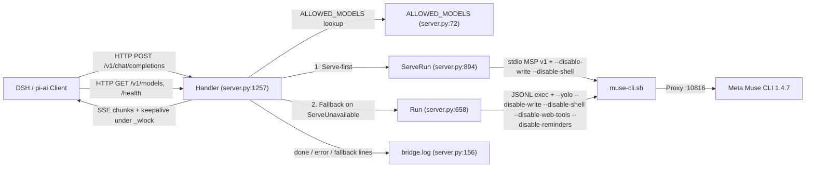

# Архитектурная спецификация: muse-bridge-heal

- **Task ID / Run ID:** `muse-bridge-heal-20261014`
- **Критичность:** `S2` (профиль `default`, Python stdlib HTTP/SSE мост поверх Meta Muse CLI)
- **Статус пакета:** `APPROVED`
- **Целевой модуль:** `bridges/muse-bridge/server.py` (1844 строки в репо)
- **Целевой тестовый модуль:** `tests/test_muse_bridge_killpg.py` (641 строка, 18 существующих тестов)
- **Защищённые пути (`protected_paths`):** `bridges/muse-bridge/README.md`
- **Входная аналитика:** `analysis/muse-bridge-heal/{handoff-architect.md,evidence-ledger.md,open-questions.md,research-plan.md}`, `/tmp/cel-runs/muse-bridge-heal-20261014/msp-defs.json`

---

## 1. Контекст, бизнес-цель и архитектурные инварианты

### 1.1. Контекст и проблема
`muse-bridge` (`bridges/muse-bridge/server.py`) — локальный однофайловый HTTP/1.1-прокси (`127.0.0.1:9886`), предоставляющий OpenAI-совместимый интерфейс (`POST /v1/chat/completions`, `GET /v1/models`, `GET /health`) поверх обёртки `~/.config/muse-launch/muse-cli.sh` (Meta Muse CLI 1.4.7) для клиента DeepSeek Harness (DSH / `pi-ai`, `streamIdleTimeoutMs=1900000`, `timeoutMs=1900000`, `[F-19]`).

По результатам системного анализа (`[F-01]..[F-27]`) выявлены пять эксплуатационных проблем:
1. **Слепые зоны журналирования ошибок (`[F-01]`, `[F-02]`, `[F-22]`, `[F-23]`):** `Handler._serve_json` пишет итоговую запись `done` в `bridge.log` только при успешном завершении хода (строки 1782–1786). Все три ранних выхода с HTTP 502 / SSE error (`launcher_missing`/`spawn_failed` на 1690–1701, `state != "ok" or rc != 0` на 1702–1717, пустой `content` и `tool_calls` на 1722–1735) завершаются без вызова `_log`.
2. **Потеря причины отказа хода в `muse serve` (`[F-03]..[F-06]`):** при получении JSON-RPC уведомления `turn/completed` с `terminal != "completed"` метод `ServeRun.execute` (строки 1188–1196) читает только `params.terminal`, игнорируя типизированный объект `params.error` (`TurnError`: `kind`, `message`, `retryable`, опциональный `quota`) и строку `params.reason` из схемы MSP 1.4.7. В результате `out["err"]` содержит только хвост `stderr` процесса `serve` (часто пустой), а клиент и оператор не видят причины сбоя.
3. **Неэффективный keepalive для SDK-клиента (`[F-16]`, `[F-17]`, `[OPEN-01]`):** поток `Handler._keepalive_loop` (строки 1347–1351) каждые `KEEPALIVE_S` (15 с) отправляет только SSE-комментарий `: keepalive\n\n`. Декодер SSE на стороне клиентского SDK отбрасывает комментарии до уровня событий данных и (по рабочей гипотезе `OPEN-01`) не сбрасывает таймер `streamIdleTimeoutMs`.
4. **Неотключённые встроенные инструменты CLI (`[F-07]..[F-14]`, `[F-24]`, `[F-27]`):** мост передаёт схемы клиентских инструментов через текстовую эмуляцию `<tool_call>`, но при запуске `muse serve` (строки 980–989) и `muse exec` (строки 718–733) не передаёт флаги `--disable-*`. Модель пытается вызвать встроенные средства чтения/записи/шелла CLI в техническом каталоге моста, что в `serve` вызывает серверный запрос `approval/request`, выброс `ServeUnavailable` (строки 1089–1090) и принудительный перезапуск хода с нуля в `muse exec` (зафиксировано 5 раз за 5 дней, `[F-24]`).
5. **Дрейф списка моделей между репо и живой копией (`[F-25]`, `[F-26]`):** в живой копии `~/.dsh/bridges/muse-bridge/server.py` в `ALLOWED_MODELS` добавлены `muse-wonder-1.0` и `muse-wonder-full-1.0`, отсутствующие в репозиторной версии.

### 1.2. Архитектурные инварианты (неизменные границы)
1. **Неизменность внешнего OpenAI wire-контракта (`NFR-01`):** маршруты `/v1/chat/completions`, `/v1/models`, `/health`, схема аутентификации (`_auth_ok`, `MUSE_BRIDGE_KEY`), коды ответов (`200`, `400`, `401`, `404`, `502`, `503`), структура успешного JSON-ответа и последовательность SSE-событий (`role`-кадр → рабочие чанки → финальный чанк с `finish_reason` и `usage` → `data: [DONE]\n\n`) остаются прежними.
2. **Неизменность жизненного цикла процессных групп и слотов (`NFR-05`, `OPEN-05`):** функции `_kill_group`, `_wait_group_exit`, `_terminate_run`, `_quarantine_slot`, `Run.close`, `ServeRun.close`, `_client_gone_probe` и `_watch_client` не меняются.
3. **Единственная точка запуска CLI:** вызов Muse осуществляется строго через `MUSE_WRAPPER` (`~/.config/muse-launch/muse-cli.sh`) с очисткой `META_API_KEY` из окружения дочернего процесса.
4. **Потокобезопасность записи в сокет (`NFR-02`):** любая запись в `self.wfile` при открытом SSE-потоке проходит исключительно через путь записи под мьютексом `self._wlock` с `self.wfile.flush()`; допустимость keepalive-записи и запечатывание потока перед финальными кадрами проверяются и устанавливаются **под тем же** `self._wlock`, а `data: [DONE]\n\n` является терминальной записью потока (см. `AD-003`, раздел 4.3). Конечный `join(timeout=2)` потока keepalive инвариантом корректности не является.
5. **Политика журналирования ошибок (`NFR-03`):** новые записи `error ...` и поле `error.detail` содержат только метаданные хода и санитизированную диагностику CLI/MSP. Stdlib-функция `_redact_secrets(text: str) -> str` в `bridges/muse-bridge/server.py` маскирует отражённые секреты на `[REDACTED]` **до любой обрезки** полей и до итоговых срезов 300/500 (спецификация — §6.1). Промпт, заголовки, окружение и `MUSE_BRIDGE_KEY` никогда не включаются; отражённое значение ключа также удаляется. Лог использует `_redact_secrets(str(out.get("err") or ""))[:300]!r`, HTTP 502 JSON / SSE error `detail` — `_redact_secrets(str(out.get("err") or ""))[:500]`. `repr` обеспечивает одну физическую строку, но не заменяет санитизацию. Существующие записи вне новых веток ошибок (в т. ч. `reasoning ... preview=`) задачей не меняются.

---

## 2. Матрица трассировки требований и артефактов

| ID требования / NFR | Критерии приёмки (AC) | Архитектурные решения (AD) | Сценарии качества / Границы / Дельты / Риски | Верификация (VER) | Основание (Evidence) |
|---|---|---|---|---|---|
| **REQ-01** Журналирование ошибок хода | `AC-01` | `AD-001` | `QA-001`, `BND-001`, `CD-001` | `VER-001`, `VER-002` | `EVD-001`, `EVD-009` |
| **REQ-02** Извлечение причины провала хода (`TurnError`, `reason`) | `AC-02`, `AC-03` | `AD-002` | `QA-001`, `BND-002`, `CD-001`, `CD-002`, `RISK-003` | `VER-001`, `VER-002` | `EVD-002`, `EVD-003` |
| **REQ-03** SSE keepalive валидными кадрами данных | `AC-04`, `AC-05` | `AD-003` | `QA-002`, `BND-001`, `CD-003`, `RISK-001` | `VER-001`, `VER-005` | `EVD-004`, `EVD-009` |
| **REQ-04** Отключение встроенных инструментов Muse CLI | `AC-06`, `AC-07` | `AD-004` | `QA-003`, `BND-002`, `BND-003`, `CD-005`, `RISK-002` | `VER-001`, `VER-004`, `VER-005` | `EVD-005`, `EVD-006` |
| **REQ-05** Сохранение реакции на `approval/request` | `AC-08` | `AD-004` | `QA-003`, `BND-001`, `BND-002`, `RISK-002` | `VER-001` | `EVD-005`, `EVD-009` |
| **REQ-06** Синхронизация `ALLOWED_MODELS` | `AC-09` | `AD-005` | `QA-004`, `BND-001`, `CD-004` | `VER-001`, `VER-004`, `VER-005` | `EVD-007` |
| **REQ-07** Регрессионные тесты (red-before-green + 18 baseline) | `AC-10` | `AD-001..AD-005` | `QA-004` | `VER-001`, `VER-002`, `VER-003` | `EVD-008` |
| **REQ-08** Доставка в живую копию и проверка живым ходом | `AC-11` | `AD-001..AD-005` | `QA-002`, `QA-003`, `RISK-001`, `RISK-002` | `VER-005` | `EVD-007`, `EVD-010` |
| **NFR-01** Совместимость OpenAI wire | `AC-01..AC-05`, `AC-09` | `AD-001..AD-005` | `QA-004`, `CD-001..CD-005` | `VER-001`, `VER-002` | `EVD-004`, `EVD-010` |
| **NFR-02** Потокобезопасность SSE (`_wlock`) | `AC-04`, `AC-05` | `AD-003` | `QA-002`, `BND-001`, `RISK-001` | `VER-001` | `EVD-004` |
| **NFR-03** Политика логов ошибок (без промптов/env/ключей; отражённые секреты санитизируются `_redact_secrets` до лимитов 300/500) | `AC-01..AC-03` | `AD-001`, `AD-002` | `QA-001`, `CD-001` | `VER-001`, `VER-002` | `EVD-001`, `EVD-002` |
| **NFR-04** Накладные расходы keepalive (`KEEPALIVE_S=15s`) | `AC-04` | `AD-003` | `QA-002`, `CD-003` | `VER-001` | `EVD-004` |
| **NFR-05** Автономность и скорость тестов (без вызовов Meta) | `AC-10` | `AD-001..AD-005` | `QA-004` | `VER-001` | `EVD-008` |
| **NFR-06** Качество кода (ruff, basedpyright, канон коммитов/веток) | `AC-10` | `AD-001..AD-005` | `BND-001..BND-003` | `VER-002`, `VER-003` | `EVD-008`, `EVD-010` |
| **NFR-07** Сдача тяжёлым путём (живой ход DSH) | `AC-07`, `AC-11` | `AD-003`, `AD-004` | `QA-002`, `QA-003`, `RISK-001`, `RISK-002` | `VER-005` | `EVD-009`, `EVD-010` |

---

## 3. Архитектурные представления (Views)

### 3.1. `VIEW-001` — Component View (границы компонентов внутри `bridges/muse-bridge/server.py`)
**Вопрос:** Как распределена ответственность между компонентами `Handler`, `ServeRun` и `Run` внутри `bridges/muse-bridge/server.py` и внешними системами (`DSH / pi-ai`, `muse-cli.sh`, `bridge.log`)?



### 3.2. `VIEW-002` — Dynamic / Sequence View (обработка хода, keepalive, ошибки и fallback)
**Вопрос:** Как протекает обработка запроса `POST /v1/chat/completions` в режиме SSE (keepalive-тики под `_wlock`, обработка `turn/completed` с `TurnError`/`reason`, fallback по `approval/request` и единое логирование ранних выходов ошибок до `[DONE]`)?

```mermaid
sequenceDiagram
    participant C as DSH Client
    participant H as Handler
    participant K as _keepalive_loop
    participant S as ServeRun
    participant R as Run (exec)
    participant L as bridge.log

    C->>H: POST /v1/chat/completions (stream=true)
    H->>C: 200 OK + data: role=assistant, content=""
    H->>K: start daemon thread (stop_event)
    loop Every KEEPALIVE_S (15s) while not stop_event
        K->>C: _wlock: only OPEN and not stopped: data: chat.completion.chunk delta={"content":""}
    end
    H->>S: execute() (--disable-write --disable-shell)
    alt approval/request or transport failure
        S-->>H: raise ServeUnavailable("serve needs interaction (approval/request)")
        H->>L: _log("serve unavailable (...), fallback exec model=...")
        H->>R: execute() (--yolo --disable-write --disable-shell --disable-web-tools --disable-reminders)
        R-->>H: out {rc, state, text, err}
    else turn/completed with terminal != "completed"
        S->>S: extract params.error (kind/message/retryable/quota) + params.reason -> separate terminal diagnostic (stderr collector untouched)
        S-->>H: out {rc=1, state="terminal_failed", err=diagnostic FIRST + stderr in remaining budget (else stderr tail)}
    else turn/completed with terminal == "completed"
        S-->>H: out {rc=0, state="ok", text, summaries, usage}
    end
    alt Early error exit (spawn_failed / state!=ok or rc!=0 / empty_output)
        H->>L: _log("error model=... via=... rc=... state=... err=... stream=True")
        H->>K: stop.set + seal under _wlock (keepalive writes forbidden; bounded join is cleanup only)
        H->>C: _wlock: data: {"error": {..., "detail": _redact_secrets(err)[:500]}}
        H->>C: _wlock: data: [DONE] (terminal write, stream closed under _wlock)
    else Normal completion
        H->>L: _log("done model=... via=... rc=0 state=ok ...")
        H->>K: stop.set + seal under _wlock (keepalive writes forbidden; bounded join is cleanup only)
        H->>C: _wlock: reasoning + tool_calls + content chunks + usage
        H->>C: _wlock: data: [DONE] (terminal write, stream closed under _wlock)
    end
```

---

## 4. Детальный дизайн по компонентам и строкам `bridges/muse-bridge/server.py`

### 4.1. `AD-001`: Единое журналирование всех ранних выходов с ошибкой в `Handler._serve_json` (строки 1690–1735)
В методе `Handler._serve_json` после проверки `if self._client_gone:` (строки 1686–1689) расположены три ранние ветки возврата с ошибкой, за которыми следует успешный путь с записью `_log("done ...")` (строки 1782–1786):

1. **Ветка 1 — Ошибка запуска лаунчера или процесса (`launcher_missing` / `spawn_failed`, строки 1690–1701):**
   Перед `self._send(502, ...)` и `return` добавляется вызов:
   ```python
   _log(
       f"error model={model} via={via} rc={out.get('rc')} state={out.get('state')} "
       f"err={_redact_secrets(str(out.get('err') or ''))[:300]!r} stream={req.get('stream') is True}"
   )
   ```
2. **Ветка 2 — Ненулевой код возврата или неуспешный терминальный статус (`out.get("state") != "ok" or out.get("rc") != 0`, строки 1702–1717):**
   Перед `self._send(502, ...)` и `return` добавляется вызов:
   ```python
   _log(
       f"error model={model} via={via} rc={out.get('rc')} state={out.get('state')} "
       f"err={_redact_secrets(str(out.get('err') or ''))[:300]!r} stream={req.get('stream') is True}"
   )
   ```
3. **Ветка 3 — Пустой вывод (`not content and not tool_calls`, строки 1722–1735):**
   В этой точке `out.get("state")` равен `"ok"`, однако ход завершился без текста и без вызовов инструментов. В соответствии с `AD-001` в журнал явно записывается `state=empty_output` перед `self._send(502, ...)` и `return`:
   ```python
   _log(
       f"error model={model} via={via} rc={out.get('rc')} state=empty_output "
       f"err={_redact_secrets(str(out.get('err') or ''))[:300]!r} stream={req.get('stream') is True}"
   )
   ```
   При этом тело HTTP 502 / SSE-ответа `self._send(502, ...)` в ветке 3 сохраняет существующую схему (`message`: `f"muse exec produced no text (rc={out.get('rc')}, state={out.get('state')}){hint}"`, `detail`: `_redact_secrets(str(out.get("err") or ""))[:500]`).
**Дельта `CD-001`, обязательная во всех трёх ветках:** HTTP 502 JSON и SSE error сохраняют поля `message/detail/type/code`, но `detail` теперь вычисляется строго как `_redact_secrets(str(out.get("err") or ""))[:500]`; при `None` или отсутствующем `err` получается пустая строка вместо прежнего `"None"`. Санитизация (§6.1) предшествует срезу и записи `_log`, применяется также к отражённому тексту в `message`/`hint`; промпт и `MUSE_BRIDGE_KEY` не подставляются. Это явная совместимая дельта диагностического содержимого, а не скрытая смена схемы.

4. **Успешная ветка (`done`, строки 1782–1786):**
   Остаётся без изменений. Таким образом, каждый завершённый ход, когда клиент не отключился (`not self._client_gone`), оставляет в `bridge.log` ровно одну финальную запись: либо `done ...`, либо `error ...`.

### 4.2. `AD-002` / `CD-002`: Терминальная диагностика `turn/completed` в `ServeRun.execute`
Схема MSP 1.4.7 (`EVD-003`) задаёт `params.terminal`, `params.error` (`kind`, `message`, `retryable`, опциональный `quota`) и свободный `params.reason`. Внутреннюю схему `QuotaDetail` не парсить.

1. До чтения событий создать **отдельную локальную переменную** `turn_diag_lines: list[str] = []`. Пишет её только основной поток `ServeRun.execute`; `drain_stderr` продолжает писать исключительно в `err_lines`. Терминальная диагностика никогда не добавляется в `err_lines` и не вытесняется его хвостом `[-6:]`.
2. Для текущего `turn_id` защитно обработать `turn/completed`: `terminal = str(p.get("terminal") or "unknown")`. При `terminal == "completed"` диагностика остаётся пустой, а успешный путь, grace, `close()`, `rc=0` и `state="ok"` не меняются. При остальных статусах сформировать не более двух строк (ошибка и недублирующий `reason`). Невалидные типы не вызывают исключений и не превращаются в `ServeUnavailable`.
3. До обрезки каждого свободного поля применить `_redact_secrets`, затем нормализовать CR/LF и управляющие переводы строк пробелами. Точные максимумы: `kind[:64]`, `message[:160]`, компактный `quota` JSON `[:120]`, `reason[:160]`; для недиктового `error` используется лимит `message[:160]`. `quota` сериализовать `json.dumps(..., ensure_ascii=False, sort_keys=True, default=str, separators=(",", ":"))`, при ошибке — защитный `str(...)` с тем же лимитом и санитизацией. `retryable` включать только при `isinstance(..., bool)`.
4. Формат основной строки: `kind: message`, далее при наличии ` retryable=True|False` и ` quota=<JSON>`; вторая строка — `reason: <text>`, если нормализованный reason непуст и не дублирует message (сравнение до срезов). Пустые поля/разделители опускаются. **Детерминированный общий бюджет терминального блока — 300 символов**, включая разделители: если блок превышает 300, сначала сокращать с хвоста значение quota вплоть до удаления всего поля ` quota=...`, затем reason, сохраняя минимум `min(16, len(reason))` символов непустой причины; далее при необходимости message, затем kind. После каждого сокращения пересчитать длину; сокращать ровно на избыток, повторяя до <=300. Формат и пределы дают место kind/message и минимуму reason без конкуренции со stderr; маркер `[REDACTED]` не разрезать, при попадании границы внутрь маркера убрать целиком примыкающее поле. Такой бюджет не обещает полное сохранение длинных полей: их детерминированное сокращение проверяется отдельно.
5. В точке формирования `err` (строка 1219) снять копию `list(err_lines)[-6:]`, санитизировать **полный** хвост stderr до обрезки. Строки `turn_diag_lines` идут **ПЕРВЫМИ**: соединить их `\n` в приоритетный блок; только оставшийся бюджет до 500 символов дополнить хвостом stderr с разделителем `\n`. Разделитель тоже расходует бюджет. В итоговых срезах 300/500 терминальная диагностика всегда предшествует stderr; шумный stderr не может вытеснить причину ни из списка строк, ни из видимой головы `err`. Если носитель пуст, сохранить прежний снимок последних шести строк stderr (после санитизации), без новой обрезки возвращаемого `err`; лимиты 300/500 применяет Handler. Поздние добавления stderr не меняют уже сформированный результат.
6. Контракты возврата `state=f"terminal_{terminal}", rc=1`, `via`, `text/chunks/summaries/usage`, grace, `close()`, обработка `approval/request` и fallback/retry не меняются. В `Run.execute` сборщик stderr уже присоединён до добавления reason; эту механику не менять. Общая санитизация на границе Handler охватывает обе реализации.
7. Во всех ранних ошибках `Handler._serve_json` HTTP 502 JSON / SSE error `detail` получает **ровно** `_redact_secrets(str(out.get("err") or ""))[:500]`, журнал — `_redact_secrets(str(out.get("err") or ""))[:300]!r` (`CD-001`). `None`/отсутствующий err становится `""`, не `"None"`. Санитизация первична, лимиты вторичны; подробный security-оракул — §7.

### 4.3. `AD-003`: SSE keepalive пустыми чанками данных и запечатывание потока перед `[DONE]` (`Handler`, строки 1293–1360, 1406–1484)
> **Дельта объёма `AD-003` (явно).** Кроме замены тела тика в `_keepalive_loop`, решение включает только необходимые сопутствующие изменения внутренних механизмов SSE-остановки/записи в том же файле `bridges/muse-bridge/server.py`: состояние запечатывания потока на соединение, проверку допустимости keepalive-записи под `self._wlock`, терминальную семантику записи `[DONE]` и сведение `join(timeout=2)` к уборке потока. Новых потоков, нового типа замка, смены периода `KEEPALIVE_S`, внешнего wire-контракта и жизненного цикла слотов/процессов дельта не вводит. Ниже зафиксирован исполнимый алгоритм и инварианты; имена обязательного состояния `_sse_phase` и `_keepalive_stop` фиксированы контрактом для совместимости тестов; разбиение на приватные методы выбирает Coder.

**Изменение тика в `Handler._keepalive_loop` (строки 1347–1352), смысл кадра задан владельцем:**
Вместо отправки SSE-комментария `self._sse_write(": keepalive\n\n")` на каждом тике `stop.wait(KEEPALIVE_S)` выполняется отправка валидного кадра `chat.completion.chunk` с пустой текстовой дельтой `{"content": ""}` через существующие методы `self._sse_emit` и `self._sse_chunk`:
```python
def _keepalive_loop(self, stop: threading.Event) -> None:
    """Пустые чанки content держат SSE-соединение; эффект на idle проверяется живым ходом."""
    while not stop.wait(KEEPALIVE_S):
        if self._client_gone or stop.is_set():
            return
        if not self._sse_emit(self._sse_chunk({"content": ""})):
            return
```

Проверка `if self._client_gone or stop.is_set(): return` перед эмиссией сохраняется только как быстрый путь (early exit). Сама по себе она гарантию «после `[DONE]` нет записей» (`AC-05`, `REQ-03`, `NFR-02`) не даёт, и дизайн ниже на неё не опирается для корректности. Кадр тика по смыслу остаётся заданным владельцем `self._sse_emit(self._sse_chunk({'content': ''}))`, но keepalive-эмиссия обязана идти через закрываемую (gated) разновидность записи из алгоритма ниже; финальные кадры и `[DONE]` идут через привилегированную разновидность той же сериализации. Как именно Coder выразит это различие (параметр, отдельный приватный метод), контрактом не фиксируется.

**Почему текущий `stop.set()` + `join(timeout=2)` не является доказательством (факты текущего кода, без тайминговых допущений):**
- `Handler._sse_write` (строки 1293–1305) выполняет блокирующие `self.wfile.write(...)` и `self.wfile.flush()` **под** `self._wlock`. Длительность одной записи и ожидания замка не ограничена двумя секундами: действующий сокетный таймаут `Handler.timeout = 300` ограничивает зависание I/O (медленный клиент, полный буфер сокета), поэтому утверждение вида «начавшийся тик успеет завершиться внутри двух секунд» недоказуемо и в дизайн не закладывается.
- `Handler._sse_stop_keepalive` (строки 1353–1359) делает конечный `join(timeout=2)` и не проверяет `is_alive()` после него. Тик, уже вышедший из `stop.wait(KEEPALIVE_S)` и прошедший внешнюю проверку `stop.is_set()`, но ещё не захвативший `self._wlock`, при истечении `join` может захватить замок **после** финальных кадров и `[DONE]` и записать кадр после терминального — прямое нарушение `AC-05`. Внешняя проверка перед эмиссией лишь сужает это окно (проверка и захват замка не атомарны).

**Алгоритм запечатывания (точка линеаризации — захват `self._wlock`, а не `join`):**
1. **Состояние потока на соединение.** В дополнение к существующим `self._wlock` (не рекурсивный `threading.Lock`, строка 1287), stop-событию (новое имя `self._keepalive_stop` вместо `_ka_stop`), `self._ka_thread`, `self._sse_open`, `self._client_gone` вводится состояние SSE-потока с тремя фазами: `OPEN` (keepalive разрешён) → `FINALIZING` (keepalive запрещён, финальные кадры разрешены) → `CLOSED` (записи запрещены полностью). **Обязательные значения на уровне класса `Handler`: `_sse_phase: str = "OPEN"`, `_keepalive_stop = None`, `_client_gone: bool = False`.** Они доступны при `Handler.__new__(Handler)` без `setup` и не вызывают `AttributeError`; изменяемое событие создаётся только на экземпляре, общий class-level `Event` запрещён. `_keepalive_stop` — единый носитель stop-события вместо старого `_ka_stop`, без двух независимых источников состояния. Начальное значение `OPEN` устанавливается в `Handler.setup` (строки 1279–1290) и повторно в `_sse_begin` до role-кадра и до запуска потока keepalive, чтобы повторный путь `_send_sse → _sse_begin` начинался из `OPEN`. Все чтения/переходы состояния, от которых зависит допустимость записи, выполняются только под `self._wlock`.
2. **Тик keepalive (gated-запись).** Текст кадра `{'content': ''}` строится до захвата замка. Затем поток ровно один раз захватывает `self._wlock` и **внутри того же удержания**: если состояние не `OPEN` или установлен `stop` или `self._client_gone` — ничего не пишет, освобождает замок и завершает цикл; иначе выполняет `write` + `flush` и освобождает замок. Обработка `OSError` (установка `self._client_gone`, журналирование, убийство текущего хода) выполняется после освобождения замка, как в текущем `_sse_write`, чтобы не держать `self._wlock` на побочных эффектах и не менять порядок замков (`_LOG_LOCK` и др.).
3. **Запечатывание перед финалом.** В точках, где сейчас вызывается `_sse_stop_keepalive()` перед финальными кадрами (`_send`, строка 1409; `_send_sse`, строка 1448; а также страховочный вызов в `finally` у `do_POST`, строка 1556), последовательность остановки становится: (а) установить `self._keepalive_stop` (будит ожидающий `stop.wait`); (б) ровно один раз захватить `self._wlock`, перевести `OPEN → FINALIZING` (идемпотентно: повторный вызов в `FINALIZING`/`CLOSED` состояние не откатывает), освободить замок; ожидание захвата `self._wlock` при остановке keepalive ограничено действующим сокетным таймаутом `Handler.timeout = 300`, если тик задержан в socket write/flush, и происходит **уже после освобождения семафора параллельности** (существующий порядок `do_POST`, без изменения lifecycle слотов); (в) **без удержания замка** выполнить существующий ограниченный `join(timeout=2)` только как уборку потока и очистить ссылки `_keepalive_stop`/`_ka_thread` как сейчас. Результат `join` (включая ещё живой поток по истечении двух секунд) на корректность не влияет: живой поток keepalive после запечатывания физически не может записать кадр из-за шага 2 и завершится на ближайшем пробуждении/проверке; поток является демоном. Бесконечный `join` запрещён.
4. **Финальные кадры и терминальный `[DONE]`.** Каждый финальный кадр (`error` в `_send`; `reasoning_content` / `tool_calls` / `content` / финальный чанк с `usage` в `_send_sse`) пишется привилегированной записью: ровно один захват `self._wlock`; в `CLOSED` — ничего не писать; в `OPEN`/`FINALIZING` — `write` + `flush`. Role-кадр в `_sse_begin` идёт этим же путём в состоянии `OPEN` до старта keepalive. Запись `data: [DONE]\n\n` — особая терминальная привилегированная запись: ровно один захват замка; если уже `CLOSED` — ничего не писать; иначе записать байты `[DONE]` и **до освобождения замка** перевести состояние в `CLOSED` (в том числе при `OSError` записи: клиент считается ушедшим, повторных записей не делается, побочные эффекты — после освобождения замка). После `CLOSED` любая запись — keepalive, финальная или повторная — является no-op с ложным результатом, поэтому байтов после `[DONE]` не существует по построению, а не по таймингу.
5. **Обоснование гарантии (без предположений о длительности записи).** Рассмотрим любой тик keepalive относительно захвата замка при запечатывании (шаг 3б): либо его gated-запись захватила замок раньше и целиком завершилась до запечатывания, а значит до финальных кадров и `[DONE]`; либо она захватит замок позже и внутри удержания увидит `FINALIZING`/`CLOSED` (или установленный `stop`) и запишет ноль байт. Промежуточного случая «проверил до, записал после» нет, потому что проверка и запись находятся в одном удержании замка. Если тик уже держит замок в медленном `flush()`, запечатывание и финальные записи ждут освобождения замка ровно на эту одну уже начавшуюся запись — то же ожидание, которое финальные записи через `self._wlock` несут и в текущем коде; дизайн не добавляет ни бесконечного `join`, ни второго ожидания, но граница ожидания заблокированного socket I/O остаётся действующим `Handler.timeout = 300`; успешная доставка `[DONE]` клиенту при разрыве/таймауте не обещается. Гарантируется только порядок байт: ни одного кадра после `[DONE]`.
6. **Отсутствие дедлока на не рекурсивном замке.** Каждая операция (тик, запечатывание, финальный кадр, `[DONE]`) захватывает `self._wlock` не более одного раза и не вызывает вложенно другую запись, удерживая замок; `join` никогда не выполняется под замком (иначе поток keepalive, ждущий замок для завершения тика, и основной поток, ждущий `join`, заблокировали бы друг друга); тип замка на рекурсивный не меняется; сон `SSE_CHUNK_DELAY_S` между контент-чанками в `_send_sse` остаётся вне удержаний замка, как сейчас. Новых потоков не создаётся: используется существующий демон `self._ka_thread` из `_sse_begin` (строки 1339–1344).
7. **Влияние на текст ответа и разбор инструментов:** серверный разбор `out.get("chunks")` (строка 1721) выполняется до `_send_sse`; на клиенте конкатенация `delta.content` из `""` и реальных чанков даёт идентичную строку ответа. Подавленный после запечатывания тик текста не меняет, так как его дельта пуста.
8. **Синхронизация module docstring:** при реализации обновить верхний docstring `bridges/muse-bridge/server.py`: описание комментария `: keepalive` заменить описанием SSE data-чанка `chat.completion.chunk` с пустой дельтой `{"content": ""}`. Отдельный README не менять.
9. **Статус утверждения про `pi-ai` (`OPEN-01`):** поскольку исходный код клиента `pi-ai` локально недоступен (`[F-20]`), утверждение о том, что кадр `data:` с `chat.completion.chunk` и пустой дельтой `{"content": ""}` сбрасывает `streamIdleTimeoutMs` в `pi-ai`, фиксируется со статусом **`ASSUMED`** до тяжёлой живой проверки (`VER-005`, раздел 8). Запечатывание гарантирует только серверный порядок байт, а не реакцию клиентского таймера.

### 4.4. `AD-004`: Ограничение встроенных инструментов CLI в `ServeRun.execute` и `Run.execute` и сохранение реакции на `approval/request`
1. **`ServeRun.execute` (`muse serve` argv, строки 980–989):**
   К существующему списку аргументов добавляются `--disable-write` и `--disable-shell` (подтверждены `muse serve --help`, `[F-12]`):
   ```python
   cmd = [
       MUSE_WRAPPER,
       "serve",
       "--provider",
       "meta",
       "--model",
       self.model_id,
       "--no-session-log",
       "--trust-workspace",
       "--disable-write",
       "--disable-shell",
   ]
   ```
2. **`Run.execute` (`muse exec` argv, строки 718–734):**
   К существующему списку аргументов добавляются `--disable-write`, `--disable-shell`, `--disable-web-tools`, `--disable-reminders` с обязательным сохранением `--yolo` и всех остальных аргументов (подтверждены `muse exec --help`, `[F-13]`):
   ```python
   cmd = [
       MUSE_WRAPPER,
       "exec",
       "--provider",
       "meta",
       "--model",
       self.model_id,
       "--reasoning-effort",
       self.effort,
       "--yolo",
       "--trust-workspace",
       "--workspace",
       str(self.workdir),
       "--json",
       "--no-session-log",
       "--disable-write",
       "--disable-shell",
       "--disable-web-tools",
       "--disable-reminders",
       "--prompt-file",
       prompt_path,
   ]
   ```
3. **Сохранение обработки `approval/request` (`REQ-05`, `OPEN-04`):**
   В `ServeRun._handle_event` (строки 1089–1090) реакция на `approval/request` и `userInput/request` остаётся неизменной: немедленный выброс `ServeUnavailable(f"serve needs interaction ({method})")`. В `Handler._serve_json` (строка 1654) сохраняется запись `_log(f"serve unavailable ({exc}), fallback exec model={model}")` и переход на `Run.execute()`. Протокольный метод `approval/decide` не реализуется, так как при отключённых встроенных инструментах запрос `approval/request` в штатном ходе возникать не должен, а если он всё же возникнет (например, на встроенном чтении), существующий fallback на `exec --yolo` с отключёнными write/shell/web/reminders безопасно доводит ход до конца.

### 4.5. `AD-005`: Синхронизация `ALLOWED_MODELS` с живой копией (строки 72–77)
В словарь `ALLOWED_MODELS` (`bridges/muse-bridge/server.py`, строки 72–77) добавляются две модели из живой копии (`[F-25]`, `[F-26]`):
```python
ALLOWED_MODELS: dict[str, dict[str, Any]] = {
    "muse-spark-1.3": {"context_length": 1048576, "max_output": 131072},
    # 2026-10-05: контрибьютор-слот (только пикер, по просьбе владельца).
    # id подтверждён `muse model-profile show` (резолвится); окно/лимит как у spark.
    "muse-spark-1.3-contributor": {"context_length": 1048576, "max_output": 131072},
    "muse-wonder-1.0": {"context_length": 1048576, "max_output": 131072},
    "muse-wonder-full-1.0": {"context_length": 1048576, "max_output": 131072},
}
```
Это синхронизирует выдачу `GET /v1/models`, `GET /health` и валидацию модели в `POST /v1/chat/completions` между репозиторием и живым рантаймом.

---

## 5. Архитектурные решения (ADR-lite: `AD-001..AD-005`)

### `AD-001` — Журналирование ранних выходов ошибок в `Handler._serve_json`
- **Статус:** `APPROVED` (`two-way`, `approval_required: false`)
- **Вопрос:** Как обеспечить полную наблюдаемость неуспешных ходов в `bridge.log` на всех ранних выходах `Handler._serve_json` (строки 1690–1701, 1702–1717, 1722–1735)?
- **Выбрано:** Перед вызовом `self._send(502, ...)` и `return` в каждой из трёх веток вызывать `_log(f"error model={model} via={via} rc={out.get('rc')} state={state} err={_redact_secrets(str(out.get('err') or ''))[:300]!r} stream={req.get('stream') is True}")`, где для третьей ветки (пустой `content` и `tool_calls`) явно передаётся `state=empty_output`. Формат записи `done` при успехе (строки 1782–1786) не меняется.
- **Альтернативы:**
  1. *Логировать внутри `Handler._send` при `code >= 500`:* отвергнуто, так как в `_send` отсутствуют локальные переменные контекста хода (`model`, `via`, `rc`, `state`, признак `stream`).
  2. *Логировать только внутри `Run.execute` и `ServeRun.execute`:* отвергнуто, так как `ServeRun` и `Run` не знают итоговый `via` (`exec-after-serve-fallback`, `exec-retry`), не видят ошибку `empty_output` после разбора `ToolCallParser` и дублировали бы записи при ретраях.
- **Драйверы:** `REQ-01`, `AC-01`, `NFR-03` (явный запрет промптов/env/ключей в записи; `err` ограничен 300 символами и одной строкой через `!r`, с обязательной маскировкой отражённых секретов `_redact_secrets` до срезов).
- **Последствия:** Каждый завершившийся ошибкой ход оставляет ровно одну структурированную строку `error ...` в `bridge.log` в заданном формате `_log`; источник `err` — локальный процесс CLI/MSP, его свободный текст считается недоверенным и санитизируется `_redact_secrets` до обрезки и записи (§6.1).
- **Подтверждение:** `python3 -m unittest tests.test_muse_bridge_killpg` (`Ran N tests, OK`).

### `AD-002` — Извлечение `TurnError` и `reason` из `turn/completed` в `ServeRun.execute`
- **Статус:** `APPROVED` (`two-way`, `approval_required: false`)
- **Вопрос:** Как сохранить первопричину отказа при конкурентном шумном stderr и безопасно передать её в журнал и `error.detail`?
- **Выбрано:** алгоритм §4.2 / `CD-002`: отдельный `turn_diag_lines: list[str]`, только основной поток; поля после санитизации ограничены `kind[:64]`, `message[:160]`, quota JSON `[:120]`, `reason[:160]`; детерминированный терминальный бюджет 300. При сборке `err` диагностика первая, оставшийся бюджет до 500 дополняется хвостом копии `err_lines[-6:]`; без диагностики сохраняется fallback stderr. На границе Handler `_redact_secrets(str(out.get("err") or ""))` предшествует срезам 300/500.
- **Альтернативы:** добавлять диагностику в конкурентный `err_lines[-6:]` отвергнуто (вытеснение); ставить stderr перед диагностикой отвергнуто (потеря в срезах); исключать stderr полностью отвергнуто в этой дельта-итерации (полезный хвост помещается только в свободный бюджет); сырой params или только message отвергнуты (шум / потеря kind и reason).
- **Драйверы:** `REQ-02`, `AC-02`, `AC-03`, `NFR-01`, `NFR-03`, `RISK-003`.
- **Последствия:** терминальная причина не зависит от объёма stderr, длинные поля сокращаются по точным правилам §4.2; malformed payload не ломает ход; completed/fallback/retry сохранены; отражённые секреты удаляются.
- **Подтверждение:** `python3 -m unittest tests.test_muse_bridge_killpg` (`Ran N tests, OK`), шумный stderr и граничные поля / security-канарейки из §7.

### `AD-003` — SSE keepalive валидными чанками `chat.completion.chunk` с пустой дельтой
- **Статус:** `APPROVED` (`two-way`, `approval_required: false`)
- **Вопрос:** Чем заменить SSE-комментарии `: keepalive` в `Handler._keepalive_loop` (строки 1347–1352) и как гарантировать отсутствие кадров после `[DONE]` при блокирующей записи под `self._wlock` (`_sse_write`, строки 1293–1305) и конечной остановке (`_sse_stop_keepalive`, строки 1353–1359)?
- **Выбрано:** На каждом тике `stop.wait(KEEPALIVE_S)` эмитировать по смыслу заданный владельцем кадр `self._sse_emit(self._sse_chunk({'content': ''}))` вместо `: keepalive`, но через gated-запись: проверка состояния потока (`OPEN`) и сама запись выполняются в одном удержании существующего не рекурсивного `self._wlock`. Перед финальными кадрами поток запечатывается (`stop.set()` + переход `OPEN → FINALIZING` под замком), `[DONE]` пишется терминальной записью с переходом в `CLOSED` до освобождения замка, а `join(timeout=2)` остаётся только уборкой потока без роли в корректности (алгоритм и доказательство порядка — раздел 4.3). Это и есть явная минимальная дельта `AD-003` в SSE stop/write internals того же `server.py`.
- **Альтернативы:**
  1. *Опираться на timed `join(timeout=2)` как на барьер (happy-path):* отвергнуто — блокирующий `flush()` под замком и тик в очереди на замок могут длиться дольше двух секунд; по истечении `join` кадр возможен после `[DONE]`.
  2. *Бесконечный `join` до смерти потока keepalive:* отвергнуто — при заблокированном сокете остановка превращается в неограниченное зависание жизненного цикла соединения и `[DONE]` не доставляется; ухудшает lifecycle без необходимости.
  3. *Рекурсивный замок с удержанием через остановку и финал либо неблокирующая запись/таймаут сокета:* отвергнуто как избыточная и рискованная дельта — удержание через `join` дедлочится с тиком, ждущим замок, а смена режима сокета меняет семантику частичной записи и ошибок за пределами задачи. Равно отвергнуты двойная посылка комментария вместе с `data:` (избыточна) и `delta: {}` без `content` (противоречит заданному кадру и `AC-04`).
- **Драйверы:** `REQ-03`, `AC-04`, `AC-05`, `NFR-01`, `NFR-02`, `NFR-04`; гарантия порядка байт без тайминговых предположений и без дедлока/бесконечного `join`.
- **Последствия:** Клиент каждые `KEEPALIVE_S` получает валидный `chat.completion.chunk` с `delta={'content': ''}`, пока поток открыт; после запечатывания тики подавляются, после `[DONE]` записи невозможны по построению; при медленной уже начавшейся записи `[DONE]` ждёт ровно её завершения (ожидание socket I/O ограничено `Handler.timeout = 300` после освобождения семафора; доставка при разрыве не обещается); эффект на `pi-ai` остаётся `ASSUMED` (`OPEN-01`) до тяжёлой живой проверки (`VER-005`).
- **Подтверждение:** `python3 -m unittest tests.test_muse_bridge_killpg` (`Ran N tests, OK`).

### `AD-004` — Отключение встроенных инструментов CLI флагами `--disable-*` и сохранение fallback при `approval/request`
- **Статус:** `APPROVED` (`two-way`, `approval_required: false`)
- **Вопрос:** Каким набором CLI-флагов отключить встроенные инструменты Muse в `ServeRun.execute` и `Run.execute` и как обрабатывать `approval/request`?
- **Выбрано:** Добавить `--disable-write` и `--disable-shell` в argv `muse serve` (`ServeRun.execute`, строки 980–989); добавить `--disable-write`, `--disable-shell`, `--disable-web-tools`, `--disable-reminders` в argv `muse exec` (`Run.execute`, строки 718–733) с сохранением `--yolo` и остальных флагов; сохранить выброс `ServeUnavailable` при `approval/request` и логирование перехода на `exec` без реализации `approval/decide`.
- **Альтернативы:**
  1. *Реализовать ответ `approval/decide` с `deny` внутри `ServeRun` вместо выброса `ServeUnavailable`:* отвергнуто (`OPEN-04`), так как в MSP `approval/request` требует двухшагового рукопожатия (ответ на запрос + вызов `approval/decide`), а при отказе модель внутри `serve` может зациклиться на повторных попытках вместо проверенного fallback на `exec`.
  2. *Убрать `--yolo` из `muse exec`:* отвергнуто, так как в headless-режиме без `--yolo` процесс `muse exec` может зависнуть в ожидании интерактивного подтверждения на чтениях вне отключённых категорий.
- **Драйверы:** `REQ-04`, `REQ-05`, `AC-06`, `AC-07`, `AC-08`, безопасность исполнения в техническом каталоге моста.
- **Последствия:** Модель лишается встроенных инструментов записи, шелла, веб-поиска и напоминаний на уровне CLI; при любом остаточном `approval/request` в `serve` мост предсказуемо логирует событие и переключается на `exec`.
- **Подтверждение:** `python3 -m unittest tests.test_muse_bridge_killpg` (`Ran N tests, OK`).

### `AD-005` — Синхронизация `ALLOWED_MODELS` с живой копией моста
- **Статус:** `APPROVED` (`two-way`, `approval_required: false`)
- **Вопрос:** Как устранить дрейф списка поддерживаемых моделей между репозиторной копией `bridges/muse-bridge/server.py` и живой копией `~/.dsh/bridges/muse-bridge/server.py`?
- **Выбрано:** Добавить `"muse-wonder-1.0"` и `"muse-wonder-full-1.0"` с параметрами `{"context_length": 1048576, "max_output": 131072}` в `ALLOWED_MODELS` (строки 72–77).
- **Альтернативы:**
  1. *Загружать список моделей динамически через вызов `muse model-profile list` при старте моста:* отвергнуто, так как это замедляет старт, создаёт внешнюю зависимость от CLI до первого запроса и усложняет офлайн-тестирование.
  2. *Хранить модели во внешнем JSON/ENV-конфиге:* отвергнуто как оверинжиниринг для однофайлового моста с четырьмя фиксированными слотами.
- **Драйверы:** `REQ-06`, `AC-09`, `NFR-01`, устранение расхождения репо и рантайма (`[F-25]`, `[F-26]`).
- **Последствия:** Эндпоинты `/v1/models`, `/health` и валидация `POST /v1/chat/completions` в репозиторном коде полностью соответствуют живой копии.
- **Подтверждение:** `python3 -m unittest tests.test_muse_bridge_killpg` (`Ran N tests, OK`).

---

## 6. Безопасность, модель угроз, наблюдаемость и потокобезопасность

### 6.1. Политика безопасности и stdlib-санитизация `_redact_secrets`
`threat_model.required = false` сохраняет существующий S2 baseline: локальные маршруты, аутентификация и границы доверия не меняются; `AD-004` ограничивает права CLI. Санитизация реализует уже заданный `NFR-03`, не разрешает утечку свободного текста CLI.

**Обязательная новая stdlib-функция:** `_redact_secrets(text: str) -> str` в `bridges/muse-bridge/server.py`, без сторонних зависимостей. Нужны `re` и уже используемое окружение; функция не пишет лог и не сохраняет секреты.
- Маскировать регистронезависимыми regex шаблонами `Bearer\s+\S+`, `Authorization\s*:\s*[^\r\n]+`, `(api[_-]?key|token|secret|password|bridge[_-]?key)\s*[:=]\s*\S+`, а также `sk-[A-Za-z0-9_-]{12,}`. Каждое полное совпадение заменять на `[REDACTED]`; приоритет замен — Authorization, Bearer, пары ключ/значение, sk-токены. Примеры: `Bearer secret-canary-token-123` и `api_key=canary_secret_val` превращаются в `[REDACTED]`.
- Дополнительно удалять точное непустое значение `MUSE_BRIDGE_KEY`, если оно отражено без метки: подстановка literal (без regex-интерпретации значения) на `[REDACTED]`, до regex-проходов. Ключ брать из уже действующей конфигурации/окружения; не выводить и не передавать в лог. Пустое значение не заменять.
- Санитизировать полные свободные поля `params.error` / `params.reason` **до** индивидуальных срезов AD-002, полный хвост stderr до его бюджетирования, затем итоговый `str(out.get("err") or "")` на границе Handler **до** `[:300]` / `[:500]`. Это исключает обход, когда срез оставляет только часть секретного токена. Повторное применение идемпотентно; `[REDACTED]` не превращается обратно в секрет.
- Формат записи допускает только метаданные `model/via/rc/state/stream` и санитизированный err. Промпт (`messages`, prompt-файл), заголовки и env не добавлять ни в err, ни в лог, ни в HTTP JSON / SSE `detail`; при известном отражении текста текущего промпта его исключать на локальной границе запроса до отправки диагностики, не сохранять промпт в глобальном состоянии. `MUSE_BRIDGE_KEY` отсутствует даже при отражении внутри диагностики. Санитизация применяется и к диагностическим message/hint этих веток, чтобы другой текст ответа не обходил правило.
- Обязательные выходы: журнал `_redact_secrets(str(out.get("err") or ""))[:300]!r` (одна физическая строка), HTTP 502 JSON / SSE error `detail` `_redact_secrets(str(out.get("err") or ""))[:500]`. Пустой/None err даёт `""`. Обрезка/repr защищают формат и объём; редакция секретов защищает содержимое.
- **Security-оракул:** синтетические токены, отражённые внутри `params.error.message` и stderr, обязаны превратиться в `[REDACTED]` и отсутствовать открытым текстом в `bridge.log` и HTTP 502 `error.detail`; отдельно проверить Authorization, все варианты пар ключ/значение, sk-токен, bare MUSE_BRIDGE_KEY и токен, пересекающий границу 300/500. Промпт и ключ не появляются также в тесте без отражения (§7).

### 6.2. Потокобезопасность (`NFR-02`)
- В каждом HTTP-соединении (`Handler.setup`, строки 1279–1290) создаётся изолированный `self._wlock = threading.Lock()` (не рекурсивный, тип не меняется), `self._keepalive_stop = None`, `self._ka_thread = None` и состояние `_sse_phase = "OPEN"` из §4.3. На уровне класса обязательны `_sse_phase: str = "OPEN"`, `_keepalive_stop = None`, `_client_gone: bool = False` для `Handler.__new__(Handler)`; события/замки остаются изолированными на экземплярах.
- Поток `_keepalive_loop` и основной поток `Handler` обращаются к `self.wfile` только через сериализованную запись, удерживающую `self._wlock` на время `write()` + `flush()`; допустимость keepalive-записи проверяется внутри того же удержания, что исключает interleaving внутри кадра и запись после запечатывания.
- Запечатывание (преемник роли `_sse_stop_keepalive`) вызывается перед финальными кадрами (`_send`, строка 1409; `_send_sse`, строка 1448) и страховочно в `finally` у `do_POST` (строка 1556); вызов идемпотентен, `join(timeout=2)` выполняется без замка и только как уборка, терминальный `[DONE]` закрывает поток до освобождения замка. Ожидание захвата `self._wlock` при остановке keepalive ограничено сокетным таймаутом `Handler.timeout = 300` и происходит уже после освобождения семафора параллельности. Фазы `_sse_phase`: `OPEN -> FINALIZING -> CLOSED`; после FINALIZING ни один новый тик не пишет, после CLOSED не пишет никто.

---

## 7. Дизайн регрессионного тестирования (`tests/test_muse_bridge_killpg.py`)

В соответствии с `REQ-07`, `AC-10` и `NFR-05` все 18 существующих тестов в `tests/test_muse_bridge_killpg.py` сохраняются без ослабления проверок. Их зелёный прогон от 2026-10-14 (`Ran 18 tests, OK`, `[F-15]`) является только **baseline до правок**; совместимость будущих правок (включая дельту SSE stop/write в `AD-003`, соседствующую со сценариями обрыва клиента) с этими тестами до прогона Coder имеет статус `ASSUMED` (`ASM-004`, `confidence=medium`) и доказывается только повторным полным прогоном `VER-001`. Новые регрессионные тесты добавляются в тот же файл по принципу **red-before-green** (сначала тест падает на текущем коде, затем проходит после внесения правок) с использованием только существующих средств файла: функции `load_bridge()`, стенда `_BridgeScenario` с фейк-обёртками, паттерна ручной сборки `Handler` через `__new__` из `ClientGoneProbeTest`, помощника `wait_until` и стандартных `threading.Event` / `unittest.mock`. Ссылок на несуществующие helper-ы тест-дизайн не содержит:

1. **`ErrorLoggingTest` (`REQ-01`, `AC-01`, `AD-001`):**
   - Проверяет все 3 ранних выхода `Handler._serve_json` (как для `stream=False`, так и для `stream=True`):
     - `launcher_missing` / `spawn_failed` (несуществующий `MUSE_WRAPPER`) → код 502 (или SSE error + `[DONE]`), в `LOG_PATH` ровно одна запись `error model=... via=... rc=-1 state=launcher_missing err=... stream=...`.
     - `state != "ok" or rc != 0` (фейк-обёртка возвращает `rc=42` и в `serve`, и в `exec`) → в `LOG_PATH` ровно одна запись `error ... state=nonzero_exit ...`, обрезка `err` не превышает 300 символов (`NFR-03`).
     - `empty_output` (фейк-обёртка завершает ход с `rc=0`, но пустым текстом) → в `LOG_PATH` ровно одна запись `error ... state=empty_output ...`.
   - **Security-оракул `NFR-03`, обязательный:** во всех трёх ранних ветках и обоих stream-режимах канареечный промпт и тестовый `MUSE_BRIDGE_KEY` отсутствуют в журнале/ответе. Отдельно фейк отражает в `out["err"]` через `params.error.message` и через stderr `Bearer secret-canary-token-123` и `api_key=canary_secret_val`: в `bridge.log` и HTTP 502 `error.detail` есть `[REDACTED]`, а `secret-canary-token-123` / `canary_secret_val` отсутствуют открытым текстом! Также проверить Authorization, варианты api-key/token/secret/password/bridge_key, `sk-` токен, ключ без метки и пересечение токеном границ 300/500, отражённый известный текст текущего промпта. Одна физическая строка, длины 300/500 и несекретная часть kind/message сохраняются. Нет/None err даёт пустой detail, не `"None"`. Санитизация требуется до обрезки; простого repr недостаточно.
2. **`ServeTurnErrorExtractionTest` (`REQ-02`, `AC-02`, `AC-03`, `AD-002`, `RISK-003`):**
   - Фейковый `serve`-скрипт возвращает `turn/completed` с `terminal="failed"` и объектом `error={"kind": "rateLimitExceeded", "message": "Quota reached", "retryable": True, "quota": {"limit": 100}}` → проверяет, что `ServeRun.execute()` возвращает `rc=1`, `state="terminal_failed"`, а `out["err"]`, `error.detail` ответа (<=500 символов) и `bridge.log` содержат `rateLimitExceeded`, `Quota reached`, `retryable=True` и сериализованный `quota`.
   - Фейковый `serve`-скрипт возвращает `turn/completed` с `terminal="failed"` и только `reason="host process terminated"` (без `error`) → проверяет наличие `reason: host process terminated` в `out["err"]`, `detail` и `bridge.log`.
   - Защитный тест на невалидный формат (`error="unexpected_string"` или `error={"kind": 123, "quota": [1, 2]}`) → проверяет отсутствие необработанного исключения и корректный возврат `state="terminal_failed"`.
   - **Шумный `stderr` после терминального события (приоритет диагностики, детерминированно):** вариант фейкового serve-скрипта (тот же паттерн `SERVE_WRAPPER` / `FAKE_SERVE_SCRIPT`) после отправки `turn/completed (failed, error+reason)` пишет в `stderr` не менее 10 длинных строк суммарно длиннее 500 символов и лишь затем завершается. Оракул: `out["err"]` начинается терминальной диагностикой (содержит `kind`, `message`, `reason`; только оставшийся бюджет до 500 дополняется хвостом stderr, шумные строки её не вытесняют), те же поля присутствуют в `detail` (<=500) и в строке `error` журнала (<=300 для `err`), `rc=1`, `state="terminal_failed"`. Парный контроль без `error`/`reason` при том же шуме: `err` равен снимку последних 6 строк `stderr` (fallback-семантика сохранена); контроль `terminal="completed"` при шуме: успешный путь (`rc=0`, `state="ok"`) не меняется.
   - **Граничные поля:** задать каждое поле длиннее лимита и проверить `kind[:64]`, `message[:160]`, quota JSON `[:120]`, `reason[:160]` после санитизации, общий терминальный бюджет 300 по §4.2 и приоритет над >=10 строками stderr; поля с канарейками на границах не оставляют секретных фрагментов.
3. **`SseDataKeepaliveTest` (`REQ-03`, `AC-04`, `AC-05`, `AD-003`, `RISK-001`)** — три детерминированных сценария; длительное ожидание стеной и опора на справедливость очереди замка запрещены, все синхронизации — через `threading.Event` и существующий `wait_until` с короткими дедлайнами файла:
   - **Классовые defaults:** `Handler.__new__(Handler)` без setup имеет `_sse_phase == "OPEN"`, `_keepalive_stop is None`, `_client_gone is False`; после ручной установки wlock/wfile, как в существующих тестах, SSE-пути не дают AttributeError; отдельные handlers не делят Event.
   - **S1, интеграционный тик (`_BridgeScenario`, сырой сокет):** при малом `mod.KEEPALIVE_S = 0.05` (значение восстанавливается после теста) и задержке фейкового хода ~0.2 с поток читается до EOF и проверяется: нет строк `: keepalive`; есть промежуточные кадры `data: {...}` с `"object": "chat.completion.chunk"` и `"delta": {"content": ""}`; конкатенированный текст `choices[0].delta.content` и разбор `<tool_call>` неизменны; поток заканчивается ровно на `data: [DONE]\n\n`, байтов после него ноль.
   - **S2, начавшаяся запись держит замок дольше любого `join` (моделируется событием, без секунд стеной):** `Handler` собирается вручную через `__new__` как в `ClientGoneProbeTest`, поля соединения инициализируются как в `Handler.setup`, вместо сокетного `wfile` подставляется записывающий двойник с буфером байтов, чей первый `flush()` для кадра keepalive выставляет событие «вошёл в flush» и блокируется на событии «отпустить flush». Реальный `_keepalive_loop` запускается с малым `KEEPALIVE_S`; тест дожидается «вошёл в flush» через `wait_until` (тик внутри записи и держит `_wlock` сколь угодно долго с точки зрения дизайна — дольше `join(timeout=2)` — но отпускается командой теста). В отдельном потоке запускается терминальный путь (`_send_sse` с минимальным содержимым, включающий остановку/запечатывание и `[DONE]`); тест дожидается установки stop-события хендлера и утверждает в этот момент: терминальный поток ещё жив, байтов `[DONE]` в буфере нет (финал не обгоняет начавшуюся запись). Затем тест отпускает `flush`, дожидается завершения обоих потоков через `wait_until` и утверждает порядок байт: начавшийся кадр keepalive целиком предшествует финальным кадрам, буфер заканчивается на `data: [DONE]\n\n`, байтов после него ноль, поток keepalive завершён. Оракул — порядок байт, а не прошедшее время; тест на текущем коде без запечатывания обязан быть красным в парном сценарии S3.
   - **S3, подавление тика после запечатывания (синхронно, без гонки планировщика):** тот же ручной `Handler` с неблокирующим записывающим `wfile`. Сначала выполняется только остановка/запечатывание, затем напрямую предпринимается одна keepalive-эмиссия тем же вызовом, что выполняет тело цикла для `{'content': ''}`: оракул — подавленный/ложный результат и неизменный буфер. Затем финальные кадры и `[DONE]` проходят успешно, а повторная keepalive-эмиссия и повторный `[DONE]` после этого также не добавляют ни байта. Сценарий детерминированно покрывает ветку «тик захватил замок после запечатывания», которую конкурентный тест не может форсировать без допущения о порядке пробуждения ждущих замок потоков.
4. **`CliDisableFlagsAndApprovalFallbackTest` (`REQ-04`, `REQ-05`, `AC-06`, `AC-08`, `AD-004`):**
   - Проверяет записанный фейк-обёрткой `sys.argv`:
     - для `serve`: наличие `--disable-write` и `--disable-shell` вместе с `--provider meta`, `--model`, `--no-session-log`, `--trust-workspace`;
     - для `exec`: наличие `--disable-write`, `--disable-shell`, `--disable-web-tools`, `--disable-reminders` вместе с `--yolo`, `--provider meta`, `--model`, `--reasoning-effort`, `--trust-workspace`, `--workspace`, `--json`, `--no-session-log`, `--prompt-file`.
   - Проверяет, что при отправке фейковым `serve` запроса `{"jsonrpc": "2.0", "id": 99, "method": "approval/request", "params": {...}}` мост не шлёт `approval/decide`, пишет в `bridge.log` строку `serve unavailable (serve needs interaction (approval/request)), fallback exec` и успешно завершает ход через `exec`.
5. **`AllowedModelsSyncTest` (`REQ-06`, `AC-09`, `AD-005`):**
   - Проверяет наличие `"muse-wonder-1.0"` и `"muse-wonder-full-1.0"` в `mod.ALLOWED_MODELS` с `context_length == 1048576` и `max_output == 131072`, а также их присутствие в ответе `GET /v1/models` и `GET /health`.

---

## 8. Выкат (Rollout), откат (Rollback) и непроверенные runtime-утверждения

### 8.1. Порядок реализации и выката (`Rollout`)
1. **Этап Coder (в репозитории `~/work/src/cli-agent-bridge` на рабочей ветке):**
   - Написать новые регрессионные тесты в `tests/test_muse_bridge_killpg.py` и убедиться, что они падают до правок кода (red).
   - При `AD-003` обновить module docstring `bridges/muse-bridge/server.py`: вместо `: keepalive` описать SSE data-чанк с пустой дельтой.
   - Внести точечные правки `AD-001..AD-005` в `bridges/muse-bridge/server.py` (не затрагивая защищённый путь `bridges/muse-bridge/README.md`).
   - Прогнать `python3 -m unittest tests.test_muse_bridge_killpg` (green: 18 старых + новые тесты) и линтеры/тайпчекер (`VER-001..VER-003`).
2. **Этап доставки в живую копию (`REQ-08`, `VER-005`) — лёгкий оракул и тяжёлый гейт строго разделены:**
   - **Лёгкий путь (только команда `VER-005`, необходим, но недостаточен).** Отдельный авторизованный шаг после приёмки кода: копирование обновлённого `bridges/muse-bridge/server.py` в `~/.dsh/bridges/muse-bridge/server.py`, перезапуск живого процесса `muse-bridge` на `:9886`, затем `diff -u bridges/muse-bridge/server.py ~/.dsh/bridges/muse-bridge/server.py && curl -fsS http://127.0.0.1:9886/health`. Успех этой команды доказывает **только** нулевой diff копий и ответ `/health` (`ok=true`, все 4 модели). Он **не равен** выполнению `REQ-08`, `NFR-07`, `AC-07` и `AC-11` и не разрешает называть доставку принятой.
   - **Тяжёлый путь (live-receipt gate, владелец — orchestrator; блокирует приёмку доставки, но не архитектурные артефакты).** К сдаче прикладываются проверяемые фактические подтверждения (receipts) по каждому пункту; отсутствие любого пункта означает «доставка не принята», а не перенос его в лёгкий путь:
     1. **Существующая рабочая нагрузка DSH.** В receipt записан фактически переданный владельцем/оператором идентификатор существующей сессии/чата DSH и характеристика рабочей нагрузки (модель, размер контекста). Существование сессии без переданного идентификатора не утверждается; если идентификатор на момент доставки не дан, тяжёлый гейт имеет статус «заблокирован для приёмки доставки» (архитектурный пакет при этом остаётся валиден).
     2. **Повтор и параллельность.** Не менее двух последовательных повторных ходов и не менее двух одновременных ходов через `muse-bridge` на рабочем размере в указанной сессии завершаются успешно без взаимного вытеснения и без утечки слотов (контроль — `/health` до/после и журнал).
     3. **Успешный `done`.** Для ходов пункта 2 в живом `bridge.log` есть строки `done ...` с ожидаемыми `model`/`via`, соотносимые по времени с receipt.
     4. **Контролируемый терминальный отказ с точной причиной.** Искусственно вызванный провал хода даёт строку `error ... state=terminal_* err='...'` в живом журнале и `error.detail` клиенту, где дословно присутствуют ожидаемые `kind`/`message` (и `reason`, когда сценарий его задаёт); формулировки вида «какая-то ошибка появилась» оракулом не являются.
     5. **Обрыв клиента и уборка.** Прерывание живого хода клиентом даёт запись об уходе клиента, мёртвую группу процессов хода и освобождённый слот (активность по `/health` возвращается к исходной), без выживших «внуков».
     6. **`VER-005`: обязательный уменьшенный тестовый idle-порог.** В одном ходе проверка молчания >1900 с невозможна при неизменном `TIMEOUT_S=1800s`. Поэтому доказательство сброса idle **обязательно** выполняется в согласованном временном тестовом профиле DSH с уменьшенным `streamIdleTimeoutMs`: порог > `KEEPALIVE_S=15s`, молчание > тестового idle-порога и перекрывает несколько тиков, но ход укладывается в 1800 с. Receipt фиксирует одобрение тестовой альтернативы, точный порог, длительность молчания, полученные data-чанки, отсутствие idle-обрыва и восстановление рабочего профиля. `TIMEOUT_S` не менять. Контроль при том же молчании без data-keepalive должен дать idle-обрыв; наличие кадров в unittest не доказывает клиентский эффект.
     7. **Отдельный живой оракул `AC-07`.** В существующем рабочем чате DSH отправить задачу с клиентским инструментом: текстовая эмуляция `<tool_call>` сохраняет имя/аргументы и выдаёт клиентский OpenAI tool_calls; CLI при этом не вызывает встроенные инструменты (включая чтение, запись, shell, web/reminders). Receipt содержит клиентский результат и след CLI событий/действий, подтверждающий отсутствие встроенных вызовов и побочных эффектов. Одного `done` или отсутствия `approval/request` недостаточно. Если наблюдаемый trace встроенных вызовов недоступен, AC-07 непроверен и доставка не принята.

### 8.2. План отката (`Rollback`)
- Изменения не затрагивают базу данных, файловые форматы хранения или конфигурацию клиента DSH.
- В случае регрессии в репозитории: `git revert` коммита на ветке задачи.
- В случае регрессии в живой копии `~/.dsh/bridges/muse-bridge/server.py`: восстановление предыдущей версии файла из бэкапа (`~/work/backups/`) или git-ревизии `1f1071a` (с сохранением двух строк `muse-wonder-*` в `ALLOWED_MODELS`) и перезапуск процесса `muse-bridge`.

### 8.3. Отложенные вопросы (`Deferred`) и непроверенные runtime-утверждения (`ASSUMED`)
- **Отложено (`Deferred`):**
  - `OPEN-06`: Изменение бюджета хода `TIMEOUT_S=1800s` (при клиентском `streamIdleTimeoutMs=1900s`) выходит за рамки текущей задачи и оставлено без изменений.
- **Непроверенные до живого прогона утверждения (`ASSUMED`, требуют проверки на этапе `VER-005`):**
  - `ASM-001` (`OPEN-01`): Сброс клиентского таймера `streamIdleTimeoutMs` внутри `pi-ai` при получении SSE-кадра `data:` с `chat.completion.chunk` и пустой дельтой `{"content": ""}` (исходный код `pi-ai` локально отсутствует, `[F-20]`, поэтому не заявляется как доказанный факт до живой пробы в DSH).
  - `ASM-002` (`OPEN-03`): Полное устранение попыток модели вызывать встроенные инструменты и отсутствие побочных эффектов для текстовой эмуляции `<tool_call>` при передаче `--disable-write --disable-shell` в `muse serve` и `--disable-write --disable-shell --disable-web-tools --disable-reminders` в `muse exec` на рабочем размере контекста.
  - `ASM-004` (`OPEN-05`, будущая совместимость): Утверждение, что ещё не внесённые правки `AD-001..AD-005` (включая дельту SSE stop/write) сохранят зелёными все 18 baseline-тестов, имеет статус **`ASSUMED`**, `confidence=medium`. Подтверждённым фактом является только baseline: перечень из 18 тестов killpg/quarantine/probe и их прогон `Ran 18 tests, OK` от 2026-10-14 до правок (`EVD-008`); этот факт будущий green не гарантирует и доказывается заново полным прогоном `VER-001` у Coder/Verifier.
  - `ASM-005` (`OPEN-02`): Косвенное подтверждение гипотезы утреннего инцидента 08:36–09:08 через появление записей `error ...` в `bridge.log` после включения `REQ-01`/`REQ-02`.

## 9. Дельта итерации 2 после R1

Исправления B1..B4 синхронизированы с `architecture-packet.json`. Идентификаторы контрактов: `CD-001` — безопасные логи/HTTP detail, `CD-002` — отдельная приоритетная терминальная диагностика, `CD-003` — SSE data-keepalive и три фазы, `CD-004` — модели, `CD-005` — сохранённая дельта CLI-флагов (ранее CD-003). ROLE PLAN: `.ai-team/runs/muse-bridge-heal-20261014/plans/architect-v2.json`. Валидация approved проверяет форму пакета; повторный независимый Совет и panel proof организует оркестратор, эта дельта их не заменяет. Продуктовый код и тесты Architect не меняет.
