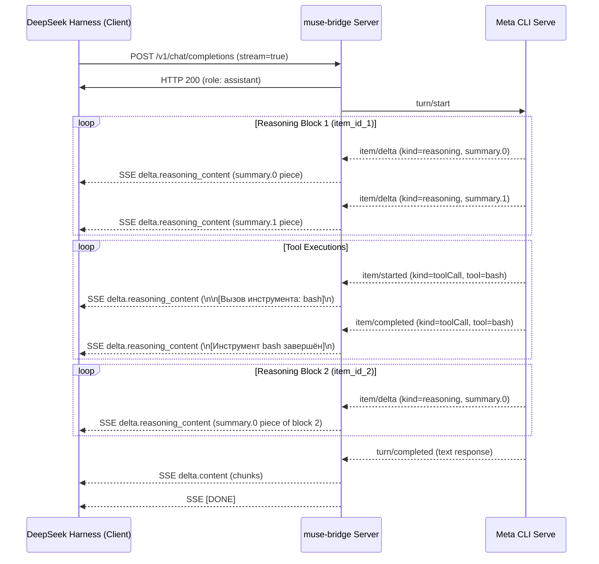

# Архитектурная спецификация: Сквозной live-стриминг всех шагов рассуждений и действий модели

## 1. Введение и цели
Цель спецификации — зафиксировать архитектурное решение для устранения проблемы «замораживания» live-потока рассуждений и отсутствия индикации действий модели в боевом мосте `muse-bridge` (`bridges/muse-bridge/server.py`).

## 2. Границы и компоненты

### 2.1. Класс `ServeRun`
- **Зона ответственности:** управление жизненным циклом фонового процесса `muse serve`, разбор входящих JSON-RPC сообщений протокола MSP over stdio.
- **Изменения:**
  1. Модель аккумулятора `(item_id, idx)`:
     `self._reasoning_items: dict[str, dict[int, str]] = {}` для раздельного сбора рассуждений разных блоков reasoning между вызовами инструментов.
  2. Исключение искусственной установки `self._live_frozen = True` при `idx > 0` и при `item/completed` для `kind == "reasoning"`.
  3. Отслеживание `item/started` и `item/completed` для `tool_item` и трансляция маркеров прогресса через `self.live_sink` с предварительной строгой санитизацией имени инструмента (`^[A-Za-z0-9_.:-]{1,64}$`).
  4. Монотонная передача инкрементальных дельт каждого поступающего чанка reasoning в `live_sink` (`delta = text[len(emitted):]`).
  5. Публичный потокобезопасный метод `get_accumulated_reasoning() -> str`, собирающий сквозной текст всех накопленных рассуждений.

### 2.2. Класс `Handler`
- **Зона ответственности:** HTTP/SSE сервер OpenAI-совместимого эндпоинта `/v1/chat/completions`.
- **Изменения:**
  1. Метод `_live_reasoning_sink`: потоковая отправка инкрементальных дельт в SSE-поле `delta.reasoning_content`.
  2. Защита от Backpressure: при возникновении `TimeoutError` или сокетной ошибки во время live-записи reasoning выставляется флаг `self._live_degraded = True`. Сбой live-записи не прерывает и не убивает процесс `ServeRun`. Авторитетный итоговый текст сохраняется в `ServeRun` для финализации в `_send_sse`.
  3. Метод `_send(code=502)`: при `self._stream == True` и наличии активного `self._current_serve_run` перед отправкой кадра ошибки извлекается `acc = self._current_serve_run.get_accumulated_reasoning()` и непереданный остаток сбрасывается в SSE.
  4. Метод `_send_sse`: согласование отправленного live-префикса с финальным итогом `F = join(summaries)`. Если `F` расширяет `_live_sent_text`, досылается суффикс `F[len(_live_sent_text):]`. При расхождении досылается разделитель `\n\n` и весь `F` (потеря авторитетного текста исключена).
  5. В нестриминговом режиме (`stream: false`) маркеры инструментов в `reasoning_content` не добавляются.

## 3. Диаграмма динамики (Sequence)

## 4. Контрактные гарантии
- **Монотонность:** текст в `delta.reasoning_content` прирастает строго аддитивно, без перезаписи или дублирования.
- **Изоляция блоков:** каждый блок reasoning сохраняет независимую индексацию дельт по `(item_id, idx)`.
- **Отказоустойчивость:** в случае таймаута на 29.5 минуте клиент получает все накопленные за это время мысли модели до получения кадра ошибки.
- **Защита процесса:** медленный сокет клиента не приводит к завершению рабочего хода `ServeRun`.
- **Безопасность:** имена инструментов проходят строгую санитизацию `^[A-Za-z0-9_.:-]{1,64}$`.
- **Обратная совместимость:** запросы со `stream: false` возвращают полный JSON-объект без маркеров инструментов.
