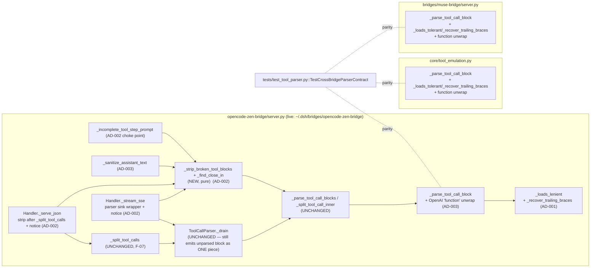
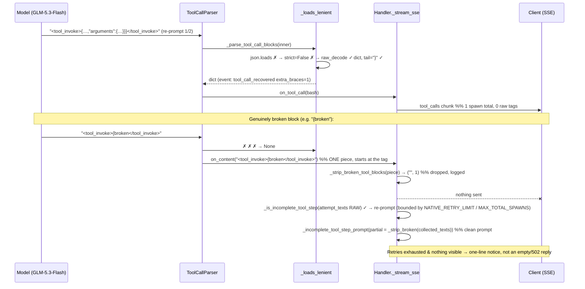

# Architecture Spec — OPENCODE-ZEN-TOOL-INVOKE-FIX

- **Task / run:** `OPENCODE-ZEN-TOOL-INVOKE-FIX` / `opencode-zen-tool-invoke-fix-20261024`
- **Criticality:** S2 (no auth / PII / trust-boundary change → no threat model)
- **Author role:** `architect` (read-only on product code; this file and the packet are the only outputs)
- **Inputs:** `analysis/opencode-zen-tool-invoke-fix/{handoff-architect,evidence-ledger}.md`, `plans/architect-01.json`, plus fresh read-only checks of the three product files and of the live bridge (see §1).
- **Packet:** `architecture/architecture-packet.json` (machine contract; this file is the human spec it points to via `VIEW-001`/`VIEW-002`).

---

## 0. TL;DR

One malformed model emission — `<tool_invoke>{"id":…,"name":"bash","arguments":{…}}}</tool_invoke>` (one `}` too many) — fell out of the parser, was streamed to the client as raw text, was fed back into the next re-prompt, and cost 3 upstream spawns instead of 1. The fix has four parts, all pure-function, stdlib-only, cold-path:

| # | Decision | Where | Effect |
|---|---|---|---|
| AD-001 | Accept trailing `}`/whitespace after a complete top-level JSON object | `_loads_lenient` (opencode-zen); `_parse_tool_call_block` via new helper (core, muse) | production payload parses on attempt 1 → spawns 3 → 1 |
| AD-002 | Remove unparseable raw blocks **at the content sinks** (stream parser sink, `_serve_json`, re-prompt builder), not by deferring a flush | opencode-zen only | raw `<tool_call>/<tool_invoke>` never reaches SSE/JSON content or a re-prompt |
| AD-003 | Strip closed-malformed blocks from replayed history; unwrap OpenAI `{"function":{…}}` envelope | `_sanitize_assistant_text`; `_parse_tool_call_block` ×3 | poisoned history cannot re-trigger the loop; echoed OpenAI schema is accepted |
| AD-004 | Keep the three parsers as independent stdlib copies; enforce parity by contract tests; deploy as a **patch onto current live**, never a file overwrite | tests + rollout | no new cross-bridge import; no regression of live-only work |

**Read §1 first**: the handoff/ledger line anchors and one handoff mechanism (`held`) describe a stale snapshot. The design below is anchored on **symbols and invariants**, not line numbers.

---

## 1. Reconciliation with handoff / ledger (fresh read-only findings)

Evidence for every row is a command or a symbol read in this run (see packet `EVD-004`, `EVD-005`).

| ID | Handoff / ledger claim | Fresh finding | Consequence for the design |
|---|---|---|---|
| D-01 | `[F-14]` live `server.py` = 3148 lines, sha `d619476e…`; line anchors `_stream_sse 2641`, `_sanitize_assistant_text 1395`, … | The repo copy `bridges/opencode-zen-bridge/` (git-untracked) **is** that snapshot (sha `d619476e…`, 3148 lines). The **live** file `~/.dsh/bridges/opencode-zen-bridge/server.py` has since changed (mtime `2026-10-24 20:17`, sha `5f6b7cb0…`, 3885 lines): spawn budget `MAX_TOTAL_SPAWNS`, `STEP_RECOVERY_ENABLED`, `_RequestAttempts`, circuit breaker, retry budget, `_PrefixDedup`. | Line numbers in handoff/ledger are unusable. Spec uses symbols. **Coder step 0: re-baseline** the working copy on current live (§9). Rollout is a patch, never an overwrite (AD-004). |
| D-02 | `[F-08]/[F-09]` `held`/`holding` is flushed at attempt end before the retry decision; REQ-002 prescribes deferring/stripping `held`. | True for the stale snapshot only. **Live has no `held`/`holding`**: retry text goes through `emit_content → _PrefixDedup → send_text → collected_texts`. The raw block still reaches the client and `collected_texts` (and therefore `_incomplete_tool_step_prompt("".join(collected_texts))`) — the *defect* survives, the *mechanism* is gone. | REQ-002 is satisfied by sink-level removal (AD-002), which is correct on both baselines. In the stale snapshot `held` then only ever contains clean prose, so its flush is harmless and untouched. |
| D-03 | `[F-04]` `_parse_tool_call_blocks` has a `raw_decode` loop (`server.py:1330-1349`) that must learn to skip stray `}`. | No such loop exists (commit `40f0615` replaced it). `_parse_tool_call_blocks` = `_parse_tool_call_block(inner)`, else split by `_split_tool_call_inner` and parse every segment with `_parse_tool_call_block`. Every decode goes through `_parse_tool_call_block → _loads_lenient`. | **Single decode choke point.** Recovery lives in `_loads_lenient` only; `_parse_tool_call_blocks`/`_split_tool_call_inner` are unchanged and inherit it per segment. |
| D-04 | `[F-03]` `_loads_lenient` falls back via `_escape_controls_in_strings`. | It does not: `json.loads(text)` then `json.loads(text, strict=False)`. | Recovery is added after the `strict=False` attempt. |
| D-05 | REQ-003: `_sanitize_assistant_text(has_tool_calls=…)`, `_STANDALONE_CLOSED_CALL_RE`. | Neither exists. Signature is `_sanitize_assistant_text(text)`; it calls `_strip_unclosed_tool_calls`. | New stripping is unconditional (closed-malformed only); valid closed blocks/batches are kept — which is what the two named tests require. |
| D-06 | REQ-001: also change `_normalize_arguments`. | The incident shows over-closing at the **envelope** tail, not in a string-encoded `arguments` value. No evidence for the latter. | `_normalize_arguments` unchanged (non-goal). |
| D-07 | REQ-002 scope = retry attempts only. | `[error_budget_policy]` in the HL envelope is "zero leaked raw tags". First-attempt leaks violate it and cannot be un-sent. | Sink filter applies to **every** attempt (uniform invariant, simpler to reason about). |
| D-08 | `core/tool_emulation.py` and `muse-bridge` get the same "lenient" parser. | They decode with strict `json.loads` (no `strict=False`). opencode-zen is lenient on raw control characters. This divergence is **baseline debt**. | Trailing-brace recovery only; keep each module's existing strictness. Cross-bridge tests use `json.dumps` payloads (escaped `\n`); a raw-newline variant is asserted on opencode-zen only. |
| D-09 | `[F-15]` baseline `360 tests OK`. | Not reproducible in the repo copy: it lacks `tests/dsh_tools_fixture.json` and `tests/fixtures/` (155 tests, 15 errors; with the json only: 262 tests, 13 errors). On a **copy of live** (scratch inside this run dir): 360 tests, **3 pre-existing failures** (`test_unmapped_retries_do_not_exhaust_incomplete_budget_{json,stream}`, `test_unmapped_then_error_stops_proc_json` — expect 4/2 spawns, live now caps at `MAX_TOTAL_SPAWNS=3`). | Verification is "no new failures vs. recorded baseline set", not "all green" (§8, `VER-002`). Owner question Q-A in §11. |

Root parser baseline verified: `python3 -m unittest tests.test_tool_parser` → 44 tests OK.

---

## 2. Views

### VIEW-001 — Component view (what changes, what must not)



### VIEW-002 — Dynamic view (incident replay after the fix)



Why a piece-level sink filter is sound (verified by probe, packet `EVD-005`): when a closed block is rejected `ToolCallParser._drain` calls `_emit(open_tag + inner + close_tag)` once; an unclosed tail at EOF is `_flush_all()` of a buffer that already starts at the open tag; a markdown-quoted tag is emitted as the bare tag (no `{`) and never matches `_RAW_CALL_RE`. Parsed blocks are never emitted as content.

---

## 3. Architecture decisions

### AD-001 — Trailing-brace recovery at the single decode choke (two-way)

- **Question:** where to tolerate `…}}}</tool_invoke>`?
- **Choice:** after both strict attempts fail, `raw_decode` the first value; accept iff it is a `dict` and the tail is non-empty, contains `}`, and consists only of `" \t\r\n}"`. Cold path only.
- **Alternatives rejected:** (a) regex-strip trailing `}` from the text before `json.loads` — mutates valid input, hot path; (b) brace-balance repair of the raw text — can invent structure (RISK-001 amplifier); (c) patch a `raw_decode` loop in `_parse_tool_call_blocks` — the loop does not exist (D-03).
- **Drivers:** zero extra I/O; segment parser inherits it; preserves negative controls (`{broken`, under-closed object stay `None`).
- **Consequences:** a block with an over-closed envelope now executes; telemetry line `tool_call_recovered extra_braces=N` makes it countable.
- **Confirmation:** `VER-001` + `VER-003`.

### AD-002 — Remove broken blocks at the sinks, not by deferring a flush (two-way)

- **Question:** how to guarantee no raw `<tool_call>/<tool_invoke>` in client content or in the next re-prompt?
- **Choice:** one pure helper `_strip_broken_tool_blocks(text) -> (text, dropped)` applied at three sinks: (1) the `ToolCallParser` content sink in `_stream_sse`; (2) `_serve_json` right after `_split_tool_calls`; (3) inside `_incomplete_tool_step_prompt` (defence-in-depth choke point for both handlers). Plus a one-line bridge notice when something was dropped and nothing else is visible.
- **Alternatives rejected:** (a) defer/strip `held` until retry resolution (handoff REQ-002 literal) — targets code absent in live, requires re-ordering the whole retry decision chain, and still leaves the first attempt leaking; (b) add an `on_unparsed` callback to `ToolCallParser` — widens a parser shared by `_split_tool_calls` and risks F-07; (c) change `_split_tool_calls` to drop unparsed blocks — forbidden, breaks `test_negative_control_garbage_still_text_and_logged`/`test_unparsed_block_returned_as_text`.
- **Drivers:** baseline-neutral (works on stale and live), smallest diff, same invariant for stream and JSON.
- **Consequences:** `_is_incomplete_tool_step`/`_incomplete_step_signal` keep seeing the **raw** `attempt_texts` (they use `_RAW_CALL_RE`), so the retry still fires — retry count and caps are unchanged. A model that deliberately prints an *unquoted, unparseable* tool-tag example loses that fragment (RISK-002).
- **Confirmation:** `VER-002` + `VER-003`.

### AD-003 — History hygiene + OpenAI envelope (two-way)

- **Question:** how to stop already-leaked/old broken blocks from poisoning replayed history, and accept the OpenAI schema echoed inside a tool tag?
- **Choice:** `_sanitize_assistant_text` additionally strips **closed** blocks whose inner is not parseable by `_parse_tool_call_blocks` (valid closed single/batch blocks and fenced/inline-quoted tags are kept); `_parse_tool_call_block` (×3) unwraps `obj["function"]` iff top-level `"name"` is **absent** (`"name" not in obj`) and `function` is a `dict`. `_render_tool_call` is untouched (still renders `"id"`, required by `test_history_renders_tool_calls_and_results`).
- **Alternatives rejected:** strip *all* closed blocks (breaks `test_closed_batch_without_intermediate_close_kept`, `test_sanitize_closed_alt_batch_kept`, `test_unclosed_tool_call_tail_removed`); reject the wrapper (the model's echo of its own history format is the likely source of `"id"`).
- **Consequences:** top-level `name` always wins; a present-but-invalid top-level `name` is still rejected.
- **Confirmation:** `VER-003` + `VER-001` (wrapper parity).

### AD-004 — Independent copies + contract tests; deploy as patch on live (two-way)

- **Question:** how to keep three parsers consistent and ship safely given D-01?
- **Choice:** keep three independent stdlib copies (each bridge deploys as a single standalone script); extend `TestCrossBridgeParserContract` with the new cases; deploy by `git merge-file`/`patch` of the Coder's diff onto live after a sha guard (§9).
- **Alternatives rejected:** shared module imported by all bridges (breaks single-file standalone deploy of `~/.dsh/.../server.py`); fix only opencode-zen (contract test would diverge from a known-incident input); overwrite live with the repo copy (reverts ~737 lines of live-only spawn-budget work — D-01).
- **Confirmation:** `VER-001`.

---

## 4. Function-level design

> Signatures and semantics are normative; bodies are reference. Prototype of items 4.1–4.4 was run in an isolated scratch copy inside this run dir against the stale snapshot: probes below + `test_lenient_tool_call`(5), `test_tool_emulation`(28), `test_step_interruption`(95), `test_native_fallback`(14), `test_stream_thinking`(15), `test_google_direct`(52) all OK; 60 KiB payload parse ≈ 0.23 ms.

### 4.1 `bridges/opencode-zen-bridge/server.py` — AD-001

```python
def _recover_trailing_braces(text: str, strict: bool) -> dict[str, Any] | None:
    """Первый JSON-объект, за которым идут только пробелы и лишние `}`; иначе None (холодный путь)."""
    body = text.lstrip()
    try:
        obj, end = json.JSONDecoder(strict=strict).raw_decode(body)
    except (ValueError, RecursionError):
        return None
    tail = body[end:]
    if isinstance(obj, dict) and "}" in tail and not tail.strip(" \t\r\n}"):
        _log(f"tool_call_recovered extra_braces={tail.count('}')}")
        return obj
    return None

def _loads_lenient(text: str) -> Any:            # signature unchanged
    try:
        return json.loads(text)
    except ValueError:
        pass
    try:
        return json.loads(text, strict=False)
    except ValueError:
        recovered = _recover_trailing_braces(text, strict=False)
        if recovered is None:
            raise                                  # still a ValueError for `_parse_tool_call_block`
        return recovered
```

Invariants: result is always a `dict` when recovered; non-dict / non-brace tail / under-closed / `{broken` → original `ValueError` → `None` from `_parse_tool_call_block(s)`. No change to `_parse_tool_call_blocks`, `_split_tool_call_inner`, `_normalize_arguments`, `ToolCallParser`, `_split_tool_calls`.

### 4.2 `server.py` — AD-003 wrapper (same 3 lines in core and muse)

In `_parse_tool_call_block`, after the `isinstance(obj, dict)` check and before reading `name`:

```python
if "name" not in obj and isinstance(obj.get("function"), dict):
    obj = obj["function"]   # OpenAI tool_calls: {"id","type","function":{"name","arguments"}}
```
Everything after (name/arguments validation, `_normalize_arguments`) is unchanged and runs on the unwrapped object.

### 4.3 `server.py` — new pure helpers (AD-002)

```python
def _find_close_in(text: str, start: int, close_tag: str = TOOL_CALL_CLOSE) -> int:
    """Тело текущего ToolCallParser._find_close_outside_string, вынесенное в функцию над `text`."""
# ToolCallParser._find_close_outside_string(self, start, close_tag) -> return _find_close_in(self._buf, start, close_tag)

_STRIP_SCAN_MAX_TAGS = 16     # H-CPU bound: _code_context is O(len) per candidate

def _strip_broken_tool_blocks(text: str) -> tuple[str, int]:
    """Вырезать сырые блоки вызова, которые не разбираются; (текст, число вырезанных)."""
```
Algorithm (behaviour contract):
1. Fast path: no `_RAW_CALL_RE` match → `(text, 0)` with zero copying.
2. Iterate candidates with `_RAW_CALL_RE.search(text, pos)`; at most `_STRIP_SCAN_MAX_TAGS` candidates, beyond that stop and keep the remainder untouched (fail-open, log once).
3. Candidate in markdown code (`_code_context(text, start, True) != "text"`) → keep the open tag literally, continue after it.
4. No closing tag via `_find_close_in` → drop `text[start:]` (unclosed tail), stop.
5. Closed: `_parse_tool_call_blocks(inner)`; `None` (or `RecursionError`) → drop the whole `open…close`; otherwise keep verbatim (valid single and valid batch without intermediate closes).
6. Return `(text, 0)` unchanged object when nothing dropped (so `_sanitize_assistant_text(text) == text` holds exactly for the kept-batch tests).

Reference body (prototype-validated): see packet `EVD-005`; the loop is ~25 lines using `_open_tag_at`, `_code_context`, `_find_close_in`, `_parse_tool_call_blocks`.

### 4.4 `server.py` — integration points (AD-002/AD-003)

| Symbol | Change |
|---|---|
| `_sanitize_assistant_text` | after `text = _strip_unclosed_tool_calls(text)` add `text = _strip_broken_tool_blocks(text)[0]` (before loop detection). |
| `_incomplete_tool_step_prompt` | `partial = _strip_broken_tool_blocks(_strip_interrupted(partial_text))[0].strip()`. Covers `_stream_sse` (`collected_texts`) and `_serve_json` (`contents`) on any baseline. |
| `Handler._stream_sse` | create `dropped_blocks = [0]` and a sink `emit_parsed_content(text)`: `cleaned, n = _strip_broken_tool_blocks(text)`; if `n`: count + `_log("stream dropped N unparsed tool block(s) …")`; then `emit_content(cleaned)`. Pass it as `ToolCallParser(emit_parsed_content, emit_tool_call)`. Do **not** touch the `parser is None` branch. After the attempt loop and the `failure` branch, before `full_text = …`: `if dropped_blocks[0] and not tool_calls and not "".join(collected_texts).strip(): emit_content(_BROKEN_BLOCK_NOTICE)`. |
| `Handler._serve_json` | right after `content, calls = _split_tool_calls(…)` (before any dedup/`contents.append`): `content, n = _strip_broken_tool_blocks(content)`; if `n`: accumulate, `_log`, and if `not content.strip()` set `content = ""`. After `content = "\n\n".join(…)`, before the 502 check: `if dropped and not content.strip() and not tool_calls: content = _BROKEN_BLOCK_NOTICE`. Strip is unconditional on `calls` (a batch with one valid and one broken block must not return the broken one in `content`). |
| `_BROKEN_BLOCK_NOTICE` | module constant: `"[opencode-zen-bridge: невалидный блок вызова инструмента отброшен]"` — same family as the existing `[opencode-zen-bridge: …]` markers. |
| Untouched | `_split_tool_calls`, `ToolCallParser._drain/_emit/_flush_all`, `_is_incomplete_tool_step`/`_incomplete_step_signal`, `_render_tool_call`, `_RequestAttempts`, retry caps, `held` flush in the stale snapshot. |

### 4.5 `core/tool_emulation.py` and `bridges/muse-bridge/server.py` (AD-001, AD-003, AD-004)

These keep strict decoding (D-08). Add, next to `_normalize_arguments` or `_parse_tool_call_block`:

```python
def _recover_trailing_braces(text: str) -> dict | None:      # same body as 4.1 but JSONDecoder() strict, no _log
def _loads_tolerant(text: str) -> Any:
    try:
        return json.loads(text)
    except ValueError:
        recovered = _recover_trailing_braces(text)
        if recovered is None:
            raise
        return recovered
```
and in `_parse_tool_call_block` replace `json.loads(_strip_code_fence(inner))` with `_loads_tolerant(_strip_code_fence(inner))`, then add the §4.2 unwrap. No other symbol changes (`_split_tool_call_inner`, `_parse_tool_call_blocks`, `ToolCallParser`, muse `strict_live`/`LiveParserError` semantics untouched). muse's `_parse_tool_call_block` is reachable under `strict_live=True`: a recovered block is a valid call, so no `LiveParserError` is raised for it; truly broken blocks keep raising.

---

## 5. High-Load Architecture Gates

HL-ENV: the 46-field envelope is **inherited unchanged** from handoff §3 (local single-user stdlib bridge, `ThreadingHTTPServer`, ≤16 in-flight, 5 RPS peak). Deltas introduced by this design: CPU +≤2 ms worst case per request on cold paths, +0 allocations on hot path, +0 deps, +0 shared state, +0 I/O. The `C-MULT-I*`/`S-HERD-I*`/`R-BULK-I*` formulas about shared dependency pools (Redis/DB/GigaRC, fork/reload, singleflight) have no subject here: no new dependency is introduced; each gate below states the bound that does apply.

### C-MULT/v1 — call multiplicity & retry amplification
- Before: initial + ≤`NATIVE_RETRY_LIMIT`(=2) incomplete-step retries ⇒ **A_max = 3** upstream spawns per client call (live also enforces `MAX_TOTAL_SPAWNS=3`).
- After: incident class resolves at attempt 1 ⇒ **1 spawn**. New code adds **0** spawns, **0** retries; retry triggers still read the *raw* `attempt_texts`, so A_max is unchanged at 3 in the worst case.
- Parser work is in-process, O(len(block)); no hop.

### S-HERD/v1 — stampede / shared-state contention
- No new module-level mutable state: `_RAW_CALL_RE` is an existing compiled constant; helpers are pure; `dropped_blocks` is a per-request local cell. No locks.
- Burst of 8 parallel turns each re-sanitising ≤256 KiB history: fast path is one `re.search` (sub-ms). Poisoned history is cleaned once per replay, which removes the cause of repeated re-prompt loops across turns.

### H-CPU/v1 — hot-path CPU & complexity
- Recovery runs only after two failed `json.loads` calls (cold). `raw_decode` O(n) + tail `str.strip` O(tail); no regex backtracking. 60 KiB: ≈0.23 ms measured (budget 5 ms p95).
- `_strip_broken_tool_blocks`: fast path O(n) search; slow path O(k·n) because `_code_context` is O(n) per candidate ⇒ **k capped at `_STRIP_SCAN_MAX_TAGS = 16`** (worst case ≤ 16·n; one 60 KiB broken block measured 1.97 ms; the capped worst case is covered by `test_strip_scan_is_bounded`). Remainder beyond the cap is left untouched (fail-open).
- `VER-004` enforces `< 5 ms` for: parse of 60 KiB with `}}}`, parse of 60 KiB unterminated, strip of a 60 KiB broken block.

### R-BULK/v1 — bulkhead, isolation, fault containment
- Everything is request-thread-local; `ToolCallParser` is per attempt; no shared buffers. Parser buffer cap `_MAX_BUFFER = 65536` is untouched.
- Failure matrix (single dependency = the helper itself): `RecursionError`/`ValueError` inside block parse ⇒ treated as "not parseable" (block dropped), never propagated; strip cap reached ⇒ fail-open + one log line; helper returns text unchanged on no match. No new timeout, retry, or breaker; existing `_RequestAttempts` breaker/budget/`MAX_TOTAL_SPAWNS` stay the only limiters.
- Blast radius of a bug in the helper: assistant text content only (tool-call path `on_tool_call` is not routed through it).

---

## 6. Quality scenarios

| ID | Quality | Scenario | Measure |
|---|---|---|---|
| QA-001 | reliability | Model emits the production block with `}}}` (escaped and raw-newline heredoc variants) during `incomplete_tool_step re-prompt 1/2` | exactly 1 `bash` tool call; 0 raw `<tool_call>/<tool_invoke>` in SSE/JSON content or re-prompt; 1 upstream spawn |
| QA-002 | performance | 60 KiB block with trailing braces / unterminated / broken-block strip | each < 5 ms (p95 budget; measured ≤ 2 ms) |

## 7. Boundaries, contract delta, risks

- **BND-001** `opencode-zen-bridge/server.py` parser/sanitizer layer: pure helpers + three sinks. Forbidden: modifying `_split_tool_calls` / `ToolCallParser` emit semantics; I/O or global mutation in helpers; changing `_render_tool_call`.
- **BND-002** `core/tool_emulation.py`, `muse-bridge/server.py`: only `_parse_tool_call_block` + the local helper. Forbidden: cross-bridge/`core` imports from bridges, touching `ToolCallParser`/`strict_live`, adding lenient control-char decoding.
- **CD-001** (behavior): producers = the three parsers/handlers; consumers = OpenAI-compatible clients (opencode, DSH) and the model. Accepts previously rejected inputs (trailing `}`, OpenAI envelope); stops returning rejected raw tool tags in assistant content; may return `_BROKEN_BLOCK_NOTICE`. No schema/field/status change. Required by REQ-002 of this task.
- **RISK-001** (low/medium): recovery accepts an over-closed envelope that the model "meant" differently. Mitigation: dict-only, tail strictly whitespace+`}` (`, "x": 1}` tails are rejected), arguments still must be a dict, log line `tool_call_recovered`.
- **RISK-002** (low/low-medium): residual or over-strip — (a) scan cap leaves tags in pathological text; (b) an unquoted unparseable tag example in prose is dropped; (c) first-attempt behaviour changes (D-07). Mitigation: quoted/fenced/valid preserved, cap + log, notice instead of empty reply, history sanitizer as second line, targeted tests.

## 8. Verification surface (frozen)

All commands run from the repo root after Coder step 0 (§9).

| ID | Command | Expected |
|---|---|---|
| VER-001 | `python3 -m unittest tests.test_tool_parser -v` | exit 0; includes new cross-bridge cases (trailing `}}}`/`}}}}\n`, OpenAI `function` wrapper, name-wins, broken stays broken) for `core` and `muse`; ≥ 44 + new tests |
| VER-002 | `cd bridges/opencode-zen-bridge && python3 -m unittest discover -s tests -t .` | exit 0 **or** failure set exactly equals the baseline set recorded at step 0 (`.ai-team/runs/<run>/receipts/baseline-failures.txt`; currently the 3 `test_unmapped_*` tests, D-09); test count = baseline + new; 0 errors |
| VER-003 | `cd bridges/opencode-zen-bridge && python3 -m unittest discover -s tests -t . -k negative_control -k unparsed_block_returned_as_text -k closed_batch_without_intermediate_close_kept -k sanitize_closed_alt_batch_kept -k broken_block -k history_renders_tool_calls` | exit 0; Ran ≥ 6; F-07 negative controls, kept-batch sanitizer tests and `"id"` rendering all green |
| VER-004 | `cd bridges/opencode-zen-bridge && python3 -c "import json,sys,time; sys.path.insert(0,'.'); import server as s; ok=json.dumps(dict(name='bash',arguments=dict(command='x'*60000))); big=ok+'}}}'; bad=ok[:-4]; blk='<tool_invoke>'+bad+'</tool_invoke>'; f=lambda fn,a: (lambda t: ([fn(a) for _ in range(20)], (time.perf_counter()-t)/20*1000)[1])(time.perf_counter()); a=f(s._parse_tool_call_blocks,big); b=f(s._parse_tool_call_blocks,bad); c=f(s._strip_broken_tool_blocks,blk); print(round(a,3),round(b,3),round(c,3)); sys.exit(0 if s._parse_tool_call_blocks(big) and s._parse_tool_call_blocks(bad) is None and s._strip_broken_tool_blocks(blk)==('',1) and max(a,b,c)<5 else 1)"` | exit 0, three timings < 5 ms (pre-flight on the prototype: 0.23 / 0.16 / 1.97 ms) |

### Test plan (REQ-004 → names the Coder must create; VER-003 `-k` relies on `broken_block`)

`bridges/opencode-zen-bridge/tests/test_lenient_tool_call.py`
- `test_trailing_braces_recovered` (`}`, `}}`, `} }\n}`; production payload escaped **and** raw-newline) · `test_trailing_garbage_not_recovered` (`}}, "x": 1}`, non-dict, under-closed, `{broken`) · `test_openai_function_wrapper` (+ with extra `}`, name-wins, present-but-blank name still rejected) · `test_batch_segment_with_extra_brace`.

`bridges/opencode-zen-bridge/tests/test_step_interruption.py`
- `test_strip_broken_blocks_helper` (closed-invalid dropped, unclosed tail dropped, valid single/batch kept byte-identical, inline/fenced quoted kept, cap behaviour) · `test_sanitize_strips_malformed_closed_tool_invoke` + the two existing kept-batch tests · `test_incomplete_prompt_has_no_broken_block` · stream: `test_stream_broken_block_not_in_sse_nor_reprompt` (attempt 1 emits `<tool_invoke>{broken</tool_invoke>`; assert no raw tag in any SSE `content`, re-prompt 2 prompt has no tag, ≤ caps) · `test_stream_recovered_trailing_braces_single_spawn` · `test_stream_notice_when_only_broken_block` · json: `test_serve_json_broken_block_stripped_and_notice`, `test_serve_json_mixed_valid_and_broken` (call returned, broken not in `content`) · `test_strip_scan_is_bounded` (1000 broken tags, < 50 ms).

`tests/test_tool_parser.py` (root)
- Extend `TestCrossBridgeParserContract._contract_cases` with `trailing_braces`, `trailing_braces_ws`, `openai_function_wrapper`, `name_wins_over_function`, `malformed_stays_text`; plus `TestTrailingBraceRecovery` calling `core.tool_emulation` and the muse module directly (reuse `_load_muse_bridge`).

Existing tests that must stay untouched and green: `test_negative_control_garbage_still_text_and_logged`, `test_unparsed_block_returned_as_text`, `test_closed_batch_without_intermediate_close_kept`, `test_sanitize_closed_alt_batch_kept`, `test_history_renders_tool_calls_and_results`, `test_malformed_member_rejects_whole_batch_as_text`.

## 9. Evolution, rollout, rollback

- **Compatibility:** additive tolerance + removal of raw rejected tags from content; OpenAI SSE/JSON schema, headers, status codes, `state/*.json` unchanged.
- **Coder step 0 — re-baseline (mandatory, before any edit):** `bridges/opencode-zen-bridge/` is git-untracked; replace its `server.py`, `tests/` (incl. `dsh_tools_fixture.json`, `fixtures/`), `zen_catalog.py`, `sync_dsh_models.py`, `opencode-go.json`, `pyproject.toml` with the current `~/.dsh/bridges/opencode-zen-bridge/` copies **without** `state/`, `logs/`, `workspace/`; record `shasum -a 256 server.py` as `BASELINE_SHA` and run VER-002 once to record `baseline-failures.txt`. Re-resolve all anchors by symbol.
- **Rollout:** (1) VER-001..004 green on the re-baselined copy; (2) immediately before deploy compare `shasum -a 256 ~/.dsh/bridges/opencode-zen-bridge/server.py` with `BASELINE_SHA` — equal ⇒ copy; different ⇒ `git merge-file` / `patch` the Coder's diff onto the new live, re-run VER-001..004 on the merged result; never overwrite blindly; (3) back up the live file to `~/work/backups/` (workspace-paths canon, not beside the file); (4) `launchctl kickstart -k gui/501/com.user.dsh-opencode-zen-bridge`; (5) heavy-path check: a real tool-call turn on `127.0.0.1:9883` with a model that emits the `}}}` form (or a fake-CLI replay), plus `grep` of `bridge.err.log` for `tool_call_recovered` / `stream dropped`; core/muse ship via normal MR (they are tracked files).
- **Rollback:** restore the backed-up `server.py` and `kickstart` (< 2 s); core/muse via `git revert`. Trigger: any new test failure vs. baseline set, crash on `:9883`, non-200, or a raw `<tool_invoke>` in live content.
- **Feature flag:** none (not a GigaRC service, per handoff); the file-restore rollback is the kill switch.

## 10. Coder constraints

- Protected (read-only for Coder): `analysis/opencode-zen-tool-invoke-fix/handoff-architect.md`, `analysis/opencode-zen-tool-invoke-fix/evidence-ledger.md`, the frozen verification surface in the packet.
- Do not change: anything in the "Untouched" row of §4.4; `_normalize_arguments`; strictness of core/muse decoders; retry caps; `_render_tool_call`.
- Commit/process rules of the repo canon apply (regression tests before fix, Conventional Commits with `[agent]` tag, full suite before MR). `bridges/opencode-zen-bridge/` is untracked: its change ships through the live-patch procedure above, core/muse/tests through MR.

## 11. Questions for the owner / orchestrator (class МОЖНО ПРОДОЛЖИТЬ — design is complete under the stated assumptions)

- **Q-A (baseline):** live `~/.dsh/bridges/opencode-zen-bridge/server.py` carries 3 pre-existing test failures (live now caps spawns at 3; the tests expect 4/2) and is evidently under active edit by another session. Assumption used: the Coder re-baselines on live, treats those 3 as baseline debt (neither fixes nor regresses them), and deploys as a patch. If the intended baseline is instead the stale d619 snapshot, only step 0 and the rollout guard change; the design does not.
- **Q-B (scope, D-07):** sink filtering applies to the first attempt too (stricter than the handoff's "retry only"). Assumption: acceptable because the HL envelope states "zero leaked raw tags".
- **Q-C:** `independent_review` is pre-set `PASS / arch-panel-pending / receipts/arch-panel.json` in the packet **by the orchestrator's brief**; that receipt does not exist yet and must be produced by the panel before `ARCH_GATE_PASS`.
