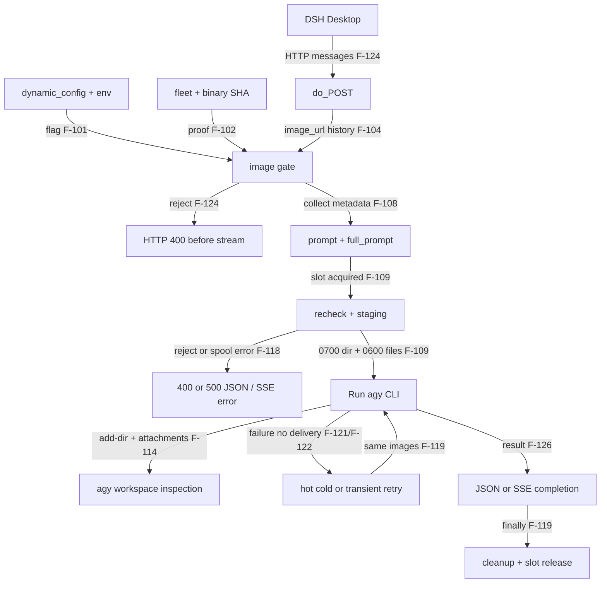

# Handoff архитектору: universal image/media fallback

Stage 1, standard gap-analysis S2, 2026-10-29. Входной HEAD `012da99905ec27a6133afb4f3e768ff9b4426a8f`, branch `feat/agy-universal-image-fallback`. Факты — [evidence-ledger.md](evidence-ledger.md), закрытие исследований — [research-plan.md](research-plan.md). Это исследовательский вход, не Architecture Packet, ADR, verdict или разрешение Coder/MR. Выбор архитектуры остаётся следующему этапу.

## Цель и границы

Источник требований — текущая постановка владельца: «всегда принимать и посылать», при отказе удалять медиа и повторять текстом. Все REQ ниже — трассировка этого запроса, не новая самостоятельная спецификация. Объект — только agy bridge и его тесты/конфигурация. Sibling bridges изучены как эталон placeholder; их изменение не требуется. Переименование моделей, смена провайдера, скачивание remote URLs, новые аудио/видео decoder, общий transport rewrite и миграция fleet вне scope.

- REQ-01: в universal mode любой **известный каталогу** model/поддерживаемый effort принимает image request без per-model proof/SHA/efforts_proven допуска. Валидные user raster PNG/JPEG/GIF/WebP в пределах лимитов при staging=true идут в attempt1 через img_dir, `--add-dir` и attachments. Источники: постановка; разрыв F-102/F-308.
- REQ-02: ImageReject, включая malformed image content, flag-off, remote/file URLs, non-user role, unsupported MIME/base64/signature/limits, а также ImageSpoolError ведут к text-only turn в universal mode; никаких media-derived400/500 до него. Источники: постановка; F-105/F-118/F-124/F-125.
- REQ-03: если первая реально image-attached попытка вернула state не done/client_gone и delivered=false, до attempt2 убрать media, файлы, прежний CID и hot eligibility. Повтор ровно один, text-only; успешный text turn возвращает обычный200 JSON/успешный SSE. Источники: постановка; F-119..F-123/F-126.
- REQ-04: все существующие строки тестового файла неизменны; только append новых uf-тестов. Strict поведение и fleet/default constants сохраняются. Источники: постановка VER-006/007; F-203..F-218/F-314/F-315.
- REQ-05: universal acceptance и fallback фактически включены в установленном production bridge для всех catalog models. Проверка checkout/config-file или `/health` сама по себе не равна живой приёмке. Источники: постановка; F-301..F-307/F-129.
- REQ-06: stripping действует на всю историю, включая media-only сообщения, dict-content и non-image media; сохраняет текст, порядок, роли и непустой безопасный запрос. Никаких media payload/URL/path/attachments-инструкций от вложений после downgrade. Источники: постановка; F-104/F-111..F-115/F-312.

## As-is и контракты

Диаграмма только as-is. Новый universal переход здесь намеренно не изображён как уже существующий.

CON-01 — ingress: `POST /v1/chat/completions`, HTTP JSON messages и JSON/SSE output; DSH → agy bridge, владелец локального моста. Auth/header/framing/model/effort/body/admission проверки самостоятельны (F-130). Нет доказанного Idempotency-Key/dedup контракта: повтор CLI не равен exactly-once. Test contour: localhost `_HttpBridge`, fake agy (F-216).

CON-02 — image input: только user `image_url` data/base64 raster; пределы 16, individual/total20971520 bytes, body33554432 bytes. External URLs не читаются; ссылки не должны попасть в CLI fallback. Rejection taxonomy сохранена в strict mode (F-105/F-106/F-206/F-310).

CON-03 — egress CLI: argv `--add-dir <dir>` и prompt attachments, рабочий cwd отдельно; stdout JSON events, stderr diagnostics; lifecycle `Run.close` и controller. Состояния/error mapping F-114/F-120/F-123/F-125. Не меняется контракт CLI под универсальное inline media API.

CON-04 — local config: путь из resolved server ROOT, strict JSON flag read с TTL1s, env override только существующего input flag; production — отдельные files. `start.sh` config не устанавливает (F-101/F-303/F-306/F-307). Новый policy обязан иметь явные чтение, default, cache reset/reload и rollout/rollback; имя ключа решает архитектор.

CON-05 — discoverability: `/v1/models`, `/health` сейчас отражают доказанный допуск, не optimistic attempt (F-129). В strict режиме ответы неизменны. Universal effective capability нельзя выдавать за confirmed proof; модель остаётся под catalog validation. Требуются различимые policy/staging/optimistic-attempt поля либо согласованное расширение semantics без мутации static fleet (F-205).

CON-06 — fault boundary: ImageReject и ImageSpoolError fail-open к **санитизированному тексту** только при universal=true. Auth/admission/framing/unknown model/unsupported reasoning effort fail-closed по прежнему контракту. Конфиг/его неверный тип fail-closed к strict policy. CLI missing/offline, timeout текстового повтора и оборванный клиент не становятся фиктивным success (F-125/F-130).

## Доказанная совместимость конфигурационных вариантов

Выполнимо с условиями: отдельный динамический policy, например `IMAGE_FALLBACK_ENABLED`, отсутствует/false → strict; production явно true. Доказательство: temp path fixtures изолирует production config, а `_ImgEnv.flag(True)` пишет лишь старый ключ (F-202/F-203). Поэтому старые тесты остаются strict даже с input=true; production может включить оба ключа. Новый cache нельзя оставлять глобальным между fixtures; production env нового флага не должен протекать в тесты (F-201).

Невыполнимо при REQ-04: default universal=true без явного профиля, вывод strict из имени pytest/unittest, universal=input_enabled, либо перепись static fleet в «все confirmed». Первое и третье ломают существующие strict requests, последнее — ao10 (F-205/F-206/F-212). Explicit production override работает без распознавания тестового рантайма. Строгий repo default не противоречит production-default universal при обязательном deployment config.

Альтернатива «production profile» также выполнима, если профиль выбирается явным runtime config, а его отсутствие строгое. Решение о схеме флага/профиля и внедрении в удалённый конфиг/GigaRC остаётся архитектору; существующий файл — local JSON, интеграция GigaRC данным исследованием не подтверждена. Прямое требование владельца допускает production dynamic_config.json. Нельзя подменять его новым постоянным env-only переключателем без reload.

Матрица поведения для согласования архитектуры:

- universal=false, input=false: legacy strict image rejection и text-only без изменений.
- universal=false, input=true: legacy proof-gated admission и legacy retry с теми же файлами.
- universal=true, input=false: принять запрос, полностью убрать media, attempt1 text-only; выключенный staging не обходить.
- universal=true, input=true: известная модель, валидные user images → optimistic attempt1 с files; invalid images/spool/recheck reject → text-only attempt1; attached runtime failure без delivery → text-only attempt2.

## Инварианты и обязательные переходы

- INV-01: bypass proof не bypass safety validation. Ни fetch/file://, ни MIME expansion, ни превышение resource limits. Strict path сохраняет прежний signature-only контракт. Valid decodable fixtures обязательны для universal positive tests; полноценное pixel decoding — отдельное решение с ограничениями памяти (F-107/F-217).
- INV-02: normalized media-free history имеет только разрешённые text parts; classification media выполняется раньше чтения `text`. `image_url`, `image`, `input_image` → `[image omitted]`; `input_audio`, `audio`, `video`, `file`, `document`, `inlineData`, `fileData` → `[media omitted]` либо удаление. Проверять и `type`, и соответствующие payload keys, в том числе dict-content; не использовать `str(media_dict)`. Неизвестный structured block не сериализовать целиком. Обычный текст пользователя с URL не цензурировать как вложение (REQ-06/F-112).
- INV-03: сбой любого изображения в universal admission убирает **все** media данного запроса/истории, без частичного spool/поднабора. Mixed valid raster + unsupported non-image media: raster допускается к optimistic send, прочее media не передаётся agy и не сериализуется. Если режим уже downgraded, никакие старые media не возвращаются через full_prompt (F-111/F-115).
- INV-04: image fallback должен иметь очищенные prompt **и** full_prompt. Перед runtime retry необходим доступ к очищенной истории/предвычисленному full text prompt: в текущем ctx исходных messages нет (F-124). Простой вызов `_messages_to_prompt(original_messages, [])` оставляет image N (F-111). Media-only → placeholder или существующий непустой safe fallback, без attachments (F-113).
- INV-05: runtime guard в точности: attempt1, фактически передан add_dir и непустые images, state не done/client_gone, delivered=false. Его нужно обработать до **обоих** legacy retry-переходов, включая ранний hot continue (F-121). Timeout/idle/first-token states подпадают под owner guard в universal mode, хотя legacy transient их не повторяет (F-122). Только одна text retry, никогда третья.
- INV-06: немедленно cleanup зарегистрированного img_dir, затем обнулить local и ctx img_dir/images; повтор с `add_dir=None`. Partial-stage failure также cleanup/registry removal. Сохранить slot на текущий ход, освободить ровно один раз; завершение каждого Run до cleanup (F-109/F-110/F-119).
- INV-07: использовать существующий CAS `_session_invalidate(sess_key,cid)` вместо несуществующего имени из брифа; снять собственный cid claim через `_cid_release`, сбросить hot_resumed/conversation_id и переключить на full **stripped** prompt. Text fallback не должен resume прежний explicit CID, который может сохранять attachment context. Plain turn не меняет чужой store; конкурентно обновлённый CID не инвалидировать (F-116/F-117/F-121).
- INV-08: delivered=text/tool_calls/stream reasoning; initial empty SSE delta и keepalive не означают delivery. После delivery или client_gone retry запрещён, файлы всё равно убрать. JSON reasoning ещё не доставлен и не блокирует downgrade (F-120/F-126).
- INV-09: legacy token budget остаётся strict. В universal mode owner требует attempt2 даже при generic retry budget0: архитектура должна предусмотреть одну ограниченную media-degradation попытку/резерв без возможности бесконечных повторов. Это отдельная ветвь, не глобальная отмена retry budget (F-213).
- INV-10: новый structured event `image_fallback` на каждый фактический downgrade с reason/stage/model/attempt/policy/count и bounded sanitized identifiers. Без auth, base64, media URLs, полного prompt, файловых путей/персональных данных. Старые strict logs и masking не менять (F-209). Причины: collect validation, flag/proof/recheck, spool, attached CLI state; log не заменяет успешную text completion.
- INV-11: не ловить произвольный Exception как media issue. Constructor LauncherUnavailable/OSError находятся до общей ветви и частично пишут response сами (F-123): не посылать вторые HTTP headers, не выполнять фиктивный успешный fallback. Проверить возможность bounded text retry при безопасном spawn failure отдельно от отсутствующего executable.
- INV-12: после downgrade и успешного text ответа следующий cold/history turn вновь обрабатывает вход через policy; не оставлять навсегда пометку «model unsupported». Статическое доказательство capability не переписывается из единичного отказа. История с прежними media либо повторно optimistic принимается, либо безопасно stripping по той же политике.

## Риски и явные допущения

RISK-01: повтор без клиентского delivery не доказывает отсутствия CLI/native-tool side effects; bounded retry не создаёт exactly-once. QA проверяет отсутствие дубликатов ответов и неидемпотентные сценарии отдельно (CON-01).

RISK-02: HTTP200 не гарантируется при втором падении backend, missing launcher, queue overload или некорректном общем body. ASSUMP-01: owner intent «не убивать чат400 на media» означает media-safe admission + реальный text attempt, а200 — результат успешного text backend. Не синтезировать success. Это ограничение обнаружено F-125/F-126/F-130 и передаётся владельцу решения, не скрывается в DoD.

RISK-03: state done с bad rc/empty output не покрыт точным guard; не расширять самовольно в этом Stage1. Также constructor failure ещё не означает, что image-attached CLI attempt действительно стартовал (F-123/F-128). Downstream обязан явно сохранить/согласовать error semantics этих исключений.

RISK-04: полное pixel decoding может сломать img10 и потребовать новые зависимости/защиту от decompression bombs. ASSUMP-02: «valid decodable raster» задаёт обязательный positive corpus; текущая signature validation не является доказательством декодируемости. Не обещать decoder coverage существующими strict tests (F-107/F-217).

RISK-05: reload cache нового flag способен утечь между fixtures или дать разную policy двум attempts. Требуется явный consistent policy snapshot на request и безопасный staging recheck после очереди; выключение input не должно вновь разрешать attach. Strict false/malformed/default и TTL сценарии обязательны (F-101/F-203/F-210).

RISK-06: repo server и deployed copy сейчас одинаковы, но checkout change не обновляет runtime/config автоматически (F-306/F-307). Production activation, restart необходимости кода и dynamic flag rollback — отдельные доказательства release.

RISK-07: admission max body413 и total budget503 не отменяются «never400». Слишком большой encoded JSON может не дойти до image strip. Иначе optimistic mode стал бы обходом памяти (F-130/F-310).

RISK-08: пик RPS, p99 SLA и provider quota не заданы. Нельзя утверждать load-safe production release по локальному suite. Это зафиксированная граница NFR, не придуманный SLO.

## Resource envelope HL-ENV/v1

Формат ниже перечисляет все46 обязательных полей; unknown — установленное отсутствие подтверждённых данных в исследованных входах, не ноль и не PASS ресурсного гейта. Изменён только analysis: продуктовый call graph не изменён; критерии нагрузки относятся к будущему коду, поэтому N/A для него не объявляется. Кластерный pod envelope здесь не подтверждён: мост — локальный Python HTTP/CLI процесс (CON-01/03), а не исследованный k8s deployment.

- P_steady: pod count не задан; локальный server entry F-303/F-307.
- P_hpa_max: HPA manifest не предоставлен; F-302.
- maxSurge_pct: не задано в текущем entry; F-307.
- maxSurge_abs: не задано; F-307.
- maxUnavailable_pct: не задано; F-307.
- maxUnavailable_abs: не задано; F-307.
- P_terminating_overlap: не измерено; F-307.
- P_live: production process count не измерен; F-306 не является PID proof.
- P_avail_min: не установлен контракт доступности; CON-01.
- W: repo MAX_CONCURRENT default4 execution slots; effective runtime env должен снять release; fixture4 сам по себе не production proof (F-202/F-404).
- N_proc: Python server + ограниченные CLI children, фактический count не измерен; F-119/F-307.
- N_proc_steady: не измерено; CON-03.
- N_proc_avail_min: не задано; CON-03.
- CPU_limit_per_pod: CPU quota не задана local entry; F-307.
- κ_skew: профиль перекоса запросов не измерен; CON-01.
- u_bg_worker: CPU background utilisation не измерена; F-132.
- U_pod_sidecars: sidecar topology не предоставлена; F-302/F-307.
- Mem_limit_per_pod: RSS hard quota не задана; F-307.
- Mem_rss_worker_max: high-water RSS не измерен; F-310 — лишь payload caps.
- Mem_shared_max: shared RSS не измерен; CON-03.
- RPS_peak: не измерен; CON-01.
- A_max: ≤2 CLI attempts/request as-is; F-119. Universal не увеличивает выше2.
- SLA_p99_s: контрактный SLA не предоставлен; CON-03.
- N_entities_max: ≤16 images/request; F-310.
- Limit_dep_share[d]: upstream agy quota/share не предоставлена; CON-03.
- Limit_dep_rps[d]: upstream RPS quota не предоставлена; CON-03.
- W_fetchers[d]: remote media fetchers отсутствуют в текущем collector; F-106; agy internal upstream concurrency не исследована.
- J_init_s[d]: startup jitter не установлен входами; CON-03.
- J_pod_s[d]: pod jitter не установлен; F-307.
- T_poll_s[d]: image config TTL1 s и sweep600 s; F-101/F-132.
- K_calls[d]: ≤2 CLI attempts/request, network calls внутри agy не измерены; F-119.
- T_base_s[d]: legacy full jitter U(0,2 s) на единственном retry; F-404.
- T_cap_s[d]: retry pause cap2 s; queue900 s / execution1800 s / first event120 s — repo ceilings, не SLA; F-404/F-405.
- Max_stale_age_s[c]: image flag cache TTL1 s, fallback policy ещё не существует; F-101/F-301.
- Min_healthy_ratio: routing panic threshold здесь не найден; catalog predicate не health quorum; F-129.
- B_retry_max: generic capacity3 tokens, cost1, credit0.2/request; fixture0/30 задаётся в tenths, не quota RPS; F-404/F-213.
- min_reserve_retry_rps: новый media reserve пока не определён; INV-09 передаёт ограничение владельца.
- FD_worker: FD high-water не измерен; F-109 описывает permissions, не FD budget.
- ulimit_n: лимит ОС production не снят; CON-03.
- λ_new_conn_per_pod(s): new connections/s не измерено; F-310 задаёт admission count, не rate.
- C_active_in_scope(s): admission≤32 HTTP connections, actual TCP/CLI upstream count не измерен; F-310.
- N_pods_in_scope(s): pod/SNAT scope не предоставлен; F-307.
- Port_range_size(s): ephemeral range production не снят; CON-03.
- T_hold_s(s): TIME_WAIT/conntrack не измерен; CON-03.
- SNAT_ips_count(s): NAT topology не исследована; CON-03.
- HOTPATH_MODULES: do_POST→collect/gate→prompt/session→_run_once→stage→Run/_execute→retry→serve_json/serve_sse→cleanup; F-104..F-126.

Memory closure `W*RSS_worker_max+Mem_shared_max <=0.8*Mem_limit` не доказано: три memory величины не заданы. C-MULT/S-HERD/H-CPU/R-BULK, T-LIFE/O-EXIT/M-SEM: Stage1 не выдаёт PASS; bounded attempts, admission и cleanup установлены, производственные quota/latency/memory measurements обязательны до утверждений о capacity. Media validation fail-open только к тексту; security/admission fail-closed; новых внешних polling pools исследование не вводит. Наблюдаемые пользовательские p95/p99 не выдуманы.

ВОПРОСЫ ВЛАДЕЛЬЦУ: для завершения Stage1 нет незакрытых вопросов; для обещаний production capacity нужны контрактные upstream квоты и p99 SLA. До этого NFR-приёмка ограничена. Это явное release-ограничение RISK-08, не запрет передавать найденные факты архитектору.

## Reuse brief и передача

Эталон: `analysis/agy-image-input-fix/`, существующие `_collect_images/_stage_images/_cleanup_img_dir`, `_session_invalidate/_cid_release`, fake HTTP fixture и taxonomy tests (F-109/F-117/F-202/F-313).

KEEP: bounded slot admission, size-before-decode, secure spool/registry/sweep, cwd/argv isolation, strict gate/proof path, delivered guard, ordinary text protocol, zero-deleted tests. CHANGE: отдельная effective universal policy, media normalization, pre-stage/spool downgrade, bounded text retry, effective observability, explicit production activation. BLOCKER для буквального копирования: прежний контракт предписывает400/500 и повтор тех же images (F-313); sibling placeholder renderer неполон и пропускает media.text (F-312). Это доказательство точечной адаптации, не основание нового transport architecture.

Mapping в Architecture Packet: F-*→evidence; REQ-*→drivers; CON-*→boundaries/contracts; INV-*→invariants; RISK-*→risks; ASSUMP-*→assumptions; HL-ENV→quality-scenario baseline/limitations. Open research blockers=0. Архитектор обязан принять отдельное решение по flag/profile, prompt normalization representation, reserve policy и исключениям state done/constructor без изменения согласованного scope. Следующий Coder/MR этап — только после требуемого внешнего architecture gate; этот handoff его не заменяет.
