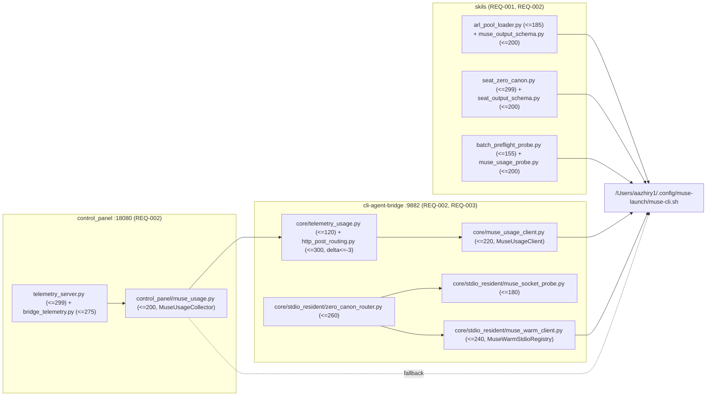
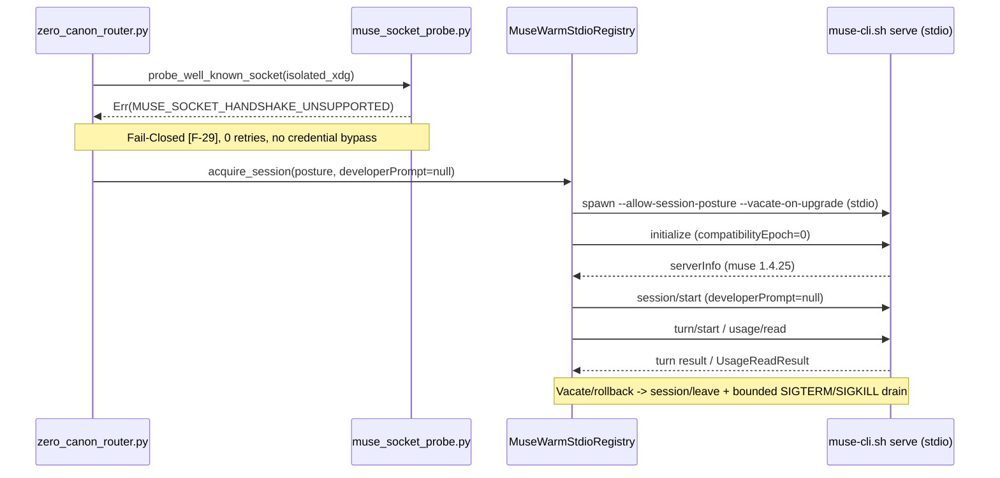
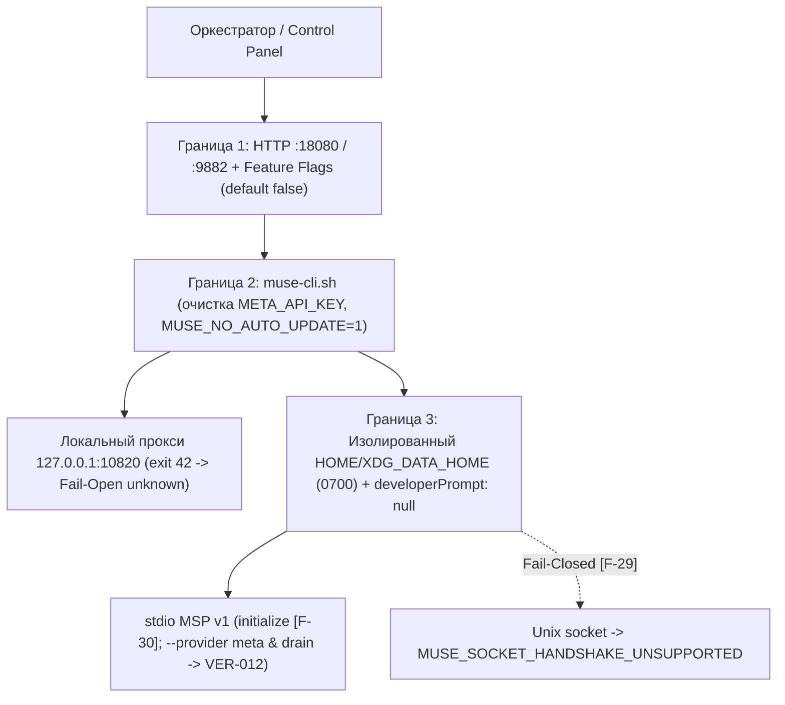

# ADR-0028: Интеграция возможностей Meta Muse 1.4.25-R9361.1 (`--output-schema`, `usage --json`, тёплый `stdio` MSP v1 и Fail-Closed проба Unix-сокета)

- **Статус:** Proposed (`DRAFT` -> `APPROVED` после ARL/Code Teamlead Council)
- **Дата:** 2026-11-23
- **Критичность:** S2 (`architect_profile: B`, `M-MOD/v1`)
- **Репозитории:** `cli-agent-bridge`, `control_panel`, `skils`
- **Наследует:** `ADR-0027` (`muse-stdio-resident-pool`)

## 1. Контекст и граница подтверждённых фактов

1. **REQ-001 (`muse exec --output-schema <FILE>`):** работает только с провайдером `meta` (`[F-05]`), требует `"additionalProperties": false` на каждом object-узле (иначе 400 `param schema`, `[F-32]`), выводит JSONL `schema_version: 1` (`[F-06]`), а `--no-session-log` пишет допустимое предупреждение в stderr при `exit 0` (`[F-07]`). По экспорту `msp.schema.json` (`[F-10]/[F-11]`, handoff аналитика) поле `outputSchema` встречается 0 раз — MSP не обслуживает REQ-001.
2. **REQ-002 (`muse usage --json`):** без модельного хода (`[F-02]`, `[F-04]`). Реальный вывод (`raw-poc/usage-json.out`):
   ```json
   {"schemaVersion":1,"allowance":{"tier":"Muse Code Max Usage","window":{"usedPercent":34,"resetsAtMs":1795446181000},"weekly":{"usedPercent":24,"resetsAtMs":1795996800000},"asOfMs":1795436896748,"source":"mint"},"reason":null,"hint":null}
   ```
   TTL кэша `30s` (env `MUSE_USAGE_CACHE_TTL_S`) — **параметр дизайна по умолчанию** (`ASM-004`), а не измеренный факт стенда.
3. **REQ-003 (`muse serve`):**
   - **Подтверждено стендом:**
     - `[F-03]` все запуски идут строго через `/Users/aazhiry1/.config/muse-launch/muse-cli.sh` (очистка `META_API_KEY`, прокси `127.0.0.1:10820`, `exit 42`, `MUSE_NO_AUTO_UPDATE=1`).
     - `[F-08]`, `[F-27]`, `[F-28]`, `[F-29]`, `[F-33]` `--listen unix:/tmp/...` отклоняется `exit 2`; изолированный `HOME+XDG_DATA_HOME` создаёт сокет `0600` в каталоге `0700`; Unix-сокет отклоняет голый `initialize` ответом `{"museClientCredential":"rejected"}` (недокументированный handshake — обход запрещён).
     - `[F-31]` `SIGTERM` чисто завершает **демон `--listen`** в изолированном `HOME` и удаляет сокет.
     - `[F-30]` `muse serve` по `stdio` с `--provider echo` принимает newline-JSON `initialize` без credential handshake (`serverInfo: muse 1.4.25`).
   - **Требует живой проверки до включения флага (`ASM-005`, `ASM-007`, гейт `VER-012`):** поведение `stdio` с `--provider meta`, `session/start` (`developerPrompt: null`), `usage/read` и чистый `SIGTERM` drain при `--vacate-on-upgrade`.

## 2. Архитектурные решения (`AD-001`..`AD-006`)

| ID | Тип | Суть решения | Фичефлаг (дефолт `false`) |
|---|---|---|---|
| `AD-001` | `inherited` | Наследование `ADR-0027`, запуск строго через `muse-cli.sh`, `adapters/stdio_drivers/muse_driver.py` не изменяется (`delta = 0`). | — |
| `AD-002` | `two-way` | `muse_output_schema.py` и `seat_output_schema.py` (`<=200` строк): рекурсивный `additionalProperties: false`, клиентская валидация JSONL, строго `exec` для `provider=='meta'`. | `MUSE_OUTPUT_SCHEMA_ENABLED` |
| `AD-003` | `two-way` | `MuseUsageClient` (`<=220`), `MuseUsageCollector` (`<=200`), `MuseUsageProbe` (`<=200`): single-flight + design-default TTL `30s` от `allowance.asOfMs`, Fail-Open (`unknown`) при ошибках/exit 42, Fail-Closed (`exhausted`/`DEAD`, `reset_at=resetsAtMs//1000`) при `usedPercent>=100`. | `MUSE_USAGE_PREFLIGHT_ENABLED`, `MUSE_USAGE_ROUTER_ENABLED`, `MUSE_USAGE_CP_ENABLED` |
| `AD-004` | `two-way` | Fail-Closed `muse_socket_probe.py` (`<=180`, `MUSE_SOCKET_HANDSHAKE_UNSUPPORTED`, 0 ретраев/обходов) + `MuseWarmStdioRegistry` (`<=240`, `stdio` MSP v1). Включение флага после живого `VER-012`. | `MUSE_UNIX_SOCKET_PROBE_ENABLED`, `MUSE_WARM_MSP_STDIO_ENABLED` |
| `AD-005` | `two-way` | `M-MOD/v1`: жёсткий кап `300`; untouched монолиты (`delta=0`), `http_post_routing.py` (`303->300`, `delta<=-3`), near-ceiling `telemetry_server.py`/`seat_zero_canon.py` (`<=299`, вставка `<=3` строк со сжатием), новые модули `<=240`. | — |
| `AD-006` | `two-way` | 6 независимых GigaRC/env флагов с дефолтом `false` для поэтапного rollout и мгновенного kill-switch. | Все 6 флагов |

## 3. Архитектурные представления

### <a id="component-view"></a>Component View (`VIEW-001`)



### <a id="dynamic-view"></a>Dynamic View (`VIEW-002`)



### <a id="trust-boundary-dfd"></a>Trust Boundary DFD (`VIEW-003`)



## 4. Модульность (`M-MOD/v1`) и канонические бюджеты

- **Untouched замороженные baseline-монолиты (`delta = 0`):** `server.py`, `adapters/stdio_drivers/muse_driver.py` (341), `answer-review-loop/scripts/answer_review_loop.py`, `ai-sdlc/universal/teamlead-gate/scripts/launch_seat.py` (1689), `seat_zero_profile.py` (302).
- **Baseline-монолит с фасадным сжатием:** `core/http_post_routing.py` (`303 -> <=300`, `delta <= -3`, фасад `<=5` строк).
- **Near-ceiling не-монолиты (жёсткий кап `300`, бюджет `299`, вставка `<=3` строк со сжатием):** `control_panel/telemetry_server.py` (299), `ai-sdlc/universal/teamlead-gate/scripts/seat_zero_canon.py` (297).
- **Единственные владельцы состояния (`M-MOD-I4`):** `MuseUsageClient`, `MuseWarmStdioRegistry`, `MuseUsageCollector`, `MuseUsageProbe`.

## 5. Rollout, Rollback и отложенные работы

- **Rollout:** тёмный деплой (`false`) -> `REQ-001` (`VER-001..002`) -> `REQ-002` (`VER-003..006`) -> `REQ-003` (`VER-007..011` + обязательный живой smoke `VER-012` для подтверждения `ASM-005`/`ASM-007`).
- **Rollback:** мгновенный сброс флага в `false`; `MuseWarmStdioRegistry` выполняет bounded `SIGTERM->SIGKILL` drain.
- **Отложено (`deferred`):** прямой Python MSP-клиент к Unix-сокету до публикации спецификации `museClientCredential` в `msp.schema.json` (`[F-29]`).
